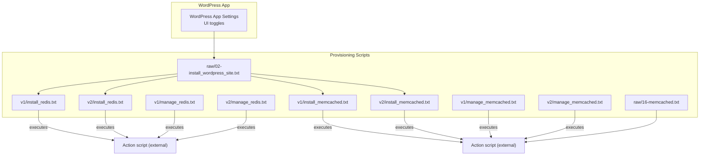
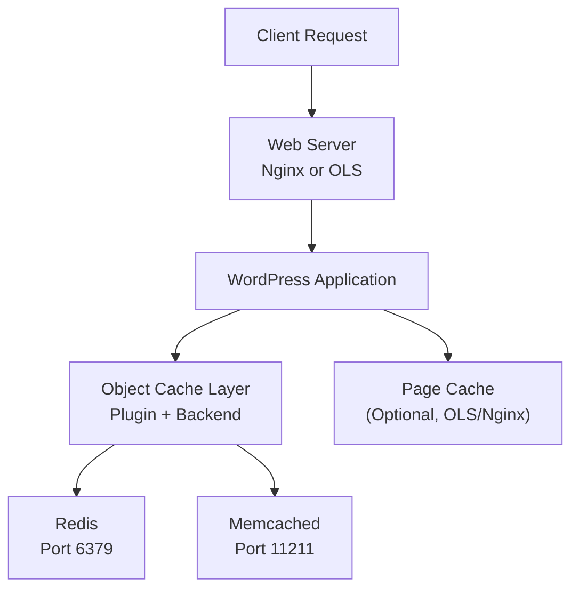
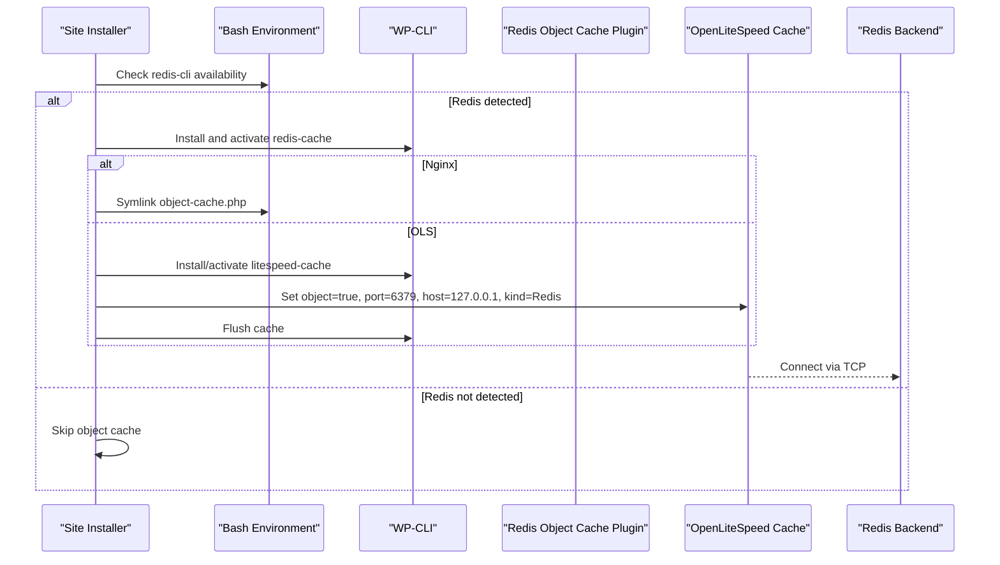
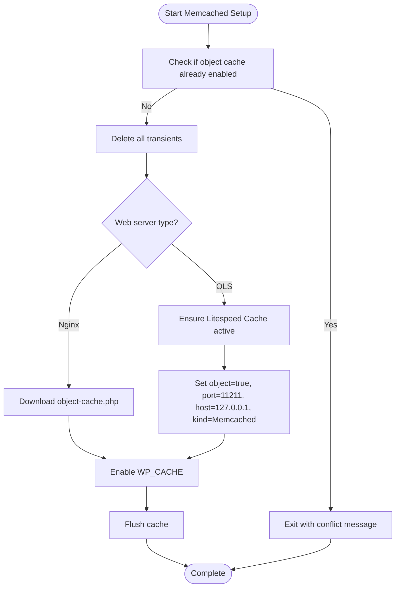
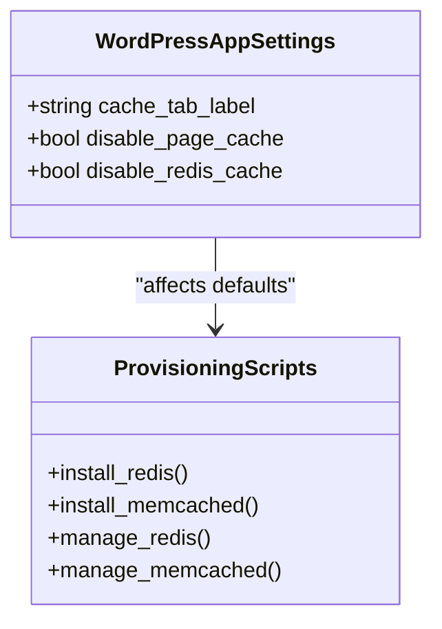
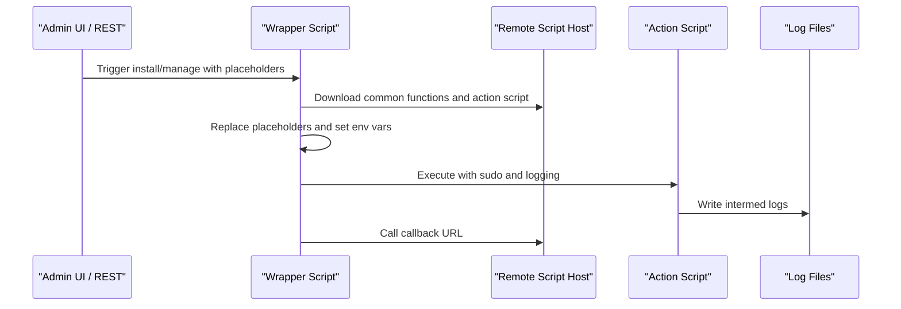
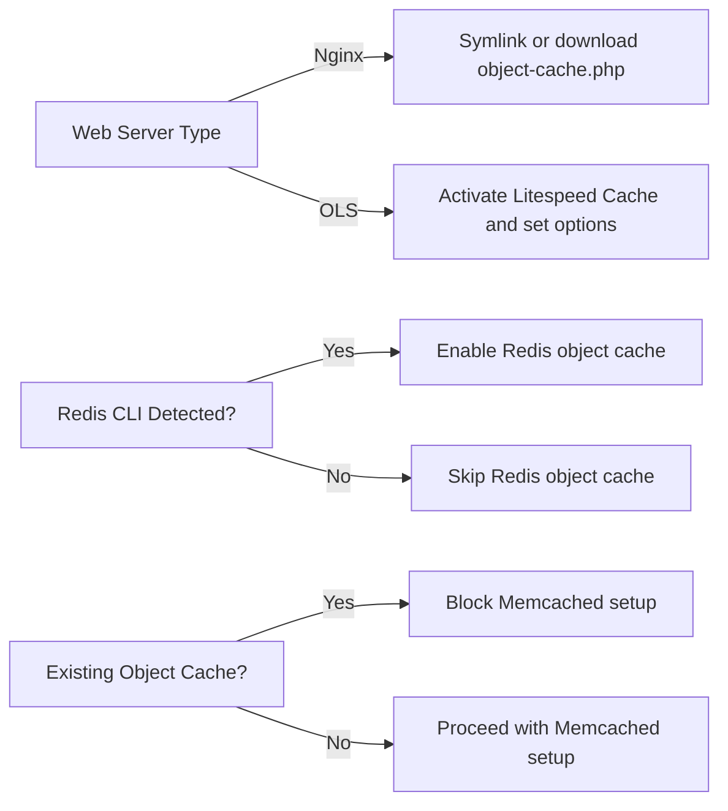

# Caching Systems

<cite>
**Referenced Files in This Document**
- [SIMPLESTACK.md](file://docs/SIMPLESTACK.md)
- [class-wordpress-app-settings.php](file://includes/core/apps/wordpress-app/class-wordpress-app-settings.php)
- [install_redis.txt](file://includes/core/apps/wordpress-app/scripts/v1/install_redis.txt)
- [install_memcached.txt](file://includes/core/apps/wordpress-app/scripts/v1/install_memcached.txt)
- [manage_redis.txt](file://includes/core/apps/wordpress-app/scripts/v1/manage_redis.txt)
- [manage_memcached.txt](file://includes/core/apps/wordpress-app/scripts/v1/manage_memcached.txt)
- [install_redis_v2.txt](file://includes/core/apps/wordpress-app/scripts/v2/install_redis.txt)
- [install_memcached_v2.txt](file://includes/core/apps/wordpress-app/scripts/v2/install_memcached.txt)
- [manage_redis_v2.txt](file://includes/core/apps/wordpress-app/scripts/v2/manage_redis.txt)
- [manage_memcached_v2.txt](file://includes/core/apps/wordpress-app/scripts/v2/manage_memcached.txt)
- [02-install_wordpress_site.txt](file://includes/core/apps/wordpress-app/scripts/v1/raw/02-install_wordpress_site.txt)
- [16-memcached.txt](file://includes/core/apps/wordpress-app/scripts/v1/raw/16-memcached.txt)
</cite>

## Table of Contents
1. [Introduction](#introduction)
2. [Project Structure](#project-structure)
3. [Core Components](#core-components)
4. [Architecture Overview](#architecture-overview)
5. [Detailed Component Analysis](#detailed-component-analysis)
6. [Dependency Analysis](#dependency-analysis)
7. [Performance Considerations](#performance-considerations)
8. [Troubleshooting Guide](#troubleshooting-guide)
9. [Conclusion](#conclusion)
10. [Appendices](#appendices)

## Introduction
This document explains SimpleStack’s caching systems for WordPress sites, focusing on Redis and Memcached installation, configuration, and management through the provided provisioning scripts. It covers:
- How object caching is enabled during site installation
- Differences between Nginx and OpenLiteSpeed (OLS) paths
- Script-based installation and management workflows
- Practical guidance for cache hierarchy, tuning, monitoring, invalidation, persistence, replication, and disaster recovery

The repository implements a WordPress hosting control plane where site provisioning scripts install and configure caching layers automatically when available.

**Section sources**
- [SIMPLESTACK.md:15-32](file://docs/SIMPLESTACK.md#L15-L32)

## Project Structure
SimpleStack provisions WordPress sites using script templates under `includes/core/apps/wordpress-app/scripts/`. Two versions coexist:
- v1: upstream-compatible scripts
- v2: SimpleStack-modified scripts

Caching-related files include:
- Installation wrappers that download and execute action scripts
- Raw scripts that perform actual installation and configuration
- WordPress app settings that expose UI toggles for page cache and Redis object cache

**Diagram sources**
- [class-wordpress-app-settings.php:1486-1496](file://includes/core/apps/wordpress-app/class-wordpress-app-settings.php#L1486-L1496)
- [install_redis.txt:1-11](file://includes/core/apps/wordpress-app/scripts/v1/install_redis.txt#L1-L11)
- [install_memcached.txt:1-11](file://includes/core/apps/wordpress-app/scripts/v1/install_memcached.txt#L1-L11)
- [manage_redis.txt:1-9](file://includes/core/apps/wordpress-app/scripts/v1/manage_redis.txt#L1-L9)
- [manage_memcached.txt:1-9](file://includes/core/apps/wordpress-app/scripts/v1/manage_memcached.txt#L1-L9)
- [install_redis_v2.txt:1-11](file://includes/core/apps/wordpress-app/scripts/v2/install_redis.txt#L1-L11)
- [install_memcached_v2.txt:1-11](file://includes/core/apps/wordpress-app/scripts/v2/install_memcached.txt#L1-L11)
- [manage_redis_v2.txt:1-9](file://includes/core/apps/wordpress-app/scripts/v2/manage_redis.txt#L1-L9)
- [manage_memcached_v2.txt:1-9](file://includes/core/apps/wordpress-app/scripts/v2/manage_memcached.txt#L1-L9)
- [02-install_wordpress_site.txt:186-215](file://includes/core/apps/wordpress-app/scripts/v1/raw/02-install_wordpress_site.txt#L186-L215)
- [16-memcached.txt:88-120](file://includes/core/apps/wordpress-app/scripts/v1/raw/16-memcached.txt#L88-L120)

**Section sources**
- [SIMPLESTACK.md:152-177](file://docs/SIMPLESTACK.md#L152-L177)

## Core Components
- WordPress App Settings: Exposes UI options to disable automatic page cache and Redis object cache for new sites.
- Provisioning Scripts:
  - Installation wrappers (v1 and v2) fetch and run action scripts with placeholders like `##ACTION##`, `##SCRIPT_URL##`, and `##CALLBACK_URL##`.
  - Management wrappers accept `action` and `domain` parameters to manage existing caches.
- Raw Site Installation Script: Installs Redis object cache plugins and configures OLS or Nginx accordingly.
- Raw Memcached Script: Installs Memcached integration and sets up object-cache.php or Litespeed Cache configuration.

Key responsibilities:
- Detect web server type (Nginx vs OLS)
- Install and activate appropriate WordPress plugins
- Configure object cache host/port/kind
- Ensure WP_CACHE is enabled where required
- Handle conflicts when an object cache is already active

**Section sources**
- [class-wordpress-app-settings.php:1486-1496](file://includes/core/apps/wordpress-app/class-wordpress-app-settings.php#L1486-L1496)
- [install_redis.txt:1-11](file://includes/core/apps/wordpress-app/scripts/v1/install_redis.txt#L1-L11)
- [install_memcached.txt:1-11](file://includes/core/apps/wordpress-app/scripts/v1/install_memcached.txt#L1-L11)
- [manage_redis.txt:1-9](file://includes/core/apps/wordpress-app/scripts/v1/manage_redis.txt#L1-L9)
- [manage_memcached.txt:1-9](file://includes/core/apps/wordpress-app/scripts/v1/manage_memcached.txt#L1-L9)
- [02-install_wordpress_site.txt:186-215](file://includes/core/apps/wordpress-app/scripts/v1/raw/02-install_wordpress_site.txt#L186-L215)
- [16-memcached.txt:88-120](file://includes/core/apps/wordpress-app/scripts/v1/raw/16-memcached.txt#L88-L120)

## Architecture Overview
The caching architecture integrates three layers:
- Application layer: WordPress with object caching plugin(s)
- Cache backends: Redis (port 6379) and Memcached (port 11211)
- Web server: Nginx or OpenLiteSpeed (OLS), which may also provide page caching

**Diagram sources**
- [02-install_wordpress_site.txt:186-215](file://includes/core/apps/wordpress-app/scripts/v1/raw/02-install_wordpress_site.txt#L186-L215)
- [16-memcached.txt:88-120](file://includes/core/apps/wordpress-app/scripts/v1/raw/16-memcached.txt#L88-L120)

## Detailed Component Analysis

### Redis Object Caching
Behavior during site installation:
- If Redis CLI is present, the script installs and activates the Redis object cache plugin.
- For Nginx, it symlinks the plugin’s object-cache.php into wp-content.
- For OLS, it ensures Litespeed Cache is installed and active, then sets object cache options:
  - Host: 127.0.0.1
  - Port: 6379
  - Kind: Redis
- After configuration, it flushes the cache.

**Diagram sources**
- [02-install_wordpress_site.txt:186-215](file://includes/core/apps/wordpress-app/scripts/v1/raw/02-install_wordpress_site.txt#L186-L215)

**Section sources**
- [02-install_wordpress_site.txt:186-215](file://includes/core/apps/wordpress-app/scripts/v1/raw/02-install_wordpress_site.txt#L186-L215)

### Memcached Object Caching
Behavior during site installation:
- The script checks whether an object cache is already enabled; if so, it exits to avoid conflicts.
- It deletes all transients to reduce options table size (important due to Memcached object size limits).
- For Nginx, it downloads Automattic’s object-cache.php into wp-content.
- For OLS, it ensures Litespeed Cache is installed and active, sets object cache options:
  - Host: 127.0.0.1
  - Port: 11211
  - Kind: Memcached
- It enables WP_CACHE and flushes the cache.

**Diagram sources**
- [16-memcached.txt:88-120](file://includes/core/apps/wordpress-app/scripts/v1/raw/16-memcached.txt#L88-L120)

**Section sources**
- [16-memcached.txt:88-120](file://includes/core/apps/wordpress-app/scripts/v1/raw/16-memcached.txt#L88-L120)

### WordPress App Settings Integration
The WordPress application exposes UI controls that affect caching behavior:
- Disable automatic page cache for new sites
- Disable automatic Redis object cache for new sites

These settings influence provisioning defaults but do not override runtime backend configuration performed by the raw scripts.

**Diagram sources**
- [class-wordpress-app-settings.php:1486-1496](file://includes/core/apps/wordpress-app/class-wordpress-app-settings.php#L1486-L1496)

**Section sources**
- [class-wordpress-app-settings.php:1486-1496](file://includes/core/apps/wordpress-app/class-wordpress-app-settings.php#L1486-L1496)

### Script Wrappers and Execution Model
Both v1 and v2 use wrapper scripts to:
- Download common functions and action scripts from remote URLs
- Substitute placeholders (`##ACTION##`, `##SCRIPT_URL##`, `##DOMAIN##`, etc.)
- Execute the action script with elevated privileges and log output
- Notify a callback URL upon completion

**Diagram sources**
- [install_redis.txt:1-11](file://includes/core/apps/wordpress-app/scripts/v1/install_redis.txt#L1-L11)
- [install_memcached.txt:1-11](file://includes/core/apps/wordpress-app/scripts/v1/install_memcached.txt#L1-L11)
- [manage_redis.txt:1-9](file://includes/core/apps/wordpress-app/scripts/v1/manage_redis.txt#L1-L9)
- [manage_memcached.txt:1-9](file://includes/core/apps/wordpress-app/scripts/v1/manage_memcached.txt#L1-L9)
- [install_redis_v2.txt:1-11](file://includes/core/apps/wordpress-app/scripts/v2/install_redis.txt#L1-L11)
- [install_memcached_v2.txt:1-11](file://includes/core/apps/wordpress-app/scripts/v2/install_memcached.txt#L1-L11)
- [manage_redis_v2.txt:1-9](file://includes/core/apps/wordpress-app/scripts/v2/manage_redis.txt#L1-L9)
- [manage_memcached_v2.txt:1-9](file://includes/core/apps/wordpress-app/scripts/v2/manage_memcached.txt#L1-L9)

**Section sources**
- [install_redis.txt:1-11](file://includes/core/apps/wordpress-app/scripts/v1/install_redis.txt#L1-L11)
- [install_memcached.txt:1-11](file://includes/core/apps/wordpress-app/scripts/v1/install_memcached.txt#L1-L11)
- [manage_redis.txt:1-9](file://includes/core/apps/wordpress-app/scripts/v1/manage_redis.txt#L1-L9)
- [manage_memcached.txt:1-9](file://includes/core/apps/wordpress-app/scripts/v1/manage_memcached.txt#L1-L9)
- [install_redis_v2.txt:1-11](file://includes/core/apps/wordpress-app/scripts/v2/install_redis.txt#L1-L11)
- [install_memcached_v2.txt:1-11](file://includes/core/apps/wordpress-app/scripts/v2/install_memcached.txt#L1-L11)
- [manage_redis_v2.txt:1-9](file://includes/core/apps/wordpress-app/scripts/v2/manage_redis.txt#L1-L9)
- [manage_memcached_v2.txt:1-9](file://includes/core/apps/wordpress-app/scripts/v2/manage_memcached.txt#L1-L9)

## Dependency Analysis
- Web server detection determines the path taken:
  - Nginx: symlink object-cache.php or download Automattic’s object-cache.php
  - OLS: ensure Litespeed Cache plugin is active and configure object cache options
- Redis presence is checked before enabling Redis object caching
- Memcached setup requires no pre-existing object cache and reduces transient sizes to respect Memcached object size limits

**Diagram sources**
- [02-install_wordpress_site.txt:186-215](file://includes/core/apps/wordpress-app/scripts/v1/raw/02-install_wordpress_site.txt#L186-L215)
- [16-memcached.txt:88-120](file://includes/core/apps/wordpress-app/scripts/v1/raw/16-memcached.txt#L88-L120)

**Section sources**
- [02-install_wordpress_site.txt:186-215](file://includes/core/apps/wordpress-app/scripts/v1/raw/02-install_wordpress_site.txt#L186-L215)
- [16-memcached.txt:88-120](file://includes/core/apps/wordpress-app/scripts/v1/raw/16-memcached.txt#L88-L120)

## Performance Considerations
- Object cache selection:
  - Redis supports larger objects and richer data structures; suitable for complex query caching and session storage.
  - Memcached has a strict per-object size limit; the script explicitly deletes transients to keep the options table small.
- Web server page caching:
  - OLS can be configured to enable page caching alongside object caching.
- Memory allocation and tuning:
  - Tune Redis memory limits and eviction policies according to workload.
  - Tune Memcached max memory and item size limits to accommodate WordPress object sizes.
- Cache warming:
  - Pre-warm popular pages and critical queries after deployment to improve first-hit performance.
- Invalidation policies:
  - Use plugin-provided cache flush operations after content updates.
  - Implement tag-based invalidation where supported by your caching stack.

[No sources needed since this section provides general guidance]

## Troubleshooting Guide
Common issues and resolutions:
- Conflict when enabling Memcached:
  - Symptom: Script exits because an object cache is already enabled.
  - Resolution: Disable the existing object cache before enabling Memcached.
- Redis not detected:
  - Symptom: Object cache was not enabled for the domain.
  - Resolution: Install Redis and redis-cli, then re-run site installation or cache management actions.
- OLS object cache not active:
  - Symptom: Litespeed Cache not installed or not active.
  - Resolution: Allow the script to install and activate Litespeed Cache, then verify object cache options are set correctly.
- Transient size causing Memcached failures:
  - Symptom: Large options table exceeds Memcached object size limits.
  - Resolution: Delete all transients before enabling Memcached; the script performs this step automatically.

Operational tips:
- Monitor cache hit rates using Redis INFO and Memcached stats.
- Verify object-cache.php presence and permissions for Nginx deployments.
- Confirm WP_CACHE is enabled and object cache options match your backend.

**Section sources**
- [16-memcached.txt:88-120](file://includes/core/apps/wordpress-app/scripts/v1/raw/16-memcached.txt#L88-L120)
- [02-install_wordpress_site.txt:186-215](file://includes/core/apps/wordpress-app/scripts/v1/raw/02-install_wordpress_site.txt#L186-L215)

## Conclusion
SimpleStack automates the installation and configuration of Redis and Memcached object caching for WordPress sites, adapting to Nginx and OpenLiteSpeed environments. The system enforces safe defaults, avoids conflicts, and leverages Litespeed Cache for OLS deployments. Administrators should monitor cache performance, tune backend memory settings, and apply consistent invalidation policies to maintain optimal performance.

[No sources needed since this section summarizes without analyzing specific files]

## Appendices

### A. Configuration Summary
- Redis object cache:
  - Host: 127.0.0.1
  - Port: 6379
  - Kind: Redis
- Memcached object cache:
  - Host: 127.0.0.1
  - Port: 11211
  - Kind: Memcached
- Web server:
  - Nginx: symlink or download object-cache.php
  - OLS: activate Litespeed Cache and set object cache options

**Section sources**
- [02-install_wordpress_site.txt:186-215](file://includes/core/apps/wordpress-app/scripts/v1/raw/02-install_wordpress_site.txt#L186-L215)
- [16-memcached.txt:88-120](file://includes/core/apps/wordpress-app/scripts/v1/raw/16-memcached.txt#L88-L120)

### B. Disaster Recovery Procedures
- Backup Redis data using RDB snapshots and AOF persistence; restore on failure.
- Back up Memcached configurations and warm caches post-recovery.
- Validate object-cache.php presence and permissions after restoration.
- Re-run cache management actions to ensure correct plugin activation and options.

[No sources needed since this section provides general guidance]