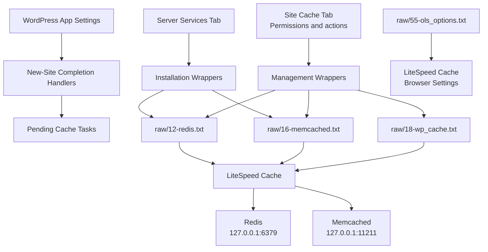
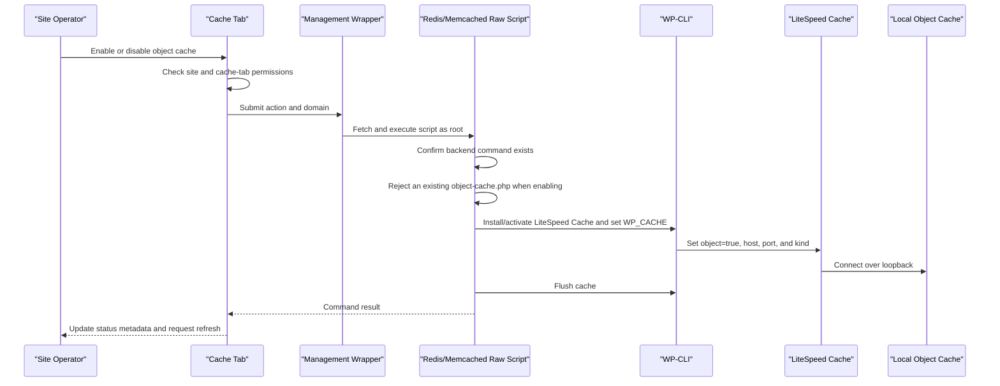
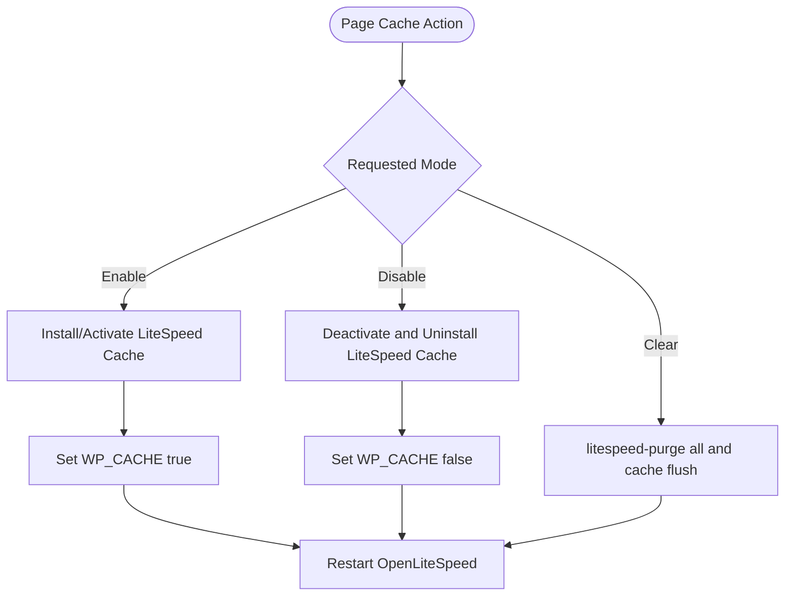
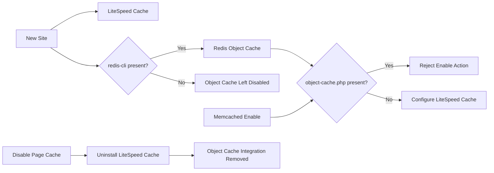

# Caching Systems

<cite>
**Referenced Files in This Document**
- [docs/SIMPLESTACK.md](file://docs/SIMPLESTACK.md)
- [class-wordpress-app-settings.php](file://includes/core/apps/wordpress-app/class-wordpress-app-settings.php)
- [class-wordpress-app.php](file://includes/core/apps/wordpress-app/class-wordpress-app.php)
- [cache.php](file://includes/core/apps/wordpress-app/tabs/cache.php)
- [02-install_wordpress_site.txt](file://includes/core/apps/wordpress-app/scripts/v2/raw/02-install_wordpress_site.txt)
- [12-redis.txt](file://includes/core/apps/wordpress-app/scripts/v2/raw/12-redis.txt)
- [16-memcached.txt](file://includes/core/apps/wordpress-app/scripts/v2/raw/16-memcached.txt)
- [18-wp_cache.txt](file://includes/core/apps/wordpress-app/scripts/v2/raw/18-wp_cache.txt)
- [55-ols_options.txt](file://includes/core/apps/wordpress-app/scripts/v2/raw/55-ols_options.txt)
- [install_redis.txt](file://includes/core/apps/wordpress-app/scripts/v2/install_redis.txt)
- [manage_redis.txt](file://includes/core/apps/wordpress-app/scripts/v2/manage_redis.txt)
- [install_memcached.txt](file://includes/core/apps/wordpress-app/scripts/v2/install_memcached.txt)
- [manage_memcached.txt](file://includes/core/apps/wordpress-app/scripts/v2/manage_memcached.txt)
- [manage_pagecache.txt](file://includes/core/apps/wordpress-app/scripts/v2/manage_pagecache.txt)
</cite>

## Table of Contents
1. [Introduction](#introduction)
2. [Project Structure](#project-structure)
3. [Core Components](#core-components)
4. [Architecture Overview](#architecture-overview)
5. [Detailed Component Analysis](#detailed-component-analysis)
6. [Dependency Analysis](#dependency-analysis)
7. [Performance Considerations](#performance-considerations)
8. [Troubleshooting Guide](#troubleshooting-guide)
9. [Conclusion](#conclusion)
10. [Appendices](#appendices)

## Introduction

Simple Stack installs LiteSpeed Cache on new WordPress sites and can use either Redis or Memcached as its object-cache backend. The web server is OpenLiteSpeed, and every cache installation or management command uses the fixed `scripts/v2/` provisioning tree.

The implementation separates four operations:

- LiteSpeed Cache installation, removal, and page-cache purging.
- Redis installation and per-site object-cache configuration.
- Memcached installation and per-site object-cache configuration.
- LiteSpeed Cache browser-cache settings for a site.

Redis and Memcached are alternatives for a site's object cache. Both are addressed on the server loopback interface, and both are configured through LiteSpeed Cache rather than a separate web-server-specific plugin path.

**Section sources**
- [02-install_wordpress_site.txt:148-180](file://includes/core/apps/wordpress-app/scripts/v2/raw/02-install_wordpress_site.txt#L148-L180)
- [12-redis.txt:79-169](file://includes/core/apps/wordpress-app/scripts/v2/raw/12-redis.txt#L79-L169)
- [16-memcached.txt:65-171](file://includes/core/apps/wordpress-app/scripts/v2/raw/16-memcached.txt#L65-L171)

## Project Structure

| Layer | Responsibility | Key Files |
|---|---|---|
| WordPress App settings | Defines post-install options to disable page cache or Redis object cache for new sites | `class-wordpress-app-settings.php` |
| Site cache tab | Checks site/team permissions and dispatches page-cache, Redis, and Memcached actions | `tabs/cache.php` |
| New-site installer | Enables `WP_CACHE`, installs LiteSpeed Cache, and enables Redis when detected | `raw/02-install_wordpress_site.txt` |
| Backend installers | Install/remove Redis or Memcached and install matching LSPHP extensions | `raw/12-redis.txt`, `raw/16-memcached.txt` |
| Page-cache manager | Installs, removes, or purges LiteSpeed Cache | `raw/18-wp_cache.txt` |
| OLS options | Controls LiteSpeed Cache browser caching and related OpenLiteSpeed settings | `raw/55-ols_options.txt` |
| Wrappers | Fetch common/action scripts, substitute parameters, and execute the selected operation | `install_*.txt`, `manage_*.txt` |



**Diagram sources**
- [class-wordpress-app.php:3024-3048](file://includes/core/apps/wordpress-app/class-wordpress-app.php#L3024-L3048)
- [cache.php:112-168](file://includes/core/apps/wordpress-app/tabs/cache.php#L112-L168)
- [install_redis.txt:1-11](file://includes/core/apps/wordpress-app/scripts/v2/install_redis.txt#L1-L11)
- [manage_memcached.txt:1-9](file://includes/core/apps/wordpress-app/scripts/v2/manage_memcached.txt#L1-L9)

## Core Components

### New-Site Defaults

The site installation script:

1. Sets `WP_CACHE` to `true`.
2. Installs and activates LiteSpeed Cache.
3. Runs `wp litespeed-online init`.
4. Checks for `redis-cli`.
5. If Redis is present, configures LiteSpeed Cache object caching on `127.0.0.1:6379` with `object-kind 1` and flushes the cache.
6. If Redis is absent, leaves object caching disabled and reports that Redis was not detected.

**Section sources**
- [02-install_wordpress_site.txt:148-180](file://includes/core/apps/wordpress-app/scripts/v2/raw/02-install_wordpress_site.txt#L148-L180)

### Site Cache Tab

`SSTK_WORDPRESS_TABS_CACHE` exposes page-cache, Redis, and Memcached controls. It verifies that the current user can view the site and passes the cache tab's team/admin-lock checks before dispatching actions.

Supported actions are:

- `site-toggle-redis`
- `site-toggle-redis-local-value`
- `site-toggle-memcached`
- `site-toggle-memcached-local-value`
- `site-toggle-pagecache`
- `site-clear-pagecache`

The `local-value` actions only change Simple Stack's stored status metadata. They do not change the remote server or WordPress configuration.

**Section sources**
- [cache.php:94-168](file://includes/core/apps/wordpress-app/tabs/cache.php#L94-L168)
- [cache.php:386-410](file://includes/core/apps/wordpress-app/tabs/cache.php#L386-L410)
- [cache.php:488-512](file://includes/core/apps/wordpress-app/tabs/cache.php#L488-L512)

### Redis and Memcached Services

Both raw service scripts support install, per-site enable, per-site disable, cache clear, restart, and removal.

The install actions also attempt to install the matching extension for every LSPHP version in the server's configured PHP version array. A missing extension is reported as a warning rather than aborting the service installation.

| Backend | Local Endpoint | LiteSpeed Cache `object-kind` |
|---|---|---|
| Redis | `127.0.0.1:6379` | `1` |
| Memcached | `127.0.0.1:11211` | `0` |

**Section sources**
- [12-redis.txt:37-76](file://includes/core/apps/wordpress-app/scripts/v2/raw/12-redis.txt#L37-L76)
- [16-memcached.txt:37-62](file://includes/core/apps/wordpress-app/scripts/v2/raw/16-memcached.txt#L37-L62)

## Architecture Overview



**Diagram sources**
- [cache.php:319-477](file://includes/core/apps/wordpress-app/tabs/cache.php#L319-L477)
- [manage_redis.txt:1-9](file://includes/core/apps/wordpress-app/scripts/v2/manage_redis.txt#L1-L9)
- [12-redis.txt:79-153](file://includes/core/apps/wordpress-app/scripts/v2/raw/12-redis.txt#L79-L153)
- [16-memcached.txt:65-142](file://includes/core/apps/wordpress-app/scripts/v2/raw/16-memcached.txt#L65-L142)

## Detailed Component Analysis

### Redis Object Caching

The Redis management script requires `redis-cli` before enabling or disabling a site. When enabling Redis, it:

- Rejects the operation if `wp-content/object-cache.php` already exists.
- Installs and activates LiteSpeed Cache if needed.
- Sets `WP_CACHE` to `true`.
- Sets LiteSpeed Cache object caching to `127.0.0.1:6379` with `object-kind 1`.
- Flushes the cache.

Disabling Redis sets LiteSpeed Cache's `object` option to `false` and flushes the cache. It does not remove the LiteSpeed Cache plugin.

The clear action runs `redis-cli FLUSHALL`. This clears every Redis database on the server, not only the selected WordPress site.

**Section sources**
- [12-redis.txt:79-169](file://includes/core/apps/wordpress-app/scripts/v2/raw/12-redis.txt#L79-L169)

### Memcached Object Caching

The Memcached enable action requires the `memcached` command. Before enabling it for a site, the script:

- Rejects the operation if `wp-content/object-cache.php` already exists.
- Deletes all WordPress transients to reduce the options-table object size.
- Installs and activates LiteSpeed Cache.
- Sets `WP_CACHE` to `true`.
- Sets object caching to `127.0.0.1:11211` with `object-kind 0`.
- Flushes the cache.

Disabling Memcached sets LiteSpeed Cache's `object` option to `false` and flushes the cache. The clear action sends `flush_all` to Memcached over loopback, which clears the Memcached server rather than only the selected site.

**Section sources**
- [16-memcached.txt:65-171](file://includes/core/apps/wordpress-app/scripts/v2/raw/16-memcached.txt#L65-L171)

### LiteSpeed Cache Page Caching

The page-cache manager installs or activates LiteSpeed Cache and enables `WP_CACHE` when page caching is turned on. Turning page caching off deactivates and uninstalls LiteSpeed Cache, sets `WP_CACHE` to `false`, and restarts OpenLiteSpeed.

Because Redis and Memcached object caching both use LiteSpeed Cache, removing that plugin also removes the active object-cache integration for the site. Operators should not treat the page-cache and object-cache controls as independent plugin lifecycles.

The clear action runs both `wp litespeed-purge all` and `wp cache flush`, then restarts OpenLiteSpeed.



**Section sources**
- [18-wp_cache.txt:44-100](file://includes/core/apps/wordpress-app/scripts/v2/raw/18-wp_cache.txt#L44-L100)
- [cache.php:180-307](file://includes/core/apps/wordpress-app/tabs/cache.php#L180-L307)

### Browser Caching

Browser caching is a separate LiteSpeed Cache option managed through the Tweaks workflow. The OpenLiteSpeed options script sets:

- `cache-browser 1` to enable browser caching.
- `cache-browser 0` to disable it.

This is distinct from Redis/Memcached object caching and from the page-cache purge operation.

**Section sources**
- [55-ols_options.txt:298-380](file://includes/core/apps/wordpress-app/scripts/v2/raw/55-ols_options.txt#L298-L380)

### New-Site Cache Settings

The WordPress App settings screen defines two options:

- `wordpress_app_sites_disable_page_cache`
- `wordpress_app_sites_disable_redis_cache`

When enabled, the corresponding new-site completion handler queues a pending task after installation. The cache tab's pending-task callbacks then run the existing page-cache or Redis action and record the task result. These options affect newly installed sites; they do not retroactively change existing sites.

**Section sources**
- [class-wordpress-app-settings.php:1449-1460](file://includes/core/apps/wordpress-app/class-wordpress-app-settings.php#L1449-L1460)
- [class-wordpress-app.php:3024-3048](file://includes/core/apps/wordpress-app/class-wordpress-app.php#L3024-L3048)
- [cache.php:967-1027](file://includes/core/apps/wordpress-app/tabs/cache.php#L967-L1027)

### Wrapper Execution and Trust Boundary

Installation wrappers download the common-functions file and selected action script, substitute placeholders, execute the action script as root, and move completed install logs into place. Installation wrappers also invoke the configured completion callback. Management wrappers execute the selected action synchronously with the supplied action and domain.

The wrappers currently use `wget --no-check-certificate`. Script URLs, transport, and downloaded content therefore form a privileged trust boundary and must be controlled and verified by the operator.

**Section sources**
- [install_redis.txt:1-11](file://includes/core/apps/wordpress-app/scripts/v2/install_redis.txt#L1-L11)
- [install_memcached.txt:1-11](file://includes/core/apps/wordpress-app/scripts/v2/install_memcached.txt#L1-L11)
- [manage_redis.txt:1-9](file://includes/core/apps/wordpress-app/scripts/v2/manage_redis.txt#L1-L9)
- [manage_memcached.txt:1-9](file://includes/core/apps/wordpress-app/scripts/v2/manage_memcached.txt#L1-L9)

## Dependency Analysis

- New-site Redis configuration requires `redis-cli` to be present before site installation.
- Per-site Redis and Memcached enable actions require the corresponding backend command on the server.
- Both backends require LiteSpeed Cache and `WP_CACHE` for the configured integration.
- The existing `object-cache.php` check prevents enabling either backend through these scripts when that drop-in is present. It does not detect every possible LiteSpeed Cache object-cache configuration.
- Memcached setup deletes all transients before changing the backend.
- Page-cache removal uninstalls the same plugin used by both object-cache backends.
- Browser caching is configured independently through LiteSpeed Cache options.



## Performance Considerations

- Redis is the only object backend enabled automatically during site installation, and only when `redis-cli` is already available.
- Memcached's item-size limit makes large option-table objects a concern. The script's transient deletion reduces that risk but does not replace capacity planning.
- Flushing Redis or Memcached affects all sites sharing that backend. Schedule server-wide flushes accordingly.
- Page-cache purges and backend flushes are different operations; use the action that matches the stale data being investigated.
- The scripts do not configure Redis replication, persistence policy, Memcached replication, or a multi-node cache cluster. Those are separate infrastructure decisions.
- Monitor backend memory, evictions, hit rates, connection failures, and PHP extension availability alongside WordPress response times.
- Reconfigure or warm caches deliberately after backend recovery; the scripts do not automate cache warming.

## Troubleshooting Guide

| Symptom | Checks |
|---|---|
| New site has no Redis object cache | Confirm `redis-cli` was installed before site installation and inspect the install log. |
| Redis/Memcached enable is rejected | Check for `wp-content/object-cache.php` and remove or migrate the existing drop-in before retrying. |
| Backend command not found | Confirm the service is installed, the expected CLI is on `PATH`, and the service is running. |
| LiteSpeed Cache cannot connect | Verify the loopback endpoint, service status, firewall rules, PHP extension, and `object-host`/`object-port` settings. |
| Object cache stops after disabling page cache | Reinstall LiteSpeed Cache and reapply the desired Redis or Memcached settings; page-cache disable uninstalls the shared plugin. |
| Cache clear affects other sites | Expected for `FLUSHALL` and Memcached `flush_all`; both are server-wide operations. |
| Memcached writes fail for large values | Inspect item sizes, the options table, transient usage, and Memcached memory/item limits. |
| Browser cache differs from page cache | Inspect LiteSpeed Cache `cache-browser` separately from page-cache and object-cache settings. |

Useful checks include:

```bash
systemctl status redis
systemctl status memcached
redis-cli ping
wp plugin status litespeed-cache
wp litespeed-option get object
wp litespeed-option get object-host
wp litespeed-option get object-port
wp litespeed-option get object-kind
```

**Section sources**
- [12-redis.txt:79-185](file://includes/core/apps/wordpress-app/scripts/v2/raw/12-redis.txt#L79-L185)
- [16-memcached.txt:65-172](file://includes/core/apps/wordpress-app/scripts/v2/raw/16-memcached.txt#L65-L172)
- [18-wp_cache.txt:44-100](file://includes/core/apps/wordpress-app/scripts/v2/raw/18-wp_cache.txt#L44-L100)

## Conclusion

Simple Stack uses LiteSpeed Cache as the common integration layer for page caching, browser caching, and optional Redis or Memcached object caching on OpenLiteSpeed. New sites enable Redis automatically only when its CLI is present; both backends can otherwise be managed through the fixed `scripts/v2/` wrappers and raw scripts. Operators must account for shared plugin lifecycle, server-wide cache flushes, and the privileged wrapper download boundary.

## Appendices

### A. Configuration Summary

| Setting | Redis | Memcached |
|---|---|---|
| Host | `127.0.0.1` | `127.0.0.1` |
| Port | `6379` | `11211` |
| `object-kind` | `1` | `0` |
| Required CLI | `redis-cli` | `memcached` |
| WordPress integration | LiteSpeed Cache | LiteSpeed Cache |
| Clear scope | All Redis databases | All Memcached items |

### B. Recovery Guidance

- Restore backend service health before flushing or warming caches.
- Confirm the required LSPHP extension is installed for every active PHP version.
- Reapply LiteSpeed Cache object settings after reinstalling the plugin.
- Treat cache contents as rebuildable unless an external persistence policy says otherwise.
- Use WordPress and application backups for recovery; the cache-management scripts are not a backup system.
