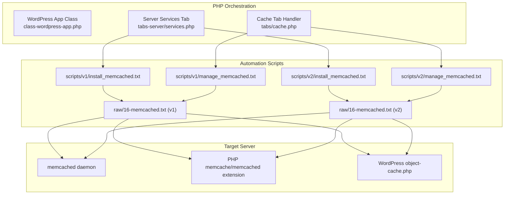
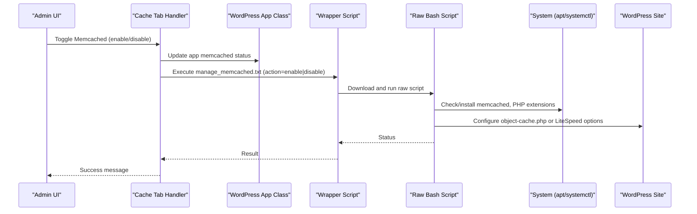
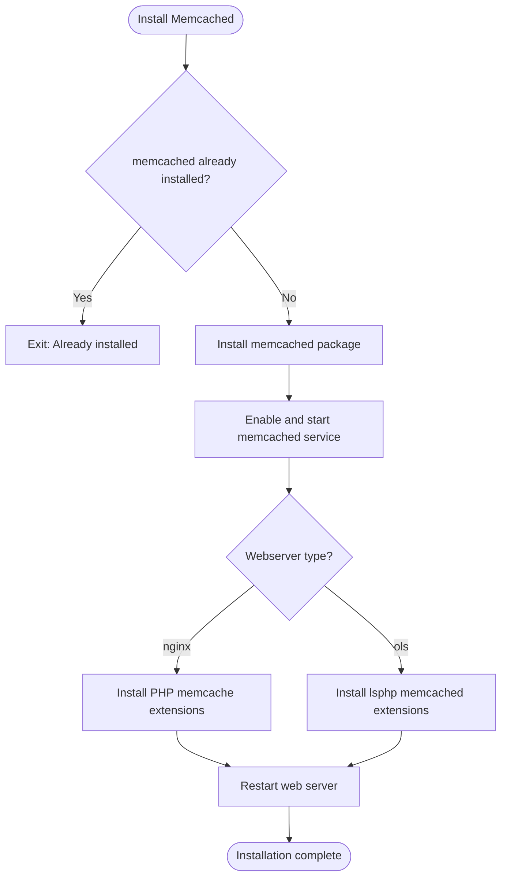
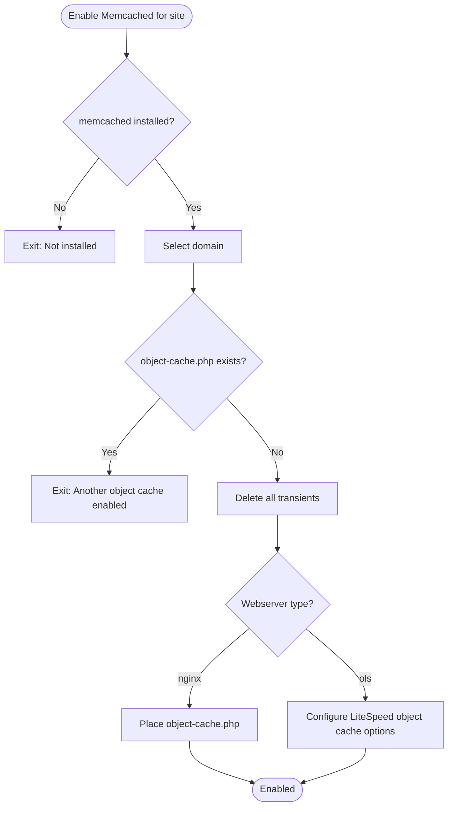
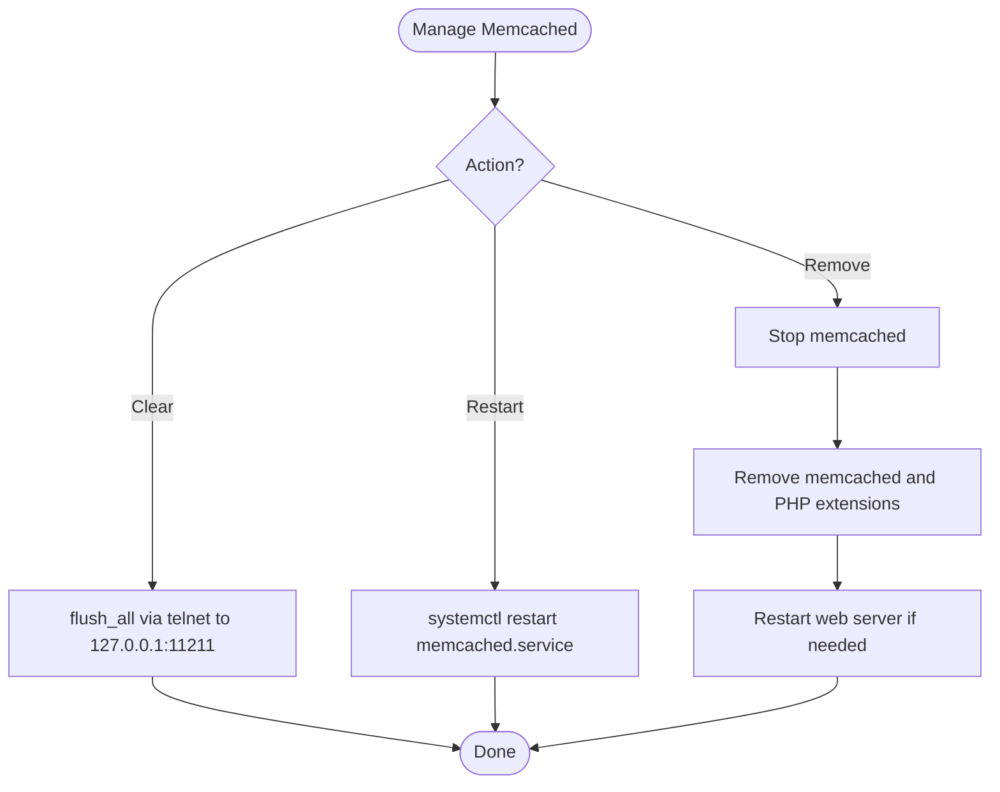
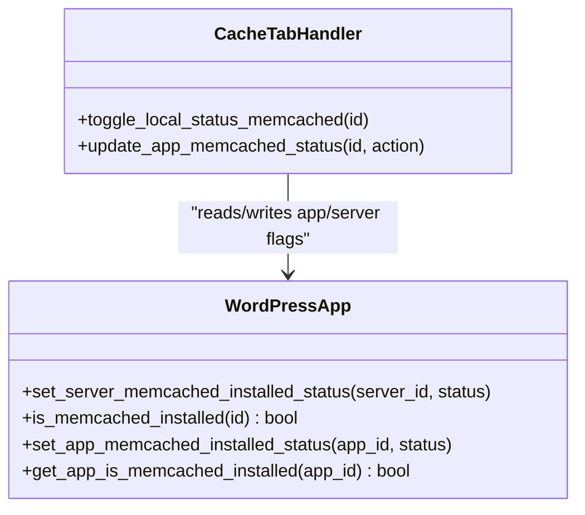
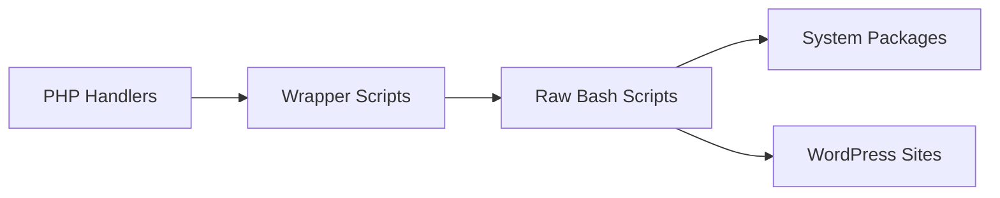

# Memcached Caching

<cite>
**Referenced Files in This Document**
- [class-wordpress-app.php](file://includes/core/apps/wordpress-app/class-wordpress-app.php)
- [cache.php](file://includes/core/apps/wordpress-app/tabs/cache.php)
- [services.php](file://includes/core/apps/wordpress-app/tabs-server/services.php)
- [16-memcached.txt (v1)](file://includes/core/apps/wordpress-app/scripts/v1/raw/16-memcached.txt)
- [16-memcached.txt (v2)](file://includes/core/apps/wordpress-app/scripts/v2/raw/16-memcached.txt)
- [install_memcached.txt (v1)](file://includes/core/apps/wordpress-app/scripts/v1/install_memcached.txt)
- [install_memcached.txt (v2)](file://includes/core/apps/wordpress-app/scripts/v2/install_memcached.txt)
- [manage_memcached.txt (v1)](file://includes/core/apps/wordpress-app/scripts/v1/manage_memcached.txt)
- [manage_memcached.txt (v2)](file://includes/core/apps/wordpress-app/scripts/v2/manage_memcached.txt)
</cite>

## Table of Contents
1. [Introduction](#introduction)
2. [Project Structure](#project-structure)
3. [Core Components](#core-components)
4. [Architecture Overview](#architecture-overview)
5. [Detailed Component Analysis](#detailed-component-analysis)
6. [Dependency Analysis](#dependency-analysis)
7. [Performance Considerations](#performance-considerations)
8. [Troubleshooting Guide](#troubleshooting-guide)
9. [Conclusion](#conclusion)

## Introduction
This document explains how Simple Stack installs, configures, and manages Memcached for WordPress applications. It covers:
- Installing the Memcached daemon and PHP extensions
- Enabling/disabling Memcached per site with WordPress object cache integration
- Managing the Memcached service (restart, clear, remove)
- Monitoring and performance tuning guidance
- Security considerations and troubleshooting steps

Simple Stack provides both server-level installation scripts and application-level toggles to enable or disable Memcached for individual sites.

## Project Structure
Memcached support is implemented across three layers:
- PHP orchestration layer that exposes UI actions and persists state
- Bash automation scripts that install/configure Memcached on the server
- Wrapper scripts that download and execute the automation scripts

**Diagram sources**
- [class-wordpress-app.php:4398-4463](file://includes/core/apps/wordpress-app/class-wordpress-app.php#L4398-L4463)
- [cache.php:465-514](file://includes/core/apps/wordpress-app/tabs/cache.php#L465-L514)
- [services.php:1717-1752](file://includes/core/apps/wordpress-app/tabs-server/services.php#L1717-L1752)
- [16-memcached.txt (v1):36-78](file://includes/core/apps/wordpress-app/scripts/v1/raw/16-memcached.txt#L36-L78)
- [16-memcached.txt (v2):36-78](file://includes/core/apps/wordpress-app/scripts/v2/raw/16-memcached.txt#L36-L78)
- [install_memcached.txt (v1):1-11](file://includes/core/apps/wordpress-app/scripts/v1/install_memcached.txt#L1-L11)
- [install_memcached.txt (v2):1-11](file://includes/core/apps/wordpress-app/scripts/v2/install_memcached.txt#L1-L11)
- [manage_memcached.txt (v1):1-9](file://includes/core/apps/wordpress-app/scripts/v1/manage_memcached.txt#L1-L9)
- [manage_memcached.txt (v2):1-9](file://includes/core/apps/wordpress-app/scripts/v2/manage_memcached.txt#L1-L9)

**Section sources**
- [class-wordpress-app.php:4398-4463](file://includes/core/apps/wordpress-app/class-wordpress-app.php#L4398-L4463)
- [cache.php:465-514](file://includes/core/apps/wordpress-app/tabs/cache.php#L465-L514)
- [services.php:1717-1752](file://includes/core/apps/wordpress-app/tabs-server/services.php#L1717-L1752)
- [16-memcached.txt (v1):36-78](file://includes/core/apps/wordpress-app/scripts/v1/raw/16-memcached.txt#L36-L78)
- [16-memcached.txt (v2):36-78](file://includes/core/apps/wordpress-app/scripts/v2/raw/16-memcached.txt#L36-L78)
- [install_memcached.txt (v1):1-11](file://includes/core/apps/wordpress-app/scripts/v1/install_memcached.txt#L1-L11)
- [install_memcached.txt (v2):1-11](file://includes/core/apps/wordpress-app/scripts/v2/install_memcached.txt#L1-L11)
- [manage_memcached.txt (v1):1-9](file://includes/core/apps/wordpress-app/scripts/v1/manage_memcached.txt#L1-L9)
- [manage_memcached.txt (v2):1-9](file://includes/core/apps/wordpress-app/scripts/v2/manage_memcached.txt#L1-L9)

## Core Components
- WordPress App class methods manage Memcached installation flags at server and app levels, and expose service status.
- Cache tab handler enables/disables Memcached for a site and updates local app state.
- Server services tab triggers Memcached installation via wrapper scripts.
- Raw bash scripts perform actual system operations: installing Memcached, enabling PHP extensions, configuring WordPress object cache, clearing/restarting/removing Memcached.

Key responsibilities:
- Installation: Install Memcached daemon and PHP extensions; restart web server as needed.
- Per-site enable/disable: Place/remove WordPress object cache file or configure LiteSpeed options.
- Service management: Clear cache, restart service, remove packages.
- State persistence: Track whether Memcached is installed on the server and enabled for an app.

**Section sources**
- [class-wordpress-app.php:4398-4463](file://includes/core/apps/wordpress-app/class-wordpress-app.php#L4398-L4463)
- [cache.php:465-514](file://includes/core/apps/wordpress-app/tabs/cache.php#L465-L514)
- [services.php:1717-1752](file://includes/core/apps/wordpress-app/tabs-server/services.php#L1717-L1752)
- [16-memcached.txt (v1):36-78](file://includes/core/apps/wordpress-app/scripts/v1/raw/16-memcached.txt#L36-L78)
- [16-memcached.txt (v2):36-78](file://includes/core/apps/wordpress-app/scripts/v2/raw/16-memcached.txt#L36-L78)

## Architecture Overview
The flow from UI action to server-side execution:

**Diagram sources**
- [cache.php:465-514](file://includes/core/apps/wordpress-app/tabs/cache.php#L465-L514)
- [class-wordpress-app.php:4444-4463](file://includes/core/apps/wordpress-app/class-wordpress-app.php#L4444-L4463)
- [manage_memcached.txt (v1):1-9](file://includes/core/apps/wordpress-app/scripts/v1/manage_memcached.txt#L1-L9)
- [manage_memcached.txt (v2):1-9](file://includes/core/apps/wordpress-app/scripts/v2/manage_memcached.txt#L1-L9)
- [16-memcached.txt (v1):81-134](file://includes/core/apps/wordpress-app/scripts/v1/raw/16-memcached.txt#L81-L134)
- [16-memcached.txt (v2):81-134](file://includes/core/apps/wordpress-app/scripts/v2/raw/16-memcached.txt#L81-L134)

## Detailed Component Analysis

### Memcached Installation Flow
- The server services tab invokes a wrapper script to install Memcached.
- The wrapper downloads and executes the raw script which:
  - Installs the Memcached package
  - Enables and starts the service
  - Installs PHP extensions appropriate for the web server type
  - Restarts the web server

**Diagram sources**
- [services.php:1717-1752](file://includes/core/apps/wordpress-app/tabs-server/services.php#L1717-L1752)
- [install_memcached.txt (v1):1-11](file://includes/core/apps/wordpress-app/scripts/v1/install_memcached.txt#L1-L11)
- [install_memcached.txt (v2):1-11](file://includes/core/apps/wordpress-app/scripts/v2/install_memcached.txt#L1-L11)
- [16-memcached.txt (v1):36-78](file://includes/core/apps/wordpress-app/scripts/v1/raw/16-memcached.txt#L36-L78)
- [16-memcached.txt (v2):36-78](file://includes/core/apps/wordpress-app/scripts/v2/raw/16-memcached.txt#L36-L78)

**Section sources**
- [services.php:1717-1752](file://includes/core/apps/wordpress-app/tabs-server/services.php#L1717-L1752)
- [16-memcached.txt (v1):36-78](file://includes/core/apps/wordpress-app/scripts/v1/raw/16-memcached.txt#L36-L78)
- [16-memcached.txt (v2):36-78](file://includes/core/apps/wordpress-app/scripts/v2/raw/16-memcached.txt#L36-L78)

### WordPress Object Cache Integration
- For nginx-based stacks, the script places the Automattic wp-memcached object-cache.php into the site’s wp-content directory.
- For LiteSpeed stacks, it ensures the LiteSpeed Cache plugin is active and sets object cache options to connect to Memcached on localhost port 11211.
- Before enabling, transients are deleted to avoid exceeding Memcached’s single-object size limit.

**Diagram sources**
- [16-memcached.txt (v1):81-134](file://includes/core/apps/wordpress-app/scripts/v1/raw/16-memcached.txt#L81-L134)
- [16-memcached.txt (v2):81-134](file://includes/core/apps/wordpress-app/scripts/v2/raw/16-memcached.txt#L81-L134)

**Section sources**
- [16-memcached.txt (v1):81-134](file://includes/core/apps/wordpress-app/scripts/v1/raw/16-memcached.txt#L81-L134)
- [16-memcached.txt (v2):81-134](file://includes/core/apps/wordpress-app/scripts/v2/raw/16-memcached.txt#L81-L134)

### Memcached Service Management
- Clear cache: Sends flush_all command to Memcached on localhost:11211.
- Restart service: Restarts the memcached systemd service.
- Remove: Stops service, removes packages, and cleans up PHP extensions.

**Diagram sources**
- [16-memcached.txt (v1):160-220](file://includes/core/apps/wordpress-app/scripts/v1/raw/16-memcached.txt#L160-L220)
- [16-memcached.txt (v2):169-229](file://includes/core/apps/wordpress-app/scripts/v2/raw/16-memcached.txt#L169-L229)

**Section sources**
- [16-memcached.txt (v1):160-220](file://includes/core/apps/wordpress-app/scripts/v1/raw/16-memcached.txt#L160-L220)
- [16-memcached.txt (v2):169-229](file://includes/core/apps/wordpress-app/scripts/v2/raw/16-memcached.txt#L169-L229)

### Application State and UI
- The WordPress App class tracks whether Memcached is installed on the server and whether it is enabled for a specific app.
- The Cache tab handler toggles the app-level Memcached status and displays success messages.

**Diagram sources**
- [class-wordpress-app.php:4398-4463](file://includes/core/apps/wordpress-app/class-wordpress-app.php#L4398-L4463)
- [cache.php:465-514](file://includes/core/apps/wordpress-app/tabs/cache.php#L465-L514)

**Section sources**
- [class-wordpress-app.php:4398-4463](file://includes/core/apps/wordpress-app/class-wordpress-app.php#L4398-L4463)
- [cache.php:465-514](file://includes/core/apps/wordpress-app/tabs/cache.php#L465-L514)

## Dependency Analysis
- PHP orchestration depends on wrapper scripts to execute remote commands.
- Wrapper scripts depend on raw bash scripts for actual system changes.
- Raw scripts depend on system packages (memcached, PHP extensions) and WordPress site structure.

**Diagram sources**
- [services.php:1717-1752](file://includes/core/apps/wordpress-app/tabs-server/services.php#L1717-L1752)
- [install_memcached.txt (v1):1-11](file://includes/core/apps/wordpress-app/scripts/v1/install_memcached.txt#L1-L11)
- [install_memcached.txt (v2):1-11](file://includes/core/apps/wordpress-app/scripts/v2/install_memcached.txt#L1-L11)
- [manage_memcached.txt (v1):1-9](file://includes/core/apps/wordpress-app/scripts/v1/manage_memcached.txt#L1-L9)
- [manage_memcached.txt (v2):1-9](file://includes/core/apps/wordpress-app/scripts/v2/manage_memcached.txt#L1-L9)
- [16-memcached.txt (v1):36-78](file://includes/core/apps/wordpress-app/scripts/v1/raw/16-memcached.txt#L36-L78)
- [16-memcached.txt (v2):36-78](file://includes/core/apps/wordpress-app/scripts/v2/raw/16-memcached.txt#L36-L78)

**Section sources**
- [services.php:1717-1752](file://includes/core/apps/wordpress-app/tabs-server/services.php#L1717-L1752)
- [install_memcached.txt (v1):1-11](file://includes/core/apps/wordpress-app/scripts/v1/install_memcached.txt#L1-L11)
- [install_memcached.txt (v2):1-11](file://includes/core/apps/wordpress-app/scripts/v2/install_memcached.txt#L1-L11)
- [manage_memcached.txt (v1):1-9](file://includes/core/apps/wordpress-app/scripts/v1/manage_memcached.txt#L1-L9)
- [manage_memcached.txt (v2):1-9](file://includes/core/apps/wordpress-app/scripts/v2/manage_memcached.txt#L1-L9)
- [16-memcached.txt (v1):36-78](file://includes/core/apps/wordpress-app/scripts/v1/raw/16-memcached.txt#L36-L78)
- [16-memcached.txt (v2):36-78](file://includes/core/apps/wordpress-app/scripts/v2/raw/16-memcached.txt#L36-L78)

## Performance Considerations
- Single-object size limit: The scripts delete all transients before enabling Memcached because large objects can exceed Memcached’s single-object size limit.
- PHP extension availability: Ensure the correct PHP memcache/memcached extensions are installed for each PHP version managed by Simple Stack.
- Web server restarts: After installing extensions, the web server is restarted to load new modules.

Operational tips derived from the scripts:
- Always ensure transients are cleared when enabling Memcached for a site.
- Confirm the correct PHP extensions are installed for your web server type (nginx vs LiteSpeed).
- Use the provided “clear” and “restart” actions to recover from transient issues.

[No sources needed since this section provides general guidance]

## Troubleshooting Guide
Common issues and resolutions based on the implementation:

- Memcached not installed:
  - Symptom: Enabling Memcached for a site fails because the daemon is missing.
  - Resolution: Run the installation flow to install Memcached and PHP extensions.

- Another object cache enabled:
  - Symptom: Enabling Memcached reports another object cache is present.
  - Resolution: Disable the existing object cache first, then retry enabling Memcached.

- Large object errors:
  - Symptom: Objects too large for Memcached.
  - Resolution: Delete all transients before enabling Memcached; the script performs this automatically.

- Connectivity issues:
  - Symptom: WordPress cannot connect to Memcached.
  - Resolution: Verify Memcached is running on localhost:11211; use the “restart” action to refresh the service.

- Cache not clearing:
  - Symptom: Cache appears stale after operations.
  - Resolution: Use the “clear” action to flush all keys.

- Removal cleanup:
  - Symptom: Residual packages/extensions after removal.
  - Resolution: Use the “remove” action to stop the service, remove packages, and clean up PHP extensions.

**Section sources**
- [16-memcached.txt (v1):81-134](file://includes/core/apps/wordpress-app/scripts/v1/raw/16-memcached.txt#L81-L134)
- [16-memcached.txt (v2):81-134](file://includes/core/apps/wordpress-app/scripts/v2/raw/16-memcached.txt#L81-L134)
- [16-memcached.txt (v1):160-220](file://includes/core/apps/wordpress-app/scripts/v1/raw/16-memcached.txt#L160-L220)
- [16-memcached.txt (v2):169-229](file://includes/core/apps/wordpress-app/scripts/v2/raw/16-memcached.txt#L169-L229)

## Conclusion
Simple Stack automates Memcached installation and configuration for WordPress sites, handling both system-level setup and per-site integration. Administrators can enable or disable Memcached through the UI, while underlying scripts ensure proper installation of the daemon, PHP extensions, and WordPress object cache configuration. Operational utilities allow clearing caches, restarting services, and removing installations cleanly.

[No sources needed since this section summarizes without analyzing specific files]