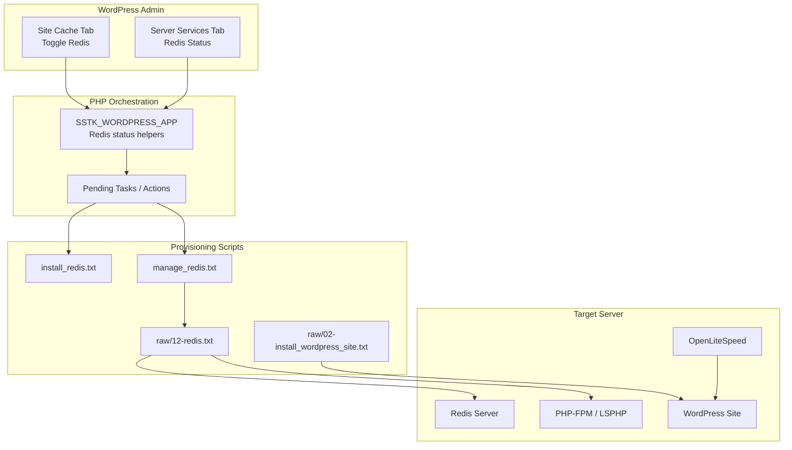
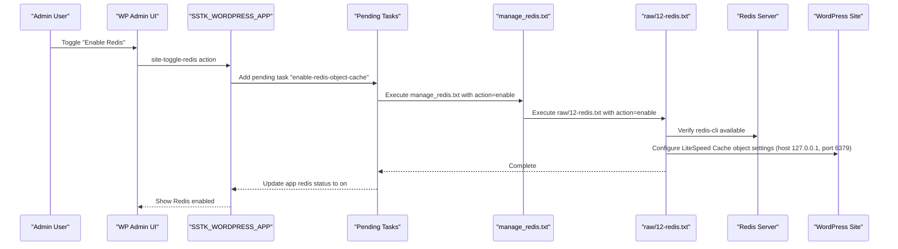
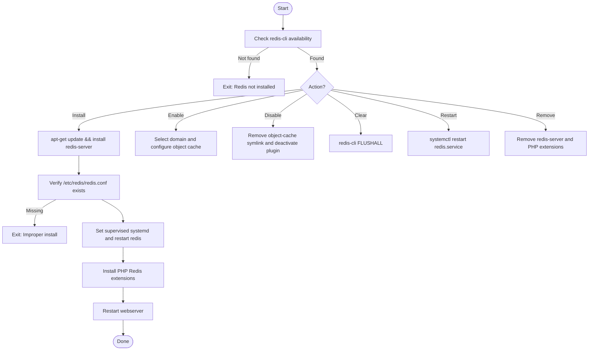
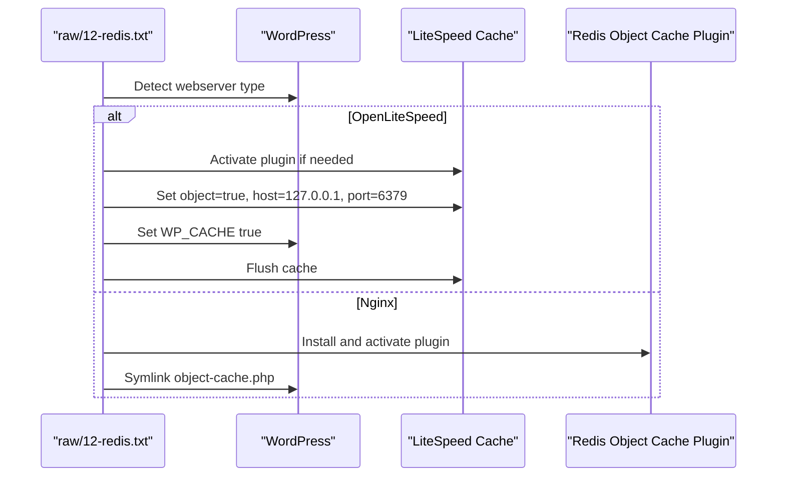
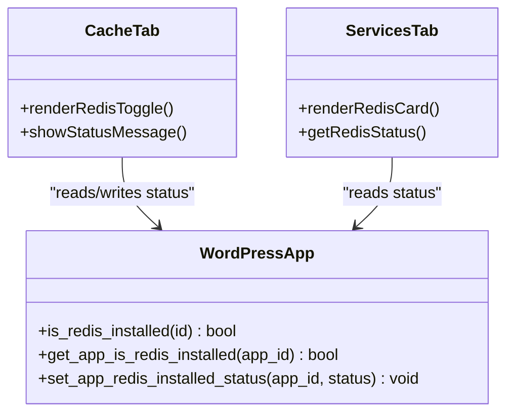
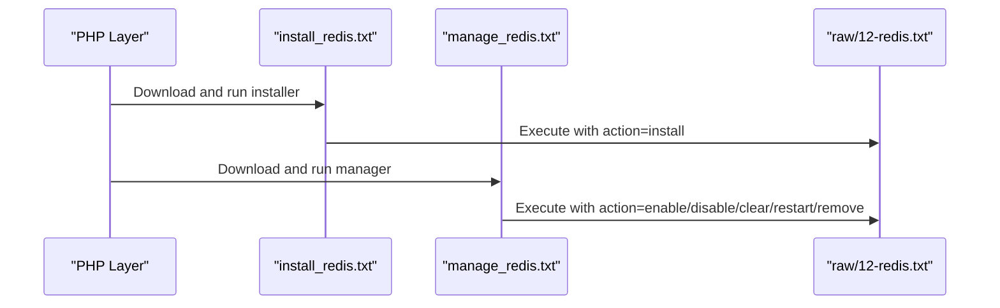
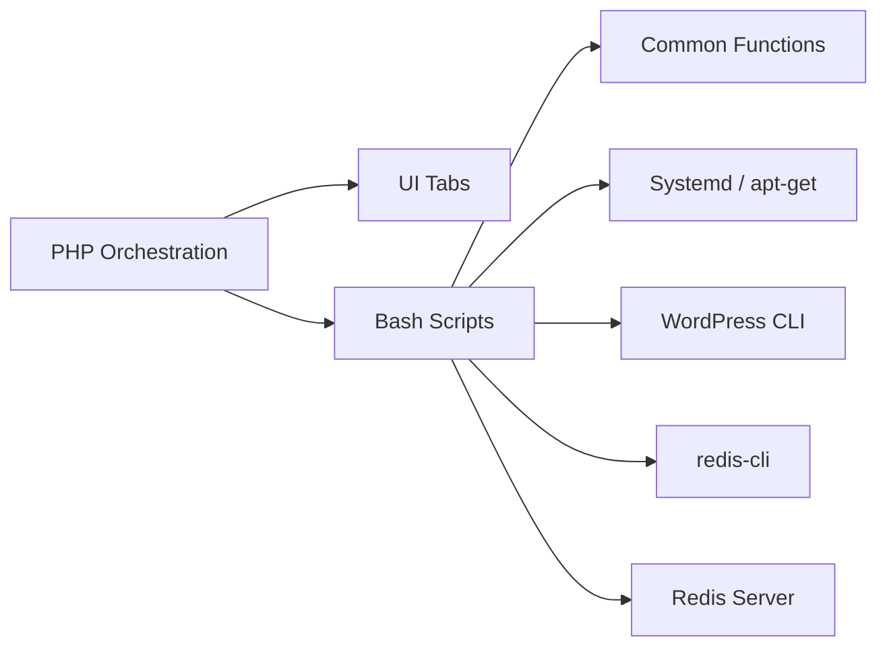

# Redis Caching

<cite>
**Referenced Files in This Document**
- [README.md](file://README.md)
- [class-wordpress-app.php](file://includes/core/apps/wordpress-app/class-wordpress-app.php)
- [cache.php](file://includes/core/apps/wordpress-app/tabs/cache.php)
- [services.php](file://includes/core/apps/wordpress-app/tabs-server/services.php)
- [install_redis.txt](file://includes/core/apps/wordpress-app/scripts/v2/install_redis.txt)
- [manage_redis.txt](file://includes/core/apps/wordpress-app/scripts/v2/manage_redis.txt)
- [12-redis.txt (v2)](file://includes/core/apps/wordpress-app/scripts/v2/raw/12-redis.txt)
- [12-redis.txt (v1)](file://includes/core/apps/wordpress-app/scripts/v1/raw/12-redis.txt)
- [02-install_wordpress_site.txt (v2)](file://includes/core/apps/wordpress-app/scripts/v2/raw/02-install_wordpress_site.txt)
- [82-destination-site-sync.txt](file://includes/core/apps/wordpress-app/scripts/v1/raw/82-destination-site-sync.txt)
- [20-monit.txt](file://includes/core/apps/wordpress-app/scripts/v1/raw/20-monit.txt)
</cite>

## Table of Contents
1. [Introduction](#introduction)
2. [Project Structure](#project-structure)
3. [Core Components](#core-components)
4. [Architecture Overview](#architecture-overview)
5. [Detailed Component Analysis](#detailed-component-analysis)
6. [Dependency Analysis](#dependency-analysis)
7. [Performance Considerations](#performance-considerations)
8. [Troubleshooting Guide](#troubleshooting-guide)
9. [Conclusion](#conclusion)
10. [Appendices](#appendices)

## Introduction
This document explains how Simple Stack provisions, configures, and manages Redis caching for WordPress sites. It covers:
- Installing Redis on the server
- Enabling/disabling Redis per site
- Integrating with WordPress object caching via LiteSpeed Cache or the Redis Object Cache plugin
- Monitoring and maintenance tasks
- Operational notes for replication, persistence, and backups as implemented by the repository scripts

Simple Stack installs OpenLiteSpeed, PHP, MariaDB, Redis, certbot, firewall rules, and an OLS vhost, driven by shell scripts executed over SSH. The stack is managed from within the WordPress admin dashboard.

**Section sources**
- [README.md:11-20](file://README.md#L11-L20)

## Project Structure
Redis-related functionality spans UI tabs, PHP orchestration, and Bash provisioning scripts:
- UI tabs expose controls to enable/disable Redis per site and show service status
- PHP classes track installation state and manage pending tasks
- Bash scripts install Redis, configure PHP extensions, and integrate with WordPress object caching

**Diagram sources**
- [cache.php:656-768](file://includes/core/apps/wordpress-app/tabs/cache.php#L656-L768)
- [services.php:601-624](file://includes/core/apps/wordpress-app/tabs-server/services.php#L601-L624)
- [class-wordpress-app.php:4471-4543](file://includes/core/apps/wordpress-app/class-wordpress-app.php#L4471-L4543)
- [install_redis.txt:1-11](file://includes/core/apps/wordpress-app/scripts/v2/install_redis.txt#L1-L11)
- [manage_redis.txt:1-9](file://includes/core/apps/wordpress-app/scripts/v2/manage_redis.txt#L1-L9)
- [12-redis.txt (v2):36-83](file://includes/core/apps/wordpress-app/scripts/v2/raw/12-redis.txt#L36-L83)
- [02-install_wordpress_site.txt (v2):193-193](file://includes/core/apps/wordpress-app/scripts/v2/raw/02-install_wordpress_site.txt#L193-L193)

**Section sources**
- [README.md:27-37](file://README.md#L27-L37)

## Core Components
- Redis installation and management are performed by Bash scripts under scripts/v2/raw/12-redis.txt. These scripts:
  - Install redis-server and PHP Redis extensions
  - Enable/disable Redis per site
  - Clear cache and restart the service
- WordPress integration:
  - For OpenLiteSpeed, the script activates LiteSpeed Cache and sets object cache options pointing to Redis on localhost port 6379
  - For nginx, it installs and activates the Redis Object Cache plugin and symlinks its object-cache.php
- State tracking:
  - PHP methods set and read whether Redis is installed on a server and enabled on a site
- UI:
  - Site Cache tab exposes a toggle to enable/disable Redis per site
  - Server Services tab shows Redis service status

**Section sources**
- [12-redis.txt (v2):36-83](file://includes/core/apps/wordpress-app/scripts/v2/raw/12-redis.txt#L36-L83)
- [12-redis.txt (v2):86-134](file://includes/core/apps/wordpress-app/scripts/v2/raw/12-redis.txt#L86-L134)
- [12-redis.txt (v2):137-166](file://includes/core/apps/wordpress-app/scripts/v2/raw/12-redis.txt#L137-L166)
- [12-redis.txt (v2):169-182](file://includes/core/apps/wordpress-app/scripts/v2/raw/12-redis.txt#L169-L182)
- [12-redis.txt (v2):185-198](file://includes/core/apps/wordpress-app/scripts/v2/raw/12-redis.txt#L185-L198)
- [02-install_wordpress_site.txt (v2):193-193](file://includes/core/apps/wordpress-app/scripts/v2/raw/02-install_wordpress_site.txt#L193-L193)
- [cache.php:656-768](file://includes/core/apps/wordpress-app/tabs/cache.php#L656-L768)
- [services.php:601-624](file://includes/core/apps/wordpress-app/tabs-server/services.php#L601-L624)
- [class-wordpress-app.php:4471-4543](file://includes/core/apps/wordpress-app/class-wordpress-app.php#L4471-L4543)

## Architecture Overview
The following sequence shows enabling Redis for a new site when Redis is already installed on the server.

**Diagram sources**
- [cache.php:686-706](file://includes/core/apps/wordpress-app/tabs/cache.php#L686-L706)
- [class-wordpress-app.php:4050-4057](file://includes/core/apps/wordpress-app/class-wordpress-app.php#L4050-L4057)
- [manage_redis.txt:1-9](file://includes/core/apps/wordpress-app/scripts/v2/manage_redis.txt#L1-L9)
- [12-redis.txt (v2):86-134](file://includes/core/apps/wordpress-app/scripts/v2/raw/12-redis.txt#L86-L134)

## Detailed Component Analysis

### Redis Installation and Service Management
- Installation flow:
  - Updates package index and installs redis-server
  - Ensures systemd supervision is configured
  - Installs PHP Redis extensions appropriate to the webserver type (nginx vs OpenLiteSpeed)
  - Restarts the webserver
- Maintenance operations:
  - Enable/disable Redis per site
  - Clear Redis cache (FLUSHALL)
  - Restart Redis service
  - Remove Redis packages and extensions

**Diagram sources**
- [12-redis.txt (v2):36-83](file://includes/core/apps/wordpress-app/scripts/v2/raw/12-redis.txt#L36-L83)
- [12-redis.txt (v2):86-134](file://includes/core/apps/wordpress-app/scripts/v2/raw/12-redis.txt#L86-L134)
- [12-redis.txt (v2):137-166](file://includes/core/apps/wordpress-app/scripts/v2/raw/12-redis.txt#L137-L166)
- [12-redis.txt (v2):169-182](file://includes/core/apps/wordpress-app/scripts/v2/raw/12-redis.txt#L169-L182)
- [12-redis.txt (v2):185-198](file://includes/core/apps/wordpress-app/scripts/v2/raw/12-redis.txt#L185-L198)
- [12-redis.txt (v2):201-222](file://includes/core/apps/wordpress-app/scripts/v2/raw/12-redis.txt#L201-L222)

**Section sources**
- [12-redis.txt (v2):36-83](file://includes/core/apps/wordpress-app/scripts/v2/raw/12-redis.txt#L36-L83)
- [12-redis.txt (v2):169-198](file://includes/core/apps/wordpress-app/scripts/v2/raw/12-redis.txt#L169-L198)
- [12-redis.txt (v2):201-222](file://includes/core/apps/wordpress-app/scripts/v2/raw/12-redis.txt#L201-L222)

### WordPress Object Cache Integration
- OpenLiteSpeed path:
  - Activates LiteSpeed Cache if not present
  - Enables object cache and sets host to 127.0.0.1 and port to 6379
  - Sets WP_CACHE true and flushes cache
- Nginx path:
  - Installs and activates the Redis Object Cache plugin
  - Symlinks the plugin’s object-cache.php into wp-content
- New site defaults:
  - If global option disables Redis for new sites, a pending task is created to disable Redis after install

**Diagram sources**
- [12-redis.txt (v2):111-130](file://includes/core/apps/wordpress-app/scripts/v2/raw/12-redis.txt#L111-L130)
- [02-install_wordpress_site.txt (v2):193-193](file://includes/core/apps/wordpress-app/scripts/v2/raw/02-install_wordpress_site.txt#L193-L193)
- [class-wordpress-app.php:4050-4057](file://includes/core/apps/wordpress-app/class-wordpress-app.php#L4050-L4057)

**Section sources**
- [12-redis.txt (v2):111-130](file://includes/core/apps/wordpress-app/scripts/v2/raw/12-redis.txt#L111-L130)
- [02-install_wordpress_site.txt (v2):193-193](file://includes/core/apps/wordpress-app/scripts/v2/raw/02-install_wordpress_site.txt#L193-L193)
- [class-wordpress-app.php:4050-4057](file://includes/core/apps/wordpress-app/class-wordpress-app.php#L4050-L4057)

### UI Controls and Status
- Site Cache tab:
  - Shows a switch to enable/disable Redis per site
  - Provides an advanced “Cleanup REDIS Status” control to reconcile UI state with actual server state
- Server Services tab:
  - Displays Redis service status and description text guiding users to enable Redis at the server level first

**Diagram sources**
- [cache.php:656-768](file://includes/core/apps/wordpress-app/tabs/cache.php#L656-L768)
- [services.php:601-624](file://includes/core/apps/wordpress-app/tabs-server/services.php#L601-L624)
- [class-wordpress-app.php:4471-4543](file://includes/core/apps/wordpress-app/class-wordpress-app.php#L4471-L4543)

**Section sources**
- [cache.php:656-768](file://includes/core/apps/wordpress-app/tabs/cache.php#L656-L768)
- [services.php:601-624](file://includes/core/apps/wordpress-app/tabs-server/services.php#L601-L624)
- [class-wordpress-app.php:4471-4543](file://includes/core/apps/wordpress-app/class-wordpress-app.php#L4471-L4543)

### Provisioning Orchestration
- install_redis.txt downloads common functions and the main script, then executes it asynchronously with callbacks
- manage_redis.txt downloads and executes the per-action script with environment variables such as action and domain

**Diagram sources**
- [install_redis.txt:1-11](file://includes/core/apps/wordpress-app/scripts/v2/install_redis.txt#L1-L11)
- [manage_redis.txt:1-9](file://includes/core/apps/wordpress-app/scripts/v2/manage_redis.txt#L1-L9)
- [12-redis.txt (v2):16-33](file://includes/core/apps/wordpress-app/scripts/v2/raw/12-redis.txt#L16-L33)

**Section sources**
- [install_redis.txt:1-11](file://includes/core/apps/wordpress-app/scripts/v2/install_redis.txt#L1-L11)
- [manage_redis.txt:1-9](file://includes/core/apps/wordpress-app/scripts/v2/manage_redis.txt#L1-L9)

## Dependency Analysis
- PHP layer depends on:
  - WordPress App class for Redis status flags and pending tasks
  - UI tabs for user interactions
- Bash scripts depend on:
  - Common functions file (9999-common-functions.sh)
  - Package manager (apt-get)
  - Systemd for service management
  - WordPress CLI (wp) for plugin and configuration changes
  - redis-cli for cache operations

**Diagram sources**
- [class-wordpress-app.php:4471-4543](file://includes/core/apps/wordpress-app/class-wordpress-app.php#L4471-L4543)
- [cache.php:656-768](file://includes/core/apps/wordpress-app/tabs/cache.php#L656-L768)
- [12-redis.txt (v2):8-14](file://includes/core/apps/wordpress-app/scripts/v2/raw/12-redis.txt#L8-L14)
- [12-redis.txt (v2):169-182](file://includes/core/apps/wordpress-app/scripts/v2/raw/12-redis.txt#L169-L182)

**Section sources**
- [class-wordpress-app.php:4471-4543](file://includes/core/apps/wordpress-app/class-wordpress-app.php#L4471-L4543)
- [12-redis.txt (v2):8-14](file://includes/core/apps/wordpress-app/scripts/v2/raw/12-redis.txt#L8-L14)

## Performance Considerations
- Localhost binding:
  - Redis is configured to listen on 127.0.0.1:6379 for local WordPress object caching
- PHP extension selection:
  - For OpenLiteSpeed, the script iterates through all managed PHP versions to ensure each has a matching Redis extension installed
- Webserver restarts:
  - After installing Redis and PHP extensions, the webserver is restarted to load the new modules

Operational recommendations derived from repository behavior:
- Keep Redis on the same host as WordPress for lowest latency
- Ensure the correct PHP Redis extension is installed for every active PHP version
- Use the provided scripts to clear cache and restart services safely

**Section sources**
- [12-redis.txt (v2):111-130](file://includes/core/apps/wordpress-app/scripts/v2/raw/12-redis.txt#L111-L130)
- [12-redis.txt (v2):63-79](file://includes/core/apps/wordpress-app/scripts/v2/raw/12-redis.txt#L63-L79)
- [12-redis.txt (v2):79-82](file://includes/core/apps/wordpress-app/scripts/v2/raw/12-redis.txt#L79-L82)

## Troubleshooting Guide
Common issues and resolutions based on repository logic:

- Redis not installed on server:
  - Symptom: Scripts exit early indicating Redis is not installed
  - Resolution: Run the install action to install redis-server and PHP extensions
- Object cache already enabled:
  - Symptom: Enabling Redis fails because another object cache is active
  - Resolution: Disable the existing object cache before enabling Redis
- LiteSpeed Cache not active:
  - Symptom: Object cache not applied
  - Resolution: The script activates LiteSpeed Cache and sets object cache options; verify activation and flush cache
- Service not running:
  - Symptom: Redis unresponsive
  - Resolution: Restart Redis using the provided script action
- Cache stale data:
  - Symptom: Outdated cached values
  - Resolution: Clear Redis cache using the provided script action

Monitoring and health checks:
- Monit includes a process check for redis-server with start/stop programs and failure thresholds

Backup considerations:
- Destination site sync script contains commented-out lines that reference securing Redis and restarting it during synchronization flows

**Section sources**
- [12-redis.txt (v2):88-93](file://includes/core/apps/wordpress-app/scripts/v2/raw/12-redis.txt#L88-L93)
- [12-redis.txt (v2):104-110](file://includes/core/apps/wordpress-app/scripts/v2/raw/12-redis.txt#L104-L110)
- [12-redis.txt (v2):117-130](file://includes/core/apps/wordpress-app/scripts/v2/raw/12-redis.txt#L117-L130)
- [12-redis.txt (v2):185-198](file://includes/core/apps/wordpress-app/scripts/v2/raw/12-redis.txt#L185-L198)
- [12-redis.txt (v2):169-182](file://includes/core/apps/wordpress-app/scripts/v2/raw/12-redis.txt#L169-L182)
- [20-monit.txt:415-424](file://includes/core/apps/wordpress-app/scripts/v1/raw/20-monit.txt#L415-L424)
- [82-destination-site-sync.txt:38-49](file://includes/core/apps/wordpress-app/scripts/v1/raw/82-destination-site-sync.txt#L38-L49)

## Conclusion
Simple Stack provides a complete, script-driven workflow to install Redis, integrate it with WordPress object caching, and manage it per site. The system uses OpenLiteSpeed’s LiteSpeed Cache for object caching on supported stacks, with fallback support for the Redis Object Cache plugin on nginx. State is tracked in WordPress post meta, and operations are orchestrated via pending tasks and Bash scripts. Monitoring is integrated via Monit, and backup/sync scripts include references to Redis handling.

[No sources needed since this section summarizes without analyzing specific files]

## Appendices

### Redis Command Execution Examples
- Clear cache:
  - Use the script action to execute FLUSHALL against Redis
- Restart service:
  - Use the script action to restart the Redis service via systemd

**Section sources**
- [12-redis.txt (v2):169-182](file://includes/core/apps/wordpress-app/scripts/v2/raw/12-redis.txt#L169-L182)
- [12-redis.txt (v2):185-198](file://includes/core/apps/wordpress-app/scripts/v2/raw/12-redis.txt#L185-L198)

### Key Management Notes
- The repository does not implement custom key naming or namespacing for Redis keys. Keys are managed by WordPress and plugins (LiteSpeed Cache or Redis Object Cache).
- To avoid conflicts, ensure only one object cache implementation is active per site.

**Section sources**
- [12-redis.txt (v2):104-110](file://includes/core/apps/wordpress-app/scripts/v2/raw/12-redis.txt#L104-L110)

### Memory Allocation Strategies
- The repository does not tune Redis memory limits directly. Administrators should adjust Redis configuration according to workload and available RAM outside of these scripts.

[No sources needed since this section provides general guidance]

### Persistence Options
- The repository does not configure Redis persistence (RDB/AOF) in the scripts. Administrators should configure persistence in Redis configuration as needed.

[No sources needed since this section provides general guidance]

### Replication and Cluster Configuration
- The repository does not configure Redis replication or cluster topology. The scripts assume a single local Redis instance bound to 127.0.0.1:6379.

[No sources needed since this section provides general guidance]

### Backup Procedures
- Destination site sync script includes commented-out steps referencing Redis security and restart during synchronization flows.
- General practice: back up Redis data files and configuration separately from application data.

**Section sources**
- [82-destination-site-sync.txt:38-49](file://includes/core/apps/wordpress-app/scripts/v1/raw/82-destination-site-sync.txt#L38-L49)