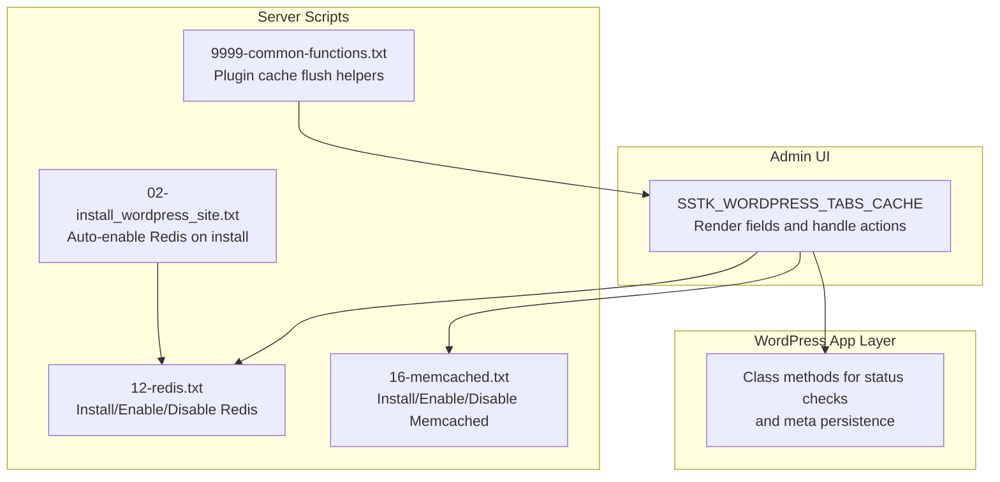
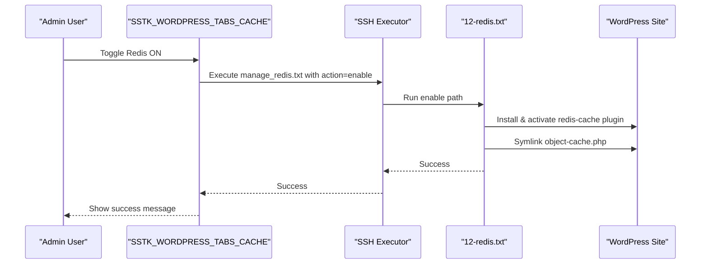
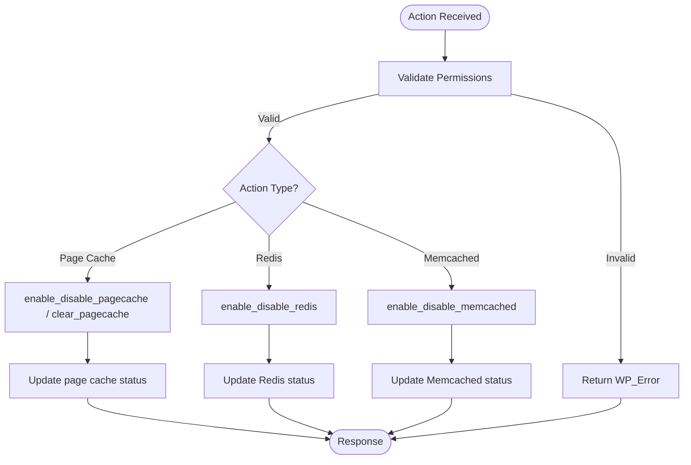
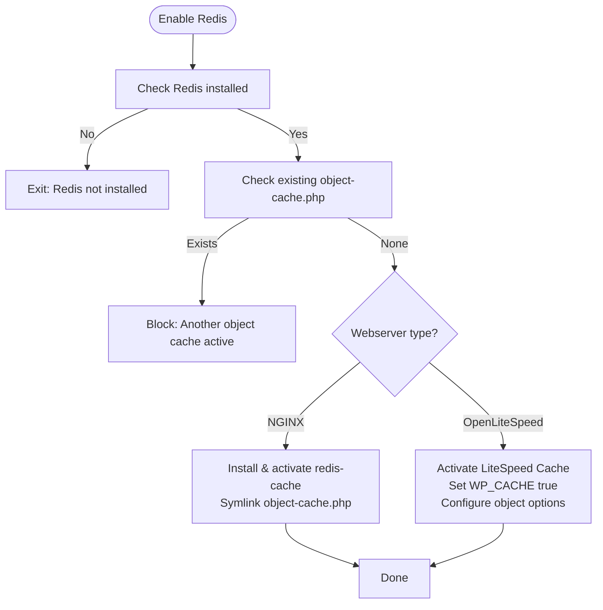
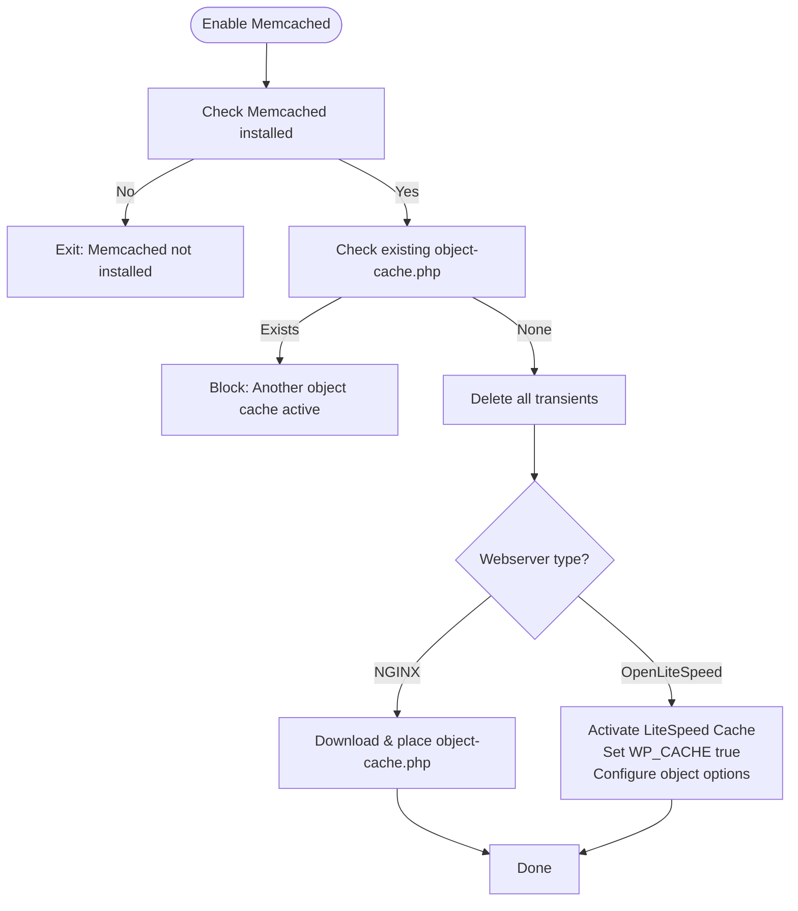
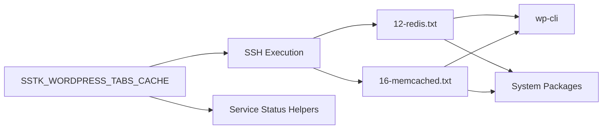

# WordPress Object Cache

<cite>
**Referenced Files in This Document**
- [cache.php](file://includes/core/apps/wordpress-app/tabs/cache.php)
- [class-wordpress-app.php](file://includes/core/apps/wordpress-app/class-wordpress-app.php)
- [12-redis.txt](file://includes/core/apps/wordpress-app/scripts/v1/raw/12-redis.txt)
- [16-memcached.txt](file://includes/core/apps/wordpress-app/scripts/v1/raw/16-memcached.txt)
- [02-install_wordpress_site.txt](file://includes/core/apps/wordpress-app/scripts/v1/raw/02-install_wordpress_site.txt)
- [9999-common-functions.txt](file://includes/core/apps/wordpress-app/scripts/v1/raw/9999-common-functions.txt)
</cite>

## Table of Contents
1. [Introduction](#introduction)
2. [Project Structure](#project-structure)
3. [Core Components](#core-components)
4. [Architecture Overview](#architecture-overview)
5. [Detailed Component Analysis](#detailed-component-analysis)
6. [Dependency Analysis](#dependency-analysis)
7. [Performance Considerations](#performance-considerations)
8. [Troubleshooting Guide](#troubleshooting-guide)
9. [Conclusion](#conclusion)

## Introduction
This document explains how Simple Stack configures and manages WordPress object caching for WordPress applications. It covers:
- The WordPress object cache API and backend selection (Redis, Memcached).
- Fallback mechanisms when an object cache is already enabled or not installed.
- Integration with popular caching plugins such as W3 Total Cache, WP Super Cache, LiteSpeed Cache, and Cache Enabler.
- Cache warming strategies, invalidation techniques, and selective caching rules.
- Examples of custom object-cache.php implementations, transients management, and database query caching optimization.
- Cache hierarchy design, memory usage patterns, and performance monitoring guidance.
- Troubleshooting cache conflicts, stale data issues, and debugging steps.

## Project Structure
Simple Stack’s WordPress application layer provides a dedicated “Cache” tab to manage page cache and object caches (Redis/Memcached). The implementation consists of:
- A PHP class that renders the UI and dispatches actions.
- Bash scripts executed over SSH to install, enable, disable, clear, restart, and remove Redis/Memcached services.
- Helper functions to detect service installation status and persist per-site state.

**Diagram sources**
- [cache.php:15-35](file://includes/core/apps/wordpress-app/tabs/cache.php#L15-L35)
- [class-wordpress-app.php:4487-4545](file://includes/core/apps/wordpress-app/class-wordpress-app.php#L4487-L4545)
- [12-redis.txt:1-214](file://includes/core/apps/wordpress-app/scripts/v1/raw/12-redis.txt#L1-L214)
- [16-memcached.txt:1-221](file://includes/core/apps/wordpress-app/scripts/v1/raw/16-memcached.txt#L1-L221)
- [02-install_wordpress_site.txt:186-215](file://includes/core/apps/wordpress-app/scripts/v1/raw/02-install_wordpress_site.txt#L186-L215)
- [9999-common-functions.txt:124-157](file://includes/core/apps/wordpress-app/scripts/v1/raw/9999-common-functions.txt#L124-L157)

**Section sources**
- [cache.php:15-35](file://includes/core/apps/wordpress-app/tabs/cache.php#L15-L35)
- [class-wordpress-app.php:4487-4545](file://includes/core/apps/wordpress-app/class-wordpress-app.php#L4487-L4545)

## Core Components
- Cache Tab Controller: Renders the Cache tab, exposes toggles for page cache, Redis, and Memcached, and triggers server-side operations via SSH.
- Service Status Helpers: Determine whether Redis/Memcached are installed on the server and whether they are enabled for a specific site.
- Server Scripts: Provide low-level commands to install, enable, disable, clear, restart, and remove Redis/Memcached services and configure WordPress object cache backends.
- Plugin Integration Helpers: Flush caches for popular plugins during site operations.

Key responsibilities:
- Page cache: Enable/disable/clear NGINX/OpenLiteSpeed page cache.
- Object cache: Enable/disable Redis or Memcached per site; ensure only one object cache backend is active.
- Transients: Delete all transients before enabling Memcached to avoid oversized objects.
- Plugin compatibility: Detect and flush W3 Total Cache, WP Super Cache, LiteSpeed Cache, Cache Enabler, and Fastest Cache where applicable.

**Section sources**
- [cache.php:111-169](file://includes/core/apps/wordpress-app/tabs/cache.php#L111-L169)
- [cache.php:179-309](file://includes/core/apps/wordpress-app/tabs/cache.php#L179-L309)
- [cache.php:319-487](file://includes/core/apps/wordpress-app/tabs/cache.php#L319-L487)
- [12-redis.txt:77-157](file://includes/core/apps/wordpress-app/scripts/v1/raw/12-redis.txt#L77-L157)
- [16-memcached.txt:72-157](file://includes/core/apps/wordpress-app/scripts/v1/raw/16-memcached.txt#L72-L157)
- [9999-common-functions.txt:124-157](file://includes/core/apps/wordpress-app/scripts/v1/raw/9999-common-functions.txt#L124-L157)

## Architecture Overview
The following sequence shows how enabling Redis for a site flows through Simple Stack:

**Diagram sources**
- [cache.php:319-378](file://includes/core/apps/wordpress-app/tabs/cache.php#L319-L378)
- [12-redis.txt:77-125](file://includes/core/apps/wordpress-app/scripts/v1/raw/12-redis.txt#L77-L125)

## Detailed Component Analysis

### Cache Tab Controller (SSTK_WORDPRESS_TABS_CACHE)
Responsibilities:
- Register tab and permissions.
- Render fields for page cache, Redis, and Memcached.
- Dispatch actions like enabling/disabling page cache, clearing page cache, and toggling Redis/Memcached.

Implementation highlights:
- Action routing validates user permissions and maps actions to handlers.
- Page cache control uses a script to toggle NGINX/OpenLiteSpeed page cache and updates local status.
- Redis/Memcached toggles call server scripts to install or configure the backend and update per-site metadata.

**Diagram sources**
- [cache.php:111-169](file://includes/core/apps/wordpress-app/tabs/cache.php#L111-L169)
- [cache.php:179-309](file://includes/core/apps/wordpress-app/tabs/cache.php#L179-L309)
- [cache.php:319-487](file://includes/core/apps/wordpress-app/tabs/cache.php#L319-L487)

**Section sources**
- [cache.php:15-35](file://includes/core/apps/wordpress-app/tabs/cache.php#L15-L35)
- [cache.php:111-169](file://includes/core/apps/wordpress-app/tabs/cache.php#L111-L169)
- [cache.php:179-309](file://includes/core/apps/wordpress-app/tabs/cache.php#L179-L309)
- [cache.php:319-487](file://includes/core/apps/wordpress-app/tabs/cache.php#L319-L487)

### Redis Backend Management
Behavior:
- Checks if Redis is installed on the server.
- Prevents enabling Redis if another object cache backend is already active.
- Installs and activates the Redis object cache plugin and symlinks object-cache.php.
- For OpenLiteSpeed, configures LiteSpeed Cache object settings and sets WP_CACHE.

**Diagram sources**
- [12-redis.txt:77-125](file://includes/core/apps/wordpress-app/scripts/v1/raw/12-redis.txt#L77-L125)

**Section sources**
- [12-redis.txt:77-157](file://includes/core/apps/wordpress-app/scripts/v1/raw/12-redis.txt#L77-L157)

### Memcached Backend Management
Behavior:
- Ensures Memcached is installed.
- Blocks enabling Memcached if another object cache backend is already active.
- Deletes all transients to keep object sizes small (Memcached has a 1 MB limit).
- Places Automattic’s object-cache.php for Memcached or configures LiteSpeed Cache for OpenLiteSpeed.

**Diagram sources**
- [16-memcached.txt:72-125](file://includes/core/apps/wordpress-app/scripts/v1/raw/16-memcached.txt#L72-L125)

**Section sources**
- [16-memcached.txt:72-157](file://includes/core/apps/wordpress-app/scripts/v1/raw/16-memcached.txt#L72-L157)

### WordPress Installation Auto-Enable Redis
During WordPress site installation, if Redis is detected on the server, Simple Stack automatically enables the Redis object cache by installing and activating the Redis plugin and linking object-cache.php. For OpenLiteSpeed, it configures LiteSpeed Cache accordingly.

**Section sources**
- [02-install_wordpress_site.txt:186-215](file://includes/core/apps/wordpress-app/scripts/v1/raw/02-install_wordpress_site.txt#L186-L215)

### Plugin Cache Flushing Helpers
When performing site operations, Simple Stack attempts to flush caches for popular plugins:
- Cache Enabler
- WP Super Cache
- W3 Total Cache
- Fastest Cache

This helps prevent stale content after changes.

**Section sources**
- [9999-common-functions.txt:124-157](file://includes/core/apps/wordpress-app/scripts/v1/raw/9999-common-functions.txt#L124-L157)

## Dependency Analysis
- The Cache Tab Controller depends on:
  - SSH execution utilities to run server scripts.
  - Status helper methods to determine service availability and per-site configuration.
- Server scripts depend on:
  - System package managers (apt-get) to install Redis/Memcached and PHP extensions.
  - wp-cli to install/activate plugins and set configuration values.
  - Web server-specific tooling (e.g., LiteSpeed CLI) for OpenLiteSpeed environments.

**Diagram sources**
- [cache.php:179-487](file://includes/core/apps/wordpress-app/tabs/cache.php#L179-L487)
- [12-redis.txt:1-214](file://includes/core/apps/wordpress-app/scripts/v1/raw/12-redis.txt#L1-L214)
- [16-memcached.txt:1-221](file://includes/core/apps/wordpress-app/scripts/v1/raw/16-memcached.txt#L1-L221)

**Section sources**
- [cache.php:179-487](file://includes/core/apps/wordpress-app/tabs/cache.php#L179-L487)
- [12-redis.txt:1-214](file://includes/core/apps/wordpress-app/scripts/v1/raw/12-redis.txt#L1-L214)
- [16-memcached.txt:1-221](file://includes/core/apps/wordpress-app/scripts/v1/raw/16-memcached.txt#L1-L221)

## Performance Considerations
- Prefer Redis for high-throughput workloads and complex data structures; Memcached is simpler but limited by object size constraints.
- Ensure only one object cache backend is active at a time to avoid conflicts.
- Delete transients before enabling Memcached to prevent oversized objects exceeding limits.
- Use page cache for static content and object cache for dynamic queries; coordinate both to avoid cache stampedes.
- Monitor memory usage on Redis/Memcached and adjust maxmemory policies appropriately.
- Leverage LiteSpeed Cache object settings for OpenLiteSpeed environments to optimize object cache behavior.

[No sources needed since this section provides general guidance]

## Troubleshooting Guide

Common issues and resolutions:
- Multiple object cache backends active:
  - Symptom: Conflicts between object-cache.php files or unexpected behavior.
  - Resolution: Disable one backend first; Simple Stack scripts block enabling a second backend while one is active.
- Stale data after enabling Memcached:
  - Cause: Large transient entries exceed Memcached object size limits.
  - Resolution: Simple Stack deletes all transients before enabling Memcached; re-run if necessary.
- Redis not installed on server:
  - Symptom: Cannot enable Redis for a site.
  - Resolution: Install Redis on the server using the provided script or system package manager.
- Plugin cache conflicts:
  - Symptom: Changes not reflected due to page cache.
  - Resolution: Simple Stack flushes caches for Cache Enabler, WP Super Cache, W3 Total Cache, and Fastest Cache during operations. Manually flush if needed.
- OpenLiteSpeed object cache misconfiguration:
  - Symptom: Object cache not working under OpenLiteSpeed.
  - Resolution: Ensure LiteSpeed Cache is activated and object settings are configured correctly; verify WP_CACHE is set.

Debugging steps:
- Verify presence of object-cache.php in wp-content.
- Confirm Redis/Memcached services are running.
- Check wp-cli outputs for plugin activation and configuration.
- Review server logs for errors during script execution.

**Section sources**
- [12-redis.txt:95-101](file://includes/core/apps/wordpress-app/scripts/v1/raw/12-redis.txt#L95-L101)
- [16-memcached.txt:88-104](file://includes/core/apps/wordpress-app/scripts/v1/raw/16-memcached.txt#L88-L104)
- [9999-common-functions.txt:124-157](file://includes/core/apps/wordpress-app/scripts/v1/raw/9999-common-functions.txt#L124-L157)

## Conclusion
Simple Stack provides a robust, script-driven approach to managing WordPress object caching. It supports Redis and Memcached backends, ensures mutual exclusivity, integrates with popular caching plugins, and automates common tasks like transient cleanup and cache flushing. By following the guidance above, administrators can design effective cache hierarchies, optimize performance, and troubleshoot issues confidently.

[No sources needed since this section summarizes without analyzing specific files]