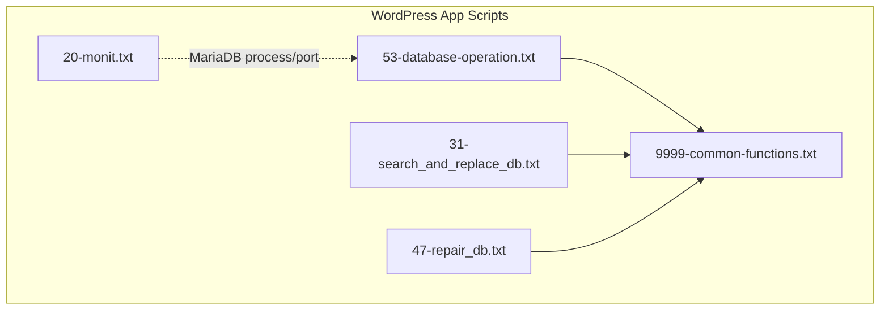
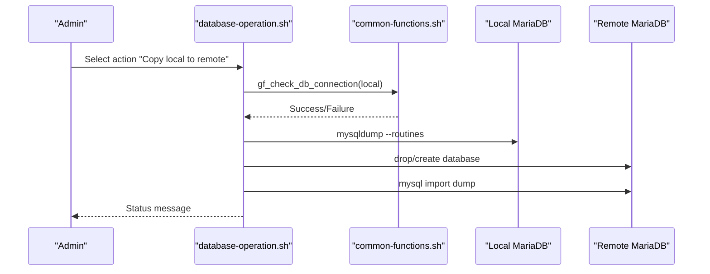
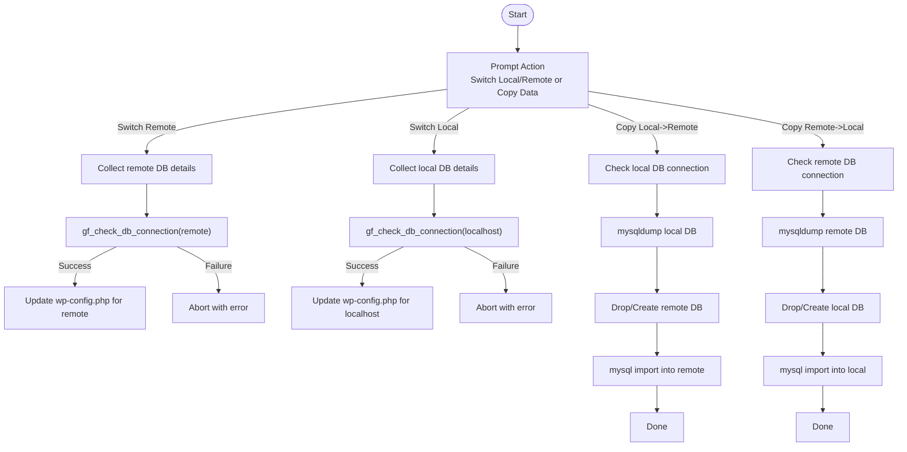
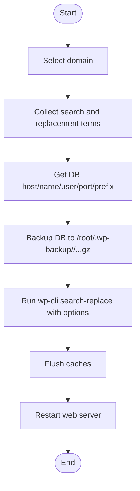
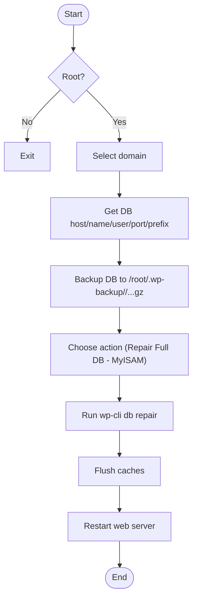
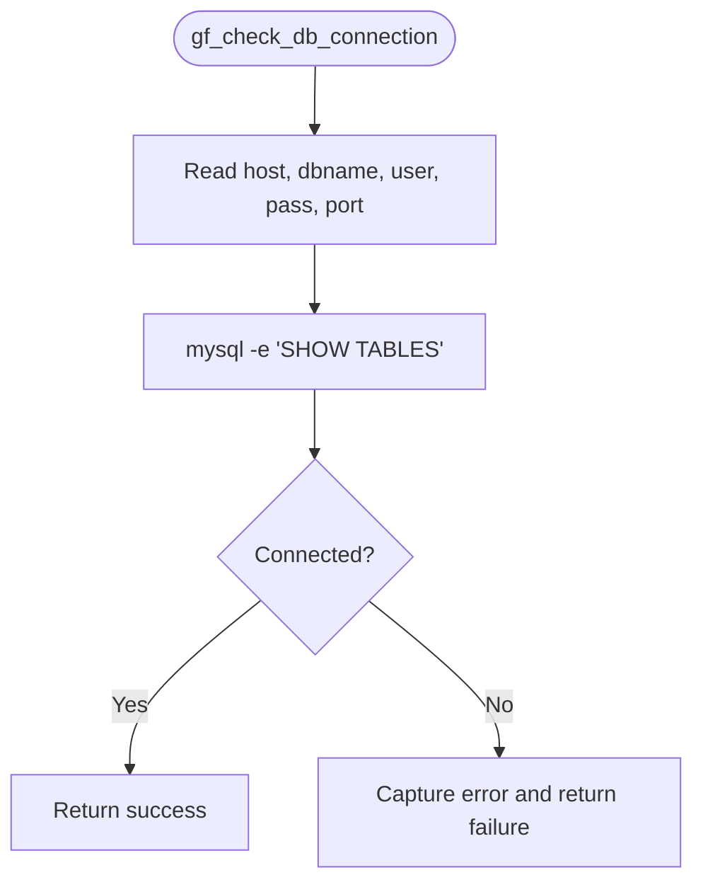
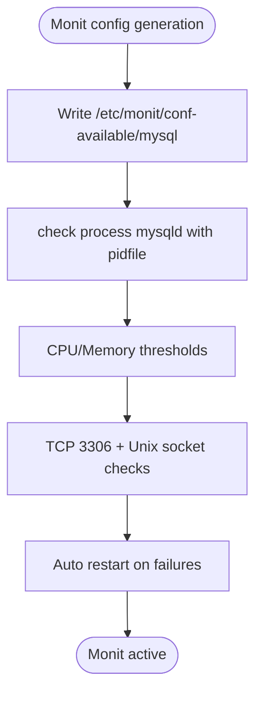
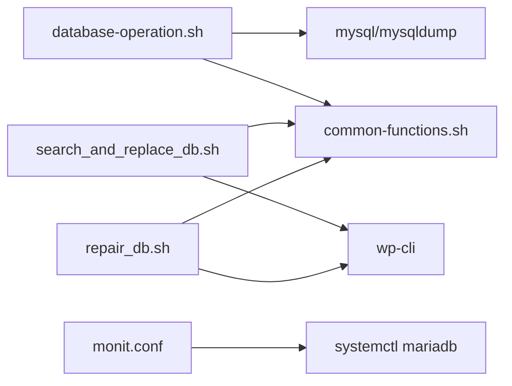

# Database Optimization

<cite>
**Referenced Files in This Document**
- [53-database-operation.txt](file://includes/core/apps/wordpress-app/scripts/v1/raw/53-database-operation.txt)
- [47-repair_db.txt](file://includes/core/apps/wordpress-app/scripts/v1/raw/47-repair_db.txt)
- [31-search_and_replace_db.txt](file://includes/core/apps/wordpress-app/scripts/v1/raw/31-search_and_replace_db.txt)
- [9999-common-functions.txt](file://includes/core/apps/wordpress-app/scripts/v1/raw/9999-common-functions.txt)
- [20-monit.txt](file://includes/core/apps/wordpress-app/scripts/v1/raw/20-monit.txt)
</cite>

## Table of Contents
1. [Introduction](#introduction)
2. [Project Structure](#project-structure)
3. [Core Components](#core-components)
4. [Architecture Overview](#architecture-overview)
5. [Detailed Component Analysis](#detailed-component-analysis)
6. [Dependency Analysis](#dependency-analysis)
7. [Performance Considerations](#performance-considerations)
8. [Troubleshooting Guide](#troubleshooting-guide)
9. [Conclusion](#conclusion)
10. [Appendices](#appendices)

## Introduction
This document provides comprehensive guidance for database optimization within SimpleStack, focusing on MySQL/MariaDB tuning, query optimization, and maintenance procedures. It explains how SimpleStack scripts support WordPress database operations such as switching between local and remote databases, copying data between environments, performing search-and-replace operations, and running repair workflows. It also covers monitoring and health checks for the database service.

Where applicable, this guide references concrete implementation files to help you locate and understand the underlying automation.

## Project Structure
SimpleStack organizes database-related automation under the WordPress app scripts directory. The key files relevant to database optimization and maintenance are:
- A script to switch or copy databases between local and remote hosts
- A script to perform search-and-replace operations in the WordPress database
- A script that outlines a repair workflow (currently limited to MyISAM via wp-cli)
- Common functions used by scripts to validate database connectivity
- A monitoring configuration snippet that watches the MariaDB process and port

**Diagram sources**
- [53-database-operation.txt:1-212](file://includes/core/apps/wordpress-app/scripts/v1/raw/53-database-operation.txt#L1-L212)
- [31-search_and_replace_db.txt:1-73](file://includes/core/apps/wordpress-app/scripts/v1/raw/31-search_and_replace_db.txt#L1-L73)
- [47-repair_db.txt:1-92](file://includes/core/apps/wordpress-app/scripts/v1/raw/47-repair_db.txt#L1-L92)
- [9999-common-functions.txt:1870-1896](file://includes/core/apps/wordpress-app/scripts/v1/raw/9999-common-functions.txt#L1870-L1896)
- [20-monit.txt:358-413](file://includes/core/apps/wordpress-app/scripts/v1/raw/20-monit.txt#L358-L413)

**Section sources**
- [53-database-operation.txt:1-212](file://includes/core/apps/wordpress-app/scripts/v1/raw/53-database-operation.txt#L1-L212)
- [31-search_and_replace_db.txt:1-73](file://includes/core/apps/wordpress-app/scripts/v1/raw/31-search_and_replace_db.txt#L1-L73)
- [47-repair_db.txt:1-92](file://includes/core/apps/wordpress-app/scripts/v1/raw/47-repair_db.txt#L1-L92)
- [9999-common-functions.txt:1870-1896](file://includes/core/apps/wordpress-app/scripts/v1/raw/9999-common-functions.txt#L1870-L1896)
- [20-monit.txt:358-413](file://includes/core/apps/wordpress-app/scripts/v1/raw/20-monit.txt#L358-L413)

## Core Components
- Database operation orchestrator: Provides interactive menus to switch a site’s database connection between local and remote hosts, and to copy data between them using mysqldump and mysql clients.
- Search and replace utility: Backs up the database and runs a safe search-and-replace across tables using wp-cli with options to recurse objects and skip specific columns/tables.
- Repair workflow helper: Demonstrates a backup-first approach and uses wp-cli to attempt repairs; currently limited to legacy MyISAM engines.
- Connectivity checker: Validates database reachability and credentials before any destructive operation.
- Monitoring integration: Configures system-level checks for the MariaDB process and TCP/Unix socket availability.

**Section sources**
- [53-database-operation.txt:16-59](file://includes/core/apps/wordpress-app/scripts/v1/raw/53-database-operation.txt#L16-L59)
- [53-database-operation.txt:92-134](file://includes/core/apps/wordpress-app/scripts/v1/raw/53-database-operation.txt#L92-L134)
- [53-database-operation.txt:137-211](file://includes/core/apps/wordpress-app/scripts/v1/raw/53-database-operation.txt#L137-L211)
- [31-search_and_replace_db.txt:42-70](file://includes/core/apps/wordpress-app/scripts/v1/raw/31-search_and_replace_db.txt#L42-L70)
- [47-repair_db.txt:53-85](file://includes/core/apps/wordpress-app/scripts/v1/raw/47-repair_db.txt#L53-L85)
- [9999-common-functions.txt:1870-1896](file://includes/core/apps/wordpress-app/scripts/v1/raw/9999-common-functions.txt#L1870-L1896)
- [20-monit.txt:358-413](file://includes/core/apps/wordpress-app/scripts/v1/raw/20-monit.txt#L358-L413)

## Architecture Overview
The database optimization workflow in SimpleStack is primarily script-driven and integrates with standard MySQL/MariaDB tools and wp-cli. The following sequence illustrates a typical “copy from local to remote” operation:

**Diagram sources**
- [53-database-operation.txt:137-173](file://includes/core/apps/wordpress-app/scripts/v1/raw/53-database-operation.txt#L137-L173)
- [9999-common-functions.txt:1870-1896](file://includes/core/apps/wordpress-app/scripts/v1/raw/9999-common-functions.txt#L1870-L1896)

## Detailed Component Analysis

### Database Operation Orchestrator
Responsibilities:
- Interactively collect local and remote database credentials and ports
- Validate connectivity before making changes
- Update WordPress configuration to point to either local or remote database
- Export/import databases between environments safely

Key behaviors:
- Switching to remote/local updates wp-config.php entries for host, name, user, and password
- Copying local to remote performs an export, drops and recreates the remote database, then imports the dump
- Copying remote to local mirrors the same flow in reverse

**Diagram sources**
- [53-database-operation.txt:16-59](file://includes/core/apps/wordpress-app/scripts/v1/raw/53-database-operation.txt#L16-L59)
- [53-database-operation.txt:92-134](file://includes/core/apps/wordpress-app/scripts/v1/raw/53-database-operation.txt#L92-L134)
- [53-database-operation.txt:137-211](file://includes/core/apps/wordpress-app/scripts/v1/raw/53-database-operation.txt#L137-L211)
- [9999-common-functions.txt:1870-1896](file://includes/core/apps/wordpress-app/scripts/v1/raw/9999-common-functions.txt#L1870-L1896)

**Section sources**
- [53-database-operation.txt:16-59](file://includes/core/apps/wordpress-app/scripts/v1/raw/53-database-operation.txt#L16-L59)
- [53-database-operation.txt:92-134](file://includes/core/apps/wordpress-app/scripts/v1/raw/53-database-operation.txt#L92-L134)
- [53-database-operation.txt:137-211](file://includes/core/apps/wordpress-app/scripts/v1/raw/53-database-operation.txt#L137-L211)
- [9999-common-functions.txt:1870-1896](file://includes/core/apps/wordpress-app/scripts/v1/raw/9999-common-functions.txt#L1870-L1896)

### Search and Replace Utility
Responsibilities:
- Prompt for domain/search term/replacement term
- Retrieve database connection details for the selected domain
- Create a compressed backup before modifying data
- Run wp-cli search-replace with object recursion and selective exclusions
- Flush caches and restart the web server

Operational notes:
- Uses wp-cli with options to recurse objects and skip specific columns/tables
- Ensures backups are created prior to any modifications

**Diagram sources**
- [31-search_and_replace_db.txt:17-49](file://includes/core/apps/wordpress-app/scripts/v1/raw/31-search_and_replace_db.txt#L17-L49)
- [31-search_and_replace_db.txt:50-70](file://includes/core/apps/wordpress-app/scripts/v1/raw/31-search_and_replace_db.txt#L50-L70)

**Section sources**
- [31-search_and_replace_db.txt:17-49](file://includes/core/apps/wordpress-app/scripts/v1/raw/31-search_and_replace_db.txt#L17-L49)
- [31-search_and_replace_db.txt:50-70](file://includes/core/apps/wordpress-app/scripts/v1/raw/31-search_and_replace_db.txt#L50-L70)

### Repair Workflow Helper
Responsibilities:
- Require root privileges
- Source common functions
- Prompt for domain and action
- Back up the database before attempting repairs
- Use wp-cli to run database repair (MyISAM only)
- Flush caches and restart the web server

Current limitations:
- The script explicitly notes it cannot fully automate modern InnoDB repairs and is not yet complete
- It demonstrates a safe backup-first pattern and cache flush after repair

**Diagram sources**
- [47-repair_db.txt:15-35](file://includes/core/apps/wordpress-app/scripts/v1/raw/47-repair_db.txt#L15-L35)
- [47-repair_db.txt:53-85](file://includes/core/apps/wordpress-app/scripts/v1/raw/47-repair_db.txt#L53-L85)

**Section sources**
- [47-repair_db.txt:15-35](file://includes/core/apps/wordpress-app/scripts/v1/raw/47-repair_db.txt#L15-L35)
- [47-repair_db.txt:53-85](file://includes/core/apps/wordpress-app/scripts/v1/raw/47-repair_db.txt#L53-L85)

### Connectivity Checker
Responsibilities:
- Accept host, database name, user, password, and optional port
- Attempt a simple SHOW TABLES command to verify connectivity
- Return success or detailed error messages

Usage:
- Called by other scripts before performing potentially destructive operations

**Diagram sources**
- [9999-common-functions.txt:1870-1896](file://includes/core/apps/wordpress-app/scripts/v1/raw/9999-common-functions.txt#L1870-L1896)

**Section sources**
- [9999-common-functions.txt:1870-1896](file://includes/core/apps/wordpress-app/scripts/v1/raw/9999-common-functions.txt#L1870-L1896)

### Monitoring Integration
Responsibilities:
- Configure Monit to monitor the MariaDB process and its PID file
- Define CPU/memory thresholds and automatic restart policies
- Check TCP port 3306 and Unix socket availability
- Ensure dependency on the mysqld binary

**Diagram sources**
- [20-monit.txt:358-413](file://includes/core/apps/wordpress-app/scripts/v1/raw/20-monit.txt#L358-L413)

**Section sources**
- [20-monit.txt:358-413](file://includes/core/apps/wordpress-app/scripts/v1/raw/20-monit.txt#L358-L413)

## Dependency Analysis
- Scripts depend on standard MySQL/MariaDB client tools:
  - mysqldump for exports
  - mysql for imports and DDL/DML
- wp-cli is used for WordPress-specific operations like search-replace and repair
- Common functions provide reusable connectivity validation and metadata helpers
- Monit configuration ensures database service availability and triggers restarts based on defined thresholds

**Diagram sources**
- [53-database-operation.txt:137-173](file://includes/core/apps/wordpress-app/scripts/v1/raw/53-database-operation.txt#L137-L173)
- [31-search_and_replace_db.txt:62-70](file://includes/core/apps/wordpress-app/scripts/v1/raw/31-search_and_replace_db.txt#L62-L70)
- [47-repair_db.txt:73-85](file://includes/core/apps/wordpress-app/scripts/v1/raw/47-repair_db.txt#L73-L85)
- [20-monit.txt:358-413](file://includes/core/apps/wordpress-app/scripts/v1/raw/20-monit.txt#L358-L413)

**Section sources**
- [53-database-operation.txt:137-173](file://includes/core/apps/wordpress-app/scripts/v1/raw/53-database-operation.txt#L137-L173)
- [31-search_and_replace_db.txt:62-70](file://includes/core/apps/wordpress-app/scripts/v1/raw/31-search_and_replace_db.txt#L62-L70)
- [47-repair_db.txt:73-85](file://includes/core/apps/wordpress-app/scripts/v1/raw/47-repair_db.txt#L73-L85)
- [20-monit.txt:358-413](file://includes/core/apps/wordpress-app/scripts/v1/raw/20-monit.txt#L358-L413)

## Performance Considerations
While SimpleStack does not directly manage MySQL/MariaDB server configuration parameters, the scripts facilitate operational tasks that impact performance indirectly:
- Safe backups before modifications reduce risk and downtime
- Cache flushing after search-and-replace or repair improves consistency
- Monitoring ensures rapid recovery from outages

For deeper server-side tuning (buffer pool sizing, connection pooling, query cache), apply best practices at the MariaDB/MySQL level outside of these scripts. Typical areas include:
- Buffer pool sizing aligned with available memory
- Connection limits tuned to expected concurrency
- Query cache considerations depending on workload patterns
- Index design and maintenance strategies tailored to query profiles

[No sources needed since this section provides general guidance]

## Troubleshooting Guide
Common issues and resolutions:
- Connectivity failures during switch/copy operations:
  - Verify credentials, hostnames, ports, and firewall rules
  - Use the built-in connectivity checker to diagnose errors
- Database switch did not take effect:
  - Confirm wp-config.php was updated correctly for DB_HOST, DB_NAME, DB_USER, DB_PASSWORD
- Search-and-replace did not update content:
  - Ensure the correct domain and terms were provided
  - Confirm wp-cli is installed and accessible
  - Check that caches were flushed post-operation
- Repair operation failed:
  - Note current limitation: repair is limited to MyISAM via wp-cli
  - For InnoDB, use native tools or consult database administrator

Operational tips:
- Always rely on the built-in backup steps before destructive actions
- Monitor MariaDB health via Monit to catch and recover from failures quickly

**Section sources**
- [9999-common-functions.txt:1870-1896](file://includes/core/apps/wordpress-app/scripts/v1/raw/9999-common-functions.txt#L1870-L1896)
- [53-database-operation.txt:92-134](file://includes/core/apps/wordpress-app/scripts/v1/raw/53-database-operation.txt#L92-L134)
- [31-search_and_replace_db.txt:62-70](file://includes/core/apps/wordpress-app/scripts/v1/raw/31-search_and_replace_db.txt#L62-L70)
- [47-repair_db.txt:73-85](file://includes/core/apps/wordpress-app/scripts/v1/raw/47-repair_db.txt#L73-L85)
- [20-monit.txt:358-413](file://includes/core/apps/wordpress-app/scripts/v1/raw/20-monit.txt#L358-L413)

## Conclusion
SimpleStack provides robust, script-driven utilities to manage WordPress database operations safely, including switching connections, copying data between environments, performing search-and-replace operations, and initiating repair workflows. These scripts integrate with standard MySQL/MariaDB clients and wp-cli, and leverage a connectivity checker to prevent misconfigurations. System-level monitoring ensures database availability and automated recovery. For advanced server tuning and capacity planning, apply industry-standard practices at the database layer while leveraging SimpleStack’s operational safeguards.

[No sources needed since this section summarizes without analyzing specific files]

## Appendices

### Examples of Running Maintenance Tasks
- Switch a site to a remote database:
  - Execute the database operation script and select “Switch to Remote Database,” providing remote host, port, database name, user, and password. The script validates connectivity and updates wp-config.php accordingly.
- Copy local database to remote:
  - Execute the database operation script and select “Copy database from local to Remote.” The script backs up locally, drops and recreates the remote database, and imports the dump.
- Perform search-and-replace:
  - Execute the search-and-replace script, enter the target domain, search term, and replacement term. The script creates a compressed backup, runs wp-cli search-replace with object recursion, flushes caches, and restarts the web server.
- Initiate repair workflow:
  - Execute the repair script as root, select the domain, and choose the repair action. The script backs up the database and attempts repair via wp-cli (MyISAM only), then flushes caches and restarts the web server.

**Section sources**
- [53-database-operation.txt:92-134](file://includes/core/apps/wordpress-app/scripts/v1/raw/53-database-operation.txt#L92-L134)
- [53-database-operation.txt:137-173](file://includes/core/apps/wordpress-app/scripts/v1/raw/53-database-operation.txt#L137-L173)
- [31-search_and_replace_db.txt:62-70](file://includes/core/apps/wordpress-app/scripts/v1/raw/31-search_and_replace_db.txt#L62-L70)
- [47-repair_db.txt:73-85](file://includes/core/apps/wordpress-app/scripts/v1/raw/47-repair_db.txt#L73-L85)