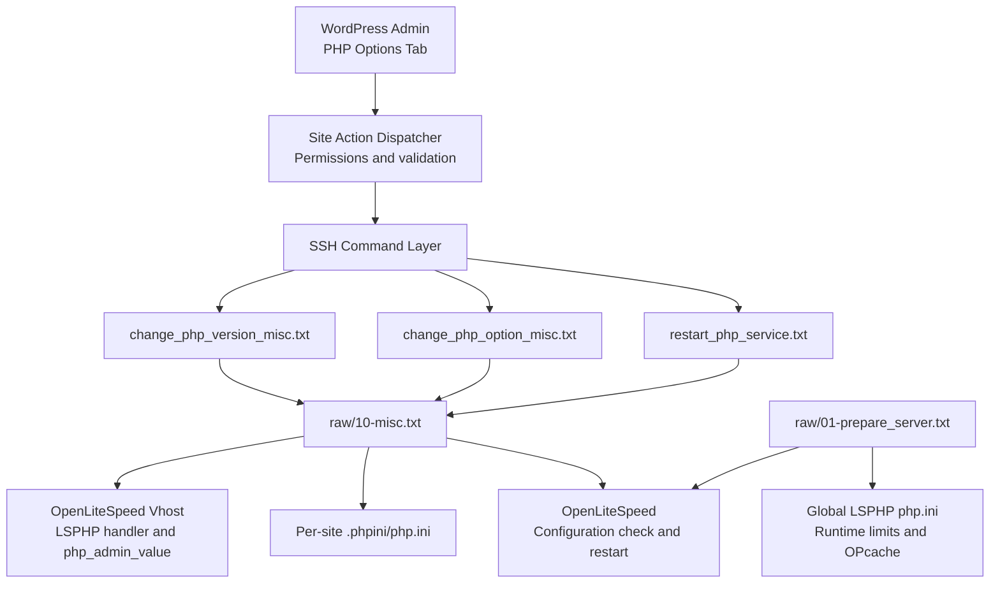
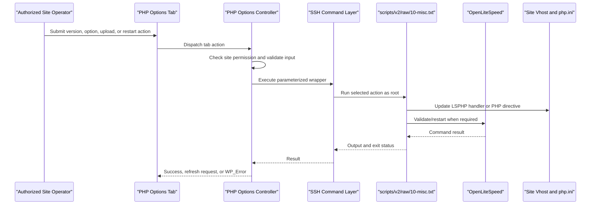
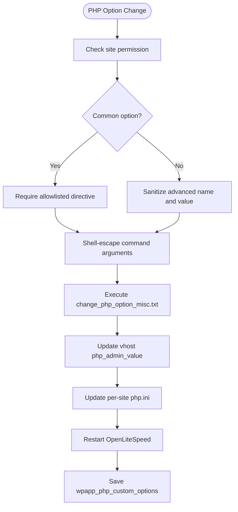
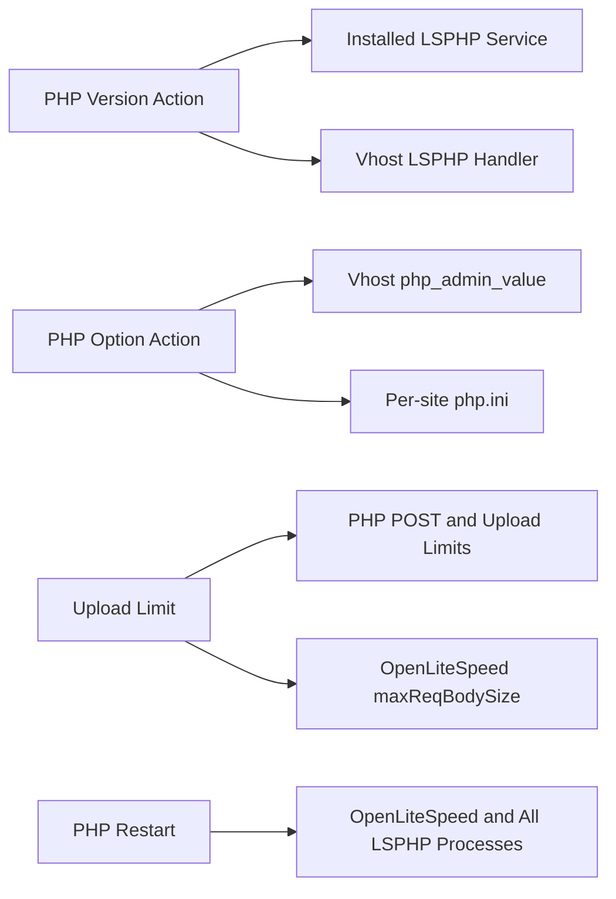

# PHP Performance Tuning

<cite>
**Referenced Files in This Document**
- [docs/SIMPLESTACK.md](file://docs/SIMPLESTACK.md)
- [php-options.php](file://includes/core/apps/wordpress-app/tabs/php-options.php)
- [01-prepare_server.txt](file://includes/core/apps/wordpress-app/scripts/v2/raw/01-prepare_server.txt)
- [10-misc.txt](file://includes/core/apps/wordpress-app/scripts/v2/raw/10-misc.txt)
- [55-ols_options.txt](file://includes/core/apps/wordpress-app/scripts/v2/raw/55-ols_options.txt)
- [change_php_version_misc.txt](file://includes/core/apps/wordpress-app/scripts/v2/change_php_version_misc.txt)
- [change_php_option_misc.txt](file://includes/core/apps/wordpress-app/scripts/v2/change_php_option_misc.txt)
- [restart_php_service.txt](file://includes/core/apps/wordpress-app/scripts/v2/restart_php_service.txt)
</cite>

## Table of Contents
1. [Introduction](#introduction)
2. [Project Structure](#project-structure)
3. [Core Components](#core-components)
4. [Architecture Overview](#architecture-overview)
5. [Detailed Component Analysis](#detailed-component-analysis)
6. [Dependency Analysis](#dependency-analysis)
7. [Performance Considerations](#performance-considerations)
8. [Troubleshooting Guide](#troubleshooting-guide)
9. [Conclusion](#conclusion)

## Introduction

Simple Stack runs WordPress on OpenLiteSpeed with LiteSpeed PHP (`lsphp83`, `lsphp84`, and `lsphp85`). PHP 8.4 is the provisioned default. PHP tuning is split between server-wide defaults established during provisioning and per-site overrides managed from the WordPress App PHP Options tab.

The supported controls are:

- Per-site PHP version selection among 8.3, 8.4, and 8.5.
- Per-site common and advanced PHP directives.
- Upload-size changes.
- PHP module enable/disable actions.
- WordPress debug-log routing.
- OpenLiteSpeed restart actions that reload its LSPHP processes.

All provisioning and management commands resolve under `includes/core/apps/wordpress-app/scripts/v2/`. OpenLiteSpeed owns the LSPHP processes; Simple Stack does not manage a separate PHP worker-pool service.

**Section sources**
- [php-options.php:129-171](file://includes/core/apps/wordpress-app/tabs/php-options.php#L129-L171)
- [01-prepare_server.txt:295-340](file://includes/core/apps/wordpress-app/scripts/v2/raw/01-prepare_server.txt#L295-L340)

## Project Structure

| Layer | Responsibility | Key Files |
|---|---|---|
| Admin action dispatcher | Checks site permissions, validates PHP versions and common option names, builds SSH commands | `php-options.php` |
| Provisioning | Installs the supported LSPHP packages, selects PHP 8.4 as the default, configures runtime limits and OPcache | `scripts/v2/raw/01-prepare_server.txt` |
| Site management | Changes the vhost LSPHP handler, edits per-site PHP configuration, manages modules, debug logging, and upload limits | `scripts/v2/raw/10-misc.txt` |
| OpenLiteSpeed options | Validates OLS configuration and manages global/server-site limits and restricted functions | `scripts/v2/raw/55-ols_options.txt` |
| Command wrappers | Substitute command parameters and execute the selected raw script over SSH | `change_php_version_misc.txt`, `change_php_option_misc.txt`, `restart_php_service.txt` |



**Diagram sources**
- [php-options.php:570-769](file://includes/core/apps/wordpress-app/tabs/php-options.php#L570-L769)
- [10-misc.txt:183-229](file://includes/core/apps/wordpress-app/scripts/v2/raw/10-misc.txt#L183-L229)
- [10-misc.txt:348-395](file://includes/core/apps/wordpress-app/scripts/v2/raw/10-misc.txt#L348-L395)
- [01-prepare_server.txt:442-474](file://includes/core/apps/wordpress-app/scripts/v2/raw/01-prepare_server.txt#L442-L474)

## Core Components

### PHP Options Tab

`SSTK_WORDPRESS_TABS_PHP_OPTIONS` registers the existing WordPress App tab actions and two optional action hooks:

- `sstk_wordpress-app_do_change_php_version`
- `sstk_wordpress-app_do_change_php_options`

Common-option changes are gated by the site-level PHP-option permission check. The common option allowlist contains:

- `upload_max_filesize`
- `post_max_size`
- `memory_limit`
- `max_execution_time`
- `max_input_time`
- `max_input_vars`

Advanced changes accept another directive name and value. Values are sanitized for form use and shell-escaped before being passed to the remote script. Successful changes are recorded in the site's `wpapp_php_custom_options` metadata.

**Section sources**
- [php-options.php:25-31](file://includes/core/apps/wordpress-app/tabs/php-options.php#L25-L31)
- [php-options.php:143-171](file://includes/core/apps/wordpress-app/tabs/php-options.php#L143-L171)
- [php-options.php:472-474](file://includes/core/apps/wordpress-app/tabs/php-options.php#L472-L474)
- [php-options.php:691-769](file://includes/core/apps/wordpress-app/tabs/php-options.php#L691-L769)

### Server Provisioning Defaults

The server preparation script installs the explicit LSPHP package set and common extensions. Core package failures stop provisioning; an unavailable optional extension is reported as a warning.

It then makes `lsphp84` the default command-line PHP binary and the OpenLiteSpeed handler. The configuration block applies the same runtime baseline to each installed LSPHP version:

| Setting | Provisioned Value |
|---|---|
| `memory_limit` | `1024M` |
| `post_max_size` | `25M` |
| `upload_max_filesize` | `25M` |
| `max_execution_time` | `7200` |
| `session.save_path` | `/var/lib/lsphp/session/lsphp<version>` |
| `opcache.enable` | `1` |
| `opcache.enable_cli` | `1` |
| `opcache.memory_consumption` | `128` |
| `opcache.max_accelerated_files` | `100000` |
| `opcache.interned_strings_buffer` | `8` |
| `opcache.revalidate_freq` | `1` |
| `opcache.file_update_protection` | `60` |

The provisioning block also enables comment preservation, current-working-directory handling, root validation, and permission validation for OPcache. Session directories are created with mode `1733`.

**Section sources**
- [01-prepare_server.txt:295-340](file://includes/core/apps/wordpress-app/scripts/v2/raw/01-prepare_server.txt#L295-L340)
- [01-prepare_server.txt:442-480](file://includes/core/apps/wordpress-app/scripts/v2/raw/01-prepare_server.txt#L442-L480)

## Architecture Overview



The PHP controller converts dotted versions such as `8.4` to OpenLiteSpeed service names such as `lsphp84` before building the command. It converts the service name back to the dotted version after a successful change so stored site metadata remains consistent.

**Section sources**
- [php-options.php:570-655](file://includes/core/apps/wordpress-app/tabs/php-options.php#L570-L655)
- [change_php_version_misc.txt:1-9](file://includes/core/apps/wordpress-app/scripts/v2/change_php_version_misc.txt#L1-L9)
- [10-misc.txt:183-229](file://includes/core/apps/wordpress-app/scripts/v2/raw/10-misc.txt#L183-L229)

## Detailed Component Analysis

### Per-Site PHP Version Changes

The controller accepts only `8.3`, `8.4`, and `8.5`. The raw script:

1. Reads the current `lsphp83`, `lsphp84`, or `lsphp85` handler from the site's vhost.
2. Confirms at least one supported LSPHP service is installed.
3. Accepts only an installed supported service.
4. Exits without rewriting when the requested version is already active.
5. Replaces the handler in the vhost and restarts OpenLiteSpeed.

This changes the PHP handler for the selected site. It does not install a new PHP package or change the server-wide default.

**Section sources**
- [php-options.php:570-655](file://includes/core/apps/wordpress-app/tabs/php-options.php#L570-L655)
- [10-misc.txt:183-229](file://includes/core/apps/wordpress-app/scripts/v2/raw/10-misc.txt#L183-L229)

### Per-Site PHP Directives

Adding a directive removes an existing line for the same directive, inserts `php_admin_value <name>=<value>` into the vhost's common PHP block, replaces the matching entry in `/var/www/<domain>/.phpini/php.ini`, and restarts OpenLiteSpeed.

Removing a directive deletes its vhost `php_admin_value` line and the corresponding per-site `php.ini` entry, then restarts OpenLiteSpeed. The UI can select an existing vhost directive for removal.



**Section sources**
- [php-options.php:691-769](file://includes/core/apps/wordpress-app/tabs/php-options.php#L691-L769)
- [10-misc.txt:348-395](file://includes/core/apps/wordpress-app/scripts/v2/raw/10-misc.txt#L348-L395)
- [change_php_option_misc.txt:1-9](file://includes/core/apps/wordpress-app/scripts/v2/change_php_option_misc.txt#L1-L9)

### Upload Limits and Request Limits

The upload-limit action requires a positive whole number of megabytes. It sets both `upload_max_filesize` and `post_max_size` to that value in the site's vhost and restarts OpenLiteSpeed.

OpenLiteSpeed also has a server-wide HTTP request-body limit, `maxReqBodySize`, managed separately by `55-ols_options.txt`. PHP upload settings do not override that web-server limit. Long-running administrative requests may additionally be affected by the server-wide `connTimeout` setting.

**Section sources**
- [10-misc.txt:716-748](file://includes/core/apps/wordpress-app/scripts/v2/raw/10-misc.txt#L716-L748)
- [55-ols_options.txt:1095-1274](file://includes/core/apps/wordpress-app/scripts/v2/raw/55-ols_options.txt#L1095-L1274)

### Modules, Debug Logging, and Restarts

The miscellaneous script can move module definitions between `mods-available` and `mods-disabled` for the configured default LSPHP version. It derives that version from the main OpenLiteSpeed configuration and restarts OpenLiteSpeed after the change.

For per-site WordPress debugging, enabling debug mode:

- Sets `WP_DEBUG` to `true`.
- Keeps `WP_DEBUG_DISPLAY` false.
- Sets `WP_DEBUG_LOG` to true.
- Creates a group-writable `wp-content/debug.log`.
- Routes the vhost PHP error log to that file.

Disabling debug mode sets `WP_DEBUG` to false and restores the vhost PHP error-log path to `logs/php_error_log`.

The PHP restart action restarts OpenLiteSpeed and all of its LSPHP processes. It is not a per-site process restart.

**Section sources**
- [10-misc.txt:577-645](file://includes/core/apps/wordpress-app/scripts/v2/raw/10-misc.txt#L577-L645)
- [10-misc.txt:664-713](file://includes/core/apps/wordpress-app/scripts/v2/raw/10-misc.txt#L664-L713)
- [10-misc.txt:786-801](file://includes/core/apps/wordpress-app/scripts/v2/raw/10-misc.txt#L786-L801)
- [restart_php_service.txt:1-9](file://includes/core/apps/wordpress-app/scripts/v2/restart_php_service.txt#L1-L9)

## Dependency Analysis

- PHP version changes require the requested LSPHP service to be installed and present in the site's OpenLiteSpeed vhost.
- Per-site directive changes require a valid site record, SSH access, and permission to change that site's PHP options.
- PHP directive changes affect both the vhost and the site's `.phpini/php.ini`; operators should use the supported actions rather than editing only one file.
- Upload success depends on PHP limits, OpenLiteSpeed request-body limits, and available disk space.
- OPcache configuration is applied during server preparation; site-level overrides should be validated against the active LSPHP version before use.



## Performance Considerations

- Keep the PHP 8.4 default unless a site has a tested compatibility requirement for 8.3 or 8.5.
- Treat `memory_limit` as a per-request ceiling, not a server capacity plan. Size LSPHP concurrency and server memory together.
- The provisioned `max_execution_time = 7200` supports long administrative operations but can allow a runaway request to consume resources. Reduce it for sites that do not need long-running requests.
- OPcache's provisioned memory and file-count settings should be checked against the number of plugins and deployed PHP files on each server.
- Per-site `php_admin_value` settings can override global LSPHP defaults. Inspect both layers when diagnosing unexpected values.
- Raising PHP upload limits alone is insufficient when OpenLiteSpeed's request-body limit remains lower.
- Measure application and database latency separately from PHP execution time before changing runtime limits.

## Troubleshooting Guide

| Symptom | Checks |
|---|---|
| Requested PHP version is rejected | Confirm the controller supplied `8.3`, `8.4`, or `8.5` and the corresponding `lsphp83`, `lsphp84`, or `lsphp85` package is installed. |
| Version change reports no current handler | Inspect the site's OpenLiteSpeed vhost for a supported LSPHP handler. |
| PHP option change fails | Confirm SSH access, site PHP-option permission, directive syntax, and the raw script's command output. |
| Changed value is not visible | Inspect both the vhost `php_admin_value` block and `/var/www/<domain>/.phpini/php.ini`; confirm OpenLiteSpeed restarted. |
| Upload still fails below the configured PHP limit | Check OpenLiteSpeed `maxReqBodySize`, `connTimeout`, WordPress limits, and disk space. |
| OPcache appears disabled | Confirm the extension package installed for the active LSPHP version and inspect its `litespeed/php.ini`. |
| Debug output is visible to visitors | Ensure `WP_DEBUG_DISPLAY` remains false and PHP errors are routed to a protected log file. |

Useful server-side checks include:

```bash
/usr/local/lsws/bin/openlitespeed -t
systemctl status openlitespeed
ls -1 /usr/local/lsws/ | grep '^lsphp'
/usr/local/lsws/lsphp84/bin/php -i | grep -E 'memory_limit|max_execution_time|opcache.enable'
```

**Section sources**
- [10-misc.txt:183-229](file://includes/core/apps/wordpress-app/scripts/v2/raw/10-misc.txt#L183-L229)
- [10-misc.txt:348-395](file://includes/core/apps/wordpress-app/scripts/v2/raw/10-misc.txt#L348-L395)
- [55-ols_options.txt:1095-1274](file://includes/core/apps/wordpress-app/scripts/v2/raw/55-ols_options.txt#L1095-L1274)

## Conclusion

Simple Stack's PHP performance model is built around OpenLiteSpeed and the three supported LSPHP versions. Provisioning establishes server-wide runtime and OPcache defaults, while the PHP Options tab applies validated per-site version and directive changes through the fixed `scripts/v2/` workflow. Operators should tune PHP and OpenLiteSpeed limits together, account for server-wide restart scope, and verify both vhost and per-site configuration when troubleshooting.
