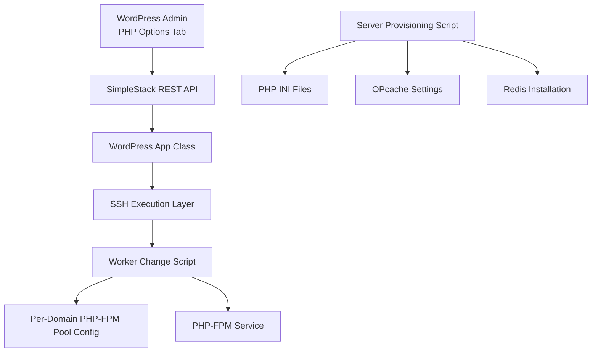
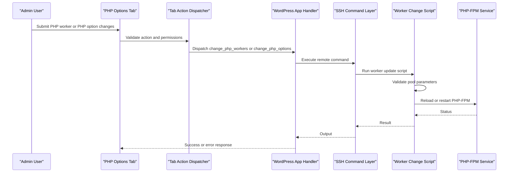
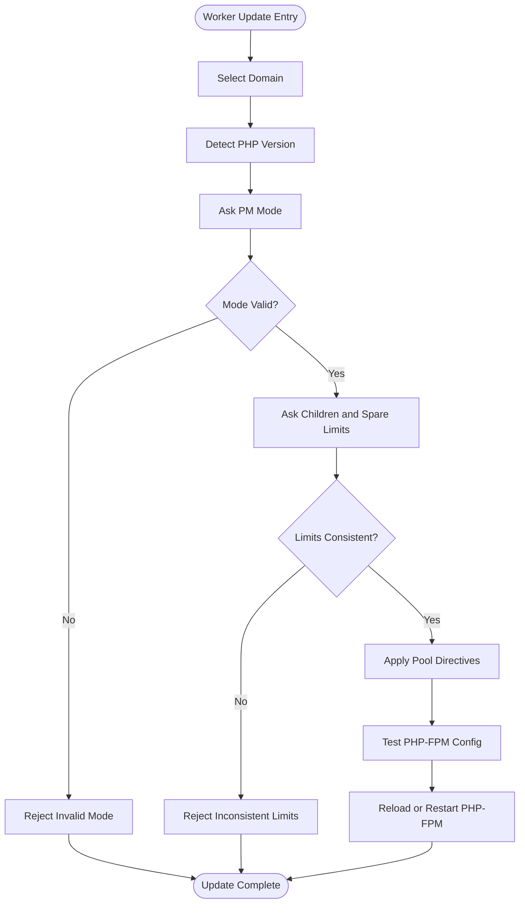
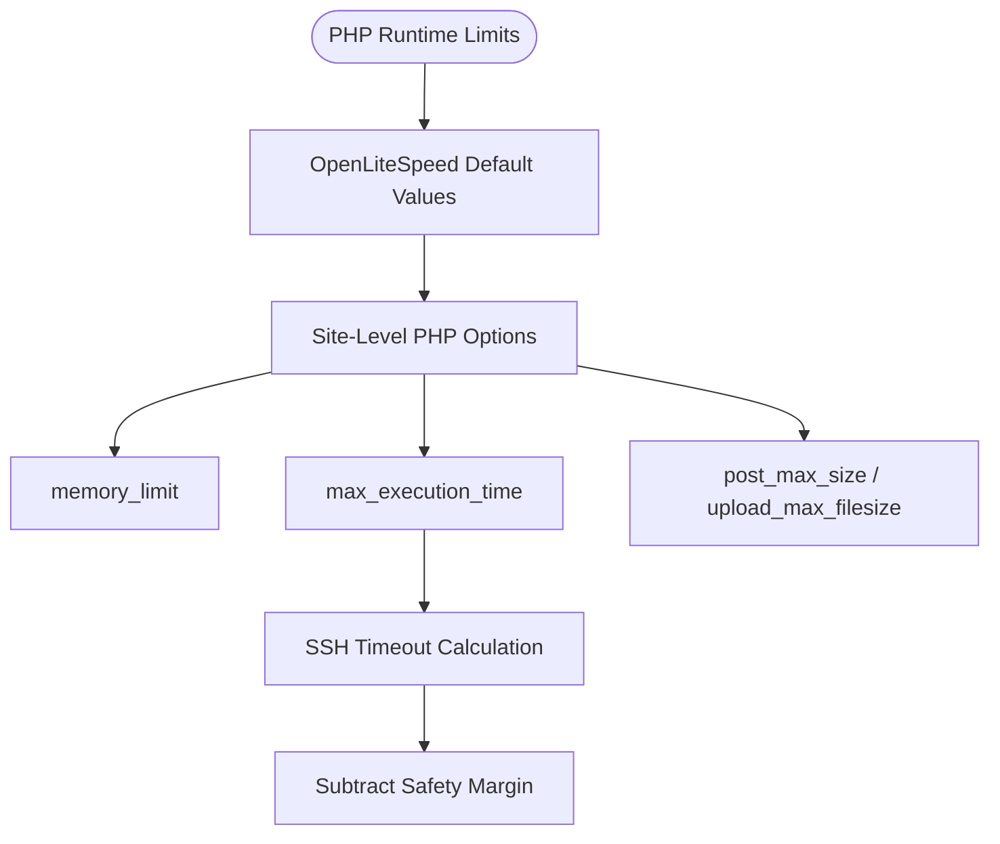
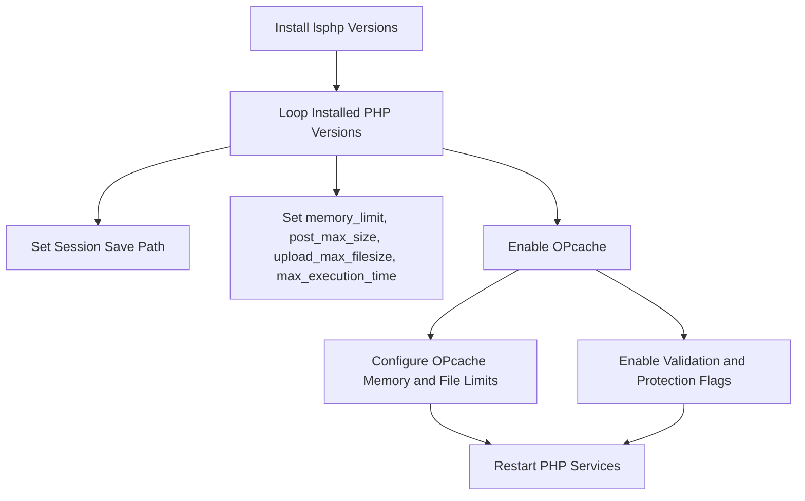
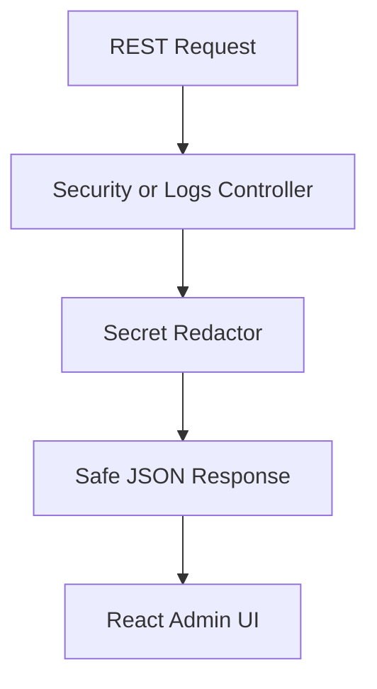
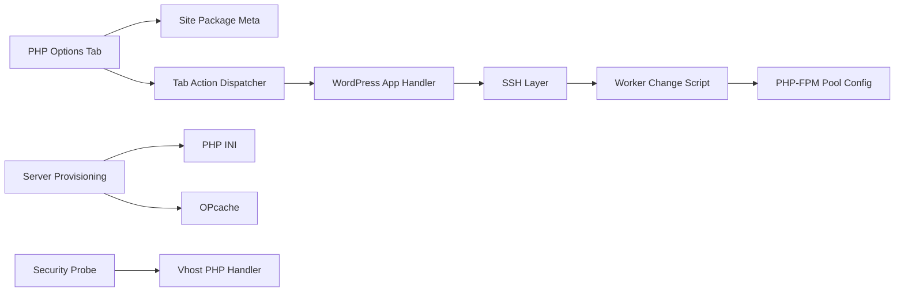

# PHP Performance Tuning

<cite>
**Referenced Files in This Document**   
- [SIMPLESTACK.md](file://docs/SIMPLESTACK.md)
- [php-options.php](file://includes/core/apps/wordpress-app/tabs/php-options.php)
- [class-wordpress-posts-site-package.php](file://includes/core/apps/wordpress-app/class-wordpress-posts-site-package.php)
- [39-php_workers.txt](file://includes/core/apps/wordpress-app/scripts/v1/raw/39-php_workers.txt)
- [01-prepare_server.txt](file://includes/core/apps/wordpress-app/scripts/v1/raw/01-prepare_server.txt)
- [1020-upgrade_460_performance.txt](file://includes/core/apps/wordpress-app/scripts/v1/raw/1020-upgrade_460_performance.txt)
- [class-wpcd-ssh.php](file://includes/core/apps/class-wpcd-ssh.php)
- [class-simplestack-rest-security.php](file://includes/core/api/class-simplestack-rest-security.php)
- [class-simplestack-secret-redactor.php](file://includes/core/api/class-simplestack-secret-redactor.php)
</cite>

## Table of Contents
1. [Introduction](#introduction)
2. [Project Structure](#project-structure)
3. [Core Components](#core-components)
4. [Architecture Overview](#architecture-overview)
5. [Detailed Component Analysis](#detailed-component-analysis)
6. [Dependency Analysis](#dependency-analysis)
7. [Performance Considerations](#performance-considerations)
8. [Troubleshooting Guide](#troubleshooting-guide)
9. [Conclusion](#conclusion)

## Introduction
This document explains how SimpleStack configures and tunes the PHP execution environment for WordPress sites. It focuses on:

- PHP-FPM worker process configuration and pool tuning.
- Memory limits, upload sizing, and execution timeouts.
- OPcache activation and memory pool settings.
- OpenLiteSpeed vs NGINX differences that affect performance tuning.
- Error reporting and production-safe logging behavior.
- Benchmarking, profiling, and system parameter fine-tuning guidance.

SimpleStack is an internal hosting control-plane plugin whose default stack targets OpenLiteSpeed with `lsphp83`, `lsphp84`, and `lsphp85`. The repository also contains legacy provisioning scripts for NGINX + PHP-FPM environments, which still influence site-level worker controls and historical performance upgrades.

**Section sources**
- [SIMPLESTACK.md:1-11](file://docs/SIMPLESTACK.md#L1-L11)

## Project Structure
The PHP performance surface spans three layers:

| Layer | Responsibility | Key Files |
|---|---|---|
| Admin UI schema | Defines PHP options, workers, version switching, and restart actions | `php-options.php`, `class-wordpress-posts-site-package.php` |
| Server-side provisioning | Installs PHP versions, sets defaults, enables OPcache, hardens functions, installs Redis | `01-prepare_server.txt`, `1020-upgrade_460_performance.txt` |
| Worker management script | Updates per-domain PHP-FPM pool directives and reloads services | `39-php_workers.txt` |

**Diagram sources**
- [php-options.php:115-196](file://includes/core/apps/wordpress-app/tabs/php-options.php#L115-L196)
- [39-php_workers.txt:182-260](file://includes/core/apps/wordpress-app/scripts/v1/raw/39-php_workers.txt#L182-L260)
- [01-prepare_server.txt:849-864](file://includes/core/apps/wordpress-app/scripts/v1/raw/01-prepare_server.txt#L849-L864)

**Section sources**
- [SIMPLESTACK.md:15-32](file://docs/SIMPLESTACK.md#L15-L32)
- [php-options.php:15-35](file://includes/core/apps/wordpress-app/tabs/php-options.php#L15-L35)

## Core Components
SimpleStack exposes PHP performance tuning through a dedicated tab and supporting data structures:

- **PHP Options Tab**: Provides fields for changing PHP version, restarting PHP, setting common PHP options, adding advanced PHP options, and updating PHP workers.
- **Site Package Fields**: Stores worker mode, max children, start servers, min spare servers, max spare servers, memory limit, and maximum execution time.
- **Worker Script**: A Bash script that edits per-domain PHP-FPM pool configuration and conditionally reloads PHP-FPM after validation.
- **Provisioning Scripts**: Set baseline PHP runtime values, enable OPcache, configure session paths, restrict dangerous functions, and install caching backends.

Key responsibilities:

| Component | Purpose |
|---|---|
| `WPCD_WORDPRESS_TABS_PHP_OPTIONS` | Renders PHP-related tabs, validates permissions, dispatches actions such as restart, version change, option update, and worker update. |
| Site package meta | Persists user-selected PHP worker and runtime values. |
| `39-php_workers.txt` | Applies validated worker changes to the active PHP-FPM pool file. |
| `01-prepare_server.txt` | Sets default PHP runtime values and OPcache configuration during server preparation. |
| `1020-upgrade_460_performance.txt` | Historical upgrade routine enabling OPcache across multiple PHP versions (now marked unsupported). |

**Section sources**
- [php-options.php:115-196](file://includes/core/apps/wordpress-app/tabs/php-options.php#L115-L196)
- [class-wordpress-posts-site-package.php:347-389](file://includes/core/apps/wordpress-app/class-wordpress-posts-site-package.php#L347-L389)
- [class-wordpress-posts-site-package.php:410-418](file://includes/core/apps/wordpress-app/class-wordpress-posts-site-package.php#L410-L418)
- [39-php_workers.txt:182-260](file://includes/core/apps/wordpress-app/scripts/v1/raw/39-php_workers.txt#L182-L260)
- [01-prepare_server.txt:849-864](file://includes/core/apps/wordpress-app/scripts/v1/raw/01-prepare_server.txt#L849-L864)
- [1020-upgrade_460_performance.txt:49-125](file://includes/core/apps/wordpress-app/scripts/v1/raw/1020-upgrade_460_performance.txt#L49-L125)

## Architecture Overview
The PHP performance workflow connects admin input, PHP action dispatch, SSH-based command execution, and service reload.

**Diagram sources**
- [php-options.php:115-196](file://includes/core/apps/wordpress-app/tabs/php-options.php#L115-L196)
- [39-php_workers.txt:30-48](file://includes/core/apps/wordpress-app/scripts/v1/raw/39-php_workers.txt#L30-L48)
- [39-php_workers.txt:182-260](file://includes/core/apps/wordpress-app/scripts/v1/raw/39-php_workers.txt#L182-L260)

## Detailed Component Analysis

### PHP-FPM Worker Configuration
SimpleStack supports three worker modes:

| Mode | Meaning |
|---|---|
| `dynamic` | Workers are created and destroyed based on demand. |
| `static` | A fixed number of workers is maintained. |
| `ondemand` | Workers are spawned only when requests arrive. |

The relevant pool directives managed by SimpleStack include:

| Directive | Role |
|---|---|
| `pm` | Process manager mode. |
| `pm.max_children` | Maximum concurrent worker processes. |
| `pm.start_servers` | Initial number of workers started. |
| `pm.min_spare_servers` | Minimum idle workers kept ready. |
| `pm.max_spare_servers` | Maximum idle workers allowed. |

Validation rules enforced by the worker script:

- `pm.min_spare_servers` must not exceed `pm.max_children`.
- `pm.max_spare_servers` must not exceed `pm.max_children`.
- `pm.start_servers` must be between `pm.min_spare_servers` and `pm.max_spare_servers`.

**Diagram sources**
- [39-php_workers.txt:182-260](file://includes/core/apps/wordpress-app/scripts/v1/raw/39-php_workers.txt#L182-L260)

Important implementation notes:

- The worker section is only shown for NGINX web servers in the PHP options tab.
- The script explicitly checks whether the web server type is NGINX before applying worker changes.
- After successful configuration edits, the script triggers a PHP-FPM reload or restart depending on the detected PHP version and service state.

**Section sources**
- [php-options.php:612-738](file://includes/core/apps/wordpress-app/tabs/php-options.php#L612-L738)
- [class-wordpress-posts-site-package.php:347-389](file://includes/core/apps/wordpress-app/class-wordpress-posts-site-package.php#L347-L389)
- [39-php_workers.txt:15-21](file://includes/core/apps/wordpress-app/scripts/v1/raw/39-php_workers.txt#L15-L21)
- [39-php_workers.txt:182-260](file://includes/core/apps/wordpress-app/scripts/v1/raw/39-php_workers.txt#L182-L260)

### Memory Management and Execution Timeouts
SimpleStack manages several PHP runtime limits:

| Setting | Scope | Notes |
|---|---|---|
| `memory_limit` | Per-site PHP options and OpenLiteSpeed defaults | Can be changed via common or advanced PHP options. |
| `max_execution_time` | Per-site PHP options and OpenLiteSpeed defaults | Also influences SSH timeout calculation. |
| `post_max_size` | OpenLiteSpeed defaults | Controls POST payload size. |
| `upload_max_filesize` | OpenLiteSpeed defaults | Controls uploaded file size. |

OpenLiteSpeed provisioning sets baseline values for memory, uploads, and execution time. Site-level overrides can be applied through the PHP options interface.

The SSH layer uses `max_execution_time` to calculate a safe SSH timeout, subtracting a margin to avoid premature termination during long-running commands.

**Diagram sources**
- [01-prepare_server.txt:849-852](file://includes/core/apps/wordpress-app/scripts/v1/raw/01-prepare_server.txt#L849-L852)
- [php-options.php:503-521](file://includes/core/apps/wordpress-app/tabs/php-options.php#L503-L521)
- [class-wpcd-ssh.php:74-77](file://includes/core/apps/class-wpcd-ssh.php#L74-L77)

**Section sources**
- [01-prepare_server.txt:849-852](file://includes/core/apps/wordpress-app/scripts/v1/raw/01-prepare_server.txt#L849-L852)
- [php-options.php:503-521](file://includes/core/apps/wordpress-app/tabs/php-options.php#L503-L521)
- [class-wpcd-ssh.php:74-77](file://includes/core/apps/class-wpcd-ssh.php#L74-L77)

### OPcache Configuration and Memory Pool Sizing
SimpleStack enables and configures OPcache in two main places:

1. **OpenLiteSpeed provisioning**: Enables OPcache, CLI OPcache, string buffer, accelerated files, memory consumption, comment saving, revalidation frequency, working directory usage, root validation, permission validation, and file update protection.
2. **Historical NGINX performance upgrade**: Enables OPcache across multiple PHP versions and increases accelerated file count and memory consumption.

Relevant OPcache directives configured by SimpleStack:

| Directive | Purpose |
|---|---|
| `opcache.enable` | Enables OPcache. |
| `opcache.enable_cli` | Enables OPcache for CLI operations. |
| `opcache.interned_strings_buffer` | Buffers interned strings. |
| `opcache.max_accelerated_files` | Maximum number of files cached. |
| `opcache.memory_consumption` | Size of the OPcache memory pool. |
| `opcache.save_comments` | Preserves comments for tools that need them. |
| `opcache.revalidate_freq` | How often OPcache checks for file updates. |
| `opcache.use_cwd` | Uses current working directory in cache keys. |
| `opcache.validate_root` | Validates root path. |
| `opcache.validate_permission` | Validates file permissions. |
| `opcache.file_update_protection` | Protects against race conditions during file updates. |

**Diagram sources**
- [01-prepare_server.txt:849-864](file://includes/core/apps/wordpress-app/scripts/v1/raw/01-prepare_server.txt#L849-L864)
- [1020-upgrade_460_performance.txt:49-125](file://includes/core/apps/wordpress-app/scripts/v1/raw/1020-upgrade_460_performance.txt#L49-L125)

**Section sources**
- [01-prepare_server.txt:849-864](file://includes/core/apps/wordpress-app/scripts/v1/raw/01-prepare_server.txt#L849-L864)
- [1020-upgrade_460_performance.txt:49-125](file://includes/core/apps/wordpress-app/scripts/v1/raw/1020-upgrade_460_performance.txt#L49-L125)

### JIT Compilation Settings
JIT compilation is a PHP 8 feature controlled by `opcache.jit` and related directives. The analyzed SimpleStack codebase does not explicitly set JIT configuration values in the referenced provisioning or tab files. Therefore, JIT remains at its PHP distribution default unless manually added to a PHP INI file or vhost override.

Guidance:

- If JIT is needed, add appropriate `opcache.jit*` directives to the target PHP INI or vhost configuration.
- Validate changes using PHP’s configuration inspection tools rather than assuming they were applied by SimpleStack.
- Monitor CPU usage and latency after enabling JIT because it benefits CPU-bound workloads more than I/O-bound workloads.

[No sources needed since this section provides general guidance without analyzing specific files]

### PHP Extensions and Disabled Modules
SimpleStack applies security-focused restrictions to PHP functions, especially for OpenLiteSpeed installations. For PHP 8.1, 8.2, and 8.3, it sets a global restricted function list. Some functions required by OpenLiteSpeed installation workflows are intentionally excluded from the global restriction.

Additionally, the security status probe reads installed plugins, WordPress configuration, PHP version, and the vhost PHP handler to help operators assess environment state.

Important considerations:

- Do not blindly remove restricted functions without testing application dependencies.
- Use the security status endpoint to verify the running PHP version and handler.
- Be aware that some provisioning steps may require temporary access to functions like `proc_open` or `proc_close` during site setup.

**Section sources**
- [01-prepare_server.txt:866-876](file://includes/core/apps/wordpress-app/scripts/v1/raw/01-prepare_server.txt#L866-L876)
- [class-simplestack-rest-security.php:171-190](file://includes/core/api/class-simplestack-rest-security.php#L171-L190)

### Error Reporting and Production Environment Behavior
SimpleStack includes mechanisms that support production-safe operation:

- Log routes expose command, SSH, and error logs through the REST API.
- All REST responses pass through a secret redactor that masks credentials and sensitive tokens.
- Common vhost configuration includes `log_errors On`.

Production recommendations derived from the codebase:

- Keep error logging enabled but avoid exposing raw error output to end users.
- Use the SimpleStack activity and log endpoints to inspect failures instead of enabling verbose display errors.
- Avoid placing secrets in command output; the redactor helps, but prevention is safer.

**Diagram sources**
- [class-simplestack-secret-redactor.php:12-37](file://includes/core/api/class-simplestack-secret-redactor.php#L12-L37)
- [class-simplestack-rest-logs.php:12-37](file://includes/core/api/class-simplestack-rest-logs.php#L12-L37)

**Section sources**
- [class-simplestack-secret-redactor.php:12-37](file://includes/core/api/class-simplestack-secret-redactor.php#L12-L37)
- [class-simplestack-rest-logs.php:12-37](file://includes/core/api/class-simplestack-rest-logs.php#L12-L37)

## Dependency Analysis
The PHP performance features depend on a clear chain of components:

**Diagram sources**
- [php-options.php:115-196](file://includes/core/apps/wordpress-app/tabs/php-options.php#L115-L196)
- [39-php_workers.txt:182-260](file://includes/core/apps/wordpress-app/scripts/v1/raw/39-php_workers.txt#L182-L260)
- [01-prepare_server.txt:849-864](file://includes/core/apps/wordpress-app/scripts/v1/raw/01-prepare_server.txt#L849-L864)
- [class-simplestack-rest-security.php:171-190](file://includes/core/api/class-simplestack-rest-security.php#L171-L190)

Coupling and cohesion observations:

- The PHP options tab is cohesive around PHP runtime configuration but depends on external services through SSH.
- Worker changes are tightly coupled to NGINX-style PHP-FPM pool files.
- OPcache configuration is centralized in provisioning scripts rather than exposed through the admin UI.
- Secret redaction is a cross-cutting concern applied to all REST responses.

**Section sources**
- [php-options.php:115-196](file://includes/core/apps/wordpress-app/tabs/php-options.php#L115-L196)
- [39-php_workers.txt:182-260](file://includes/core/apps/wordpress-app/scripts/v1/raw/39-php_workers.txt#L182-L260)
- [01-prepare_server.txt:849-864](file://includes/core/apps/wordpress-app/scripts/v1/raw/01-prepare_server.txt#L849-L864)
- [class-simplestack-secret-redactor.php:12-37](file://includes/core/api/class-simplestack-secret-redactor.php#L12-L37)

## Performance Considerations
Use the following tuning strategy when operating SimpleStack:

1. **Start with defaults.** Let provisioning set baseline memory, upload sizes, execution time, and OPcache values.
2. **Tune workers conservatively.** Begin with dynamic mode and small child counts, then increase based on observed memory pressure and request concurrency.
3. **Validate pool constraints.** Ensure minimum and maximum spare servers do not exceed max children, and start servers remain within the allowed range.
4. **Monitor OPcache hit rates.** Increase `opcache.memory_consumption` and `opcache.max_accelerated_files` only if cache misses or file table saturation are observed.
5. **Separate concerns.** Use site-level PHP options for application-specific limits and keep global defaults for consistency.
6. **Avoid overloading PHP-FPM.** Worker count × memory per worker should fit within available RAM, leaving room for the OS, database, and other services.
7. **Profile before changing.** Identify bottlenecks with PHP profilers, server metrics, and SimpleStack logs before adjusting runtime values.

Benchmarking and profiling recommendations:

- Measure baseline response times and throughput under realistic load.
- Use PHP profilers such as Xdebug or Blackfire in non-production environments.
- Track OPcache statistics and PHP-FPM process counts.
- Compare results before and after each change to avoid regression.
- Use SimpleStack’s activity and log endpoints to correlate configuration changes with failures.

[No sources needed since this section provides general guidance]

## Troubleshooting Guide
Common issues and their likely causes in SimpleStack:

| Symptom | Likely Cause | Recommended Action |
|---|---|---|
| PHP-FPM fails to restart after worker changes | Invalid pool directive or inconsistent limits | Review worker values and validate constraints. |
| Site cannot handle large uploads | Upload limits too low | Adjust `post_max_size` and `upload_max_filesize`. |
| Long-running scripts time out | `max_execution_time` too low | Increase execution time and review SSH timeout behavior. |
| OPcache not effective | Cache disabled or memory pool too small | Verify OPcache flags and memory settings. |
| Secrets appear in logs | Command output contains credentials | Redact secrets before logging and use the redacted REST responses. |
| Cannot determine PHP handler | OpenLiteSpeed vs NGINX difference | Use the security status probe to inspect the vhost PHP handler. |

Operational tips:

- Always test PHP-FPM configuration before reloading.
- Use the PHP options tab confirmation prompts to prevent accidental destructive changes.
- Inspect SimpleStack logs for command output and SSH transcripts.
- Use the security status endpoint to confirm the active PHP version and handler.

**Section sources**
- [39-php_workers.txt:182-260](file://includes/core/apps/wordpress-app/scripts/v1/raw/39-php_workers.txt#L182-L260)
- [php-options.php:612-738](file://includes/core/apps/wordpress-app/tabs/php-options.php#L612-L738)
- [class-simplestack-rest-security.php:171-190](file://includes/core/api/class-simplestack-rest-security.php#L171-L190)

## Conclusion
SimpleStack provides a structured way to tune PHP performance through admin-driven configuration, server-side provisioning, and service reload logic. Its strongest performance controls are:

- Per-site PHP options for memory, uploads, and execution time.
- NGINX-style PHP-FPM worker pool tuning through a validated script.
- OPcache activation and conservative defaults during provisioning.
- Production-safe logging and secret redaction in the REST layer.

For optimal throughput and response times, combine conservative worker sizing, adequate OPcache memory, appropriate upload and execution limits, and disciplined profiling. Avoid aggressive changes until workload characteristics are understood, and always validate configuration before reloading services.