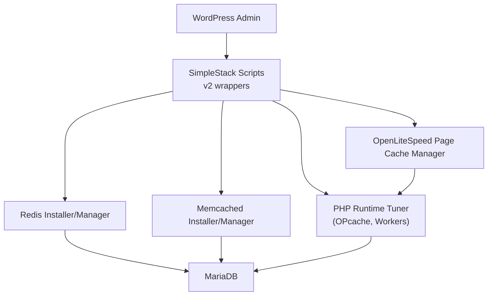
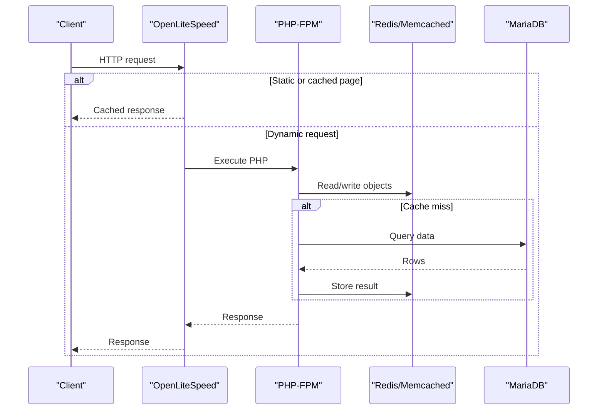
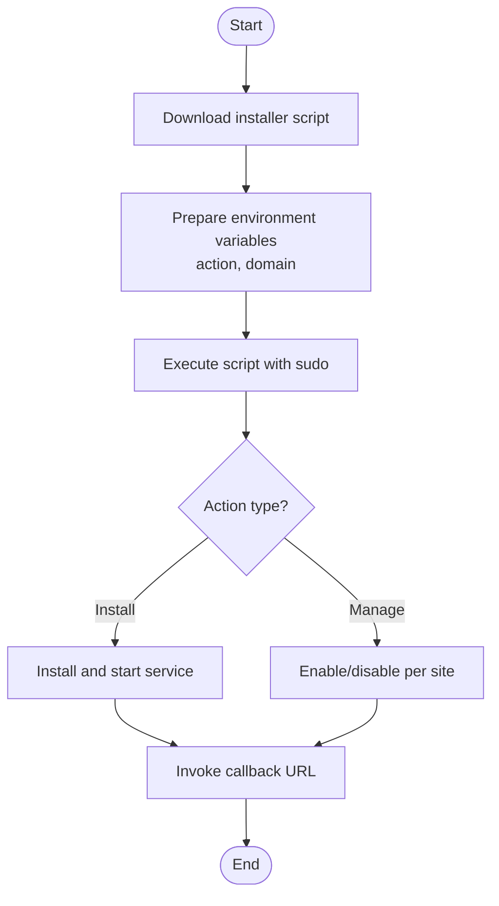
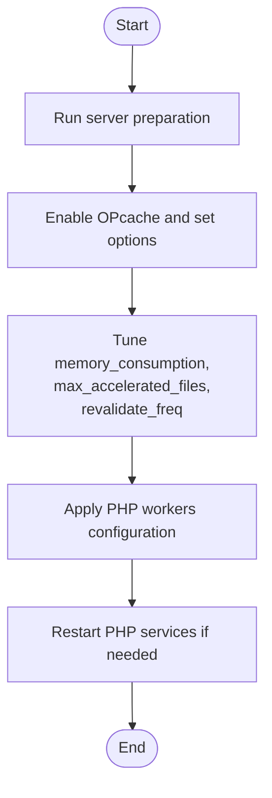
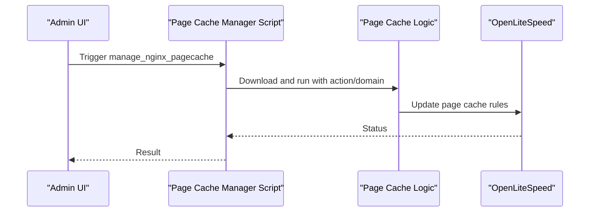
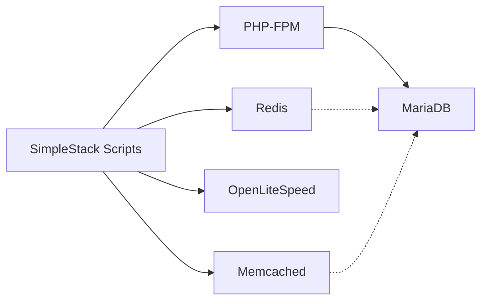

# Performance Optimization Tools

<cite>
**Referenced Files in This Document**
- [README.md](file://README.md)
- [install_redis.txt](file://includes/core/apps/wordpress-app/scripts/v2/install_redis.txt)
- [install_memcached.txt](file://includes/core/apps/wordpress-app/scripts/v2/install_memcached.txt)
- [manage_redis.txt](file://includes/core/apps/wordpress-app/scripts/v2/manage_redis.txt)
- [manage_memcached.txt](file://includes/core/apps/wordpress-app/scripts/v2/manage_memcached.txt)
- [manage_nginx_pagecache.txt](file://includes/core/apps/wordpress-app/scripts/v2/manage_nginx_pagecache.txt)
- [01-prepare_server.txt](file://includes/core/apps/wordpress-app/scripts/v1/raw/01-prepare_server.txt)
- [1020-upgrade_460_performance.txt](file://includes/core/apps/wordpress-app/scripts/v1/raw/1020-upgrade_460_performance.txt)
- [39-php_workers.txt](file://includes/core/apps/wordpress-app/scripts/v2/raw/39-php_workers.txt)
- [16-memcached.txt](file://includes/core/apps/wordpress-app/scripts/v1/raw/16-memcached.txt)
</cite>

## Table of Contents
1. [Introduction](#introduction)
2. [Project Structure](#project-structure)
3. [Core Components](#core-components)
4. [Architecture Overview](#architecture-overview)
5. [Detailed Component Analysis](#detailed-component-analysis)
6. [Dependency Analysis](#dependency-analysis)
7. [Performance Considerations](#performance-considerations)
8. [Troubleshooting Guide](#troubleshooting-guide)
9. [Conclusion](#conclusion)

## Introduction
This document explains how SimpleStack optimizes performance across caching layers, database access patterns, PHP runtime tuning, and web server configuration. It focuses on:
- Object caching with Redis and Memcached for application data, sessions, and query results
- WordPress-specific caching integration and cache lifecycle strategies
- PHP worker concurrency, memory limits, and execution timeouts
- Web server (OpenLiteSpeed) optimizations and static asset handling
- Monitoring, profiling, benchmarking, and capacity planning practices

SimpleStack provisions OpenLiteSpeed, PHP, MariaDB, Redis, and related services over SSH using Bash scripts executed from the WordPress admin UI. The stack is designed to be managed entirely within wp-admin without external SaaS control paths.

**Section sources**
- [README.md:1-25](file://README.md#L1-L25)
- [README.md:27-38](file://README.md#L27-L38)

## Project Structure
Performance-related capabilities are primarily implemented as provisioning and management scripts under the WordPress app module. Key areas include:
- Caching layer installers and managers for Redis and Memcached
- PHP runtime optimization scripts enabling and tuning OPcache
- Web server page cache management utilities
- PHP worker configuration scripts for concurrency tuning

**Diagram sources**
- [install_redis.txt:1-11](file://includes/core/apps/wordpress-app/scripts/v2/install_redis.txt#L1-L11)
- [install_memcached.txt:1-11](file://includes/core/apps/wordpress-app/scripts/v2/install_memcached.txt#L1-L11)
- [manage_redis.txt:1-9](file://includes/core/apps/wordpress-app/scripts/v2/manage_redis.txt#L1-L9)
- [manage_memcached.txt:1-9](file://includes/core/apps/wordpress-app/scripts/v2/manage_memcached.txt#L1-L9)
- [manage_nginx_pagecache.txt:1-9](file://includes/core/apps/wordpress-app/scripts/v2/manage_nginx_pagecache.txt#L1-L9)
- [01-prepare_server.txt:412-423](file://includes/core/apps/wordpress-app/scripts/v1/raw/01-prepare_server.txt#L412-L423)
- [39-php_workers.txt](file://includes/core/apps/wordpress-app/scripts/v2/raw/39-php_workers.txt)

**Section sources**
- [README.md:27-38](file://README.md#L27-L38)
- [install_redis.txt:1-11](file://includes/core/apps/wordpress-app/scripts/v2/install_redis.txt#L1-L11)
- [install_memcached.txt:1-11](file://includes/core/apps/wordpress-app/scripts/v2/install_memcached.txt#L1-L11)
- [manage_redis.txt:1-9](file://includes/core/apps/wordpress-app/scripts/v2/manage_redis.txt#L1-L9)
- [manage_memcached.txt:1-9](file://includes/core/apps/wordpress-app/scripts/v2/manage_memcached.txt#L1-L9)
- [manage_nginx_pagecache.txt:1-9](file://includes/core/apps/wordpress-app/scripts/v2/manage_nginx_pagecache.txt#L1-L9)
- [01-prepare_server.txt:412-423](file://includes/core/apps/wordpress-app/scripts/v1/raw/01-prepare_server.txt#L412-L423)
- [39-php_workers.txt](file://includes/core/apps/wordpress-app/scripts/v2/raw/39-php_workers.txt)

## Core Components
- Redis and Memcached object caching: Installers bootstrap the services; managers enable/disable per-site or system-wide usage.
- PHP runtime optimization: OPcache is enabled and tuned during server preparation and upgrades; PHP workers script adjusts concurrency.
- Web server page cache: A manager script toggles page caching rules for the web server.
- Provisioning orchestration: v2 wrapper scripts download and execute the actual logic scripts, passing parameters like action and domain.

Key responsibilities:
- Caching layer installation and service lifecycle
- Per-site activation and configuration
- PHP OPcache tuning and worker concurrency
- Web server page cache rule management

**Section sources**
- [install_redis.txt:1-11](file://includes/core/apps/wordpress-app/scripts/v2/install_redis.txt#L1-L11)
- [install_memcached.txt:1-11](file://includes/core/apps/wordpress-app/scripts/v2/install_memcached.txt#L1-L11)
- [manage_redis.txt:1-9](file://includes/core/apps/wordpress-app/scripts/v2/manage_redis.txt#L1-L9)
- [manage_memcached.txt:1-9](file://includes/core/apps/wordpress-app/scripts/v2/manage_memcached.txt#L1-L9)
- [manage_nginx_pagecache.txt:1-9](file://includes/core/apps/wordpress-app/scripts/v2/manage_nginx_pagecache.txt#L1-L9)
- [01-prepare_server.txt:412-423](file://includes/core/apps/wordpress-app/scripts/v1/raw/01-prepare_server.txt#L412-L423)
- [39-php_workers.txt](file://includes/core/apps/wordpress-app/scripts/v2/raw/39-php_workers.txt)

## Architecture Overview
The performance toolchain integrates at multiple layers:
- Application layer: WordPress uses object caching via Redis/Memcached and can leverage page caching through the web server.
- Runtime layer: PHP OPcache reduces compilation overhead; PHP workers tune concurrency.
- Web server layer: OpenLiteSpeed serves cached content and forwards dynamic requests to PHP.
- Data layer: MariaDB provides persistent storage; caching layers reduce load by serving frequent reads from memory.

**Diagram sources**
- [README.md:27-38](file://README.md#L27-L38)
- [install_redis.txt:1-11](file://includes/core/apps/wordpress-app/scripts/v2/install_redis.txt#L1-L11)
- [install_memcached.txt:1-11](file://includes/core/apps/wordpress-app/scripts/v2/install_memcached.txt#L1-L11)
- [manage_nginx_pagecache.txt:1-9](file://includes/core/apps/wordpress-app/scripts/v2/manage_nginx_pagecache.txt#L1-L9)
- [01-prepare_server.txt:412-423](file://includes/core/apps/wordpress-app/scripts/v1/raw/01-prepare_server.txt#L412-L423)

## Detailed Component Analysis

### Redis and Memcached Object Caching
Purpose:
- Provide fast in-memory stores for application objects, session data, and query results.
- Reduce database load and improve response times for read-heavy workloads.

Implementation overview:
- Installers download and execute a common script that installs and starts the caching service.
- Managers accept an action and domain to enable or configure caching for specific sites.

**Diagram sources**
- [install_redis.txt:1-11](file://includes/core/apps/wordpress-app/scripts/v2/install_redis.txt#L1-L11)
- [install_memcached.txt:1-11](file://includes/core/apps/wordpress-app/scripts/v2/install_memcached.txt#L1-L11)
- [manage_redis.txt:1-9](file://includes/core/apps/wordpress-app/scripts/v2/manage_redis.txt#L1-L9)
- [manage_memcached.txt:1-9](file://includes/core/apps/wordpress-app/scripts/v2/manage_memcached.txt#L1-L9)

Operational notes:
- Use the installer to provision the caching service once per server.
- Use the manager to toggle caching behavior per site or adjust settings.
- For legacy environments, older scripts demonstrate enabling memcached and restarting services.

**Section sources**
- [install_redis.txt:1-11](file://includes/core/apps/wordpress-app/scripts/v2/install_redis.txt#L1-L11)
- [install_memcached.txt:1-11](file://includes/core/apps/wordpress-app/scripts/v2/install_memcached.txt#L1-L11)
- [manage_redis.txt:1-9](file://includes/core/apps/wordpress-app/scripts/v2/manage_redis.txt#L1-L9)
- [manage_memcached.txt:1-9](file://includes/core/apps/wordpress-app/scripts/v2/manage_memcached.txt#L1-L9)
- [16-memcached.txt:45-68](file://includes/core/apps/wordpress-app/scripts/v1/raw/16-memcached.txt#L45-L68)
- [16-memcached.txt:183-186](file://includes/core/apps/wordpress-app/scripts/v1/raw/16-memcached.txt#L183-L186)

### PHP Runtime Optimization (OPcache and Workers)
Purpose:
- Minimize PHP compilation overhead with OPcache.
- Tune concurrency and resource limits for optimal throughput.

Key behaviors:
- Server preparation enables and tunes OPcache options such as file update protection, memory consumption, and revalidation frequency.
- Upgrade scripts apply consistent OPcache settings across PHP versions.
- PHP workers script configures concurrency parameters for PHP-FPM/OpenLiteSpeed.

**Diagram sources**
- [01-prepare_server.txt:412-423](file://includes/core/apps/wordpress-app/scripts/v1/raw/01-prepare_server.txt#L412-L423)
- [1020-upgrade_460_performance.txt:57-97](file://includes/core/apps/wordpress-app/scripts/v1/raw/1020-upgrade_460_performance.txt#L57-L97)
- [39-php_workers.txt](file://includes/core/apps/wordpress-app/scripts/v2/raw/39-php_workers.txt)

Best practices:
- Ensure OPcache is enabled for both CLI and FPM contexts.
- Align memory and file limits with site size and plugin/theme count.
- Adjust revalidation frequency based on deployment cadence.
- Set PHP workers according to CPU cores and expected concurrent requests.

**Section sources**
- [01-prepare_server.txt:412-423](file://includes/core/apps/wordpress-app/scripts/v1/raw/01-prepare_server.txt#L412-L423)
- [1020-upgrade_460_performance.txt:57-97](file://includes/core/apps/wordpress-app/scripts/v1/raw/1020-upgrade_460_performance.txt#L57-L97)
- [39-php_workers.txt](file://includes/core/apps/wordpress-app/scripts/v2/raw/39-php_workers.txt)

### Web Server Page Cache Management
Purpose:
- Serve cached pages directly from OpenLiteSpeed to reduce PHP processing.
- Toggle caching rules per site or globally.

Behavior:
- A manager script downloads and executes the page cache logic with action and domain parameters.

**Diagram sources**
- [manage_nginx_pagecache.txt:1-9](file://includes/core/apps/wordpress-app/scripts/v2/manage_nginx_pagecache.txt#L1-L9)

Notes:
- Use this utility to enable or disable page caching for specific domains.
- Combine with object caching for maximum performance gains.

**Section sources**
- [manage_nginx_pagecache.txt:1-9](file://includes/core/apps/wordpress-app/scripts/v2/manage_nginx_pagecache.txt#L1-L9)

### WordPress-Specific Caching Integration
Guidance:
- Configure WordPress to use Redis or Memcached as the object cache backend.
- Integrate a page caching plugin compatible with OpenLiteSpeed when appropriate.
- Implement cache warming strategies to pre-populate caches after deployments.
- Define cache invalidation policies tied to content updates and user actions.

Recommendations:
- Prefer Redis for complex data structures and high-throughput scenarios.
- Use Memcached for simple key-value caching where supported by plugins.
- Validate plugin compatibility with OpenLiteSpeed and ensure proper cache headers.

[No sources needed since this section provides general guidance]

### CDN Integration and Static Asset Optimization
Guidance:
- Offload static assets (images, CSS, JS) to a CDN to reduce origin load.
- Leverage OpenLiteSpeed’s built-in caching for static files and page responses.
- Optimize assets by minification, compression, and versioning.

Best practices:
- Configure CDN origins to point to your OpenLiteSpeed server.
- Set appropriate cache-control headers for static assets.
- Use purging mechanisms aligned with content updates.

[No sources needed since this section provides general guidance]

### Database Query Optimization Techniques
Guidance:
- Use object caching to reduce repeated queries.
- Analyze slow queries and add indexes where appropriate.
- Avoid N+1 query patterns and heavy joins in hot paths.
- Monitor query performance and adjust application logic accordingly.

[No sources needed since this section provides general guidance]

## Dependency Analysis
The performance toolchain depends on:
- Provisioning scripts that install and manage services
- PHP runtime configurations for OPcache and workers
- Web server page cache rules
- WordPress application code integrating with caching backends

**Diagram sources**
- [README.md:27-38](file://README.md#L27-L38)
- [install_redis.txt:1-11](file://includes/core/apps/wordpress-app/scripts/v2/install_redis.txt#L1-L11)
- [install_memcached.txt:1-11](file://includes/core/apps/wordpress-app/scripts/v2/install_memcached.txt#L1-L11)
- [manage_nginx_pagecache.txt:1-9](file://includes/core/apps/wordpress-app/scripts/v2/manage_nginx_pagecache.txt#L1-L9)
- [01-prepare_server.txt:412-423](file://includes/core/apps/wordpress-app/scripts/v1/raw/01-prepare_server.txt#L412-L423)

**Section sources**
- [README.md:27-38](file://README.md#L27-L38)
- [install_redis.txt:1-11](file://includes/core/apps/wordpress-app/scripts/v2/install_redis.txt#L1-L11)
- [install_memcached.txt:1-11](file://includes/core/apps/wordpress-app/scripts/v2/install_memcached.txt#L1-L11)
- [manage_nginx_pagecache.txt:1-9](file://includes/core/apps/wordpress-app/scripts/v2/manage_nginx_pagecache.txt#L1-L9)
- [01-prepare_server.txt:412-423](file://includes/core/apps/wordpress-app/scripts/v1/raw/01-prepare_server.txt#L412-L423)

## Performance Considerations
- Caching strategy:
  - Enable object caching early; prefer Redis for complex workloads.
  - Use page caching for static and frequently accessed pages.
  - Implement cache warming post-deploy to avoid cold-start penalties.
- PHP tuning:
  - Keep OPcache enabled and tuned to workload characteristics.
  - Adjust PHP workers based on CPU and memory resources.
  - Monitor memory usage and adjust limits to prevent OOM conditions.
- Web server:
  - Use OpenLiteSpeed’s native caching features.
  - Offload static assets to a CDN.
  - Tune connection pooling and keep-alive settings.
- Database:
  - Profile slow queries and optimize indexes.
  - Use read replicas if necessary to scale reads.
  - Regularly vacuum and analyze tables.

[No sources needed since this section provides general guidance]

## Troubleshooting Guide
Common issues and resolutions:
- Caching service not responding:
  - Verify service installation and status.
  - Check permissions and restart the service if needed.
- OPcache not taking effect:
  - Confirm OPcache is enabled for both CLI and FPM.
  - Review memory and file limits; restart PHP services after changes.
- Page cache not serving cached content:
  - Ensure page cache rules are applied for the domain.
  - Validate cache headers and CDN purge operations.
- High memory usage:
  - Tune PHP workers and OPcache memory.
  - Identify memory leaks in plugins/themes.

**Section sources**
- [16-memcached.txt:183-186](file://includes/core/apps/wordpress-app/scripts/v1/raw/16-memcached.txt#L183-L186)
- [01-prepare_server.txt:412-423](file://includes/core/apps/wordpress-app/scripts/v1/raw/01-prepare_server.txt#L412-L423)
- [manage_nginx_pagecache.txt:1-9](file://includes/core/apps/wordpress-app/scripts/v2/manage_nginx_pagecache.txt#L1-L9)

## Conclusion
SimpleStack provides a comprehensive performance optimization toolkit centered around Redis/Memcached object caching, PHP runtime tuning, and OpenLiteSpeed page caching. By leveraging these components strategically—along with CDN offloading, asset optimization, and database query improvements—you can achieve significant performance gains. Continuous monitoring, profiling, and capacity planning ensure sustained performance under varying loads.

[No sources needed since this section summarizes without analyzing specific files]