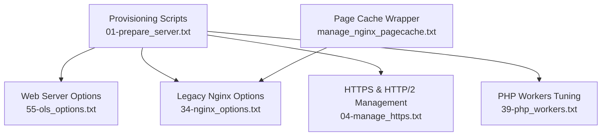
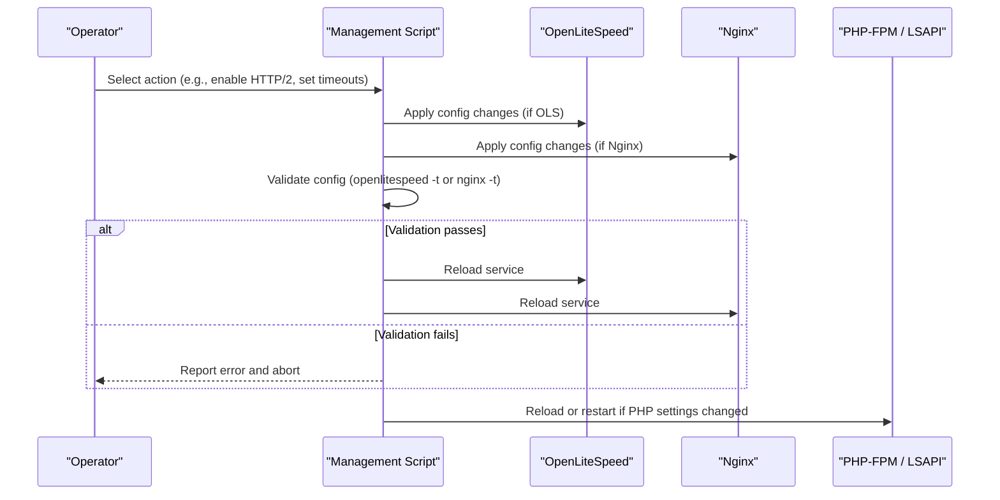
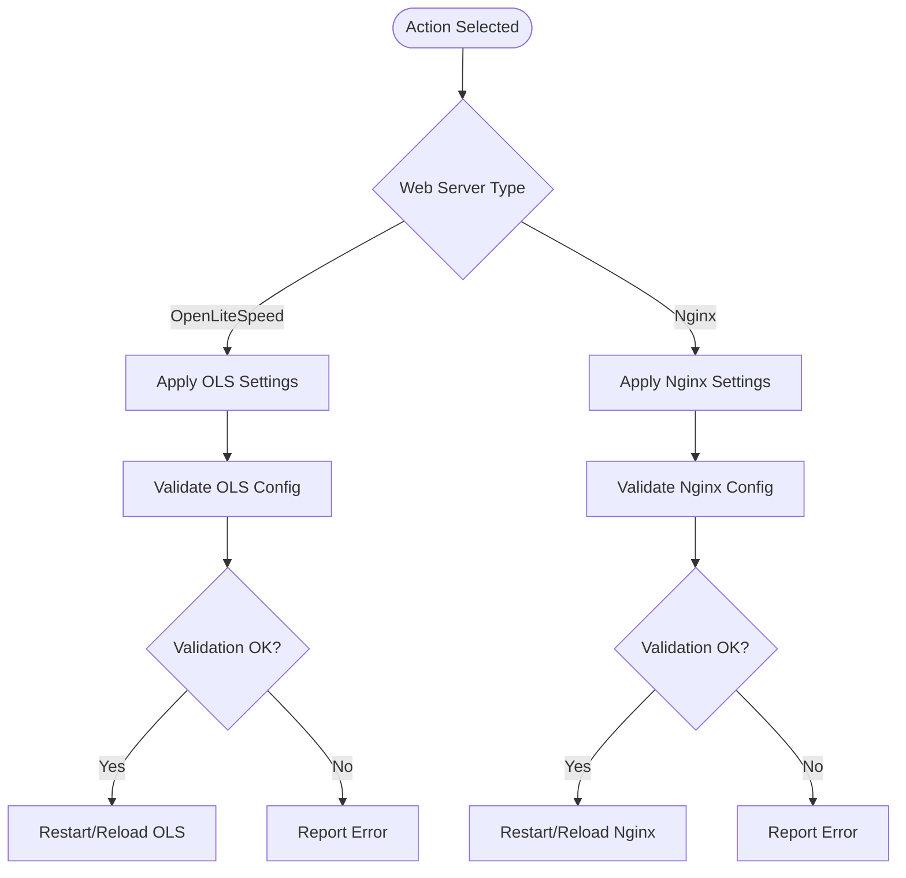
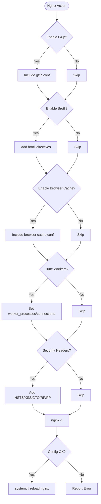
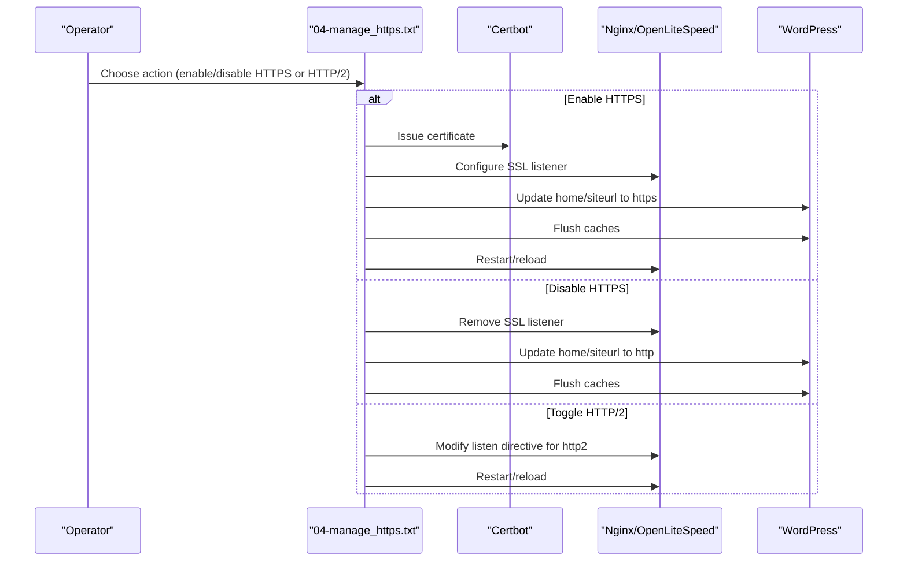
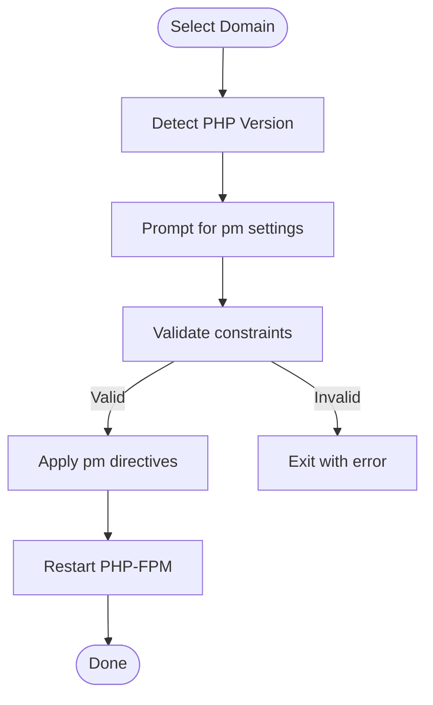
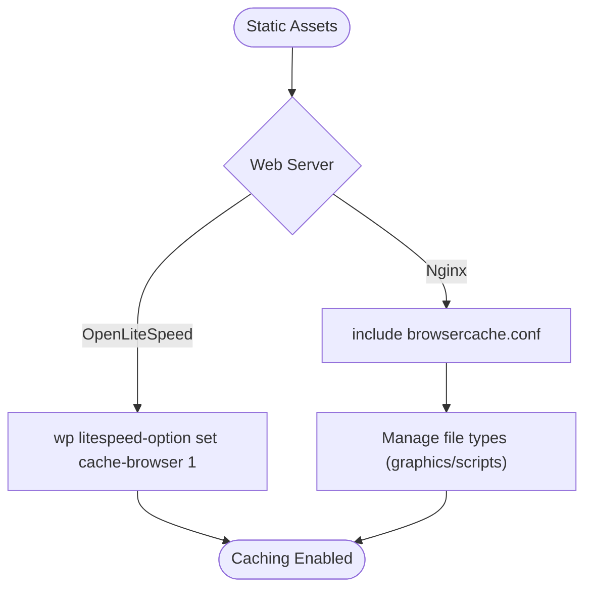
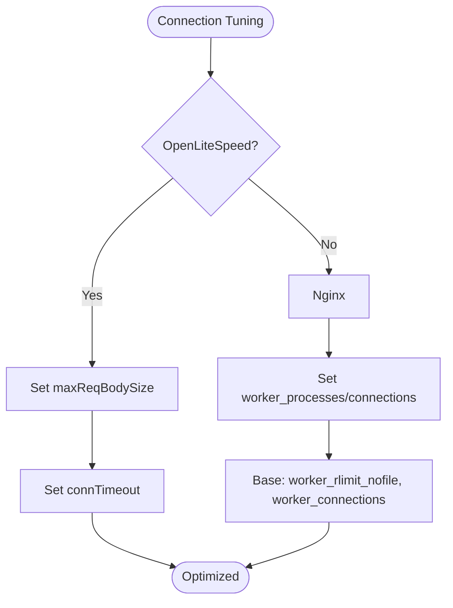
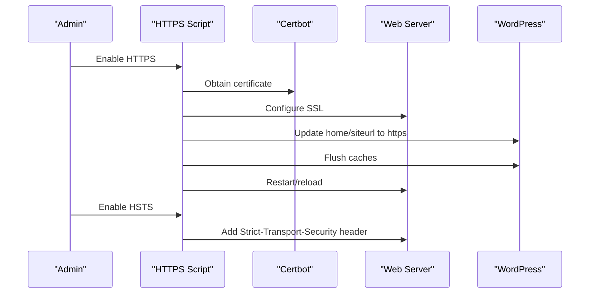
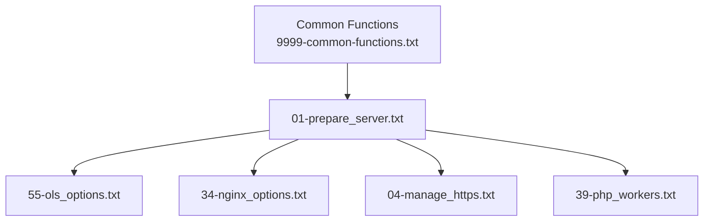

# Web Server Optimization

<cite>
**Referenced Files in This Document**   
- [README.md](file://README.md)
- [01-prepare_server.txt](file://includes/core/apps/wordpress-app/scripts/v1/raw/01-prepare_server.txt)
- [34-nginx_options.txt](file://includes/core/apps/wordpress-app/scripts/v1/raw/34-nginx_options.txt)
- [55-ols_options.txt](file://includes/core/apps/wordpress-app/scripts/v1/raw/55-ols_options.txt)
- [04-manage_https.txt](file://includes/core/apps/wordpress-app/scripts/v1/raw/04-manage_https.txt)
- [39-php_workers.txt](file://includes/core/apps/wordpress-app/scripts/v1/raw/39-php_workers.txt)
- [manage_nginx_pagecache.txt](file://includes/core/apps/wordpress-app/scripts/v2/manage_nginx_pagecache.txt)
</cite>

## Table of Contents
1. [Introduction](#introduction)
2. [Project Structure](#project-structure)
3. [Core Components](#core-components)
4. [Architecture Overview](#architecture-overview)
5. [Detailed Component Analysis](#detailed-component-analysis)
6. [Dependency Analysis](#dependency-analysis)
7. [Performance Considerations](#performance-considerations)
8. [Troubleshooting Guide](#troubleshooting-guide)
9. [Conclusion](#conclusion)
10. [Appendices](#appendices)

## Introduction
This document provides a comprehensive guide to web server performance optimization for high-traffic WordPress deployments using the repository’s provisioning and management scripts. It focuses on OpenLiteSpeed (primary) and legacy Nginx configuration paths, static asset optimization, browser caching, compression, HTTP/2, SSL/TLS, PHP worker tuning, and operational guidance for CDN integration and load balancing. The content is grounded in the repository’s shell scripts that configure web servers, PHP runtimes, and site-level behaviors.

## Project Structure
The repository provisions and manages WordPress sites primarily with OpenLiteSpeed and includes legacy Nginx support via scripts. Key areas relevant to web server optimization:
- Provisioning and base server hardening
- Web server options (OpenLiteSpeed and Nginx)
- HTTPS and HTTP/2 management
- PHP worker tuning
- Page cache script wrappers

**Diagram sources**
- [01-prepare_server.txt:443-449](file://includes/core/apps/wordpress-app/scripts/v1/raw/01-prepare_server.txt#L443-L449)
- [55-ols_options.txt:163-230](file://includes/core/apps/wordpress-app/scripts/v1/raw/55-ols_options.txt#L163-L230)
- [34-nginx_options.txt:1457-1599](file://includes/core/apps/wordpress-app/scripts/v1/raw/34-nginx_options.txt#L1457-L1599)
- [04-manage_https.txt:16-67](file://includes/core/apps/wordpress-app/scripts/v1/raw/04-manage_https.txt#L16-L67)
- [39-php_workers.txt:117-264](file://includes/core/apps/wordpress-app/scripts/v1/raw/39-php_workers.txt#L117-L264)
- [manage_nginx_pagecache.txt:1-9](file://includes/core/apps/wordpress-app/scripts/v2/manage_nginx_pagecache.txt#L1-L9)

**Section sources**
- [README.md:27-38](file://README.md#L27-L38)

## Core Components
- OpenLiteSpeed configuration and tuning via menu-driven scripts (compression, HTTP/2, headers, timeouts).
- Legacy Nginx configuration and tuning via menu-driven scripts (gzip, brotli, HTTP/2, browser cache includes, worker settings).
- HTTPS and HTTP/2 enablement/disabling across both web servers.
- PHP-FPM worker pool tuning for Nginx environments.
- Base server preparation including connection limits and worker directives.

Key responsibilities:
- Enabling and disabling compression (Gzip/Brotli).
- Managing HTTP/2 per domain.
- Setting security headers (HSTS, XSS protection, Content-Type options, Referrer-Policy, Permissions-Policy).
- Configuring browser caching strategies.
- Adjusting request body size and connection timeout at the server level.
- Tuning PHP workers (pm settings) for Nginx.

**Section sources**
- [55-ols_options.txt:163-230](file://includes/core/apps/wordpress-app/scripts/v1/raw/55-ols_options.txt#L163-L230)
- [34-nginx_options.txt:824-915](file://includes/core/apps/wordpress-app/scripts/v1/raw/34-nginx_options.txt#L824-L915)
- [04-manage_https.txt:16-67](file://includes/core/apps/wordpress-app/scripts/v1/raw/04-manage_https.txt#L16-L67)
- [39-php_workers.txt:117-264](file://includes/core/apps/wordpress-app/scripts/v1/raw/39-php_workers.txt#L117-L264)
- [01-prepare_server.txt:443-449](file://includes/core/apps/wordpress-app/scripts/v1/raw/01-prepare_server.txt#L443-L449)

## Architecture Overview
The optimization flow integrates provisioning, web server configuration, and runtime tuning. The scripts are invoked by the control plane to apply changes safely, validate configurations, and reload services.

**Diagram sources**
- [55-ols_options.txt:56-69](file://includes/core/apps/wordpress-app/scripts/v1/raw/55-ols_options.txt#L56-L69)
- [34-nginx_options.txt:41-49](file://includes/core/apps/wordpress-app/scripts/v1/raw/34-nginx_options.txt#L41-L49)
- [39-php_workers.txt:30-48](file://includes/core/apps/wordpress-app/scripts/v1/raw/39-php_workers.txt#L30-L48)

## Detailed Component Analysis

### OpenLiteSpeed Performance Tuning
- Compression: Global Gzip toggle and per-domain Brotli enablement.
- HTTP/2: Per-domain enable/disable functions.
- Browser caching: Managed via LSCache option through WP CLI.
- Security headers: HSTS, XSS Protection, X-Content-Type-Options, Referrer-Policy, Permissions-Policy.
- Request/connection tuning: maxReqBodySize and connTimeout directives.

**Diagram sources**
- [55-ols_options.txt:163-230](file://includes/core/apps/wordpress-app/scripts/v1/raw/55-ols_options.txt#L163-L230)
- [55-ols_options.txt:704-746](file://includes/core/apps/wordpress-app/scripts/v1/raw/55-ols_options.txt#L704-L746)
- [55-ols_options.txt:1094-1273](file://includes/core/apps/wordpress-app/scripts/v1/raw/55-ols_options.txt#L1094-L1273)

**Section sources**
- [55-ols_options.txt:163-230](file://includes/core/apps/wordpress-app/scripts/v1/raw/55-ols_options.txt#L163-L230)
- [55-ols_options.txt:704-746](file://includes/core/apps/wordpress-app/scripts/v1/raw/55-ols_options.txt#L704-L746)
- [55-ols_options.txt:1094-1273](file://includes/core/apps/wordpress-app/scripts/v1/raw/55-ols_options.txt#L1094-L1273)

### Nginx Performance Tuning
- Compression: Gzip inclusion and Brotli enablement per domain.
- HTTP/2: Enable/disable via regex-based edits to listen directives.
- Browser caching: Include-based strategy and type lists for graphics and scripts.
- Worker tuning: worker_processes and worker_connections directives.
- Security headers: HSTS, XSS Protection, X-Content-Type-Options, Referrer-Policy, Permissions-Policy.

**Diagram sources**
- [34-nginx_options.txt:173-246](file://includes/core/apps/wordpress-app/scripts/v1/raw/34-nginx_options.txt#L173-L246)
- [34-nginx_options.txt:824-915](file://includes/core/apps/wordpress-app/scripts/v1/raw/34-nginx_options.txt#L824-L915)
- [34-nginx_options.txt:1210-1260](file://includes/core/apps/wordpress-app/scripts/v1/raw/34-nginx_options.txt#L1210-L1260)
- [34-nginx_options.txt:1457-1599](file://includes/core/apps/wordpress-app/scripts/v1/raw/34-nginx_options.txt#L1457-L1599)

**Section sources**
- [34-nginx_options.txt:173-246](file://includes/core/apps/wordpress-app/scripts/v1/raw/34-nginx_options.txt#L173-L246)
- [34-nginx_options.txt:824-915](file://includes/core/apps/wordpress-app/scripts/v1/raw/34-nginx_options.txt#L824-L915)
- [34-nginx_options.txt:1210-1260](file://includes/core/apps/wordpress-app/scripts/v1/raw/34-nginx_options.txt#L1210-L1260)
- [34-nginx_options.txt:1457-1599](file://includes/core/apps/wordpress-app/scripts/v1/raw/34-nginx_options.txt#L1457-L1599)

### HTTPS and HTTP/2 Management
- Enables/disables HTTPS via certbot integration for both Nginx and OpenLiteSpeed.
- Manages HTTP/2 toggles per domain for both web servers.
- Updates WordPress home/siteurl and flushes caches after enabling HTTPS.

**Diagram sources**
- [04-manage_https.txt:16-67](file://includes/core/apps/wordpress-app/scripts/v1/raw/04-manage_https.txt#L16-L67)
- [04-manage_https.txt:99-137](file://includes/core/apps/wordpress-app/scripts/v1/raw/04-manage_https.txt#L99-L137)
- [04-manage_https.txt:181-204](file://includes/core/apps/wordpress-app/scripts/v1/raw/04-manage_https.txt#L181-L204)

**Section sources**
- [04-manage_https.txt:16-67](file://includes/core/apps/wordpress-app/scripts/v1/raw/04-manage_https.txt#L16-L67)
- [04-manage_https.txt:99-137](file://includes/core/apps/wordpress-app/scripts/v1/raw/04-manage_https.txt#L99-L137)
- [04-manage_https.txt:181-204](file://includes/core/apps/wordpress-app/scripts/v1/raw/04-manage_https.txt#L181-L204)

### PHP Workers Tuning (Nginx)
- Interactively adjusts PHP-FPM pm settings (pm, pm.max_children, pm.start_servers, pm.min_spare_servers, pm.max_spare_servers).
- Validates parameter relationships before applying changes.
- Restarts PHP-FPM after successful updates.

**Diagram sources**
- [39-php_workers.txt:117-264](file://includes/core/apps/wordpress-app/scripts/v1/raw/39-php_workers.txt#L117-L264)

**Section sources**
- [39-php_workers.txt:117-264](file://includes/core/apps/wordpress-app/scripts/v1/raw/39-php_workers.txt#L117-L264)

### Static Asset Optimization and Browser Caching
- OpenLiteSpeed: Uses LSCache options via WP CLI to manage browser cache behavior.
- Nginx: Includes centralized browser cache configuration files and allows adding/removing file types for graphics and scripts.

**Diagram sources**
- [55-ols_options.txt:298-333](file://includes/core/apps/wordpress-app/scripts/v1/raw/55-ols_options.txt#L298-L333)
- [34-nginx_options.txt:1210-1260](file://includes/core/apps/wordpress-app/scripts/v1/raw/34-nginx_options.txt#L1210-L1260)

**Section sources**
- [55-ols_options.txt:298-333](file://includes/core/apps/wordpress-app/scripts/v1/raw/55-ols_options.txt#L298-L333)
- [34-nginx_options.txt:1210-1260](file://includes/core/apps/wordpress-app/scripts/v1/raw/34-nginx_options.txt#L1210-L1260)

### Connection Handling and Timeouts
- OpenLiteSpeed: Sets maxReqBodySize and connTimeout at the server level.
- Nginx: Allows setting worker_processes and worker_connections; base provisioning also tunes worker_rlimit_nofile and worker_connections.

**Diagram sources**
- [55-ols_options.txt:1094-1273](file://includes/core/apps/wordpress-app/scripts/v1/raw/55-ols_options.txt#L1094-L1273)
- [34-nginx_options.txt:1457-1599](file://includes/core/apps/wordpress-app/scripts/v1/raw/34-nginx_options.txt#L1457-L1599)
- [01-prepare_server.txt:443-449](file://includes/core/apps/wordpress-app/scripts/v1/raw/01-prepare_server.txt#L443-L449)

**Section sources**
- [55-ols_options.txt:1094-1273](file://includes/core/apps/wordpress-app/scripts/v1/raw/55-ols_options.txt#L1094-L1273)
- [34-nginx_options.txt:1457-1599](file://includes/core/apps/wordpress-app/scripts/v1/raw/34-nginx_options.txt#L1457-L1599)
- [01-prepare_server.txt:443-449](file://includes/core/apps/wordpress-app/scripts/v1/raw/01-prepare_server.txt#L443-L449)

### SSL/TLS Optimization
- HTTPS enablement uses certbot integration for both Nginx and OpenLiteSpeed.
- HSTS header can be enabled per domain for both web servers.
- After enabling HTTPS, WordPress URLs are updated and caches flushed.

**Diagram sources**
- [04-manage_https.txt:99-137](file://includes/core/apps/wordpress-app/scripts/v1/raw/04-manage_https.txt#L99-L137)
- [34-nginx_options.txt:877-915](file://includes/core/apps/wordpress-app/scripts/v1/raw/34-nginx_options.txt#L877-L915)
- [55-ols_options.txt:749-791](file://includes/core/apps/wordpress-app/scripts/v1/raw/55-ols_options.txt#L749-L791)

**Section sources**
- [04-manage_https.txt:99-137](file://includes/core/apps/wordpress-app/scripts/v1/raw/04-manage_https.txt#L99-L137)
- [34-nginx_options.txt:877-915](file://includes/core/apps/wordpress-app/scripts/v1/raw/34-nginx_options.txt#L877-L915)
- [55-ols_options.txt:749-791](file://includes/core/apps/wordpress-app/scripts/v1/raw/55-ols_options.txt#L749-L791)

### CDN Integration Guidelines
- Use OpenLiteSpeed LSCache browser caching and server-side caching modules where applicable.
- For Nginx, leverage include-based browser cache configuration and consider offloading static assets to a CDN.
- Ensure cache-busting strategies for dynamic content and consistent cache headers.

[No sources needed since this section provides general guidance]

### Load Balancing Configurations
- Scale horizontally by provisioning multiple servers and distributing traffic via a load balancer.
- Tune PHP workers and connection limits per node to match expected concurrency.
- Monitor resource utilization and adjust worker_processes/connections accordingly.

[No sources needed since this section provides general guidance]

## Dependency Analysis
The scripts depend on common functions and system utilities to validate and reload services. They interact with:
- System services (systemctl) for restarting/reloading web servers and PHP.
- WP CLI for managing WordPress options and caches.
- Certbot for SSL certificate management.

**Diagram sources**
- [01-prepare_server.txt:443-449](file://includes/core/apps/wordpress-app/scripts/v1/raw/01-prepare_server.txt#L443-L449)
- [55-ols_options.txt:163-230](file://includes/core/apps/wordpress-app/scripts/v1/raw/55-ols_options.txt#L163-L230)
- [34-nginx_options.txt:1457-1599](file://includes/core/apps/wordpress-app/scripts/v1/raw/34-nginx_options.txt#L1457-L1599)
- [04-manage_https.txt:16-67](file://includes/core/apps/wordpress-app/scripts/v1/raw/04-manage_https.txt#L16-L67)
- [39-php_workers.txt:117-264](file://includes/core/apps/wordpress-app/scripts/v1/raw/39-php_workers.txt#L117-L264)

**Section sources**
- [01-prepare_server.txt:443-449](file://includes/core/apps/wordpress-app/scripts/v1/raw/01-prepare_server.txt#L443-L449)
- [55-ols_options.txt:163-230](file://includes/core/apps/wordpress-app/scripts/v1/raw/55-ols_options.txt#L163-L230)
- [34-nginx_options.txt:1457-1599](file://includes/core/apps/wordpress-app/scripts/v1/raw/34-nginx_options.txt#L1457-L1599)
- [04-manage_https.txt:16-67](file://includes/core/apps/wordpress-app/scripts/v1/raw/04-manage_https.txt#L16-L67)
- [39-php_workers.txt:117-264](file://includes/core/apps/wordpress-app/scripts/v1/raw/39-php_workers.txt#L117-L264)

## Performance Considerations
- Prefer OpenLiteSpeed for integrated caching and performance features; use Nginx only when necessary due to legacy support.
- Enable compression (Gzip/Brotli) based on workload characteristics and client support.
- Use HTTP/2 for improved multiplexing and header compression where SSL is enabled.
- Configure browser caching for static assets and leverage CDN for global distribution.
- Tune PHP workers to match CPU cores and memory constraints; monitor process counts under load.
- Set appropriate request body sizes and connection timeouts to prevent bottlenecks.

[No sources needed since this section provides general guidance]

## Troubleshooting Guide
- Configuration validation failures: Scripts test configs before reloading; check error messages and revert changes if needed.
- Service reload issues: Verify systemctl status and logs for web servers and PHP-FPM.
- WordPress cache inconsistencies: Flush caches after HTTPS changes and configuration updates.
- Permission errors: Ensure correct ownership for .htaccess and vhost directories.

**Section sources**
- [55-ols_options.txt:56-69](file://includes/core/apps/wordpress-app/scripts/v1/raw/55-ols_options.txt#L56-L69)
- [34-nginx_options.txt:41-49](file://includes/core/apps/wordpress-app/scripts/v1/raw/34-nginx_options.txt#L41-L49)
- [39-php_workers.txt:30-48](file://includes/core/apps/wordpress-app/scripts/v1/raw/39-php_workers.txt#L30-L48)

## Conclusion
The repository provides robust, script-driven mechanisms to optimize web server performance for WordPress deployments. By leveraging OpenLiteSpeed’s native capabilities and Nginx’s flexible configuration, operators can tune compression, HTTP/2, browser caching, SSL/TLS, and PHP workers effectively. Adhering to the provided workflows ensures safe, validated changes with minimal downtime.

[No sources needed since this section summarizes without analyzing specific files]

## Appendices
- Page cache wrapper script for Nginx operations.

**Section sources**
- [manage_nginx_pagecache.txt:1-9](file://includes/core/apps/wordpress-app/scripts/v2/manage_nginx_pagecache.txt#L1-L9)