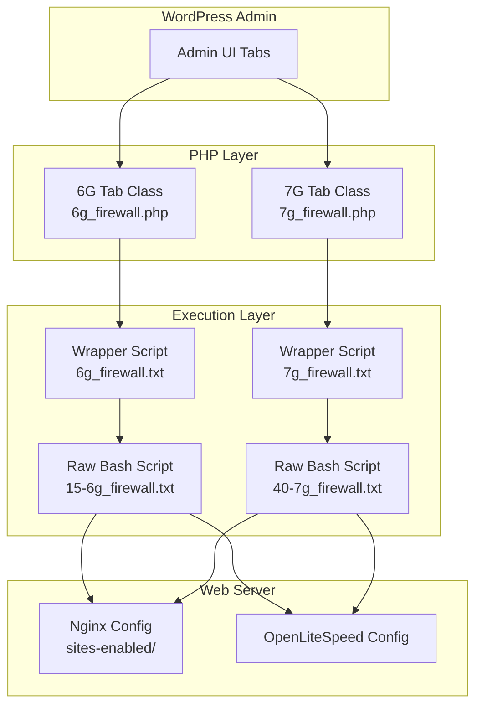
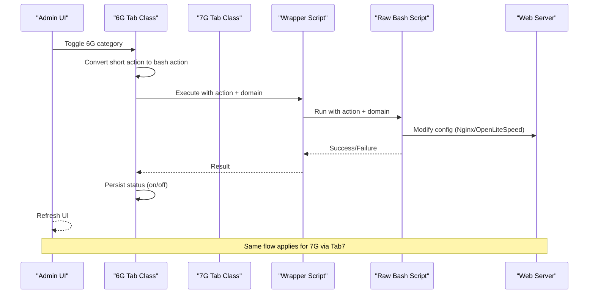
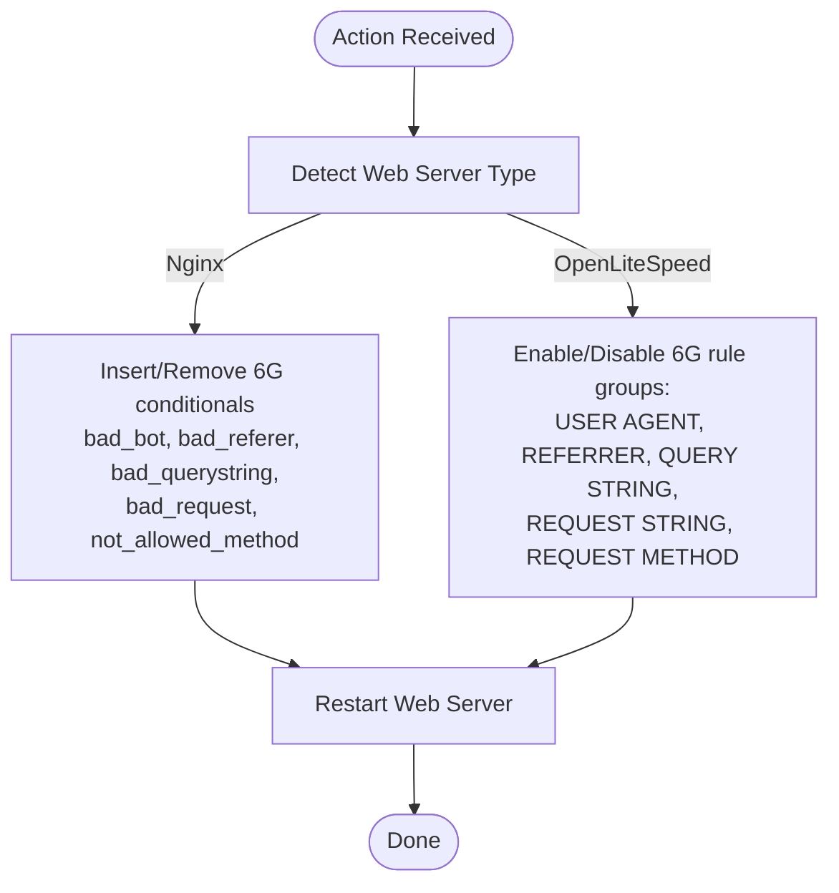
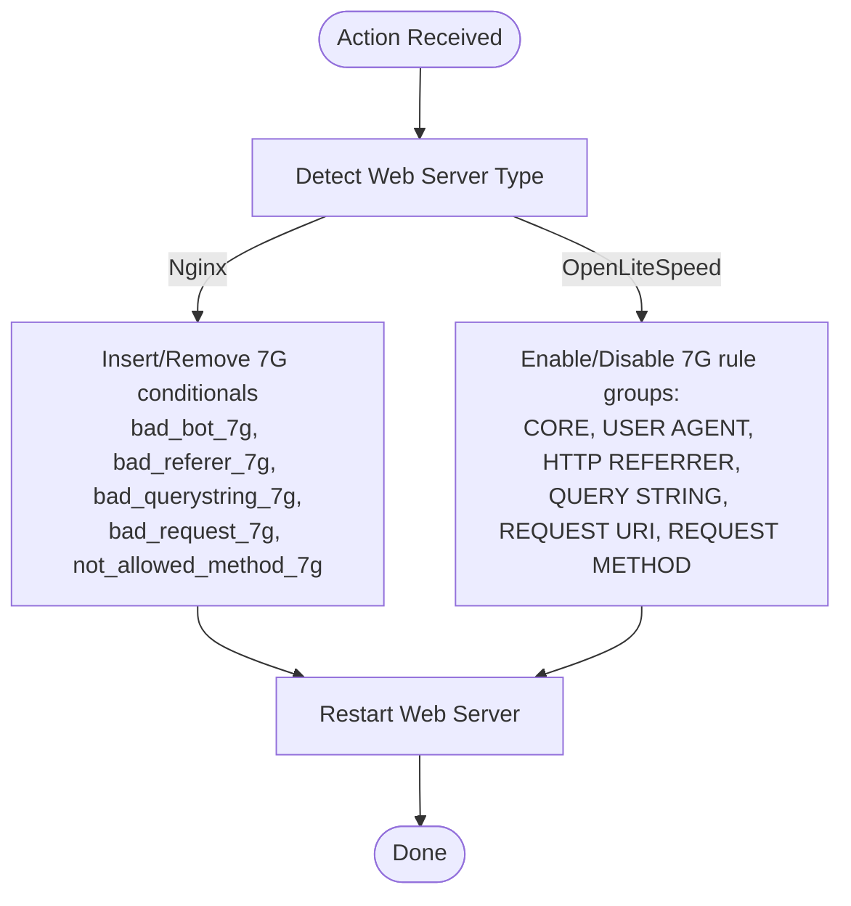
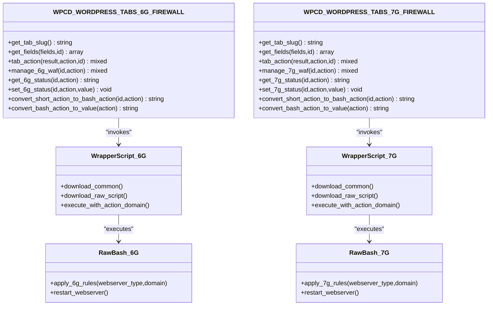

# Firewall Management

<cite>
**Referenced Files in This Document**
- [6g_firewall.php](file://includes/core/apps/wordpress-app/tabs/6g_firewall.php)
- [7g_firewall.php](file://includes/core/apps/wordpress-app/tabs/7g_firewall.php)
- [6g_firewall.txt](file://includes/core/apps/wordpress-app/scripts/v1/6g_firewall.txt)
- [7g_firewall.txt](file://includes/core/apps/wordpress-app/scripts/v1/7g_firewall.txt)
- [15-6g_firewall.txt](file://includes/core/apps/wordpress-app/scripts/v1/raw/15-6g_firewall.txt)
- [40-7g_firewall.txt](file://includes/core/apps/wordpress-app/scripts/v1/raw/40-7g_firewall.txt)
- [9999-common-functions.txt](file://includes/core/apps/wordpress-app/scripts/v1/raw/9999-common-functions.txt)
</cite>

## Table of Contents
1. [Introduction](#introduction)
2. [Project Structure](#project-structure)
3. [Core Components](#core-components)
4. [Architecture Overview](#architecture-overview)
5. [Detailed Component Analysis](#detailed-component-analysis)
6. [Dependency Analysis](#dependency-analysis)
7. [Performance Considerations](#performance-considerations)
8. [Troubleshooting Guide](#troubleshooting-guide)
9. [Conclusion](#conclusion)

## Introduction
This document explains SimpleStack’s firewall management system for WordPress applications, focusing on the 6G and 7G Web Application Firewall (WAF) rule sets. It covers:
- Differences between 6G and 7G firewalls and when to use each
- The five core firewall categories: User Agent, Referrer, Query String, Request String, and Request Method
- How to enable/disable specific rule categories via the UI
- How rules are applied on Nginx and OpenLiteSpeed
- Performance considerations, optimization techniques, and production best practices

## Project Structure
The firewall feature is implemented as two tabs (6G and 7G), each with:
- A PHP tab class that renders controls and handles actions
- A wrapper script that downloads and executes a raw bash script
- Raw bash scripts that modify web server configuration files based on the selected action and web server type

**Diagram sources**
- [6g_firewall.php:139-187](file://includes/core/apps/wordpress-app/tabs/6g_firewall.php#L139-L187)
- [7g_firewall.php:129-177](file://includes/core/apps/wordpress-app/tabs/7g_firewall.php#L129-L177)
- [6g_firewall.txt:1-12](file://includes/core/apps/wordpress-app/scripts/v1/6g_firewall.txt#L1-L12)
- [7g_firewall.txt:1-12](file://includes/core/apps/wordpress-app/scripts/v1/7g_firewall.txt#L1-L12)
- [15-6g_firewall.txt:49-260](file://includes/core/apps/wordpress-app/scripts/v1/raw/15-6g_firewall.txt#L49-L260)
- [40-7g_firewall.txt:49-260](file://includes/core/apps/wordpress-app/scripts/v1/raw/40-7g_firewall.txt#L49-L260)

**Section sources**
- [6g_firewall.php:15-26](file://includes/core/apps/wordpress-app/tabs/6g_firewall.php#L15-L26)
- [7g_firewall.php:15-26](file://includes/core/apps/wordpress-app/tabs/7g_firewall.php#L15-L26)
- [6g_firewall.txt:1-12](file://includes/core/apps/wordpress-app/scripts/v1/6g_firewall.txt#L1-L12)
- [7g_firewall.txt:1-12](file://includes/core/apps/wordpress-app/scripts/v1/7g_firewall.txt#L1-L12)

## Core Components
- 6G WAF Tab: Renders toggles for all 6G rule groups and persists state in app meta.
- 7G WAF Tab: Renders toggles for all 7G rule groups and persists state in app meta.
- Wrapper Scripts: Download common functions and the appropriate raw script, then execute it with action and domain parameters.
- Raw Bash Scripts: Apply or remove server-side rules for Nginx or OpenLiteSpeed and restart the web server.

Key responsibilities:
- UI rendering and permission checks
- Action routing and SSH execution
- State persistence (on/off per category)
- Web server configuration modification

**Section sources**
- [6g_firewall.php:139-187](file://includes/core/apps/wordpress-app/tabs/6g_firewall.php#L139-L187)
- [7g_firewall.php:129-177](file://includes/core/apps/wordpress-app/tabs/7g_firewall.php#L129-L177)
- [6g_firewall.txt:1-12](file://includes/core/apps/wordpress-app/scripts/v1/6g_firewall.txt#L1-L12)
- [7g_firewall.txt:1-12](file://includes/core/apps/wordpress-app/scripts/v1/7g_firewall.txt#L1-L12)

## Architecture Overview
End-to-end flow for enabling/disabling a firewall category:

**Diagram sources**
- [6g_firewall.php:139-187](file://includes/core/apps/wordpress-app/tabs/6g_firewall.php#L139-L187)
- [7g_firewall.php:129-177](file://includes/core/apps/wordpress-app/tabs/7g_firewall.php#L129-L177)
- [6g_firewall.txt:1-12](file://includes/core/apps/wordpress-app/scripts/v1/6g_firewall.txt#L1-L12)
- [7g_firewall.txt:1-12](file://includes/core/apps/wordpress-app/scripts/v1/7g_firewall.txt#L1-L12)
- [15-6g_firewall.txt:49-260](file://includes/core/apps/wordpress-app/scripts/v1/raw/15-6g_firewall.txt#L49-L260)
- [40-7g_firewall.txt:49-260](file://includes/core/apps/wordpress-app/scripts/v1/raw/40-7g_firewall.txt#L49-L260)

## Detailed Component Analysis

### 6G vs 7G Firewalls: Differences and When to Use Each
- Both provide the same five categories: User Agent, Referrer, Query String, Request String, Request Method.
- 7G is an updated version of 6G. The UI explicitly recommends starting new sites with 7G and downgrading to 6G only if issues arise.
- Implementation differences:
  - 6G uses variables like bad_bot, bad_referer, bad_querystring, bad_request, not_allowed_method.
  - 7G uses variables like bad_bot_7g, bad_referer_7g, bad_querystring_7g, bad_request_7g, not_allowed_method_7g.
  - On OpenLiteSpeed, 7G includes a CORE group alongside the other categories.

Recommendation:
- Start with 7G for new sites.
- If you encounter compatibility issues, switch to 6G selectively by disabling problematic categories.

**Section sources**
- [6g_firewall.php:450-484](file://includes/core/apps/wordpress-app/tabs/6g_firewall.php#L450-L484)
- [7g_firewall.php:434-470](file://includes/core/apps/wordpress-app/tabs/7g_firewall.php#L434-L470)
- [15-6g_firewall.txt:49-260](file://includes/core/apps/wordpress-app/scripts/v1/raw/15-6g_firewall.txt#L49-L260)
- [40-7g_firewall.txt:49-260](file://includes/core/apps/wordpress-app/scripts/v1/raw/40-7g_firewall.txt#L49-L260)

### Five Core Firewall Categories
- User Agent Rules: Block malicious bots and suspicious user agents.
- Referrer Rules: Prevent hotlinking and block bad referrers.
- Query String Rules: Filter malicious query parameters.
- Request String Rules: Block suspicious patterns in request URIs.
- Request Method Rules: Restrict HTTP methods to safe ones.

Both 6G and 7G expose toggles for these categories at the site level.

**Section sources**
- [6g_firewall.php:289-448](file://includes/core/apps/wordpress-app/tabs/6g_firewall.php#L289-L448)
- [7g_firewall.php:274-432](file://includes/core/apps/wordpress-app/tabs/7g_firewall.php#L274-L432)

### Enabling/Disabling Specific Rule Categories
- UI Controls: Each category has a toggle switch labeled “Enabled”/“Disabled.”
- Actions:
  - All rules: 6g_all / 7g_all
  - Individual categories: 6g_user_agent, 6g_referrer, 6g_query_string, 6g_request_string, 6g_request_method (same pattern for 7g_*).
- Persistence: Status is stored per site in post meta (wpapp_6g_status, wpapp_7g_status).

Steps:
- Navigate to the 6G or 7G WAF tab for a site.
- Toggle the desired category or “Toggle ALL” to apply uniformly.
- Confirm the prompt; the system updates the server configuration and refreshes the UI.

**Section sources**
- [6g_firewall.php:252-448](file://includes/core/apps/wordpress-app/tabs/6g_firewall.php#L252-L448)
- [7g_firewall.php:237-432](file://includes/core/apps/wordpress-app/tabs/7g_firewall.php#L237-L432)
- [6g_firewall.php:498-546](file://includes/core/apps/wordpress-app/tabs/6g_firewall.php#L498-L546)
- [7g_firewall.php:484-532](file://includes/core/apps/wordpress-app/tabs/7g_firewall.php#L484-L532)

### Customizing Firewall Rules for Different Web Servers
- Nginx:
  - The raw scripts insert conditional blocks into the site’s server config file under sites-enabled.
  - Variables used:
    - 6G: bad_bot, bad_referer, bad_querystring, bad_request, not_allowed_method
    - 7G: bad_bot_7g, bad_referer_7g, bad_querystring_7g, bad_request_7g, not_allowed_method_7g
- OpenLiteSpeed:
  - The raw scripts call helper functions to enable/disable named rule groups:
    - 6G: USER AGENT, REFERRER, QUERY STRING, REQUEST STRING, REQUEST METHOD
    - 7G: CORE, USER AGENT, HTTP REFERRER, QUERY STRING, REQUEST URI, REQUEST METHOD

Notes:
- After changes, the scripts restart the web server to apply rules.
- The main OpenLiteSpeed configuration is managed elsewhere; firewall rules are toggled via helper functions.

**Section sources**
- [15-6g_firewall.txt:49-260](file://includes/core/apps/wordpress-app/scripts/v1/raw/15-6g_firewall.txt#L49-L260)
- [40-7g_firewall.txt:49-260](file://includes/core/apps/wordpress-app/scripts/v1/raw/40-7g_firewall.txt#L49-L260)
- [9999-common-functions.txt:883-1009](file://includes/core/apps/wordpress-app/scripts/v1/raw/9999-common-functions.txt#L883-L1009)

### Processing Logic and Flowcharts

#### 6G Category Enable/Disable Flow

**Diagram sources**
- [15-6g_firewall.txt:49-260](file://includes/core/apps/wordpress-app/scripts/v1/raw/15-6g_firewall.txt#L49-L260)

#### 7G Category Enable/Disable Flow

**Diagram sources**
- [40-7g_firewall.txt:49-260](file://includes/core/apps/wordpress-app/scripts/v1/raw/40-7g_firewall.txt#L49-L260)

### Class Diagrams (UI and Execution)

**Diagram sources**
- [6g_firewall.php:15-608](file://includes/core/apps/wordpress-app/tabs/6g_firewall.php#L15-L608)
- [7g_firewall.php:15-596](file://includes/core/apps/wordpress-app/tabs/7g_firewall.php#L15-L596)
- [6g_firewall.txt:1-12](file://includes/core/apps/wordpress-app/scripts/v1/6g_firewall.txt#L1-L12)
- [7g_firewall.txt:1-12](file://includes/core/apps/wordpress-app/scripts/v1/7g_firewall.txt#L1-L12)
- [15-6g_firewall.txt:1-261](file://includes/core/apps/wordpress-app/scripts/v1/raw/15-6g_firewall.txt#L1-L261)
- [40-7g_firewall.txt:1-260](file://includes/core/apps/wordpress-app/scripts/v1/raw/40-7g_firewall.txt#L1-L260)

## Dependency Analysis
- PHP Tab Classes depend on:
  - App instance details and domain resolution
  - SSH execution utilities
  - Post meta storage for status
- Wrapper Scripts depend on:
  - Common functions file (downloaded and sourced)
  - Raw scripts (downloaded and executed)
- Raw Scripts depend on:
  - Web server type detection
  - Helper functions for OpenLiteSpeed rule toggling
  - Nginx config path manipulation

Potential coupling:
- Changes to variable names in Nginx configs require corresponding updates in both 6G and 7G raw scripts.
- OpenLiteSpeed rule group names must remain consistent with helper functions.

External dependencies:
- Internet access required to download common functions and raw scripts during setup.
- Root privileges required to modify server configuration and restart services.

**Section sources**
- [6g_firewall.php:139-187](file://includes/core/apps/wordpress-app/tabs/6g_firewall.php#L139-L187)
- [7g_firewall.php:129-177](file://includes/core/apps/wordpress-app/tabs/7g_firewall.php#L129-L177)
- [6g_firewall.txt:1-12](file://includes/core/apps/wordpress-app/scripts/v1/6g_firewall.txt#L1-L12)
- [7g_firewall.txt:1-12](file://includes/core/apps/wordpress-app/scripts/v1/7g_firewall.txt#L1-L12)
- [15-6g_firewall.txt:1-261](file://includes/core/apps/wordpress-app/scripts/v1/raw/15-6g_firewall.txt#L1-L261)
- [40-7g_firewall.txt:1-260](file://includes/core/apps/wordpress-app/scripts/v1/raw/40-7g_firewall.txt#L1-L260)

## Performance Considerations
- Early filtering: WAF rules run at the web server layer before reaching PHP, reducing application load.
- Selective enablement: Only enable categories needed for your environment to minimize overhead.
- Proxy usage: If using CloudFlare or similar proxies, consider whether local WAF rules are redundant.
- Web server restarts: Each change triggers a restart; batch changes where possible to reduce downtime.
- Logging and monitoring: Keep access/error logs enabled to detect false positives and tune rules.

[No sources needed since this section provides general guidance]

## Troubleshooting Guide
Common issues and resolutions:
- Permission errors:
  - Ensure the process runs as root when modifying server configurations.
- Missing common functions:
  - Verify network access to download 9999-common-functions.sh and raw scripts.
- Incorrect web server type:
  - Confirm g_webserver_type is correctly detected; otherwise, rule application may fail.
- False positives:
  - Temporarily disable the offending category (e.g., Query String or Request String) to identify the cause.
  - For Nginx, inspect the inserted conditional blocks in sites-enabled/<domain>.
  - For OpenLiteSpeed, verify the targeted rule group is enabled/disabled via helper functions.
- Stale UI state:
  - After applying changes, force a UI refresh to reflect persisted status.

Operational tips:
- Use “Toggle ALL” to quickly enable or disable all categories for testing.
- Re-enable categories one by one after isolating issues.
- Monitor web server error logs for rule-triggered rejections.

**Section sources**
- [15-6g_firewall.txt:1-20](file://includes/core/apps/wordpress-app/scripts/v1/raw/15-6g_firewall.txt#L1-L20)
- [40-7g_firewall.txt:1-20](file://includes/core/apps/wordpress-app/scripts/v1/raw/40-7g_firewall.txt#L1-L20)
- [6g_firewall.php:169-173](file://includes/core/apps/wordpress-app/tabs/6g_firewall.php#L169-L173)
- [7g_firewall.php:159-163](file://includes/core/apps/wordpress-app/tabs/7g_firewall.php#L159-L163)

## Conclusion
SimpleStack’s firewall management provides robust, server-level protection through 6G and 7G WAF rule sets. The recommended approach is to start with 7G and selectively adjust categories based on site needs. The system supports both Nginx and OpenLiteSpeed, with clear UI controls and automated configuration changes. By understanding the five core categories and following the troubleshooting and performance guidelines, administrators can maintain secure and high-performing environments.

[No sources needed since this section summarizes without analyzing specific files]