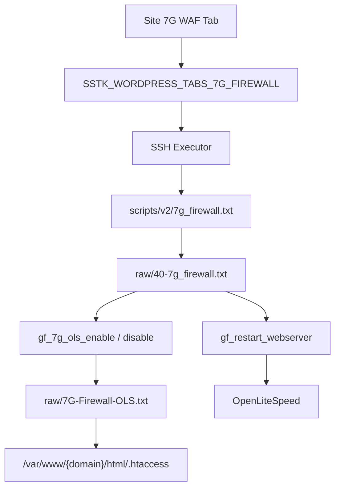
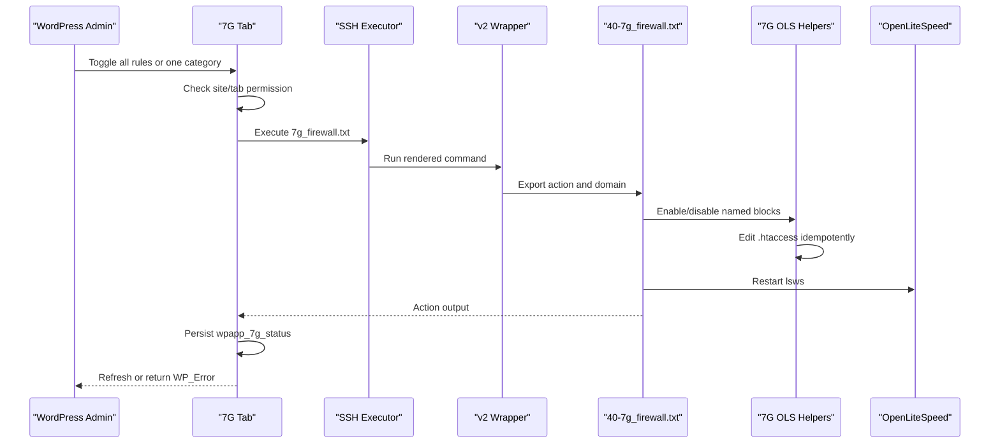

# Firewall Management

<cite>
**Referenced Files in This Document**
- [7g_firewall.php](file://includes/core/apps/wordpress-app/tabs/7g_firewall.php)
- [7g_firewall.txt](file://includes/core/apps/wordpress-app/scripts/v2/7g_firewall.txt)
- [40-7g_firewall.txt](file://includes/core/apps/wordpress-app/scripts/v2/raw/40-7g_firewall.txt)
- [7G-Firewall-OLS.txt](file://includes/core/apps/wordpress-app/scripts/v2/raw/7G-Firewall-OLS.txt)
- [9999-common-functions.txt](file://includes/core/apps/wordpress-app/scripts/v2/raw/9999-common-functions.txt)
- [ufw_firewall.php](file://includes/core/apps/wordpress-app/tabs-server/ufw_firewall.php)
- [01-prepare_server.txt](file://includes/core/apps/wordpress-app/scripts/v2/raw/01-prepare_server.txt)
</cite>

## Table of Contents
1. [Introduction](#introduction)
2. [Project Structure](#project-structure)
3. [Core Components](#core-components)
4. [Architecture Overview](#architecture-overview)
5. [Detailed Component Analysis](#detailed-component-analysis)
6. [Dependency Analysis](#dependency-analysis)
7. [Performance Considerations](#performance-considerations)
8. [Troubleshooting Guide](#troubleshooting-guide)
9. [Conclusion](#conclusion)

## Introduction

Simple Stack’s application-layer firewall is the site-level **7G WAF** integration for OpenLiteSpeed. It applies named 7G rule blocks to a site’s `.htaccess` file and restarts OpenLiteSpeed after changes.

The 6G tab and script have been retired. There is no 6G fallback, Nginx configuration path, or web-server selector. Host-level port filtering is handled separately by UFW.

## Project Structure

```text
includes/core/apps/wordpress-app/
├── class-wordpress-app.php
├── tabs/
│   └── 7g_firewall.php
├── tabs-server/
│   └── ufw_firewall.php
└── scripts/v2/
    ├── 7g_firewall.txt
    └── raw/
        ├── 40-7g_firewall.txt
        ├── 7G-Firewall-OLS.txt
        ├── 9999-common-functions.txt
        └── 01-prepare_server.txt
```



## Core Components

- **7G tab:** Registers the `7g_waf` site tab, checks site/tab permissions, renders switches, and dispatches actions.
- **Fixed-v2 wrapper:** Downloads the shared functions, 7G rule file, and raw action script, then executes them as root.
- **Raw action script:** Maps UI actions to named OpenLiteSpeed rule groups and restarts the web server.
- **Rule file:** Contains the 7G blocks consumed by the OpenLiteSpeed helpers.
- **Shared helpers:** Append or remove marked rule blocks from the site `.htaccess` file and restore site-user ownership.
- **UFW:** Manages host firewall ports independently of the 7G request rules.

## Architecture Overview



The PHP tab uses `is_ssh_successful( $result, '7g_firewall.txt' )` to evaluate the command result before updating state.

## Detailed Component Analysis

### UI Actions

The tab accepts exactly these actions:

- `7g_all`
- `7g_user_agent`
- `7g_referrer`
- `7g_query_string`
- `7g_request_string`
- `7g_request_method`

Each switch derives its next action from the stored state. Status is kept in the `wpapp_7g_status` post-meta array. A missing or empty array is treated as disabled.

### OpenLiteSpeed Rule Groups

| UI category | 7G block |
|---|---|
| All rules | `CORE`, `USER AGENT`, `HTTP REFERRER`, `QUERY STRING`, `REQUEST URI`, `REQUEST METHOD` |
| User Agent | `USER AGENT` |
| Referrer | `HTTP REFERRER` |
| Query String | `QUERY STRING` |
| Request String | `REQUEST URI` |
| Request Method | `REQUEST METHOD` |

“Request String” is the UI label for the underlying `REQUEST URI` rule block.

### Idempotent `.htaccess` Updates

The enable helper first checks for the block marker `# 7G:[MODULE]`. If absent, it copies the matching block from `7G-Firewall-OLS.txt` into the site `.htaccess` file. The disable helper removes the marked block. Both helpers set ownership to the site user.

The raw script restarts OpenLiteSpeed after each successful category change through `gf_restart_webserver()`, which runs `systemctl restart lsws`.

### Relationship to UFW

7G filters HTTP requests at the application layer. UFW controls network ports at the host layer. Provisioning sets deny-incoming/allow-outgoing defaults, allows SSH/HTTP/HTTPS, denies port `7080`, and permits a scoped port-`7080` exception only when a validated admin IP is configured.

## Dependency Analysis

- The tab depends on `class-wordpress-app.php` loading `tabs/7g_firewall.php`.
- Execution depends on valid server SSH credentials and root privileges.
- The wrapper depends on the fixed-v2 common functions, 7G rule file, raw action script, and `dos2unix`.
- Rule application depends on the site document root being `/var/www/{domain}/html` with an existing `.htaccess` file.
- OpenLiteSpeed must be installed and active for the restart to succeed.

## Performance Considerations

- Rules execute before PHP, reducing application work for rejected requests.
- Enable only the categories required by the site; overly broad request rules can produce false positives.
- Each category change restarts OpenLiteSpeed, so avoid rapid repeated toggles in production.
- Preserve the block markers when editing `.htaccess` manually; the helpers use them for idempotency.

## Troubleshooting Guide

### The UI Shows Disabled After a Change

Confirm the SSH command succeeded, inspect the site `.htaccess` file for the expected `# 7G:[MODULE]` markers, and refresh the tab. The PHP handler does not persist an enabled state when command execution fails.

### A Rule Blocks Legitimate Traffic

Temporarily disable the offending category, inspect the OpenLiteSpeed error log, and re-enable categories individually. There is no 6G compatibility mode.

### Changes Do Not Take Effect

Verify that `systemctl restart lsws` succeeded and that OpenLiteSpeed is active. Confirm the edited `.htaccess` belongs to the served site and remains owned by the site user.

### Required Files Are Missing

Verify that the fixed-v2 wrapper URLs resolve and that `9999-common-functions.txt`, `40-7g_firewall.txt`, and `7G-Firewall-OLS.txt` were downloaded successfully.

### Script Download Security

The current wrapper still uses `wget --no-check-certificate`. TLS certificate validation must be restored before release; until then, script distribution is not protected against a forged HTTPS endpoint.

## Conclusion

The 7G WAF is the only supported Simple Stack application firewall. It provides category-level OpenLiteSpeed rules through a fixed-v2 PHP/Bash pipeline, stores per-site state in `wpapp_7g_status`, and complements UFW’s host-level port policy. The retired 6G and Nginx paths are not part of the current architecture.
