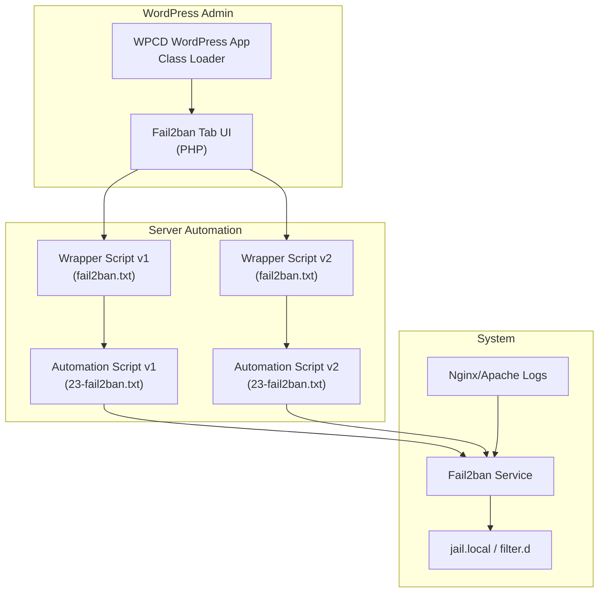
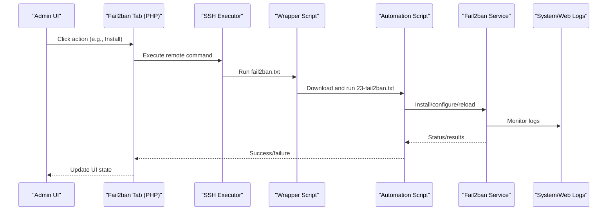
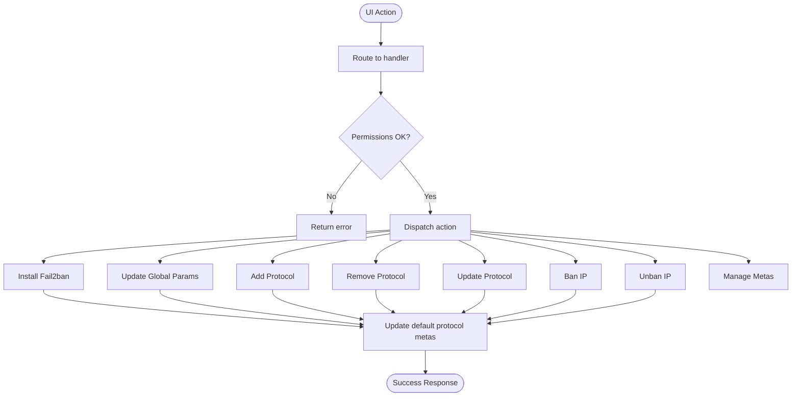
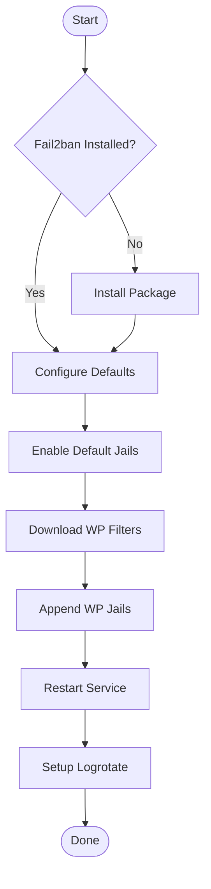
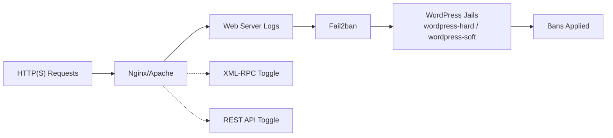
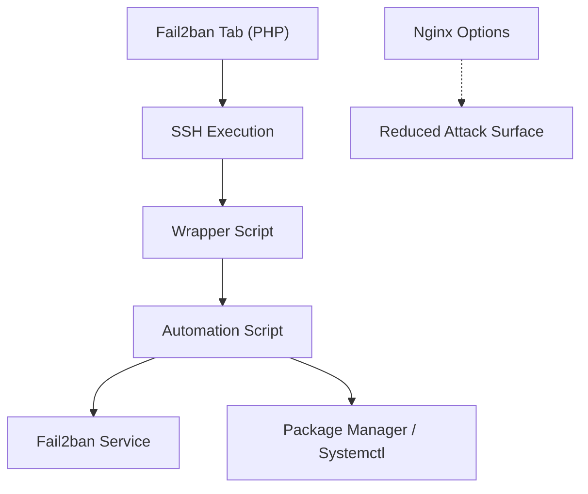

# Intrusion Detection & Prevention

<cite>
**Referenced Files in This Document**
- [fail2ban.php](file://includes/core/apps/wordpress-app/tabs-server/fail2ban.php)
- [fail2ban.txt (v1)](file://includes/core/apps/wordpress-app/scripts/v1/fail2ban.txt)
- [fail2ban_site.txt (v1)](file://includes/core/apps/wordpress-app/scripts/v1/fail2ban_site.txt)
- [fail2ban.txt (v2)](file://includes/core/apps/wordpress-app/scripts/v2/fail2ban.txt)
- [fail2ban_site.txt (v2)](file://includes/core/apps/wordpress-app/scripts/v2/fail2ban_site.txt)
- [23-fail2ban.txt (v1)](file://includes/core/apps/wordpress-app/scripts/v1/raw/23-fail2ban.txt)
- [23-fail2ban.txt (v2)](file://includes/core/apps/wordpress-app/scripts/v2/raw/23-fail2ban.txt)
- [class-wordpress-app.php](file://includes/core/apps/wordpress-app/class-wordpress-app.php)
- [34-nginx_options.txt](file://includes/core/apps/wordpress-app/scripts/v1/raw/34-nginx_options.txt)
</cite>

## Table of Contents
1. [Introduction](#introduction)
2. [Project Structure](#project-structure)
3. [Core Components](#core-components)
4. [Architecture Overview](#architecture-overview)
5. [Detailed Component Analysis](#detailed-component-analysis)
6. [Dependency Analysis](#dependency-analysis)
7. [Performance Considerations](#performance-considerations)
8. [Troubleshooting Guide](#troubleshooting-guide)
9. [Conclusion](#conclusion)

## Introduction
This document explains how SimpleStack integrates Fail2ban for intrusion detection and prevention, with a focus on WordPress security. It covers installation, configuration, integration points, brute-force protection for login pages, SSH hardening, service-level monitoring, jail configurations for WordPress-specific attacks, custom filters, log analysis, alerting mechanisms, ban/unban procedures, and troubleshooting guidance.

Fail2ban is installed and managed via server-side scripts invoked from the WordPress admin UI. The UI provides controls to install, upgrade, remove, or purge Fail2ban; adjust global parameters; manage per-protocol jails; ban/unban IPs; and list current bans and whitelisted IPs. For WordPress-specific protections, default filters are downloaded and enabled, and optional Nginx rules can disable XML-RPC and REST API endpoints at the web server layer.

## Project Structure
The Fail2ban integration spans PHP UI logic and Bash automation:
- PHP tab class renders the Fail2ban management interface and dispatches actions.
- Wrapper scripts download and execute versioned automation scripts.
- Versioned raw scripts implement Fail2ban installation, configuration, and operations.
- Optional Nginx options include toggles to disable XML-RPC and REST API endpoints.

**Diagram sources**
- [class-wordpress-app.php:375-375](file://includes/core/apps/wordpress-app/class-wordpress-app.php#L375-L375)
- [fail2ban.php:126-202](file://includes/core/apps/wordpress-app/tabs-server/fail2ban.php#L126-L202)
- [fail2ban.txt (v1):1-7](file://includes/core/apps/wordpress-app/scripts/v1/fail2ban.txt#L1-L7)
- [fail2ban.txt (v2):1-7](file://includes/core/apps/wordpress-app/scripts/v2/fail2ban.txt#L1-L7)
- [23-fail2ban.txt (v1):44-120](file://includes/core/apps/wordpress-app/scripts/v1/raw/23-fail2ban.txt#L44-L120)
- [23-fail2ban.txt (v2):44-120](file://includes/core/apps/wordpress-app/scripts/v2/raw/23-fail2ban.txt#L44-L120)

**Section sources**
- [class-wordpress-app.php:375-375](file://includes/core/apps/wordpress-app/class-wordpress-app.php#L375-L375)
- [fail2ban.php:126-202](file://includes/core/apps/wordpress-app/tabs-server/fail2ban.php#L126-L202)
- [fail2ban.txt (v1):1-7](file://includes/core/apps/wordpress-app/scripts/v1/fail2ban.txt#L1-L7)
- [fail2ban.txt (v2):1-7](file://includes/core/apps/wordpress-app/scripts/v2/fail2ban.txt#L1-L7)
- [23-fail2ban.txt (v1):44-120](file://includes/core/apps/wordpress-app/scripts/v1/raw/23-fail2ban.txt#L44-L120)
- [23-fail2ban.txt (v2):44-120](file://includes/core/apps/wordpress-app/scripts/v2/raw/23-fail2ban.txt#L44-L120)

## Core Components
- Fail2ban Tab UI (PHP): Renders the Fail2ban management screen, validates permissions, and routes user actions to backend handlers. It supports installing/removing/purging Fail2ban, changing global parameters, managing protocols/jails, banning/unbanning IPs, and listing banned/whitelisted IPs.
- Wrapper Scripts (v1/v2): Download common functions and the appropriate automation script, then pass environment variables to control the operation.
- Automation Scripts (v1/v2): Implement Fail2ban installation, enablement of default jails, downloading WordPress filters, updating parameters, adding/removing/updating protocols, force-upgrading, ban/unban IP handling, and WP plugin management.
- Nginx Options: Provide toggles to disable XML-RPC and REST API endpoints at the web server level as an additional defense-in-depth measure.

Key responsibilities:
- Installation and lifecycle management of Fail2ban.
- Default jail configuration for SSH, Nginx auth/rate-limit/bot search, and WordPress filters.
- Per-protocol jail tuning (bantime, findtime, maxretry).
- IP ban/unban and whitelist management.
- Integration with WordPress application logs via wp-fail2ban plugin when desired.

**Section sources**
- [fail2ban.php:126-202](file://includes/core/apps/wordpress-app/tabs-server/fail2ban.php#L126-L202)
- [fail2ban.php:252-719](file://includes/core/apps/wordpress-app/tabs-server/fail2ban.php#L252-L719)
- [fail2ban.php:950-1043](file://includes/core/apps/wordpress-app/tabs-server/fail2ban.php#L950-L1043)
- [fail2ban.php:1074-1132](file://includes/core/apps/wordpress-app/tabs-server/fail2ban.php#L1074-L1132)
- [fail2ban.txt (v1):1-7](file://includes/core/apps/wordpress-app/scripts/v1/fail2ban.txt#L1-L7)
- [fail2ban.txt (v2):1-7](file://includes/core/apps/wordpress-app/scripts/v2/fail2ban.txt#L1-L7)
- [23-fail2ban.txt (v1):44-120](file://includes/core/apps/wordpress-app/scripts/v1/raw/23-fail2ban.txt#L44-L120)
- [23-fail2ban.txt (v2):44-120](file://includes/core/apps/wordpress-app/scripts/v2/raw/23-fail2ban.txt#L44-L120)

## Architecture Overview
The Fail2ban workflow begins in the WordPress admin UI, which triggers a server command through SSH. The command executes a wrapper script that downloads and runs the versioned automation script. The automation script installs Fail2ban if needed, configures default jails, downloads WordPress-specific filters, and manages protocol settings. Fail2ban monitors system and web server logs and applies bans based on configured thresholds.

**Diagram sources**
- [fail2ban.php:950-964](file://includes/core/apps/wordpress-app/tabs-server/fail2ban.php#L950-L964)
- [fail2ban.txt (v1):1-7](file://includes/core/apps/wordpress-app/scripts/v1/fail2ban.txt#L1-L7)
- [fail2ban.txt (v2):1-7](file://includes/core/apps/wordpress-app/scripts/v2/fail2ban.txt#L1-L7)
- [23-fail2ban.txt (v1):44-120](file://includes/core/apps/wordpress-app/scripts/v1/raw/23-fail2ban.txt#L44-L120)
- [23-fail2ban.txt (v2):44-120](file://includes/core/apps/wordpress-app/scripts/v2/raw/23-fail2ban.txt#L44-L120)

## Detailed Component Analysis

### Fail2ban Tab UI (PHP)
Responsibilities:
- Register the Fail2ban tab and fields.
- Validate permissions and route actions.
- Build UI sections for ban/unban, protocol management, global parameters, and lifecycle actions.
- Persist Fail2ban-related post meta for dashboard state synchronization.

Key behaviors:
- Action routing maps UI actions to internal methods like install, remove, purge, parameter updates, protocol add/remove/update, ban/unban, and metas management.
- On successful execution, it updates post meta to reflect installed status, defaults, and protocol lists.
- Provides helper methods to construct display text for banned and whitelisted IPs.

**Diagram sources**
- [fail2ban.php:126-202](file://includes/core/apps/wordpress-app/tabs-server/fail2ban.php#L126-L202)
- [fail2ban.php:950-1043](file://includes/core/apps/wordpress-app/tabs-server/fail2ban.php#L950-L1043)
- [fail2ban.php:1124-1132](file://includes/core/apps/wordpress-app/tabs-server/fail2ban.php#L1124-L1132)

**Section sources**
- [fail2ban.php:126-202](file://includes/core/apps/wordpress-app/tabs-server/fail2ban.php#L126-L202)
- [fail2ban.php:252-719](file://includes/core/apps/wordpress-app/tabs-server/fail2ban.php#L252-L719)
- [fail2ban.php:950-1043](file://includes/core/apps/wordpress-app/tabs-server/fail2ban.php#L950-L1043)
- [fail2ban.php:1074-1132](file://includes/core/apps/wordpress-app/tabs-server/fail2ban.php#L1074-L1132)

### Wrapper Scripts (v1/v2)
Purpose:
- Standardize invocation by downloading common functions and the target automation script.
- Pass environment variables to control behavior (action, domain, parameters, IPs, protocol names).

Behavior:
- Downloads common functions and the specific script file.
- Converts line endings and executes the script with exported variables.

Operational notes:
- v1 and v2 wrappers differ only in variable naming conventions passed to the automation script.

**Section sources**
- [fail2ban.txt (v1):1-7](file://includes/core/apps/wordpress-app/scripts/v1/fail2ban.txt#L1-L7)
- [fail2ban.txt (v2):1-7](file://includes/core/apps/wordpress-app/scripts/v2/fail2ban.txt#L1-L7)
- [fail2ban_site.txt (v1):1-7](file://includes/core/apps/wordpress-app/scripts/v1/fail2ban_site.txt#L1-L7)
- [fail2ban_site.txt (v2):1-7](file://includes/core/apps/wordpress-app/scripts/v2/fail2ban_site.txt#L1-L7)

### Automation Scripts (v1/v2)
Capabilities:
- Install Fail2ban, set defaults, enable services, configure logrotate.
- Download WordPress-specific filters and create jails for wordpress-hard and wordpress-soft.
- Enable default jails for sshd, phpmyadmin-syslog, monit (if present), and nginx-http-auth, nginx-limit-req, nginx-botsearch (if Nginx logs exist).
- Manage global parameters (bantime, findtime, maxretry, ignoreip).
- Add/remove/update protocols/jails dynamically.
- Force-update Fail2ban package while preserving jail.local.
- Ban/unban IPs and list current bans/whitelisted IPs.
- Install/remove the wp-fail2ban WordPress plugin and link it as mu-plugin.

Installation flow highlights:
- Installs Fail2ban via package manager.
- Generates jail.local with DEFAULT section and enables selected jails.
- Downloads WordPress filters and appends corresponding jails.
- Enables and restarts the service.
- Configures log rotation for Fail2ban logs.

Parameter update flow:
- Reads current DEFAULT values.
- Validates numeric inputs for bantime/findtime/maxretry.
- Optionally adds IPs to ignoreip after validation.
- Reloads Fail2ban.

Protocol management:
- Adds new protocols by enabling them in jail.local with inherited defaults.
- Removes protocols by disabling them.
- Updates per-protocol parameters and reloads.

Ban/unban flows:
- Unban: Adds IP to ignoreip, unban via client, reload.
- Ban: Removes IP from ignoreip, sets ban via client, reload.

WP plugin management:
- Installs and activates wp-fail2ban plugin for a site and symlinks it into mu-plugins.
- Removes symlink and deactivates/uninstalls plugin.

**Diagram sources**
- [23-fail2ban.txt (v1):44-120](file://includes/core/apps/wordpress-app/scripts/v1/raw/23-fail2ban.txt#L44-L120)
- [23-fail2ban.txt (v2):44-120](file://includes/core/apps/wordpress-app/scripts/v2/raw/23-fail2ban.txt#L44-L120)

**Section sources**
- [23-fail2ban.txt (v1):44-120](file://includes/core/apps/wordpress-app/scripts/v1/raw/23-fail2ban.txt#L44-L120)
- [23-fail2ban.txt (v1):143-233](file://includes/core/apps/wordpress-app/scripts/v1/raw/23-fail2ban.txt#L143-L233)
- [23-fail2ban.txt (v1):235-386](file://includes/core/apps/wordpress-app/scripts/v1/raw/23-fail2ban.txt#L235-L386)
- [23-fail2ban.txt (v1):388-457](file://includes/core/apps/wordpress-app/scripts/v1/raw/23-fail2ban.txt#L388-L457)
- [23-fail2ban.txt (v1):476-534](file://includes/core/apps/wordpress-app/scripts/v1/raw/23-fail2ban.txt#L476-L534)
- [23-fail2ban.txt (v2):44-120](file://includes/core/apps/wordpress-app/scripts/v2/raw/23-fail2ban.txt#L44-L120)
- [23-fail2ban.txt (v2):143-233](file://includes/core/apps/wordpress-app/scripts/v2/raw/23-fail2ban.txt#L143-L233)
- [23-fail2ban.txt (v2):235-386](file://includes/core/apps/wordpress-app/scripts/v2/raw/23-fail2ban.txt#L235-L386)
- [23-fail2ban.txt (v2):388-457](file://includes/core/apps/wordpress-app/scripts/v2/raw/23-fail2ban.txt#L388-L457)
- [23-fail2ban.txt (v2):476-534](file://includes/core/apps/wordpress-app/scripts/v2/raw/23-fail2ban.txt#L476-L534)

### WordPress-Specific Protection
Default WordPress jails:
- wordpress-hard: Strict threshold (very low maxretry) for HTTP/HTTPS traffic.
- wordpress-soft: Relaxed threshold for broader detection.

These jails use filters downloaded from the WordPress plugin repository and monitor authentication logs. They are appended to jail.local during installation.

Additional layers:
- Nginx options allow disabling XML-RPC and REST API endpoints at the web server level to reduce attack surface.
- The wp-fail2ban plugin can be installed per site to integrate WordPress application logs with Fail2ban.

**Diagram sources**
- [23-fail2ban.txt (v1):78-95](file://includes/core/apps/wordpress-app/scripts/v1/raw/23-fail2ban.txt#L78-L95)
- [23-fail2ban.txt (v2):78-95](file://includes/core/apps/wordpress-app/scripts/v2/raw/23-fail2ban.txt#L78-L95)
- [34-nginx_options.txt:504-556](file://includes/core/apps/wordpress-app/scripts/v1/raw/34-nginx_options.txt#L504-L556)

**Section sources**
- [23-fail2ban.txt (v1):78-95](file://includes/core/apps/wordpress-app/scripts/v1/raw/23-fail2ban.txt#L78-L95)
- [23-fail2ban.txt (v2):78-95](file://includes/core/apps/wordpress-app/scripts/v2/raw/23-fail2ban.txt#L78-L95)
- [34-nginx_options.txt:504-556](file://includes/core/apps/wordpress-app/scripts/v1/raw/34-nginx_options.txt#L504-L556)

### Brute Force Protection for Login Pages
Mechanisms:
- WordPress jails (wordpress-hard/wordpress-soft) monitor authentication logs for repeated failures and apply bans.
- Nginx rate limiting and bot search jails protect against excessive requests and automated scanning.
- Optional disabling of XML-RPC reduces brute-force vectors targeting xmlrpc.php.

Recommendations:
- Keep wordpress-hard enabled for strict protection.
- Use Nginx rate limiting jails to mitigate automated scanners.
- Disable XML-RPC unless required.

**Section sources**
- [23-fail2ban.txt (v1):78-95](file://includes/core/apps/wordpress-app/scripts/v1/raw/23-fail2ban.txt#L78-L95)
- [23-fail2ban.txt (v2):78-95](file://includes/core/apps/wordpress-app/scripts/v2/raw/23-fail2ban.txt#L78-L95)
- [34-nginx_options.txt:504-556](file://includes/core/apps/wordpress-app/scripts/v1/raw/34-nginx_options.txt#L504-L556)

### SSH Hardening Measures
Default jails:
- sshd jail is enabled with default thresholds during installation.
- Additional service jails (phpmyadmin-syslog, monit) may be enabled depending on presence of logs.

Management:
- Adjust sshd jail parameters via per-protocol settings in the UI.
- Use global parameters to tune baseline thresholds.

**Section sources**
- [23-fail2ban.txt (v1):60-75](file://includes/core/apps/wordpress-app/scripts/v1/raw/23-fail2ban.txt#L60-L75)
- [23-fail2ban.txt (v2):60-75](file://includes/core/apps/wordpress-app/scripts/v2/raw/23-fail2ban.txt#L60-L75)
- [fail2ban.php:1074-1117](file://includes/core/apps/wordpress-app/tabs-server/fail2ban.php#L1074-L1117)

### Service-Level Security Monitoring
Enabled services:
- sshd
- phpmyadmin-syslog
- monit (conditional)
- nginx-http-auth
- nginx-limit-req
- nginx-botsearch

Monitoring approach:
- Fail2ban watches relevant logs and applies bans according to jail thresholds.
- Logrotate ensures manageable log sizes and periodic flushing.

**Section sources**
- [23-fail2ban.txt (v1):60-75](file://includes/core/apps/wordpress-app/scripts/v1/raw/23-fail2ban.txt#L60-L75)
- [23-fail2ban.txt (v1):101-119](file://includes/core/apps/wordpress-app/scripts/v1/raw/23-fail2ban.txt#L101-L119)
- [23-fail2ban.txt (v2):60-75](file://includes/core/apps/wordpress-app/scripts/v2/raw/23-fail2ban.txt#L60-L75)
- [23-fail2ban.txt (v2):101-119](file://includes/core/apps/wordpress-app/scripts/v2/raw/23-fail2ban.txt#L101-L119)

### Jail Configurations for WordPress-Specific Attacks
- wordpress-hard: Very aggressive protection for HTTP/HTTPS, suitable for high-risk environments.
- wordpress-soft: Balanced protection allowing more retries before banning.

Customization:
- Parameters can be tuned globally or per-protocol via the UI.
- Additional WordPress-specific filters can be added by extending jail.local and creating custom filters under filter.d.

**Section sources**
- [23-fail2ban.txt (v1):78-95](file://includes/core/apps/wordpress-app/scripts/v1/raw/23-fail2ban.txt#L78-L95)
- [23-fail2ban.txt (v2):78-95](file://includes/core/apps/wordpress-app/scripts/v2/raw/23-fail2ban.txt#L78-L95)
- [fail2ban.php:1074-1117](file://includes/core/apps/wordpress-app/tabs-server/fail2ban.php#L1074-L1117)

### Custom Filter Rules and Log Analysis
- WordPress filters are downloaded from the official plugin repository and applied automatically during installation.
- To add custom filters:
  - Create a filter file under /etc/fail2ban/filter.d/.
  - Define a jail in jail.local pointing to the appropriate log path.
  - Reload Fail2ban to activate.

Log analysis:
- Review Fail2ban logs (/var/log/fail2ban.log) for ban events and reasons.
- Inspect web server logs for patterns indicating abuse (e.g., repeated 401/403 responses).

**Section sources**
- [23-fail2ban.txt (v1):78-95](file://includes/core/apps/wordpress-app/scripts/v1/raw/23-fail2ban.txt#L78-L95)
- [23-fail2ban.txt (v2):78-95](file://includes/core/apps/wordpress-app/scripts/v2/raw/23-fail2ban.txt#L78-L95)

### XML-RPC and REST API Abuse Mitigation
- XML-RPC can be disabled via Nginx options to block xmlrpc.php access.
- REST API can be disabled via Nginx options to restrict endpoint exposure.
- Combine with Fail2ban jails to detect and ban abusive requests.

**Section sources**
- [34-nginx_options.txt:504-556](file://includes/core/apps/wordpress-app/scripts/v1/raw/34-nginx_options.txt#L504-L556)

### Alerting Mechanisms
- Fail2ban logs ban events to /var/log/fail2ban.log.
- Integrate with external monitoring systems by tailing Fail2ban logs and forwarding alerts.
- The UI displays banned and whitelisted IPs for manual review.

**Section sources**
- [23-fail2ban.txt (v1):101-119](file://includes/core/apps/wordpress-app/scripts/v1/raw/23-fail2ban.txt#L101-L119)
- [23-fail2ban.txt (v2):101-119](file://includes/core/apps/wordpress-app/scripts/v2/raw/23-fail2ban.txt#L101-L119)
- [fail2ban.php:1193-1214](file://includes/core/apps/wordpress-app/tabs-server/fail2ban.php#L1193-L1214)

### Ban/Unban Procedures
- Ban IP: Remove IP from ignorelist and enforce ban via Fail2ban client.
- Unban IP: Add IP to ignorelist and unban via Fail2ban client.
- List IPs: Display currently banned and whitelisted IPs.

**Section sources**
- [23-fail2ban.txt (v1):407-457](file://includes/core/apps/wordpress-app/scripts/v1/raw/23-fail2ban.txt#L407-L457)
- [23-fail2ban.txt (v2):407-457](file://includes/core/apps/wordpress-app/scripts/v2/raw/23-fail2ban.txt#L407-L457)
- [fail2ban.php:1193-1214](file://includes/core/apps/wordpress-app/tabs-server/fail2ban.php#L1193-L1214)

### Integration with Monitoring Systems
- Forward Fail2ban logs to centralized logging platforms (e.g., ELK, Splunk) using log shipping agents.
- Correlate Fail2ban events with web server metrics and application logs.
- Use the UI to validate ban/unban states and ensure consistency between dashboard and server state.

**Section sources**
- [23-fail2ban.txt (v1):101-119](file://includes/core/apps/wordpress-app/scripts/v1/raw/23-fail2ban.txt#L101-L119)
- [23-fail2ban.txt (v2):101-119](file://includes/core/apps/wordpress-app/scripts/v2/raw/23-fail2ban.txt#L101-L119)

## Dependency Analysis
- PHP UI depends on the WordPress app loader to register the Fail2ban tab.
- UI actions trigger remote commands executed via SSH.
- Wrapper scripts depend on network access to download common functions and automation scripts.
- Automation scripts depend on package managers, systemctl, and Fail2ban client utilities.
- Nginx options are independent but complement Fail2ban by reducing attack surface.

**Diagram sources**
- [class-wordpress-app.php:375-375](file://includes/core/apps/wordpress-app/class-wordpress-app.php#L375-L375)
- [fail2ban.php:950-964](file://includes/core/apps/wordpress-app/tabs-server/fail2ban.php#L950-L964)
- [fail2ban.txt (v1):1-7](file://includes/core/apps/wordpress-app/scripts/v1/fail2ban.txt#L1-L7)
- [23-fail2ban.txt (v1):44-120](file://includes/core/apps/wordpress-app/scripts/v1/raw/23-fail2ban.txt#L44-L120)
- [34-nginx_options.txt:504-556](file://includes/core/apps/wordpress-app/scripts/v1/raw/34-nginx_options.txt#L504-L556)

**Section sources**
- [class-wordpress-app.php:375-375](file://includes/core/apps/wordpress-app/class-wordpress-app.php#L375-L375)
- [fail2ban.php:950-964](file://includes/core/apps/wordpress-app/tabs-server/fail2ban.php#L950-L964)
- [fail2ban.txt (v1):1-7](file://includes/core/apps/wordpress-app/scripts/v1/fail2ban.txt#L1-L7)
- [23-fail2ban.txt (v1):44-120](file://includes/core/apps/wordpress-app/scripts/v1/raw/23-fail2ban.txt#L44-L120)
- [34-nginx_options.txt:504-556](file://includes/core/apps/wordpress-app/scripts/v1/raw/34-nginx_options.txt#L504-L556)

## Performance Considerations
- Tune bantime, findtime, and maxretry to balance security and usability. Overly aggressive settings may cause false positives.
- Limit monitored log paths to essential ones to reduce processing overhead.
- Use Nginx rate limiting jails judiciously to avoid impacting legitimate traffic.
- Regularly rotate and compress logs to prevent disk pressure.
- Avoid enabling unnecessary jails; keep only those relevant to your stack.

[No sources needed since this section provides general guidance]

## Troubleshooting Guide
Common issues and resolutions:
- Fail2ban not installed or inactive:
  - Use the UI to install or refresh metas if the dashboard shows inconsistent state.
  - Verify service status and logs on the server.
- Incorrect parameters:
  - Re-run parameter updates via the UI; check validation messages.
  - Manually inspect jail.local for syntax errors.
- Protocol not found:
  - Ensure the protocol exists in jail.conf and has a valid log path.
  - Add or correct the protocol entry and reload Fail2ban.
- Ban/unban not taking effect:
  - Confirm IP validity and routing checks.
  - Reload Fail2ban and verify ignoreip changes.
- WordPress filters not working:
  - Verify filter files exist under filter.d and jails are enabled.
  - Check authentication logs for expected patterns.

Operational tips:
- Use the “List Banned IPs” and “List Whitelisted IPs” functions to audit state.
- After major changes, perform a forced upgrade to align with package versions.
- Keep a backup of jail.local before making manual edits.

**Section sources**
- [fail2ban.php:1047-1067](file://includes/core/apps/wordpress-app/tabs-server/fail2ban.php#L1047-L1067)
- [fail2ban.php:1193-1214](file://includes/core/apps/wordpress-app/tabs-server/fail2ban.php#L1193-L1214)
- [23-fail2ban.txt (v1):143-233](file://includes/core/apps/wordpress-app/scripts/v1/raw/23-fail2ban.txt#L143-L233)
- [23-fail2ban.txt (v1):235-386](file://includes/core/apps/wordpress-app/scripts/v1/raw/23-fail2ban.txt#L235-L386)
- [23-fail2ban.txt (v1):388-457](file://includes/core/apps/wordpress-app/scripts/v1/raw/23-fail2ban.txt#L388-L457)

## Conclusion
SimpleStack’s Fail2ban integration provides a comprehensive, UI-driven approach to intrusion detection and prevention for WordPress environments. It automates installation, configures robust default jails, supports per-protocol tuning, and offers ban/unban capabilities. Combined with optional Nginx toggles to disable XML-RPC and REST API endpoints, it delivers layered protection against brute-force attacks, automated scanning, and service-level threats. Proper tuning, log analysis, and integration with monitoring systems ensure effective defense while maintaining operational stability.

[No sources needed since this section summarizes without analyzing specific files]