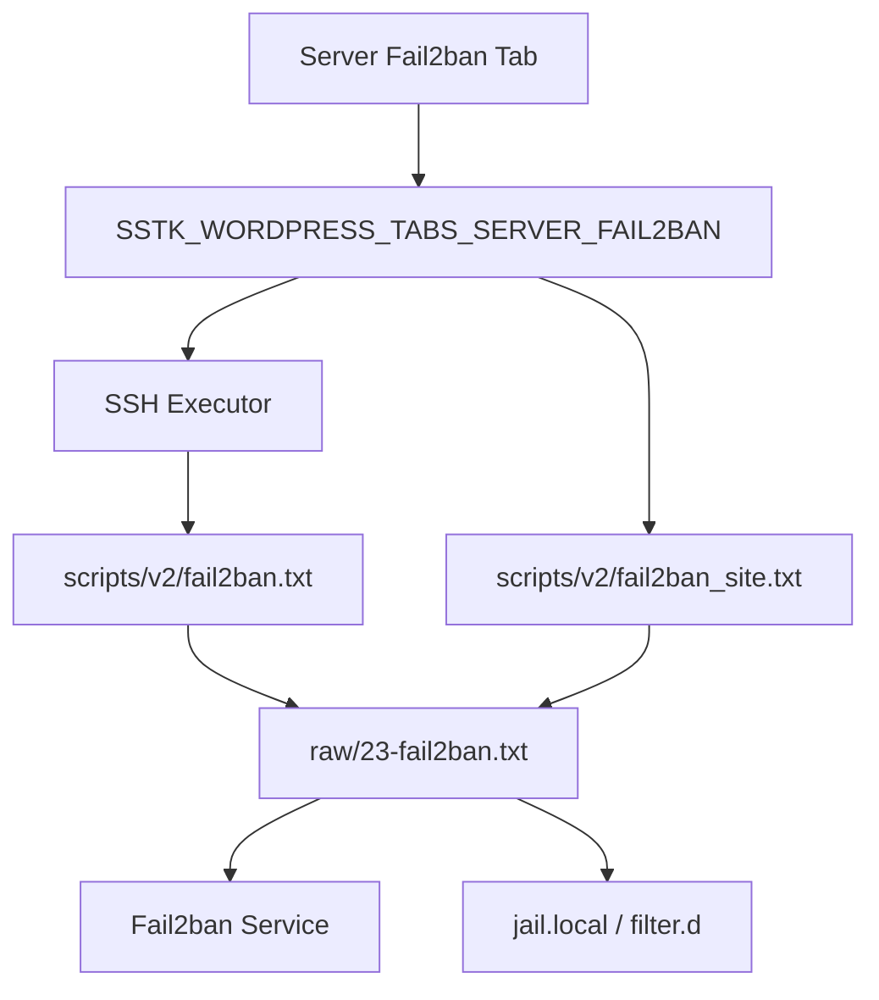
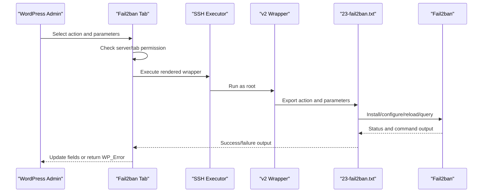

# Intrusion Detection & Prevention

<cite>
**Referenced Files in This Document**
- [fail2ban.php](file://includes/core/apps/wordpress-app/tabs-server/fail2ban.php)
- [fail2ban.txt](file://includes/core/apps/wordpress-app/scripts/v2/fail2ban.txt)
- [fail2ban_site.txt](file://includes/core/apps/wordpress-app/scripts/v2/fail2ban_site.txt)
- [23-fail2ban.txt](file://includes/core/apps/wordpress-app/scripts/v2/raw/23-fail2ban.txt)
- [class-wordpress-app.php](file://includes/core/apps/wordpress-app/class-wordpress-app.php)
</cite>

## Table of Contents
1. [Introduction](#introduction)
2. [Project Structure](#project-structure)
3. [Core Components](#core-components)
4. [Architecture Overview](#architecture-overview)
5. [Detailed Component Analysis](#detailed-component-analysis)
6. [Dependency Analysis](#dependency-analysis)
7. [Performance Considerations](#performance-considerations)
8. [Troubleshooting Guide](#troubleshooting-guide)
9. [Conclusion](#conclusion)

## Introduction

Simple Stack manages Fail2ban through the server-level `fail2ban` tab. The integration covers package lifecycle, global and per-jail parameters, IP bans and allow-list entries, and optional WordPress-specific filters. The execution path is fixed to `scripts/v2/`; there is no `scripts/v1/` fallback or per-server selector.

The supported server stack is Ubuntu 24.04/26.04 with OpenLiteSpeed. Fail2ban watches system and application logs; it does not depend on Nginx or PHP-FPM. Web-server request filtering is handled separately by UFW and the site-level 7G WAF.

## Project Structure

```text
includes/core/apps/wordpress-app/
├── class-wordpress-app.php                 # loads the server tab
├── tabs-server/
│   └── fail2ban.php                        # permissions, fields, action routing
└── scripts/v2/
    ├── fail2ban.txt                        # server-level wrapper
    ├── fail2ban_site.txt                   # per-site WP Fail2ban wrapper
    └── raw/
        └── 23-fail2ban.txt                 # installation and operations
```



## Core Components

- **Fail2ban tab:** Registers the `fail2ban` server tab, checks tab permissions, renders lifecycle and jail controls, and dispatches actions.
- **Server wrapper:** Downloads the shared function library and `23-fail2ban.txt`, exports action parameters, and runs the raw script as root.
- **Site wrapper:** Adds the selected `domain` for the optional WP Fail2ban plugin install/remove operations.
- **Raw automation:** Implements installation, removal, purge, upgrade, parameter updates, jail enable/disable, IP ban/unban, status listing, and per-site WP Fail2ban plugin management.

Supported PHP action names include:

- `fail2ban-install`
- `fail2ban-remove`
- `fail2ban-purge`
- `fail2ban-change-default-parameters`
- `fail2ban-upgrade`
- `fail2ban-add-protocol`
- `fail2ban-remove-protocol`
- `fail2ban-ban-ip`
- `fail2ban-unban-ip`
- Dynamic protocol update/remove actions generated for each enabled jail.

## Architecture Overview



The PHP handler escapes individual arguments before rendering the wrapper command. The raw script validates numeric timing values and checks IP addresses with `ip route get` or `ip -6 route get` before using them.

## Detailed Component Analysis

### Installation

`fail2ban_install` performs the following work:

1. Installs the distribution `fail2ban` package.
2. Builds `/etc/fail2ban/jail.local` from the packaged `jail.conf`.
3. Sets default `bantime=600`, `findtime=600`, `maxretry=3`, and `ignoreip=127.0.0.1`.
4. Enables the `sshd` and `phpmyadmin-syslog` jails.
5. Enables the `monit` jail when `/var/log/monit.log` exists.
6. Downloads the `wordpress-hard` and `wordpress-soft` filters from the WP Fail2ban repository and creates matching jails.
7. Enables Fail2ban at boot, restarts it, and installs log rotation when needed.

The WordPress jails use `/var/log/auth.log`; `wordpress-hard` has `maxretry=1` and `bantime=30`, while `wordpress-soft` uses `maxretry=3` and `bantime=600`.

### Global and Per-Jail Parameters

The parameter handler can update:

- `bantime`
- `findtime`
- `maxretry`
- `ignoreip`

Timing values must be numeric. An allow-list addition must resolve through the local IPv4 or IPv6 route table. Changes are applied to `jail.local` and followed by `fail2ban-client reload`.

Per-jail management uses the jail names present in the packaged `jail.conf`. Adding a jail sets `enabled=true` and inherits the current default timing values. If reload fails, the add operation disables that jail again and attempts another reload.

### Ban, Unban, and Status

- **Ban:** Accepts comma-separated IP addresses, validates each address, removes it from the allow-list, and issues `fail2ban-client set sshd banip`.
- **Unban:** Validates each address, adds it to `ignoreip`, issues `fail2ban-client unban`, and reloads Fail2ban.
- **Status:** Lists banned IPs across active jails and reads the allow-list from `jail.local`.

These are Fail2ban operations. They do not replace UFW rules, the 7G WAF, or provider-level firewalls.

### Optional WP Fail2ban Plugin

The per-site wrapper can install and activate `wp-fail2ban` for a selected domain and add a symlink under `wp-content/mu-plugins`. Removal deletes the symlink and uninstalls the plugin.

The WordPress jails and the WP Fail2ban plugin are related but separate: the raw install operation creates server-side filters and jails, while the per-site operation installs the plugin that writes compatible authentication events.

## Dependency Analysis

- The tab depends on the WordPress app bootstrap loading `tabs-server/fail2ban.php`.
- Remote execution depends on valid server SSH credentials and root command execution.
- The wrappers depend on `9999-common-functions.txt`, `23-fail2ban.txt`, `dos2unix`, and outbound HTTPS access.
- WordPress filters depend on the WP Fail2ban filter files being downloaded successfully.
- phpMyAdmin and Monit jails depend on their logs existing on the target host.

## Performance Considerations

- Fail2ban is event-driven and normally has low overhead when jails are scoped to relevant logs.
- Keep `findtime`, `maxretry`, and `bantime` aligned with the service being protected; overly broad values can lock out legitimate users.
- Avoid enabling jails whose log paths do not exist.
- Review the allow-list before adding shared NAT addresses or large CIDR ranges.

## Troubleshooting Guide

### Fail2ban Does Not Start After Installation

Run on the target server:

```bash
fail2ban-client status
fail2ban-client -t
```

Check that the WordPress filter downloads succeeded and that every enabled jail has a readable log path. The current raw script uses silent downloads and does not fail immediately when a filter file is missing, so service validation is required.

### A Jail Cannot Be Enabled

Confirm the jail exists in `/etc/fail2ban/jail.conf`, its log path exists, and `fail2ban-client -t` accepts the generated configuration. The add operation disables the jail again when reload fails.

### Bans Do Not Apply

Confirm the address is not covered by `ignoreip`, inspect the active jail list, and verify that the intended jail is enabled. The manual ban action targets the `sshd` jail.

### WordPress Events Are Missing

Confirm the WP Fail2ban plugin is active for the site, the mu-plugin symlink exists, and the plugin is writing to the authentication log expected by the WordPress jails.

### Script Download Security

The current `scripts/v2` wrappers still use `wget --no-check-certificate` for provisioning assets. That disables TLS certificate verification and is a release-blocking hardening gap for this integration and the wider script pipeline.

## Conclusion

Fail2ban provides server-side brute-force detection and IP banning for SSH, phpMyAdmin, Monit, and WordPress authentication events. Simple Stack exposes lifecycle and jail management through the server tab and executes only the fixed `scripts/v2` automation. UFW and 7G remain separate layers of the OpenLiteSpeed-only security model.
