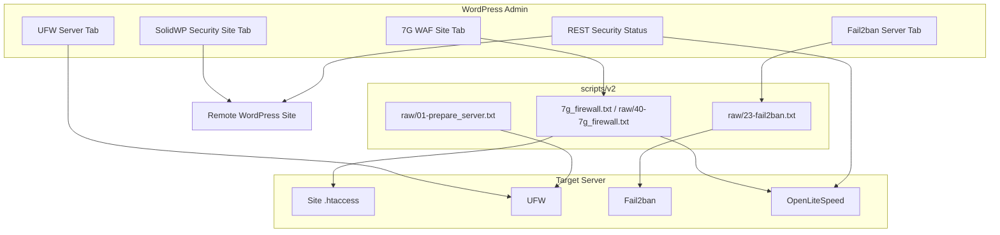

# Security Hardening Tools

<cite>
**Referenced Files in This Document**
- [7g_firewall.php](file://includes/core/apps/wordpress-app/tabs/7g_firewall.php)
- [7g_firewall.txt](file://includes/core/apps/wordpress-app/scripts/v2/7g_firewall.txt)
- [40-7g_firewall.txt](file://includes/core/apps/wordpress-app/scripts/v2/raw/40-7g_firewall.txt)
- [7G-Firewall-OLS.txt](file://includes/core/apps/wordpress-app/scripts/v2/raw/7G-Firewall-OLS.txt)
- [9999-common-functions.txt](file://includes/core/apps/wordpress-app/scripts/v2/raw/9999-common-functions.txt)
- [ufw_firewall.php](file://includes/core/apps/wordpress-app/tabs-server/ufw_firewall.php)
- [01-prepare_server.txt](file://includes/core/apps/wordpress-app/scripts/v2/raw/01-prepare_server.txt)
- [fail2ban.php](file://includes/core/apps/wordpress-app/tabs-server/fail2ban.php)
- [23-fail2ban.txt](file://includes/core/apps/wordpress-app/scripts/v2/raw/23-fail2ban.txt)
- [security.php](file://includes/core/apps/wordpress-app/tabs/security.php)
- [class-sstk-rest-security.php](file://includes/core/api/class-sstk-rest-security.php)
- [class-sstk-rest-controller-base.php](file://includes/core/api/class-sstk-rest-controller-base.php)
</cite>

## Introduction

Simple Stack 1.0.0 supports OpenLiteSpeed only and uses the fixed `scripts/v2` provisioning
library. Its active security controls include:

- Per-site 7G web-application-firewall rules.
- UFW host firewall defaults and an admin port-management tab.
- Fail2ban installation, jail configuration and IP ban management.
- Optional SolidWP Security installation and license activation.
- A read-only REST security-status probe.
- Restricted OpenLiteSpeed WebAdmin exposure.

The 6G firewall, WPScan automation, WPSecurity Scanner workflows and Nginx-specific hardening
paths are not part of this release.

## Architecture Overview

## 7G Web Application Firewall

The site-level **7G WAF** tab is active and OpenLiteSpeed-specific. It manages rule blocks in
`/var/www/<domain>/html/.htaccess` using the bundled `7G-Firewall-OLS.txt` definitions.

The UI exposes:

- All rules.
- User Agent.
- Referrer.
- Query String.
- Request String, mapped to the underlying `REQUEST URI` block.
- Request Method.

The all-rules operation also manages the underlying `CORE` block. Enabling or disabling a group
updates the site's `.htaccess`, restarts OpenLiteSpeed and records the result in
`wpapp_7g_status`. Missing status defaults to off.

Actions are permission-gated at both the site and tab levels. As with any WAF, test rule changes
against legitimate forms, API traffic and admin requests before enabling them broadly.

## UFW Host Firewall

Server preparation configures UFW with incoming traffic denied by default and outgoing traffic
allowed. It opens the configured SSH port, HTTP (`80`) and HTTPS (`443`).

OpenLiteSpeed WebAdmin port `7080` is explicitly denied. A scoped allow rule is added only when
`SSTK_ADMIN_IP` contains a validated administration address; otherwise the port remains closed
to public traffic.

The **Firewall** server tab can open or close additional ports. It refuses changes to `80`, `443`
and `22`, executes `ufw allow` or `ufw deny`, and tracks dashboard-managed ports in server meta.
The list is not a complete UFW audit: rules created directly on the server are not discovered by
that tab. Review any provider-level firewall separately.

## Fail2ban

The **Fail2ban** server tab supports:

- Install, remove, purge and upgrade.
- Global ban time, find time, retry limit and ignore-list changes.
- Protocol/jail enablement and parameter changes.
- Manual IP ban and unban.

The installation script enables the SSH and phpMyAdmin jails, enables the Monit jail when its log
exists, and installs WordPress hard/soft filters from the WP Fail2ban project. Defaults are
deliberately strict. Because an incorrect ignore list or threshold can lock out administrators,
review SSH access and jail settings before applying changes.

## SolidWP Security Integration

The **Security Plugin** site tab can install, activate, connect, remove or license SolidWP
Security when the global SolidWP file URL, account username and password are configured. Optional
bulk actions can apply the same operation to multiple sites.

This is an optional third-party integration. Simple Stack does not bundle an autonomous
vulnerability scanner or WPScan workflow, and it does not claim that installing SolidWP replaces
patching, monitoring or incident response.

## Read-only REST Security Probe

`POST /simple-stack/v1/sites/{id}/security-status` is an authenticated, read-only probe. The
controller family requires `manage_options`.

The probe reports:

- Whether the server connection succeeded.
- Installed WordPress plugins with name, status, version and update availability.
- Whether `DISALLOW_FILE_EDIT` is enabled.
- The PHP version serving the site's OpenLiteSpeed vhost, with CLI PHP as a fallback.

It does not install software, change settings, scan the filesystem or return credentials. Responses
pass through the shared Simple Stack secret redactor.

## Operational Guidance

- Keep UFW and any provider-level firewall rules aligned.
- Leave port `7080` closed unless a specific administration address requires access.
- Review Fail2ban ignore lists before changing retry or ban thresholds.
- Enable 7G groups incrementally and validate application traffic after each OpenLiteSpeed
  restart.
- Keep WordPress core, plugins, themes and server packages patched; the REST probe is a posture
  check, not a vulnerability scanner.
- Treat SolidWP credentials and license material as secrets.

## Troubleshooting Guide

- **Site requests are blocked after a WAF change:** disable the affected 7G group, inspect the
  `.htaccess` rule block and validate the legitimate request pattern.
- **UFW change failed:** inspect the SSH command result, confirm UFW is installed and check that
  the requested port is not one of the protected ports.
- **Fail2ban does not ban an address:** verify the jail is enabled, its log path exists and the
  filter matches the service's log format.
- **Security probe cannot connect:** verify the parent server, provider credentials, SSH key and
  site domain recorded on the site post.
- **Reported PHP version looks wrong:** inspect the vhost's `lsapi:lsphp*` handler; the probe
  prefers that value over the CLI PHP version.
