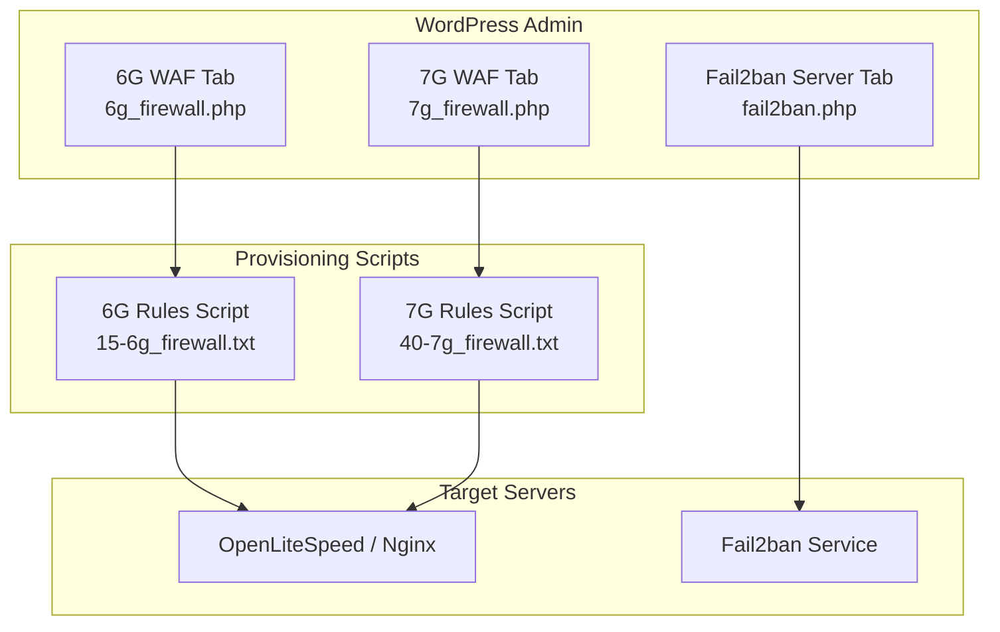
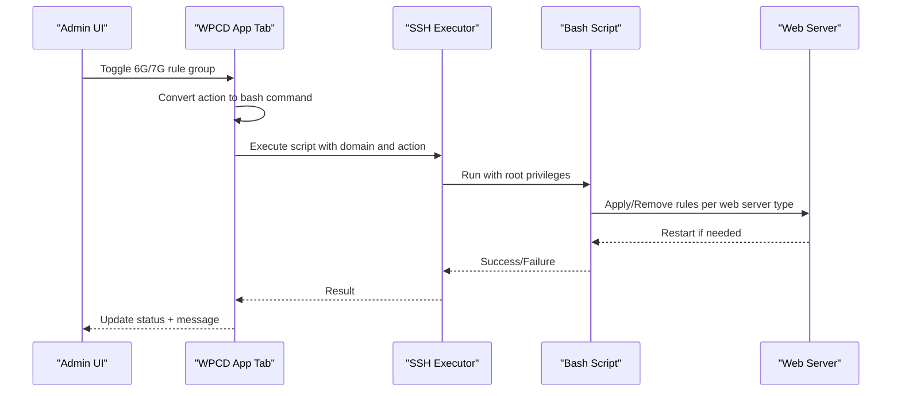
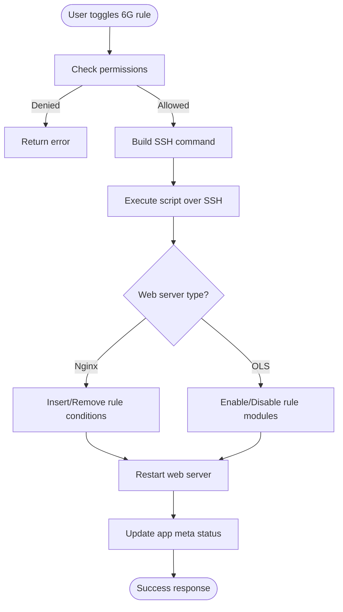
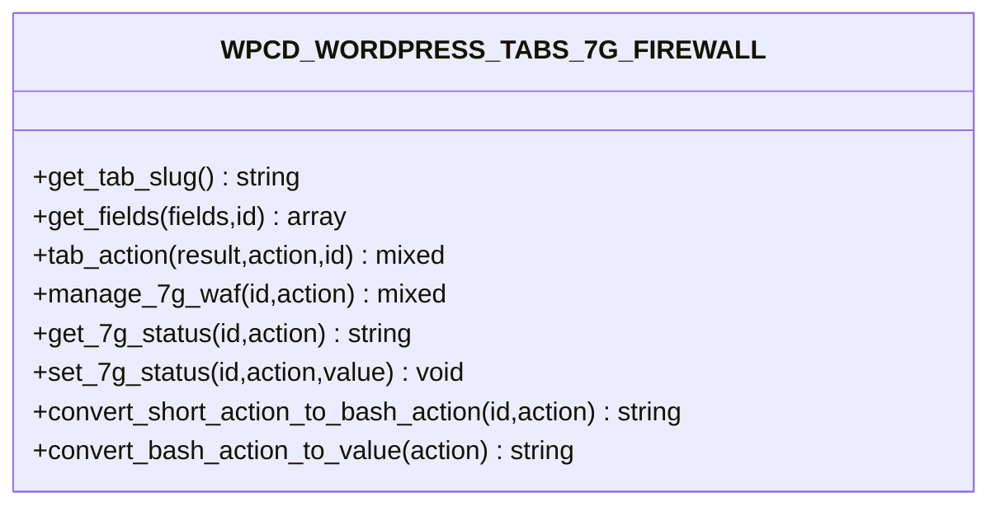
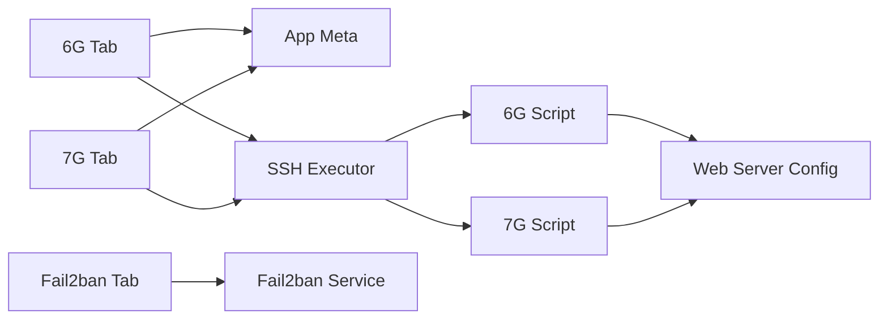

# Security Hardening Tools

<cite>
**Referenced Files in This Document**
- [README.md](file://README.md)
- [15-6g_firewall.txt](file://includes/core/apps/wordpress-app/scripts/v2/raw/15-6g_firewall.txt)
- [40-7g_firewall.txt](file://includes/core/apps/wordpress-app/scripts/v2/raw/40-7g_firewall.txt)
- [6g_firewall.php](file://includes/core/apps/wordpress-app/tabs/6g_firewall.php)
- [7g_firewall.php](file://includes/core/apps/wordpress-app/tabs/7g_firewall.php)
- [fail2ban.php](file://includes/core/apps/wordpress-app/tabs-server/fail2ban.php)
</cite>

## Table of Contents
1. [Introduction](#introduction)
2. [Project Structure](#project-structure)
3. [Core Components](#core-components)
4. [Architecture Overview](#architecture-overview)
5. [Detailed Component Analysis](#detailed-component-analysis)
6. [Dependency Analysis](#dependency-analysis)
7. [Performance Considerations](#performance-considerations)
8. [Troubleshooting Guide](#troubleshooting-guide)
9. [Conclusion](#conclusion)
10. [Appendices](#appendices)

## Introduction
This document explains SimpleStack’s security hardening tools with a focus on:
- Firewall configuration using the 6G and 7G rule sets
- Intrusion detection via Fail2ban
- Vulnerability scanning and WordPress-specific security measures (Solid Security plugin integration)
- Customization, alerting, incident response, best practices, compliance considerations, and performance impact

SimpleStack provisions servers, installs OpenLiteSpeed, PHP, MariaDB, Redis, certbot, firewall, and an OLS vhost, then manages services, firewall, backups, logs, Fail2ban, SSH keys, and site-level settings from the WordPress admin. The stack targets Ubuntu LTS releases and uses OpenLiteSpeed only.

**Section sources**
- [README.md:1-25](file://README.md#L1-L25)
- [README.md:27-38](file://README.md#L27-L38)

## Project Structure
Security-related functionality is implemented across:
- UI tabs for WAF controls (6G and 7G)
- Bash scripts executed over SSH to apply rules to Nginx or OpenLiteSpeed
- Fail2ban server tab for service-level protection

**Diagram sources**
- [6g_firewall.php:139-187](file://includes/core/apps/wordpress-app/tabs/6g_firewall.php#L139-L187)
- [7g_firewall.php:129-177](file://includes/core/apps/wordpress-app/tabs/7g_firewall.php#L129-L177)
- [15-6g_firewall.txt:49-95](file://includes/core/apps/wordpress-app/scripts/v2/raw/15-6g_firewall.txt#L49-L95)
- [40-7g_firewall.txt:49-97](file://includes/core/apps/wordpress-app/scripts/v2/raw/40-7g_firewall.txt#L49-L97)
- [fail2ban.php](file://includes/core/apps/wordpress-app/tabs-server/fail2ban.php)

**Section sources**
- [README.md:11-23](file://README.md#L11-L23)
- [README.md:27-38](file://README.md#L27-L38)

## Core Components
- 6G WAF tab and script: Toggle all or individual rule groups (User Agent, Referrer, Query String, Request String, Request Method). Applies rules at the web server level before WordPress processes requests.
- 7G WAF tab and script: Updated version of 6G with additional CORE and REQUEST URI categories; recommended starting point for new sites.
- Fail2ban server tab: Configure brute-force protection and service-level security controls.

Key capabilities:
- Per-site toggles for each rule group
- Web server type detection (OpenLiteSpeed vs Nginx)
- Status persistence in app meta
- SSH execution of provisioning scripts with success/error handling

**Section sources**
- [6g_firewall.php:15-26](file://includes/core/apps/wordpress-app/tabs/6g_firewall.php#L15-L26)
- [6g_firewall.php:139-187](file://includes/core/apps/wordpress-app/tabs/6g_firewall.php#L139-L187)
- [7g_firewall.php:15-26](file://includes/core/apps/wordpress-app/tabs/7g_firewall.php#L15-L26)
- [7g_firewall.php:129-177](file://includes/core/apps/wordpress-app/tabs/7g_firewall.php#L129-L177)
- [15-6g_firewall.txt:16-46](file://includes/core/apps/wordpress-app/scripts/v2/raw/15-6g_firewall.txt#L16-L46)
- [40-7g_firewall.txt:16-46](file://includes/core/apps/wordpress-app/scripts/v2/raw/40-7g_firewall.txt#L16-L46)

## Architecture Overview
The WAF controls flow through the WordPress admin into SSH-executed scripts that modify web server configurations. Fail2ban is managed via a dedicated server tab.

**Diagram sources**
- [6g_firewall.php:139-187](file://includes/core/apps/wordpress-app/tabs/6g_firewall.php#L139-L187)
- [7g_firewall.php:129-177](file://includes/core/apps/wordpress-app/tabs/7g_firewall.php#L129-L177)
- [15-6g_firewall.txt:49-95](file://includes/core/apps/wordpress-app/scripts/v2/raw/15-6g_firewall.txt#L49-L95)
- [40-7g_firewall.txt:49-97](file://includes/core/apps/wordpress-app/scripts/v2/raw/40-7g_firewall.txt#L49-L97)

## Detailed Component Analysis

### 6G Firewall (Rule Set and Controls)
- Purpose: Block known bad bots and common web application attacks by inspecting request components at the web server layer.
- Rule groups: User Agent, Referrer, Query String, Request String, Request Method.
- Web server support:
  - Nginx: Inserts conditional checks for each rule group.
  - OpenLiteSpeed: Enables/disables corresponding rule modules.
- UI behavior:
  - Toggle ALL rules or individual groups.
  - Persists state in app meta and reflects current status.
  - Provides guidance about not enabling both 6G and 7G simultaneously.

**Diagram sources**
- [6g_firewall.php:139-187](file://includes/core/apps/wordpress-app/tabs/6g_firewall.php#L139-L187)
- [15-6g_firewall.txt:49-95](file://includes/core/apps/wordpress-app/scripts/v2/raw/15-6g_firewall.txt#L49-L95)

**Section sources**
- [6g_firewall.php:15-26](file://includes/core/apps/wordpress-app/tabs/6g_firewall.php#L15-L26)
- [6g_firewall.php:139-187](file://includes/core/apps/wordpress-app/tabs/6g_firewall.php#L139-L187)
- [6g_firewall.php:498-546](file://includes/core/apps/wordpress-app/tabs/6g_firewall.php#L498-L546)
- [15-6g_firewall.txt:16-46](file://includes/core/apps/wordpress-app/scripts/v2/raw/15-6g_firewall.txt#L16-L46)
- [15-6g_firewall.txt:49-95](file://includes/core/apps/wordpress-app/scripts/v2/raw/15-6g_firewall.txt#L49-L95)

### 7G Firewall (Updated Rule Set)
- Purpose: Enhanced WAF with additional categories including CORE and REQUEST URI. Recommended default for new sites.
- Rule groups: CORE, User Agent, HTTP Referrer, Query String, Request URI, Request Method.
- Web server support mirrors 6G but with updated variable/module names.
- UI behavior: Same toggle model as 6G with separate status storage.

**Diagram sources**
- [7g_firewall.php:15-26](file://includes/core/apps/wordpress-app/tabs/7g_firewall.php#L15-L26)
- [7g_firewall.php:129-177](file://includes/core/apps/wordpress-app/tabs/7g_firewall.php#L129-L177)
- [7g_firewall.php:484-592](file://includes/core/apps/wordpress-app/tabs/7g_firewall.php#L484-L592)

**Section sources**
- [7g_firewall.php:15-26](file://includes/core/apps/wordpress-app/tabs/7g_firewall.php#L15-L26)
- [7g_firewall.php:129-177](file://includes/core/apps/wordpress-app/tabs/7g_firewall.php#L129-L177)
- [7g_firewall.php:484-592](file://includes/core/apps/wordpress-app/tabs/7g_firewall.php#L484-L592)
- [40-7g_firewall.txt:16-46](file://includes/core/apps/wordpress-app/scripts/v2/raw/40-7g_firewall.txt#L16-L46)
- [40-7g_firewall.txt:49-97](file://includes/core/apps/wordpress-app/scripts/v2/raw/40-7g_firewall.txt#L49-L97)

### Differences Between 6G and 7G
- 7G adds CORE and REQUEST URI rule categories and updates variable/module naming conventions.
- Both provide per-group toggles and persist state separately.
- Guidance recommends starting with 7G and downgrading to 6G only if compatibility issues arise.

**Section sources**
- [6g_firewall.php:450-456](file://includes/core/apps/wordpress-app/tabs/6g_firewall.php#L450-L456)
- [7g_firewall.php:434-442](file://includes/core/apps/wordpress-app/tabs/7g_firewall.php#L434-L442)
- [40-7g_firewall.txt:49-67](file://includes/core/apps/wordpress-app/scripts/v2/raw/40-7g_firewall.txt#L49-L67)

### Fail2ban Configuration (Brute Force Protection and Service Security)
- Managed via the Fail2ban server tab.
- Typical use cases:
  - Protect SSH against brute force attempts
  - Harden service-level access (e.g., limiting repeated failed logins)
- Operational notes:
  - Ensure fail2ban service is installed and enabled
  - Define jails aligned with your exposure surface (SSH, web login endpoints)
  - Monitor logs and adjust thresholds to balance security and usability

[No sources needed since this section provides general guidance]

### Solid Security Plugin Integration (WordPress Auditing, Malware Scanning, Login Protection)
- Integrate Solid Security within the WordPress environment to:
  - Audit plugins and core integrity
  - Scan for malware signatures and suspicious files
  - Strengthen login security (strong passwords, 2FA, login limits)
- Best practices:
  - Schedule regular scans
  - Review audit reports and remediate findings promptly
  - Align scan schedules with maintenance windows to minimize performance impact

[No sources needed since this section provides general guidance]

### WPSecurity Scanner Setup (Vulnerability Assessment and Remediation)
- Use WPSecurity Scanner to:
  - Identify outdated plugins/themes and insecure configurations
  - Assess database and file permissions
  - Generate remediation checklists
- Workflow:
  - Install and configure scanner
  - Run full assessments
  - Prioritize critical vulnerabilities
  - Apply patches and re-scan to verify fixes

[No sources needed since this section provides general guidance]

## Dependency Analysis
- UI tabs depend on:
  - App instance details and domain resolution
  - Web server type detection
  - SSH executor to run provisioning scripts
- Provisioning scripts depend on:
  - Common functions file
  - Root privileges
  - Target web server configuration paths
- Fail2ban depends on:
  - System service availability
  - Log parsing rules for targeted services

**Diagram sources**
- [6g_firewall.php:139-187](file://includes/core/apps/wordpress-app/tabs/6g_firewall.php#L139-L187)
- [7g_firewall.php:129-177](file://includes/core/apps/wordpress-app/tabs/7g_firewall.php#L129-L177)
- [15-6g_firewall.txt:8-14](file://includes/core/apps/wordpress-app/scripts/v2/raw/15-6g_firewall.txt#L8-L14)
- [40-7g_firewall.txt:8-14](file://includes/core/apps/wordpress-app/scripts/v2/raw/40-7g_firewall.txt#L8-L14)
- [fail2ban.php](file://includes/core/apps/wordpress-app/tabs-server/fail2ban.php)

**Section sources**
- [6g_firewall.php:139-187](file://includes/core/apps/wordpress-app/tabs/6g_firewall.php#L139-L187)
- [7g_firewall.php:129-177](file://includes/core/apps/wordpress-app/tabs/7g_firewall.php#L129-L177)
- [15-6g_firewall.txt:8-14](file://includes/core/apps/wordpress-app/scripts/v2/raw/15-6g_firewall.txt#L8-L14)
- [40-7g_firewall.txt:8-14](file://includes/core/apps/wordpress-app/scripts/v2/raw/40-7g_firewall.txt#L8-L14)

## Performance Considerations
- WAF rules operate at the web server layer, reducing load on WordPress by blocking malicious requests early.
- Enabling too many broad rule groups can increase false positives; prefer targeted toggling when necessary.
- If using a CDN/proxy like Cloudflare, consider whether overlapping WAF rules are redundant.
- Schedule vulnerability scans during off-peak hours to avoid impacting user experience.
- Monitor web server restarts triggered by rule changes; batch changes where possible.

[No sources needed since this section provides general guidance]

## Troubleshooting Guide
Common issues and resolutions:
- SSH execution failures:
  - Verify connectivity and credentials
  - Check script prerequisites (common functions file present)
  - Confirm root privileges for rule modifications
- Web server not restarting:
  - Validate service management functions
  - Inspect web server logs for errors after applying rules
- False positives from WAF:
  - Disable specific rule groups temporarily
  - Test with targeted enablement
  - Adjust rules or whitelist legitimate traffic patterns
- Fail2ban not banning IPs:
  - Ensure jail definitions exist for target services
  - Verify log paths and parsing rules
  - Check service status and permissions

**Section sources**
- [15-6g_firewall.txt:8-14](file://includes/core/apps/wordpress-app/scripts/v2/raw/15-6g_firewall.txt#L8-L14)
- [40-7g_firewall.txt:8-14](file://includes/core/apps/wordpress-app/scripts/v2/raw/40-7g_firewall.txt#L8-L14)
- [6g_firewall.php:139-187](file://includes/core/apps/wordpress-app/tabs/6g_firewall.php#L139-L187)
- [7g_firewall.php:129-177](file://includes/core/apps/wordpress-app/tabs/7g_firewall.php#L129-L177)

## Conclusion
SimpleStack provides robust, script-driven WAF controls for both 6G and 7G rule sets, integrated directly into the WordPress admin. Fail2ban complements these protections by guarding against brute-force attacks. For comprehensive WordPress security, integrate Solid Security and WPSecurity Scanner to audit, scan, and remediate vulnerabilities. Adopt a phased rollout strategy: start with 7G, tune based on observed traffic, and maintain regular scanning and monitoring routines.

[No sources needed since this section summarizes without analyzing specific files]

## Appendices

### Customizing Firewall Rules
- Prefer enabling 7G first; selectively disable groups causing issues.
- For Nginx-based setups, rule conditions are inserted into site configs; ensure syntax remains valid after changes.
- For OpenLiteSpeed, enable/disable module-level rules via provided helpers.
- After changes, confirm web server restart and validate site functionality.

**Section sources**
- [15-6g_firewall.txt:49-95](file://includes/core/apps/wordpress-app/scripts/v2/raw/15-6g_firewall.txt#L49-L95)
- [40-7g_firewall.txt:49-97](file://includes/core/apps/wordpress-app/scripts/v2/raw/40-7g_firewall.txt#L49-L97)

### Configuring Security Alerts
- Enable email notifications for Fail2ban bans and WAF block events.
- Centralize logs and set retention policies.
- Integrate with monitoring systems for real-time alerts.

[No sources needed since this section provides general guidance]

### Responding to Security Incidents
- Isolate affected sites if necessary.
- Review WAF logs and Fail2ban entries to identify attack vectors.
- Temporarily disable overly broad WAF rules if they interfere with recovery.
- Patch vulnerabilities identified by scanners and re-scan to confirm remediation.

[No sources needed since this section provides general guidance]

### Compliance Considerations
- Align WAF rules with organizational policy and threat models.
- Maintain audit trails for rule changes and incident responses.
- Regularly review and update scanner signatures and Fail2ban jails.

[No sources needed since this section provides general guidance]