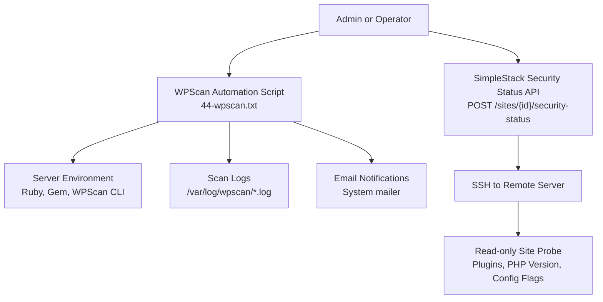
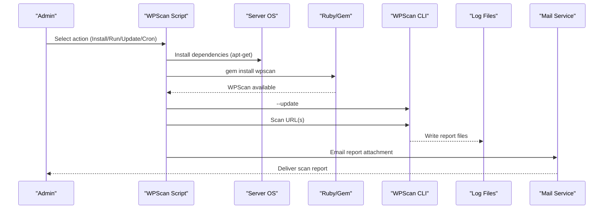
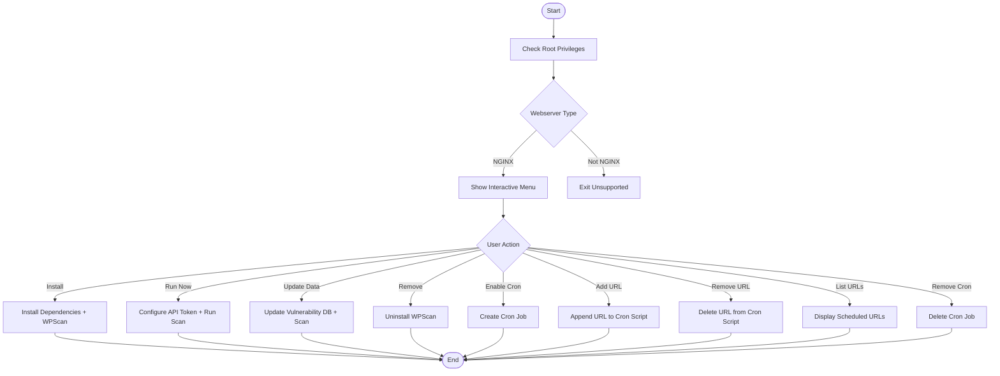
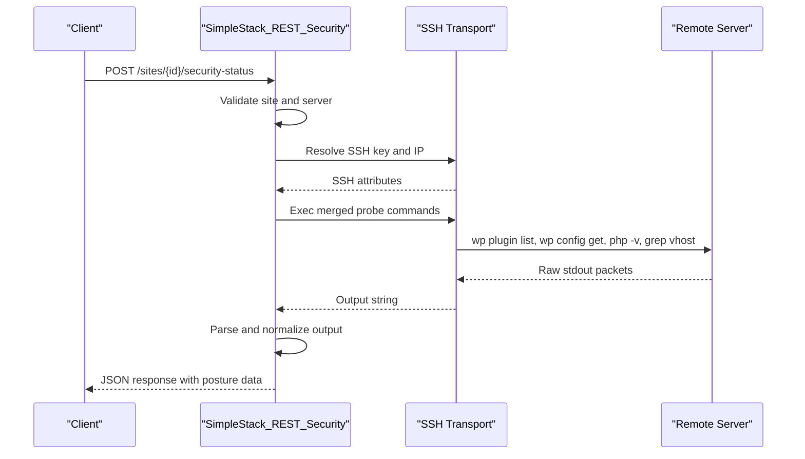
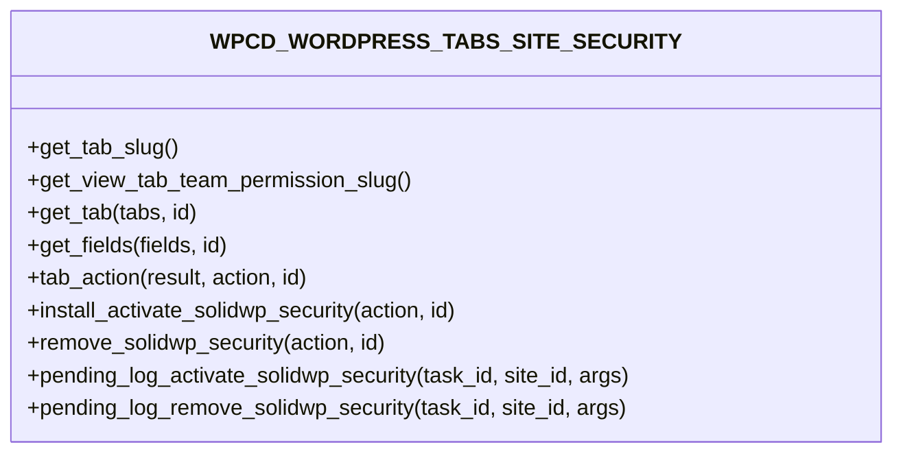
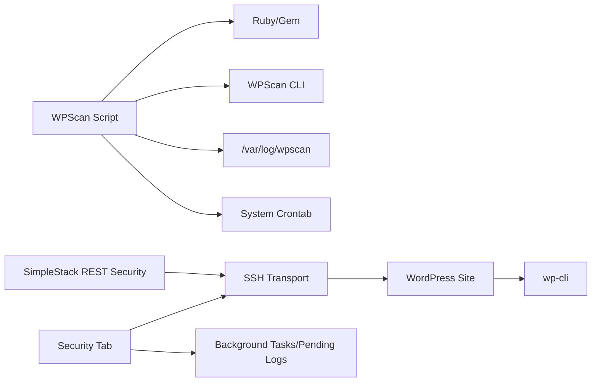

# Vulnerability Scanning

<cite>
**Referenced Files in This Document**
- [44-wpscan.txt](file://includes/core/apps/wordpress-app/scripts/v1/raw/44-wpscan.txt)
- [class-simplestack-rest-security.php](file://includes/core/api/class-simplestack-rest-security.php)
- [security.php](file://includes/core/apps/wordpress-app/tabs/security.php)
- [manage_solidwp_security.txt](file://includes/core/apps/wordpress-app/scripts/v1/manage_solidwp_security.txt)
</cite>

## Table of Contents
1. [Introduction](#introduction)
2. [Project Structure](#project-structure)
3. [Core Components](#core-components)
4. [Architecture Overview](#architecture-overview)
5. [Detailed Component Analysis](#detailed-component-analysis)
6. [Dependency Analysis](#dependency-analysis)
7. [Performance Considerations](#performance-considerations)
8. [Troubleshooting Guide](#troubleshooting-guide)
9. [Conclusion](#conclusion)

## Introduction
This document explains SimpleStack’s vulnerability scanning capabilities using WPSecurity Scanner (WPScan). It covers installation, configuration, automated scheduling, scan result interpretation, severity classification, remediation guidance, CI/CD integration, false positive handling, customization options, performance impact mitigation, and security compliance practices.

SimpleStack provides:
- A server-side WPScan automation script that installs WPScan, runs scans, updates vulnerability databases, schedules recurring scans via cron, and emails reports.
- A read-only security posture probe endpoint that collects installed plugins, PHP version, file editing policy, and OpenLiteSpeed handler information without mutating the remote system.
- A WordPress application tab for managing a related security plugin integration.

## Project Structure
The relevant parts of the repository are organized as follows:
- Server-side WPScan automation is implemented as a Bash script under the WordPress app scripts directory.
- The SimpleStack REST API exposes a security status endpoint that probes site configuration over SSH.
- The WordPress application tabs include a security-related interface for managing a third-party security plugin integration.

**Diagram sources**
- [44-wpscan.txt:1-285](file://includes/core/apps/wordpress-app/scripts/v1/raw/44-wpscan.txt#L1-L285)
- [class-simplestack-rest-security.php:31-100](file://includes/core/api/class-simplestack-rest-security.php#L31-L100)

**Section sources**
- [44-wpscan.txt:1-285](file://includes/core/apps/wordpress-app/scripts/v1/raw/44-wpscan.txt#L1-L285)
- [class-simplestack-rest-security.php:1-253](file://includes/core/api/class-simplestack-rest-security.php#L1-L253)

## Core Components
- WPScan Automation Script: Provides interactive menu-driven operations for installing WPScan, running immediate scans, updating vulnerability data, removing WPScan, enabling cron-based scheduled scans, adding/removing URLs from the schedule, listing scheduled URLs, and removing the cron job.
- SimpleStack Security Status API: Exposes a POST endpoint that performs a read-only probe against a site to collect plugin inventory, PHP version, DISALLOW_FILE_EDIT status, and OpenLiteSpeed PHP handler details.
- WordPress App Security Tab: Manages activation and removal of a third-party security plugin integration through background tasks and pending logs.

Key responsibilities:
- Installation and lifecycle management of WPScan on NGINX servers.
- Automated scanning with email notifications and log retention.
- Read-only security posture reporting via REST API.
- Integration hooks for background task execution.

**Section sources**
- [44-wpscan.txt:45-227](file://includes/core/apps/wordpress-app/scripts/v1/raw/44-wpscan.txt#L45-L227)
- [class-simplestack-rest-security.php:31-100](file://includes/core/api/class-simplestack-rest-security.php#L31-L100)
- [security.php:22-635](file://includes/core/apps/wordpress-app/tabs/security.php#L22-L635)

## Architecture Overview
The vulnerability scanning architecture combines two complementary mechanisms:
- WPScan automation for deep vulnerability detection and reporting.
- SimpleStack REST security status for lightweight, read-only posture checks.

**Diagram sources**
- [44-wpscan.txt:45-120](file://includes/core/apps/wordpress-app/scripts/v1/raw/44-wpscan.txt#L45-L120)

## Detailed Component Analysis

### WPScan Automation Script
The script implements an interactive menu with functions for:
- Installing WPScan and required dependencies.
- Running an immediate scan with optional API token configuration.
- Updating vulnerability data and scanning.
- Removing WPScan.
- Enabling cron-based scheduled scans at a fixed time.
- Adding/removing URLs from the cron schedule.
- Listing URLs included in the cron schedule.
- Removing the cron job.

Important behaviors:
- Requires root privileges.
- Only supported on NGINX web servers.
- Stores scan logs under a dedicated directory.
- Emails scan reports using system mail.
- Uses a YAML configuration file for WPScan CLI options including an API token.
- Schedules daily scans via crontab and allows per-URL additions.

**Diagram sources**
- [44-wpscan.txt:1-285](file://includes/core/apps/wordpress-app/scripts/v1/raw/44-wpscan.txt#L1-L285)

Operational notes:
- Installation installs Ruby, build tools, and WPScan via gem, then initializes the log directory and stores notification settings.
- Immediate scans update WPScan, write a timestamped log file, and email it.
- Cron jobs run daily at a fixed hour, update WPScan, perform scans, and email results.
- URL management modifies the cron script to add or remove specific site URLs.

**Section sources**
- [44-wpscan.txt:45-227](file://includes/core/apps/wordpress-app/scripts/v1/raw/44-wpscan.txt#L45-L227)

### SimpleStack Security Status API
The REST controller registers a POST route for site security status and executes a read-only probe over SSH. It:
- Validates the site record and resolves the parent server.
- Resolves SSH connectivity and provider details.
- Executes a merged command sequence that lists plugins, reads configuration flags, checks PHP version, and inspects OpenLiteSpeed vhost configuration.
- Parses output into normalized fields for UI consumption.

Security posture fields returned:
- Plugins list with name, status, version, and update flag.
- Whether file editing is disallowed.
- PHP version detected via CLI and/or vhost handler.
- Connection status and message.

**Diagram sources**
- [class-simplestack-rest-security.php:31-100](file://includes/core/api/class-simplestack-rest-security.php#L31-L100)
- [class-simplestack-rest-security.php:117-191](file://includes/core/api/class-simplestack-rest-security.php#L117-L191)

**Section sources**
- [class-simplestack-rest-security.php:1-253](file://includes/core/api/class-simplestack-rest-security.php#L1-L253)

### WordPress App Security Tab
The security tab manages activation and removal of a third-party security plugin integration. It:
- Adds a “Security Plugin” tab when conditions allow.
- Handles toggle actions to install or remove the integration.
- Uses background tasks and pending logs for bulk operations.
- Executes remote scripts via SSH to manage the integration.

**Diagram sources**
- [security.php:22-635](file://includes/core/apps/wordpress-app/tabs/security.php#L22-L635)

Remote script wrapper:
- Downloads common helper and target script, exports variables, and executes the script via bash.

**Section sources**
- [security.php:22-635](file://includes/core/apps/wordpress-app/tabs/security.php#L22-L635)
- [manage_solidwp_security.txt:1-8](file://includes/core/apps/wordpress-app/scripts/v1/manage_solidwp_security.txt#L1-L8)

## Dependency Analysis
- WPScan depends on Ruby and the WPScan gem; the script installs these dependencies automatically.
- The script requires NGINX; it exits early if another web server type is detected.
- The REST security status endpoint depends on SSH access to the remote server and wp-cli availability on the site directory.
- The security tab relies on WordPress app infrastructure, SSH execution, and background task logging.

**Diagram sources**
- [44-wpscan.txt:45-227](file://includes/core/apps/wordpress-app/scripts/v1/raw/44-wpscan.txt#L45-L227)
- [class-simplestack-rest-security.php:152-191](file://includes/core/api/class-simplestack-rest-security.php#L152-L191)
- [security.php:295-432](file://includes/core/apps/wordpress-app/tabs/security.php#L295-L432)

**Section sources**
- [44-wpscan.txt:45-227](file://includes/core/apps/wordpress-app/scripts/v1/raw/44-wpscan.txt#L45-L227)
- [class-simplestack-rest-security.php:152-191](file://includes/core/api/class-simplestack-rest-security.php#L152-L191)
- [security.php:295-432](file://includes/core/apps/wordpress-app/tabs/security.php#L295-L432)

## Performance Considerations
- WPScan scans can be resource-intensive; schedule them during off-peak hours to minimize impact on production workloads.
- Use the built-in cron scheduler to automate scans at a consistent time rather than triggering ad-hoc scans frequently.
- Limit the number of URLs scanned per run by maintaining a focused cron script with only essential sites.
- For frequent posture checks, prefer the read-only security status API instead of full WPScan scans to reduce overhead.
- Ensure adequate disk space for scan logs and rotate or archive old logs periodically.

[No sources needed since this section provides general guidance]

## Troubleshooting Guide
Common issues and resolutions:
- Non-root execution: The script requires root privileges; run as root or adjust permissions accordingly.
- Unsupported web server: WPScan automation is only supported on NGINX; switch web server or use alternative scanning methods.
- Missing dependencies: If Ruby or WPScan gem installation fails, verify package manager availability and network access.
- Email delivery failures: Confirm system mail configuration and recipient address stored in the script configuration.
- Cron not executing: Verify crontab entries and ensure the cron script has execute permissions.
- SSH connectivity problems: Ensure provider credentials and SSH keys are configured correctly; check server reachability.
- wp-cli not found: Ensure wp-cli is installed and accessible in the site’s environment for the security status probe.

**Section sources**
- [44-wpscan.txt:1-21](file://includes/core/apps/wordpress-app/scripts/v1/raw/44-wpscan.txt#L1-L21)
- [class-simplestack-rest-security.php:194-224](file://includes/core/api/class-simplestack-rest-security.php#L194-L224)

## Conclusion
SimpleStack integrates WPScan automation for comprehensive vulnerability scanning and provides a lightweight security posture probe via REST API. Operators can install and configure WPScan, schedule regular scans, interpret results, and integrate scanning workflows into operational processes. The read-only security status endpoint offers quick insights into plugin inventory, PHP versions, and configuration flags without mutating the remote system. Together, these components support robust vulnerability detection, reporting, and ongoing security compliance.

[No sources needed since this section summarizes without analyzing specific files]