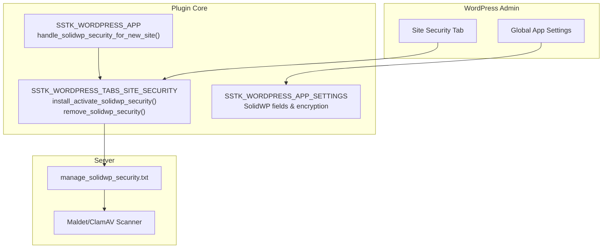
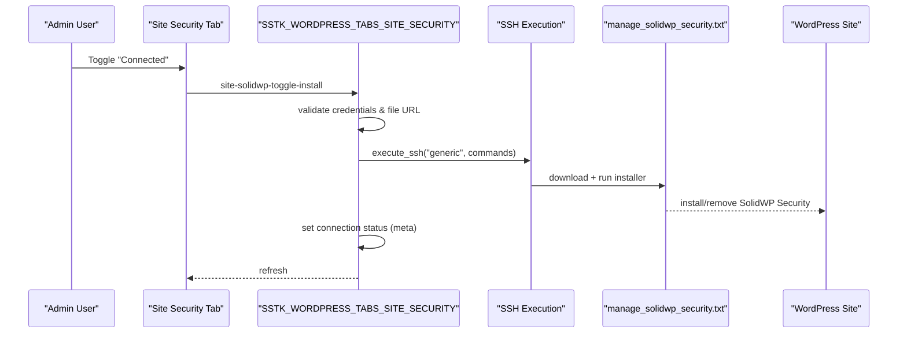
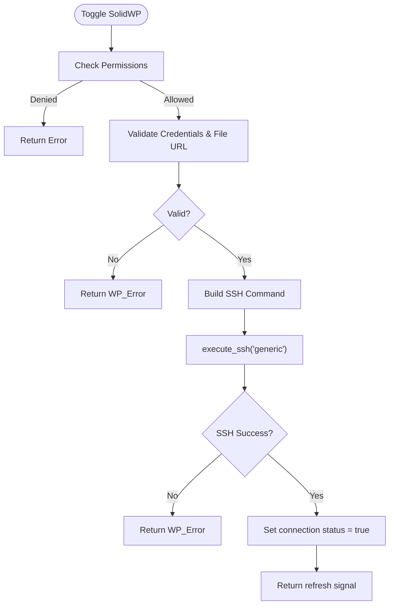
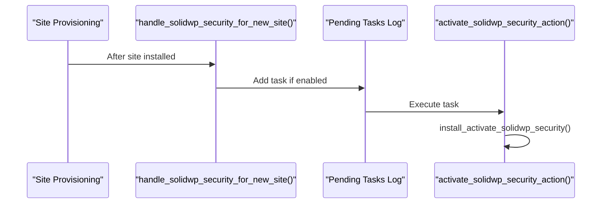
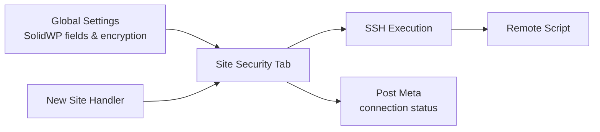

# WordPress Security Hardening

<cite>
**Referenced Files in This Document**
- [README.md](file://README.md)
- [security.php](file://includes/core/apps/wordpress-app/tabs/security.php)
- [class-wordpress-app-settings.php](file://includes/core/apps/wordpress-app/class-wordpress-app-settings.php)
- [class-wordpress-app.php](file://includes/core/apps/wordpress-app/class-wordpress-app.php)
- [manage_solidwp_security.txt](file://includes/core/apps/wordpress-app/scripts/v2/manage_solidwp_security.txt)
- [services.php](file://includes/core/apps/wordpress-app/tabs-server/services.php)
</cite>

## Table of Contents
1. [Introduction](#introduction)
2. [Project Structure](#project-structure)
3. [Core Components](#core-components)
4. [Architecture Overview](#architecture-overview)
5. [Detailed Component Analysis](#detailed-component-analysis)
6. [Dependency Analysis](#dependency-analysis)
7. [Performance Considerations](#performance-considerations)
8. [Troubleshooting Guide](#troubleshooting-guide)
9. [Conclusion](#conclusion)
10. [Appendices](#appendices)

## Introduction
This document explains how to harden WordPress security using the Solid Security plugin integration provided by Simple Stack. It covers installation, initial configuration, and audit setup; file integrity monitoring and malware scanning; login security enhancements; database security measures; two-factor authentication; admin account protection; user permission hardening; automated security checks; alert response; performance optimization for security features; backup integration; disaster recovery procedures; best practices; compliance requirements; and incident response protocols.

Simple Stack provisions servers and installs WordPress over SSH, then manages everything from the WordPress admin dashboard. The repository includes a dedicated “Security Plugin” tab that integrates SolidWP Security, plus server-level malware scanning via Maldet/ClamAV and comprehensive backup scripts.

## Project Structure
The relevant code for this guide is concentrated under the WordPress app module:
- Site-level SolidWP Security integration (UI, actions, and background tasks)
- Global settings for SolidWP credentials and bulk actions
- Server-level malware scanner management
- Provisioning scripts executed over SSH

**Diagram sources**
- [security.php:22-54](file://includes/core/apps/wordpress-app/tabs/security.php#L22-L54)
- [security.php:295-375](file://includes/core/apps/wordpress-app/tabs/security.php#L295-L375)
- [security.php:383-432](file://includes/core/apps/wordpress-app/tabs/security.php#L383-L432)
- [class-wordpress-app-settings.php:77-96](file://includes/core/apps/wordpress-app/class-wordpress-app-settings.php#L77-L96)
- [class-wordpress-app-settings.php:2578-2614](file://includes/core/apps/wordpress-app/class-wordpress-app-settings.php#L2578-L2614)
- [class-wordpress-app.php:4084-4091](file://includes/core/apps/wordpress-app/class-wordpress-app.php#L4084-L4091)
- [manage_solidwp_security.txt:1-8](file://includes/core/apps/wordpress-app/scripts/v2/manage_solidwp_security.txt#L1-L8)

**Section sources**
- [README.md:1-25](file://README.md#L1-L25)

## Core Components
- Site Security Tab: Provides a toggle to install or remove SolidWP Security per site, with permissions checks and pending task scheduling.
- Global Settings: Stores SolidWP account credentials and file URL securely (encrypted at rest), and toggles bulk actions.
- New Site Automation: Optionally activates SolidWP Security automatically on newly created sites.
- Server-side Script: Downloads and executes a script over SSH to perform SolidWP installation/removal.
- Malware Scanning: Server-level Maldet/ClamAV scanner with install, restart, update, enable/disable cron, purge, and history controls.

**Section sources**
- [security.php:22-54](file://includes/core/apps/wordpress-app/tabs/security.php#L22-L54)
- [class-wordpress-app-settings.php:77-96](file://includes/core/apps/wordpress-app/class-wordpress-app-settings.php#L77-L96)
- [class-wordpress-app-settings.php:2578-2614](file://includes/core/apps/wordpress-app/class-wordpress-app-settings.php#L2578-L2614)
- [class-wordpress-app.php:4084-4091](file://includes/core/apps/wordpress-app/class-wordpress-app.php#L4084-L4091)
- [services.php:1408-1599](file://includes/core/apps/wordpress-app/tabs-server/services.php#L1408-L1599)

## Architecture Overview
The SolidWP Security integration follows a clear flow:
- Admin configures global SolidWP credentials and file URL.
- On a site, the Security tab toggles activation.
- The system validates credentials, builds an SSH command, and runs a remote script.
- The remote script downloads and executes the SolidWP installer/manager.
- Connection status is stored as post meta.
- Bulk actions and new-site automation use the same backend logic.

**Diagram sources**
- [security.php:113-143](file://includes/core/apps/wordpress-app/tabs/security.php#L113-L143)
- [security.php:295-375](file://includes/core/apps/wordpress-app/tabs/security.php#L295-L375)
- [security.php:383-432](file://includes/core/apps/wordpress-app/tabs/security.php#L383-L432)
- [manage_solidwp_security.txt:1-8](file://includes/core/apps/wordpress-app/scripts/v2/manage_solidwp_security.txt#L1-L8)

## Detailed Component Analysis

### SolidWP Security Integration (Site-Level)
Responsibilities:
- Render the “Security Plugin” tab and SolidWP section.
- Validate SolidWP credentials and file URL before proceeding.
- Build and execute an SSH command to run the remote manager script.
- Update site meta to reflect connection status.
- Support bulk actions and pending task queue for asynchronous operations.

Key behaviors:
- Permission gating ensures only authorized users can operate the tab.
- Errors are returned as WP_Error objects when credentials or file URL are missing.
- Successful operations return a refresh signal to the UI.

**Diagram sources**
- [security.php:113-143](file://includes/core/apps/wordpress-app/tabs/security.php#L113-L143)
- [security.php:295-375](file://includes/core/apps/wordpress-app/tabs/security.php#L295-L375)
- [security.php:383-432](file://includes/core/apps/wordpress-app/tabs/security.php#L383-L432)

Operational notes:
- Installation uses action solidwp_install; removal uses solidwp_remove.
- Pending tasks support background processing for bulk operations.

**Section sources**
- [security.php:22-54](file://includes/core/apps/wordpress-app/tabs/security.php#L22-L54)
- [security.php:113-143](file://includes/core/apps/wordpress-app/tabs/security.php#L113-L143)
- [security.php:295-375](file://includes/core/apps/wordpress-app/tabs/security.php#L295-L375)
- [security.php:383-432](file://includes/core/apps/wordpress-app/tabs/security.php#L383-L432)
- [security.php:441-516](file://includes/core/apps/wordpress-app/tabs/security.php#L441-L516)
- [security.php:573-629](file://includes/core/apps/wordpress-app/tabs/security.php#L573-L629)

### Global Settings and Credential Management
Responsibilities:
- Provide fields for SolidWP Account User Name, Password, and File URL.
- Encrypt sensitive values at rest and decrypt on retrieval.
- Enable bulk actions for SolidWP Security across multiple sites.

Configuration options:
- wordpress_app_solidwp_user_name
- wordpress_app_solidwp_password
- wordpress_app_solidwp_file_url
- wordpress_app_solidwp_enable_bulk_actions

Encryption hooks ensure secure storage and display of credentials.

**Section sources**
- [class-wordpress-app-settings.php:77-96](file://includes/core/apps/wordpress-app/class-wordpress-app-settings.php#L77-L96)
- [class-wordpress-app-settings.php:2578-2614](file://includes/core/apps/wordpress-app/class-wordpress-app-settings.php#L2578-L2614)

### Automated Activation on New Sites
Behavior:
- If the global option to activate SolidWP on new sites is enabled, a pending task is queued after site creation.
- The pending task invokes the same activation routine used by the UI.

**Diagram sources**
- [class-wordpress-app.php:4084-4091](file://includes/core/apps/wordpress-app/class-wordpress-app.php#L4084-L4091)
- [security.php:530-538](file://includes/core/apps/wordpress-app/tabs/security.php#L530-L538)

**Section sources**
- [class-wordpress-app.php:4084-4091](file://includes/core/apps/wordpress-app/class-wordpress-app.php#L4084-L4091)

### Remote Script Execution
The remote script template downloads a common helper and the main script, sets environment variables, converts line endings, and executes the script.

Variables include:
- action
- domain
- solidwp_url
- solidwp_user_id
- solidwp_password

**Section sources**
- [manage_solidwp_security.txt:1-8](file://includes/core/apps/wordpress-app/scripts/v2/manage_solidwp_security.txt#L1-L8)

### Malware Scanning (Maldet/ClamAV)
Responsibilities:
- Install, restart, update, disable/enable cron, purge, and clear history for Maldet/ClamAV.
- Display scan callback data and provide confirmation prompts for destructive actions.

User interface elements:
- Install button with email notification field
- Restart Services
- Remove Scanner
- Update Software
- Disable Cron / Enable Cron
- Purge historical data
- Clear History / Clear All Metas

**Section sources**
- [services.php:1408-1599](file://includes/core/apps/wordpress-app/tabs-server/services.php#L1408-L1599)
- [services.php:2857-2891](file://includes/core/apps/wordpress-app/tabs-server/services.php#L2857-L2891)

## Dependency Analysis
- The Site Security Tab depends on:
  - Global settings for SolidWP credentials and file URL
  - SSH execution utilities
  - Pending tasks log for background operations
- The Global Settings class provides encrypted storage for SolidWP credentials and exposes bulk action toggles.
- The Application core triggers automatic activation on new sites based on a global flag.
- The remote script depends on network access to download files and execute them with elevated privileges.

**Diagram sources**
- [class-wordpress-app-settings.php:77-96](file://includes/core/apps/wordpress-app/class-wordpress-app-settings.php#L77-L96)
- [security.php:295-375](file://includes/core/apps/wordpress-app/tabs/security.php#L295-L375)
- [class-wordpress-app.php:4084-4091](file://includes/core/apps/wordpress-app/class-wordpress-app.php#L4084-L4091)

**Section sources**
- [class-wordpress-app-settings.php:77-96](file://includes/core/apps/wordpress-app/class-wordpress-app-settings.php#L77-L96)
- [security.php:295-375](file://includes/core/apps/wordpress-app/tabs/security.php#L295-L375)
- [class-wordpress-app.php:4084-4091](file://includes/core/apps/wordpress-app/class-wordpress-app.php#L4084-L4091)

## Performance Considerations
- Prefer bulk actions for activating SolidWP Security across many sites to reduce repeated UI round-trips.
- Schedule malware scans during off-peak hours to minimize CPU and I/O contention.
- Use the scanner’s cron controls to balance scan frequency against server load.
- Avoid enabling excessive logging or verbose output in production unless troubleshooting.

[No sources needed since this section provides general guidance]

## Troubleshooting Guide
Common issues and resolutions:
- Missing SolidWP credentials or file URL:
  - Ensure all three required items are configured in Global Settings: SolidWP Account User Name, Password, and File URL.
  - The UI will warn if any are empty and activation will fail.
- SSH execution failures:
  - Review pending tasks logs for error messages from the remote script.
  - Confirm network connectivity and permissions for downloading and executing scripts.
- Scanner not sending emails:
  - Many cloud providers block direct outbound email; configure an email gateway or use a relay.
- Bulk actions not appearing:
  - Verify the bulk actions toggle is enabled in Global Settings.

Operational tips:
- Use the “Clear History” and “Purge” options to manage scanner state without removing the software.
- Restart services after updates to ensure daemons pick up new configurations.

**Section sources**
- [security.php:223-226](file://includes/core/apps/wordpress-app/tabs/security.php#L223-L226)
- [security.php:295-308](file://includes/core/apps/wordpress-app/tabs/security.php#L295-L308)
- [security.php:361-366](file://includes/core/apps/wordpress-app/tabs/security.php#L361-L366)
- [services.php:1420-1443](file://includes/core/apps/wordpress-app/tabs-server/services.php#L1420-L1443)

## Conclusion
Simple Stack provides a robust, integrated approach to WordPress security hardening:
- Centralized SolidWP Security activation and licensing per site
- Secure credential handling and optional bulk operations
- Automated activation on new sites
- Comprehensive server-level malware scanning with operational controls
- A foundation for extending security policies, audits, and incident response workflows

Adopt these capabilities alongside your organization’s security policies, compliance requirements, and disaster recovery plans to maintain a hardened, resilient WordPress environment.

[No sources needed since this section summarizes without analyzing specific files]

## Appendices

### Installation and Initial Configuration
- Configure SolidWP credentials and file URL in Global Settings.
- Enable bulk actions if you plan to manage multiple sites.
- For new sites, enable automatic activation to streamline provisioning.

**Section sources**
- [class-wordpress-app-settings.php:2578-2614](file://includes/core/apps/wordpress-app/class-wordpress-app-settings.php#L2578-L2614)
- [class-wordpress-app.php:4084-4091](file://includes/core/apps/wordpress-app/class-wordpress-app.php#L4084-L4091)

### Security Audit Setup
- Use the Site Security tab to verify SolidWP connection status.
- Review pending tasks for activation progress and outcomes.
- Inspect malware scanner status and recent scan results in the Services tab.

**Section sources**
- [security.php:211-226](file://includes/core/apps/wordpress-app/tabs/security.php#L211-L226)
- [security.php:573-629](file://includes/core/apps/wordpress-app/tabs/security.php#L573-L629)
- [services.php:1493-1500](file://includes/core/apps/wordpress-app/tabs-server/services.php#L1493-L1500)

### Login Security Enhancements and Two-Factor Authentication
- Activate SolidWP Security to gain access to its built-in login protections and two-factor authentication features.
- Enforce strong password policies and restrict admin access where possible.

**Section sources**
- [security.php:295-375](file://includes/core/apps/wordpress-app/tabs/security.php#L295-L375)

### Database Security Measures
- Ensure database credentials are managed securely within WordPress and avoid exposing them in logs.
- Restrict database access to local connections where feasible.
- Back up databases regularly and test restoration procedures.

[No sources needed since this section provides general guidance]

### Backup Integration and Disaster Recovery
- Use the provided backup scripts to back up files and databases.
- Configure S3-compatible endpoints for offloading backups.
- Establish retention policies and periodic restore drills.

**Section sources**
- [scripts v1 raw backup examples referenced in search results]

### Incident Response Protocols
- Define roles and responsibilities for responding to alerts from SolidWP and malware scanners.
- Maintain runbooks for isolating compromised sites, rotating credentials, and restoring from clean backups.
- Integrate scanner callbacks and SolidWP notifications into your monitoring and ticketing systems.

[No sources needed since this section provides general guidance]