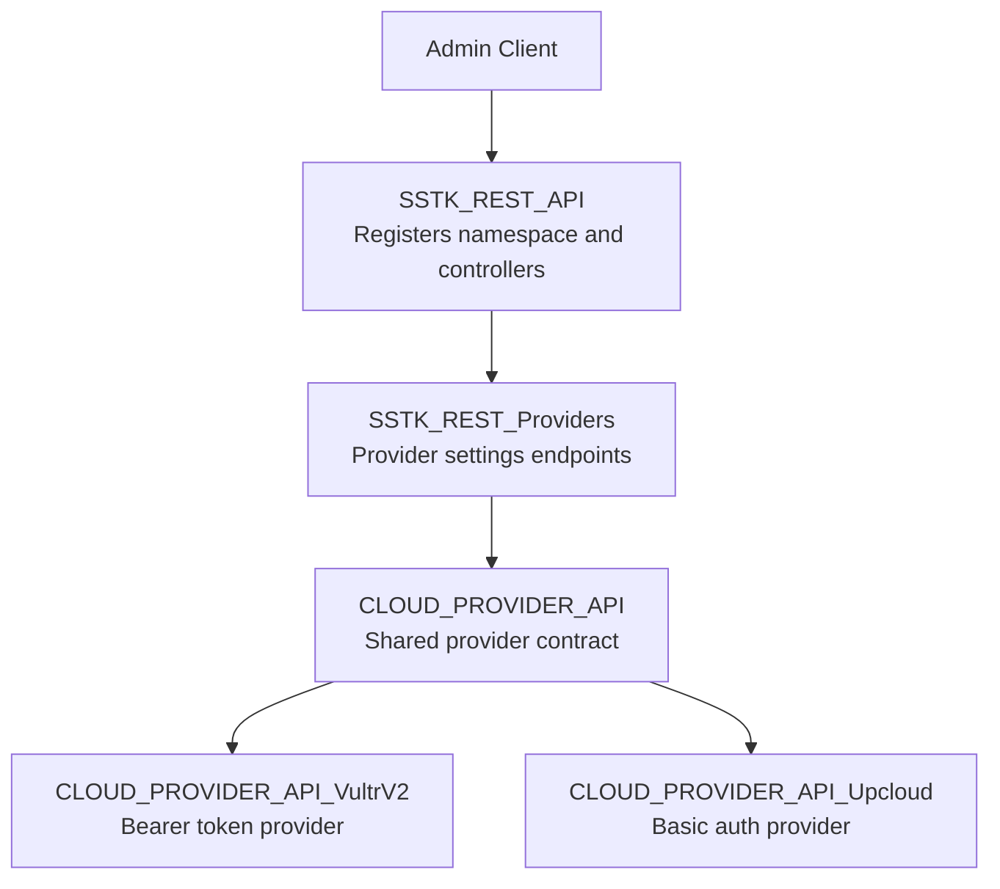
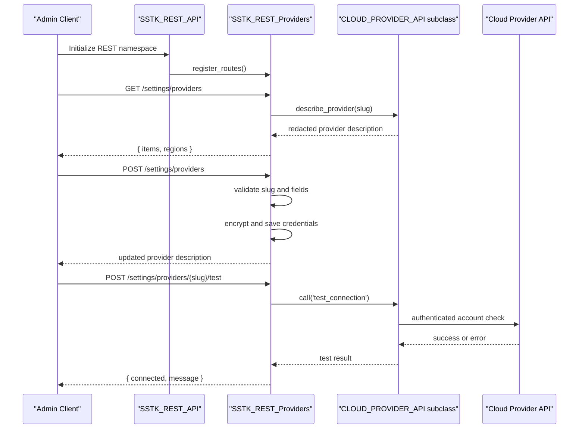
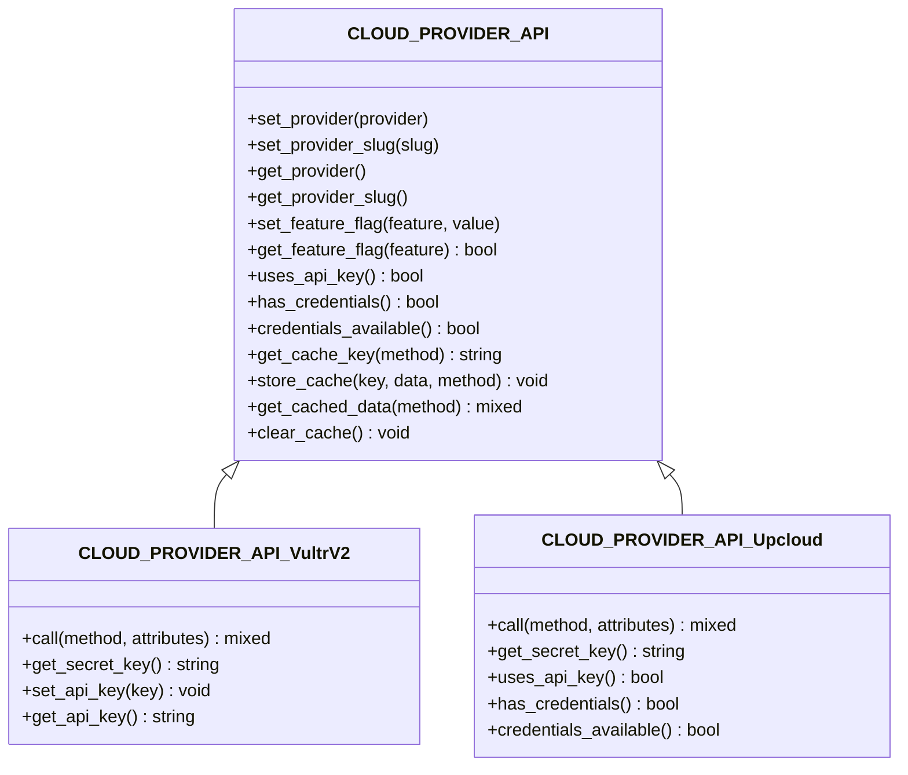
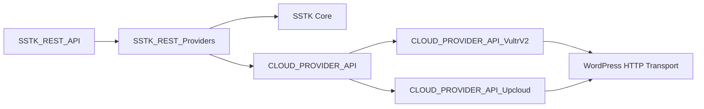

# Providers API

<cite>
**Referenced Files in This Document**   
- [class-sstk-rest-api.php](file://includes/core/api/class-sstk-rest-api.php)
- [class-sstk-rest-providers.php](file://includes/core/api/class-sstk-rest-providers.php)
- [class-cloud-provider-api.php](file://includes/core/providers/class-cloud-provider-api.php)
- [class-vultr-v2.php](file://includes/core/providers/class-vultr-v2.php)
- [class-upcloud.php](file://includes/core/providers/class-upcloud.php)
- [simple-stack.php](file://includes/core/simple-stack.php)
</cite>

## Table of Contents
1. [Introduction](#introduction)
2. [Project Structure](#project-structure)
3. [Core Components](#core-components)
4. [Architecture Overview](#architecture-overview)
5. [Detailed Component Analysis](#detailed-component-analysis)
6. [Dependency Analysis](#dependency-analysis)
7. [Performance Considerations](#performance-considerations)
8. [Troubleshooting Guide](#troubleshooting-guide)
9. [Conclusion](#conclusion)
10. [Appendices](#appendices)

## Introduction
This document describes the cloud provider management endpoints exposed under the Simple Stack REST namespace used by the admin client. It focuses on provider configuration, credential storage, region and size discovery, and connection testing for the supported Vultr and UpCloud providers. It also explains the provider abstraction layer, virtual provider aliases, authentication requirements, credential encryption, error handling, retry behavior, and multi-account considerations. Adding any other provider type is outside the 1.0.0 product scope and requires an explicit scope change.

The admin REST surface is registered under the shared Simple Stack REST namespace. All provider settings routes use `SSTK_REST_Controller_Base` and require `manage_options`. The controller responsible for provider settings lives at the `settings/providers` route segment. Clients should not expect a separate `simple-stack/v1/providers` path; the actual routes are mounted through the shared Simple Stack REST API loader.

## Project Structure
The provider-related code is organized into three layers:

- REST routing and request handling:
  - The Simple Stack REST API loader registers controllers.
  - The providers controller defines provider listing, saving, and testing endpoints.
- Provider abstraction:
  - A base class defines shared state, feature flags, caching, credential helpers, and common provider operations.
- Concrete provider implementations:
  - Vultr v2 uses bearer-token authentication.
  - UpCloud uses HTTP Basic authentication with user name and password.

**Diagram sources**
- [class-sstk-rest-api.php:21-37](file://includes/core/api/class-sstk-rest-api.php#L21-L37)
- [class-sstk-rest-api.php:84-99](file://includes/core/api/class-sstk-rest-api.php#L84-L99)
- [class-sstk-rest-providers.php:20-85](file://includes/core/api/class-sstk-rest-providers.php#L20-L85)
- [class-cloud-provider-api.php:15-167](file://includes/core/providers/class-cloud-provider-api.php#L15-L167)
- [class-vultr-v2.php:30-127](file://includes/core/providers/class-vultr-v2.php#L30-L127)
- [class-upcloud.php:33-128](file://includes/core/providers/class-upcloud.php#L33-L128)

**Section sources**
- [class-sstk-rest-api.php:15-37](file://includes/core/api/class-sstk-rest-api.php#L15-L37)
- [class-sstk-rest-api.php:84-99](file://includes/core/api/class-sstk-rest-api.php#L84-L99)
- [class-sstk-rest-providers.php:20-85](file://includes/core/api/class-sstk-rest-providers.php#L20-L85)

## Core Components
- **SSTK_REST_API**: Loads provider-related files and registers the Simple Stack REST namespace. It instantiates each controller and calls its `register_routes()` method.
- **SSTK_REST_Providers**: Defines provider settings endpoints under `settings/providers`. It lists configured providers, saves encrypted credentials, and tests provider connectivity.
- **CLOUD_PROVIDER_API**: Shared base class defining provider identity, feature flags, cache keys, credential helpers, and common operations such as regions, sizes, SSH keys, create, status, power, delete, resize, snapshots, and test connection.
- **CLOUD_PROVIDER_API_VultrV2**: Implements Vultr v2 using bearer tokens, plan mapping, image resolution, pagination, and rate-limit retry logic.
- **CLOUD_PROVIDER_API_Upcloud**: Implements UpCloud using HTTP Basic authentication, zone/plan mapping, storage template selection, and backup limitations.

Key responsibilities:
- Endpoint registration and validation.
- Encrypted credential persistence.
- Redacted provider descriptions.
- Region and size count caching.
- Provider capability reporting via feature flags.
- Connection testing through provider-specific `test_connection` methods.

**Section sources**
- [class-sstk-rest-api.php:63-75](file://includes/core/api/class-sstk-rest-api.php#L63-L75)
- [class-sstk-rest-api.php:84-99](file://includes/core/api/class-sstk-rest-api.php#L84-L99)
- [class-sstk-rest-providers.php:20-85](file://includes/core/api/class-sstk-rest-providers.php#L20-L85)
- [class-cloud-provider-api.php:146-167](file://includes/core/providers/class-cloud-provider-api.php#L146-L167)
- [class-vultr-v2.php:30-127](file://includes/core/providers/class-vultr-v2.php#L30-L127)
- [class-upcloud.php:33-128](file://includes/core/providers/class-upcloud.php#L33-L128)

## Architecture Overview
The provider management flow follows this sequence:

**Diagram sources**
- [class-sstk-rest-api.php:84-99](file://includes/core/api/class-sstk-rest-api.php#L84-L99)
- [class-sstk-rest-providers.php:58-85](file://includes/core/api/class-sstk-rest-providers.php#L58-L85)
- [class-sstk-rest-providers.php:96-111](file://includes/core/api/class-sstk-rest-providers.php#L96-L111)
- [class-sstk-rest-providers.php:122-174](file://includes/core/api/class-sstk-rest-providers.php#L122-L174)
- [class-sstk-rest-providers.php:185-217](file://includes/core/api/class-sstk-rest-providers.php#L185-L217)
- [class-vultr-v2.php:813-823](file://includes/core/providers/class-vultr-v2.php#L813-L823)
- [class-upcloud.php:831-841](file://includes/core/providers/class-upcloud.php#L831-L841)

## Detailed Component Analysis

### Provider Settings Endpoints
The provider settings controller exposes three primary operations:

| Method | Route | Purpose | Required Parameters | Response Summary |
|---|---|---|---:|---|
| GET | `/settings/providers` | List all configured providers with redacted credential state and region/size counts | Optional `refresh=1` to bypass cached counts | `{ items: [...], regions: {...} }` |
| POST | `/settings/providers` | Save provider credentials and notes | `slug`, optional `api_key`, `user_name`, `user_password`, `ssh_key_id`, `ssh_key`, `notes` | Updated provider description |
| POST | `/settings/providers/{slug}/test` | Test provider connectivity | `slug` | `{ slug, connected, message }` |

#### GET `/settings/providers`
- Lists Vultr, UpCloud, and virtual provider aliases of those supported provider types.
- Returns redacted boolean flags indicating whether credentials exist without exposing secret values.
- Includes per-provider feature flags such as snapshots, snapshot deletion, snapshot listing, resize, SSH key creation, and connection testing.
- Includes region and size counts, optionally refreshed from the provider.

Request parameters:
- `refresh`: integer flag `0` or `1`; when set to `1`, region and size counts bypass the short-lived transient cache.

Response structure:
- `items`: array of provider descriptions.
- `regions`: summary object keyed by provider slug containing `regions` and `sizes` counts.

Provider description fields:
- `slug`: internal provider identifier.
- `label`: human-readable provider label.
- `available`: whether the provider implementation is installed.
- `credentials_available`: whether required credentials are present.
- `uses_api_key`: whether the provider authenticates with an API key.
- `has_credentials`: whether the provider reports credentials available.
- `has_api_key`: whether an API key option exists.
- `has_user_password`: whether username/password options exist.
- `has_ssh_key`: whether a private SSH key option exists.
- `has_ssh_key_id`: whether a provider-side SSH key ID exists.
- `features`: boolean map of supported features.
- `regions_count`: number of regions returned by the provider.
- `sizes_count`: number of sizes returned by the provider.
- `counts_cached`: whether the counts came from cache.

Error conditions:
- If a provider implementation is missing, it appears as unavailable.
- Region and size discovery failures are swallowed so the settings screen remains usable.

**Section sources**
- [class-sstk-rest-providers.php:58-85](file://includes/core/api/class-sstk-rest-providers.php#L58-L85)
- [class-sstk-rest-providers.php:96-111](file://includes/core/api/class-sstk-rest-providers.php#L96-L111)
- [class-sstk-rest-providers.php:228-276](file://includes/core/api/class-sstk-rest-providers.php#L228-L276)
- [class-sstk-rest-providers.php:290-336](file://includes/core/api/class-sstk-rest-providers.php#L290-L336)
- [class-sstk-rest-providers.php:343-357](file://includes/core/api/class-sstk-rest-providers.php#L343-L357)

#### POST `/settings/providers`
- Validates that the provided slug corresponds to a known provider.
- Determines whether the provider expects an API key or username/password pair.
- Encrypts sensitive fields before storing them in WordPress options.
- Stores non-sensitive metadata such as SSH key ID and notes.
- Returns the updated redacted provider description.

Request parameters:
- `slug`: required string identifying the provider.
- `api_key`: optional encrypted-before-storage API key.
- `user_name`: optional encrypted-before-storage account username.
- `user_password`: optional encrypted-before-storage account password.
- `ssh_key_id`: optional provider-side SSH key identifier.
- `ssh_key`: optional encrypted-before-storage private SSH key.
- `notes`: optional free-text notes.

Validation and behavior:
- Unknown slugs return an invalid-provider error.
- Empty fields mean “leave existing stored values unchanged.”
- API-key providers store `sstk_{slug}_apikey`.
- Username/password providers store `sstk_{slug}_user_name` and `sstk_{slug}_user_password`.
- Private SSH key is stored under `sstk_{slug}_sshkey`.
- SSH key ID is stored under `sstk_{slug}_sshkey_id`.
- Notes are stored under `sstk_{slug}_keynotes`.

Response:
- Updated provider description including credential presence flags and feature availability.

Error responses:
- Invalid provider slug.
- Missing or malformed provider implementation.

**Section sources**
- [class-sstk-rest-providers.php:122-174](file://includes/core/api/class-sstk-rest-providers.php#L122-L174)

#### POST `/settings/providers/{slug}/test`
- Retrieves the provider implementation by slug.
- Checks that credentials are available.
- Invokes the provider’s `test_connection` operation.
- Wraps provider errors into a simple connected/not-connected response.

Request parameters:
- `slug`: required provider slug.

Response structure:
- `slug`: provider slug.
- `connected`: boolean indicating success.
- `message`: human-readable status or error message.

Error conditions:
- Provider not installed in this build.
- Credentials incomplete.
- Provider API returns an error.

**Section sources**
- [class-sstk-rest-providers.php:185-217](file://includes/core/api/class-sstk-rest-providers.php#L185-L217)

### Provider Abstraction Layer
The base provider class defines the shared contract implemented by Vultr and UpCloud:

- Provider identity:
  - Friendly name and internal slug.
  - Baseline provider name/slug identifying the supported Vultr or UpCloud type behind a virtual provider alias.
- Feature flags:
  - Snapshots, snapshot deletion, snapshot listing.
  - Backups and enable-backups-on-create.
  - Dynamic tags and custom images.
  - Resize and SSH key creation.
  - Connection testing.
- Credential helpers:
  - API key retrieval.
  - Secret key retrieval.
  - Credential fingerprinting.
  - Whether the provider uses an API key.
  - Whether credentials are configured.
  - Whether full credentials plus SSH material are available.
- Caching:
  - Cache key generation.
  - Clearing cached transients.
  - Storing and retrieving cached data.
  - Listing cached transient expiration information.
- Common operations:
  - Regions, sizes, SSH keys.
  - Create, details, status, reboot, off, on, delete, resize.
  - Snapshot lifecycle where supported.
  - Test connection.

Complexity characteristics:
- Cache key construction includes provider slug, site context, version, and hashed secret material to avoid cross-account collisions.
- Cached read-only operations reduce provider API calls for regions, sizes, and keys.
- Error paths consistently return `WP_Error` objects for structured failure handling.

**Section sources**
- [class-cloud-provider-api.php:15-167](file://includes/core/providers/class-cloud-provider-api.php#L15-L167)
- [class-cloud-provider-api.php:197-207](file://includes/core/providers/class-cloud-provider-api.php#L197-L207)
- [class-cloud-provider-api.php:481-585](file://includes/core/providers/class-cloud-provider-api.php#L481-L585)
- [class-cloud-provider-api.php:655-704](file://includes/core/providers/class-cloud-provider-api.php#L655-L704)

### Vultr Provider Implementation
Vultr implements the provider contract against the Vultr v2 REST API:

- Authentication:
  - Bearer token read from the encrypted option `sstk_vultr-v2_apikey`.
- Supported features:
  - SSH key creation.
  - Connection testing.
  - Snapshots, snapshot deletion, snapshot listing.
  - Resize.
  - Backups and enable-backups-on-server-create.
  - Custom images and dynamic tags are explicitly disabled because no code path consumes those options.
- Discovery:
  - Regions mapped from city and country labels.
  - Plans filtered to exclude very small instances.
  - SSH keys listed by id and name.
- Operations:
  - Instance creation with OS image resolution and optional cloud-init script.
  - Instance details, status, power control, deletion, resize.
  - Snapshot creation, deletion, listing, and pending status polling.
  - SSH key registration.
  - Account access test.
- Error handling:
  - Transport errors wrapped as `WP_Error`.
  - Rate limiting handled with one retry after honoring `Retry-After`.
  - Missing IDs, regions, plans, OS images, and snapshot identifiers produce specific errors.
- Pagination:
  - Paginated list endpoints are fetched up to a bounded page limit to prevent unbounded loops.

Connection test:
- Calls the Vultr account endpoint.
- Returns `test_status` based on whether an account record is present.

**Section sources**
- [class-vultr-v2.php:30-127](file://includes/core/providers/class-vultr-v2.php#L30-L127)
- [class-vultr-v2.php:163-250](file://includes/core/providers/class-vultr-v2.php#L163-L250)
- [class-vultr-v2.php:257-333](file://includes/core/providers/class-vultr-v2.php#L257-L333)
- [class-vultr-v2.php:369-453](file://includes/core/providers/class-vultr-v2.php#L369-L453)
- [class-vultr-v2.php:813-823](file://includes/core/providers/class-vultr-v2.php#L813-L823)
- [class-vultr-v2.php:1167-1227](file://includes/core/providers/class-vultr-v2.php#L1167-L1227)
- [class-vultr-v2.php:1101-1156](file://includes/core/providers/class-vultr-v2.php#L1101-L1156)

### UpCloud Provider Implementation
UpCloud implements the provider contract against the UpCloud 1.3 REST API:

- Authentication:
  - HTTP Basic authentication using account user name and password.
  - `uses_api_key()` returns false.
- Supported features:
  - Connection testing.
  - Resize.
  - SSH key creation.
  - Snapshots and backups are disabled because UpCloud identifies backups by storage device and date rather than returning a stable snapshot id.
- Discovery:
  - Zones mapped from zone records.
  - Plans mapped from plan names.
  - SSH keys listed by title.
- Operations:
  - Server creation requiring a storage template resolved from available templates.
  - Server details, status, power control, deletion, resize.
  - SSH key registration.
  - Account access test.
- Error handling:
  - Transport errors wrapped as `WP_Error`.
  - Rate limiting handled with one retry after honoring `Retry-After`.
  - Missing zones, plans, templates, and SSH keys produce specific errors.

Connection test:
- Calls the UpCloud account endpoint.
- Returns `test_status` based on whether an account record is present.

**Section sources**
- [class-upcloud.php:33-128](file://includes/core/providers/class-upcloud.php#L33-L128)
- [class-upcloud.php:173-231](file://includes/core/providers/class-upcloud.php#L173-L231)
- [class-upcloud.php:247-289](file://includes/core/providers/class-upcloud.php#L247-L289)
- [class-upcloud.php:310-372](file://includes/core/providers/class-upcloud.php#L310-L372)
- [class-upcloud.php:379-451](file://includes/core/providers/class-upcloud.php#L379-L451)
- [class-upcloud.php:491-602](file://includes/core/providers/class-upcloud.php#L491-L602)
- [class-upcloud.php:831-841](file://includes/core/providers/class-upcloud.php#L831-L841)
- [class-upcloud.php:1133-1193](file://includes/core/providers/class-upcloud.php#L1133-L1193)

### Class Relationships

**Diagram sources**
- [class-cloud-provider-api.php:15-167](file://includes/core/providers/class-cloud-provider-api.php#L15-L167)
- [class-cloud-provider-api.php:655-704](file://includes/core/providers/class-cloud-provider-api.php#L655-L704)
- [class-vultr-v2.php:30-127](file://includes/core/providers/class-vultr-v2.php#L30-L127)
- [class-upcloud.php:33-128](file://includes/core/providers/class-upcloud.php#L33-L128)

## Dependency Analysis
The provider management stack has clear boundaries:

- REST layer depends only on the controller interface and shared base controller utilities.
- Provider controller depends on:
  - SSTK core for provider registry and encryption.
  - Provider implementations for feature flags, credential checks, and API calls.
- Provider implementations depend on:
  - Base provider class for shared behavior.
  - WordPress HTTP transport for remote API calls.
  - Transient storage for caching.

**Diagram sources**
- [class-sstk-rest-api.php:21-37](file://includes/core/api/class-sstk-rest-api.php#L21-L37)
- [class-sstk-rest-providers.php:20-85](file://includes/core/api/class-sstk-rest-providers.php#L20-L85)
- [class-cloud-provider-api.php:15-167](file://includes/core/providers/class-cloud-provider-api.php#L15-L167)
- [class-vultr-v2.php:1167-1255](file://includes/core/providers/class-vultr-v2.php#L1167-L1255)
- [class-upcloud.php:1204-1222](file://includes/core/providers/class-upcloud.php#L1204-L1222)

**Section sources**
- [class-sstk-rest-api.php:63-75](file://includes/core/api/class-sstk-rest-api.php#L63-L75)
- [class-sstk-rest-providers.php:122-174](file://includes/core/api/class-sstk-rest-providers.php#L122-L174)
- [class-vultr-v2.php:1167-1227](file://includes/core/providers/class-vultr-v2.php#L1167-L1227)
- [class-upcloud.php:1133-1193](file://includes/core/providers/class-upcloud.php#L1133-L1193)

## Performance Considerations
- Region and size counts are cached per provider slug for a short TTL.
- Read-only provider operations such as regions, sizes, and keys use the base provider cache.
- Provider outage scenarios do not break the settings screen; discovery failures are treated as zero counts.
- Vultr and UpCloud implement one-time retry on HTTP 429 responses, respecting `Retry-After` when present.
- Power operations use time-based backstops to avoid leaving servers stuck in “in-progress” states.

Recommendations:
- Use the `refresh` parameter sparingly; prefer default caching for normal UI loads.
- Avoid frequent connection tests in automated workflows unless necessary.
- Monitor transient storage and object cache behavior in production environments.

**Section sources**
- [class-sstk-rest-providers.php:35-37](file://includes/core/api/class-sstk-rest-providers.php#L35-L37)
- [class-sstk-rest-providers.php:290-336](file://includes/core/api/class-sstk-rest-providers.php#L290-L336)
- [class-vultr-v2.php:1176-1194](file://includes/core/providers/class-vultr-v2.php#L1176-L1194)
- [class-upcloud.php:1142-1160](file://includes/core/providers/class-upcloud.php#L1142-L1160)

## Troubleshooting Guide

### Provider Scope and Registration
Simple Stack 1.0.0 registers only `vultr-v2` and `upcloud`. Virtual provider records may alias either supported type, but they do not add a new provider implementation.

Common issues:
- Unknown provider slug during save.
- Provider implementation not loaded.
- Incomplete credentials for connection testing.

Resolution steps:
- Ensure the provider slug is registered or is a virtual alias of `vultr-v2` or `upcloud`.
- Verify the underlying provider class file is loadable.
- Provide the correct credential shape:
  - API key for Vultr.
  - Username and password for UpCloud.
- Store SSH key material separately where required.

Adding another provider type requires an explicit product-scope change, including registry and UI updates, provisioning compatibility work, tests, and documentation. It is not a configuration-only extension.

**Section sources**
- [class-sstk-rest-providers.php:122-174](file://includes/core/api/class-sstk-rest-providers.php#L122-L174)
- [class-sstk-rest-providers.php:185-217](file://includes/core/api/class-sstk-rest-providers.php#L185-L217)

### Validating Credentials
Symptoms:
- Connection test fails immediately.
- Credentials marked as incomplete.
- Provider shows as unavailable.

Checks:
- Confirm the provider slug is valid.
- Confirm the provider implementation is installed.
- Confirm required credentials are saved.
- For UpCloud, confirm both username and password are present.
- For Vultr, confirm the API key is present.

**Section sources**
- [class-sstk-rest-providers.php:185-217](file://includes/core/api/class-sstk-rest-providers.php#L185-L217)
- [class-upcloud.php:173-231](file://includes/core/providers/class-upcloud.php#L173-L231)

### Discovering Regions and Sizes
Symptoms:
- Zero region or size counts.
- Counts not refreshing.
- Provider API errors not visible in the settings screen.

Behavior:
- Region and size discovery failures are intentionally suppressed.
- Counts are cached per provider slug.
- Use `refresh=1` to force a new count fetch.

**Section sources**
- [class-sstk-rest-providers.php:290-336](file://includes/core/api/class-sstk-rest-providers.php#L290-L336)

### Handling Provider Failures
Patterns:
- Provider API errors are wrapped as `WP_Error`.
- Transport errors include transport-level messages.
- Rate-limited requests may be retried once.
- Missing required parameters produce specific error codes.

Best practices:
- Inspect error codes such as missing-id, missing-region, missing-size, and transport-error.
- Do not log raw provider credentials or full request bodies.
- Use provider dashboards for manual recovery when automation cannot resolve the issue.

**Section sources**
- [class-vultr-v2.php:1167-1227](file://includes/core/providers/class-vultr-v2.php#L1167-L1227)
- [class-upcloud.php:1133-1193](file://includes/core/providers/class-upcloud.php#L1133-L1193)

### Multi-Provider Environments
Guidance:
- Each provider slug isolates credentials and caches.
- Feature flags determine which capabilities are exposed per provider.
- Virtual providers can override display name, slug, region prefix, and dashboard link, but must resolve to the supported `vultr-v2` or `upcloud` provider type.

**Section sources**
- [class-vultr-v2.php:86-95](file://includes/core/providers/class-vultr-v2.php#L86-L95)
- [class-upcloud.php:82-91](file://includes/core/providers/class-upcloud.php#L82-L91)
- [simple-stack.php:1282-1317](file://includes/core/simple-stack.php#L1282-L1317)

## Conclusion
The Simple Stack provider management API provides a secure admin surface for configuring Vultr and UpCloud, validating credentials, discovering regions and sizes, and testing connectivity. The two supported providers have different authentication models and capability sets. The base provider class standardizes feature reporting, caching, and error handling, while concrete implementations encapsulate provider-specific API details. Virtual provider records support multiple accounts under either supported provider type; adding another provider type requires an explicit product-scope change.

## Appendices

### Request and Response Schemas

#### Provider Description Object
Fields returned by provider listing and save operations:
- `slug`: string
- `label`: string
- `available`: boolean
- `credentials_available`: boolean
- `uses_api_key`: boolean
- `has_credentials`: boolean
- `has_api_key`: boolean
- `has_user_password`: boolean
- `has_ssh_key`: boolean
- `has_ssh_key_id`: boolean
- `features`: object mapping feature names to booleans
- `regions_count`: integer
- `sizes_count`: integer
- `counts_cached`: boolean

**Section sources**
- [class-sstk-rest-providers.php:228-276](file://includes/core/api/class-sstk-rest-providers.php#L228-L276)

#### Region and Size Count Summary
Returned under `regions` in the provider list response:
- Keyed by provider slug.
- Contains `regions`: integer count.
- Contains `sizes`: integer count.

**Section sources**
- [class-sstk-rest-providers.php:343-357](file://includes/core/api/class-sstk-rest-providers.php#L343-L357)

#### Connection Test Result
Returned by the provider test endpoint:
- `slug`: string
- `connected`: boolean
- `message`: string

**Section sources**
- [class-sstk-rest-providers.php:185-217](file://includes/core/api/class-sstk-rest-providers.php#L185-L217)

### Authentication and Secure Storage Practices

- Vultr:
  - Uses a bearer token.
  - Token is stored encrypted under `sstk_vultr-v2_apikey`.
  - Never logged in plaintext.
- UpCloud:
  - Uses HTTP Basic authentication.
  - Username and password are stored encrypted under `sstk_upcloud_user_name` and `sstk_upcloud_user_password`.
  - Password travels only in the Authorization header.
- SSH keys:
  - Private SSH key stored encrypted under `sstk_{slug}_sshkey`.
  - Provider-side SSH key ID stored unencrypted under `sstk_{slug}_sshkey_id`.
- General:
  - Sensitive values are redacted in logs.
  - Requests and responses avoid exposing secrets.

**Section sources**
- [class-vultr-v2.php:17-29](file://includes/core/providers/class-vultr-v2.php#L17-L29)
- [class-vultr-v2.php:120-121](file://includes/core/providers/class-vultr-v2.php#L120-L121)
- [class-upcloud.php:17-32](file://includes/core/providers/class-upcloud.php#L17-L32)
- [class-upcloud.php:117-120](file://includes/core/providers/class-upcloud.php#L117-L120)
- [class-sstk-rest-providers.php:142-171](file://includes/core/api/class-sstk-rest-providers.php#L142-L171)

### Virtual Provider Aliases and Provider Scope

- Virtual providers:
  - Defined through a custom post type.
  - Can override provider name, slug, region prefix, and dashboard link.
  - Must use `vultr-v2` or `upcloud` as the underlying provider type.
- Provider class loading:
  - SSTK resolves the concrete class from the supported underlying provider type.
  - Virtual providers reuse that class and its credential, feature, and caching behavior.
- Provider scope:
  - No additional provider type is registered in Simple Stack 1.0.0.
  - A future provider requires an explicit scope change and a new `CLOUD_PROVIDER_API` implementation with its own credential shape, feature flags, lifecycle methods, tests, and documentation.

**Section sources**
- [simple-stack.php:1282-1317](file://includes/core/simple-stack.php#L1282-L1317)
- [class-cloud-provider-api.php:146-167](file://includes/core/providers/class-cloud-provider-api.php#L146-L167)
- [class-vultr-v2.php:86-95](file://includes/core/providers/class-vultr-v2.php#L86-L95)
- [class-upcloud.php:82-91](file://includes/core/providers/class-upcloud.php#L82-L91)