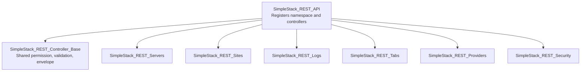
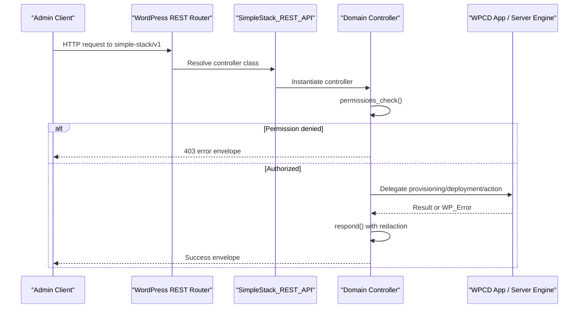
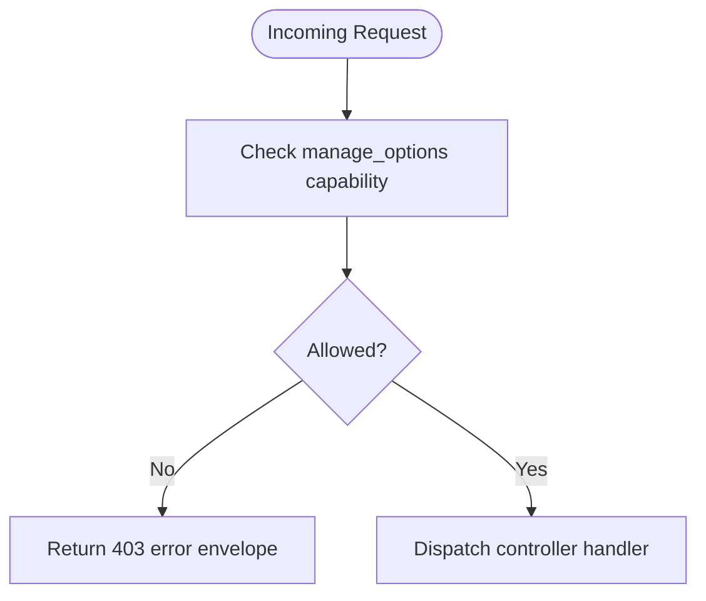
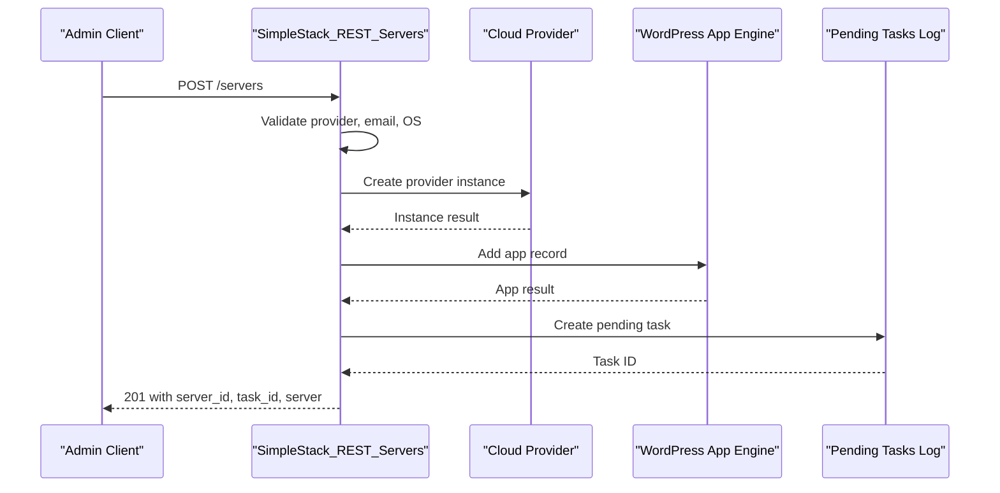
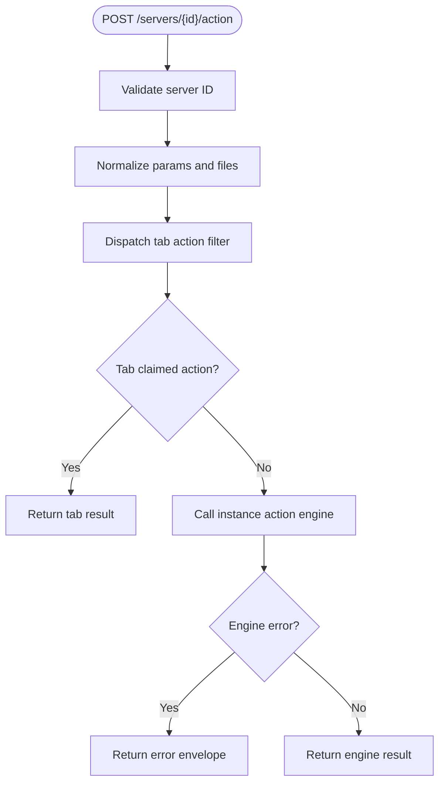
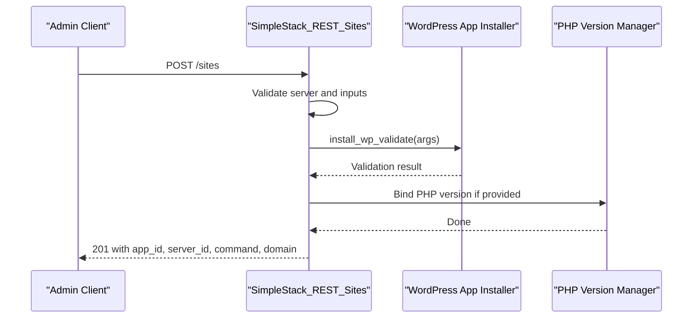
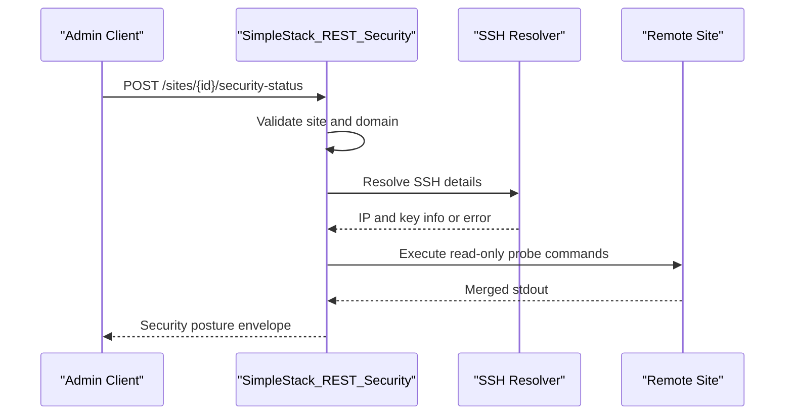
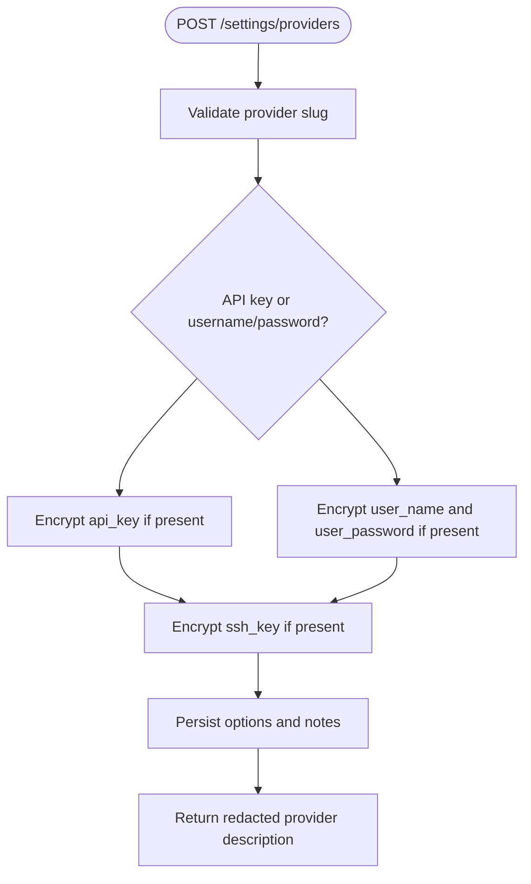
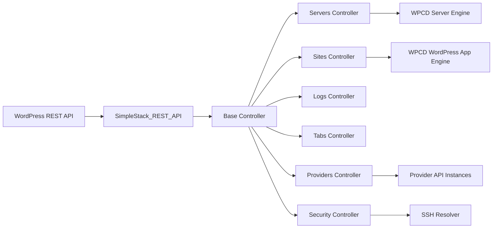

# REST API Reference

<cite>
**Referenced Files in This Document**   
- [class-simplestack-rest-api.php](file://includes/core/api/class-simplestack-rest-api.php)
- [class-simplestack-rest-controller-base.php](file://includes/core/api/class-simplestack-rest-controller-base.php)
- [class-simplestack-rest-servers.php](file://includes/core/api/class-simplestack-rest-servers.php)
- [class-simplestack-rest-sites.php](file://includes/core/api/class-simplestack-rest-sites.php)
- [class-simplestack-rest-security.php](file://includes/core/api/class-simplestack-rest-security.php)
- [class-simplestack-rest-logs.php](file://includes/core/api/class-simplestack-rest-logs.php)
- [class-simplestack-rest-providers.php](file://includes/core/api/class-simplestack-rest-providers.php)
- [class-simplestack-rest-tabs.php](file://includes/core/api/class-simplestack-rest-tabs.php)
</cite>

## Table of Contents
1. [Introduction](#introduction)
2. [Project Structure](#project-structure)
3. [Core Components](#core-components)
4. [Architecture Overview](#architecture-overview)
5. [Detailed Component Analysis](#detailed-component-analysis)
6. [Dependency Analysis](#dependency-analysis)
7. [Performance Considerations](#performance-considerations)
8. [Troubleshooting Guide](#troubleshooting-guide)
9. [Conclusion](#conclusion)

## Introduction
This document describes SimpleStack’s internal REST API surface under the `simple-stack/v1` namespace. It is designed as a secure control plane for server provisioning, WordPress site deployment, security posture inspection, provider configuration, logging, and tab-driven administration. The API is intended for authenticated administrative clients such as the bundled React admin interface; it is not a public-facing integration API.

Key characteristics:
- All routes are gated by the WordPress `manage_options` capability.
- Every response uses a consistent envelope with redacted secrets.
- Server and site actions are dispatched through existing tab/action bridges rather than reimplementing legacy handlers.
- Provider credentials are encrypted at rest and never returned to clients.
- Read-only operations avoid mutating remote systems unless explicitly requested through action endpoints.

## Project Structure
The SimpleStack REST layer is registered by a single controller loader that instantiates domain controllers and registers their routes under one namespace.

**Diagram sources**
- [class-simplestack-rest-api.php:30-37](file://includes/core/api/class-simplestack-rest-api.php#L30-L37)
- [class-simplestack-rest-api.php:84-99](file://includes/core/api/class-simplestack-rest-api.php#L84-L99)
- [class-simplestack-rest-controller-base.php:22-27](file://includes/core/api/class-simplestack-rest-controller-base.php#L22-L27)

**Section sources**
- [class-simplestack-rest-api.php:12-118](file://includes/core/api/class-simplestack-rest-api.php#L12-L118)
- [class-simplestack-rest-controller-base.php:22-51](file://includes/core/api/class-simplestack-rest-controller-base.php#L22-L51)

## Core Components
| Component | Responsibility | Primary URL prefix |
|---|---|---|
| `SimpleStack_REST_API` | Loads controller classes, wires the `simple-stack/v1` namespace, and exposes the shared namespace constant. | Namespace root |
| `SimpleStack_REST_Controller_Base` | Provides permissions, route registration helpers, argument validators, paging helpers, secret-redacting response envelope, and tab-action dispatch. | Shared base |
| `SimpleStack_REST_Servers` | Lists, creates, reads, deletes, and acts on servers. | `/servers` |
| `SimpleStack_REST_Sites` | Lists, deploys, reads, deletes, and acts on WordPress sites. | `/sites` |
| `SimpleStack_REST_Security` | Probes a site’s installed plugins, PHP version, file-edit policy, and connectivity. | `/sites/{id}/security-status` |
| `SimpleStack_REST_Logs` | Returns command, SSH, and error logs plus a merged activity feed. | `/servers/{id}/logs`, `/activity` |
| `SimpleStack_REST_Providers` | Lists providers, saves encrypted credentials, tests provider connections, and reports feature flags and region/size counts. | `/settings/providers` |
| `SimpleStack_REST_Tabs` | Exposes tab schemas for servers and sites without exposing sensitive field values. | `/servers/{id}/tabs`, `/sites/{id}/tabs` |

**Section sources**
- [class-simplestack-rest-api.php:30-37](file://includes/core/api/class-simplestack-rest-api.php#L30-L37)
- [class-simplestack-rest-controller-base.php:22-51](file://includes/core/api/class-simplestack-rest-controller-base.php#L22-L51)
- [class-simplestack-rest-servers.php:22-88](file://includes/core/api/class-simplestack-rest-servers.php#L22-L88)
- [class-simplestack-rest-sites.php:21-86](file://includes/core/api/class-simplestack-rest-sites.php#L21-L86)
- [class-simplestack-rest-security.php:19-38](file://includes/core/api/class-simplestack-rest-security.php#L19-L38)
- [class-simplestack-rest-logs.php:19-65](file://includes/core/api/class-simplestack-rest-logs.php#L19-L65)
- [class-simplestack-rest-providers.php:20-85](file://includes/core/api/class-simplestack-rest-providers.php#L20-L85)
- [class-simplestack-rest-tabs.php:27-54](file://includes/core/api/class-simplestack-rest-tabs.php#L27-L54)

## Architecture Overview
The API follows a layered design:
- A loader registers controllers during WordPress REST initialization.
- Each controller extends a base class that centralizes authentication, parameter validation, paging, and response formatting.
- Domain controllers delegate heavy work to existing WordPress plugin infrastructure rather than duplicating logic.
- Sensitive data is redacted before leaving the process.

**Diagram sources**
- [class-simplestack-rest-api.php:51-99](file://includes/core/api/class-simplestack-rest-api.php#L51-L99)
- [class-simplestack-rest-controller-base.php:58-83](file://includes/core/api/class-simplestack-rest-controller-base.php#L58-L83)
- [class-simplestack-rest-controller-base.php:136-149](file://includes/core/api/class-simplestack-rest-controller-base.php#L136-L149)

## Detailed Component Analysis

### Authentication and Authorization
- All SimpleStack routes require the WordPress `manage_options` capability.
- There is no public permission callback; every route inherits the base controller’s authorization check.
- Nonce-based CSRF protection is not part of this internal control-plane API; consumers should rely on WordPress session/authentication and restrict access to trusted administrative contexts.

**Diagram sources**
- [class-simplestack-rest-controller-base.php:58-60](file://includes/core/api/class-simplestack-rest-controller-base.php#L58-L60)

**Section sources**
- [class-simplestack-rest-controller-base.php:12-21](file://includes/core/api/class-simplestack-rest-controller-base.php#L12-L21)
- [class-simplestack-rest-controller-base.php:58-60](file://includes/core/api/class-simplestack-rest-controller-base.php#L58-L60)

### Response Envelope and Error Format
Every successful response returns an object with:
- `ok`: Boolean indicating success.
- `data`: Redacted payload.
- `meta`: Includes request timestamp and namespace.

Errors return a WordPress error object wrapped with an HTTP status code. Clients should inspect the top-level error code and message rather than relying solely on HTTP status.

Common patterns:
- Validation failures use status 400.
- Missing resources use status 404.
- Forbidden deletions use status 403.
- Internal failures may use status 500 when a task record cannot be created.

**Section sources**
- [class-simplestack-rest-controller-base.php:136-162](file://includes/core/api/class-simplestack-rest-controller-base.php#L136-L162)

### Input Validation and Parameter Helpers
The base controller provides reusable parameter definitions:
- `arg_id`: Positive integer path parameter.
- `arg_int`: Integer with optional minimum/maximum bounds.
- `arg_string`: String with optional enum constraint.
- `arg_text`: Free-form text that preserves characters but rejects non-strings.
- `arg_object`: Generic object/map.
- `arg_params`: Flexible map supporting JSON objects, JSON strings, and query-string-like payloads.

Paging defaults to page 1 and 25 records per page, capped at 200.

**Section sources**
- [class-simplestack-rest-controller-base.php:169-341](file://includes/core/api/class-simplestack-rest-controller-base.php#L169-L341)
- [class-simplestack-rest-controller-base.php:415-445](file://includes/core/api/class-simplestack-rest-controller-base.php#L415-L445)

### Secret Redaction
All responses pass through a secret redactor. Keys resembling credentials are masked so accidental exposure in logs, provider payloads, or command output does not reach the client.

**Section sources**
- [class-simplestack-rest-controller-base.php:136-149](file://includes/core/api/class-simplestack-rest-controller-base.php#L136-L149)

### Server Endpoints

#### List Servers
- **Method:** GET
- **URL:** `/simple-stack/v1/servers`
- **Query parameters:**
  - `page`: Page number, default 1.
  - `per_page`: Records per page, default 25, maximum 200.
  - `provider`: Filter by provider slug.
  - `region`: Filter by provider region slug.
  - `status`: Filter by recorded server state.
  - `search`: Free-text search on server name.
- **Success response structure:**
  - `items`: Array of server summaries.
  - `total`: Total matching servers.
  - `page`: Current page.
  - `per_page`: Records per page.
- **Server summary fields include:** id, name, provider, provider_label, region, size, state, health, webserver_type, ipv4, ipv6, instance_id, os, app_count, author, created, and meta.

**Section sources**
- [class-simplestack-rest-servers.php:38-50](file://includes/core/api/class-simplestack-rest-servers.php#L38-L50)
- [class-simplestack-rest-servers.php:99-161](file://includes/core/api/class-simplestack-rest-servers.php#L99-L161)
- [class-simplestack-rest-servers.php:390-412](file://includes/core/api/class-simplestack-rest-servers.php#L390-L412)

#### Create Server
- **Method:** POST
- **URL:** `/simple-stack/v1/servers`
- **Request body fields:**
  - `name`: Required server name.
  - `provider`: Required provider slug.
  - `region`: Required provider region slug.
  - `size`: Required provider size or plan slug.
  - `os`: Optional operating system slug; defaults to application default.
  - `webserver_type`: Optional; currently defaults to OpenLiteSpeed.
  - `author_email`: Optional owner email address.
- **Success response structure:**
  - `server_id`: Created server post ID.
  - `task_id`: Pending task identifier.
  - `server`: Server summary.
- **Error conditions:**
  - Invalid provider slug.
  - Invalid owner email.
  - Failure creating provider instance or local record.
  - Failure writing pending task entry.

**Diagram sources**
- [class-simplestack-rest-servers.php:172-249](file://includes/core/api/class-simplestack-rest-servers.php#L172-L249)

**Section sources**
- [class-simplestack-rest-servers.php:52-64](file://includes/core/api/class-simplestack-rest-servers.php#L52-L64)
- [class-simplestack-rest-servers.php:172-249](file://includes/core/api/class-simplestack-rest-servers.php#L172-L249)

#### Get Server
- **Method:** GET
- **URL:** `/simple-stack/v1/servers/{id}`
- **Path parameter:** `id`: Numeric server ID.
- **Success response structure:**
  - Server summary fields.
  - `meta`: Stripped server metadata.
  - `php_version`: Bound PHP version for the server.
  - `available`: Whether the server is available for commands.
- **Error conditions:**
  - Server not found.

**Section sources**
- [class-simplestack-rest-servers.php:66-70](file://includes/core/api/class-simplestack-rest-servers.php#L66-L70)
- [class-simplestack-rest-servers.php:261-276](file://includes/core/api/class-simplestack-rest-servers.php#L261-L276)
- [class-simplestack-rest-servers.php:372-381](file://includes/core/api/class-simplestack-rest-servers.php#L372-L381)

#### Delete Server
- **Method:** DELETE
- **URL:** `/simple-stack/v1/servers/{id}`
- **Path parameter:** `id`: Numeric server ID.
- **Behavior:** Triggers the server delete action chain and verifies the server record is trashed.
- **Success response structure:**
  - `server_id`: Deleted server ID.
  - `deleted`: Boolean true.
- **Error conditions:**
  - Server not found.
  - Server record still exists and is not trashed.

**Section sources**
- [class-simplestack-rest-servers.php:72-76](file://includes/core/api/class-simplestack-rest-servers.php#L72-L76)
- [class-simplestack-rest-servers.php:287-310](file://includes/core/api/class-simplestack-rest-servers.php#L287-L310)

#### Run Server Action
- **Method:** POST
- **URL:** `/simple-stack/v1/servers/{id}/action`
- **Path parameter:** `id`: Numeric server ID.
- **Request body fields:**
  - `action`: Required action slug understood by the server action bridge.
  - `params`: Optional tab parameters.
  - `additional`: Optional alias of params passed to the lifecycle engine.
- **Behavior:** Dispatches through the tab action filter chain; if no tab claims the action, it falls back to the instance action engine.
- **Success response structure:**
  - `server_id`.
  - `action`.
  - `result`: Handler or engine result.
- **Error conditions:**
  - Server not found.
  - Tab or engine returns a WordPress error.

**Diagram sources**
- [class-simplestack-rest-servers.php:327-363](file://includes/core/api/class-simplestack-rest-servers.php#L327-L363)
- [class-simplestack-rest-controller-base.php:362-406](file://includes/core/api/class-simplestack-rest-controller-base.php#L362-L406)

**Section sources**
- [class-simplestack-rest-servers.php:78-87](file://includes/core/api/class-simplestack-rest-servers.php#L78-L87)
- [class-simplestack-rest-servers.php:327-363](file://includes/core/api/class-simplestack-rest-servers.php#L327-L363)

### Site Endpoints

#### List Sites
- **Method:** GET
- **URL:** `/simple-stack/v1/sites`
- **Query parameters:**
  - `page`: Page number, default 1.
  - `per_page`: Records per page, default 25, maximum 200.
  - `server_id`: Optional numeric server ID to filter sites hosted on that server.
  - `search`: Free-text search on site title.
- **Success response structure:**
  - `items`: Array of site summaries.
  - `total`: Total matching sites.
  - `page`: Current page.
  - `per_page`: Records per page.
- **Site summary fields include:** id, name, domain, server_id, server_name, php_version, wp_version, owner, created, and meta.

**Section sources**
- [class-simplestack-rest-sites.php:37-47](file://includes/core/api/class-simplestack-rest-sites.php#L37-L47)
- [class-simplestack-rest-sites.php:97-144](file://includes/core/api/class-simplestack-rest-sites.php#L97-L144)
- [class-simplestack-rest-sites.php:343-358](file://includes/core/api/class-simplestack-rest-sites.php#L343-L358)

#### Deploy Site
- **Method:** POST
- **URL:** `/simple-stack/v1/sites`
- **Request body fields:**
  - `server_id`: Required numeric server ID.
  - `domain`: Required primary domain.
  - `admin_user`: Required WordPress administrator username.
  - `admin_email`: Required WordPress administrator email.
  - `admin_password`: Required administrator password; never logged or echoed back.
  - `wp_version`: Required WordPress version.
  - `locale`: Optional WordPress locale; defaults to English US.
  - `site_package`: Optional site package ID.
  - `php_version`: Optional PHP version to bind to the new site.
- **Success response structure:**
  - `app_id`: New site post ID.
  - `server_id`: Host server ID.
  - `command`: Optional queued command identifier.
  - `domain`: Deployed domain.
- **Error conditions:**
  - Server not found.
  - Validation failure from the installer.
  - Failure queuing installation.

**Diagram sources**
- [class-simplestack-rest-sites.php:158-206](file://includes/core/api/class-simplestack-rest-sites.php#L158-L206)

**Section sources**
- [class-simplestack-rest-sites.php:49-63](file://includes/core/api/class-simplestack-rest-sites.php#L49-L63)
- [class-simplestack-rest-sites.php:158-206](file://includes/core/api/class-simplestack-rest-sites.php#L158-L206)

#### Get Site
- **Method:** GET
- **URL:** `/simple-stack/v1/sites/{id}`
- **Path parameter:** `id`: Numeric site ID.
- **Success response structure:**
  - Site summary fields.
  - `meta`: Stripped site metadata.
  - `action_status`: Recorded action status.
- **Error conditions:**
  - Site not found or wrong application type.

**Section sources**
- [class-simplestack-rest-sites.php:65-69](file://includes/core/api/class-simplestack-rest-sites.php#L65-L69)
- [class-simplestack-rest-sites.php:217-231](file://includes/core/api/class-simplestack-rest-sites.php#L217-L231)
- [class-simplestack-rest-sites.php:321-334](file://includes/core/api/class-simplestack-rest-sites.php#L321-L334)

#### Delete Site
- **Method:** DELETE
- **URL:** `/simple-stack/v1/sites/{id}`
- **Path parameter:** `id`: Numeric site ID.
- **Behavior:** Checks application deletion permission, then moves the site post to trash.
- **Success response structure:**
  - `app_id`: Deleted site ID.
  - `deleted`: Boolean true.
- **Error conditions:**
  - Site not found.
  - Deletion forbidden.
  - Failed to move site to trash.

**Section sources**
- [class-simplestack-rest-sites.php:71-75](file://includes/core/api/class-simplestack-rest-sites.php#L71-L75)
- [class-simplestack-rest-sites.php:242-268](file://includes/core/api/class-simplestack-rest-sites.php#L242-L268)

#### Run Site Action
- **Method:** POST
- **URL:** `/simple-stack/v1/sites/{id}/action`
- **Path parameter:** `id`: Numeric site ID.
- **Request body fields:**
  - `action`: Required action slug handled by a site tab.
  - `params`: Optional tab parameters.
- **Behavior:** Dispatches through the tab action bridge; supports file uploads for tabs that need them.
- **Success response structure:**
  - `app_id`.
  - `server_id`.
  - `action`.
  - `result`.
- **Error conditions:**
  - Site not found.
  - Tab handler returns a WordPress error.

**Section sources**
- [class-simplestack-rest-sites.php:77-85](file://includes/core/api/class-simplestack-rest-sites.php#L77-L85)
- [class-simplestack-rest-sites.php:283-312](file://includes/core/api/class-simplestack-rest-sites.php#L283-L312)

### Security Status Endpoint

#### Probe Site Security Posture
- **Method:** POST
- **URL:** `/simple-stack/v1/sites/{id}/security-status`
- **Path parameter:** `id`: Numeric site ID.
- **Behavior:** Performs read-only SSH probes against the site’s server to collect:
  - Installed plugins list.
  - Whether `DISALLOW_FILE_EDIT` is enabled.
  - PHP version reported by CLI and vhost configuration.
  - Connectivity status and diagnostic messages.
- **Success response structure:**
  - `app_id`.
  - `server_id`.
  - `domain`.
  - `connected`: Boolean indicating whether the probe reached the server.
  - `plugins`: Normalized plugin rows.
  - `file_edit_disallowed`: Boolean.
  - `php_version`: Detected PHP version string.
  - `message`: Diagnostic message when probing fails.
- **Error conditions:**
  - Site not found.
  - No provider recorded.
  - Provider not installed.
  - Server unreachable.

**Diagram sources**
- [class-simplestack-rest-security.php:49-101](file://includes/core/api/class-simplestack-rest-security.php#L49-L101)
- [class-simplestack-rest-security.php:162-191](file://includes/core/api/class-simplestack-rest-security.php#L162-L191)
- [class-simplestack-rest-security.php:200-224](file://includes/core/api/class-simplestack-rest-security.php#L200-L224)

**Section sources**
- [class-simplestack-rest-security.php:33-38](file://includes/core/api/class-simplestack-rest-security.php#L33-L38)
- [class-simplestack-rest-security.php:49-101](file://includes/core/api/class-simplestack-rest-security.php#L49-L101)
- [class-simplestack-rest-security.php:117-150](file://includes/core/api/class-simplestack-rest-security.php#L117-L150)
- [class-simplestack-rest-security.php:162-191](file://includes/core/api/class-simplestack-rest-security.php#L162-L191)
- [class-simplestack-rest-security.php:200-224](file://includes/core/api/class-simplestack-rest-security.php#L200-L224)
- [class-simplestack-rest-security.php:233-251](file://includes/core/api/class-simplestack-rest-security.php#L233-L251)

### Logging Endpoints

#### Server Logs
- **Method:** GET
- **URL:** `/simple-stack/v1/servers/{id}/logs`
- **Path parameter:** `id`: Numeric server ID.
- **Query parameters:**
  - `type`: One of `all`, `command`, `ssh`, `error`; default `all`.
  - `since`: ISO8601 timestamp; only entries newer than this time are returned.
  - `limit`: Maximum entries to return, default 50, maximum 200.
- **Success response structure:**
  - `items`: Array of log entries.
  - `cursor`: Timestamp of the newest entry for incremental polling.
  - `server`: Server ID.
  - `type`: Requested log type.
- **Log entry fields vary by type:**
  - Command logs include command type, reference, and body.
  - SSH logs include command reference and body.
  - Error logs include error type, message, file, and line.

**Section sources**
- [class-simplestack-rest-logs.php:46-55](file://includes/core/api/class-simplestack-rest-logs.php#L46-L55)
- [class-simplestack-rest-logs.php:76-101](file://includes/core/api/class-simplestack-rest-logs.php#L76-L101)
- [class-simplestack-rest-logs.php:137-178](file://includes/core/api/class-simplestack-rest-logs.php#L137-L178)
- [class-simplestack-rest-logs.php:187-222](file://includes/core/api/class-simplestack-rest-logs.php#L187-L222)
- [class-simplestack-rest-logs.php:231-238](file://includes/core/api/class-simplestack-rest-logs.php#L231-L238)

#### Activity Feed
- **Method:** GET
- **URL:** `/simple-stack/v1/activity`
- **Query parameters:**
  - `limit`: Maximum entries to return, default 50, maximum 200.
  - `server_id`: Optional numeric server ID to restrict the feed.
- **Success response structure:**
  - `items`: Merged recent log entries.
  - `cursor`: Cursor derived from the newest entry.

**Section sources**
- [class-simplestack-rest-logs.php:57-64](file://includes/core/api/class-simplestack-rest-logs.php#L57-L64)
- [class-simplestack-rest-logs.php:112-125](file://includes/core/api/class-simplestack-rest-logs.php#L112-L125)

### Provider Settings Endpoints

#### List Providers
- **Method:** GET
- **URL:** `/simple-stack/v1/settings/providers`
- **Query parameters:**
  - `refresh`: Set to 1 to bypass cached region and size counts.
- **Success response structure:**
  - `items`: Array of provider descriptions.
  - `regions`: Per-provider region and size count summaries.
- **Provider description fields include:**
  - `slug`, `label`, `available`, `credentials_available`, `uses_api_key`, `has_credentials`, `has_api_key`, `has_user_password`, `has_ssh_key`, `has_ssh_key_id`, `features`, `regions_count`, `sizes_count`, `counts_cached`.
- Credentials are never returned; only boolean presence flags and feature capabilities.

**Section sources**
- [class-simplestack-rest-providers.php:60-64](file://includes/core/api/class-simplestack-rest-providers.php#L60-L64)
- [class-simplestack-rest-providers.php:96-111](file://includes/core/api/class-simplestack-rest-providers.php#L96-L111)
- [class-simplestack-rest-providers.php:228-276](file://includes/core/api/class-simplestack-rest-providers.php#L228-L276)
- [class-simplestack-rest-providers.php:343-357](file://includes/core/api/class-simplestack-rest-providers.php#L343-L357)

#### Save Provider Credentials
- **Method:** POST
- **URL:** `/simple-stack/v1/settings/providers`
- **Request body fields:**
  - `slug`: Required provider slug.
  - `api_key`: Optional provider API key; encrypted before storage.
  - `user_name`: Optional account user name for providers using username/password; encrypted before storage.
  - `user_password`: Optional account password; encrypted before storage.
  - `ssh_key_id`: Optional provider-side SSH key identifier.
  - `ssh_key`: Optional private SSH key; encrypted before storage.
  - `notes`: Optional free-text notes.
- **Success response structure:** Redacted provider description.
- **Error conditions:**
  - Unknown provider slug.

**Diagram sources**
- [class-simplestack-rest-providers.php:122-174](file://includes/core/api/class-simplestack-rest-providers.php#L122-L174)

**Section sources**
- [class-simplestack-rest-providers.php:66-78](file://includes/core/api/class-simplestack-rest-providers.php#L66-L78)
- [class-simplestack-rest-providers.php:122-174](file://includes/core/api/class-simplestack-rest-providers.php#L122-L174)

#### Test Provider Connection
- **Method:** POST
- **URL:** `/simple-stack/v1/settings/providers/{slug}/test`
- **Path parameter:** `slug`: Provider slug.
- **Success response structure:**
  - `slug`.
  - `connected`: Boolean.
  - `message`: Human-readable status.
- **Error conditions:**
  - Provider not installed.
  - Incomplete credentials.

**Section sources**
- [class-simplestack-rest-providers.php:80-84](file://includes/core/api/class-simplestack-rest-providers.php#L80-L84)
- [class-simplestack-rest-providers.php:185-217](file://includes/core/api/class-simplestack-rest-providers.php#L185-L217)

### Tab Schema Endpoints

#### Server Tabs Schema
- **Method:** GET
- **URL:** `/simple-stack/v1/servers/{id}/tabs`
- **Path parameter:** `id`: Numeric server ID.
- **Success response structure:**
  - `context`: Always `server`.
  - `id`: Server ID.
  - `tabs`: Normalized tab list.
  - `fields`: Normalized field definitions.
- Password fields have their current value blanked. Closures and non-JSON-safe values are dropped.

**Section sources**
- [class-simplestack-rest-tabs.php:43-47](file://includes/core/api/class-simplestack-rest-tabs.php#L43-L47)
- [class-simplestack-rest-tabs.php:65-87](file://includes/core/api/class-simplestack-rest-tabs.php#L65-L87)
- [class-simplestack-rest-tabs.php:134-154](file://includes/core/api/class-simplestack-rest-tabs.php#L134-L154)
- [class-simplestack-rest-tabs.php:163-221](file://includes/core/api/class-simplestack-rest-tabs.php#L163-L221)

#### Site Tabs Schema
- **Method:** GET
- **URL:** `/simple-stack/v1/sites/{id}/tabs`
- **Path parameter:** `id`: Numeric site ID.
- **Success response structure:**
  - `context`: Always `site`.
  - `id`: Site ID.
  - `server_id`: Parent server ID.
  - `tabs`: Normalized tab list.
  - `fields`: Normalized field definitions.
- **Error conditions:**
  - Site not found or wrong application type.

**Section sources**
- [class-simplestack-rest-tabs.php:49-53](file://includes/core/api/class-simplestack-rest-tabs.php#L49-L53)
- [class-simplestack-rest-tabs.php:98-125](file://includes/core/api/class-simplestack-rest-tabs.php#L98-L125)

## Dependency Analysis
The SimpleStack REST layer depends on WordPress core, the WPCD plugin infrastructure, and cloud provider integrations.

**Diagram sources**
- [class-simplestack-rest-api.php:30-37](file://includes/core/api/class-simplestack-rest-api.php#L30-L37)
- [class-simplestack-rest-servers.php:172-249](file://includes/core/api/class-simplestack-rest-servers.php#L172-L249)
- [class-simplestack-rest-sites.php:158-206](file://includes/core/api/class-simplestack-rest-sites.php#L158-L206)
- [class-simplestack-rest-security.php:49-101](file://includes/core/api/class-simplestack-rest-security.php#L49-L101)
- [class-simplestack-rest-providers.php:185-217](file://includes/core/api/class-simplestack-rest-providers.php#L185-L217)

**Section sources**
- [class-simplestack-rest-api.php:63-75](file://includes/core/api/class-simplestack-rest-api.php#L63-L75)
- [class-simplestack-rest-servers.php:390-456](file://includes/core/api/class-simplestack-rest-servers.php#L390-L456)
- [class-simplestack-rest-sites.php:343-390](file://includes/core/api/class-simplestack-rest-sites.php#L343-L390)

## Performance Considerations
- Pagination is enforced with a maximum of 200 records per page across list endpoints.
- Log queries disable row counting when totals are unnecessary to reduce database load.
- Provider region and size counts are cached for five minutes to avoid repeated external API calls.
- Security probes merge multiple read-only commands into a single SSH round trip.
- Responses are redacted, which adds minimal overhead but prevents accidental credential leakage.

[No sources needed since this section provides general guidance]

## Troubleshooting Guide

### Common Error Codes and Meanings
- `simplestack_invalid_provider`: The requested provider slug is not configured or available.
- `simplestack_invalid_email`: The owner or administrator email is invalid.
- `simplestack_server_create_failed`: Provider creation or local server record creation failed.
- `simplestack_server_not_found`: The server resource does not exist.
- `simplestack_site_deploy_failed`: The site could not be queued for installation.
- `simplestack_site_not_found`: The site resource does not exist or belongs to another application.
- `simplestack_site_delete_forbidden`: The caller lacks permission to delete the site.
- `simplestack_site_delete_failed`: Moving the site to trash failed.
- `simplestack_provider_unavailable`: The provider integration is not installed.
- `simplestack_provider_credentials_missing`: Provider credentials are incomplete.
- `simplestack_ssh_unavailable`: The server is not reachable via SSH.

### Debugging Approaches
- Inspect the response envelope’s `ok`, `data`, and `meta` fields for successful requests.
- For errors, inspect the WordPress error code and message returned by the API.
- Use `/servers/{id}/logs` and `/activity` to trace provisioning, deployment, and action execution.
- Use `/servers/{id}/tabs` and `/sites/{id}/tabs` to verify which controls and actions are available.
- Use `/settings/providers` to confirm provider availability, credential presence, and feature flags.
- Use `/settings/providers/{slug}/test` to validate provider connectivity.
- Use `/sites/{id}/security-status` to diagnose remote connectivity and environment differences.

**Section sources**
- [class-simplestack-rest-servers.php:172-249](file://includes/core/api/class-simplestack-rest-servers.php#L172-L249)
- [class-simplestack-rest-sites.php:158-206](file://includes/core/api/class-simplestack-rest-sites.php#L158-L206)
- [class-simplestack-rest-security.php:49-101](file://includes/core/api/class-simplestack-rest-security.php#L49-L101)
- [class-simplestack-rest-providers.php:185-217](file://includes/core/api/class-simplestack-rest-providers.php#L185-L217)

## Conclusion
SimpleStack’s `simple-stack/v1` REST API provides a secure, consistent, and extensible control plane for managing servers and WordPress sites. It centralizes authentication, input validation, secret redaction, and response formatting while delegating complex operations to established plugin engines. Consumers should treat it as an administrative interface: authenticate as a capable WordPress user, respect pagination limits, handle both success envelopes and error objects, and prefer tab schemas and action endpoints over direct implementation of legacy behavior.

[No sources needed since this section summarizes without analyzing specific files]