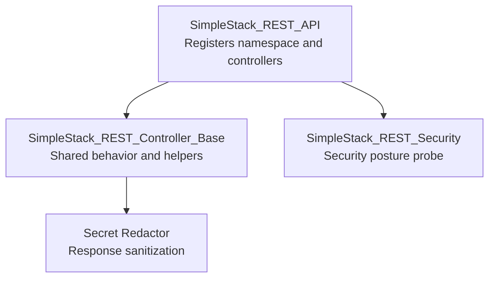
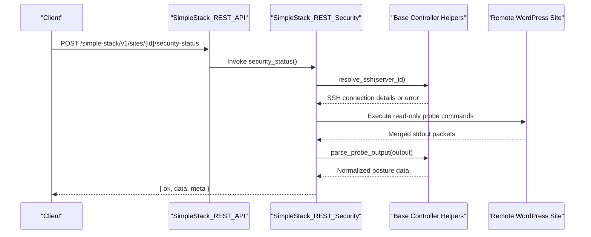
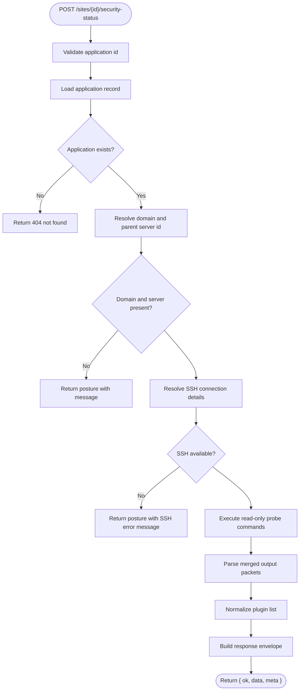
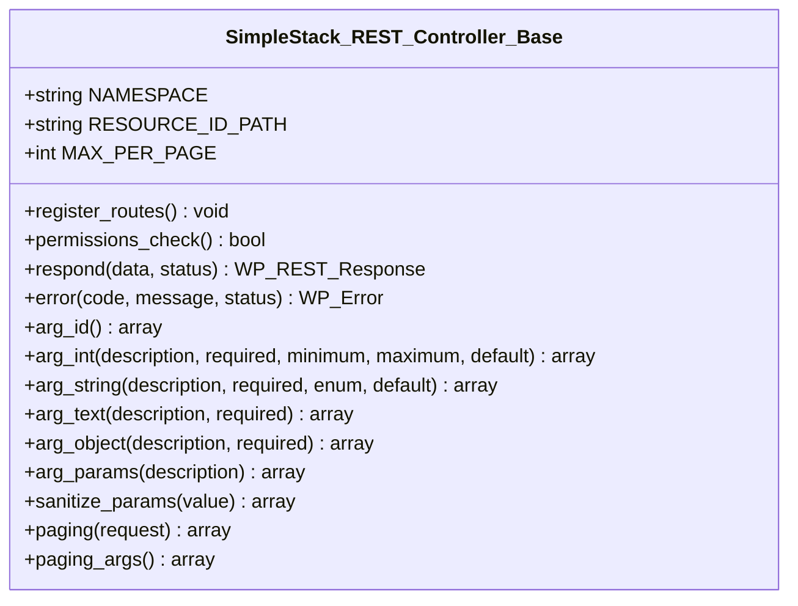
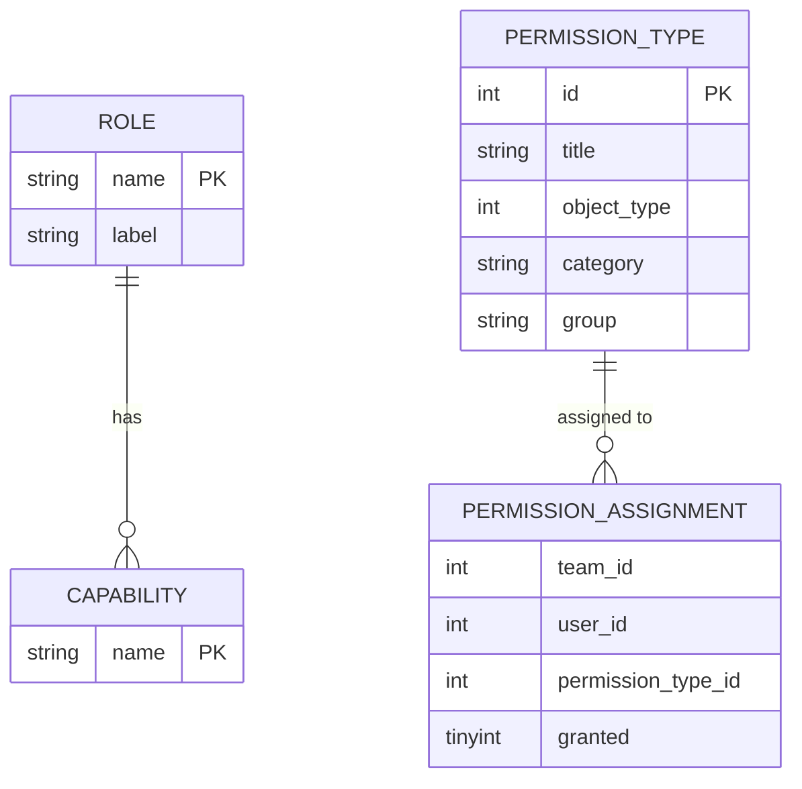
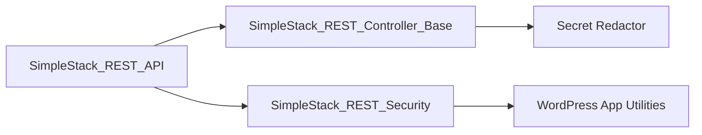

# Security API

<cite>
**Referenced Files in This Document**
- [class-simplestack-rest-api.php](file://includes/core/api/class-simplestack-rest-api.php)
- [class-simplestack-rest-controller-base.php](file://includes/core/api/class-simplestack-rest-controller-base.php)
- [class-simplestack-rest-security.php](file://includes/core/api/class-simplestack-rest-security.php)
- [class-wpcd-roles-capabilities.php](file://includes/core/class-wpcd-roles-capabilities.php)
- [class-wpcd-posts-permission-type.php](file://includes/core/class-wpcd-posts-permission-type.php)
</cite>

## Table of Contents
1. [Introduction](#introduction)
2. [Project Structure](#project-structure)
3. [Core Components](#core-components)
4. [Architecture Overview](#architecture-overview)
5. [Detailed Component Analysis](#detailed-component-analysis)
6. [Dependency Analysis](#dependency-analysis)
7. [Performance Considerations](#performance-considerations)
8. [Troubleshooting Guide](#troubleshooting-guide)
9. [Conclusion](#conclusion)
10. [Appendices](#appendices)

## Introduction
This document specifies the security-related endpoints and authorization model exposed by the SimpleStack REST layer under the `simple-stack/v1` namespace. The current implementation provides a read-only security posture probe for WordPress applications, while the broader platform integrates with WordPress roles and capabilities and maintains custom permission types for team-based access control.

Key points:
- All SimpleStack routes are internal and require the WordPress `manage_options` capability.
- Responses are wrapped in a consistent envelope and pass through a secret redactor to avoid leaking credentials.
- The security endpoint probes a site over SSH and returns non-sensitive posture data such as plugin inventory, PHP version, and whether file editing is disabled.
- Role and capability definitions, plus custom permission types, are managed outside the REST API but inform UI visibility and administrative permissions.

## Project Structure
The SimpleStack REST layer is registered by a central API class that loads controller classes and wires them into the `simple-stack/v1` namespace. The security functionality lives in its own controller.

**Diagram sources**
- [class-simplestack-rest-api.php:21-37](file://includes/core/api/class-simplestack-rest-api.php#L21-L37)
- [class-simplestack-rest-controller-base.php:22-27](file://includes/core/api/class-simplestack-rest-controller-base.php#L22-L27)
- [class-simplestack-rest-security.php:19-38](file://includes/core/api/class-simplestack-rest-security.php#L19-L38)

**Section sources**
- [class-simplestack-rest-api.php:21-118](file://includes/core/api/class-simplestack-rest-api.php#L21-L118)
- [class-simplestack-rest-controller-base.php:22-446](file://includes/core/api/class-simplestack-rest-controller-base.php#L22-L446)

## Core Components
- SimpleStack_REST_API: Loads controller files, instantiates controllers, and registers all routes under `simple-stack/v1`.
- SimpleStack_REST_Controller_Base: Provides shared route registration, argument validation helpers, response envelope, error helper, and a global admin-only permission callback.
- SimpleStack_REST_Security: Implements the security posture probe endpoint for a given application.

Important behaviors:
- Permission model: Every route uses `permissions_check()` which requires `manage_options`.
- Response envelope: Successful responses include `ok`, `data`, and `meta` fields; errors use WP_Error with a status code.
- Secret redaction: All response payloads are sanitized via the secret redactor before being sent to clients.

**Section sources**
- [class-simplestack-rest-api.php:21-118](file://includes/core/api/class-simplestack-rest-api.php#L21-L118)
- [class-simplestack-rest-controller-base.php:53-162](file://includes/core/api/class-simplestack-rest-controller-base.php#L53-L162)
- [class-simplestack-rest-security.php:19-38](file://includes/core/api/class-simplestack-rest-security.php#L19-L38)

## Architecture Overview
The security posture flow connects the REST controller to the remote server via SSH and parses read-only output.

**Diagram sources**
- [class-simplestack-rest-security.php:49-101](file://includes/core/api/class-simplestack-rest-security.php#L49-L101)
- [class-simplestack-rest-security.php:117-149](file://includes/core/api/class-simplestack-rest-security.php#L117-L149)
- [class-simplestack-rest-security.php:162-191](file://includes/core/api/class-simplestack-rest-security.php#L162-L191)
- [class-simplestack-rest-security.php:200-224](file://includes/core/api/class-simplestack-rest-security.php#L200-L224)

## Detailed Component Analysis

### Security Posture Endpoint
- Method: POST
- Path: `/simple-stack/v1/sites/{id}/security-status`
- Purpose: Probe a WordPress application’s security posture without mutating any state on the remote system.
- Authentication: Requires WordPress user with `manage_options`.
- Authorization: Enforced by base controller’s permission callback.
- Request path parameter:
  - id: Integer application post ID.
- Success response envelope:
  - ok: boolean
  - data: object containing posture information
  - meta: object with request timestamp and namespace
- Data fields:
  - app_id: integer
  - server_id: integer
  - domain: string
  - connected: boolean
  - plugins: array of plugin objects
  - file_edit_disallowed: boolean
  - php_version: string
  - message: string (present when probing cannot proceed)
- Error handling:
  - Returns WP_Error with machine-readable codes and HTTP status when the site is not found, provider unavailable, or SSH is unreachable.

**Diagram sources**
- [class-simplestack-rest-security.php:49-101](file://includes/core/api/class-simplestack-rest-security.php#L49-L101)
- [class-simplestack-rest-security.php:117-149](file://includes/core/api/class-simplestack-rest-security.php#L117-L149)
- [class-simplestack-rest-security.php:162-191](file://includes/core/api/class-simplestack-rest-security.php#L162-L191)
- [class-simplestack-rest-security.php:200-224](file://includes/core/api/class-simplestack-rest-security.php#L200-L224)

**Section sources**
- [class-simplestack-rest-security.php:31-38](file://includes/core/api/class-simplestack-rest-security.php#L31-L38)
- [class-simplestack-rest-security.php:49-101](file://includes/core/api/class-simplestack-rest-security.php#L49-L101)
- [class-simplestack-rest-security.php:117-149](file://includes/core/api/class-simplestack-rest-security.php#L117-L149)
- [class-simplestack-rest-security.php:162-191](file://includes/core/api/class-simplestack-rest-security.php#L162-L191)
- [class-simplestack-rest-security.php:200-224](file://includes/core/api/class-simplestack-rest-security.php#L200-L224)
- [class-simplestack-rest-security.php:233-251](file://includes/core/api/class-simplestack-rest-security.php#L233-L251)

### Base Controller and Shared Behavior
- Namespace: `simple-stack/v1`
- Global permission callback: `current_user_can('manage_options')`
- Route registration helpers: GET, POST, DELETE, and generic route registration
- Argument helpers:
  - arg_id: numeric resource identifier
  - arg_int: integer with optional min/max bounds
  - arg_string: string with optional enum set
  - arg_text: free-form text preserving characters
  - arg_object: generic object/map
  - arg_params: flexible params payload supporting JSON object, JSON string, or query string
- Response envelope:
  - respond(data, status): wraps data with `ok`, `data`, and `meta`; applies secret redaction
  - error(code, message, status): returns WP_Error with status
- Paging helpers:
  - paging(request): normalizes page/per_page into offset/page/per_page
  - paging_args(): standard pagination parameters

**Diagram sources**
- [class-simplestack-rest-controller-base.php:22-446](file://includes/core/api/class-simplestack-rest-controller-base.php#L22-L446)

**Section sources**
- [class-simplestack-rest-controller-base.php:53-162](file://includes/core/api/class-simplestack-rest-controller-base.php#L53-L162)
- [class-simplestack-rest-controller-base.php:164-341](file://includes/core/api/class-simplestack-rest-controller-base.php#L164-L341)
- [class-simplestack-rest-controller-base.php:408-446](file://includes/core/api/class-simplestack-rest-controller-base.php#L408-L446)

### Roles, Capabilities, and Custom Permissions
- WordPress roles and capabilities:
  - Custom roles are created during activation, including WPCDAdmin, WPCDManager, WPCDSysAdmin, and WPCDAppManager.
  - Existing Administrator role receives additional capabilities.
- Custom permission types:
  - A private custom post type stores permission definitions.
  - Default permissions cover server and application views, tab visibility, and management actions.
  - Permission assignments are stored in a dedicated table linking teams, users, permission types, and grant status.

**Diagram sources**
- [class-wpcd-roles-capabilities.php:54-151](file://includes/core/class-wpcd-roles-capabilities.php#L54-L151)
- [class-wpcd-posts-permission-type.php:77-110](file://includes/core/class-wpcd-posts-permission-type.php#L77-L110)
- [class-wpcd-posts-permission-type.php:331-348](file://includes/core/class-wpcd-posts-permission-type.php#L331-L348)

**Section sources**
- [class-wpcd-roles-capabilities.php:54-151](file://includes/core/class-wpcd-roles-capabilities.php#L54-L151)
- [class-wpcd-posts-permission-type.php:77-110](file://includes/core/class-wpcd-posts-permission-type.php#L77-L110)
- [class-wpcd-posts-permission-type.php:143-240](file://includes/core/class-wpcd-posts-permission-type.php#L143-L240)
- [class-wpcd-posts-permission-type.php:331-348](file://includes/core/class-wpcd-posts-permission-type.php#L331-L348)
- [class-wpcd-posts-permission-type.php:355-760](file://includes/core/class-wpcd-posts-permission-type.php#L355-L760)

## Dependency Analysis
- SimpleStack_REST_API depends on controller classes and loads them at runtime.
- Controllers extend SimpleStack_REST_Controller_Base for shared behavior.
- SimpleStack_REST_Security depends on WordPress application utilities to resolve SSH connectivity and execute read-only commands.

**Diagram sources**
- [class-simplestack-rest-api.php:63-75](file://includes/core/api/class-simplestack-rest-api.php#L63-L75)
- [class-simplestack-rest-controller-base.php:126-149](file://includes/core/api/class-simplestack-rest-controller-base.php#L126-L149)
- [class-simplestack-rest-security.php:84-101](file://includes/core/api/class-simplestack-rest-security.php#L84-L101)

**Section sources**
- [class-simplestack-rest-api.php:63-118](file://includes/core/api/class-simplestack-rest-api.php#L63-L118)
- [class-simplestack-rest-security.php:84-101](file://includes/core/api/class-simplestack-rest-security.php#L84-L101)

## Performance Considerations
- The security probe executes multiple read-only commands in a single SSH round trip by merging outputs with a delimiter. This reduces latency and avoids repeated connections.
- Output parsing splits packets and normalizes only the fields needed by the UI, minimizing payload size.
- Plugin list normalization filters malformed entries and selects a minimal set of fields.

Recommendations:
- Keep the number of probe operations small and focused on read-only checks.
- Cache posture results where appropriate if the same site is polled frequently.
- Avoid logging sensitive command output or configuration values.

[No sources needed since this section provides general guidance]

## Troubleshooting Guide
Common issues and their indicators:
- Site not found:
  - Occurs when the provided application ID does not exist or is not an application post type.
  - Response includes a descriptive message and a 404 error code.
- Missing domain or parent server:
  - The probe cannot run without both a domain and a valid server ID.
  - Response contains a message explaining why probing is skipped.
- Provider unavailable:
  - The server’s provider is not installed or configured.
  - Response includes a 400-level error indicating provider unavailability.
- SSH unreachable:
  - The server instance may still be starting or credentials are missing.
  - Response includes a message describing SSH unavailability.

Best practices:
- Always validate the application ID before calling the endpoint.
- Ensure the server instance is fully provisioned and reachable before probing.
- Inspect the response message field for human-readable diagnostics.

**Section sources**
- [class-simplestack-rest-security.php:49-101](file://includes/core/api/class-simplestack-rest-security.php#L49-L101)
- [class-simplestack-rest-security.php:200-224](file://includes/core/api/class-simplestack-rest-security.php#L200-L224)

## Conclusion
The SimpleStack security API currently exposes a secure, read-only posture probe for WordPress applications under the `simple-stack/v1` namespace. It enforces strict administrative permissions, sanitizes responses, and performs minimal, safe SSH operations. While authentication tokens, CSRF protection, session management, and audit logs are not implemented as REST endpoints here, the platform’s broader WordPress integration provides robust role and capability controls and a custom permission model suitable for team-based access control.

[No sources needed since this section summarizes without analyzing specific files]

## Appendices

### Endpoint Specification Summary
- POST `/simple-stack/v1/sites/{id}/security-status`
  - Description: Probe a site’s security posture.
  - Auth: WordPress user with `manage_options`.
  - Path parameter:
    - id: integer application post ID.
  - Success response:
    - ok: boolean
    - data: object with posture fields
    - meta: object with request_date and namespace
  - Error response:
    - WP_Error with code and message, plus HTTP status

**Section sources**
- [class-simplestack-rest-security.php:31-38](file://includes/core/api/class-simplestack-rest-security.php#L31-L38)
- [class-simplestack-rest-security.php:49-101](file://includes/core/api/class-simplestack-rest-security.php#L49-L101)
- [class-simplestack-rest-controller-base.php:126-162](file://includes/core/api/class-simplestack-rest-controller-base.php#L126-L162)

### Security Best Practices
- Restrict API access to administrators with `manage_options`.
- Use HTTPS for all API traffic.
- Avoid logging secrets; rely on the built-in secret redactor.
- Limit probe operations to read-only commands.
- Validate and sanitize all inputs using the base controller’s argument helpers.
- Implement client-side nonce verification for any future forms or AJAX flows.
- Monitor and rate-limit requests to prevent abuse.

[No sources needed since this section provides general guidance]