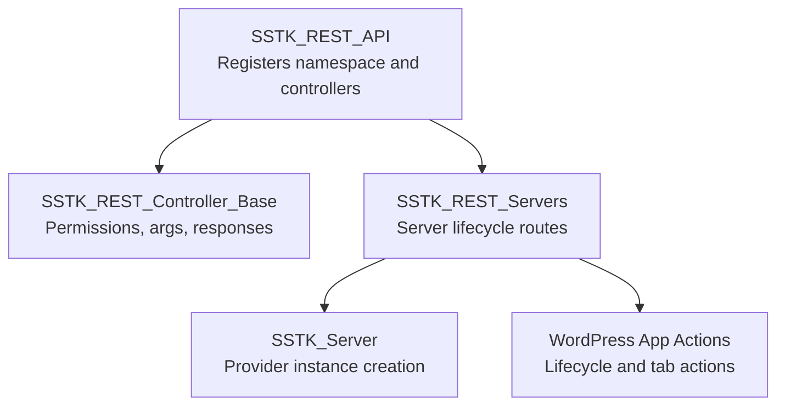
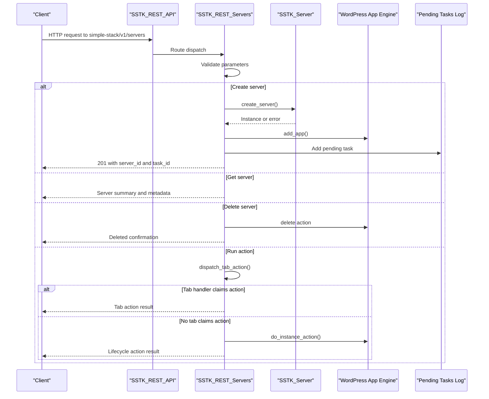
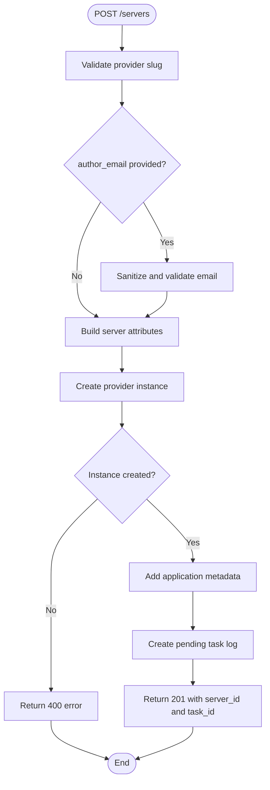
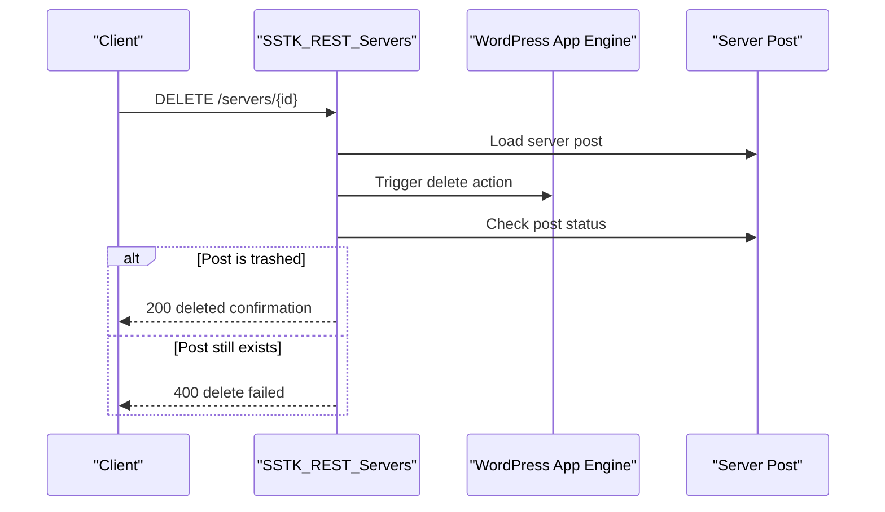
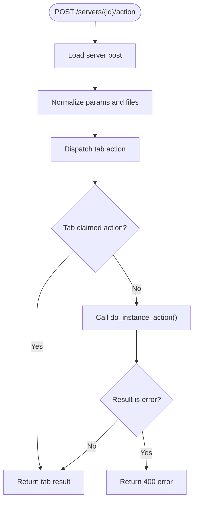
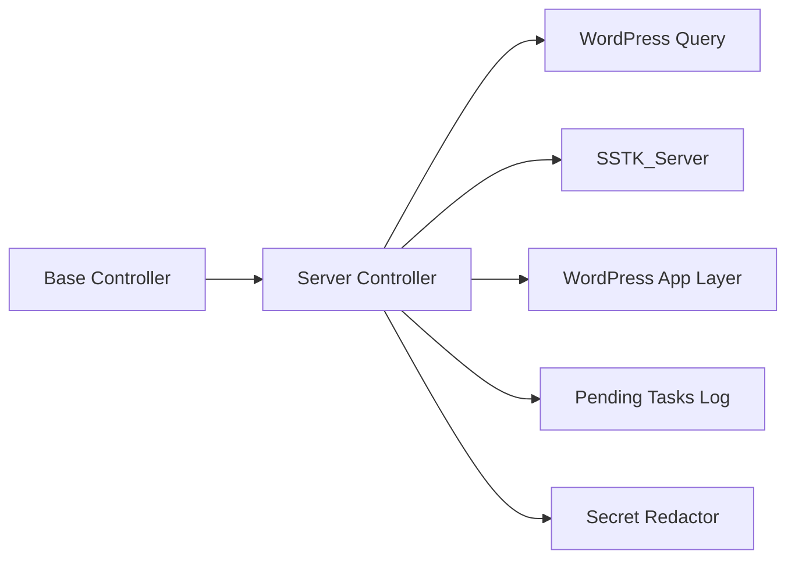

# Servers API

<cite>
**Referenced Files in This Document**   
- [class-sstk-rest-api.php](file://includes/core/api/class-sstk-rest-api.php)
- [class-sstk-rest-controller-base.php](file://includes/core/api/class-sstk-rest-controller-base.php)
- [class-sstk-rest-servers.php](file://includes/core/api/class-sstk-rest-servers.php)
- [class-sstk-server.php](file://includes/core/class-sstk-server.php)
- [power.php](file://includes/core/apps/wordpress-app/tabs-server/power.php)
- [ControllerServersTest.php](file://tests/phpunit/rest-api/ControllerServersTest.php)
</cite>

## Table of Contents
1. [Introduction](#introduction)
2. [Project Structure](#project-structure)
3. [Core Components](#core-components)
4. [Architecture Overview](#architecture-overview)
5. [Detailed Component Analysis](#detailed-component-analysis)
6. [Dependency Analysis](#dependency-analysis)
7. [Performance Considerations](#performance-considerations)
8. [Troubleshooting Guide](#troubleshooting-guide)
9. [Conclusion](#conclusion)

## Introduction
This document specifies the server management endpoints under the `simple-stack/v1/servers` route prefix. These endpoints provide a REST interface for listing servers, provisioning new servers from configured cloud providers, retrieving detailed server information, deleting servers, and executing lifecycle actions such as power operations through an action bridge.

The API is intended as an internal control plane. Every `/servers` route requires the WordPress capability `manage_options`, returns a consistent envelope with secret redaction, and delegates long-running provider operations to asynchronous task handling.

## Project Structure
The Simple Stack REST layer is registered by a central API class that loads controller classes and registers routes under the shared namespace. The server controller owns all `/servers` routes, while the base controller provides permission checks, argument validation helpers, paging support, and response formatting.



**Diagram sources**
- [class-sstk-rest-api.php:21-37](file://includes/core/api/class-sstk-rest-api.php#L21-L37)
- [class-sstk-rest-api.php:84-99](file://includes/core/api/class-sstk-rest-api.php#L84-L99)
- [class-sstk-rest-controller-base.php:22-60](file://includes/core/api/class-sstk-rest-controller-base.php#L22-L60)
- [class-sstk-rest-servers.php:22-88](file://includes/core/api/class-sstk-rest-servers.php#L22-L88)
- [class-sstk-server.php:84-120](file://includes/core/class-sstk-server.php#L84-L120)

**Section sources**
- [class-sstk-rest-api.php:12-37](file://includes/core/api/class-sstk-rest-api.php#L12-L37)
- [class-sstk-rest-controller-base.php:22-60](file://includes/core/api/class-sstk-rest-controller-base.php#L22-L60)
- [class-sstk-rest-servers.php:12-29](file://includes/core/api/class-sstk-rest-servers.php#L12-L29)

## Core Components
- **Namespace**: `simple-stack/v1`.
- **Authentication**: All `/servers` routes require `manage_options`.
- **Response envelope**: Successful responses are wrapped in `{ ok: true, data: ..., meta: { request_date, namespace } }`. Errors use WordPress error objects with a numeric status.
- **Secret redaction**: Response payloads are passed through a secret redactor before being sent to clients.
- **Paging**: List endpoints accept `page` and `per_page`; default page size is 25, maximum is 200.
- **Validation**: Parameters are sanitized and validated using helper methods for integers, strings, enums, objects, and free-form text.

**Section sources**
- [class-sstk-rest-controller-base.php:24-37](file://includes/core/api/class-sstk-rest-controller-base.php#L24-L37)
- [class-sstk-rest-controller-base.php:58-60](file://includes/core/api/class-sstk-rest-controller-base.php#L58-L60)
- [class-sstk-rest-controller-base.php:136-162](file://includes/core/api/class-sstk-rest-controller-base.php#L136-L162)
- [class-sstk-rest-controller-base.php:415-445](file://includes/core/api/class-sstk-rest-controller-base.php#L415-L445)

## Architecture Overview
The server endpoints follow a layered flow:

1. The REST API loader instantiates controllers and registers routes.
2. Requests enter the server controller.
3. Input is validated through base controller helpers.
4. Server records are stored as the `sstk_app_server` custom post type.
5. Provisioning calls the provider API and creates a pending task log entry.
6. Lifecycle actions are dispatched through tab handlers or the WordPress app action engine.



**Diagram sources**
- [class-sstk-rest-api.php:84-99](file://includes/core/api/class-sstk-rest-api.php#L84-L99)
- [class-sstk-rest-servers.php:36-88](file://includes/core/api/class-sstk-rest-servers.php#L36-L88)
- [class-sstk-rest-servers.php:172-249](file://includes/core/api/class-sstk-rest-servers.php#L172-L249)
- [class-sstk-server.php:84-120](file://includes/core/class-sstk-server.php#L84-L120)

## Detailed Component Analysis

### Authentication and Authorization
Every route in the `/servers` controller uses the shared permission callback that checks `current_user_can( 'manage_options' )`. This statement is scoped to the server controller; the separately registered WordPress App command and webhook callbacks use their own authentication.

| Aspect | Specification |
|---|---|
| Capability required | `manage_options` |
| Public `/servers` endpoints | None |
| Error when unauthorized | Standard WordPress REST authorization error |

**Section sources**
- [class-sstk-rest-controller-base.php:58-60](file://includes/core/api/class-sstk-rest-controller-base.php#L58-L60)

### Common Response Envelope
All successful `/servers` responses use the base controller’s response method. Secrets are redacted automatically.

| Field | Type | Description |
|---|---|---|
| `ok` | boolean | Always `true` for successful responses |
| `data` | mixed | Endpoint-specific payload |
| `meta.request_date` | string | ISO-8601 timestamp |
| `meta.namespace` | string | `simple-stack/v1` |

Error responses return a WordPress error object with a numeric status code.

**Section sources**
- [class-sstk-rest-controller-base.php:136-162](file://includes/core/api/class-sstk-rest-controller-base.php#L136-L162)

### GET /servers
Lists server summaries with optional filtering and pagination.

**Endpoint**
- Method: `GET`
- Path: `/wp-json/simple-stack/v1/servers`

**Query Parameters**

| Parameter | Type | Required | Default | Description |
|---|---|---:|---:|---|
| `page` | integer | No | 1 | Page number, one-based |
| `per_page` | integer | No | 25 | Records per page, maximum 200 |
| `provider` | string | No | — | Filter by provider slug |
| `region` | string | No | — | Filter by provider region slug |
| `status` | string | No | — | Filter by recorded server state |
| `search` | string | No | — | Free-text search on server name |

**Filtering Behavior**
- `provider` filters by the `sstk_server_provider` meta field.
- `region` filters by the `sstk_server_region` meta field.
- `status` filters by the `sstk_server_current_state` meta field.
- `search` uses WordPress post title search.

**Success Response Schema**
```json
{
  "ok": true,
  "data": {
    "items": [
      {
        "id": 123,
        "name": "example-server",
        "provider": "vultr-v2",
        "provider_label": "Vultr",
        "region": "ewr",
        "size": "vc2-1c-1gb",
        "state": "active",
        "health": "healthy",
        "webserver_type": "ols",
        "ipv4": "203.0.113.10",
        "ipv6": "",
        "instance_id": "12345678",
        "os": "ubuntu2404lts",
        "app_count": 0,
        "author": 1,
        "created": "2024-01-01T00:00:00Z"
      }
    ],
    "total": 1,
    "page": 1,
    "per_page": 25
  },
  "meta": {
    "request_date": "2024-01-01T00:00:00Z",
    "namespace": "simple-stack/v1"
  }
}
```

**Status Codes**
- `200`: Success.
- `401` or `403`: Unauthorized due to missing `manage_options`.

**Section sources**
- [class-sstk-rest-servers.php:38-50](file://includes/core/api/class-sstk-rest-servers.php#L38-L50)
- [class-sstk-rest-servers.php:99-161](file://includes/core/api/class-sstk-rest-servers.php#L99-L161)
- [class-sstk-rest-servers.php:390-412](file://includes/core/api/class-sstk-rest-servers.php#L390-L412)
- [class-sstk-rest-controller-base.php:415-445](file://includes/core/api/class-sstk-rest-controller-base.php#L415-L445)

### POST /servers
Provisions a new server from a configured cloud provider.

**Endpoint**
- Method: `POST`
- Path: `/wp-json/simple-stack/v1/servers`

**Request Body Fields**

| Field | Type | Required | Default | Validation |
|---|---|---:|---:|---|
| `name` | string | Yes | — | Sanitized text field |
| `provider` | string | Yes | — | Must be a registered provider slug |
| `region` | string | Yes | — | Provider region slug |
| `size` | string | Yes | — | Provider size or plan slug |
| `os` | string | No | `ubuntu2404lts` | `ubuntu2404lts` or `ubuntu2604lts` |
| `webserver_type` | string | No | `ols` | Enum value `ols` |
| `author_email` | string | No | — | Valid email address if provided |

**Processing Flow**
1. Validate the provider exists.
2. Sanitize and validate `author_email`.
3. Resolve default OS if not provided.
4. Build server attributes.
5. Call provider creation through `SSTK_Server::create_server()`.
6. Attach application metadata through the WordPress app layer.
7. Create a pending task log entry for asynchronous provisioning.
8. Return server ID, task ID, and server summary.



**Diagram sources**
- [class-sstk-rest-servers.php:172-249](file://includes/core/api/class-sstk-rest-servers.php#L172-L249)
- [class-sstk-server.php:84-120](file://includes/core/class-sstk-server.php#L84-L120)

**Success Response Schema**
```json
{
  "ok": true,
  "data": {
    "server_id": 123,
    "task_id": 456,
    "server": {
      "id": 123,
      "name": "example-server",
      "provider": "vultr-v2",
      "provider_label": "Vultr",
      "region": "ewr",
      "size": "vc2-1c-1gb",
      "state": "in-progress",
      "health": "",
      "webserver_type": "ols",
      "ipv4": "",
      "ipv6": "",
      "instance_id": "12345678",
      "os": "ubuntu2404lts",
      "app_count": 0,
      "author": 1,
      "created": "2024-01-01T00:00:00Z"
    }
  },
  "meta": {
    "request_date": "2024-01-01T00:00:00Z",
    "namespace": "simple-stack/v1"
  }
}
```

**Status Codes**
- `201`: Server record created and provisioning task queued.
- `400`: Invalid provider, invalid email, or server creation failed.
- `500`: Server record created but pending task could not be written.

**Section sources**
- [class-sstk-rest-servers.php:52-64](file://includes/core/api/class-sstk-rest-servers.php#L52-L64)
- [class-sstk-rest-servers.php:172-249](file://includes/core/api/class-sstk-rest-servers.php#L172-L249)
- [class-sstk-server.php:84-120](file://includes/core/class-sstk-server.php#L84-L120)
- [ControllerServersTest.php:84-109](file://tests/phpunit/rest-api/ControllerServersTest.php#L84-L109)

### GET /servers/{id}
Retrieves detailed server information, including metadata, PHP version, and availability for commands.

**Endpoint**
- Method: `GET`
- Path: `/wp-json/simple-stack/v1/servers/{id}`

**Path Parameters**

| Parameter | Type | Required | Validation |
|---|---|---:|---|
| `id` | integer | Yes | Positive numeric ID |

**Success Response Schema**
```json
{
  "ok": true,
  "data": {
    "id": 123,
    "name": "example-server",
    "provider": "vultr-v2",
    "provider_label": "Vultr",
    "region": "ewr",
    "size": "vc2-1c-1gb",
    "state": "active",
    "health": "healthy",
    "webserver_type": "ols",
    "ipv4": "203.0.113.10",
    "ipv6": "",
    "instance_id": "12345678",
    "os": "ubuntu2404lts",
    "app_count": 0,
    "author": 1,
    "created": "2024-01-01T00:00:00Z",
    "meta": {
      "initial_os": "ubuntu2404lts",
      "region": "ewr",
      "size_raw": "vc2-1c-1gb",
      "name": "example-server",
      "provider": "vultr-v2",
      "author_email": "admin@example.com"
    },
    "php_version": "8.4"
    "available": true
  },
  "meta": {
    "request_date": "2024-01-01T00:00:00Z",
    "namespace": "simple-stack/v1"
  }
}
```

**Notes**
- `meta` contains every recorded server meta value with the `sstk_server_` prefix stripped.
- Sensitive values may be redacted by the secret redactor before response delivery.
- `available` indicates whether the server is currently available for commands.

**Status Codes**
- `200`: Success.
- `404`: Server not found.

**Section sources**
- [class-sstk-rest-servers.php:66-70](file://includes/core/api/class-sstk-rest-servers.php#L66-L70)
- [class-sstk-rest-servers.php:261-276](file://includes/core/api/class-sstk-rest-servers.php#L261-L276)
- [class-sstk-rest-servers.php:428-456](file://includes/core/api/class-sstk-rest-servers.php#L428-L456)

### DELETE /servers/{id}
Deletes a server record and triggers the provider-side deletion lifecycle.

**Endpoint**
- Method: `DELETE`
- Path: `/wp-json/simple-stack/v1/servers/{id}`

**Path Parameters**

| Parameter | Type | Required | Validation |
|---|---|---:|---|
| `id` | integer | Yes | Positive numeric ID |

**Behavior**
1. Load the server post.
2. Trigger the WordPress app delete action chain.
3. Verify the server post is trashed.
4. Return deletion confirmation.



**Diagram sources**
- [class-sstk-rest-servers.php:287-310](file://includes/core/api/class-sstk-rest-servers.php#L287-L310)

**Success Response Schema**
```json
{
  "ok": true,
  "data": {
    "server_id": 123,
    "deleted": true
  },
  "meta": {
    "request_date": "2024-01-01T00:00:00Z",
    "namespace": "simple-stack/v1"
  }
}
```

**Status Codes**
- `200`: Server deleted successfully.
- `400`: Server record still exists and is not trashed.
- `404`: Server not found.

**Section sources**
- [class-sstk-rest-servers.php:72-76](file://includes/core/api/class-sstk-rest-servers.php#L72-L76)
- [class-sstk-rest-servers.php:287-310](file://includes/core/api/class-sstk-rest-servers.php#L287-L310)
- [ControllerServersTest.php:128-146](file://tests/phpunit/rest-api/ControllerServersTest.php#L128-L146)

### POST /servers/{id}/action
Executes lifecycle and configuration actions against a server. This is the primary endpoint for power operations, resizing, snapshotting, and other server management tasks.

**Endpoint**
- Method: `POST`
- Path: `/wp-json/simple-stack/v1/servers/{id}/action`

**Path Parameters**

| Parameter | Type | Required | Validation |
|---|---|---:|---|
| `id` | integer | Yes | Positive numeric ID |

**Request Body Fields**

| Field | Type | Required | Default | Description |
|---|---|---:|---:|---|
| `action` | string | Yes | — | Action slug understood by the server action bridge |
| `params` | object or string | No | — | Parameters addressed to the tab handler |
| `additional` | object | No | — | Alias of params passed to the lifecycle engine |

**Supported Power Actions**
Power-related actions are handled by the WordPress app’s server power tab. Common action slugs include:

| Action Slug | Purpose | Notes |
|---|---|---|
| `server-reboot-soft` | Soft reboot | Updates local state to `in-progress` during execution |
| `server-schedule-reboot-soft` | Schedule soft reboot | Asynchronous scheduling |
| `server-reboot-hard-provider` | Hard reboot via provider | Provider-level restart |
| `server-graceful-shutdown` | Graceful shutdown | Updates local state to `off` after completion |
| `server-hard-shutdown` | Hard shutdown | Provider-level power-off |
| `server-turn-on` | Turn server on | Provider-level power-on |

**Action Dispatch Flow**
1. Load and validate the server post.
2. Normalize `params` from JSON object, JSON string, or multipart form data.
3. Attempt tab handler dispatch.
4. If no tab claims the action, delegate to the WordPress app instance action engine.
5. Return the action result.



**Diagram sources**
- [class-sstk-rest-servers.php:327-363](file://includes/core/api/class-sstk-rest-servers.php#L327-L363)
- [class-sstk-rest-controller-base.php:343-406](file://includes/core/api/class-sstk-rest-controller-base.php#L343-L406)
- [power.php:133-157](file://includes/core/apps/wordpress-app/tabs-server/power.php#L133-L157)

**Success Response Schema**
```json
{
  "ok": true,
  "data": {
    "server_id": 123,
    "action": "server-reboot-soft",
    "result": {
      "success": true,
      "message": "Reboot initiated"
    }
  },
  "meta": {
    "request_date": "2024-01-01T00:00:00Z",
    "namespace": "simple-stack/v1"
  }
}
```

**Status Codes**
- `200`: Action executed successfully.
- `400`: Invalid action, invalid parameters, or action returned an error.
- `404`: Server not found.

**Section sources**
- [class-sstk-rest-servers.php:78-87](file://includes/core/api/class-sstk-rest-servers.php#L78-L87)
- [class-sstk-rest-servers.php:327-363](file://includes/core/api/class-sstk-rest-servers.php#L327-L363)
- [class-sstk-rest-controller-base.php:343-406](file://includes/core/api/class-sstk-rest-controller-base.php#L343-L406)
- [power.php:133-157](file://includes/core/apps/wordpress-app/tabs-server/power.php#L133-L157)

### Server Metadata Structure
The server detail endpoint exposes a `meta` object containing recorded server metadata with the `sstk_server_` prefix removed. Examples include provider configuration, initial OS, region, size, owner email, and other provisioning attributes.

| Meta Key Example | Meaning |
|---|---|
| `initial_os` | Operating system selected during provisioning |
| `region` | Cloud provider region |
| `size_raw` | Provider size or plan identifier |
| `name` | Server name |
| `provider` | Provider slug |
| `author_email` | Owner email address |

**Important Security Note**
Although sensitive keys are redacted at response time, callers should treat `meta` as potentially containing secrets and handle it securely.

**Section sources**
- [class-sstk-rest-servers.php:428-456](file://includes/core/api/class-sstk-rest-servers.php#L428-L456)
- [class-sstk-rest-controller-base.php:136-149](file://includes/core/api/class-sstk-rest-controller-base.php#L136-L149)

### Status Codes Summary

| Code | Meaning | Typical Cause |
|---|---|---|
| `200` | Success | Read or action completed |
| `201` | Created | Server provisioning started |
| `400` | Bad Request | Invalid input, invalid provider, creation failure, or action error |
| `404` | Not Found | Server does not exist |
| `500` | Internal Error | Pending task log write failure |

**Section sources**
- [class-sstk-rest-servers.php:177-188](file://includes/core/api/class-sstk-rest-servers.php#L177-L188)
- [class-sstk-rest-servers.php:213-240](file://includes/core/api/class-sstk-rest-servers.php#L213-L240)
- [class-sstk-rest-servers.php:287-310](file://includes/core/api/class-sstk-rest-servers.php#L287-L310)
- [class-sstk-rest-servers.php:352-354](file://includes/core/api/class-sstk-rest-servers.php#L352-L354)

## Dependency Analysis
The server API depends on several core components:



**Diagram sources**
- [class-sstk-rest-controller-base.php:136-162](file://includes/core/api/class-sstk-rest-controller-base.php#L136-L162)
- [class-sstk-rest-servers.php:99-161](file://includes/core/api/class-sstk-rest-servers.php#L99-L161)
- [class-sstk-rest-servers.php:172-249](file://includes/core/api/class-sstk-rest-servers.php#L172-L249)

**Section sources**
- [class-sstk-rest-servers.php:99-161](file://includes/core/api/class-sstk-rest-servers.php#L99-L161)
- [class-sstk-rest-servers.php:172-249](file://includes/core/api/class-sstk-rest-servers.php#L172-L249)

## Performance Considerations
- **List endpoint pagination**: Use `per_page` judiciously. The maximum accepted page size is 200, but large pages increase database load and response size.
- **Meta queries**: Filtering by provider, region, or status adds `meta_query` clauses. Indexing or limiting filters improves performance.
- **Asynchronous provisioning**: Creation returns immediately with a task ID; avoid polling too frequently.
- **Secret redaction**: All `/servers` responses are processed through the secret redactor. Keep payloads minimal where possible.
- **Action dispatch**: Long-running provider operations should be treated as asynchronous. Clients should poll server status rather than waiting synchronously.

[No sources needed since this section provides general guidance]

## Troubleshooting Guide

### Server Not Found
**Symptoms**
- `GET /servers/{id}` returns a 404.
- `DELETE /servers/{id}` returns a 404.
- `POST /servers/{id}/action` returns a 404.

**Likely Causes**
- Invalid server ID.
- Server was already deleted or trashed.
- Incorrect namespace or path.

**Resolution**
- Confirm the server ID exists.
- Use `GET /servers` to list available servers.
- Verify the request uses `simple-stack/v1/servers`.

**Section sources**
- [class-sstk-rest-servers.php:372-381](file://includes/core/api/class-sstk-rest-servers.php#L372-L381)

### Invalid Provider
**Symptoms**
- `POST /servers` returns a 400 with an invalid provider error.

**Likely Causes**
- Provider slug not registered.
- Typo in provider name.
- Provider not configured.

**Resolution**
- Check available providers through the providers API.
- Use `vultr-v2` or `upcloud`, or a virtual alias of one of those supported provider types, and configure its credentials.

**Section sources**
- [class-sstk-rest-servers.php:174-179](file://includes/core/api/class-sstk-rest-servers.php#L174-L179)

### Invalid Email Address
**Symptoms**
- `POST /servers` returns a 400 when `author_email` is malformed.

**Likely Causes**
- Missing `@` symbol.
- Invalid domain.
- Non-string value.

**Resolution**
- Provide a valid email address.
- Omit `author_email` if ownership attribution is not required.

**Section sources**
- [class-sstk-rest-servers.php:181-188](file://includes/core/api/class-sstk-rest-servers.php#L181-L188)

### Server Creation Failed
**Symptoms**
- `POST /servers` returns a 400 with a server creation failure message.

**Likely Causes**
- Provider API call failed.
- Insufficient provider credentials.
- Region or size not available.

**Resolution**
- Check provider logs.
- Validate region and size against provider offerings.
- Retry after resolving provider configuration issues.

**Section sources**
- [class-sstk-rest-servers.php:210-224](file://includes/core/api/class-sstk-rest-servers.php#L210-L224)
- [class-sstk-server.php:84-120](file://includes/core/class-sstk-server.php#L84-L120)

### Pending Task Write Failure
**Symptoms**
- `POST /servers` returns a 500 indicating the pending task entry could not be written.

**Likely Causes**
- Database write issue.
- Pending tasks table corruption.
- Permission problem writing task logs.

**Resolution**
- Check WordPress debug logs.
- Verify database connectivity.
- Recreate or repair pending task entries if necessary.

**Section sources**
- [class-sstk-rest-servers.php:228-240](file://includes/core/api/class-sstk-rest-servers.php#L228-L240)

### Delete Still Active
**Symptoms**
- `DELETE /servers/{id}` returns a 400 because the server record still exists and is not trashed.

**Likely Causes**
- Provider deletion did not complete.
- Server lifecycle hook did not trash the post.
- Manual intervention left the record active.

**Resolution**
- Check provider instance status.
- Review server lifecycle hooks.
- Manually verify post status and provider instance state.

**Section sources**
- [class-sstk-rest-servers.php:296-302](file://includes/core/api/class-sstk-rest-servers.php#L296-L302)

### Power Action State Mismatch
**Symptoms**
- Server state remains `in-progress` after reboot or shutdown.
- Server becomes unavailable for further operations until state is updated.

**Likely Causes**
- Callbacks not installed on the server.
- Provider state update did not reach WordPress.
- Manual state synchronization required.

**Resolution**
- Install or verify server callbacks.
- Use the admin interface to update remote state.
- Poll server status until state transitions to `active` or `off`.

**Section sources**
- [power.php:405-407](file://includes/core/apps/wordpress-app/tabs-server/power.php#L405-L407)
- [power.php:443-485](file://includes/core/apps/wordpress-app/tabs-server/power.php#L443-L485)

## Conclusion
The `simple-stack/v1/servers` API provides a secure, consistent interface for managing server lifecycles. It supports listing, provisioning, reading, deleting, and executing lifecycle actions through a well-defined request/response contract. Because many operations interact with external cloud providers, clients should treat provisioning and power actions as asynchronous and monitor server state through the provided endpoints. `/servers` routes are restricted to administrators, responses are consistently structured, and sensitive data is redacted before leaving the server.

[No sources needed since this section summarizes without analyzing specific files]