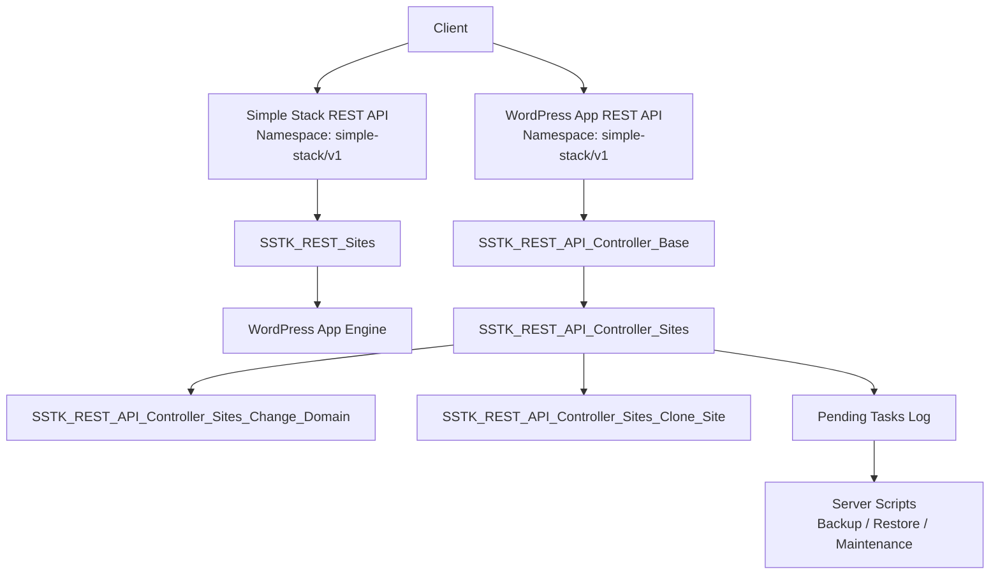
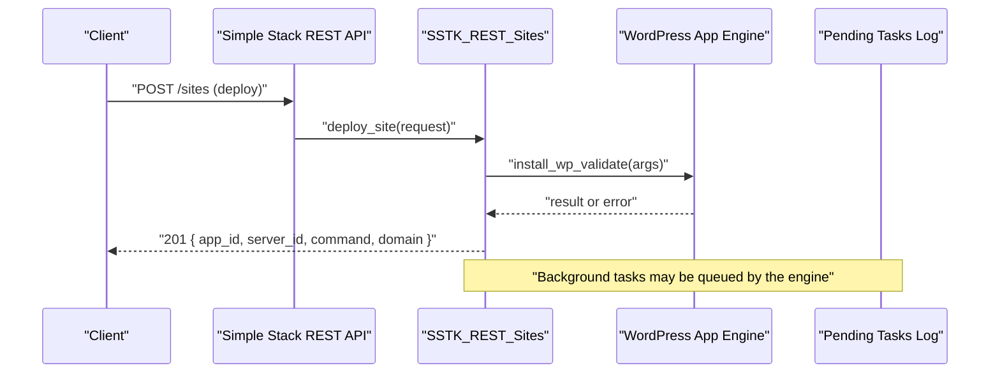
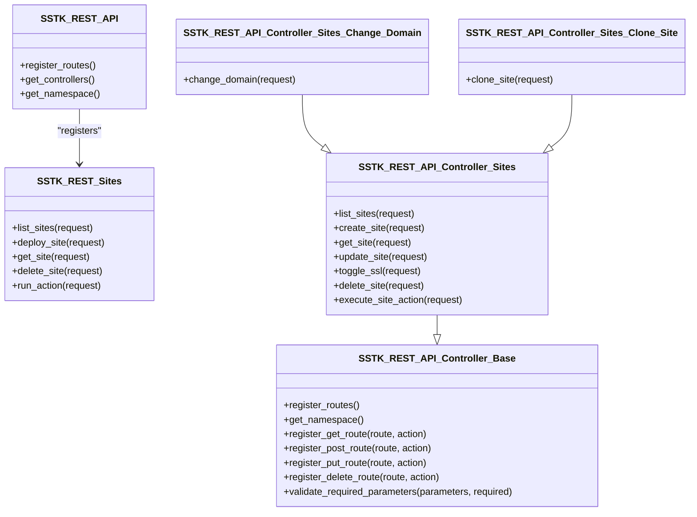

# Sites API

<cite>
**Referenced Files in This Document**   
- [class-sstk-rest-api.php](file://includes/core/api/class-sstk-rest-api.php)
- [class-sstk-rest-sites.php](file://includes/core/api/class-sstk-rest-sites.php)
- [class-sstk-rest-api-controller-base.php](file://includes/core/apps/wordpress-app/rest-api/class-sstk-rest-api-controller-base.php)
- [class-sstk-rest-api-controller-sites.php](file://includes/core/apps/wordpress-app/rest-api/class-sstk-rest-api-controller-sites.php)
- [class-sstk-rest-api-controller-sites-change-domain.php](file://includes/core/apps/wordpress-app/rest-api/class-sstk-rest-api-controller-sites-change-domain.php)
- [class-sstk-rest-api-controller-sites-clone-site.php](file://includes/core/apps/wordpress-app/rest-api/class-sstk-rest-api-controller-sites-clone-site.php)
- [ControllerSitesTest.php](file://tests/phpunit/rest-api/ControllerSitesTest.php)
- [environment variables.txt](file://includes/core/apps/wordpress-app/scripts/v2/raw/environment%20variables.txt)
- [41-wp-backup2.txt](file://includes/core/apps/wordpress-app/scripts/v2/raw/41-wp-backup2.txt)
</cite>

## Table of Contents
1. [Introduction](#introduction)
2. [Project Structure](#project-structure)
3. [Core Components](#core-components)
4. [Architecture Overview](#architecture-overview)
5. [Detailed Component Analysis](#detailed-component-analysis)
6. [Dependency Analysis](#dependency-analysis)
7. [Performance Considerations](#performance-considerations)
8. [Troubleshooting Guide](#troubleshooting-guide)
9. [Conclusion](#conclusion)
10. [Appendices](#appendices)

## Introduction
This document provides comprehensive API documentation for WordPress site management endpoints under the `simple-stack/v1/sites` route prefix. It covers site lifecycle operations including listing, creation, retrieval, deletion, SSL toggling, domain changes, cloning, and maintenance actions. It also documents request/response schemas, authentication and permissions, error handling, debugging approaches, and integration points with the WordPress application engine.

The repository registers two current controller families under the same `simple-stack/v1` namespace:
- The admin SPA surface is implemented by `SSTK_REST_API` and `SSTK_REST_Sites`.
- The WordPress App surface is implemented by `SSTK_REST_API_Controller_Base` and its site controllers, including SSL toggling, domain changes, cloning, and task-oriented site creation.

This is not an upstream compatibility namespace; both controller families are first-party Simple Stack code.

## Project Structure
The site-related REST functionality is split between:
- Core Simple Stack REST infrastructure and controller for sites.
- WordPress App REST controllers for sites, domain changes, and cloning.
- Background task orchestration via pending logs.
- Server-side scripts that perform backup, restore, and maintenance operations.

**Diagram sources**
- [class-sstk-rest-api.php:21-37](file://includes/core/api/class-sstk-rest-api.php#L21-L37)
- [class-sstk-rest-sites.php:21-86](file://includes/core/api/class-sstk-rest-sites.php#L21-L86)
- [class-sstk-rest-api-controller-base.php:17-52](file://includes/core/apps/wordpress-app/rest-api/class-sstk-rest-api-controller-base.php#L17-L52)
- [class-sstk-rest-api-controller-sites.php:17-56](file://includes/core/apps/wordpress-app/rest-api/class-sstk-rest-api-controller-sites.php#L17-L56)
- [class-sstk-rest-api-controller-sites-change-domain.php:17-39](file://includes/core/apps/wordpress-app/rest-api/class-sstk-rest-api-controller-sites-change-domain.php#L17-L39)
- [class-sstk-rest-api-controller-sites-clone-site.php:17-39](file://includes/core/apps/wordpress-app/rest-api/class-sstk-rest-api-controller-sites-clone-site.php#L17-L39)

**Section sources**
- [class-sstk-rest-api.php:21-118](file://includes/core/api/class-sstk-rest-api.php#L21-L118)
- [class-sstk-rest-sites.php:21-86](file://includes/core/api/class-sstk-rest-sites.php#L21-L86)
- [class-sstk-rest-api-controller-base.php:17-52](file://includes/core/apps/wordpress-app/rest-api/class-sstk-rest-api-controller-base.php#L17-L52)
- [class-sstk-rest-api-controller-sites.php:17-56](file://includes/core/apps/wordpress-app/rest-api/class-sstk-rest-api-controller-sites.php#L17-L56)

## Core Components
- Simple Stack REST API entrypoint registers controllers under `simple-stack/v1`.
- `SSTK_REST_Sites` implements site list, deploy, get, delete, and action bridge endpoints.
- `SSTK_REST_API_Controller_Sites` implements list, create, get, update (disabled), toggle SSL, delete, and execute-action endpoints.
- `SSTK_REST_API_Controller_Sites_Change_Domain` adds a change-domain endpoint.
- `SSTK_REST_API_Controller_Sites_Clone_Site` adds a clone-site endpoint.
- Both controller families enforce administrative access: `SSTK_REST_Controller_Base` checks `manage_options`, while the WordPress App base controller uses `sstk_is_admin()` (super admin or `manage_options`).

Key responsibilities:
- Route registration and HTTP method mapping.
- Request validation and parameter sanitization.
- Delegation to WordPress App engine and background tasks.
- Consistent error wrapping and response formatting.

**Section sources**
- [class-sstk-rest-api.php:51-99](file://includes/core/api/class-sstk-rest-api.php#L51-L99)
- [class-sstk-rest-sites.php:35-86](file://includes/core/api/class-sstk-rest-sites.php#L35-L86)
- [class-sstk-rest-api-controller-sites.php:48-56](file://includes/core/apps/wordpress-app/rest-api/class-sstk-rest-api-controller-sites.php#L48-L56)
- [class-sstk-rest-api-controller-sites-change-domain.php:37-39](file://includes/core/apps/wordpress-app/rest-api/class-sstk-rest-api-controller-sites-change-domain.php#L37-L39)
- [class-sstk-rest-api-controller-sites-clone-site.php:37-39](file://includes/core/apps/wordpress-app/rest-api/class-sstk-rest-api-controller-sites-clone-site.php#L37-L39)

## Architecture Overview
The system uses one REST namespace with two controller families:
- `simple-stack/v1`: The admin SPA controller family provides the standard response envelope, typed argument helpers, and tab-action bridge.
- `simple-stack/v1`: The WordPress App controller family provides additional site lifecycle endpoints and its existing exception-to-`WP_Error` handling.

**Diagram sources**
- [class-sstk-rest-api.php:84-99](file://includes/core/api/class-sstk-rest-api.php#L84-L99)
- [class-sstk-rest-sites.php:158-205](file://includes/core/api/class-sstk-rest-sites.php#L158-L205)

## Detailed Component Analysis

### Simple Stack Sites Controller (`simple-stack/v1/sites`)
Endpoints:
- GET `/sites` — List sites with optional pagination and filters.
- POST `/sites` — Deploy a new WordPress site on an existing server.
- GET `/sites/{id}` — Get site details and metadata.
- DELETE `/sites/{id}` — Delete a site record.
- POST `/sites/{id}/action` — Run a tab action against a site.

Authentication and permissions:
- Uses `SSTK_REST_Controller_Base::permissions_check()`, which requires `manage_options`.

Request parameters:
- List sites:
  - `server_id` (integer, optional): Filter by server.
  - `search` (string, optional): Free text search on site title.
  - Pagination parameters are supported by the base paging helper.
- Deploy site:
  - `server_id` (integer, required): Target server.
  - `domain` (string, required): Primary domain.
  - `admin_user` (string, required): WordPress administrator username.
  - `admin_email` (string, required): WordPress administrator email.
  - `admin_password` (string, required): Administrator password (never logged).
  - `wp_version` (string, required): WordPress version to install.
  - `locale` (string, optional): WordPress locale; defaults to `en_US`.
  - `site_package` (integer, optional): Site package ID.
  - `php_version` (string, optional): PHP version to bind to the site.

Response schemas:
- List sites:
  - `items`: Array of site summaries.
  - `total`: Integer total count.
  - `page`: Integer page number.
  - `per_page`: Integer items per page.
- Site summary fields:
  - `id`, `name`, `domain`, `server_id`, `server_name`, `php_version`, `wp_version`, `owner`, `created`.
- Deploy site:
  - `app_id` (integer): New site post ID.
  - `server_id` (integer): Target server ID.
  - `command` (string): Command identifier for background processing.
  - `domain` (string): Primary domain.
- Get site:
  - Site summary plus `meta` object containing all `wpapp_*` meta values (with prefix stripped), excluding `wpapp_domain`.
  - `action_status` (string): Current action status from post meta.
- Delete site:
  - `app_id` (integer): Deleted site ID.
  - `deleted` (boolean): Always true on success.
- Run action:
  - `app_id` (integer): Site ID.
  - `server_id` (integer): Parent server ID.
  - `action` (string): Action slug.
  - `result` (mixed): Tab-specific result payload.

Error handling:
- Returns structured errors for invalid inputs, missing resources, and forbidden operations.
- The action bridge maps tab errors into REST errors.

Operational notes:
- The action bridge temporarily restores the request body into superglobals to match existing tab-handler expectations.

**Section sources**
- [class-sstk-rest-sites.php:35-86](file://includes/core/api/class-sstk-rest-sites.php#L35-L86)
- [class-sstk-rest-sites.php:97-143](file://includes/core/api/class-sstk-rest-sites.php#L97-L143)
- [class-sstk-rest-sites.php:158-205](file://includes/core/api/class-sstk-rest-sites.php#L158-L205)
- [class-sstk-rest-sites.php:217-230](file://includes/core/api/class-sstk-rest-sites.php#L217-L230)
- [class-sstk-rest-sites.php:242-267](file://includes/core/api/class-sstk-rest-sites.php#L242-L267)
- [class-sstk-rest-sites.php:283-311](file://includes/core/api/class-sstk-rest-sites.php#L283-L311)
- [class-sstk-rest-sites.php:343-389](file://includes/core/api/class-sstk-rest-sites.php#L343-L389)

### WordPress App Sites Controller (`simple-stack/v1/sites`)
Endpoints:
- GET `/sites` — List sites with optional filters.
- POST `/sites` — Create a new site (queues installation task).
- GET `/sites/{id}` — Get site data.
- PUT `/sites/{id}` — Disabled; returns 405.
- PUT `/sites/{id}/toggle-ssl` — Toggle SSL for a site.
- DELETE `/sites/{id}` — Delete a site.
- POST `/sites/{id}/execute-action` — Execute a predefined action (marked not used).

Authentication and permissions:
- All routes require administrative access through `sstk_is_admin()` in the WordPress App base controller.

Request parameters:
- List sites:
  - `user_id` (integer, optional): Filter by author.
  - `server_id` (integer, optional): Filter by parent server.
  - `user_email` (string, optional): Resolve author by email.
- Create site:
  - `server_id` (integer, required).
  - `wp_domain` (string, required).
  - `wp_user` (string, required).
  - `wp_password` (string, required).
  - `wp_email` (string, required).
  - `author_email` (string, optional): Owner email; user created if missing when allowed.

Response schemas:
- List sites:
  - Array of site objects with fields: `id`, `name`, `author`, `server_id`, `domain`, `ssl_status`, `http2_status`, plus push status fields merged when present.
- Create site:
  - `task_id` (integer): Pending task identifier.
- Get site:
  - Same structure as list items.
- Toggle SSL:
  - `site_id` (integer).
  - `enabled` (boolean): Current SSL status after toggle.
- Delete site:
  - `site_id` (integer).
  - `deleted` (boolean): Always true on success.

Operational notes:
- Creation queues a pending task and triggers installation via hooks.
- SSL toggle triggers the WordPress App engine’s SSL status action.
- Delete triggers full site removal via hooks.

**Section sources**
- [class-sstk-rest-api-controller-base.php:78-93](file://includes/core/apps/wordpress-app/rest-api/class-sstk-rest-api-controller-base.php#L78-L93)
- [class-sstk-rest-api-controller-sites.php:48-56](file://includes/core/apps/wordpress-app/rest-api/class-sstk-rest-api-controller-sites.php#L48-L56)
- [class-sstk-rest-api-controller-sites.php:69-107](file://includes/core/apps/wordpress-app/rest-api/class-sstk-rest-api-controller-sites.php#L69-L107)
- [class-sstk-rest-api-controller-sites.php:119-154](file://includes/core/apps/wordpress-app/rest-api/class-sstk-rest-api-controller-sites.php#L119-L154)
- [class-sstk-rest-api-controller-sites.php:167-170](file://includes/core/apps/wordpress-app/rest-api/class-sstk-rest-api-controller-sites.php#L167-L170)
- [class-sstk-rest-api-controller-sites.php:182-184](file://includes/core/apps/wordpress-app/rest-api/class-sstk-rest-api-controller-sites.php#L182-L184)
- [class-sstk-rest-api-controller-sites.php:197-215](file://includes/core/apps/wordpress-app/rest-api/class-sstk-rest-api-controller-sites.php#L197-L215)
- [class-sstk-rest-api-controller-sites.php:228-240](file://includes/core/apps/wordpress-app/rest-api/class-sstk-rest-api-controller-sites.php#L228-L240)
- [class-sstk-rest-api-controller-sites.php:292-313](file://includes/core/apps/wordpress-app/rest-api/class-sstk-rest-api-controller-sites.php#L292-L313)

### Change Domain Endpoint (`simple-stack/v1/sites/{id}/change-domain`)
Purpose:
- Change the primary domain for a site asynchronously via pending tasks.

Endpoint:
- POST `/sites/{id}/change-domain`
- Body:
  - `new_domain` (string, required).

Flow:
- Validates site and parameters.
- Creates a pending task with type `rest-api-change-domain`.
- Background process triggers domain change action.
- Success/failure handlers update the pending task state.

Response:
- `task_id` (integer): Pending task identifier.

Error handling:
- Throws exceptions for invalid site or missing parameters.
- Updates pending task to failed on domain change failure.

**Section sources**
- [class-sstk-rest-api-controller-sites-change-domain.php:37-39](file://includes/core/apps/wordpress-app/rest-api/class-sstk-rest-api-controller-sites-change-domain.php#L37-L39)
- [class-sstk-rest-api-controller-sites-change-domain.php:55-81](file://includes/core/apps/wordpress-app/rest-api/class-sstk-rest-api-controller-sites-change-domain.php#L55-L81)
- [class-sstk-rest-api-controller-sites-change-domain.php:95-103](file://includes/core/apps/wordpress-app/rest-api/class-sstk-rest-api-controller-sites-change-domain.php#L95-L103)
- [class-sstk-rest-api-controller-sites-change-domain.php:119-157](file://includes/core/apps/wordpress-app/rest-api/class-sstk-rest-api-controller-sites-change-domain.php#L119-L157)
- [class-sstk-rest-api-controller-sites-change-domain.php:170-205](file://includes/core/apps/wordpress-app/rest-api/class-sstk-rest-api-controller-sites-change-domain.php#L170-L205)

### Clone Site Endpoint (`simple-stack/v1/sites/{id}/clone-site`)
Purpose:
- Clone an existing site to a new domain asynchronously via pending tasks.

Endpoint:
- POST `/sites/{id}/clone-site`
- Body:
  - `new_domain` (string, required).

Flow:
- Validates site and parameters.
- Creates a pending task with type `rest-api-clone-site`.
- Background process triggers clone action.
- Success/failure handlers update the pending task state.

Response:
- `task_id` (integer): Pending task identifier.

Error handling:
- Throws exceptions for invalid site or missing parameters.
- Updates pending task to failed on clone failure.

**Section sources**
- [class-sstk-rest-api-controller-sites-clone-site.php:37-39](file://includes/core/apps/wordpress-app/rest-api/class-sstk-rest-api-controller-sites-clone-site.php#L37-L39)
- [class-sstk-rest-api-controller-sites-clone-site.php:55-81](file://includes/core/apps/wordpress-app/rest-api/class-sstk-rest-api-controller-sites-clone-site.php#L55-L81)
- [class-sstk-rest-api-controller-sites-clone-site.php:95-103](file://includes/core/apps/wordpress-app/rest-api/class-sstk-rest-api-controller-sites-clone-site.php#L95-L103)
- [class-sstk-rest-api-controller-sites-clone-site.php:119-157](file://includes/core/apps/wordpress-app/rest-api/class-sstk-rest-api-controller-sites-clone-site.php#L119-L157)
- [class-sstk-rest-api-controller-sites-clone-site.php:169-205](file://includes/core/apps/wordpress-app/rest-api/class-sstk-rest-api-controller-sites-clone-site.php#L169-L205)

### Backup and Restore Operations
There are no dedicated REST endpoints for backup and restore in the analyzed files. Instead, backup and restore operations are performed via server-side scripts invoked by the WordPress App engine. These scripts support:
- Listing backups.
- Restoring files, database, and web server configuration.
- Scheduling and pruning backups.
- Managing remote storage (e.g., S3-compatible endpoints).

Relevant script references:
- Backup/restore logic and environment variables are defined in the raw scripts directory.
- Environment variables specify required inputs for actions like restore, schedule, prune, and delete.

Operational guidance:
- Use the WordPress App engine’s commands or tabs to trigger backup/restore workflows.
- For disaster recovery, use the restore script with the correct backup name format and overwrite flag.

**Section sources**
- [environment variables.txt:113-173](file://includes/core/apps/wordpress-app/scripts/v2/raw/environment%20variables.txt#L113-L173)
- [41-wp-backup2.txt:822-859](file://includes/core/apps/wordpress-app/scripts/v2/raw/41-wp-backup2.txt#L822-L859)

### Multisite Setup and Configuration
Multisite setup is not exposed as a direct REST endpoint in the analyzed files. However, multisite-related scripts and templates exist within the WordPress App scripts directory, indicating that multisite configuration is handled through the application engine rather than the REST API.

Recommendation:
- Use the WordPress App engine’s built-in tools or tabs to configure multisite.
- Refer to the multisite scripts for advanced automation needs.

[No sources needed since this section doesn't analyze specific files]

## Dependency Analysis
The following diagram shows how controllers depend on shared base classes and external components.

**Diagram sources**
- [class-sstk-rest-api.php:21-37](file://includes/core/api/class-sstk-rest-api.php#L21-L37)
- [class-sstk-rest-sites.php:21-86](file://includes/core/api/class-sstk-rest-sites.php#L21-L86)
- [class-sstk-rest-api-controller-base.php:17-52](file://includes/core/apps/wordpress-app/rest-api/class-sstk-rest-api-controller-base.php#L17-L52)
- [class-sstk-rest-api-controller-sites.php:17-56](file://includes/core/apps/wordpress-app/rest-api/class-sstk-rest-api-controller-sites.php#L17-L56)
- [class-sstk-rest-api-controller-sites-change-domain.php:17-39](file://includes/core/apps/wordpress-app/rest-api/class-sstk-rest-api-controller-sites-change-domain.php#L17-L39)
- [class-sstk-rest-api-controller-sites-clone-site.php:17-39](file://includes/core/apps/wordpress-app/rest-api/class-sstk-rest-api-controller-sites-clone-site.php#L17-L39)

**Section sources**
- [class-sstk-rest-api.php:21-118](file://includes/core/api/class-sstk-rest-api.php#L21-L118)
- [class-sstk-rest-sites.php:21-86](file://includes/core/api/class-sstk-rest-sites.php#L21-L86)
- [class-sstk-rest-api-controller-base.php:17-52](file://includes/core/apps/wordpress-app/rest-api/class-sstk-rest-api-controller-base.php#L17-L52)
- [class-sstk-rest-api-controller-sites.php:17-56](file://includes/core/apps/wordpress-app/rest-api/class-sstk-rest-api-controller-sites.php#L17-L56)
- [class-sstk-rest-api-controller-sites-change-domain.php:17-39](file://includes/core/apps/wordpress-app/rest-api/class-sstk-rest-api-controller-sites-change-domain.php#L17-L39)
- [class-sstk-rest-api-controller-sites-clone-site.php:17-39](file://includes/core/apps/wordpress-app/rest-api/class-sstk-rest-api-controller-sites-clone-site.php#L17-L39)

## Performance Considerations
- List endpoints:
  - Simple Stack list supports pagination via base helpers.
  - The WordPress App list retrieves all matching posts without pagination; consider filtering by `user_id` or `server_id` to reduce payload size.
- Background operations:
  - Deployment, domain changes, and cloning queue tasks; avoid polling too frequently.
- Metadata exposure:
  - Simple Stack get site returns all `wpapp_*` meta; clients should cache and diff updates.

[No sources needed since this section provides general guidance]

## Troubleshooting Guide
Common issues and resolutions:
- Authentication failures:
  - Both site controller families require admin access; ensure the caller is authenticated as an administrator.
- Invalid site IDs:
  - Both controllers validate site existence; verify the resource ID and app type.
- Missing required parameters:
  - Validation throws exceptions with clear messages; check request payloads.
- SSL toggle not taking effect:
  - Confirm the underlying engine processed the toggle action; inspect pending tasks and logs.
- Domain change or clone failures:
  - Check pending task status; failure handlers mark tasks as failed with messages.

Debugging approaches:
- Inspect pending tasks via the WordPress App engine’s logging facilities.
- Review server-side script outputs for backup/restore/maintenance operations.
- Use the action bridge to run tab actions and capture results.

**Section sources**
- [class-sstk-rest-api-controller-base.php:170-173](file://includes/core/apps/wordpress-app/rest-api/class-sstk-rest-api-controller-base.php#L170-L173)
- [class-sstk-rest-api-controller-sites-change-domain.php:119-157](file://includes/core/apps/wordpress-app/rest-api/class-sstk-rest-api-controller-sites-change-domain.php#L119-L157)
- [class-sstk-rest-api-controller-sites-clone-site.php:119-157](file://includes/core/apps/wordpress-app/rest-api/class-sstk-rest-api-controller-sites-clone-site.php#L119-L157)

## Conclusion
The `simple-stack/v1/sites` route prefix provides a focused set of endpoints for listing, deploying, retrieving, deleting, and acting on WordPress sites, while the WordPress App controller family adds site creation, SSL toggling, domain changes, and cloning. Both families are current first-party code under the same namespace. Most long-running operations are orchestrated through background tasks and `scripts/v2/` server-side scripts. Clients should use the admin SPA controller family for standard UI flows and the WordPress App endpoints for their additional lifecycle capabilities.

[No sources needed since this section summarizes without analyzing specific files]

## Appendices

### Endpoint Summary

#### Simple Stack REST API (`simple-stack/v1/sites`)
- GET `/sites`
  - Query params: `server_id`, `search`, pagination.
  - Response: `{ items, total, page, per_page }`.
- POST `/sites`
  - Body: `server_id`, `domain`, `admin_user`, `admin_email`, `admin_password`, `wp_version`, `locale`, `site_package`, `php_version`.
  - Response: `{ app_id, server_id, command, domain }`.
- GET `/sites/{id}`
  - Response: Site summary + `meta` + `action_status`.
- DELETE `/sites/{id}`
  - Response: `{ app_id, deleted }`.
- POST `/sites/{id}/action`
  - Body: `action`, `params`.
  - Response: `{ app_id, server_id, action, result }`.

#### WordPress App REST API (`simple-stack/v1/sites`)
- GET `/sites`
  - Query params: `user_id`, `server_id`, `user_email`.
  - Response: Array of site objects.
- POST `/sites`
  - Body: `server_id`, `wp_domain`, `wp_user`, `wp_password`, `wp_email`, optional `author_email`.
  - Response: `{ task_id }`.
- GET `/sites/{id}`
  - Response: Site object.
- PUT `/sites/{id}`
  - Status: 405 Not Allowed.
- PUT `/sites/{id}/toggle-ssl`
  - Response: `{ site_id, enabled }`.
- DELETE `/sites/{id}`
  - Response: `{ site_id, deleted }`.
- POST `/sites/{id}/execute-action`
  - Marked not used.

**Section sources**
- [class-sstk-rest-sites.php:35-86](file://includes/core/api/class-sstk-rest-sites.php#L35-L86)
- [class-sstk-rest-sites.php:97-143](file://includes/core/api/class-sstk-rest-sites.php#L97-L143)
- [class-sstk-rest-sites.php:158-205](file://includes/core/api/class-sstk-rest-sites.php#L158-L205)
- [class-sstk-rest-sites.php:217-230](file://includes/core/api/class-sstk-rest-sites.php#L217-L230)
- [class-sstk-rest-sites.php:242-267](file://includes/core/api/class-sstk-rest-sites.php#L242-L267)
- [class-sstk-rest-sites.php:283-311](file://includes/core/api/class-sstk-rest-sites.php#L283-L311)
- [class-sstk-rest-api-controller-sites.php:48-56](file://includes/core/apps/wordpress-app/rest-api/class-sstk-rest-api-controller-sites.php#L48-L56)
- [class-sstk-rest-api-controller-sites.php:69-107](file://includes/core/apps/wordpress-app/rest-api/class-sstk-rest-api-controller-sites.php#L69-L107)
- [class-sstk-rest-api-controller-sites.php:119-154](file://includes/core/apps/wordpress-app/rest-api/class-sstk-rest-api-controller-sites.php#L119-L154)
- [class-sstk-rest-api-controller-sites.php:167-170](file://includes/core/apps/wordpress-app/rest-api/class-sstk-rest-api-controller-sites.php#L167-L170)
- [class-sstk-rest-api-controller-sites.php:182-184](file://includes/core/apps/wordpress-app/rest-api/class-sstk-rest-api-controller-sites.php#L182-L184)
- [class-sstk-rest-api-controller-sites.php:197-215](file://includes/core/apps/wordpress-app/rest-api/class-sstk-rest-api-controller-sites.php#L197-L215)
- [class-sstk-rest-api-controller-sites.php:228-240](file://includes/core/apps/wordpress-app/rest-api/class-sstk-rest-api-controller-sites.php#L228-L240)

### Example Workflows

#### Multi-Site Setup
- Use the WordPress App engine’s multisite scripts and templates to configure network settings and subsites.
- Avoid relying on REST endpoints for multisite configuration; instead, invoke engine-provided tools.

[No sources needed since this section doesn't analyze specific files]

#### Domain Changes
- Call `POST /sites/{id}/change-domain` with `new_domain`.
- Monitor pending task status until completion or failure.

**Section sources**
- [class-sstk-rest-api-controller-sites-change-domain.php:55-81](file://includes/core/apps/wordpress-app/rest-api/class-sstk-rest-api-controller-sites-change-domain.php#L55-L81)

#### Disaster Recovery Procedures
- Identify the target backup using the backup listing script.
- Invoke the restore workflow via the WordPress App engine with the correct backup name and overwrite flag.
- Verify restoration by checking site availability and database integrity.

**Section sources**
- [environment variables.txt:113-173](file://includes/core/apps/wordpress-app/scripts/v2/raw/environment%20variables.txt#L113-L173)
- [41-wp-backup2.txt:822-859](file://includes/core/apps/wordpress-app/scripts/v2/raw/41-wp-backup2.txt#L822-L859)

### Error Handling and Status Codes
- WordPress App endpoints wrap exceptions into `WP_Error` with consistent codes and messages.
- Admin SPA endpoints return structured responses and map tab action errors to REST errors.
- The WordPress App controller family supports `disable_status_code` to force 200 responses for error payloads when needed.

**Section sources**
- [class-sstk-rest-api-controller-base.php:170-173](file://includes/core/apps/wordpress-app/rest-api/class-sstk-rest-api-controller-base.php#L170-L173)
- [class-sstk-rest-sites.php:300-301](file://includes/core/api/class-sstk-rest-sites.php#L300-L301)

### Testing References
- Tests verify route registration, listing filters, single site retrieval, update denial, and deletion behavior.

**Section sources**
- [ControllerSitesTest.php:29-38](file://tests/phpunit/rest-api/ControllerSitesTest.php#L29-L38)
- [ControllerSitesTest.php:66-98](file://tests/phpunit/rest-api/ControllerSitesTest.php#L66-L98)
- [ControllerSitesTest.php:130-141](file://tests/phpunit/rest-api/ControllerSitesTest.php#L130-L141)
- [ControllerSitesTest.php:146-153](file://tests/phpunit/rest-api/ControllerSitesTest.php#L146-L153)
- [ControllerSitesTest.php:158-173](file://tests/phpunit/rest-api/ControllerSitesTest.php#L158-L173)