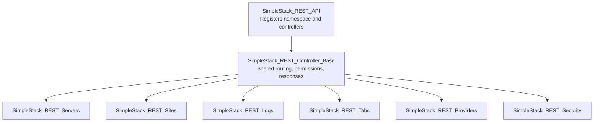
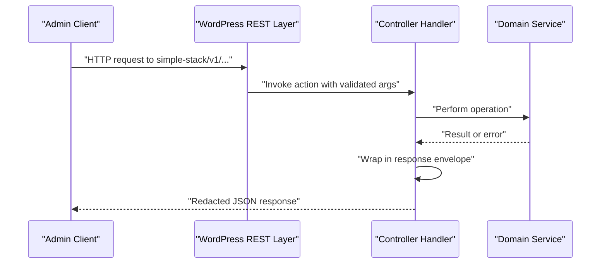
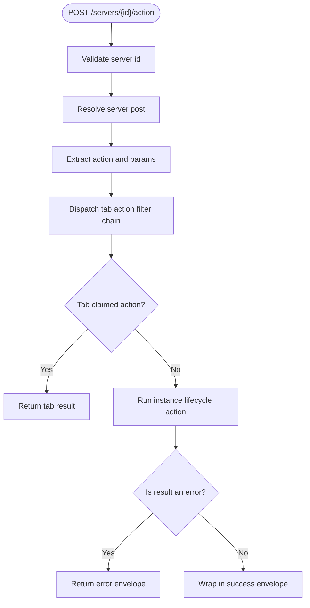
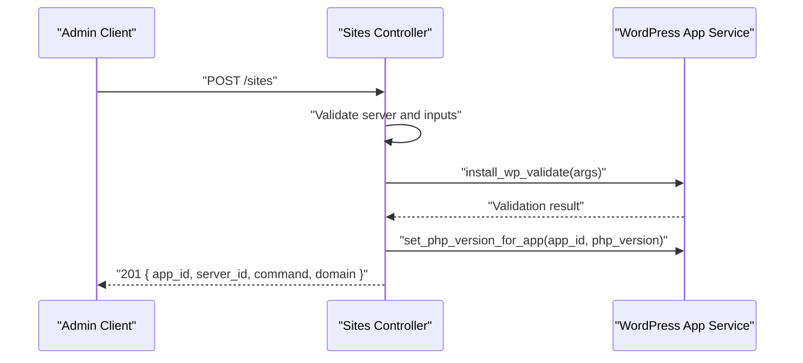
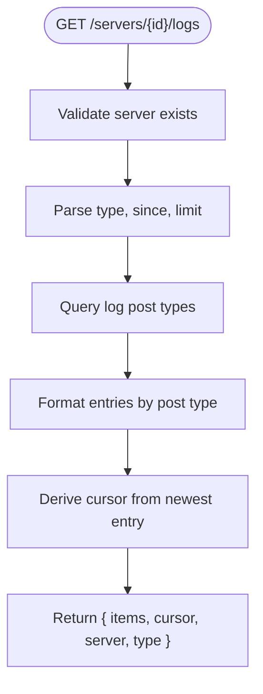
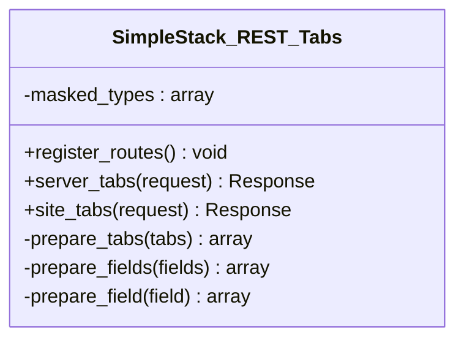
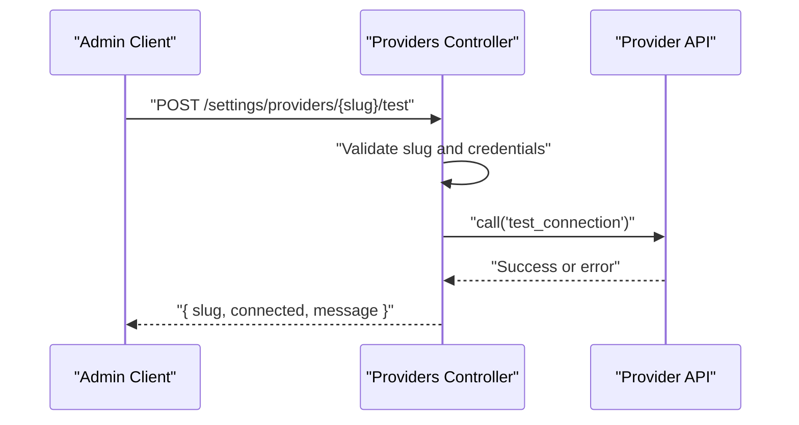
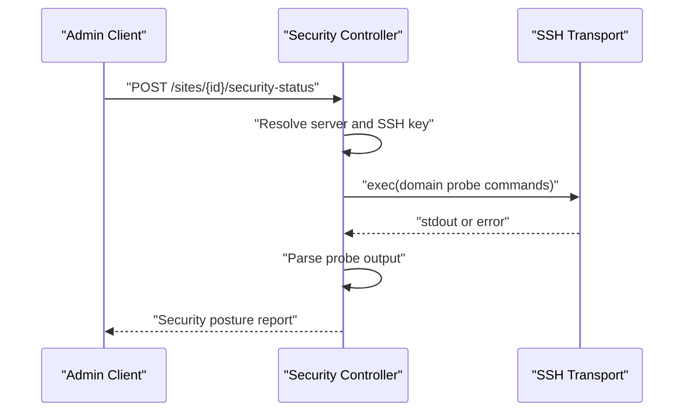
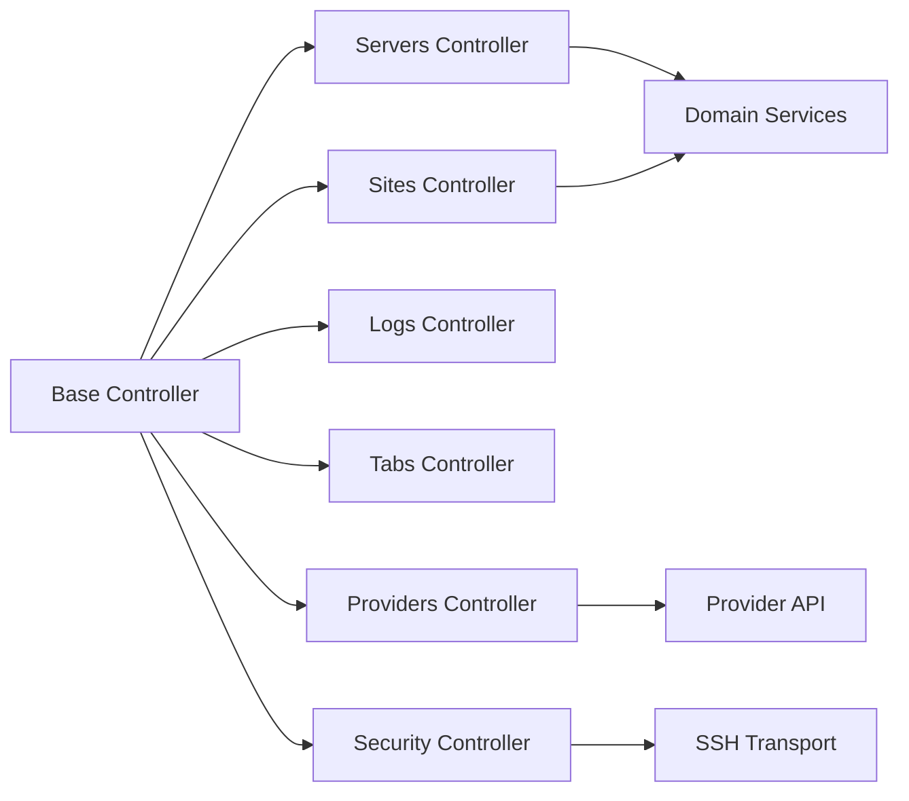

# System API

<cite>
**Referenced Files in This Document**   
- [class-simplestack-rest-api.php](file://includes/core/api/class-simplestack-rest-api.php)
- [class-simplestack-rest-controller-base.php](file://includes/core/api/class-simplestack-rest-controller-base.php)
- [class-simplestack-rest-servers.php](file://includes/core/api/class-simplestack-rest-servers.php)
- [class-simplestack-rest-sites.php](file://includes/core/api/class-simplestack-rest-sites.php)
- [class-simplestack-rest-logs.php](file://includes/core/api/class-simplestack-rest-logs.php)
- [class-simplestack-rest-tabs.php](file://includes/core/api/class-simplestack-rest-tabs.php)
- [class-simplestack-rest-providers.php](file://includes/core/api/class-simplestack-rest-providers.php)
- [class-simplestack-rest-security.php](file://includes/core/api/class-simplestack-rest-security.php)
</cite>

## Table of Contents
1. [Introduction](#introduction)
2. [Project Structure](#project-structure)
3. [Core Components](#core-components)
4. [Architecture Overview](#architecture-overview)
5. [Detailed Component Analysis](#detailed-component-analysis)
6. [Dependency Analysis](#dependency-analysis)
7. [Performance Considerations](#performance-considerations)
8. [Troubleshooting Guide](#troubleshooting-guide)
9. [Conclusion](#conclusion)
10. [Appendices](#appendices)

## Introduction
This document describes the system administration API surface under the `simple-stack/v1` namespace. It is the internal control plane used by the SimpleStack React admin client and is separate from legacy WordPress REST routes. Every route requires administrative privileges, returns a consistent envelope, and redacts secrets before leaving the server process.

The documented endpoints cover:
- Server lifecycle and actions
- Site deployment and actions
- Log retrieval and activity feed
- Tab schema for UI components
- Cloud provider configuration and connection testing
- Read-only security posture probing

It also explains request/response envelopes, parameter validation, paging behavior, error shapes, and operational considerations such as resource limits, caching, and production maintenance.

## Project Structure
The SimpleStack REST layer is composed of:
- A registrar that loads controllers and registers the `simple-stack/v1` namespace
- A base controller providing shared routing, permissions, response shaping, argument helpers, and tab dispatch
- Feature-specific controllers for servers, sites, logs, tabs, providers, and security

**Diagram sources**
- [class-simplestack-rest-api.php:21-118](file://includes/core/api/class-simplestack-rest-api.php#L21-L118)
- [class-simplestack-rest-controller-base.php:22-84](file://includes/core/api/class-simplestack-rest-controller-base.php#L22-L84)

**Section sources**
- [class-simplestack-rest-api.php:15-118](file://includes/core/api/class-simplestack-rest-api.php#L15-L118)
- [class-simplestack-rest-controller-base.php:22-84](file://includes/core/api/class-simplestack-rest-controller-base.php#L22-L84)

## Core Components
- **Namespace**: All routes are registered under `simple-stack/v1`.
- **Authorization**: Every route uses an admin-only permission callback requiring the `manage_options` capability.
- **Response envelope**: Successful responses use `{ ok: true, data, meta }`, where `data` is passed through a secret redactor and `meta` includes the request timestamp and namespace.
- **Error envelope**: Errors return a `WP_Error` with a machine-readable code, human-readable message, and HTTP status.
- **Parameter validation**: Arguments are defined with sanitization and validation callbacks; text payloads preserve content while rejecting non-string types.
- **Paging**: List endpoints accept `page` and `per_page`; default page size is 25, maximum is 200.
- **Tab dispatch**: Action endpoints map JSON or multipart form bodies into legacy tab handlers safely.

**Section sources**
- [class-simplestack-rest-controller-base.php:24-60](file://includes/core/api/class-simplestack-rest-controller-base.php#L24-L60)
- [class-simplestack-rest-controller-base.php:125-162](file://includes/core/api/class-simplestack-rest-controller-base.php#L125-L162)
- [class-simplestack-rest-controller-base.php:164-341](file://includes/core/api/class-simplestack-rest-controller-base.php#L164-L341)
- [class-simplestack-rest-controller-base.php:408-445](file://includes/core/api/class-simplestack-rest-controller-base.php#L408-L445)

## Architecture Overview
The API follows a layered design:
1. The registrar instantiates controllers and registers their routes during `rest_api_init`.
2. Each controller extends the base controller and declares its own routes.
3. Requests are validated against declared arguments.
4. Handlers perform domain work through shared services and return structured data.
5. Responses are wrapped and redacted.

**Diagram sources**
- [class-simplestack-rest-api.php:51-99](file://includes/core/api/class-simplestack-rest-api.php#L51-L99)
- [class-simplestack-rest-controller-base.php:72-84](file://includes/core/api/class-simplestack-rest-controller-base.php#L72-L84)
- [class-simplestack-rest-controller-base.php:136-149](file://includes/core/api/class-simplestack-rest-controller-base.php#L136-L149)

## Detailed Component Analysis

### Servers API
Endpoints:
- `GET /servers` — List servers with filtering and paging
- `POST /servers` — Provision a new server
- `GET /servers/{id}` — Get server details
- `DELETE /servers/{id}` — Delete server record and trigger provider deletion
- `POST /servers/{id}/action` — Run a server action via the tab/action bridge

Key behaviors:
- Listing supports filters by provider, region, recorded state, and free-text search.
- Creation validates provider availability, optional owner email, OS defaults, and queues a pending task.
- Detail includes summarized fields, collected server metadata, PHP version, and command availability.
- Deletion triggers the app’s delete action chain and verifies the server record is trashed.
- Actions first try tab handlers; if none claim the action, lifecycle verbs fall back to instance actions.

Request parameters:
- List: `provider`, `region`, `status`, `search`, plus standard paging.
- Create: `name`, `provider`, `region`, `size`, `os`, `webserver_type`, `author_email`.
- Action: `action`, `params`, `additional`.

Response shape:
- List: `{ items, total, page, per_page }`
- Create: `{ server_id, task_id, server }` with HTTP 201
- Detail: summarized server object plus `meta`, `php_version`, `available`
- Delete: `{ server_id, deleted }`
- Action: `{ server_id, action, result }`

**Diagram sources**
- [class-simplestack-rest-servers.php:312-363](file://includes/core/api/class-simplestack-rest-servers.php#L312-L363)
- [class-simplestack-rest-controller-base.php:343-406](file://includes/core/api/class-simplestack-rest-controller-base.php#L343-L406)

**Section sources**
- [class-simplestack-rest-servers.php:22-88](file://includes/core/api/class-simplestack-rest-servers.php#L22-L88)
- [class-simplestack-rest-servers.php:90-161](file://includes/core/api/class-simplestack-rest-servers.php#L90-L161)
- [class-simplestack-rest-servers.php:163-250](file://includes/core/api/class-simplestack-rest-servers.php#L163-L250)
- [class-simplestack-rest-servers.php:252-310](file://includes/core/api/class-simplestack-rest-servers.php#L252-L310)
- [class-simplestack-rest-servers.php:312-456](file://includes/core/api/class-simplestack-rest-servers.php#L312-L456)

### Sites API
Endpoints:
- `GET /sites` — List sites with paging and optional server filter
- `POST /sites` — Deploy a new WordPress site on a server
- `GET /sites/{id}` — Get site details
- `DELETE /sites/{id}` — Trash a site after permission checks
- `POST /sites/{id}/action` — Run a site action via the tab/action bridge

Key behaviors:
- Listing filters by parent server and title search.
- Deployment validates the server, runs the existing installer validator, optionally binds a PHP version, and returns installation context.
- Detail includes summarized site data, collected app metadata, and current action status.
- Delegation to the app’s delete logic ensures correct ownership and capability checks.
- Actions reuse the same safe superglobal mapping as server actions.

Request parameters:
- List: `server_id`, `search`, plus standard paging.
- Deploy: `server_id`, `domain`, `admin_user`, `admin_email`, `admin_password`, `wp_version`, `locale`, `site_package`, `php_version`.
- Action: `action`, `params`.

Response shape:
- List: `{ items, total, page, per_page }`
- Deploy: `{ app_id, server_id, command, domain }` with HTTP 201
- Detail: summarized site object plus `meta`, `action_status`
- Delete: `{ app_id, deleted }`
- Action: `{ app_id, server_id, action, result }`

**Diagram sources**
- [class-simplestack-rest-sites.php:146-206](file://includes/core/api/class-simplestack-rest-sites.php#L146-L206)
- [class-simplestack-rest-sites.php:270-312](file://includes/core/api/class-simplestack-rest-sites.php#L270-L312)

**Section sources**
- [class-simplestack-rest-sites.php:21-86](file://includes/core/api/class-simplestack-rest-sites.php#L21-L86)
- [class-simplestack-rest-sites.php:88-144](file://includes/core/api/class-simplestack-rest-sites.php#L88-L144)
- [class-simplestack-rest-sites.php:146-206](file://includes/core/api/class-simplestack-rest-sites.php#L146-L206)
- [class-simplestack-rest-sites.php:208-268](file://includes/core/api/class-simplestack-rest-sites.php#L208-L268)
- [class-simplestack-rest-sites.php:270-390](file://includes/core/api/class-simplestack-rest-sites.php#L270-L390)

### Logs API
Endpoints:
- `GET /servers/{id}/logs` — Retrieve command, SSH, and error logs for a server
- `GET /activity` — Retrieve a merged recent activity feed

Key behaviors:
- Log type supports `all`, `command`, `ssh`, `error`.
- Entries can be filtered by ISO8601 `since` timestamp and limited by `limit`.
- Activity endpoint merges all log types and can be restricted to one server.
- Responses include a cursor derived from the newest entry for efficient polling.
- All payloads pass through the secret redactor because command output may contain credentials.

Request parameters:
- Server logs: `type`, `since`, `limit`
- Activity: `limit`, `server_id`

Response shape:
- Both endpoints return `{ items, cursor }` plus server/type context where applicable.
- Log entries include identifiers, type, parent reference, title, date, and type-specific fields such as command body, SSH command, or error details.

**Diagram sources**
- [class-simplestack-rest-logs.php:44-65](file://includes/core/api/class-simplestack-rest-logs.php#L44-L65)
- [class-simplestack-rest-logs.php:76-125](file://includes/core/api/class-simplestack-rest-logs.php#L76-L125)
- [class-simplestack-rest-logs.php:137-238](file://includes/core/api/class-simplestack-rest-logs.php#L137-L238)

**Section sources**
- [class-simplestack-rest-logs.php:19-65](file://includes/core/api/class-simplestack-rest-logs.php#L19-L65)
- [class-simplestack-rest-logs.php:67-125](file://includes/core/api/class-simplestack-rest-logs.php#L67-L125)
- [class-simplestack-rest-logs.php:127-238](file://includes/core/api/class-simplestack-rest-logs.php#L127-L238)

### Tabs API
Endpoints:
- `GET /servers/{id}/tabs` — Retrieve server tab schema
- `GET /sites/{id}/tabs` — Retrieve site tab schema

Key behaviors:
- Tab names and field definitions come from existing filters.
- Field definitions are normalized to JSON-safe scalars; closures and objects are dropped.
- Password-type fields have stored values masked so credentials are never sent to the browser.
- Responses include context, resource id, tab list, and sanitized field definitions.

Request parameters:
- Resource id path parameter only.

Response shape:
- Server tabs: `{ context: 'server', id, tabs, fields }`
- Site tabs: `{ context: 'site', id, server_id, tabs, fields }`

**Diagram sources**
- [class-simplestack-rest-tabs.php:27-54](file://includes/core/api/class-simplestack-rest-tabs.php#L27-L54)
- [class-simplestack-rest-tabs.php:65-125](file://includes/core/api/class-simplestack-rest-tabs.php#L65-L125)
- [class-simplestack-rest-tabs.php:134-221](file://includes/core/api/class-simplestack-rest-tabs.php#L134-L221)

**Section sources**
- [class-simplestack-rest-tabs.php:12-54](file://includes/core/api/class-simplestack-rest-tabs.php#L12-L54)
- [class-simplestack-rest-tabs.php:56-125](file://includes/core/api/class-simplestack-rest-tabs.php#L56-L125)
- [class-simplestack-rest-tabs.php:127-221](file://includes/core/api/class-simplestack-rest-tabs.php#L127-L221)

### Providers API
Endpoints:
- `GET /settings/providers` — List configured providers with redacted credential state and region/size counts
- `POST /settings/providers` — Save provider credentials with encryption
- `POST /settings/providers/{slug}/test` — Test provider connectivity

Key behaviors:
- Provider listing reports boolean flags for credential presence, feature support, and cached counts.
- Saving writes only the fields appropriate to the provider’s authentication model and encrypts sensitive values.
- Testing calls the provider API’s `test_connection` and returns a connected flag and message.
- Region and size counts are cached using a short-lived transient; failures are swallowed to keep the settings screen functional.

Request parameters:
- List: optional `refresh` flag to bypass cached counts.
- Save: `slug`, `api_key`, `user_name`, `user_password`, `ssh_key_id`, `ssh_key`, `notes`.
- Test: `slug`.

Response shape:
- List: `{ items, regions }`
- Save: provider description with redacted credential state
- Test: `{ slug, connected, message }`

**Diagram sources**
- [class-simplestack-rest-providers.php:58-85](file://includes/core/api/class-simplestack-rest-providers.php#L58-L85)
- [class-simplestack-rest-providers.php:185-217](file://includes/core/api/class-simplestack-rest-providers.php#L185-L217)

**Section sources**
- [class-simplestack-rest-providers.php:20-85](file://includes/core/api/class-simplestack-rest-providers.php#L20-L85)
- [class-simplestack-rest-providers.php:87-174](file://includes/core/api/class-simplestack-rest-providers.php#L87-L174)
- [class-simplestack-rest-providers.php:176-357](file://includes/core/api/class-simplestack-rest-providers.php#L176-L357)

### Security API
Endpoints:
- `POST /sites/{id}/security-status` — Probe a site’s security posture over SSH

Key behaviors:
- The endpoint performs read-only operations: plugin listing, configuration check, PHP version detection, and vhost inspection.
- It resolves SSH access using the site’s server and provider, then executes a merged command pipeline.
- Output is parsed into plugins, file-edit policy, and PHP version; errors are returned without mutating the remote system.

Request parameters:
- Resource id path parameter only.

Response shape:
- `{ app_id, server_id, domain, connected, plugins, file_edit_disallowed, php_version, message }`

**Diagram sources**
- [class-simplestack-rest-security.php:31-38](file://includes/core/api/class-simplestack-rest-security.php#L31-L38)
- [class-simplestack-rest-security.php:49-101](file://includes/core/api/class-simplestack-rest-security.php#L49-L101)
- [class-simplestack-rest-security.php:117-191](file://includes/core/api/class-simplestack-rest-security.php#L117-L191)
- [class-simplestack-rest-security.php:200-251](file://includes/core/api/class-simplestack-rest-security.php#L200-L251)

**Section sources**
- [class-simplestack-rest-security.php:19-38](file://includes/core/api/class-simplestack-rest-security.php#L19-L38)
- [class-simplestack-rest-security.php:40-101](file://includes/core/api/class-simplestack-rest-security.php#L40-L101)
- [class-simplestack-rest-security.php:103-251](file://includes/core/api/class-simplestack-rest-security.php#L103-L251)

## Dependency Analysis
The controllers depend on shared infrastructure and domain services:
- Base controller provides routing, permissions, response envelope, argument helpers, and tab dispatch.
- Servers and sites controllers delegate provisioning, installation, and lifecycle actions to domain services.
- Logs controller queries private log posts and formats them for the UI.
- Tabs controller normalizes dynamic tab schemas.
- Providers controller interacts with provider APIs and caches advisory counts.
- Security controller performs read-only SSH probes.

**Diagram sources**
- [class-simplestack-rest-controller-base.php:22-84](file://includes/core/api/class-simplestack-rest-controller-base.php#L22-L84)
- [class-simplestack-rest-servers.php:22-88](file://includes/core/api/class-simplestack-rest-servers.php#L22-L88)
- [class-simplestack-rest-sites.php:21-86](file://includes/core/api/class-simplestack-rest-sites.php#L21-L86)
- [class-simplestack-rest-security.php:19-38](file://includes/core/api/class-simplestack-rest-security.php#L19-L38)
- [class-simplestack-rest-providers.php:20-85](file://includes/core/api/class-simplestack-rest-providers.php#L20-L85)

**Section sources**
- [class-simplestack-rest-api.php:21-118](file://includes/core/api/class-simplestack-rest-api.php#L21-L118)
- [class-simplestack-rest-controller-base.php:22-84](file://includes/core/api/class-simplestack-rest-controller-base.php#L22-L84)

## Performance Considerations
- Paging limits: Maximum records per page is 200 across list endpoints; default is 25. Clients should paginate rather than requesting large batches.
- Log queries: Use the `since` cursor to avoid re-fetching old entries and reduce database load.
- Provider counts: Region and size counts are cached for 300 seconds; use the `refresh` flag sparingly to avoid repeated provider API calls.
- Secret redaction: All responses are redacted; this adds minimal overhead but prevents accidental credential exposure.
- SSH probes: Security status performs network I/O; clients should cache results and retry with backoff when the server is unavailable.

[No sources needed since this section provides general guidance]

## Troubleshooting Guide
Common issues and resolutions:
- Unauthorized requests: Ensure the calling user has the `manage_options` capability.
- Invalid provider: Verify the provider slug exists and is installed.
- Missing credentials: For provider tests, ensure required credentials are saved; empty fields mean “leave stored value unchanged.”
- Server not found: Confirm the resource id corresponds to the expected post type.
- Site not found: Confirm the site belongs to the active app type and the id is valid.
- SSH unavailable: The server may still be starting; retry after the provider instance becomes reachable.
- Log cursor empty: Indicates no matching entries; clients should treat it as a signal to stop polling until new events arrive.

**Section sources**
- [class-simplestack-rest-controller-base.php:54-60](file://includes/core/api/class-simplestack-rest-controller-base.php#L54-L60)
- [class-simplestack-rest-servers.php:172-250](file://includes/core/api/class-simplestack-rest-servers.php#L172-L250)
- [class-simplestack-rest-sites.php:158-206](file://includes/core/api/class-simplestack-rest-sites.php#L158-L206)
- [class-simplestack-rest-providers.php:122-174](file://includes/core/api/class-simplestack-rest-providers.php#L122-L174)
- [class-simplestack-rest-security.php:200-224](file://includes/core/api/class-simplestack-rest-security.php#L200-L224)

## Conclusion
The `simple-stack/v1` API provides a secure, consistent, and extensible control plane for managing servers, sites, logs, tabs, providers, and security posture. Its design emphasizes:
- Strong authorization and secret redaction
- Predictable request validation and response envelopes
- Safe integration with legacy tab and lifecycle systems
- Operational safeguards such as paging limits, caching, and read-only probes

For production environments, administrators should:
- Restrict API access to trusted clients with administrative credentials
- Monitor provider connectivity and SSH reachability
- Use cursors and pagination to minimize load
- Avoid frequent provider count refreshes
- Review logs and security status regularly for anomalies

[No sources needed since this section summarizes without analyzing specific files]

## Appendices

### Administrative Privileges
- All endpoints require the `manage_options` capability.
- Sensitive operations such as provider credential updates and server/site deletions should be further protected by organizational policies and audit logging.

**Section sources**
- [class-simplestack-rest-controller-base.php:54-60](file://includes/core/api/class-simplestack-rest-controller-base.php#L54-L60)

### Request/Response Envelope Reference
- Success: `{ ok: true, data, meta: { request_date, namespace } }`
- Error: `WP_Error` with code, message, and status
- Secrets: Automatically redacted in every response

**Section sources**
- [class-simplestack-rest-controller-base.php:125-162](file://includes/core/api/class-simplestack-rest-controller-base.php#L125-L162)

### Parameter Validation Reference
- Integer parameters: sanitized, bounded, and validated
- String parameters: sanitized and optionally enum-constrained
- Text parameters: preserved content with strict string validation
- Object parameters: validated arrays
- Params payload: accepts JSON object, JSON string, or query string

**Section sources**
- [class-simplestack-rest-controller-base.php:164-341](file://includes/core/api/class-simplestack-rest-controller-base.php#L164-L341)

### Tab Management Notes
- Tab schemas are dynamic and driven by filters.
- Password fields are masked in responses.
- Actions are dispatched safely through the legacy filter chain with superglobal restoration.

**Section sources**
- [class-simplestack-rest-tabs.php:12-54](file://includes/core/api/class-simplestack-rest-tabs.php#L12-L54)
- [class-simplestack-rest-tabs.php:182-221](file://includes/core/api/class-simplestack-rest-tabs.php#L182-L221)
- [class-simplestack-rest-controller-base.php:343-406](file://includes/core/api/class-simplestack-rest-controller-base.php#L343-L406)

### Logging and Diagnostics
- Use `/servers/{id}/logs` for targeted troubleshooting.
- Use `/activity` for a global view of recent operations.
- Use `/sites/{id}/security-status` for read-only diagnostics including plugin inventory and PHP version.

**Section sources**
- [class-simplestack-rest-logs.php:44-125](file://includes/core/api/class-simplestack-rest-logs.php#L44-L125)
- [class-simplestack-rest-security.php:49-101](file://includes/core/api/class-simplestack-rest-security.php#L49-L101)