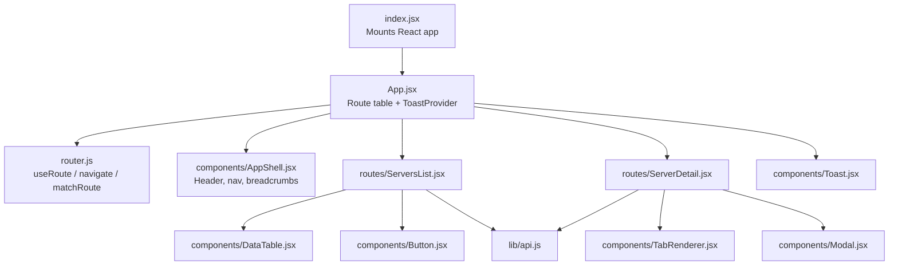
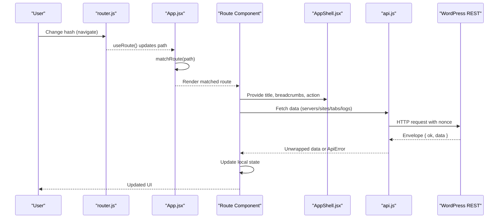
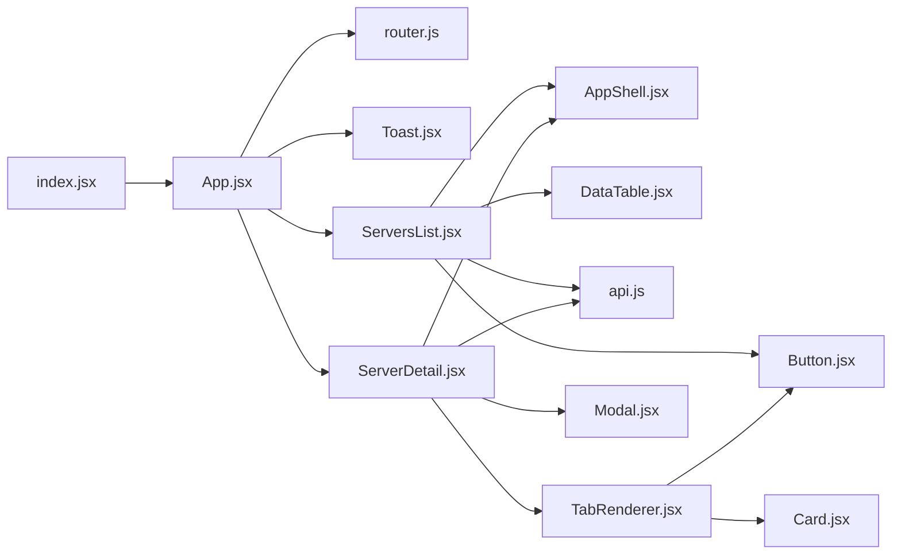

# Component Architecture

<cite>
**Referenced Files in This Document**
- [index.jsx](file://src/admin/index.jsx)
- [App.jsx](file://src/admin/App.jsx)
- [AppShell.jsx](file://src/admin/components/AppShell.jsx)
- [ServersList.jsx](file://src/admin/routes/ServersList.jsx)
- [ServerDetail.jsx](file://src/admin/routes/ServerDetail.jsx)
- [Button.jsx](file://src/admin/components/Button.jsx)
- [Card.jsx](file://src/admin/components/Card.jsx)
- [DataTable.jsx](file://src/admin/components/DataTable.jsx)
- [Modal.jsx](file://src/admin/components/Modal.jsx)
- [TabRenderer.jsx](file://src/admin/components/TabRenderer.jsx)
- [Toast.jsx](file://src/admin/components/Toast.jsx)
- [api.js](file://src/admin/lib/api.js)
- [router.js](file://src/admin/lib/router.js)
</cite>

## Table of Contents
1. [Introduction](#introduction)
2. [Project Structure](#project-structure)
3. [Core Components](#core-components)
4. [Architecture Overview](#architecture-overview)
5. [Detailed Component Analysis](#detailed-component-analysis)
6. [Dependency Analysis](#dependency-analysis)
7. [Performance Considerations](#performance-considerations)
8. [Troubleshooting Guide](#troubleshooting-guide)
9. [Conclusion](#conclusion)

## Introduction
This document explains SimpleStack’s React component architecture inside the WordPress admin area. It covers the entry point, root application component, shell wrapper, routing strategy, state management approach, and how components compose together to render servers, sites, providers, and activity screens. It also documents the REST API integration with the WordPress backend, error handling patterns, testing strategies, and debugging techniques.

## Project Structure
The React code lives under `src/admin`. The main entry mounts the app into a container provided by PHP, seeds the initial hash route, and renders the root `App` component. Routes are resolved from the URL hash because wp-admin owns the real URL bar.

**Diagram sources**
- [index.jsx:15-46](file://src/admin/index.jsx#L15-L46)
- [App.jsx:12-69](file://src/admin/App.jsx#L12-L69)
- [router.js:16-83](file://src/admin/lib/router.js#L16-L83)
- [AppShell.jsx:10-87](file://src/admin/components/AppShell.jsx#L10-L87)
- [ServersList.jsx:10-217](file://src/admin/routes/ServersList.jsx#L10-L217)
- [ServerDetail.jsx:12-209](file://src/admin/routes/ServerDetail.jsx#L12-L209)
- [DataTable.jsx:23-152](file://src/admin/components/DataTable.jsx#L23-L152)
- [Button.jsx:27-59](file://src/admin/components/Button.jsx#L27-L59)
- [Modal.jsx:20-130](file://src/admin/components/Modal.jsx#L20-L130)
- [TabRenderer.jsx:46-210](file://src/admin/components/TabRenderer.jsx#L46-L210)
- [Toast.jsx:25-82](file://src/admin/components/Toast.jsx#L25-L82)
- [api.js:153-291](file://src/admin/lib/api.js#L153-L291)

**Section sources**
- [index.jsx:1-47](file://src/admin/index.jsx#L1-L47)
- [App.jsx:1-70](file://src/admin/App.jsx#L1-L70)
- [router.js:1-84](file://src/admin/lib/router.js#L1-L84)

## Core Components
- Entry and bootstrap: `index.jsx` finds the `simplestack-admin` container, seeds the initial hash route from PHP-provided data, and mounts React in strict mode.
- Root application: `App.jsx` defines the route table, resolves the current path via `useRoute`, wraps content with `ToastProvider`, and renders matched routes.
- Application chrome: `AppShell.jsx` provides header, primary navigation, breadcrumbs, and page content area. It is intentionally thin so wp-admin retains control over global chrome.
- Route views: `ServersList.jsx` and `ServerDetail.jsx` are example feature screens that consume shared UI primitives and the REST client.
- Shared UI primitives: `Button.jsx`, `Card.jsx`, `DataTable.jsx`, `Modal.jsx`, `TabRenderer.jsx`, and `Toast.jsx` provide reusable building blocks.
- Utilities: `api.js` encapsulates REST calls and error wrapping; `router.js` implements a minimal hash-based router.

Key responsibilities:
- Routing: Hash-based, deep-linkable, survives reloads.
- State: Local component state for lists, forms, loading, errors, and UI toggles.
- Data fetching: Centralized through `api.js` with consistent error wrapping.
- Composition: Feature routes compose shell, tables, modals, and tab renderers rather than duplicating layout logic.

**Section sources**
- [index.jsx:15-46](file://src/admin/index.jsx#L15-L46)
- [App.jsx:25-69](file://src/admin/App.jsx#L25-L69)
- [AppShell.jsx:17-87](file://src/admin/components/AppShell.jsx#L17-L87)
- [ServersList.jsx:23-217](file://src/admin/routes/ServersList.jsx#L23-L217)
- [ServerDetail.jsx:28-209](file://src/admin/routes/ServerDetail.jsx#L28-L209)
- [Button.jsx:27-59](file://src/admin/components/Button.jsx#L27-L59)
- [Card.jsx:21-120](file://src/admin/components/Card.jsx#L21-L120)
- [DataTable.jsx:23-152](file://src/admin/components/DataTable.jsx#L23-L152)
- [Modal.jsx:20-130](file://src/admin/components/Modal.jsx#L20-L130)
- [TabRenderer.jsx:46-210](file://src/admin/components/TabRenderer.jsx#L46-L210)
- [Toast.jsx:25-82](file://src/admin/components/Toast.jsx#L25-L82)
- [api.js:9-120](file://src/admin/lib/api.js#L9-L120)
- [router.js:16-83](file://src/admin/lib/router.js#L16-L83)

## Architecture Overview
SimpleStack uses a small, explicit routing layer on top of React. The root `App` component maps URL hashes to route components. Each route composes `AppShell` for chrome and uses shared primitives for layout and interaction. Data flows from routes to `api.js`, which normalizes responses and throws typed errors.

**Diagram sources**
- [router.js:29-49](file://src/admin/lib/router.js#L29-L49)
- [App.jsx:44-69](file://src/admin/App.jsx#L44-L69)
- [AppShell.jsx:27-87](file://src/admin/components/AppShell.jsx#L27-L87)
- [api.js:67-120](file://src/admin/lib/api.js#L67-L120)

## Detailed Component Analysis

### Entry Point: index.jsx
Responsibilities:
- Locate the mount container.
- Seed the initial hash route from PHP-provided configuration when no hash exists.
- Mount React with `StrictMode` and pass bootstrap config to `App`.

Design notes:
- If the container is absent, nothing is mounted, protecting wp-admin from accidental DOM mutations.
- The seed function ensures every submenu lands on its intended route while preserving deep links.

**Section sources**
- [index.jsx:15-46](file://src/admin/index.jsx#L15-L46)

### Root Application: App.jsx
Responsibilities:
- Define the route table mapping patterns to components.
- Resolve the current path using `useRoute`.
- Wrap the app with `ToastProvider` for global notifications.
- Fallback to the server list for unknown routes.

Design notes:
- Route matching supports parameters like `:id`.
- The version attribute is attached to the root element for diagnostics.

**Section sources**
- [App.jsx:25-69](file://src/admin/App.jsx#L25-L69)
- [router.js:59-83](file://src/admin/lib/router.js#L59-L83)

### Shell Wrapper: AppShell.jsx
Responsibilities:
- Render header, section navigation, breadcrumbs, and page content.
- Highlight active section based on current path.
- Provide accessible navigation attributes.

Design notes:
- Intentionally thin; wp-admin still controls global chrome.
- Navigation triggers hash changes via `navigate`.

**Section sources**
- [AppShell.jsx:10-87](file://src/admin/components/AppShell.jsx#L10-L87)
- [router.js:29-32](file://src/admin/lib/router.js#L29-L32)

### Route: ServersList.jsx
Responsibilities:
- Display paginated, filterable server list.
- Load providers for filtering.
- Compose `AppShell`, search/filter controls, and `DataTable`.
- Navigate to detail view on row click.

State management:
- Local state holds items, total, page, search, filters, providers, loading, and error.
- A cancellable load pattern avoids stale updates.

Data flow:
- Uses `api.servers.list` and `api.providers.list`.
- Errors surface via `ErrorPanel` with retry.

**Section sources**
- [ServersList.jsx:23-217](file://src/admin/routes/ServersList.jsx#L23-L217)
- [api.js:153-191](file://src/admin/lib/api.js#L153-L191)
- [api.js:269-291](file://src/admin/lib/api.js#L269-L291)

### Route: ServerDetail.jsx
Responsibilities:
- Load server details and tab schema concurrently.
- Render overview, site count, live log drawer, and dynamic tabs.
- Run actions through `api.servers.runAction` and refresh when requested.
- Confirm destructive operations with `ConfirmDialog`.

Lifecycle:
- Initial load on mount.
- Conditional skeletons and error panels before data arrives.

Composition:
- Uses `AppShell`, `TabRenderer`, `LogDrawer`, `Modal`, `Badge`, `Card`, and toast notifications.

**Section sources**
- [ServerDetail.jsx:28-209](file://src/admin/routes/ServerDetail.jsx#L28-L209)
- [api.js:153-191](file://src/admin/lib/api.js#L153-L191)
- [Modal.jsx:102-130](file://src/admin/components/Modal.jsx#L102-L130)

### Shared UI Primitives

#### Button.jsx
- Variants and sizes.
- Busy state disables the button and shows a spinner.
- Scoped Tailwind classes avoid leaking styles into wp-admin.

**Section sources**
- [Button.jsx:27-59](file://src/admin/components/Button.jsx#L27-L59)

#### Card.jsx
- Card with optional title, subtitle, borderless mode, and action slot.
- Badge for status tones.
- Skeleton placeholders for loading states.
- EmptyState for empty datasets.
- ErrorPanel for inline failure display with optional retry.

**Section sources**
- [Card.jsx:21-120](file://src/admin/components/Card.jsx#L21-L120)

#### DataTable.jsx
- Generic sortable table driven by column descriptors.
- Keyboard-accessible row activation.
- Loading skeleton and empty state composition.

**Section sources**
- [DataTable.jsx:23-152](file://src/admin/components/DataTable.jsx#L23-L152)

#### Modal.jsx
- Accessible modal with focus management and Escape key support.
- `ConfirmDialog` variant for destructive actions.

**Section sources**
- [Modal.jsx:20-130](file://src/admin/components/Modal.jsx#L20-L130)

#### TabRenderer.jsx
- Renders any tab schema returned by the backend.
- Manages field values, file uploads, pending actions, and expanded help cards.
- Supports multiple field kinds: label, html, readonly, toggle, select, textarea, password, file, number/temporal/email/url, and action.
- Integrates with `onShowLog` to open live logs for streaming actions.

**Section sources**
- [TabRenderer.jsx:46-210](file://src/admin/components/TabRenderer.jsx#L46-L210)
- [TabRenderer.jsx:219-402](file://src/admin/components/TabRenderer.jsx#L219-L402)

#### Toast.jsx
- Context provider and hook for global notifications.
- Auto-dismiss with configurable TTL.
- Tone variants for success, error, and info.

**Section sources**
- [Toast.jsx:25-82](file://src/admin/components/Toast.jsx#L25-L82)

### Routing Utilities: router.js
Responsibilities:
- Read current path from hash.
- Navigate by updating hash.
- Subscribe to hash changes via `useRoute`.
- Match patterns with parameter capture.

Design notes:
- Minimal implementation avoids conflicts with wp-admin history.
- Deep links survive reloads.

**Section sources**
- [router.js:16-83](file://src/admin/lib/router.js#L16-L83)

### REST Integration: api.js
Responsibilities:
- Build absolute URLs relative to the SimpleStack namespace.
- Attach nonce header when available.
- Normalize JSON bodies and FormData uploads.
- Throw typed `ApiError` with code and status.
- Unwrap envelope `{ ok, data }` so components receive domain data.

Client modules:
- `servers`: list, get, create, remove, runAction.
- `sites`: list, get, deploy, remove, runAction, securityStatus.
- `tabs`: forServer, forSite.
- `logs`: forServer, activity.
- `providers`: list, save, test.

Error handling:
- Network failures map to a network error code.
- HTTP failures map to an HTTP error code with message.

**Section sources**
- [api.js:9-120](file://src/admin/lib/api.js#L9-L120)
- [api.js:153-291](file://src/admin/lib/api.js#L153-L291)

## Dependency Analysis
The following diagram highlights import relationships among core files.

**Diagram sources**
- [index.jsx:12-13](file://src/admin/index.jsx#L12-L13)
- [App.jsx:12-23](file://src/admin/App.jsx#L12-L23)
- [ServersList.jsx:10-16](file://src/admin/routes/ServersList.jsx#L10-L16)
- [ServerDetail.jsx:12-21](file://src/admin/routes/ServerDetail.jsx#L12-L21)
- [TabRenderer.jsx:15-24](file://src/admin/components/TabRenderer.jsx#L15-L24)

**Section sources**
- [index.jsx:12-13](file://src/admin/index.jsx#L12-L13)
- [App.jsx:12-23](file://src/admin/App.jsx#L12-L23)
- [ServersList.jsx:10-16](file://src/admin/routes/ServersList.jsx#L10-L16)
- [ServerDetail.jsx:12-21](file://src/admin/routes/ServerDetail.jsx#L12-L21)
- [TabRenderer.jsx:15-24](file://src/admin/components/TabRenderer.jsx#L15-L24)

## Performance Considerations
- Prefer memoization for derived data: `useMemo` is used in `DataTable` for sorting and in `TabRenderer` for tab and field indexing.
- Avoid unnecessary re-renders by keeping state local to the smallest scope needed.
- Use pagination and server-side filtering to limit payload size.
- Debounce heavy computations if added later (for example, large table sorts).
- Keep API requests idempotent where possible and cancel stale requests to prevent race conditions.

[No sources needed since this section provides general guidance]

## Troubleshooting Guide
Common issues and remedies:
- Blank screen after reload: Ensure the hash is seeded correctly and the container exists. Check `window.simplestackAdmin` for missing bootstrap data.
- API errors: Inspect `ApiError.code` and `status`. Network errors indicate reachability issues; HTTP errors include messages from the backend.
- Stale data: Verify that `load` functions are called after relevant state changes and that cancellation flags prevent late updates.
- Tabs not rendering: Confirm the backend returns valid `tabs` and `fields`; check `TabRenderer` disabled reason and pending state.
- Modals not closing: Ensure `onClose` handlers are wired and that Escape key listener is active.

Debugging tips:
- Add console logs around `request` in `api.js` to inspect payloads and responses.
- Use browser DevTools to monitor hash changes and network requests.
- Validate Tailwind scoping by checking that styles apply only within `#simplestack-admin`.

**Section sources**
- [index.jsx:17-34](file://src/admin/index.jsx#L17-L34)
- [api.js:67-120](file://src/admin/lib/api.js#L67-L120)
- [TabRenderer.jsx:108-144](file://src/admin/components/TabRenderer.jsx#L108-L144)
- [Modal.jsx:23-47](file://src/admin/components/Modal.jsx#L23-L47)

## Conclusion
SimpleStack’s React architecture emphasizes simplicity and composability. A minimal hash router drives clear route components that share a thin shell and robust UI primitives. State is kept local, data access is centralized through a typed REST client, and error handling is consistent. The design makes it straightforward to add new routes, extend tab schemas, and integrate additional backend endpoints while maintaining predictable behavior and performance.

[No sources needed since this section summarizes without analyzing specific files]