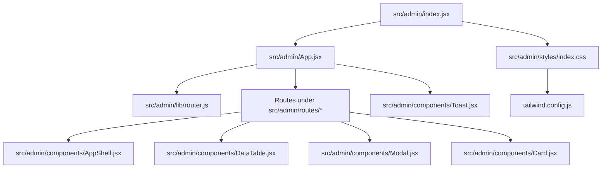
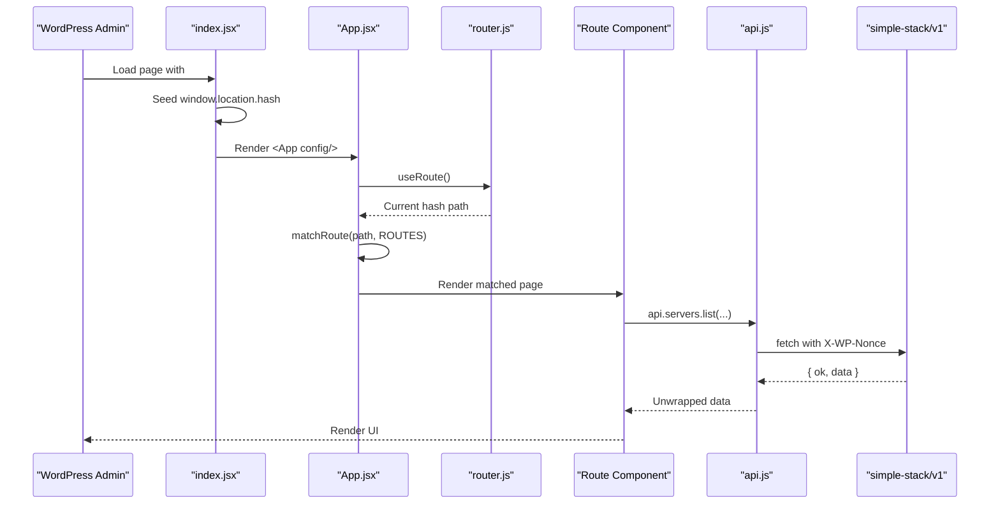
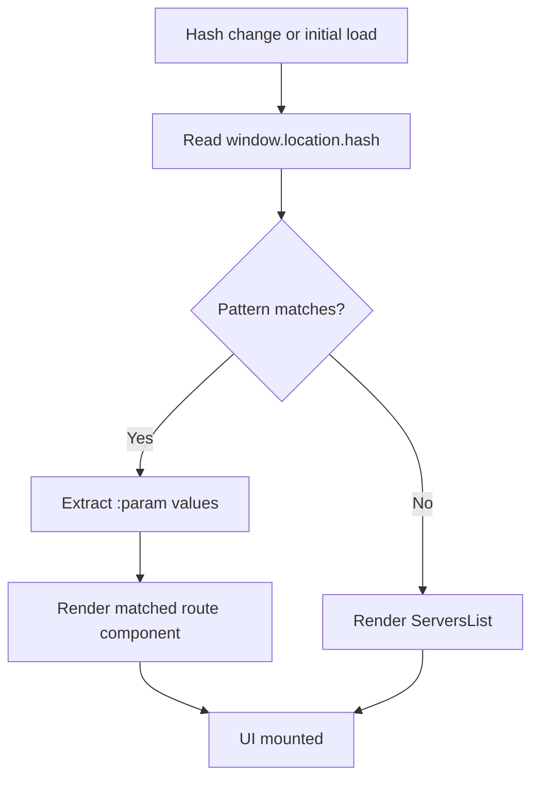
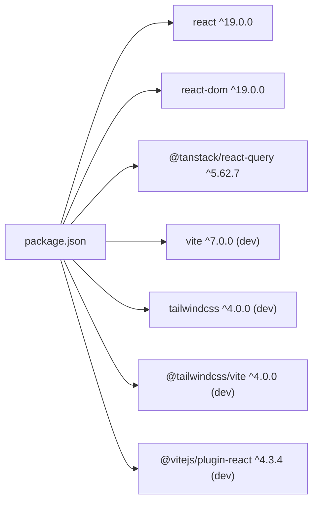

# React Admin Interface

<cite>
**Referenced Files in This Document**
- [index.jsx](file://src/admin/index.jsx)
- [App.jsx](file://src/admin/App.jsx)
- [router.js](file://src/admin/lib/router.js)
- [api.js](file://src/admin/lib/api.js)
- [AppShell.jsx](file://src/admin/components/AppShell.jsx)
- [DataTable.jsx](file://src/admin/components/DataTable.jsx)
- [Modal.jsx](file://src/admin/components/Modal.jsx)
- [Toast.jsx](file://src/admin/components/Toast.jsx)
- [Card.jsx](file://src/admin/components/Card.jsx)
- [index.css](file://src/admin/styles/index.css)
- [tailwind.config.js](file://tailwind.config.js)
- [vite.config.js](file://vite.config.js)
- [package.json](file://package.json)
- [SIMPLESTACK.md](file://docs/SIMPLESTACK.md)
</cite>

## Table of Contents
1. [Introduction](#introduction)
2. [Project Structure](#project-structure)
3. [Core Components](#core-components)
4. [Architecture Overview](#architecture-overview)
5. [Detailed Component Analysis](#detailed-component-analysis)
6. [Dependency Analysis](#dependency-analysis)
7. [Performance Considerations](#performance-considerations)
8. [Troubleshooting Guide](#troubleshooting-guide)
9. [Conclusion](#conclusion)
10. [Appendices](#appendices)

## Introduction
This document describes SimpleStack’s React-based administrative interface built with React 19 and Tailwind CSS v4. The client is a lightweight, hash-driven admin shell that renders inside the existing WordPress admin chrome. It manages routing through the URL hash, communicates with a `simple-stack/v1` REST API, and provides reusable UI primitives for tables, modals, toasts, cards, and application shells.

The project uses Vite for development and production builds. The compiled assets are written into `assets/dist/`, which allows the plugin to run without requiring Node on the server. Tailwind CSS v4 is configured so all generated utilities are scoped under `#simplestack-admin`, preventing style leakage into the rest of wp-admin.

## Project Structure
The React source lives under `src/admin/`. The entry point mounts the app into a container provided by PHP, initializes the hash route, and renders the root component. Routes are declared centrally in the root application component and resolved against a small custom router.

**Diagram sources**
- [index.jsx:15-46](file://src/admin/index.jsx#L15-L46)
- [App.jsx:12-68](file://src/admin/App.jsx#L12-L68)
- [router.js:16-83](file://src/admin/lib/router.js#L16-L83)
- [index.css:1-14](file://src/admin/styles/index.css#L1-L14)
- [tailwind.config.js:1-20](file://tailwind.config.js#L1-L20)

**Section sources**
- [index.jsx:1-47](file://src/admin/index.jsx#L1-L47)
- [App.jsx:1-70](file://src/admin/App.jsx#L1-L70)
- [SIMPLESTACK.md:117-150](file://docs/SIMPLESTACK.md#L117-L150)

## Core Components
The interface is composed around a small set of focused components:

- **Application entry**: Mounts the app, seeds the initial hash route from PHP-provided data, and wraps the tree in React Strict Mode.
- **Root application**: Holds the route table, resolves the current hash path, and renders the matched page inside a toast provider.
- **AppShell**: Provides the header, primary navigation, breadcrumbs, and main content area.
- **DataTable**: A sortable, keyboard-accessible table driven by column descriptors.
- **Modal and ConfirmDialog**: Accessible dialog containers with focus management and Escape-to-close behavior.
- **Toast and useToast**: Global notification context for success, error, and informational messages.
- **Card, Badge, Skeleton, EmptyState, ErrorPanel**: Presentational building blocks used across routes and tables.

These components are intentionally thin and rely on Tailwind utility classes rather than custom CSS.

**Section sources**
- [index.jsx:15-46](file://src/admin/index.jsx#L15-L46)
- [App.jsx:25-68](file://src/admin/App.jsx#L25-L68)
- [AppShell.jsx:10-87](file://src/admin/components/AppShell.jsx#L10-L87)
- [DataTable.jsx:23-152](file://src/admin/components/DataTable.jsx#L23-L152)
- [Modal.jsx:20-130](file://src/admin/components/Modal.jsx#L20-L130)
- [Toast.jsx:25-82](file://src/admin/components/Toast.jsx#L25-L82)
- [Card.jsx:21-120](file://src/admin/components/Card.jsx#L21-L120)

## Architecture Overview
The admin interface follows a simple layered architecture:

1. **Mounting layer**: `index.jsx` finds the `#simplestack-admin` container, seeds the hash route, and creates the React root.
2. **Routing layer**: `router.js` reads and writes `window.location.hash`. `App.jsx` maintains a static route table and matches paths using parameterized patterns.
3. **Presentation layer**: Route components render pages using `AppShell`, `DataTable`, `Modal`, `Card`, and other shared components.
4. **Data layer**: `api.js` wraps `fetch`, attaches the WordPress nonce, unwraps the PHP response envelope, and exposes typed methods for servers, sites, tabs, logs, and providers.

**Diagram sources**
- [index.jsx:25-46](file://src/admin/index.jsx#L25-L46)
- [App.jsx:44-68](file://src/admin/App.jsx#L44-L68)
- [router.js:16-83](file://src/admin/lib/router.js#L16-L83)
- [api.js:67-119](file://src/admin/lib/api.js#L67-L119)

**Section sources**
- [SIMPLESTACK.md:15-32](file://docs/SIMPLESTACK.md#L15-L32)
- [SIMPLESTACK.md:117-150](file://docs/SIMPLESTACK.md#L117-L150)

## Detailed Component Analysis

### Application Shell and Routing
The root application defines a fixed route table mapping URL patterns to React elements. Parameterized segments such as `:id` are captured and passed as props. Unknown routes fall back to the servers list so stale bookmarks remain useful.

Key behaviors:
- Hash-based routing avoids conflicts with WordPress’s URL bar and history.
- Deep links survive reloads because the PHP bootstrap can seed the initial hash.
- Navigation is performed by updating the hash, not by pushing state.

**Diagram sources**
- [App.jsx:25-54](file://src/admin/App.jsx#L25-L54)
- [router.js:59-83](file://src/admin/lib/router.js#L59-L83)

**Section sources**
- [App.jsx:1-70](file://src/admin/App.jsx#L1-L70)
- [router.js:1-84](file://src/admin/lib/router.js#L1-L84)

### AppShell Wrapper
`AppShell` is the visual wrapper for pages. It renders:
- A branded header with title and optional subtitle.
- Primary navigation buttons for Servers, Sites, Providers, and Activity.
- Optional breadcrumbs with clickable items.
- A `<main>` region for page content.

Props:
- `path`: Current hash path.
- `title`: Page heading.
- `subtitle`: Optional supporting text.
- `breadcrumbs`: Array of `{ label, path }`.
- `action`: Optional page-level action element.
- `children`: Page content.

Accessibility highlights:
- Navigation uses `aria-label`.
- Active navigation sets `aria-current="page"`.
- Breadcrumbs use an accessible breadcrumb landmark.

**Section sources**
- [AppShell.jsx:10-87](file://src/admin/components/AppShell.jsx#L10-L87)

### DataTable
`DataTable` is a generic, sortable table component. Columns are declared as descriptors containing a key, header, optional renderer, optional sort value, and alignment. Rows are plain objects; a stable `rowKey` function is required.

Props:
- `columns`: Column descriptors.
- `rows`: Row data array.
- `rowKey`: Function returning a unique key per row.
- `onRowClick`: Optional row activation callback.
- `loading`: Boolean to show skeleton placeholders.
- `emptyTitle`: Headline when no rows exist.
- `emptyMessage`: Supporting message for empty state.

Behavior:
- Sorting toggles between ascending and descending.
- Clickable rows support keyboard activation via Enter and Space.
- Loading state shows skeletons from `Card.Skeleton`.
- Empty state uses `Card.EmptyState`.

Complexity:
- Sorting creates a new sorted array each time inputs change.
- Rendering is linear in the number of rows and columns.

**Section sources**
- [DataTable.jsx:1-153](file://src/admin/components/DataTable.jsx#L1-L153)
- [Card.jsx:61-73](file://src/admin/components/Card.jsx#L61-L73)

### Modal and ConfirmDialog
`Modal` is a dialog container rendered inside the app container so Tailwind scoping remains effective. It handles:
- Focus management when opened.
- Escape key to close.
- Click-outside-to-close behavior.
- Accessible roles and labels.

Props:
- `open`: Visibility flag.
- `title`: Dialog heading.
- `onClose`: Close handler.
- `footer`: Optional footer content.
- `children`: Dialog body.

`ConfirmDialog` composes `Modal` for destructive actions:
- `open`, `title`, `message`, `confirmLabel`, `onConfirm`, `onCancel`, `busy`.

Accessibility highlights:
- `role="dialog"` and `aria-modal="true"`.
- `aria-label` bound to the dialog title.
- Focus moves into the dialog when opened.

**Section sources**
- [Modal.jsx:1-131](file://src/admin/components/Modal.jsx#L1-L131)

### Toast Notifications
Toast notifications provide global feedback without requiring every route to manage banners. The provider stores a list of toasts and supports auto-dismissal.

Exports:
- `ToastProvider`: Wraps the application tree and renders toast notifications.
- `useToast`: Hook returning `push(message, tone, ttl)` and `dismiss(id)`.

Tones:
- `success`, `error`, `info`.

Behavior:
- Each toast receives a unique id.
- Auto-dismissal uses `setTimeout` unless `ttl` is zero or negative.
- Toasts are visually styled by tone and include a dismiss button.

**Section sources**
- [Toast.jsx:1-83](file://src/admin/components/Toast.jsx#L1-L83)

### Card Primitives
`Card.jsx` exports several presentational components:

- `Card`: Container with optional title, subtitle, borderless mode, and header action.
- `Badge`: Small status label with tone variants.
- `Skeleton`: Placeholder rows for loading states.
- `EmptyState`: Centered empty layout with optional call to action.
- `ErrorPanel`: Inline failure display with optional retry button.

Props vary by component but consistently use Tailwind classes and theme tokens.

**Section sources**
- [Card.jsx:1-121](file://src/admin/components/Card.jsx#L1-L121)

## Dependency Analysis
The frontend dependencies are minimal:

- React 19 and ReactDOM 19 are runtime dependencies.
- `@tanstack/react-query` is listed as a dependency but is not used directly by the analyzed files; the current implementation uses local state and direct `fetch` calls through `api.js`.
- Development dependencies include Vite 7, the React plugin, Tailwind CSS v4, and the Tailwind Vite integration.

Build configuration:
- The Vite build outputs to `assets/dist/`.
- CSS code splitting is disabled so there is one stylesheet for the whole app.
- Source maps are disabled in production builds.
- The target is ES2020.
- The manifest file is generated so PHP can resolve asset URLs at runtime.

**Diagram sources**
- [package.json:13-23](file://package.json#L13-L23)

**Section sources**
- [package.json:1-25](file://package.json#L1-L25)
- [vite.config.js:15-37](file://vite.config.js#L15-L37)

## Performance Considerations
- **Bundle size**: React is bundled rather than borrowed from WordPress, which simplifies the Tailwind v4 pipeline but increases bundle size compared to sharing WordPress’s copy. This trade-off is documented in the build configuration comments.
- **CSS isolation**: Preflight is disabled and utilities are scoped under `#simplestack-admin`, reducing accidental style collisions and avoiding unnecessary resets.
- **Single stylesheet**: `cssCodeSplit: false` produces one stylesheet, improving cacheability and simplifying verification.
- **Sorting cost**: `DataTable` sorts rows locally. For very large datasets, consider server-side sorting or pagination at the API layer.
- **Network requests**: The API layer unwraps responses once and throws typed errors. Consumers should avoid redundant requests and debounce search inputs where appropriate.
- **Browser target**: The build targets ES2020, which is modern enough for most admin environments but may require polyfills if older browsers must be supported.

[No sources needed since this section provides general guidance]

## Troubleshooting Guide

### Adding a New Route
1. Import the route component in `App.jsx`.
2. Add a pattern and builder to the `ROUTES` array.
3. Use parameterized segments like `:id` when the route needs dynamic values.
4. Navigate to the route using `navigate()` from `router.js` or by setting the hash.

Example reference:
- Route table definition and fallback behavior: [App.jsx:25-54](file://src/admin/App.jsx#L25-L54)
- Hash navigation helper: [router.js:29-32](file://src/admin/lib/router.js#L29-L32)

### Creating a Custom Component
1. Create a new component under `src/admin/components/`.
2. Use Tailwind utility classes and theme tokens defined in `tailwind.config.js`.
3. If the component needs global state, prefer the existing context patterns such as `ToastProvider` and `useToast`.
4. Compose smaller primitives from `Card.jsx` instead of writing bespoke layouts.

Reference components:
- Context-based global state: [Toast.jsx:25-82](file://src/admin/components/Toast.jsx#L25-L82)
- Presentable primitives: [Card.jsx:21-120](file://src/admin/components/Card.jsx#L21-L120)

### Integrating with the REST API
Use the typed methods exported by `api.js`:
- Servers: list, get, create, remove, runAction.
- Sites: list, get, deploy, remove, runAction, securityStatus.
- Tabs: forServer, forSite.
- Logs: forServer, activity.
- Providers: list, save, test.

Important details:
- Requests automatically attach the WordPress nonce when available.
- Responses are expected to follow the `{ ok, data }` envelope; the client unwraps it.
- Errors are thrown as `ApiError` with `code` and optional `status`.

Reference:
- Request wrapper and error handling: [api.js:67-119](file://src/admin/lib/api.js#L67-L119)
- Server endpoints: [api.js:153-191](file://src/admin/lib/api.js#L153-L191)
- Site endpoints: [api.js:193-237](file://src/admin/lib/api.js#L193-L237)
- Tab endpoints: [api.js:239-251](file://src/admin/lib/api.js#L239-L251)
- Log endpoints: [api.js:253-267](file://src/admin/lib/api.js#L253-L267)
- Provider endpoints: [api.js:269-290](file://src/admin/lib/api.js#L269-L290)

### Debugging Techniques
- Open the browser console and inspect network requests to `simple-stack/v1`.
- Check whether the hash route matches the expected pattern.
- Verify that `window.simplestackAdmin` contains the expected bootstrap data, including `restUrl` and `nonce`.
- Use the toast system to surface user-facing errors and confirm successful operations.
- Run `npm run verify:css` to ensure Tailwind styles remain scoped to `#simplestack-admin`.

References:
- Bootstrap object access: [api.js:18-22](file://src/admin/lib/api.js#L18-L22)
- CSS isolation verification script reference: [SIMPLESTACK.md:138-150](file://docs/SIMPLESTACK.md#L138-L150)

**Section sources**
- [App.jsx:25-68](file://src/admin/App.jsx#L25-L68)
- [router.js:29-32](file://src/admin/lib/router.js#L29-L32)
- [api.js:18-119](file://src/admin/lib/api.js#L18-L119)
- [SIMPLESTACK.md:138-150](file://docs/SIMPLESTACK.md#L138-L150)

## Conclusion
SimpleStack’s admin interface is a compact, hash-driven React application that integrates cleanly with WordPress admin. It separates concerns between mounting, routing, presentation, and API communication while keeping styling safely scoped under `#simplestack-admin`. Reusable components like `DataTable`, `Modal`, `Toast`, and `Card` reduce duplication and make adding new features straightforward. The Vite build produces committed assets so the plugin works without a Node toolchain on production servers.

[No sources needed since this section summarizes without analyzing specific files]

## Appendices

### Build and Development Workflow
- Install dependencies: `npm ci`.
- Start development server: `npm run dev`.
- Build production assets: `npm run build`.
- Verify CSS isolation: `npm run verify:css`.
- Full verification: `npm run verify`.

References:
- Scripts: [package.json:7-12](file://package.json#L7-L12)
- Build output and plugins: [vite.config.js:15-37](file://vite.config.js#L15-L37)
- Working instructions summary: [SIMPLESTACK.md:300-316](file://docs/SIMPLESTACK.md#L300-L316)

**Section sources**
- [package.json:7-12](file://package.json#L7-L12)
- [vite.config.js:1-45](file://vite.config.js#L1-L45)
- [SIMPLESTACK.md:300-316](file://docs/SIMPLESTACK.md#L300-L316)

### Styling System and Accessibility Notes
- Tailwind v4 is imported explicitly without Preflight to avoid resetting global elements.
- All utilities are scoped under `#simplestack-admin`.
- A hand-written reset normalizes box sizing, headings, lists, images, links, buttons, and tables within the mount point.
- Components use semantic roles such as `dialog`, `status`, and `aria-*` attributes where appropriate.

References:
- CSS entry and reset: [index.css:1-80](file://src/admin/styles/index.css#L1-L80)
- Tailwind configuration and scoping: [tailwind.config.js:1-20](file://tailwind.config.js#L1-L20)
- Modal accessibility: [Modal.jsx:53-86](file://src/admin/components/Modal.jsx#L53-L86)
- Toast accessibility: [Toast.jsx:52-72](file://src/admin/components/Toast.jsx#L52-L72)

**Section sources**
- [index.css:1-80](file://src/admin/styles/index.css#L1-L80)
- [tailwind.config.js:1-20](file://tailwind.config.js#L1-L20)
- [Modal.jsx:53-86](file://src/admin/components/Modal.jsx#L53-L86)
- [Toast.jsx:52-72](file://src/admin/components/Toast.jsx#L52-L72)