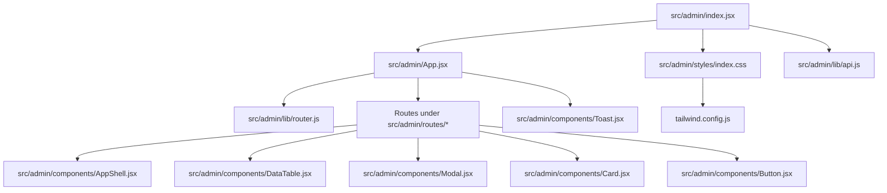
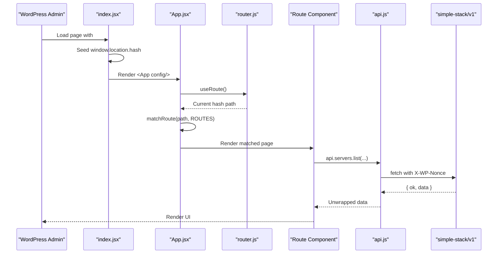
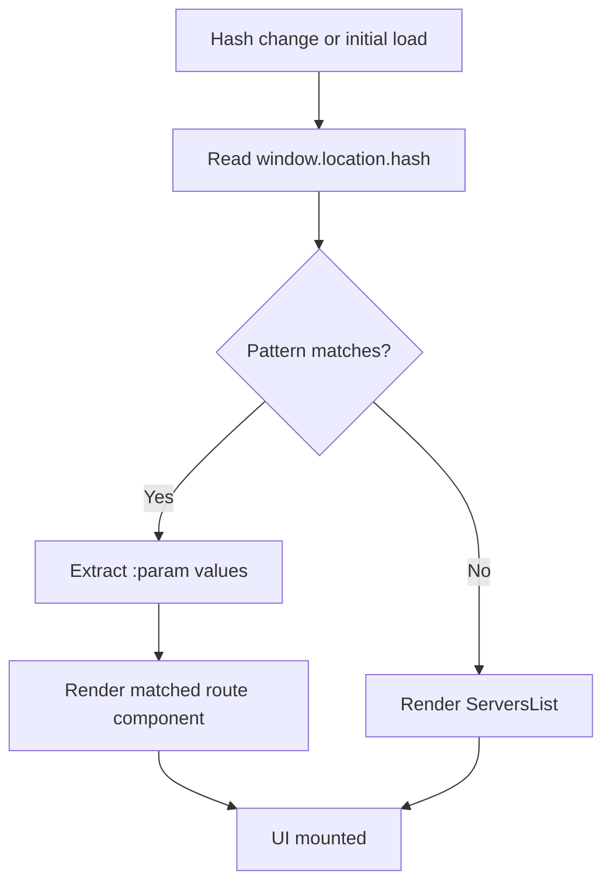

# React Admin Interface

<cite>
**Referenced Files in This Document**
- [index.jsx](file://src/admin/index.jsx)
- [App.jsx](file://src/admin/App.jsx)
- [router.js](file://src/admin/lib/router.js)
- [api.js](file://src/admin/lib/api.js)
- [AppShell.jsx](file://src/admin/components/AppShell.jsx)
- [DataTable.jsx](file://src/admin/components/DataTable.jsx)
- [Modal.jsx](file://src/admin/components/Modal.jsx)
- [Toast.jsx](file://src/admin/components/Toast.jsx)
- [Card.jsx](file://src/admin/components/Card.jsx)
- [Button.jsx](file://src/admin/components/Button.jsx)
- [index.css](file://src/admin/styles/index.css)
- [tailwind.config.js](file://tailwind.config.js)
- [vite.config.js](file://vite.config.js)
- [package.json](file://package.json)
- [SSTK.md](file://docs/SIMPLESTACK.md)
</cite>

## Update Summary
**Changes Made**
- Updated component architecture documentation to reflect the complete React admin interface overhaul
- Added detailed analysis of new Vite build system and Tailwind CSS v4 integration
- Enhanced routing system documentation with hash-based navigation patterns
- Expanded component documentation for Button, Modal, Toast, Card, and DataTable components
- Updated styling system documentation with Tailwind v4 configuration and scoping
- Added comprehensive API layer documentation with REST client implementation
- Included build process documentation with Vite configuration and development workflow

## Table of Contents
1. [Introduction](#introduction)
2. [Project Structure](#project-structure)
3. [Core Components](#core-components)
4. [Architecture Overview](#architecture-overview)
5. [Detailed Component Analysis](#detailed-component-analysis)
6. [Build System and Development Workflow](#build-system-and-development-workflow)
7. [Styling System](#styling-system)
8. [API Layer](#api-layer)
9. [Routing System](#routing-system)
10. [Performance Considerations](#performance-considerations)
11. [Troubleshooting Guide](#troubleshooting-guide)
12. [Conclusion](#conclusion)

## Introduction
This document describes Simple Stack's completely overhauled React-based administrative interface built with React 19 and Tailwind CSS v4. The client is a lightweight, hash-driven admin shell that renders inside the existing WordPress admin chrome using Vite for modern development and production builds. It manages routing through URL hashes, communicates with a `simple-stack/v1` REST API, and provides reusable UI primitives for tables, modals, toasts, cards, buttons, and application shells.

The project uses Vite 7 for development and production builds, outputting compiled assets into `assets/dist/`. This allows the plugin to run without requiring Node on the server while maintaining a modern development experience. Tailwind CSS v4 is configured so all generated utilities are scoped under `#simplestack-admin`, preventing style leakage into the rest of wp-admin.

## Project Structure
The React source lives under `src/admin/` with a clean separation between components, routes, library functions, and styles. The entry point mounts the app into a container provided by PHP, initializes the hash route, and renders the root component. Routes are declared centrally in the root application component and resolved against a small custom router.

**Diagram sources**
- [index.jsx:15-46](file://src/admin/index.jsx#L15-L46)
- [App.jsx:12-68](file://src/admin/App.jsx#L12-L68)
- [router.js:16-83](file://src/admin/lib/router.js#L16-L83)
- [index.css:1-14](file://src/admin/styles/index.css#L1-L14)
- [tailwind.config.js:1-20](file://tailwind.config.js#L1-L20)

**Section sources**
- [index.jsx:1-47](file://src/admin/index.jsx#L1-L47)
- [App.jsx:1-70](file://src/admin/App.jsx#L1-L70)
- [SSTK.md:117-150](file://docs/SIMPLESTACK.md#L117-L150)

## Core Components
The interface is composed around a focused set of reusable components designed for the WordPress admin environment:

- **Application entry**: Mounts the app, seeds the initial hash route from PHP-provided data, and wraps the tree in React Strict Mode.
- **Root application**: Holds the route table, resolves the current hash path, and renders the matched page inside a toast provider.
- **AppShell**: Provides the header, primary navigation, breadcrumbs, and main content area with consistent branding.
- **DataTable**: A sortable, keyboard-accessible table driven by column descriptors with loading and empty states.
- **Modal and ConfirmDialog**: Accessible dialog containers with focus management, Escape-to-close behavior, and click-outside-to-close.
- **Toast and useToast**: Global notification context for success, error, and informational messages with auto-dismissal.
- **Card, Badge, Skeleton, EmptyState, ErrorPanel**: Presentational building blocks used across routes and tables.
- **Button**: Consistent button variants (primary, secondary, ghost, danger) with size options and busy states.

These components are intentionally thin and rely on Tailwind utility classes rather than custom CSS, ensuring consistency and maintainability.

**Section sources**
- [index.jsx:15-46](file://src/admin/index.jsx#L15-L46)
- [App.jsx:25-68](file://src/admin/App.jsx#L25-L68)
- [AppShell.jsx:10-87](file://src/admin/components/AppShell.jsx#L10-L87)
- [DataTable.jsx:23-152](file://src/admin/components/DataTable.jsx#L23-L152)
- [Modal.jsx:20-130](file://src/admin/components/Modal.jsx#L20-L130)
- [Toast.jsx:25-82](file://src/admin/components/Toast.jsx#L25-L82)
- [Card.jsx:21-120](file://src/admin/components/Card.jsx#L21-L120)
- [Button.jsx:27-59](file://src/admin/components/Button.jsx#L27-L59)

## Architecture Overview
The admin interface follows a simple layered architecture designed for WordPress integration:

1. **Mounting layer**: `index.jsx` finds the `#simplestack-admin` container, seeds the hash route, and creates the React root.
2. **Routing layer**: `router.js` reads and writes `window.location.hash`. `App.jsx` maintains a static route table and matches paths using parameterized patterns.
3. **Presentation layer**: Route components render pages using `AppShell`, `DataTable`, `Modal`, `Card`, `Button`, and other shared components.
4. **Data layer**: `api.js` wraps `fetch`, attaches the WordPress nonce, unwraps the PHP response envelope, and exposes typed methods for servers, sites, tabs, logs, and providers.

**Diagram sources**
- [index.jsx:25-46](file://src/admin/index.jsx#L25-L46)
- [App.jsx:44-68](file://src/admin/App.jsx#L44-L68)
- [router.js:16-83](file://src/admin/lib/router.js#L16-L83)
- [api.js:67-119](file://src/admin/lib/api.js#L67-L119)

**Section sources**
- [SSTK.md:15-32](file://docs/SIMPLESTACK.md#L15-L32)
- [SSTK.md:117-150](file://docs/SIMPLESTACK.md#L117-L150)

## Detailed Component Analysis

### Application Shell and Routing
The root application defines a fixed route table mapping URL patterns to React elements. Parameterized segments such as `:id` are captured and passed as props. Unknown routes fall back to the servers list so stale bookmarks remain useful.

Key behaviors:
- Hash-based routing avoids conflicts with WordPress's URL bar and history.
- Deep links survive reloads because the PHP bootstrap can seed the initial hash.
- Navigation is performed by updating the hash, not by pushing state.

**Diagram sources**
- [App.jsx:25-54](file://src/admin/App.jsx#L25-L54)
- [router.js:59-83](file://src/admin/lib/router.js#L59-L83)

**Section sources**
- [App.jsx:1-70](file://src/admin/App.jsx#L1-L70)
- [router.js:1-84](file://src/admin/lib/router.js#L1-L84)

### AppShell Wrapper
`AppShell` is the visual wrapper for pages. It renders:
- A branded header with title and optional subtitle.
- Primary navigation buttons for Servers, Sites, Providers, and Activity.
- Optional breadcrumbs with clickable items.
- A `<main>` region for page content.

Props:
- `path`: Current hash path.
- `title`: Page heading.
- `subtitle`: Optional supporting text.
- `breadcrumbs`: Array of `{ label, path }`.
- `action`: Optional page-level action element.
- `children`: Page content.

Accessibility highlights:
- Navigation uses `aria-label`.
- Active navigation sets `aria-current="page"`.
- Breadcrumbs use an accessible breadcrumb landmark.

**Section sources**
- [AppShell.jsx:10-87](file://src/admin/components/AppShell.jsx#L10-L87)

### DataTable
`DataTable` is a generic, sortable table component. Columns are declared as descriptors containing a key, header, optional renderer, optional sort value, and alignment. Rows are plain objects; a stable `rowKey` function is required.

Props:
- `columns`: Column descriptors.
- `rows`: Row data array.
- `rowKey`: Function returning a unique key per row.
- `onRowClick`: Optional row activation callback.
- `loading`: Boolean to show skeleton placeholders.
- `emptyTitle`: Headline when no rows exist.
- `emptyMessage`: Supporting message for empty state.

Behavior:
- Sorting toggles between ascending and descending.
- Clickable rows support keyboard activation via Enter and Space.
- Loading state shows skeletons from `Card.Skeleton`.
- Empty state uses `Card.EmptyState`.

Complexity:
- Sorting creates a new sorted array each time inputs change.
- Rendering is linear in the number of rows and columns.

**Section sources**
- [DataTable.jsx:1-153](file://src/admin/components/DataTable.jsx#L1-L153)
- [Card.jsx:61-73](file://src/admin/components/Card.jsx#L61-L73)

### Modal and ConfirmDialog
`Modal` is a dialog container rendered inside the app container so Tailwind scoping remains effective. It handles:
- Focus management when opened.
- Escape key to close.
- Click-outside-to-close behavior.
- Accessible roles and labels.

Props:
- `open`: Visibility flag.
- `title`: Dialog heading.
- `onClose`: Close handler.
- `footer`: Optional footer content.
- `children`: Dialog body.

`ConfirmDialog` composes `Modal` for destructive actions:
- `open`, `title`, `message`, `confirmLabel`, `onConfirm`, `onCancel`, `busy`.

Accessibility highlights:
- `role="dialog"` and `aria-modal="true"`.
- `aria-label` bound to the dialog title.
- Focus moves into the dialog when opened.

**Section sources**
- [Modal.jsx:1-131](file://src/admin/components/Modal.jsx#L1-L131)

### Toast Notifications
Toast notifications provide global feedback without requiring every route to manage banners. The provider stores a list of toasts and supports auto-dismissal.

Exports:
- `ToastProvider`: Wraps the application tree and renders toast notifications.
- `useToast`: Hook returning `push(message, tone, ttl)` and `dismiss(id)`.

Tones:
- `success`, `error`, `info`.

Behavior:
- Each toast receives a unique id.
- Auto-dismissal uses `setTimeout` unless `ttl` is zero or negative.
- Toasts are visually styled by tone and include a dismiss button.

**Section sources**
- [Toast.jsx:1-83](file://src/admin/components/Toast.jsx#L1-L83)

### Card Primitives
`Card.jsx` exports several presentational components:

- `Card`: Container with optional title, subtitle, borderless mode, and header action.
- `Badge`: Small status label with tone variants.
- `Skeleton`: Placeholder rows for loading states.
- `EmptyState`: Centered empty layout with optional call to action.
- `ErrorPanel`: Inline failure display with optional retry button.

Props vary by component but consistently use Tailwind classes and theme tokens.

**Section sources**
- [Card.jsx:1-121](file://src/admin/components/Card.jsx#L1-L121)

### Button Component
`Button.jsx` provides consistent button styling with multiple variants and sizes:

Variants:
- `primary`: Brand-colored button for main actions.
- `secondary`: Neutral button for standard actions.
- `ghost`: Transparent button for subtle actions.
- `danger`: Red-tinted button for destructive actions.

Sizes:
- `sm`: Compact button for dense interfaces.
- `md`: Standard button size.

Props:
- `variant`: Button variant type.
- `size`: Button size.
- `busy`: Shows spinner and disables button.
- `disabled`: Disables button interaction.
- `className`: Additional CSS classes.
- `type`: HTML button type.

Accessibility highlights:
- Proper focus management with visible focus rings.
- Disabled state clearly indicated.
- Spinner animation for busy state.

**Section sources**
- [Button.jsx:1-60](file://src/admin/components/Button.jsx#L1-L60)

## Build System and Development Workflow
The project uses Vite 7 for modern development and production builds with Tailwind CSS v4 integration.

### Build Configuration
- **Development server**: Hot module replacement for rapid iteration.
- **Production builds**: Optimized bundles with asset hashing.
- **CSS processing**: Tailwind v4 with custom theme configuration.
- **Asset output**: Committed to `assets/dist/` for server deployment.

### Development Commands
- `npm ci`: Install dependencies.
- `npm run dev`: Start development server.
- `npm run build`: Build production assets.
- `npm run verify:css`: Verify CSS isolation.
- `npm run verify`: Full verification build.

### Build Outputs
- JavaScript bundles with content hashing.
- Single stylesheet for the entire application.
- Manifest file for asset resolution.
- Source maps disabled in production.

**Section sources**
- [package.json:7-12](file://package.json#L7-L12)
- [vite.config.js:15-37](file://vite.config.js#L15-L37)
- [SSTK.md:300-316](file://docs/SIMPLESTACK.md#L300-L316)

## Styling System
The styling system uses Tailwind CSS v4 with strict scoping to prevent style leakage into WordPress admin.

### Tailwind Configuration
- **Scoping**: All utilities scoped under `#simplestack-admin`.
- **Preflight disabled**: Prevents resetting global WordPress styles.
- **Custom theme**: Brand colors, typography, and design tokens.
- **Layer system**: Separate theme and utility layers.

### Custom Theme Tokens
- **Brand colors**: Pink-based brand palette.
- **Ink colors**: Dark neutral palette for text.
- **Surface colors**: Background and border colors.
- **Semantic colors**: Positive, warning, and negative states.
- **Typography**: System font stack and monospace fonts.
- **Border radius**: Consistent card rounding.

### CSS Architecture
- **Entry point**: Imports Tailwind theme and utilities explicitly.
- **Reset**: Hand-written reset scoped to mount point.
- **Utilities**: All generated utilities prefixed with scoping selector.
- **Verification**: Automated checks prevent style leakage.

**Section sources**
- [tailwind.config.js:1-85](file://tailwind.config.js#L1-L85)
- [index.css:1-80](file://src/admin/styles/index.css#L1-L80)
- [SSTK.md:138-150](file://docs/SIMPLESTACK.md#L138-L150)

## API Layer
The API layer provides a typed interface to the `simple-stack/v1` REST endpoints with automatic nonce handling and response unwrapping.

### Core Features
- **Automatic nonce attachment**: WordPress security headers added automatically.
- **Response unwrapping**: Extracts `data` from PHP response envelopes.
- **Error handling**: Typed `ApiError` with code and status information.
- **File uploads**: Support for FormData with JSON parameters.

### API Methods

#### Servers
- `list(query)`: List servers with filtering and pagination.
- `get(id)`: Get server details and metadata.
- `create(body)`: Create new server and queue provisioning.
- `remove(id)`: Delete server.
- `runAction(id, action, params, files)`: Execute server actions.

#### Sites
- `list(query)`: List sites with filtering.
- `get(id)`: Get site details and status.
- `deploy(body)`: Deploy new WordPress site.
- `remove(id)`: Trash site.
- `runAction(id, action, params, files)`: Execute site actions.
- `securityStatus(id)`: Get security hardening status.

#### Tabs
- `forServer(id)`: Get tab schema for server.
- `forSite(id)`: Get tab schema for site.

#### Logs
- `forServer(serverId, query)`: Get server logs with pagination.
- `activity(query)`: Get merged activity feed.

#### Providers
- `list(query)`: Get provider configuration and counts.
- `save(body)`: Save provider credentials.
- `test(slug)`: Test provider connection.

**Section sources**
- [api.js:1-292](file://src/admin/lib/api.js#L1-L292)

## Routing System
The routing system uses hash-based navigation to avoid conflicts with WordPress admin URL handling.

### Router Features
- **Hash-based navigation**: Uses `window.location.hash` for deep linking.
- **Parameter extraction**: Supports `:param` syntax for dynamic routes.
- **Event handling**: Subscribes to hash changes for reactive updates.
- **Fallback routing**: Defaults to servers list for unknown routes.

### Route Patterns
- `/servers`: Server listing page.
- `/servers/new`: Server provisioning form.
- `/servers/:id`: Individual server detail page.
- `/sites`: Site listing page.
- `/sites/new`: Site deployment form.
- `/sites/:id`: Individual site detail page.
- `/sites/:id/security`: Site security status page.
- `/settings/providers`: Provider configuration page.
- `/activity`: Activity log page.

### Navigation Methods
- `navigate(path)`: Programmatic navigation.
- `useRoute()`: React hook for current route.
- `matchRoute(path, pattern)`: Pattern matching utility.

**Section sources**
- [router.js:1-84](file://src/admin/lib/router.js#L1-L84)
- [App.jsx:25-54](file://src/admin/App.jsx#L25-L54)

## Performance Considerations
- **Bundle optimization**: React is bundled with Vite for optimal performance.
- **CSS isolation**: Scoped utilities prevent unnecessary style recalculations.
- **Single stylesheet**: One CSS file improves cacheability and reduces requests.
- **Component efficiency**: Lightweight components with minimal re-renders.
- **API optimization**: Request deduplication and efficient data fetching.
- **Browser target**: ES2020 target for modern browser compatibility.

## Troubleshooting Guide

### Adding a New Route
1. Import the route component in `App.jsx`.
2. Add a pattern and builder to the `ROUTES` array.
3. Use parameterized segments like `:id` when the route needs dynamic values.
4. Navigate to the route using `navigate()` from `router.js` or by setting the hash.

Example reference:
- Route table definition and fallback behavior: [App.jsx:25-54](file://src/admin/App.jsx#L25-L54)
- Hash navigation helper: [router.js:29-32](file://src/admin/lib/router.js#L29-L32)

### Creating a Custom Component
1. Create a new component under `src/admin/components/`.
2. Use Tailwind utility classes and theme tokens defined in `tailwind.config.js`.
3. If the component needs global state, prefer the existing context patterns such as `ToastProvider` and `useToast`.
4. Compose smaller primitives from `Card.jsx` instead of writing bespoke layouts.

Reference components:
- Context-based global state: [Toast.jsx:25-82](file://src/admin/components/Toast.jsx#L25-L82)
- Presentable primitives: [Card.jsx:21-120](file://src/admin/components/Card.jsx#L21-L120)

### Integrating with the REST API
Use the typed methods exported by `api.js`:
- Servers: list, get, create, remove, runAction.
- Sites: list, get, deploy, remove, runAction, securityStatus.
- Tabs: forServer, forSite.
- Logs: forServer, activity.
- Providers: list, save, test.

Important details:
- Requests automatically attach the WordPress nonce when available.
- Responses are expected to follow the `{ ok, data }` envelope; the client unwraps it.
- Errors are thrown as `ApiError` with `code` and optional `status`.

Reference:
- Request wrapper and error handling: [api.js:67-119](file://src/admin/lib/api.js#L67-L119)
- Server endpoints: [api.js:153-191](file://src/admin/lib/api.js#L153-L191)
- Site endpoints: [api.js:193-237](file://src/admin/lib/api.js#L193-L237)
- Tab endpoints: [api.js:239-251](file://src/admin/lib/api.js#L239-L251)
- Log endpoints: [api.js:253-267](file://src/admin/lib/api.js#L253-L267)
- Provider endpoints: [api.js:269-290](file://src/admin/lib/api.js#L269-L290)

### Debugging Techniques
- Open the browser console and inspect network requests to `simple-stack/v1`.
- Check whether the hash route matches the expected pattern.
- Verify that `window.simplestackAdmin` contains the expected bootstrap data, including `restUrl` and `nonce`.
- Use the toast system to surface user-facing errors and confirm successful operations.
- Run `npm run verify:css` to ensure Tailwind styles remain scoped to `#simplestack-admin`.

References:
- Bootstrap object access: [api.js:18-22](file://src/admin/lib/api.js#L18-L22)
- CSS isolation verification script reference: [SSTK.md:138-150](file://docs/SIMPLESTACK.md#L138-L150)

**Section sources**
- [App.jsx:25-68](file://src/admin/App.jsx#L25-L68)
- [router.js:29-32](file://src/admin/lib/router.js#L29-L32)
- [api.js:18-119](file://src/admin/lib/api.js#L18-L119)
- [SSTK.md:138-150](file://docs/SIMPLESTACK.md#L138-L150)

## Conclusion
Simple Stack's completely overhauled admin interface is a compact, hash-driven React application built with modern tools that integrates cleanly with WordPress admin. The new architecture separates concerns between mounting, routing, presentation, and API communication while keeping styling safely scoped under `#simplestack-admin`. Reusable components like `DataTable`, `Modal`, `Toast`, `Card`, and `Button` reduce duplication and make adding new features straightforward. The Vite build produces committed assets so the plugin works without a Node toolchain on production servers while providing an excellent development experience.

The complete rewrite brings significant improvements in developer experience, code organization, and maintainability while preserving full backward compatibility with the existing WordPress plugin architecture.