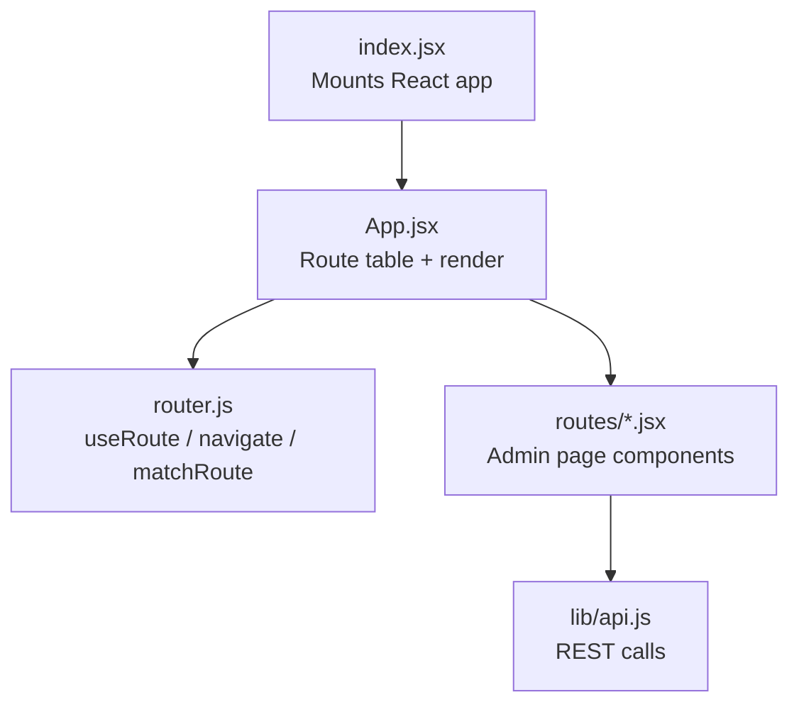
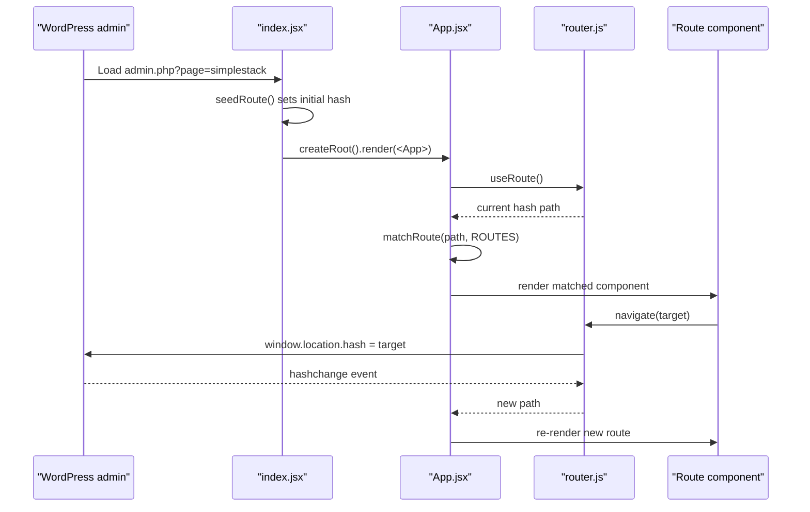
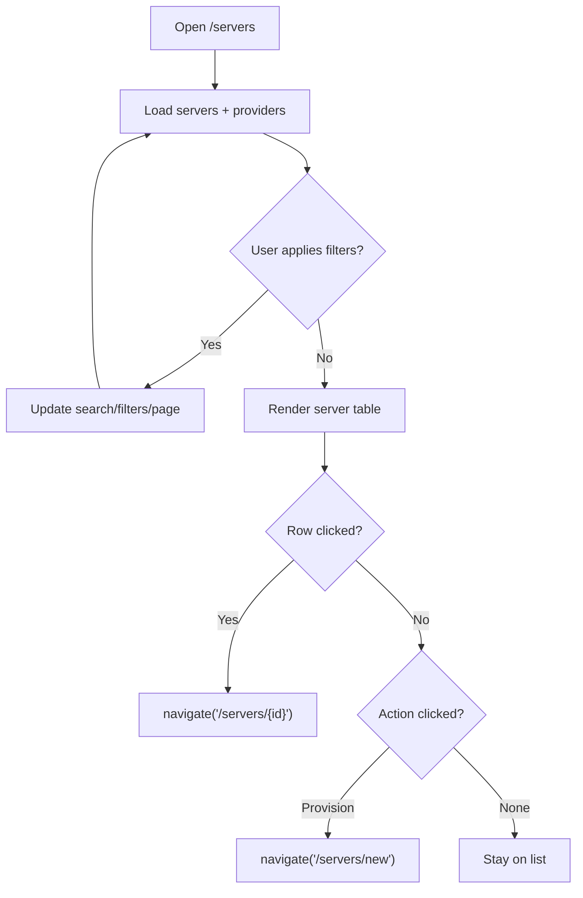
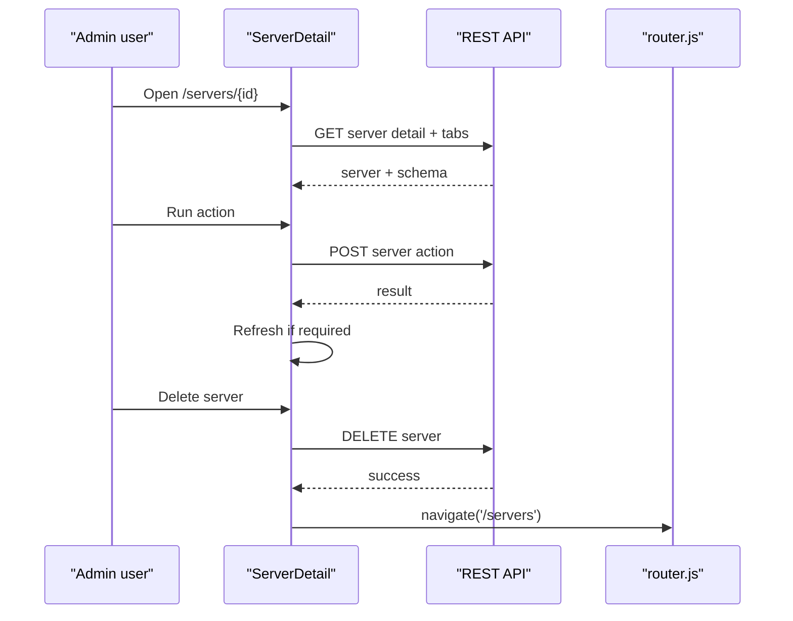
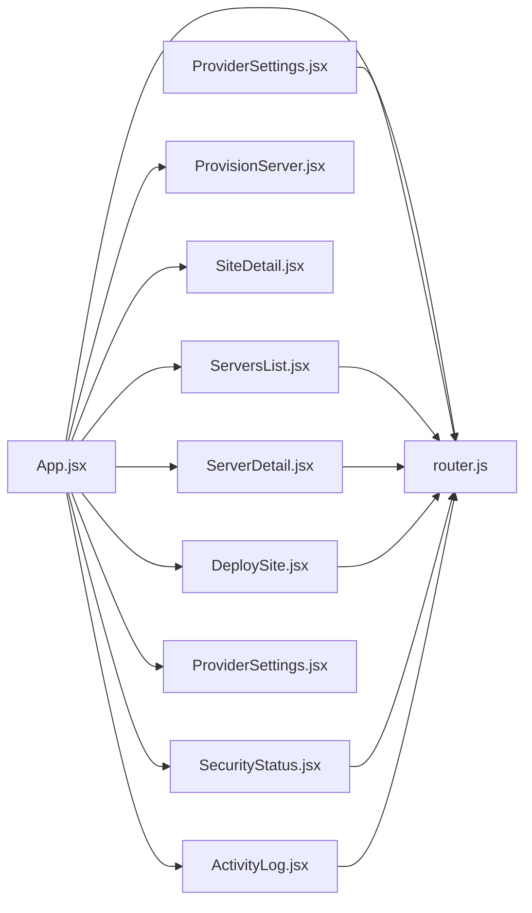

# Routing & Navigation

<cite>
**Referenced Files in This Document**
- [router.js](file://src/admin/lib/router.js)
- [App.jsx](file://src/admin/App.jsx)
- [index.jsx](file://src/admin/index.jsx)
- [ServersList.jsx](file://src/admin/routes/ServersList.jsx)
- [ServerDetail.jsx](file://src/admin/routes/ServerDetail.jsx)
- [ProvisionServer.jsx](file://src/admin/routes/ProvisionServer.jsx)
- [SiteDetail.jsx](file://src/admin/routes/SiteDetail.jsx)
- [DeploySite.jsx](file://src/admin/routes/DeploySite.jsx)
- [SecurityStatus.jsx](file://src/admin/routes/SecurityStatus.jsx)
- [ActivityLog.jsx](file://src/admin/routes/ActivityLog.jsx)
- [ProviderSettings.jsx](file://src/admin/routes/ProviderSettings.jsx)
</cite>

## Table of Contents
1. [Introduction](#introduction)
2. [Project Structure](#project-structure)
3. [Core Components](#core-components)
4. [Architecture Overview](#architecture-overview)
5. [Detailed Component Analysis](#detailed-component-analysis)
6. [Dependency Analysis](#dependency-analysis)
7. [Performance Considerations](#performance-considerations)
8. [Troubleshooting Guide](#troubleshooting-guide)
9. [Conclusion](#conclusion)
10. [Appendices](#appendices)

## Introduction
This document explains SimpleStack’s React routing and navigation system for the admin interface. The application uses a minimal hash-based router so it can coexist with WordPress’s `admin.php?page=simplestack` URL without fighting browser history or losing deep links. Route configuration is centralized, route parameters are captured through simple patterns, and navigation between admin pages is performed by updating the hash.

The built-in routes include:
- Servers list
- Provision server
- Server detail
- Sites list
- Deploy site
- Site detail
- Site security status
- Provider settings
- Activity log

## Project Structure
The routing layer lives under `src/admin`:
- `lib/router.js` provides the hash router utilities.
- `App.jsx` defines the route table and renders matched components.
- `index.jsx` seeds the initial hash and mounts the React app.
- `routes/*.jsx` contains one component per admin page.

**Diagram sources**
- [index.jsx:15-46](file://src/admin/index.jsx#L15-L46)
- [App.jsx:25-54](file://src/admin/App.jsx#L25-L54)
- [router.js:16-83](file://src/admin/lib/router.js#L16-L83)

**Section sources**
- [index.jsx:1-47](file://src/admin/index.jsx#L1-L47)
- [App.jsx:1-70](file://src/admin/App.jsx#L1-L70)
- [router.js:1-84](file://src/admin/lib/router.js#L1-L84)

## Core Components
The routing system has three main responsibilities:
1. Read and write the current hash path.
2. Match a path against declared route patterns.
3. Render the correct admin page component.

Key utilities:
- `currentPath()` reads `window.location.hash`, strips query strings, and normalizes the path to start with `/`.
- `navigate(path)` updates `window.location.hash`.
- `useRoute()` subscribes to `hashchange` and returns the current path as React state.
- `matchRoute(path, pattern)` splits both into segments and captures values from `:param` placeholders.

Important behavior:
- Query strings after the hash are ignored by the router; they do not become route parameters.
- Unmatched routes fall back to the servers list instead of showing a blank screen.
- The PHP entry point seeds the hash once on first load so each submenu loads its intended default route.

**Section sources**
- [router.js:16-83](file://src/admin/lib/router.js#L16-L83)
- [App.jsx:25-54](file://src/admin/App.jsx#L25-L54)
- [index.jsx:17-34](file://src/admin/index.jsx#L17-L34)

## Architecture Overview
SimpleStack’s admin UI is a single-page React application mounted inside a WordPress admin page. The real URL remains controlled by WordPress, while the app’s internal navigation lives in the hash fragment.

**Diagram sources**
- [index.jsx:17-46](file://src/admin/index.jsx#L17-L46)
- [App.jsx:61-68](file://src/admin/App.jsx#L61-L68)
- [router.js:39-50](file://src/admin/lib/router.js#L39-L50)

## Detailed Component Analysis

### Route Configuration and URL Patterns
Routes are defined as pairs of `[pattern, componentFactory]`:
- Static paths such as `/servers`, `/sites/new`, `/settings/providers`, `/providers`, and `/activity`.
- Parameterized paths using `:id`, for example `/servers/:id`, `/sites/:id`, and `/sites/:id/security`.
- A fallback to the servers list when no route matches.

| Route Pattern | Purpose | Parameters | Notes |
|---|---|---:|---|
| `/servers` | List and filter servers | None | Default landing route. |
| `/servers/new` | Provision a new server | None | Redirects to provider settings if none are configured. |
| `/servers/:id` | View server details | `id` | Numeric ID passed as a prop. |
| `/sites` | List sites | None | Not shown here but imported and used by the app shell. |
| `/sites/new` | Deploy a WordPress site | None | Requires an existing server. |
| `/sites/:id` | View site details | `id` | Includes actions and tabs. |
| `/sites/:id/security` | Run read-only security probe | `id` | Navigated from site detail. |
| `/settings/providers` | Manage cloud provider credentials | None | Also aliased to `/providers`. |
| `/providers` | Alias for provider settings | None | Maps to the same component. |
| `/activity` | Merged activity feed | None | Shows command, SSH, and error logs. |

Query string handling:
- The router ignores query strings after the hash. For example, a search filter in the servers list is kept in local state rather than encoded into the hash.
- If you need shareable filters, encode them explicitly into the hash or use the parent WordPress page query arguments.

Programmatic navigation:
- Use `navigate('/path')` from `router.js`.
- Components call it after successful mutations, such as provisioning a server or deleting a site.

Adding a new route:
1. Create a component under `src/admin/routes/`.
2. Import it in `App.jsx`.
3. Add a `[pattern, componentFactory]` entry to the `ROUTES` array.
4. Call `navigate(newPattern)` from other components where needed.

Route guards:
- There is no built-in authentication guard. Guards should be implemented at the route resolution level in `App.jsx` before rendering, or inside individual components.
- A common approach is to check permissions in `render(path)` and redirect to a safe route such as `/servers` when access is denied.

Deep linking:
- Deep links work because the hash is part of the full WordPress admin URL.
- Example shape: `admin.php?page=simplestack#/servers/42`.
- On fresh page load, `seedRoute()` initializes the hash from either an existing hash or the PHP-provided `data-route` attribute.

Browser history:
- The app does not use `pushState`; it only changes `window.location.hash`.
- This avoids conflicts with WordPress’s own history management.
- Back and forward buttons update the hash and trigger `hashchange`, which `useRoute()` listens to.

SEO considerations:
- Admin interfaces are generally not SEO-sensitive.
- Because the app uses hash routing, public crawlers cannot index internal admin state.
- If any admin-like content becomes public-facing, consider moving to a proper client-side router with server-side rendering or pre-rendering.

**Section sources**
- [App.jsx:25-54](file://src/admin/App.jsx#L25-L54)
- [router.js:16-83](file://src/admin/lib/router.js#L16-L83)
- [index.jsx:17-34](file://src/admin/index.jsx#L17-L34)

### ServersList
The servers list is the default route and primary navigation hub. It:
- Fetches paginated servers via the REST API.
- Loads available providers for filtering.
- Renders a data table with columns for name, provider, size, state, health, site count, and creation date.
- Navigates to `/servers/new` to provision a server.
- Navigates to `/servers/{id}` when a row is clicked.

Navigation flow:
- Clicking “Provision server” navigates to `/servers/new`.
- Clicking a server row navigates to `/servers/{id}`.

State and filtering:
- Search, provider filter, status filter, and pagination are stored in local component state.
- Filtering mirrors REST query arguments but is not currently reflected in the hash.

**Diagram sources**
- [ServersList.jsx:32-74](file://src/admin/routes/ServersList.jsx#L32-L74)
- [ServersList.jsx:128-217](file://src/admin/routes/ServersList.jsx#L128-L217)

**Section sources**
- [ServersList.jsx:1-218](file://src/admin/routes/ServersList.jsx#L1-L218)

### ServerDetail
The server detail route displays server metadata, actions, and tabbed panels. It:
- Loads server details and tab schema concurrently.
- Runs server actions through the REST API.
- Opens a live log drawer for streaming output.
- Confirms deletion before removing the server.
- Navigates back to `/servers` after deletion.
- Links to the sites list filtered by the current server.

Parameters:
- `id` is extracted from `/servers/:id` and converted to a number.

Common flows:
- Running an action may refresh the view based on the API response.
- Deleting a server triggers confirmation, then navigates away.

**Diagram sources**
- [ServerDetail.jsx:39-87](file://src/admin/routes/ServerDetail.jsx#L39-L87)
- [ServerDetail.jsx:114-207](file://src/admin/routes/ServerDetail.jsx#L114-L207)

**Section sources**
- [ServerDetail.jsx:1-250](file://src/admin/routes/ServerDetail.jsx#L1-L250)

### ProvisionServer
The provision server form creates a new server instance and installs the web stack. It:
- Loads providers and defaults to the first usable provider.
- Submits server creation data through the REST API.
- Shows a toast notification on success.
- Navigates to the newly created server’s detail page.
- Directs users to provider settings if no provider is configured.

Navigation flow:
- Success: navigate to `/servers/{server_id}`.
- Cancel: navigate to `/servers`.
- No providers: navigate to `/providers`.

**Section sources**
- [ProvisionServer.jsx:1-182](file://src/admin/routes/ProvisionServer.jsx#L1-L182)

### SiteDetail
The site detail route manages a WordPress site record. It:
- Loads site details and tab schema.
- Runs site actions through the REST API.
- Opens a log drawer tied to the site’s server.
- Trashes the site and navigates to `/sites`.
- Provides a shortcut to the site’s security status page.

Parameters:
- `id` is extracted from `/sites/:id`.

Related navigation:
- Security status: `/sites/{id}/security`.
- Linked server name navigates to `/servers/{server_id}`.

**Section sources**
- [SiteDetail.jsx:1-200](file://src/admin/routes/SiteDetail.jsx#L1-L200)

### DeploySite
The deploy site form installs WordPress on an existing server. It:
- Loads available servers and selects the first one by default.
- Collects domain, admin credentials, WordPress version, and locale.
- Submits deployment through the REST API.
- Navigates to the deployed site’s detail page.
- Guides users to provision a server if none are available.

Navigation flow:
- Success: navigate to `/sites/{app_id}`.
- Cancel: navigate to `/sites`.
- No servers: navigate to `/servers/new`.

**Section sources**
- [DeploySite.jsx:1-263](file://src/admin/routes/DeploySite.jsx#L1-L263)

### SecurityStatus
The security status route runs a read-only probe against a site’s server. It:
- Calls the security status endpoint.
- Displays connection status, file-edit policy, PHP version, and plugin information.
- Allows re-running the probe.
- Provides a link back to the site detail page.

Parameters:
- `id` is extracted from `/sites/:id/security`.

Behavior:
- If the site is unreachable, the UI shows a warning and allows retrying.
- No sensitive keys are sent to or displayed by this screen.

**Section sources**
- [SecurityStatus.jsx:1-190](file://src/admin/routes/SecurityStatus.jsx#L1-L190)

### ActivityLog
The activity log aggregates command, SSH, and error logs across all servers. It:
- Fetches activity entries and server names.
- Supports searching, filtering by type, and adjusting the limit.
- Expands/collapses log bodies.
- Links activity entries back to their source server.

Navigation flow:
- Clicking a server reference navigates to `/servers/{parent}`.

State management:
- Local state tracks items, cursor, server name mapping, filters, search text, expanded rows, loading, and errors.

**Section sources**
- [ActivityLog.jsx:1-239](file://src/admin/routes/ActivityLog.jsx#L1-L239)

### ProviderSettings
The provider settings route manages cloud provider credentials. It:
- Loads provider summaries, including capability flags and credential presence.
- Saves credentials through the REST API.
- Tests provider connectivity.
- Hides actual secrets and indicates whether values are stored.

Routing alias:
- Both `/settings/providers` and `/providers` render the same component.

Credential model:
- Some providers use an API key; others use a username/password pair.
- SSH key id and private key fields are supported.
- Empty inputs mean “keep the stored value.”

**Section sources**
- [ProviderSettings.jsx:1-372](file://src/admin/routes/ProviderSettings.jsx#L1-L372)

## Dependency Analysis
The routing dependencies are intentionally shallow:
- `App.jsx` imports the router utilities and route components.
- Route components import shared UI components, formatting helpers, the REST API wrapper, and the router’s `navigate` function.
- The router itself depends only on React hooks and the browser’s hash location.

**Diagram sources**
- [App.jsx:12-36](file://src/admin/App.jsx#L12-L36)
- [router.js:16-83](file://src/admin/lib/router.js#L16-L83)
- [ServersList.jsx:16](file://src/admin/routes/ServersList.jsx#L16)
- [ServerDetail.jsx:21](file://src/admin/routes/ServerDetail.jsx#L21)
- [ProvisionServer.jsx:15](file://src/admin/routes/ProvisionServer.jsx#L15)
- [SiteDetail.jsx:21](file://src/admin/routes/SiteDetail.jsx#L21)
- [DeploySite.jsx:17](file://src/admin/routes/DeploySite.jsx#L17)
- [SecurityStatus.jsx:19](file://src/admin/routes/SecurityStatus.jsx#L19)
- [ActivityLog.jsx:16](file://src/admin/routes/ActivityLog.jsx#L16)

**Section sources**
- [App.jsx:12-36](file://src/admin/App.jsx#L12-L36)
- [router.js:16-83](file://src/admin/lib/router.js#L16-L83)

## Performance Considerations
- Hash routing avoids heavy client-side history management and integrates cleanly with WordPress admin.
- Route matching is linear over the small static route table; performance is negligible.
- Data fetching happens inside components, so unrelated routes do not load unnecessary data.
- Pagination and cursor-based feeds keep large lists manageable.
- Avoid encoding large filter states into the hash unless necessary; prefer local state or server-side query parameters.

[No sources needed since this section provides general guidance]

## Troubleshooting Guide
Common issues and resolutions:

- Deep link lands on servers list instead of expected page:
  - Verify the hash path matches a declared route pattern.
  - Check that parameterized routes receive the expected segment count.

- Navigation does not update the URL bar:
  - Confirm `navigate()` is called with a path starting with `/`.
  - Ensure the hash change is not being overwritten by another script.

- Initial route is wrong after a full page load:
  - Check the PHP-provided `data-route` attribute or `config.route`.
  - Remember that an existing hash takes precedence over the seeded route.

- Query parameters are missing from route params:
  - The router ignores query strings after the hash.
  - Encode query data explicitly into the hash or manage it in component state.

- Adding a new route does nothing:
  - Register the route in `App.jsx`.
  - Ensure the pattern length and parameter names match the path.
  - Verify the component is imported and returned by the route factory.

- Route guard not blocking access:
  - Implement permission checks in `App.jsx` before rendering.
  - Redirect to a safe route such as `/servers` when unauthorized.

**Section sources**
- [router.js:16-83](file://src/admin/lib/router.js#L16-L83)
- [index.jsx:17-34](file://src/admin/index.jsx#L17-L34)
- [App.jsx:44-54](file://src/admin/App.jsx#L44-L54)

## Conclusion
SimpleStack’s admin routing is intentionally lightweight. It uses a hash-based router to avoid conflicts with WordPress, centralizes route definitions, and keeps navigation predictable. Built-in routes cover the core admin workflows: managing servers, deploying sites, inspecting site security, configuring providers, and reviewing activity. Extending the system involves adding a route pattern, a component, and calling `navigate()` where appropriate. For production-grade admin applications requiring rich history, authentication guards, or SEO-sensitive URLs, consider migrating to a more feature-rich client-side router while preserving compatibility with WordPress’s URL ownership.

[No sources needed since this section summarizes without analyzing specific files]

## Appendices

### How to Add a New Route
1. Create a new component under `src/admin/routes/`.
2. Import it in `App.jsx`.
3. Add a route entry to the `ROUTES` array.
4. Use `navigate()` from other components to reach the new route.

Example pattern types:
- Static: `['/reports', () => <Reports />]`
- Parameterized: `['/reports/:id', (params) => <ReportView id={Number(params.id)} />]`

Fallback behavior:
- Unknown routes render the servers list, preventing blank screens.

**Section sources**
- [App.jsx:25-54](file://src/admin/App.jsx#L25-L54)

### Programmatic Navigation Examples
- Go to servers list: `navigate('/servers')`
- Go to provision server: `navigate('/servers/new')`
- Go to server detail: `navigate(`/servers/${id}`)`
- Go to sites list: `navigate('/sites')`
- Go to deploy site: `navigate('/sites/new')`
- Go to site detail: `navigate(`/sites/${id}`)`
- Go to site security: `navigate(`/sites/${id}/security`)`
- Go to provider settings: `navigate('/providers')`
- Go to activity log: `navigate('/activity')`

**Section sources**
- [ServersList.jsx:134-190](file://src/admin/routes/ServersList.jsx#L134-L190)
- [ServerDetail.jsx:80-80](file://src/admin/routes/ServerDetail.jsx#L80-L80)
- [ProvisionServer.jsx:90-171](file://src/admin/routes/ProvisionServer.jsx#L90-L171)
- [SiteDetail.jsx:77-120](file://src/admin/routes/SiteDetail.jsx#L77-L120)
- [DeploySite.jsx:99-252](file://src/admin/routes/DeploySite.jsx#L99-L252)
- [SecurityStatus.jsx:111-111](file://src/admin/routes/SecurityStatus.jsx#L111-L111)
- [ActivityLog.jsx:194-197](file://src/admin/routes/ActivityLog.jsx#L194-L197)