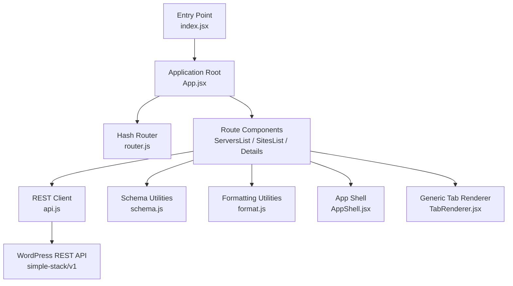
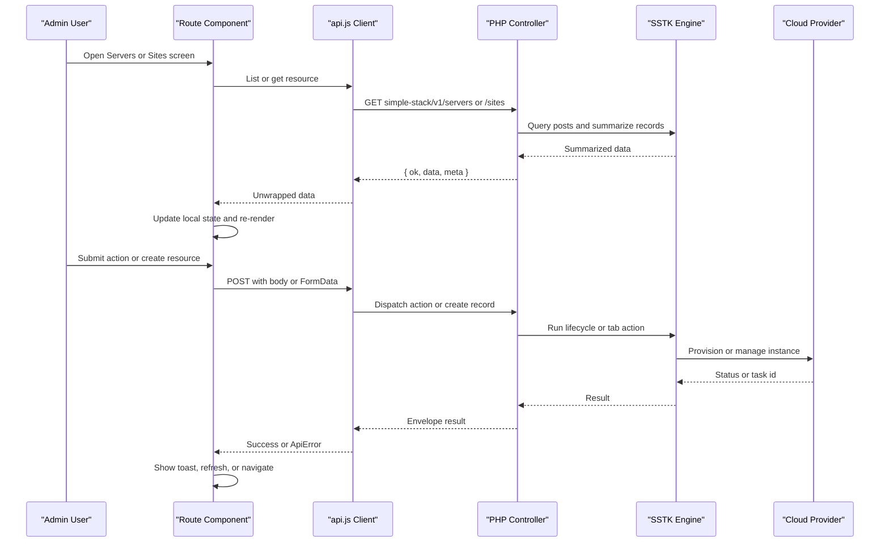
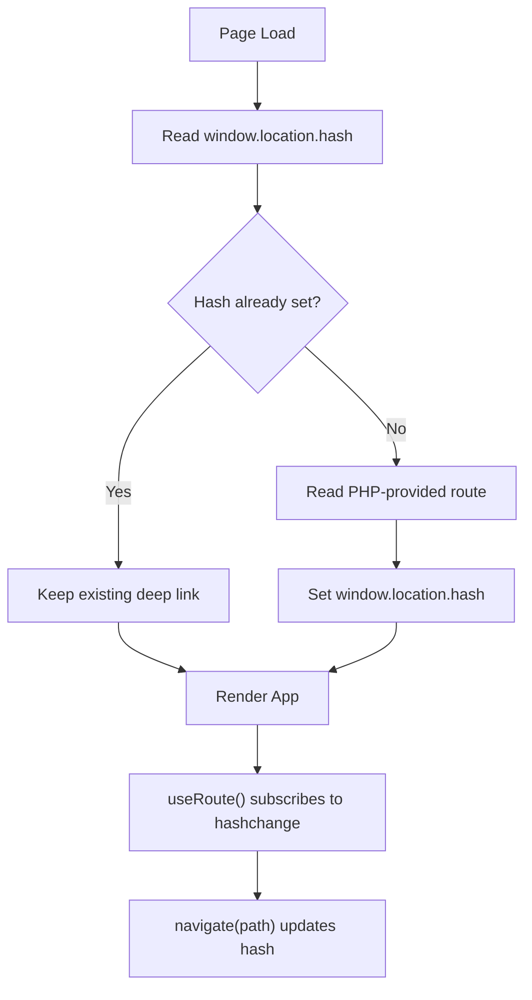
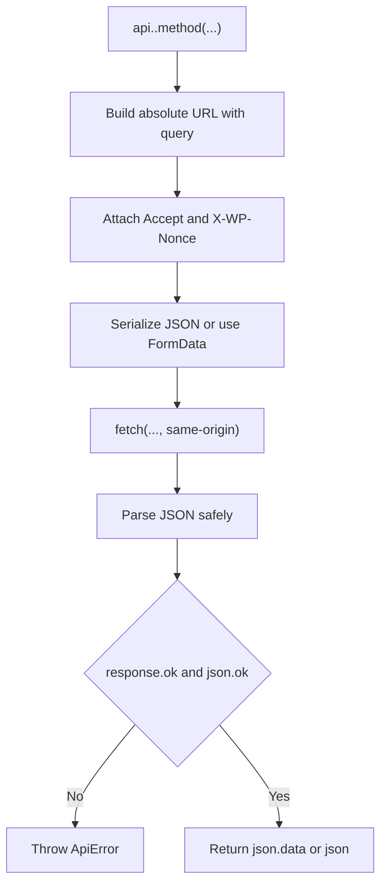
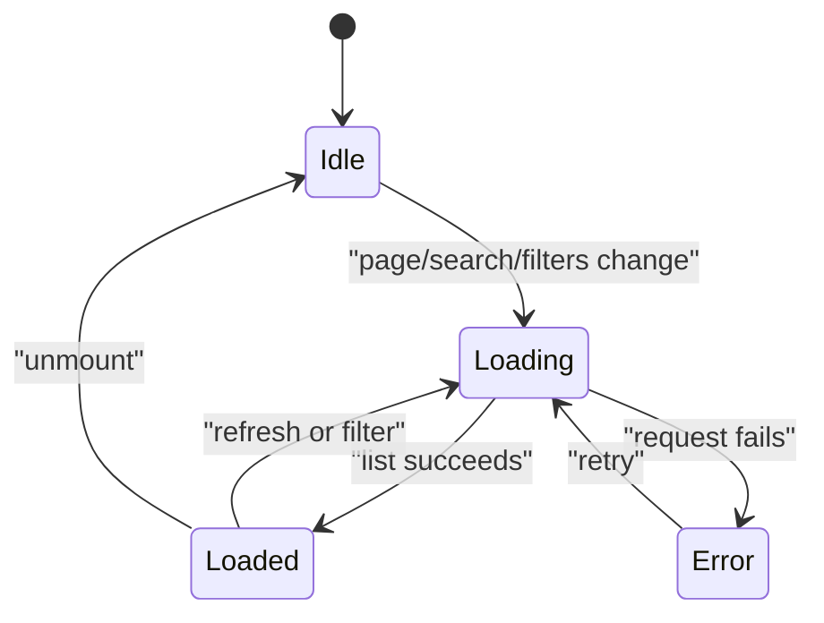
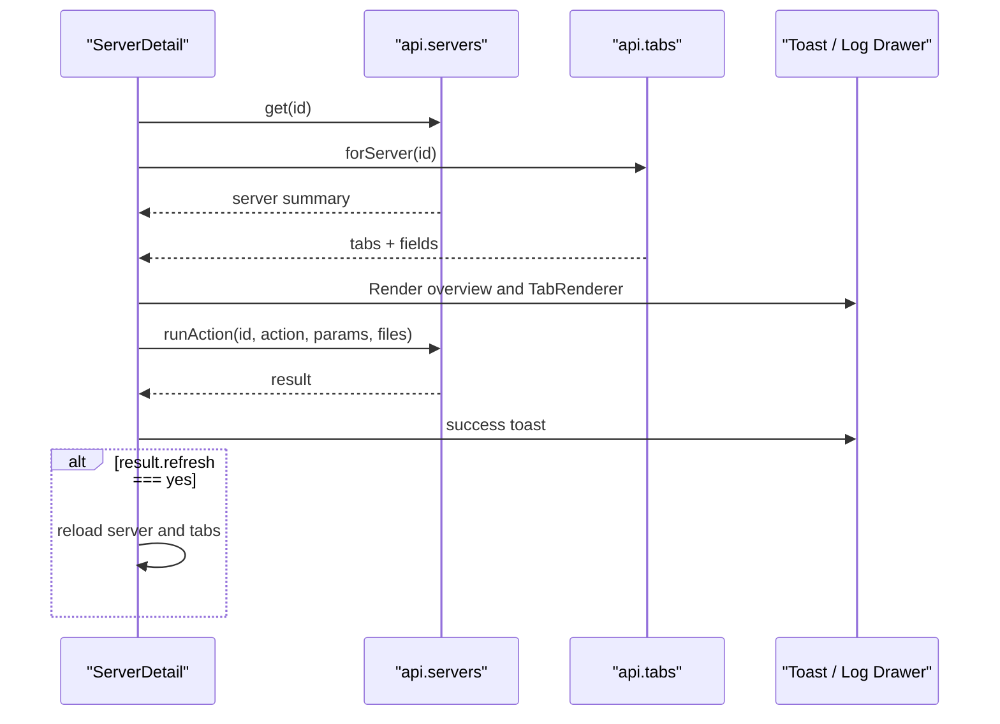
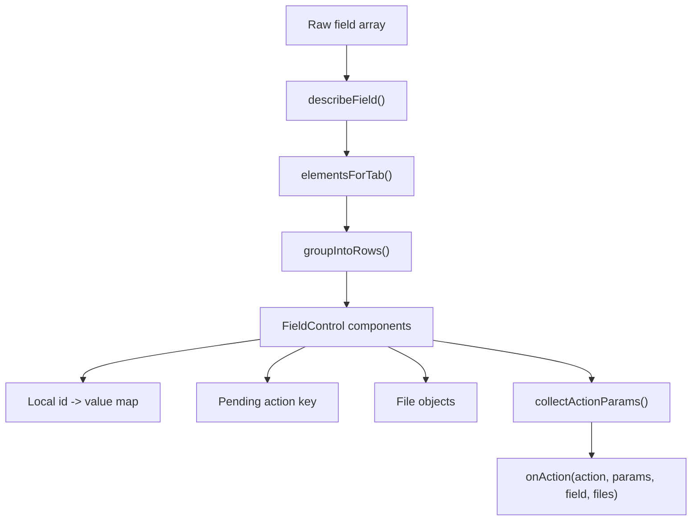
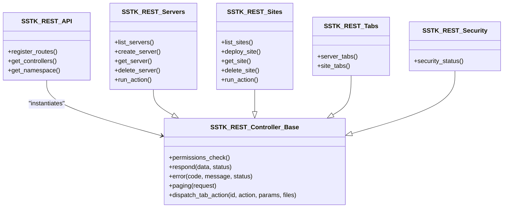
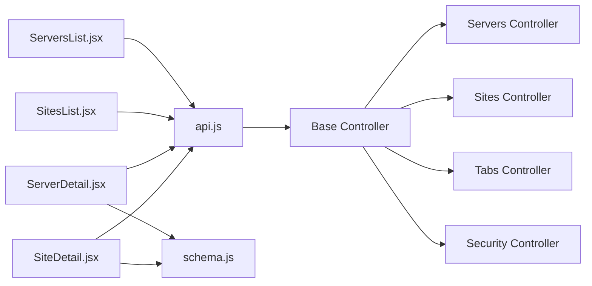

# State Management

<cite>
**Referenced Files in This Document**
- [index.jsx](file://src/admin/index.jsx)
- [App.jsx](file://src/admin/App.jsx)
- [router.js](file://src/admin/lib/router.js)
- [api.js](file://src/admin/lib/api.js)
- [format.js](file://src/admin/lib/format.js)
- [schema.js](file://src/admin/lib/schema.js)
- [AppShell.jsx](file://src/admin/components/AppShell.jsx)
- [TabRenderer.jsx](file://src/admin/components/TabRenderer.jsx)
- [ServersList.jsx](file://src/admin/routes/ServersList.jsx)
- [ServerDetail.jsx](file://src/admin/routes/ServerDetail.jsx)
- [SitesList.jsx](file://src/admin/routes/SitesList.jsx)
- [SiteDetail.jsx](file://src/admin/routes/SiteDetail.jsx)
- [class-sstk-rest-api.php](file://includes/core/api/class-sstk-rest-api.php)
- [class-sstk-rest-controller-base.php](file://includes/core/api/class-sstk-rest-controller-base.php)
- [class-sstk-rest-servers.php](file://includes/core/api/class-sstk-rest-servers.php)
- [class-sstk-rest-sites.php](file://includes/core/api/class-sstk-rest-sites.php)
- [class-sstk-rest-tabs.php](file://includes/core/api/class-sstk-rest-tabs.php)
- [class-sstk-rest-security.php](file://includes/core/api/class-sstk-rest-security.php)
</cite>

## Table of Contents
1. [Introduction](#introduction)
2. [Project Structure](#project-structure)
3. [Core Components](#core-components)
4. [Architecture Overview](#architecture-overview)
5. [Detailed Component Analysis](#detailed-component-analysis)
6. [Dependency Analysis](#dependency-analysis)
7. [Performance Considerations](#performance-considerations)
8. [Troubleshooting Guide](#troubleshooting-guide)
9. [Conclusion](#conclusion)

## Introduction
This document explains Simple Stack’s React state management approach inside the WordPress admin. The application is a client-side React app mounted into a dedicated container. It owns its navigation through the URL hash, keeps local component state for lists and forms, and synchronizes with the WordPress backend through a `simple-stack/v1` REST API.

Key principles:
- Application state is small and local to each route.
- Server data is fetched on demand and kept in component state.
- Tabbed configuration screens are driven by a server-provided field schema rather than hardcoded UI logic.
- All network responses are wrapped in a uniform envelope that the client unwraps once.
- Errors are surfaced through typed exceptions, toast notifications, and retryable error panels.
- Data formatting and presentation utilities live outside components so routes stay focused on behavior.

## Project Structure
The React codebase under `src/admin` follows a thin layering:
- Entry point mounts the app and seeds the initial hash route.
- `App.jsx` maps hash paths to route components.
- `lib/` contains shared concerns: routing, REST client, formatting, and schema translation.
- `routes/` implements page-level state and user interactions.
- `components/` provides reusable UI primitives and the generic tab renderer.
- PHP controllers under `includes/core/api/` implement the REST endpoints consumed by the client.

**Diagram sources**
- [index.jsx:15-46](file://src/admin/index.jsx#L15-L46)
- [App.jsx:25-69](file://src/admin/App.jsx#L25-L69)
- [router.js:16-83](file://src/admin/lib/router.js#L16-L83)
- [api.js:153-290](file://src/admin/lib/api.js#L153-L290)
- [schema.js:354-423](file://src/admin/lib/schema.js#L354-L423)
- [format.js:12-167](file://src/admin/lib/format.js#L12-L167)
- [AppShell.jsx:10-87](file://src/admin/components/AppShell.jsx#L10-L87)
- [TabRenderer.jsx:46-210](file://src/admin/components/TabRenderer.jsx#L46-L210)

**Section sources**
- [index.jsx:1-46](file://src/admin/index.jsx#L1-L46)
- [App.jsx:1-69](file://src/admin/App.jsx#L1-L69)

## Core Components
- **Entry point**: Mounts the React root only when the expected container exists, seeds the initial hash from PHP-provided configuration, and passes bootstrap configuration down to the app.
- **Application root**: Maintains a static route table mapping patterns such as `/servers/:id` to route components. Unrecognized routes fall back to the server list.
- **Router**: A minimal hash router that reads `window.location.hash`, exposes a `useRoute` hook, and supports parameterized route matching.
- **API client**: Provides namespaced methods for servers, sites, tabs, logs, and providers. Every request builds an absolute URL, attaches a nonce header when available, handles JSON and multipart bodies, unwraps the response envelope, and throws a typed `ApiError`.
- **Formatting utilities**: Convert WordPress GMT dates, format bytes, title-case slugs, map status strings to badge tones, and safely display scalar values.
- **Schema utilities**: Translate Meta Box field arrays returned by the tabs endpoint into renderable descriptors, collect action parameters, normalize options, group fields into card rows, and encode control values for legacy tab handlers.
- **App shell**: Renders the Simple Stack chrome, primary navigation, breadcrumbs, and page actions without touching wp-admin’s global layout.
- **Tab renderer**: Renders any tab schema generically, manages local form state, file uploads, pending actions, confirmation prompts, and opens the log drawer for streaming actions.

**Section sources**
- [index.jsx:15-46](file://src/admin/index.jsx#L15-L46)
- [App.jsx:25-69](file://src/admin/App.jsx#L25-L69)
- [router.js:16-83](file://src/admin/lib/router.js#L16-L83)
- [api.js:9-120](file://src/admin/lib/api.js#L9-L120)
- [format.js:12-167](file://src/admin/lib/format.js#L12-L167)
- [schema.js:49-310](file://src/admin/lib/schema.js#L49-L310)
- [AppShell.jsx:10-87](file://src/admin/components/AppShell.jsx#L10-L87)
- [TabRenderer.jsx:46-210](file://src/admin/components/TabRenderer.jsx#L46-L210)

## Architecture Overview
Simple Stack uses a clear separation between the React frontend and the WordPress backend:

**Diagram sources**
- [ServersList.jsx:32-74](file://src/admin/routes/ServersList.jsx#L32-L74)
- [SiteDetail.jsx:58-69](file://src/admin/routes/SiteDetail.jsx#L58-L69)
- [api.js:67-120](file://src/admin/lib/api.js#L67-L120)
- [class-sstk-rest-servers.php:99-160](file://includes/core/api/class-sstk-rest-servers.php#L99-L160)
- [class-sstk-rest-sites.php:97-143](file://includes/core/api/class-sstk-rest-sites.php#L97-L143)
- [class-sstk-rest-servers.php:327-363](file://includes/core/api/class-sstk-rest-servers.php#L327-L363)
- [class-sstk-rest-sites.php:283-312](file://includes/core/api/class-sstk-rest-sites.php#L283-L312)

## Detailed Component Analysis

### Hash Routing and Navigation
The app does not fight WordPress’s URL handling. Instead, it stores navigation state in the hash fragment. The entry point seeds the hash from PHP-provided configuration when no hash is present, ensuring deep links survive full-page reloads.

**Diagram sources**
- [index.jsx:25-34](file://src/admin/index.jsx#L25-L34)
- [router.js:16-49](file://src/admin/lib/router.js#L16-L49)

**Section sources**
- [index.jsx:15-46](file://src/admin/index.jsx#L15-L46)
- [router.js:16-83](file://src/admin/lib/router.js#L16-L83)
- [App.jsx:25-69](file://src/admin/App.jsx#L25-L69)

### REST API Client
The client centralizes HTTP behavior:
- Builds absolute URLs relative to the `simple-stack/v1` namespace.
- Attaches `X-WP-Nonce` when available.
- Supports JSON and `FormData` bodies.
- Wraps every successful response by returning only the `data` member.
- Throws `ApiError` with machine-readable codes and optional HTTP status.

**Diagram sources**
- [api.js:29-55](file://src/admin/lib/api.js#L29-L55)
- [api.js:67-120](file://src/admin/lib/api.js#L67-L120)

**Section sources**
- [api.js:9-120](file://src/admin/lib/api.js#L9-L120)
- [api.js:153-290](file://src/admin/lib/api.js#L153-L290)

### Servers List State
The servers list maintains:
- Paginated items and total count.
- Search text.
- Provider and status filters.
- Available provider options.
- Loading and error states.

Data fetching is memoized with `useCallback`, runs on dependency changes, and cancels stale work using a simple signal object. Provider options are loaded independently and errors are normalized into the shared error panel.

**Diagram sources**
- [ServersList.jsx:23-74](file://src/admin/routes/ServersList.jsx#L23-L74)

**Section sources**
- [ServersList.jsx:23-218](file://src/admin/routes/ServersList.jsx#L23-L218)

### Server Detail State
The server detail screen loads two parallel resources:
- Server summary via `GET /servers/{id}`.
- Tab schema via `GET /servers/{id}/tabs`.

It also manages:
- Live log drawer visibility.
- Delete confirmation dialog.
- Deletion loading state.
- Action execution results and conditional refresh based on server availability.

**Diagram sources**
- [ServerDetail.jsx:39-72](file://src/admin/routes/ServerDetail.jsx#L39-L72)

**Section sources**
- [ServerDetail.jsx:28-209](file://src/admin/routes/ServerDetail.jsx#L28-L209)

### Sites List State
The sites list mirrors the servers list pattern:
- Local pagination, search, and optional server filter.
- Independent loading and error states.
- Navigation to server details from site rows.
- Optional “show all servers” toggle when filtered by server.

**Section sources**
- [SitesList.jsx:17-193](file://src/admin/routes/SitesList.jsx#L17-L193)

### Site Detail State
The site detail screen:
- Loads site summary and tab schema in parallel.
- Runs site actions through `POST /sites/{id}/action`.
- Shows security status navigation.
- Trashes the site and navigates back to the list.
- Uses the generic tab renderer for all site tabs.

**Section sources**
- [SiteDetail.jsx:28-186](file://src/admin/routes/SiteDetail.jsx#L28-L186)

### Generic Tab Rendering and Field Schema
The tab renderer is the core of Simple Stack’s state-driven configuration UI:
- It receives raw Meta Box field arrays from the backend.
- It translates them into renderable elements and groups them into card rows.
- It tracks local control values keyed by field id.
- It collects action parameters according to legacy jQuery behavior.
- It supports toggles, selects, textareas, passwords, files, temporal inputs, and read-only or HTML fields.
- It coordinates with the parent route through `onAction` and optional `onShowLog`.

**Diagram sources**
- [schema.js:258-310](file://src/admin/lib/schema.js#L258-L310)
- [schema.js:354-423](file://src/admin/lib/schema.js#L354-L423)
- [TabRenderer.jsx:100-144](file://src/admin/components/TabRenderer.jsx#L100-L144)

**Section sources**
- [schema.js:21-423](file://src/admin/lib/schema.js#L21-L423)
- [TabRenderer.jsx:46-403](file://src/admin/components/TabRenderer.jsx#L46-L403)

### Formatting Utilities
Formatting functions keep routes free of presentation logic:
- `parseGmt` and `formatDate` handle WordPress GMT date strings.
- `relativeTime` produces human-friendly timestamps.
- `formatBytes` formats storage sizes.
- `titleCase` converts slugs into readable labels.
- `stateTone` maps status strings to badge tones.
- `display` safely renders unknown scalars.

**Section sources**
- [format.js:12-167](file://src/admin/lib/format.js#L12-L167)

### WordPress REST API Layer
The backend exposes a single `simple-stack/v1` namespace:
- `SSTK_REST_API` registers controller classes.
- `SSTK_REST_Controller_Base` enforces admin-only permissions, standard envelopes, argument helpers, paging normalization, and a tab-action dispatcher.
- Servers and sites controllers provide list, detail, create, delete, and action endpoints.
- Tabs controller returns sanitized tab names and field definitions.
- Security controller performs read-only SSH probes against remote sites.

**Diagram sources**
- [class-sstk-rest-api.php:21-118](file://includes/core/api/class-sstk-rest-api.php#L21-L118)
- [class-sstk-rest-controller-base.php:22-446](file://includes/core/api/class-sstk-rest-controller-base.php#L22-L446)
- [class-sstk-rest-servers.php:22-88](file://includes/core/api/class-sstk-rest-servers.php#L22-L88)
- [class-sstk-rest-sites.php:21-86](file://includes/core/api/class-sstk-rest-sites.php#L21-L86)
- [class-sstk-rest-tabs.php:27-54](file://includes/core/api/class-sstk-rest-tabs.php#L27-L54)
- [class-sstk-rest-security.php:19-38](file://includes/core/api/class-sstk-rest-security.php#L19-L38)

**Section sources**
- [class-sstk-rest-api.php:21-136](file://includes/core/api/class-sstk-rest-api.php#L21-L136)
- [class-sstk-rest-controller-base.php:22-446](file://includes/core/api/class-sstk-rest-controller-base.php#L22-L446)
- [class-sstk-rest-servers.php:22-458](file://includes/core/api/class-sstk-rest-servers.php#L22-L458)
- [class-sstk-rest-sites.php:21-392](file://includes/core/api/class-sstk-rest-sites.php#L21-L392)
- [class-sstk-rest-tabs.php:27-223](file://includes/core/api/class-sstk-rest-tabs.php#L27-L223)
- [class-sstk-rest-security.php:19-253](file://includes/core/api/class-sstk-rest-security.php#L19-L253)

## Dependency Analysis
The React client depends on:
- `router.js` for navigation and route matching.
- `api.js` for all backend communication.
- `format.js` for consistent presentation.
- `schema.js` for translating server-provided field definitions.
- Reusable components such as `AppShell`, `Button`, `DataTable`, `Card`, `Modal`, `Toast`, and `TabRenderer`.

The backend depends on:
- SSTK core classes for server and site models.
- Cloud provider integrations for provisioning and lifecycle actions.
- SSH access for read-only security probes.

**Diagram sources**
- [ServersList.jsx:10-16](file://src/admin/routes/ServersList.jsx#L10-L16)
- [SitesList.jsx:9-15](file://src/admin/routes/SitesList.jsx#L9-L15)
- [ServerDetail.jsx:12-21](file://src/admin/routes/ServerDetail.jsx#L12-L21)
- [SiteDetail.jsx:12-21](file://src/admin/routes/SiteDetail.jsx#L12-L21)
- [api.js:153-290](file://src/admin/lib/api.js#L153-L290)
- [class-sstk-rest-api.php:30-37](file://includes/core/api/class-sstk-rest-api.php#L30-L37)

**Section sources**
- [ServersList.jsx:10-16](file://src/admin/routes/ServersList.jsx#L10-L16)
- [SitesList.jsx:9-15](file://src/admin/routes/SitesList.jsx#L9-L15)
- [ServerDetail.jsx:12-21](file://src/admin/routes/ServerDetail.jsx#L12-L21)
- [SiteDetail.jsx:12-21](file://src/admin/routes/SiteDetail.jsx#L12-L21)
- [api.js:153-290](file://src/admin/lib/api.js#L153-L290)
- [class-sstk-rest-api.php:30-37](file://includes/core/api/class-sstk-rest-api.php#L30-L37)

## Performance Considerations
- **Local state per route**: Each route owns only the data it needs. Lists store paginated slices rather than entire datasets.
- **Memoized fetchers**: `useCallback` prevents unnecessary recreation of load functions; dependencies include pagination, search, and filters.
- **Parallel requests**: Detail screens use `Promise.all` to fetch summaries and tab schemas concurrently.
- **Stale request cleanup**: The servers list uses a cancellation flag to ignore responses after unmount or dependency changes.
- **Minimal re-renders**: Form state in `TabRenderer` is keyed by field id, avoiding full-tree updates.
- **Pagination limits**: The backend caps list size at a maximum per page, preventing oversized payloads.
- **No client-side caching strategy**: The current implementation does not cache responses in memory or IndexedDB. If needed, add a lightweight cache keyed by method, path, and query.
- **Memory considerations**: Avoid storing large raw payloads in long-lived contexts. Prefer keeping only summarized data in route state and clearing temporary buffers after actions.
- **Network retries**: Add exponential backoff and retry for transient failures around `ApiError` instances with network-related codes.
- **Logging and debugging**: Use the built-in toast system for user feedback and consider adding structured logging around API calls during development.

[No sources needed since this section provides general guidance]

## Troubleshooting Guide
Common issues and how to diagnose them:

- **Blank screen after reload**: Verify the hash seeding logic and ensure the container has the expected `data-route` attribute.
- **401 or nonce errors**: Confirm that `window.simplestackAdmin.nonce` is present and that the REST root resolves correctly.
- **Tab controls do not submit**: Check that the field has an action slug, that `data-sstk-fields` selectors resolve to valid field ids, and that `encodeValue` produces the expected `'on'`/`'off'` string for switches.
- **Multipart uploads fail**: Ensure file inputs are mapped to the correct field id and that the API client sends `FormData` when files are present.
- **Actions appear disabled**: Inspect `disabledReason` passed to `TabRenderer`; server or site actions may be blocked until the target is reachable.
- **Errors not visible**: Confirm that `ApiError` messages are caught and displayed through `ErrorPanel` or toast notifications.
- **Backend returns unexpected shape**: Remember that the base controller wraps responses in `{ ok, data, meta }`; the client unwraps `data`, so components should expect the inner payload.

**Section sources**
- [index.jsx:25-34](file://src/admin/index.jsx#L25-L34)
- [api.js:67-120](file://src/admin/lib/api.js#L67-L120)
- [schema.js:162-210](file://src/admin/lib/schema.js#L162-L210)
- [TabRenderer.jsx:108-144](file://src/admin/components/TabRenderer.jsx#L108-L144)
- [class-sstk-rest-controller-base.php:136-162](file://includes/core/api/class-sstk-rest-controller-base.php#L136-L162)

## Conclusion
Simple Stack’s React state management is intentionally lightweight: routes own their data, the API client centralizes networking, and the generic tab renderer turns server-provided field schemas into interactive forms. This design avoids duplicating dozens of legacy screens while preserving compatibility with existing tab handlers. For future improvements, consider adding explicit client-side caching, structured error boundaries, and performance profiling hooks around heavy tab rendering.

[No sources needed since this section summarizes without analyzing specific files]