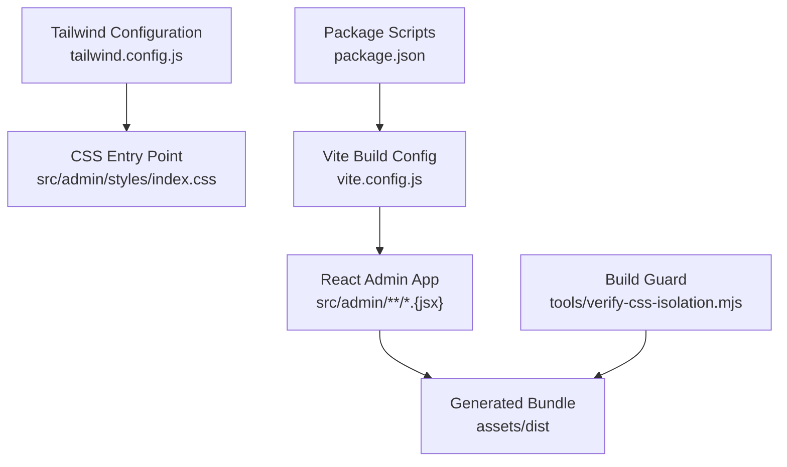
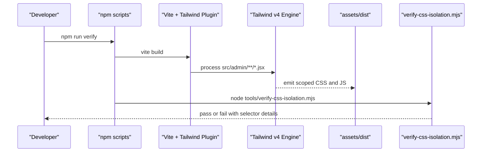
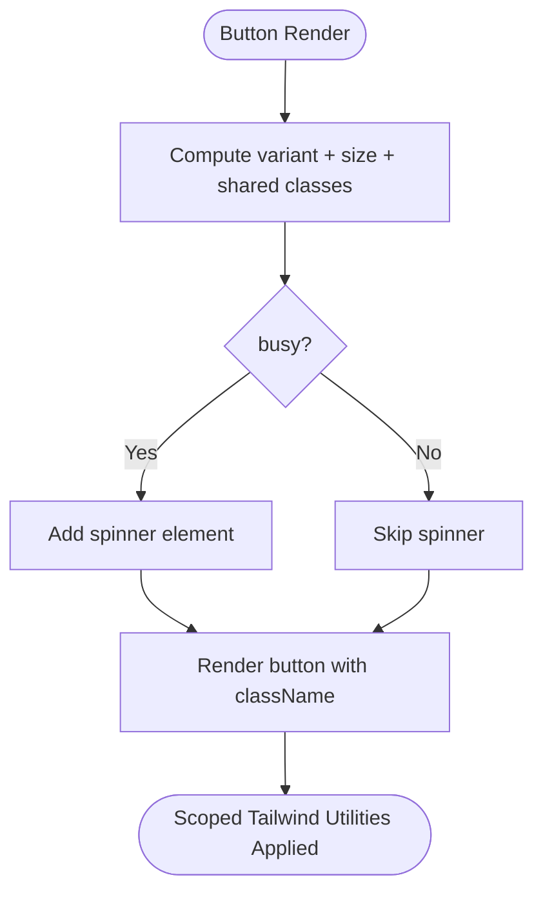
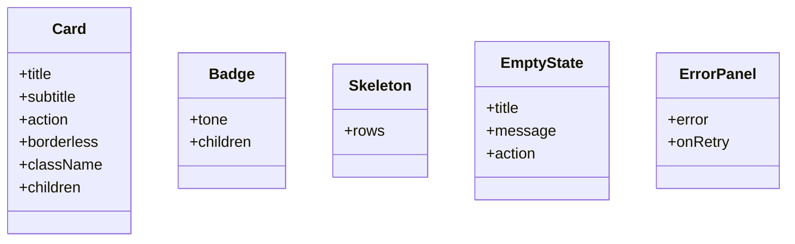
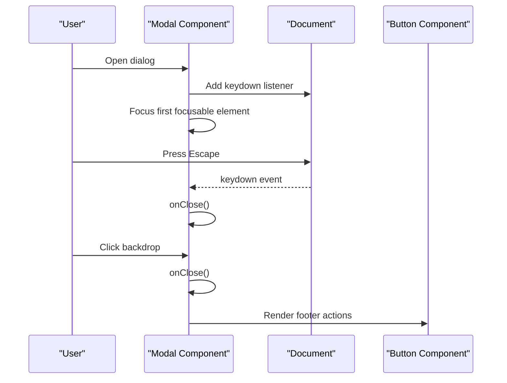
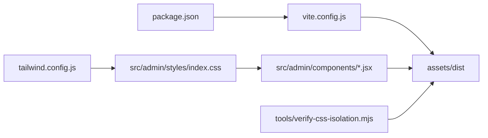

# Styling System

<cite>
**Referenced Files in This Document**
- [tailwind.config.js](file://tailwind.config.js)
- [vite.config.js](file://vite.config.js)
- [package.json](file://package.json)
- [src/admin/styles/index.css](file://src/admin/styles/index.css)
- [tools/verify-css-isolation.mjs](file://tools/verify-css-isolation.mjs)
- [src/admin/components/Button.jsx](file://src/admin/components/Button.jsx)
- [src/admin/components/Card.jsx](file://src/admin/components/Card.jsx)
- [src/admin/components/Modal.jsx](file://src/admin/components/Modal.jsx)
- [src/admin/components/AppShell.jsx](file://src/admin/components/AppShell.jsx)
- [simple-stack.php](file://simple-stack.php)
</cite>

## Table of Contents
1. [Introduction](#introduction)
2. [Project Structure](#project-structure)
3. [Core Components](#core-components)
4. [Architecture Overview](#architecture-overview)
5. [Detailed Component Analysis](#detailed-component-analysis)
6. [Dependency Analysis](#dependency-analysis)
7. [Performance Considerations](#performance-considerations)
8. [Troubleshooting Guide](#troubleshooting-guide)
9. [Conclusion](#conclusion)

## Introduction
This document explains Simple Stack’s styling system built with Tailwind CSS v4. The admin client is a React application mounted inside WordPress admin at the `#simplestack-admin` container. Tailwind generates scoped utilities so they cannot leak into or restyle the surrounding wp-admin chrome. The build pipeline uses Vite and the Tailwind v4 Vite plugin, producing a single bundled stylesheet under `assets/dist`.

Key goals:
- Keep all generated styles scoped to `#simplestack-admin`.
- Provide a consistent design token system for colors, typography, spacing, and radii.
- Use utility-first classes in components while keeping hand-written CSS minimal and intentionally scoped.
- Fail the build if any style escapes the mount point.
- Produce a reproducible production bundle without requiring Node tooling on deployment.

## Project Structure
The styling system lives primarily in three places:
- Tailwind configuration and theme tokens.
- The Vite build configuration that wires Tailwind v4 into the React app.
- The React component layer where Tailwind utilities are composed.

**Diagram sources**
- [tailwind.config.js:1-85](file://tailwind.config.js#L1-L85)
- [src/admin/styles/index.css:1-80](file://src/admin/styles/index.css#L1-L80)
- [vite.config.js:1-45](file://vite.config.js#L1-L45)
- [tools/verify-css-isolation.mjs:1-334](file://tools/verify-css-isolation.mjs#L1-L334)
- [package.json:1-25](file://package.json#L1-L25)

**Section sources**
- [tailwind.config.js:1-85](file://tailwind.config.js#L1-L85)
- [vite.config.js:1-45](file://vite.config.js#L1-L45)
- [package.json:1-25](file://package.json#L1-L25)

## Core Components
The styling system is composed of:
- **Configuration:** Tailwind v4 legacy config loaded from the CSS entry via `@config`. It sets the important selector, disables Preflight, and extends theme tokens.
- **CSS Entry:** Imports only Tailwind theme and utilities layers and adds a small scoped reset plus accessibility helpers.
- **Components:** Presentational React components compose Tailwind utilities for layout, color, typography, focus states, and motion.
- **Build Pipeline:** Vite compiles React and Tailwind into a single output directory and manifest.
- **Isolation Guard:** A Node script validates the final CSS to prevent leaks outside `#simplestack-admin`.

### Tailwind Configuration
Important behaviors:
- Content scanning targets `./src/admin/**/*.{js,jsx}` so only used utilities are emitted.
- Every utility is emitted with `important: '#simplestack-admin'`, making selectors like `#simplestack-admin .bg-brand-600`.
- Preflight is disabled because it would target global elements such as `html`, `body`, and `*`.
- Theme extensions define brand colors, ink tones, surface tokens, semantic colors, font families, and a card radius.

Design tokens include:
- Brand palette from light tints through deep accents.
- Ink scale for text and borders.
- Surface base, muted, and border tokens for backgrounds and outlines.
- Semantic positive, warning, and negative palettes.
- System-friendly sans-serif and monospace stacks.
- A reusable `card` border radius.

**Section sources**
- [tailwind.config.js:1-85](file://tailwind.config.js#L1-L85)

### CSS Entry and Scoped Reset
The CSS entry:
- Loads Tailwind theme and utilities explicitly rather than using the default import that pulls in Preflight.
- Uses Tailwind v4 cascade layers: `theme` and `utilities`.
- Adds a hand-written reset scoped to `#simplestack-admin` and its descendants.
- Normalizes headings, lists, images, links, buttons, and tables.
- Provides an `.ss-visually-hidden` utility for screen-reader-only content.

Why this matters:
- Tailwind’s layered CSS can still lose to unlayered author rules in wp-admin unless specificity is raised.
- The mount selector raises specificity above common wp-admin resets.
- Hand-written rules outside `@layer` ensure they beat unlayered wp-admin declarations.

**Section sources**
- [src/admin/styles/index.css:1-80](file://src/admin/styles/index.css#L1-L80)

### Build Pipeline
Vite configuration:
- Registers React and Tailwind plugins.
- Outputs bundles to `assets/dist`.
- Generates a manifest file so PHP can enqueue assets by filename hash.
- Disables CSS code splitting so there is one stylesheet chunk.
- Targets ES2020 and excludes duplicate dependencies shipped by WordPress.

Package scripts:
- `dev` runs the development server.
- `build` produces the production bundle.
- `verify:css` runs the isolation guard.
- `verify` builds and then verifies CSS isolation.

**Section sources**
- [vite.config.js:1-45](file://vite.config.js#L1-L45)
- [package.json:1-25](file://package.json#L1-L25)

### Isolation Guard
The verification script enforces:
- No top-level `html`, `body`, `*`, `:root`, or `::selection` selectors that actually style something.
- Every rule inside `@layer utilities` must be anchored on `#simplestack-admin`.
- At least one scoped utility must be emitted; otherwise, a silent empty Tailwind run passes checks.
- No unprocessed Tailwind directives remain in the output.
- The Vite manifest exists and lists a stylesheet.

It parses the final CSS, strips comments, collects rules with their at-rule context, distinguishes token-only declarations from real visual declarations, and reports violations with exact selectors.

**Section sources**
- [tools/verify-css-isolation.mjs:1-334](file://tools/verify-css-isolation.mjs#L1-L334)

## Architecture Overview
The styling architecture connects configuration, build, components, and validation.

**Diagram sources**
- [package.json:7-12](file://package.json#L7-L12)
- [vite.config.js:11-38](file://vite.config.js#L11-L38)
- [tailwind.config.js:11-20](file://tailwind.config.js#L11-L20)
- [tools/verify-css-isolation.mjs:215-334](file://tools/verify-css-isolation.mjs#L215-L334)

## Detailed Component Analysis

### Button Component
The Button component demonstrates how Tailwind utilities are composed safely inside the scoped mount point.

Key styling patterns:
- Variant map controls background, text, border, and hover states using brand and semantic tokens.
- Size map controls typography and padding.
- Shared classes provide layout, rounded corners, focus rings, transitions, and disabled states.
- Busy state renders a spinner using Tailwind animation utilities.

Scoping behavior:
- All utilities are scoped by `important: '#simplestack-admin'`, so they do not affect other buttons in wp-admin.

Accessibility:
- Focus-visible ring improves keyboard navigation.
- Spinner is marked `aria-hidden`.

**Diagram sources**
- [src/admin/components/Button.jsx:8-46](file://src/admin/components/Button.jsx#L8-L46)
- [src/admin/components/Button.jsx:48-58](file://src/admin/components/Button.jsx#L48-L58)

**Section sources**
- [src/admin/components/Button.jsx:1-60](file://src/admin/components/Button.jsx#L1-L60)

### Card, Badge, Skeleton, EmptyState, ErrorPanel
These presentational primitives share design tokens and utility patterns:
- Cards use the custom `card` radius, surface colors, and border tokens.
- Badges use semantic tone maps for status-like labels.
- Skeleton uses pulse animation and proportional widths.
- EmptyState provides a centered placeholder with optional action.
- ErrorPanel reuses negative tokens and includes a retry button.

Naming convention:
- Props control appearance through explicit options like `tone`, `borderless`, `rows`, and `title`.
- Styles are expressed as Tailwind utility strings rather than separate CSS files.

**Diagram sources**
- [src/admin/components/Card.jsx:21-40](file://src/admin/components/Card.jsx#L21-L40)
- [src/admin/components/Card.jsx:48-54](file://src/admin/components/Card.jsx#L48-L54)
- [src/admin/components/Card.jsx:61-73](file://src/admin/components/Card.jsx#L61-L73)
- [src/admin/components/Card.jsx:82-90](file://src/admin/components/Card.jsx#L82-L90)
- [src/admin/components/Card.jsx:100-120](file://src/admin/components/Card.jsx#L100-L120)

**Section sources**
- [src/admin/components/Card.jsx:1-121](file://src/admin/components/Card.jsx#L1-L121)

### Modal and ConfirmDialog
Modals are rendered into the app container instead of `document.body` so Tailwind-scoped utilities still match descendant elements.

Behavioral highlights:
- Escape key closes the dialog.
- First focusable element receives focus when opened.
- Backdrop click closes the modal.
- ConfirmDialog composes Modal with secondary and primary actions.

Styling highlights:
- Fixed overlay with z-index, background opacity, padding, and scroll handling.
- Dialog panel uses surface background, border, shadow, and card radius.
- Header and footer use consistent spacing and borders.

**Diagram sources**
- [src/admin/components/Modal.jsx:23-47](file://src/admin/components/Modal.jsx#L23-L47)
- [src/admin/components/Modal.jsx:53-86](file://src/admin/components/Modal.jsx#L53-L86)
- [src/admin/components/Modal.jsx:102-130](file://src/admin/components/Modal.jsx#L102-L130)

**Section sources**
- [src/admin/components/Modal.jsx:1-131](file://src/admin/components/Modal.jsx#L1-L131)

### AppShell
AppShell provides the application chrome: header, section navigation, breadcrumbs, and main content area.

Styling patterns:
- Full-height layout with muted background and padding.
- Typography uses the configured sans stack and ink tokens.
- Navigation buttons use active/inactive states based on current path.
- Breadcrumbs use compact spacing and hover states.

Integration note:
- The shell deliberately stays thin; WordPress owns page title, admin menu, and admin bar.

**Section sources**
- [src/admin/components/AppShell.jsx:1-88](file://src/admin/components/AppShell.jsx#L1-L88)

## Dependency Analysis
The styling system has clear boundaries between configuration, build, components, and validation.

**Diagram sources**
- [tailwind.config.js:1-85](file://tailwind.config.js#L1-L85)
- [src/admin/styles/index.css:1-80](file://src/admin/styles/index.css#L1-L80)
- [vite.config.js:1-45](file://vite.config.js#L1-L45)
- [package.json:1-25](file://package.json#L1-L25)
- [tools/verify-css-isolation.mjs:1-334](file://tools/verify-css-isolation.mjs#L1-L334)

**Section sources**
- [tailwind.config.js:1-85](file://tailwind.config.js#L1-L85)
- [vite.config.js:1-45](file://vite.config.js#L1-L45)
- [tools/verify-css-isolation.mjs:1-334](file://tools/verify-css-isolation.mjs#L1-L334)

## Performance Considerations
Optimization strategies already implemented:
- **Content-aware generation:** Tailwind scans only `src/admin/**/*.{js,jsx}`, so unused utilities are excluded.
- **Single stylesheet:** `cssCodeSplit: false` avoids multiple CSS round-trips and simplifies scoping.
- **Manifest-based asset loading:** The manifest allows precise asset versioning and prevents cache issues.
- **No Preflight:** Global resets are disabled to avoid unnecessary global rules and reduce risk of leaking styles.
- **Scoped reset:** Only the mount point is normalized, reducing CSS scope and complexity.

Recommended practices for large-scale styling systems:
- Prefer utility composition over new CSS files to keep the design system cohesive.
- Centralize tokens in Tailwind theme extensions rather than hardcoding values in components.
- Keep hand-written CSS minimal and scoped to the mount point.
- Run the isolation guard in CI to catch accidental global selectors early.
- Monitor bundle size changes when adding new tokens or components.

[No sources needed since this section provides general guidance]

## Troubleshooting Guide

### Tailwind Utilities Are Not Applied
Symptoms:
- Classes appear in JSX but no styles render.
- The build succeeds but the UI looks unstyled.

Likely causes:
- The content glob does not match the component files.
- The CSS entry is not imported by the app.
- The build output is not enqueued by WordPress.

Checks:
- Verify `content` in `tailwind.config.js` matches the source paths.
- Ensure the CSS entry imports Tailwind theme and utilities.
- Confirm the Vite build outputs to `assets/dist` and the manifest exists.

**Section sources**
- [tailwind.config.js:11-15](file://tailwind.config.js#L11-L15)
- [src/admin/styles/index.css:1-14](file://src/admin/styles/index.css#L1-L14)
- [vite.config.js:18-37](file://vite.config.js#L18-L37)

### Styles Leak Into wp-admin
Symptoms:
- wp-admin chrome is restyled.
- Global elements like `body` or `*` receive unexpected styles.

Likely causes:
- Preflight was enabled or imported.
- The important selector is missing or incorrect.
- Hand-written CSS targets global selectors.

Fixes:
- Keep `preflight: false` in Tailwind configuration.
- Keep `important: '#simplestack-admin'`.
- Scope all hand-written CSS to `#simplestack-admin`.
- Run `npm run verify:css` to detect leaks.

**Section sources**
- [tailwind.config.js:11-20](file://tailwind.config.js#L11-L20)
- [src/admin/styles/index.css:3-23](file://src/admin/styles/index.css#L3-L23)
- [tools/verify-css-isolation.mjs:269-312](file://tools/verify-css-isolation.mjs#L269-L312)

### Build Fails During Isolation Verification
Symptoms:
- `verify-css-isolation` exits with errors listing selectors.

Common violations:
- Top-level `html`, `body`, `*`, or `:root` selectors with real declarations.
- Utility selectors not anchored on `#simplestack-admin`.
- Unprocessed Tailwind directives remaining in output.
- Missing manifest or stylesheet.

Resolution steps:
- Remove or scope global selectors.
- Restore the correct important selector.
- Rebuild the project.
- Inspect the reported selectors to locate the offending rule.

**Section sources**
- [tools/verify-css-isolation.mjs:31-32](file://tools/verify-css-isolation.mjs#L31-L32)
- [tools/verify-css-isolation.mjs:262-312](file://tools/verify-css-isolation.mjs#L262-L312)

### Dark Mode Support
Current state:
- The repository defines light-mode-oriented tokens such as surface base, muted, and border colors.
- There is no explicit dark mode configuration in Tailwind or theme layers.
- Components rely on those tokens rather than dark-mode variants.

Recommended approach:
- Extend the Tailwind theme with dark-mode color tokens.
- Apply dark-mode variants conditionally using Tailwind’s dark mode strategy.
- Keep all dark-mode rules scoped to `#simplestack-admin`.
- Validate with the isolation guard after adding dark-mode utilities.

[No sources needed since this section proposes future improvements without analyzing specific files]

### Cross-Browser Compatibility
Guidance:
- Target ES2020 in the build configuration.
- Avoid browser-specific hacks; prefer standard properties and Tailwind utilities.
- Test focus-visible, animations, and grid/flex layouts across supported browsers.
- Keep hand-written CSS minimal to reduce compatibility surface area.

[No sources needed since this section provides general guidance]

## Conclusion
Simple Stack’s styling system is a focused, safety-first implementation of Tailwind CSS v4 inside WordPress admin. It uses a mount-point scoping strategy, explicit Tailwind layer imports, a minimal scoped reset, and a build-time isolation guard to protect the admin chrome. Components express design intent through Tailwind utilities backed by a shared token set. The Vite build produces a reproducible bundle, and the verification script ensures that styling remains isolated. For future growth, maintain strict scoping, centralize tokens, and continue validating the output during development and CI.

[No sources needed since this section summarizes without analyzing specific files]