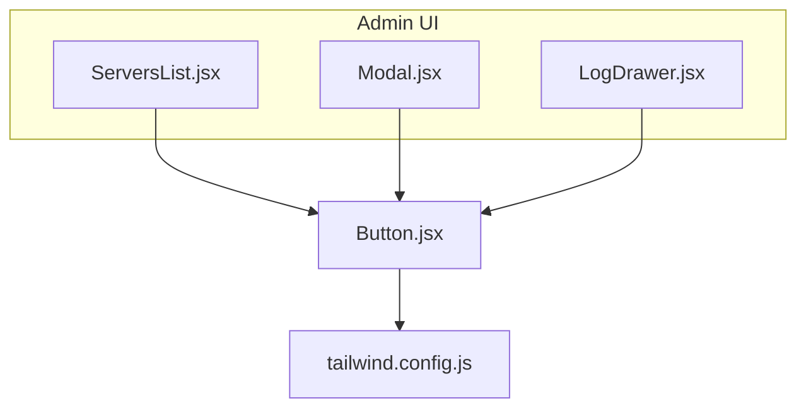
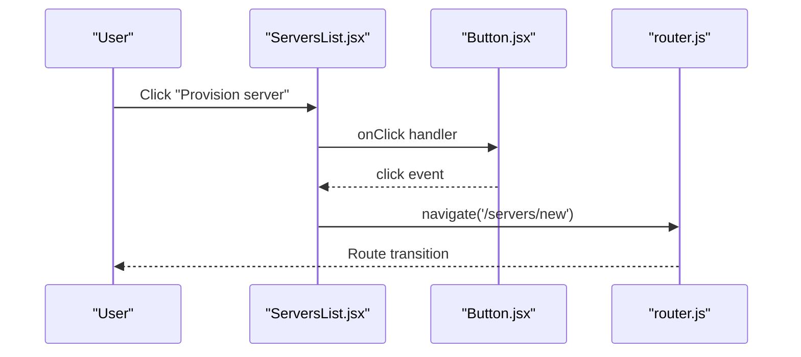
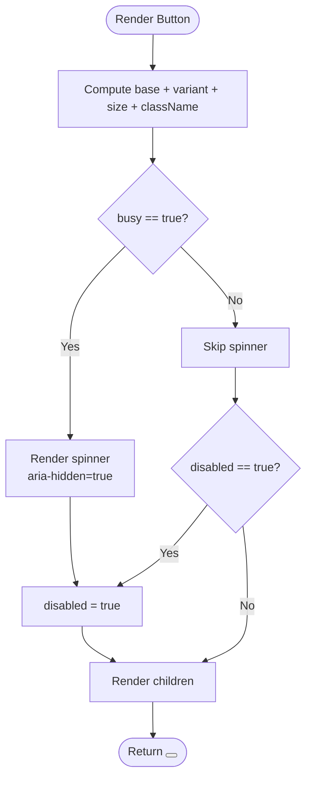
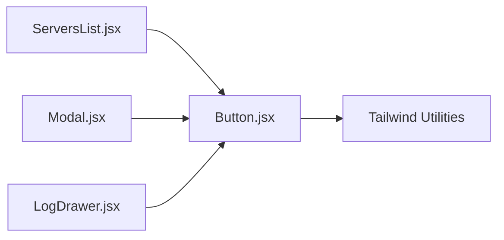

# Button Component

<cite>
**Referenced Files in This Document**
- [Button.jsx](file://src/admin/components/Button.jsx)
- [ServersList.jsx](file://src/admin/routes/ServersList.jsx)
- [Modal.jsx](file://src/admin/components/Modal.jsx)
- [LogDrawer.jsx](file://src/admin/components/LogDrawer.jsx)
- [tailwind.config.js](file://tailwind.config.js)
</cite>

## Table of Contents
1. [Introduction](#introduction)
2. [Project Structure](#project-structure)
3. [Core Components](#core-components)
4. [Architecture Overview](#architecture-overview)
5. [Detailed Component Analysis](#detailed-component-analysis)
6. [Dependency Analysis](#dependency-analysis)
7. [Performance Considerations](#performance-considerations)
8. [Troubleshooting Guide](#troubleshooting-guide)
9. [Conclusion](#conclusion)

## Introduction
This document provides comprehensive documentation for the Button component used across the admin interface. It covers all available props, variant and size options, disabled and loading states, icon support patterns, event handling, accessibility features, responsive behavior, and integration examples with other components.

## Project Structure
The Button component is a small, focused React component styled with Tailwind CSS utilities scoped to the admin area. It is consumed by several routes and UI components such as modals, drawers, and list pages.

**Diagram sources**
- [Button.jsx:1-60](file://src/admin/components/Button.jsx#L1-L60)
- [ServersList.jsx:11-11](file://src/admin/routes/ServersList.jsx#L11-L11)
- [Modal.jsx:10-10](file://src/admin/components/Modal.jsx#L10-L10)
- [LogDrawer.jsx:15-15](file://src/admin/components/LogDrawer.jsx#L15-L15)
- [tailwind.config.js:1-85](file://tailwind.config.js#L1-L85)

**Section sources**
- [Button.jsx:1-60](file://src/admin/components/Button.jsx#L1-L60)
- [tailwind.config.js:1-85](file://tailwind.config.js#L1-L85)

## Core Components
The Button component renders a native `<button>` element with Tailwind utility classes. It supports variants, sizes, busy/loading state, disabled state, custom className, and forwards additional props to the underlying button.

Key behaviors:
- Variants: primary, secondary, ghost, danger
- Sizes: sm, md
- Busy (loading): shows an inline spinner and disables the button
- Disabled: can be set directly or inferred from busy
- Focus ring: visible focus indicator for keyboard navigation
- Spacing: internal gap between spinner and children content

Props reference:
- variant: string — one of primary | secondary | ghost | danger; defaults to secondary
- size: string — one of sm | md; defaults to md
- busy: boolean — shows spinner and disables the button when true
- disabled: boolean — explicitly disables the button
- className: string — additional classes appended to the button
- type: string — HTML button type; defaults to button
- children: node — button label or content
- ...rest: object — forwarded to the underlying button element

Styling notes:
- All Tailwind utilities are scoped under #simplestack-admin to avoid leaking into wp-admin chrome.
- The component uses semantic color tokens like brand, surface, ink, negative, etc., defined in the Tailwind config.

**Section sources**
- [Button.jsx:8-18](file://src/admin/components/Button.jsx#L8-L18)
- [Button.jsx:20-46](file://src/admin/components/Button.jsx#L20-L46)
- [Button.jsx:48-59](file://src/admin/components/Button.jsx#L48-L59)
- [tailwind.config.js:11-20](file://tailwind.config.js#L11-L20)
- [tailwind.config.js:22-83](file://tailwind.config.js#L22-L83)

## Architecture Overview
The Button component is a leaf UI primitive. Higher-level components compose it to provide actions like navigation, confirmation, refresh, and download.

**Diagram sources**
- [ServersList.jsx:134-136](file://src/admin/routes/ServersList.jsx#L134-L136)
- [Button.jsx:48-59](file://src/admin/components/Button.jsx#L48-L59)

## Detailed Component Analysis

### Props and Behavior
- Variant mapping:
  - primary: brand-colored background and border with hover states
  - secondary: neutral surface background with subtle hover
  - ghost: transparent background with text-focused hover
  - danger: negative-toned text and border with hover
- Size mapping:
  - sm: smaller text and padding
  - md: default text and padding
- Busy state:
  - Renders a small animated spinner before children
  - Disables the button automatically
- Disabled state:
  - Cursor becomes not-allowed and opacity reduces
- Accessibility:
  - Uses native <button> semantics
  - Provides visible focus ring via focus-visible utilities
  - Spinner is marked aria-hidden so screen readers ignore it
- Styling composition:
  - Base classes ensure consistent layout, rounded corners, borders, font weight, and transitions
  - Variant and size classes are conditionally applied
  - className prop allows further customization

**Diagram sources**
- [Button.jsx:37-46](file://src/admin/components/Button.jsx#L37-L46)
- [Button.jsx:48-59](file://src/admin/components/Button.jsx#L48-L59)

**Section sources**
- [Button.jsx:8-18](file://src/admin/components/Button.jsx#L8-L18)
- [Button.jsx:20-46](file://src/admin/components/Button.jsx#L20-L46)
- [Button.jsx:48-59](file://src/admin/components/Button.jsx#L48-L59)

### Practical Usage Examples

- Primary action button that navigates to a new route:
  - See usage in the servers list header.
  - Reference: [ServersList.jsx:134-136](file://src/admin/routes/ServersList.jsx#L134-L136)

- Ghost button with loading state:
  - Used to refresh data while showing a spinner.
  - Reference: [ServersList.jsx:179-181](file://src/admin/routes/ServersList.jsx#L179-L181)

- Small buttons for pagination:
  - Previous and Next buttons with disabled logic based on current page.
  - References: [ServersList.jsx:202-211](file://src/admin/routes/ServersList.jsx#L202-L211)

- Modal close button:
  - Ghost button with small size inside a modal header.
  - Reference: [Modal.jsx:72-74](file://src/admin/components/Modal.jsx#L72-L74)

- Confirmation dialog buttons:
  - Cancel (secondary) and Confirm (primary) with busy state passed through.
  - References: [Modal.jsx:118-123](file://src/admin/components/Modal.jsx#L118-L123)

- Drawer controls:
  - Refresh, Download, and Hide buttons using ghost style and small size.
  - References: [LogDrawer.jsx:142-150](file://src/admin/components/LogDrawer.jsx#L142-L150)

### Event Handling Patterns
- Navigation:
  - Buttons trigger routing functions to move between screens.
  - Example: [ServersList.jsx:134-136](file://src/admin/routes/ServersList.jsx#L134-L136)
- Data refresh:
  - Buttons call API fetch functions and pass busy state to show loading indicators.
  - Example: [ServersList.jsx:179-181](file://src/admin/routes/ServersList.jsx#L179-L181)
- Dialog actions:
  - Confirm and cancel handlers are wired to confirm/cancel callbacks.
  - Example: [Modal.jsx:118-123](file://src/admin/components/Modal.jsx#L118-L123)

### Icon Support
- Built-in spinner:
  - When busy is true, an inline spinner is rendered before the children.
  - Reference: [Button.jsx:50-55](file://src/admin/components/Button.jsx#L50-L55)
- Custom icons:
  - Place any icon element or SVG as children alongside text.
  - The component’s base spacing ensures proper alignment with the spinner if busy is also used.
  - Reference: [Button.jsx:37-46](file://src/admin/components/Button.jsx#L37-L46)

### Accessibility Features
- Keyboard navigation:
  - Native <button> elements are focusable and operable via Enter/Space.
  - Visible focus ring provided by focus-visible utilities.
  - Reference: [Button.jsx:37-46](file://src/admin/components/Button.jsx#L37-L46)
- Screen reader support:
  - Spinner is hidden from assistive technologies via aria-hidden.
  - Reference: [Button.jsx:50-55](file://src/admin/components/Button.jsx#L50-L55)
- ARIA attributes:
  - The component itself does not add extra ARIA roles; rely on native semantics.
  - Parent components may add ARIA attributes where appropriate (e.g., modal dialogs).
  - Reference: [Modal.jsx:63-68](file://src/admin/components/Modal.jsx#L63-L68)

### Responsive Behavior
- Layout:
  - Inline-flex layout adapts to container width.
  - Internal gap ensures consistent spacing between spinner and content.
- Typography and sizing:
  - Size variants adjust font size and padding for different contexts.
- Tailwind scoping:
  - Utilities are scoped to #simplestack-admin to prevent affecting global admin styles.
  - Reference: [tailwind.config.js:11-20](file://tailwind.config.js#L11-L20)

### Integration With Other Components
- Modals:
  - Use ghost and primary variants for close and confirm actions.
  - Reference: [Modal.jsx:72-74](file://src/admin/components/Modal.jsx#L72-L74), [Modal.jsx:118-123](file://src/admin/components/Modal.jsx#L118-L123)
- Drawers:
  - Use ghost buttons for auxiliary actions like refresh and download.
  - Reference: [LogDrawer.jsx:142-150](file://src/admin/components/LogDrawer.jsx#L142-L150)
- Lists and tables:
  - Use small sizes for pagination and compact controls.
  - Reference: [ServersList.jsx:202-211](file://src/admin/routes/ServersList.jsx#L202-L211)

**Section sources**
- [ServersList.jsx:134-136](file://src/admin/routes/ServersList.jsx#L134-L136)
- [ServersList.jsx:179-181](file://src/admin/routes/ServersList.jsx#L179-L181)
- [ServersList.jsx:202-211](file://src/admin/routes/ServersList.jsx#L202-L211)
- [Modal.jsx:72-74](file://src/admin/components/Modal.jsx#L72-L74)
- [Modal.jsx:118-123](file://src/admin/components/Modal.jsx#L118-L123)
- [LogDrawer.jsx:142-150](file://src/admin/components/LogDrawer.jsx#L142-L150)
- [Button.jsx:37-59](file://src/admin/components/Button.jsx#L37-L59)
- [tailwind.config.js:11-20](file://tailwind.config.js#L11-L20)

## Dependency Analysis
The Button component has minimal external dependencies:
- Tailwind CSS utilities for styling
- No runtime libraries beyond React

Consumers import Button directly and pass props to control appearance and behavior.

**Diagram sources**
- [Button.jsx:1-60](file://src/admin/components/Button.jsx#L1-L60)
- [ServersList.jsx:11-11](file://src/admin/routes/ServersList.jsx#L11-L11)
- [Modal.jsx:10-10](file://src/admin/components/Modal.jsx#L10-L10)
- [LogDrawer.jsx:15-15](file://src/admin/components/LogDrawer.jsx#L15-L15)

**Section sources**
- [Button.jsx:1-60](file://src/admin/components/Button.jsx#L1-L60)
- [ServersList.jsx:11-11](file://src/admin/routes/ServersList.jsx#L11-L11)
- [Modal.jsx:10-10](file://src/admin/components/Modal.jsx#L10-L10)
- [LogDrawer.jsx:15-15](file://src/admin/components/LogDrawer.jsx#L15-L15)

## Performance Considerations
- Lightweight component:
  - Renders a single button element with conditional spinner.
  - Minimal re-renders due to simple prop-driven logic.
- Styling performance:
  - Tailwind utilities are precomputed at build time; no runtime CSS calculations.
- Scoping isolation:
  - Scoped utilities reduce unintended style conflicts and repaints outside the app container.

[No sources needed since this section provides general guidance]

## Troubleshooting Guide
- Button not clickable:
  - Ensure disabled is false or busy is false.
  - Verify onClick handlers are attached correctly.
  - Reference: [Button.jsx:48-59](file://src/admin/components/Button.jsx#L48-L59)
- Spinner not visible:
  - Confirm busy prop is true.
  - Check that children are present; spinner appears before children.
  - Reference: [Button.jsx:50-55](file://src/admin/components/Button.jsx#L50-L55)
- Styles not applying:
  - Verify Tailwind is configured with important selector #simplestack-admin.
  - Ensure your component tree is mounted within the scoped container.
  - Reference: [tailwind.config.js:11-20](file://tailwind.config.js#L11-L20)
- Focus ring missing:
  - Confirm focus-visible utilities are included and not overridden.
  - Reference: [Button.jsx:37-46](file://src/admin/components/Button.jsx#L37-L46)

**Section sources**
- [Button.jsx:37-59](file://src/admin/components/Button.jsx#L37-L59)
- [tailwind.config.js:11-20](file://tailwind.config.js#L11-L20)

## Conclusion
The Button component is a concise, accessible, and customizable primitive for building consistent user interactions across the admin interface. It integrates seamlessly with Tailwind CSS, supports common variants and sizes, handles loading and disabled states, and provides solid accessibility foundations. Use it to create clear calls to action, control flows, and interactive surfaces throughout the application.

[No sources needed since this section summarizes without analyzing specific files]