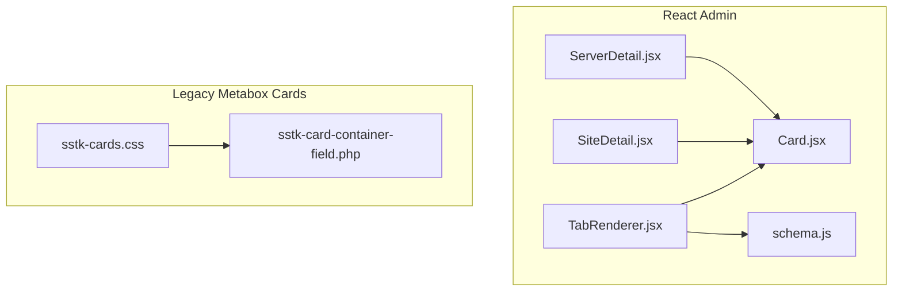
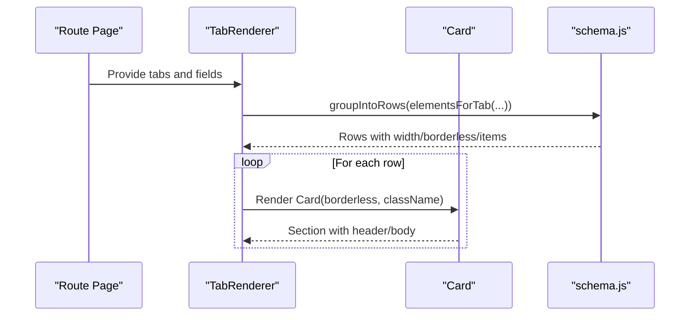
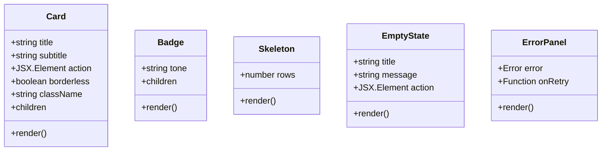
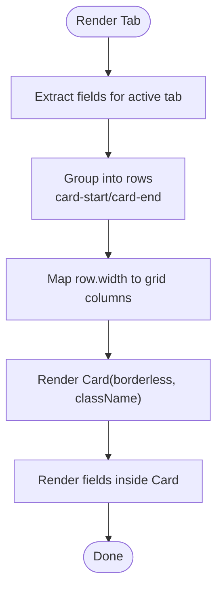
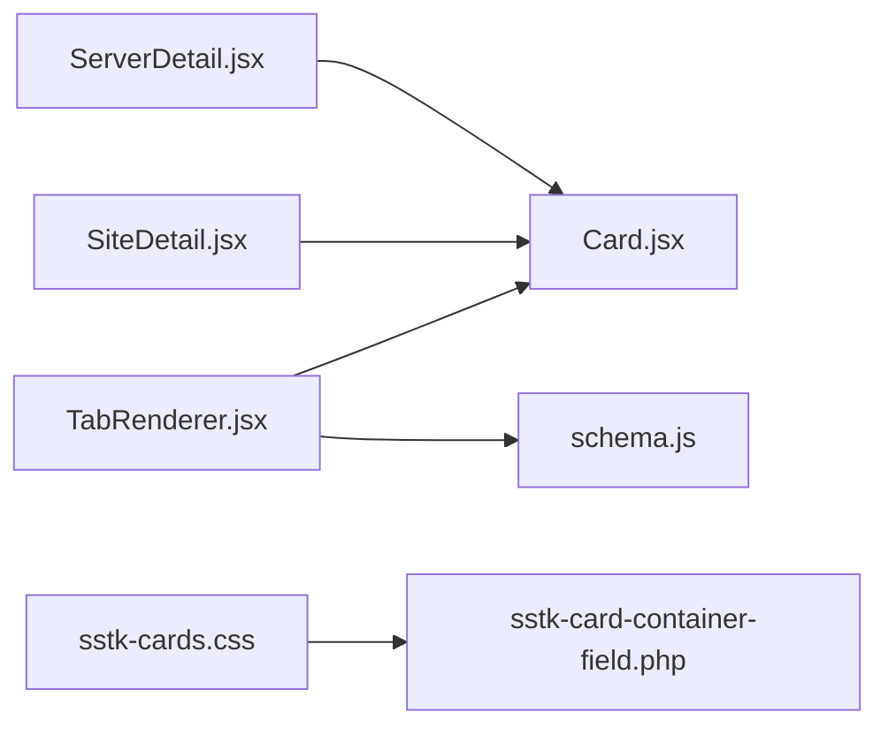

# Card Component

<cite>
**Referenced Files in This Document**
- [Card.jsx](file://src/admin/components/Card.jsx)
- [TabRenderer.jsx](file://src/admin/components/TabRenderer.jsx)
- [schema.js](file://src/admin/lib/schema.js)
- [ServerDetail.jsx](file://src/admin/routes/ServerDetail.jsx)
- [SiteDetail.jsx](file://src/admin/routes/SiteDetail.jsx)
- [sstk-cards.css](file://assets/css/sstk-cards.css)
- [sstk-card-container-field.php](file://includes/core/metabox-io-custom-fields/sstk-card-container-field.php)
</cite>

## Table of Contents
1. [Introduction](#introduction)
2. [Project Structure](#project-structure)
3. [Core Components](#core-components)
4. [Architecture Overview](#architecture-overview)
5. [Detailed Component Analysis](#detailed-component-analysis)
6. [Dependency Analysis](#dependency-analysis)
7. [Performance Considerations](#performance-considerations)
8. [Troubleshooting Guide](#troubleshooting-guide)
9. [Conclusion](#conclusion)

## Introduction
This document explains the Card component system used across the admin interface. It covers the React-based Card primitive, its related presentational components, how cards are composed into tabbed forms and detail pages, and the legacy CSS card layout used by metabox-driven screens. The goal is to help you understand card structure, configuration options, common usage patterns, responsive behavior, overflow handling, and accessibility considerations.

## Project Structure
The card system spans three layers:
- React primitives for modern admin UIs under `src/admin/components`.
- A schema-driven tab renderer that groups fields into card rows.
- Legacy metabox card styling and container support under `assets/css` and PHP.

**Diagram sources**
- [Card.jsx:1-121](file://src/admin/components/Card.jsx#L1-L121)
- [TabRenderer.jsx:1-403](file://src/admin/components/TabRenderer.jsx#L1-L403)
- [schema.js:386-423](file://src/admin/lib/schema.js#L386-L423)
- [ServerDetail.jsx:1-250](file://src/admin/routes/ServerDetail.jsx#L1-L250)
- [SiteDetail.jsx:1-200](file://src/admin/routes/SiteDetail.jsx#L1-L200)
- [sstk-cards.css:1-197](file://assets/css/sstk-cards.css#L1-L197)
- [sstk-card-container-field.php:1-27](file://includes/core/metabox-io-custom-fields/sstk-card-container-field.php#L1-L27)

**Section sources**
- [Card.jsx:1-121](file://src/admin/components/Card.jsx#L1-L121)
- [TabRenderer.jsx:1-403](file://src/admin/components/TabRenderer.jsx#L1-L403)
- [schema.js:386-423](file://src/admin/lib/schema.js#L386-L423)
- [sstk-cards.css:1-197](file://assets/css/sstk-cards.css#L1-L197)
- [sstk-card-container-field.php:1-27](file://includes/core/metabox-io-custom-fields/sstk-card-container-field.php#L1-L27)

## Core Components
The React card system provides a small set of presentational primitives:
- Card: A sectioned container with optional header (title, subtitle, action), borderless mode, and custom class injection.
- Badge: A small status label with tone variants.
- Skeleton: Placeholder blocks for loading states.
- EmptyState: Centered message panel for empty data scenarios.
- ErrorPanel: Inline error display with optional retry action.

Key behaviors:
- Card renders a `<section>` with rounded corners and optional border/padding.
- Header appears only when title or action is provided.
- Children content fills the body area.
- Borderless mode removes default border and padding while keeping rounded corners.
- Tone-based Badge styles map to semantic color tokens.

Common usage patterns:
- Data cards: Title + grid of key-value pairs using definition lists.
- Form cards: Grouped controls rendered by TabRenderer inside card rows.
- Dashboard widgets: Compact panels with badges and actions.

Accessibility highlights:
- Card uses semantic `<section>` and `<header>` elements.
- Headings are level-appropriate (`<h2>`).
- ErrorPanel includes an accessible button for retry.
- Skeleton uses `aria-hidden="true"` so placeholders do not announce to screen readers.

**Section sources**
- [Card.jsx:13-40](file://src/admin/components/Card.jsx#L13-L40)
- [Card.jsx:42-54](file://src/admin/components/Card.jsx#L42-L54)
- [Card.jsx:56-73](file://src/admin/components/Card.jsx#L56-L73)
- [Card.jsx:75-90](file://src/admin/components/Card.jsx#L75-L90)
- [Card.jsx:92-120](file://src/admin/components/Card.jsx#L92-L120)

## Architecture Overview
Cards are used in two primary ways:
1. Directly in route-level detail pages for overview panels and informational sections.
2. Indirectly through TabRenderer, which groups form fields into card rows based on a field schema.

**Diagram sources**
- [TabRenderer.jsx:78-81](file://src/admin/components/TabRenderer.jsx#L78-L81)
- [schema.js:395-423](file://src/admin/lib/schema.js#L395-L423)
- [TabRenderer.jsx:176-207](file://src/admin/components/TabRenderer.jsx#L176-L207)

## Detailed Component Analysis

### Card Component
Responsibilities:
- Provide a consistent visual container for grouped content.
- Support optional header with title, subtitle, and action slot.
- Offer borderless mode for seamless layouts.
- Allow additional classes via `className`.

Props:
- title: Card heading text.
- subtitle: Optional supporting line below the title.
- action: Optional JSX element placed in the header’s right side.
- borderless: Boolean to remove border and padding.
- className: Additional Tailwind classes.
- children: Body content.

Structure:
- Root: `<section>` with rounded corners and conditional border/background/padding.
- Header: `<header>` containing title/subtitle and action; hidden if neither title nor action is provided.
- Body: Renders children.

Styling approach:
- Uses Tailwind utility classes for spacing, typography, borders, and colors.
- Applies a base rounded corner class and conditional border/background/padding.

Accessibility:
- Semantic HTML improves screen reader navigation.
- Heading levels are appropriate for page hierarchy.

Usage examples:
- Data card: Wrap a grid of details with a title.
- Info card: Use borderless mode to embed controls without extra chrome.
- Error state: Use ErrorPanel for inline errors with retry.

**Section sources**
- [Card.jsx:13-40](file://src/admin/components/Card.jsx#L13-L40)

#### Class Diagram

**Diagram sources**
- [Card.jsx:13-120](file://src/admin/components/Card.jsx#L13-L120)

### TabRenderer and Card Rows
Responsibilities:
- Render tabs and their fields.
- Group fields into card rows using schema rules.
- Apply width presets (full, half, third, two-thirds).
- Pass `borderless` from schema to Card.

Row grouping logic:
- Fields are split into rows at `card-start` and `card-end` markers.
- Each row carries width and borderless flags.
- Width maps to responsive grid columns.

Rendering flow:
- Active tab fields are extracted.
- Rows are computed.
- Each row renders a Card wrapping its fields.

**Diagram sources**
- [TabRenderer.jsx:78-81](file://src/admin/components/TabRenderer.jsx#L78-L81)
- [schema.js:395-423](file://src/admin/lib/schema.js#L395-L423)
- [TabRenderer.jsx:176-207](file://src/admin/components/TabRenderer.jsx#L176-L207)

**Section sources**
- [TabRenderer.jsx:26-31](file://src/admin/components/TabRenderer.jsx#L26-L31)
- [TabRenderer.jsx:78-81](file://src/admin/components/TabRenderer.jsx#L78-L81)
- [TabRenderer.jsx:176-207](file://src/admin/components/TabRenderer.jsx#L176-L207)
- [schema.js:395-423](file://src/admin/lib/schema.js#L395-L423)

### Legacy Metabox Card Layout
Purpose:
- Style metabox-generated card containers and control widths.
- Provide hover/focus effects and responsive breakpoints.
- Hide pseudo container rows introduced by metabox column add-ons.

Key features:
- `.sstk-card-group`: Base card container with background, border, radius, padding, and shadow.
- Hover/focus: Enhanced shadow and accent border color.
- Width utilities: Full, half, third, two-thirds with responsive adjustments.
- Flex wrappers: Specific tab panels use flex-wrap to arrange cards.
- Spacing: Button icon spacing inside cards.

Responsive behavior:
- At smaller viewports, half/third/two-thirds collapse toward full width.
- Flex wrapping ensures cards reflow naturally.

Metabox integration:
- Hides the first pseudo row after `.sstk-card-group`.
- Provides a no-border variant for seamless headings.

Custom container field:
- A placeholder field that outputs a comment marker to allow metabox column logic to inject wrapper divs around card content.

**Section sources**
- [sstk-cards.css:8-28](file://assets/css/sstk-cards.css#L8-L28)
- [sstk-cards.css:30-63](file://assets/css/sstk-cards.css#L30-L63)
- [sstk-cards.css:65-93](file://assets/css/sstk-cards.css#L65-L93)
- [sstk-cards.css:100-103](file://assets/css/sstk-cards.css#L100-L103)
- [sstk-cards.css:105-152](file://assets/css/sstk-cards.css#L105-L152)
- [sstk-cards.css:169-172](file://assets/css/sstk-cards.css#L169-L172)
- [sstk-card-container-field.php:4-27](file://includes/core/metabox-io-custom-fields/sstk-card-container-field.php#L4-L27)

### Usage in Detail Pages
Overview cards:
- Server and Site detail pages render overview cards with grids of key-value pairs.
- Badges indicate status and health.
- Actions include navigation and log toggles.

Loading and error states:
- Skeleton placeholders appear inside Card during load.
- ErrorPanel displays server-side errors with a retry action.

Patterns demonstrated:
- Data card: Overview panel with structured metadata.
- Widget card: Informational panel explaining tab behavior.
- Action card: Header with buttons for secondary actions.

**Section sources**
- [ServerDetail.jsx:94-109](file://src/admin/routes/ServerDetail.jsx#L94-L109)
- [ServerDetail.jsx:131-172](file://src/admin/routes/ServerDetail.jsx#L131-L172)
- [ServerDetail.jsx:238-249](file://src/admin/routes/ServerDetail.jsx#L238-L249)
- [SiteDetail.jsx:91-107](file://src/admin/routes/SiteDetail.jsx#L91-L107)
- [SiteDetail.jsx:130-156](file://src/admin/routes/SiteDetail.jsx#L130-L156)

## Dependency Analysis
Component relationships:
- Routes import Card primitives directly for overview panels and error/skeleton states.
- TabRenderer composes Card for each row of fields.
- schema.js defines row grouping logic consumed by TabRenderer.
- Legacy CSS and PHP provide metabox card styling and container hooks.

**Diagram sources**
- [ServerDetail.jsx:17](file://src/admin/routes/ServerDetail.jsx#L17)
- [SiteDetail.jsx:17](file://src/admin/routes/SiteDetail.jsx#L17)
- [TabRenderer.jsx:16](file://src/admin/components/TabRenderer.jsx#L16)
- [schema.js:395-423](file://src/admin/lib/schema.js#L395-L423)
- [sstk-cards.css:1-197](file://assets/css/sstk-cards.css#L1-L197)
- [sstk-card-container-field.php:1-27](file://includes/core/metabox-io-custom-fields/sstk-card-container-field.php#L1-L27)

**Section sources**
- [ServerDetail.jsx:17](file://src/admin/routes/ServerDetail.jsx#L17)
- [SiteDetail.jsx:17](file://src/admin/routes/SiteDetail.jsx#L17)
- [TabRenderer.jsx:16](file://src/admin/components/TabRenderer.jsx#L16)
- [schema.js:395-423](file://src/admin/lib/schema.js#L395-L423)

## Performance Considerations
- Card rendering is lightweight and relies on Tailwind utilities; avoid excessive nested components inside Card bodies to keep DOM shallow.
- Skeleton animations are simple CSS pulses; limit the number of rows to reduce repaint cost.
- TabRenderer computes rows per active tab; ensure field arrays are not excessively large to avoid unnecessary recomputation.
- Legacy metabox cards apply shadows and hover effects; be mindful of many stacked cards on a single page.

[No sources needed since this section provides general guidance]

## Troubleshooting Guide
Common issues and resolutions:
- Card header not visible: Ensure either `title` or `action` is provided; otherwise, the header block is intentionally omitted.
- Borderless layout not applied: Verify `borderless={true}` is passed to Card and that no overriding classes force borders.
- Row widths not responding: Check schema row definitions and confirm width values match supported presets (`full`, `half`, `third`, `two-thirds`).
- Metabox card layout broken: Confirm `.sstk-card-group` is present and that pseudo rows are hidden as expected; verify responsive breakpoints in the stylesheet.
- Empty or error states not showing: Ensure Skeleton is wrapped in Card during loading and ErrorPanel receives a valid error object with optional retry handler.

**Section sources**
- [Card.jsx:21-39](file://src/admin/components/Card.jsx#L21-L39)
- [TabRenderer.jsx:176-207](file://src/admin/components/TabRenderer.jsx#L176-L207)
- [sstk-cards.css:100-103](file://assets/css/sstk-cards.css#L100-L103)

## Conclusion
The Card component system provides a flexible foundation for both modern React admin interfaces and legacy metabox-driven screens. The React Card offers a clean, semantic container with optional header and borderless mode, while TabRenderer integrates it into schema-driven forms. The legacy CSS layer ensures consistent card appearance and responsive behavior within metabox contexts. Together, these pieces enable data cards, form cards, and dashboard widgets with clear structure, accessible markup, and predictable styling.

[No sources needed since this section summarizes without analyzing specific files]