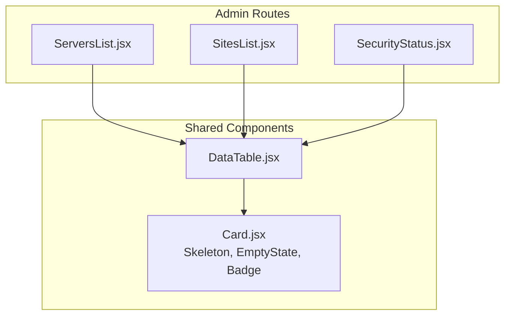
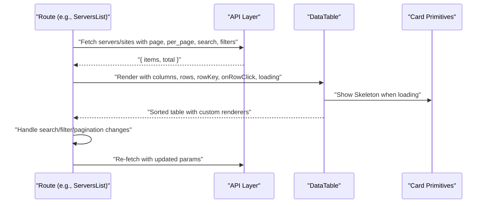
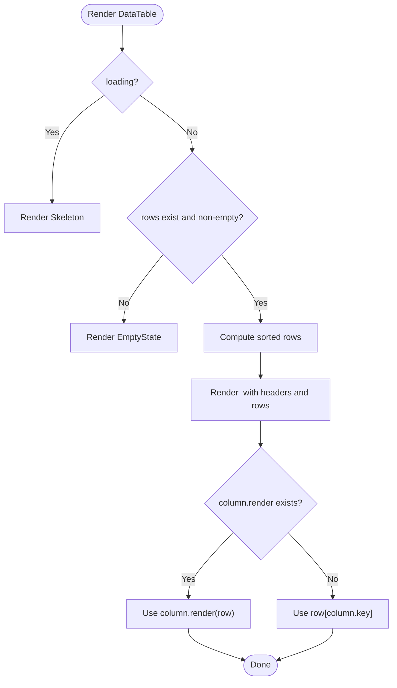
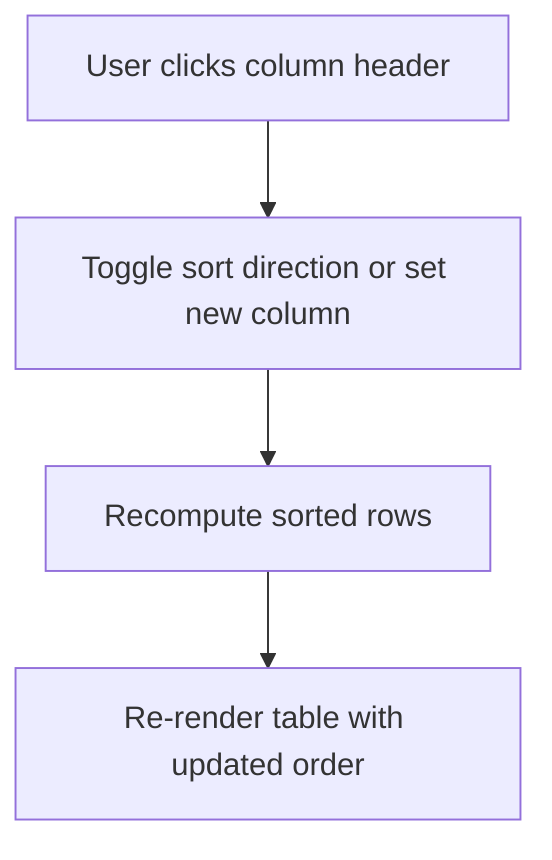
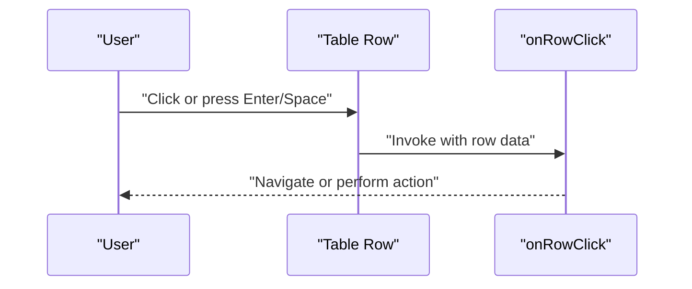
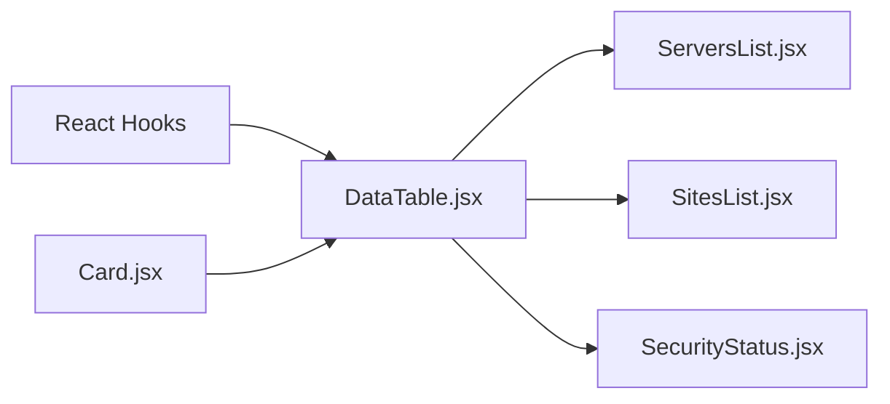

# DataTable Component

<cite>
**Referenced Files in This Document**
- [DataTable.jsx](file://src/admin/components/DataTable.jsx)
- [Card.jsx](file://src/admin/components/Card.jsx)
- [ServersList.jsx](file://src/admin/routes/ServersList.jsx)
- [SitesList.jsx](file://src/admin/routes/SitesList.jsx)
- [SecurityStatus.jsx](file://src/admin/routes/SecurityStatus.jsx)
</cite>

## Table of Contents
1. [Introduction](#introduction)
2. [Project Structure](#project-structure)
3. [Core Components](#core-components)
4. [Architecture Overview](#architecture-overview)
5. [Detailed Component Analysis](#detailed-component-analysis)
6. [Dependency Analysis](#dependency-analysis)
7. [Performance Considerations](#performance-considerations)
8. [Troubleshooting Guide](#troubleshooting-guide)
9. [Conclusion](#conclusion)

## Introduction
This document provides comprehensive documentation for the DataTable component used across the admin interface. It explains how data is bound, how columns are configured, and how sorting works. It also documents row selection via keyboard and mouse, custom cell rendering, empty and loading states, and how consuming routes implement search, filtering, pagination, and navigation. Where features such as virtual scrolling, export, or advanced accessibility beyond keyboard reachability are not implemented by the component itself, this guide clearly identifies those gaps and suggests practical approaches to extend the component safely.

## Project Structure
The DataTable component is a reusable React table that renders rows from an array and supports column-based sorting and optional row activation. It is consumed by list routes:

- Servers list: demonstrates server data binding, search, provider/status filters, pagination, and row click navigation.
- Sites list: demonstrates site data binding, search, server-scoped filtering via hash, pagination, and row click navigation.
- Security status: demonstrates displaying read-only probe results with custom renderers and badges.

**Diagram sources**
- [ServersList.jsx:186-194](file://src/admin/routes/ServersList.jsx#L186-L194)
- [SitesList.jsx:161-169](file://src/admin/routes/SitesList.jsx#L161-L169)
- [SecurityStatus.jsx:164-170](file://src/admin/routes/SecurityStatus.jsx#L164-L170)
- [DataTable.jsx:1-152](file://src/admin/components/DataTable.jsx#L1-L152)
- [Card.jsx:61-90](file://src/admin/components/Card.jsx#L61-L90)

**Section sources**
- [ServersList.jsx:1-218](file://src/admin/routes/ServersList.jsx#L1-L218)
- [SitesList.jsx:1-193](file://src/admin/routes/SitesList.jsx#L1-L193)
- [SecurityStatus.jsx:1-190](file://src/admin/routes/SecurityStatus.jsx#L1-L190)
- [DataTable.jsx:1-152](file://src/admin/components/DataTable.jsx#L1-L152)
- [Card.jsx:1-121](file://src/admin/components/Card.jsx#L1-L121)

## Core Components
- DataTable: A generic, sortable, keyboard-reachable table. It accepts columns, rows, a stable row key function, optional row click handler, loading state, and empty state text.
- Card primitives: Skeleton placeholders, EmptyState for no-data scenarios, and Badge for status indicators used by consumers.

Key responsibilities:
- Data binding: Renders rows from the `rows` prop using `rowKey` for stable keys.
- Column configuration: Columns define `key`, `header`, optional `render`, optional `sortValue`, optional `align`, and optional `sortable`.
- Sorting: Client-side sort on a single column with ascending/descending toggle.
- Row interaction: Optional `onRowClick` with keyboard support (Enter/Space) and focusability.
- Loading and empty states: Uses Skeleton and EmptyState from Card.

**Section sources**
- [DataTable.jsx:12-31](file://src/admin/components/DataTable.jsx#L12-L31)
- [Card.jsx:61-90](file://src/admin/components/Card.jsx#L61-L90)

## Architecture Overview
The DataTable component is decoupled from domain data. Consumers provide:
- `columns`: Array of column descriptors.
- `rows`: Array of row objects.
- `rowKey`: Function returning a unique key per row.
- `onRowClick`: Optional handler for row activation.
- `loading`: Boolean to show skeleton placeholders.
- `emptyTitle` / `emptyMessage`: Text for the empty state.

Consuming routes handle:
- Fetching paginated data from APIs.
- Search input and filter controls.
- Pagination UI and page state.
- Navigation on row click.

**Diagram sources**
- [ServersList.jsx:32-58](file://src/admin/routes/ServersList.jsx#L32-L58)
- [SitesList.jsx:41-59](file://src/admin/routes/SitesList.jsx#L41-L59)
- [DataTable.jsx:61-71](file://src/admin/components/DataTable.jsx#L61-L71)

## Detailed Component Analysis

### DataTable Component
Responsibilities:
- Sortable table with client-side sorting.
- Keyboard-reachable rows when `onRowClick` is provided.
- Custom cell rendering via `column.render`.
- Stable row keys via `rowKey`.
- Loading and empty states.

Props:
- `columns`: Array of column descriptors. Each column may include:
  - `key`: Field name used for default value access and sorting.
  - `header`: Display label.
  - `render(row)`: Optional renderer for custom cell content.
  - `sortValue(row)`: Optional comparator value; otherwise uses `row[key]`.
  - `align`: Optional alignment hint (e.g., 'right').
  - `sortable`: If false, disables clickable header sorting.
- `rows`: Array of row objects.
- `rowKey(row)`: Returns a stable unique key for each row.
- `onRowClick(row)`: Optional handler invoked on row click or keyboard activation.
- `loading`: Boolean to display skeleton placeholders.
- `emptyTitle`, `emptyMessage`: Text for empty state.

Sorting behavior:
- Single-column sort with ascending/descending toggle.
- Uses `sortValue` if present; otherwise reads `row[key]`.
- Sort is computed with `useMemo` based on `rows`, `columns`, and current sort state.

Accessibility:
- Rows are focusable (`tabIndex`) when interactive.
- Keyboard activation via Enter or Space triggers `onRowClick`.
- Header sort buttons are native `<button>` elements.
- Headings use `scope="col"` for semantic table structure.

Limitations:
- No built-in filtering or search within the table.
- No built-in pagination; handled by consumers.
- No built-in row selection state or multi-select.
- No built-in cell editing.
- No built-in export functionality.
- No virtual scrolling or windowing.

**Diagram sources**
- [DataTable.jsx:61-71](file://src/admin/components/DataTable.jsx#L61-L71)
- [DataTable.jsx:34-59](file://src/admin/components/DataTable.jsx#L34-L59)
- [DataTable.jsx:117-147](file://src/admin/components/DataTable.jsx#L117-L147)

**Section sources**
- [DataTable.jsx:1-152](file://src/admin/components/DataTable.jsx#L1-L152)

### Column Configuration Patterns
Common patterns observed in consumers:
- Multi-line cells: Using nested JSX inside `render` to show primary and secondary info.
- Status badges: Rendering `Badge` components with tone mapping.
- Numeric alignment: Setting `align: 'right'` for numeric fields.
- Custom sort values: Providing `sortValue` to coerce types for correct ordering.

Examples:
- Server name and IP address in one cell.
- Provider label and region in one cell.
- State and health badges side-by-side.
- App count aligned right with numeric sort.

**Section sources**
- [ServersList.jsx:76-124](file://src/admin/routes/ServersList.jsx#L76-L124)
- [SitesList.jsx:65-113](file://src/admin/routes/SitesList.jsx#L65-L113)
- [SecurityStatus.jsx:66-97](file://src/admin/routes/SecurityStatus.jsx#L66-L97)

### Sorting
- Clicking a sortable column header toggles between ascending and descending order.
- Non-sortable columns can be marked with `sortable: false`.
- The active sort indicator is shown visually.

**Diagram sources**
- [DataTable.jsx:73-79](file://src/admin/components/DataTable.jsx#L73-L79)
- [DataTable.jsx:34-59](file://src/admin/components/DataTable.jsx#L34-L59)
- [DataTable.jsx:97-110](file://src/admin/components/DataTable.jsx#L97-L110)

**Section sources**
- [DataTable.jsx:34-59](file://src/admin/components/DataTable.jsx#L34-L59)
- [DataTable.jsx:73-79](file://src/admin/components/DataTable.jsx#L73-L79)
- [DataTable.jsx:97-110](file://src/admin/components/DataTable.jsx#L97-L110)

### Row Selection and Interaction
- When `onRowClick` is provided, rows become clickable and keyboard-activatable.
- Keyboard activation responds to Enter and Space.
- Rows receive `tabIndex` to be reachable via Tab.

**Diagram sources**
- [DataTable.jsx:117-135](file://src/admin/components/DataTable.jsx#L117-L135)

**Section sources**
- [DataTable.jsx:117-135](file://src/admin/components/DataTable.jsx#L117-L135)

### Custom Renderers
- Columns can provide a `render(row)` function to return any JSX.
- Consumers use renderers to compose rich cells: badges, formatted dates, links, and nested layouts.

Best practices:
- Keep renderers pure and lightweight.
- Use consistent styling classes for typography and spacing.
- For complex cells, consider extracting small presentational components.

**Section sources**
- [ServersList.jsx:76-124](file://src/admin/routes/ServersList.jsx#L76-L124)
- [SitesList.jsx:65-113](file://src/admin/routes/SitesList.jsx#L65-L113)
- [SecurityStatus.jsx:66-97](file://src/admin/routes/SecurityStatus.jsx#L66-L97)

### Large Dataset Handling and Virtual Scrolling
Current implementation:
- DataTable renders all rows in memory.
- Consumers fetch paginated subsets via API and pass only the current page’s rows to DataTable.

Recommendations for very large datasets:
- Implement virtual scrolling/windowing at the DataTable level to render only visible rows.
- Debounce user interactions and avoid unnecessary re-renders.
- Offload heavy computations (sorting, formatting) to Web Workers if needed.
- Consider server-side sorting and filtering for massive lists.

Note: These enhancements are not currently implemented in DataTable.

[No sources needed since this section provides general guidance]

### Performance Optimization Techniques
Observed optimizations:
- Client-side sorting memoized with `useMemo`.
- Consumers paginate data and pass only the current page to DataTable.
- Lightweight renderers and minimal DOM updates.

Additional recommendations:
- Memoize expensive column renderers where appropriate.
- Avoid creating new column arrays on every render; hoist them outside the component or memoize them.
- Stabilize `rowKey` functions to prevent unnecessary re-renders.

**Section sources**
- [DataTable.jsx:34-59](file://src/admin/components/DataTable.jsx#L34-L59)
- [ServersList.jsx:18-19](file://src/admin/routes/ServersList.jsx#L18-L19)
- [SitesList.jsx:17-18](file://src/admin/routes/SitesList.jsx#L17-L18)

### Export Functionality
Current implementation:
- DataTable does not include export capabilities.

Suggested approach:
- Add an export button in the route layer that serializes the current dataset to CSV/JSON and triggers a download.
- Respect current filters/search by exporting filtered data.
- Provide accessible labels and keyboard shortcuts for export actions.

[No sources needed since this section provides general guidance]

### Search Capabilities
Current implementation:
- DataTable does not include internal search.
- Consumers implement search inputs and pass query parameters to the API.

Observed patterns:
- Servers list: search input resets to page 1 and triggers API reload.
- Sites list: similar pattern with search input resetting to page 1.

**Section sources**
- [ServersList.jsx:139-155](file://src/admin/routes/ServersList.jsx#L139-L155)
- [SitesList.jsx:137-153](file://src/admin/routes/SitesList.jsx#L137-L153)

### Filtering
Current implementation:
- DataTable does not include internal filtering.
- Consumers implement filters (e.g., provider, status) and pass them to the API.

Observed patterns:
- Servers list: provider and status dropdowns update filter state and trigger reload.

**Section sources**
- [ServersList.jsx:157-181](file://src/admin/routes/ServersList.jsx#L157-L181)

### Pagination
Current implementation:
- DataTable does not include pagination.
- Consumers compute total pages and render Previous/Next buttons, updating page state and refetching data.

Observed patterns:
- Both Servers and Sites lists implement pagination UI and logic.

**Section sources**
- [ServersList.jsx:126-127](file://src/admin/routes/ServersList.jsx#L126-L127)
- [ServersList.jsx:196-214](file://src/admin/routes/ServersList.jsx#L196-L214)
- [SitesList.jsx:115-116](file://src/admin/routes/SitesList.jsx#L115-L116)
- [SitesList.jsx:171-189](file://src/admin/routes/SitesList.jsx#L171-L189)

### Responsive Table Layouts
Current implementation:
- DataTable uses responsive-friendly utility classes and wraps the table in a container with overflow handling.
- Consumers apply responsive layout utilities around controls and cards.

Recommendations:
- Consider horizontal scroll containers for wide tables on small screens.
- Use responsive typography and spacing utilities consistently.

**Section sources**
- [DataTable.jsx:82-84](file://src/admin/components/DataTable.jsx#L82-L84)

### Accessibility Features
Keyboard navigation:
- Interactive rows are focusable and activatable via Enter or Space.
- Sort headers are native buttons.

Screen reader support:
- Semantic table structure with `<thead>`, `<th scope="col">`, and `<tbody>`.
- Empty and error states use accessible headings and paragraphs.

Enhancements:
- Add aria-labels or aria-describedby for sort direction.
- Announce loading and empty states with live regions if needed.
- Ensure color contrast meets WCAG guidelines.

**Section sources**
- [DataTable.jsx:84-114](file://src/admin/components/DataTable.jsx#L84-L114)
- [DataTable.jsx:117-135](file://src/admin/components/DataTable.jsx#L117-L135)
- [Card.jsx:82-90](file://src/admin/components/Card.jsx#L82-L90)

## Dependency Analysis
DataTable depends on:
- React hooks: `useState`, `useMemo`.
- Card primitives: `Skeleton`, `EmptyState`.

Consumers depend on:
- DataTable for rendering tabular data.
- Card primitives for skeletons, empty states, and badges.
- API layer for fetching data.
- Router utilities for navigation.

**Diagram sources**
- [DataTable.jsx:8-10](file://src/admin/components/DataTable.jsx#L8-L10)
- [ServersList.jsx:10-16](file://src/admin/routes/ServersList.jsx#L10-L16)
- [SitesList.jsx:9-15](file://src/admin/routes/SitesList.jsx#L9-L15)
- [SecurityStatus.jsx:12-19](file://src/admin/routes/SecurityStatus.jsx#L12-L19)

**Section sources**
- [DataTable.jsx:8-10](file://src/admin/components/DataTable.jsx#L8-L10)
- [ServersList.jsx:10-16](file://src/admin/routes/ServersList.jsx#L10-L16)
- [SitesList.jsx:9-15](file://src/admin/routes/SitesList.jsx#L9-L15)
- [SecurityStatus.jsx:12-19](file://src/admin/routes/SecurityStatus.jsx#L12-L19)

## Performance Considerations
- Client-side sorting is efficient for moderate datasets; for very large datasets, prefer server-side sorting.
- Pagination reduces initial payload and DOM size.
- Memoization prevents unnecessary recomputation of sorted rows.
- Avoid heavy work in renderers; extract complex logic into helpers or workers.

[No sources needed since this section provides general guidance]

## Troubleshooting Guide
Common issues and resolutions:
- Rows not sorting correctly:
  - Ensure `sortValue` returns comparable types (e.g., numbers).
  - Verify `key` matches the field used in `sortValue`.
- Empty state appearing unexpectedly:
  - Confirm `rows` is an array and not null/undefined.
  - Check API responses and map to `items`.
- Row click not firing:
  - Ensure `onRowClick` is provided.
  - Verify keyboard activation requires Enter or Space.
- Loading state not clearing:
  - Confirm API calls resolve and set `loading` to false in finally blocks.

**Section sources**
- [DataTable.jsx:34-59](file://src/admin/components/DataTable.jsx#L34-L59)
- [DataTable.jsx:61-71](file://src/admin/components/DataTable.jsx#L61-L71)
- [DataTable.jsx:117-135](file://src/admin/components/DataTable.jsx#L117-L135)
- [ServersList.jsx:32-58](file://src/admin/routes/ServersList.jsx#L32-L58)
- [SitesList.jsx:41-59](file://src/admin/routes/SitesList.jsx#L41-L59)

## Conclusion
The DataTable component provides a focused, accessible, and extensible foundation for tabular data presentation. It handles sorting, loading, empty states, and keyboard interaction while leaving pagination, search, filtering, selection, editing, and export to consumers. This separation keeps the component simple and reusable across different domains. For large datasets, consider extending DataTable with virtual scrolling and additional performance optimizations, while keeping the existing props contract intact.

[No sources needed since this section summarizes without analyzing specific files]