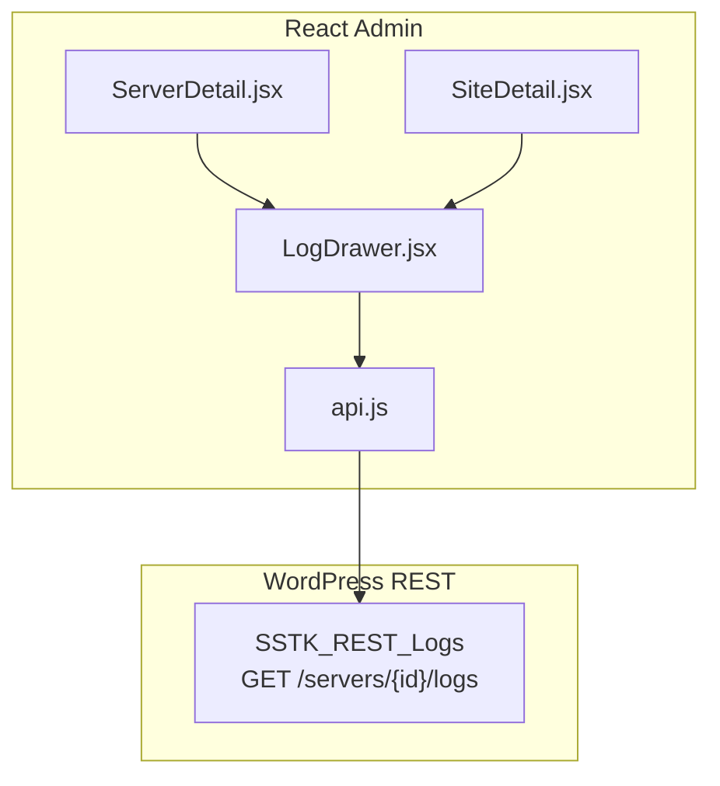
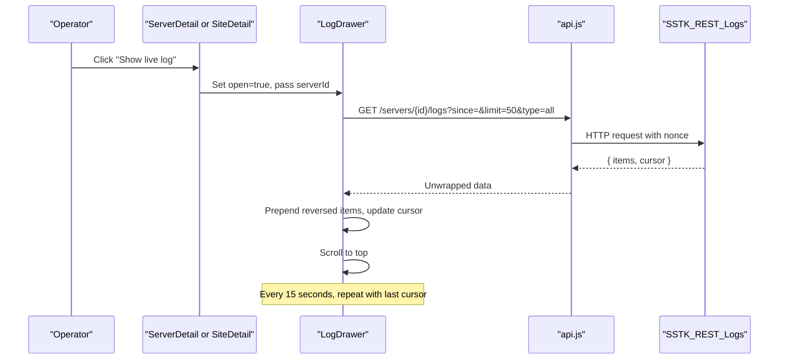
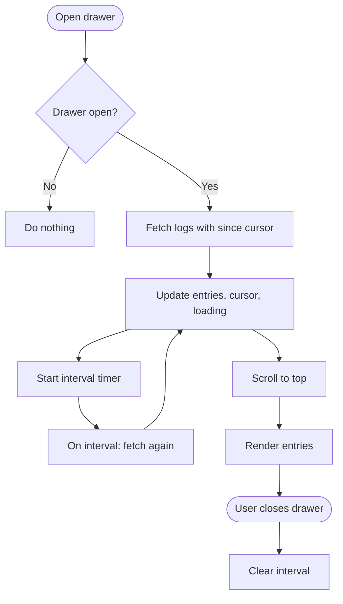
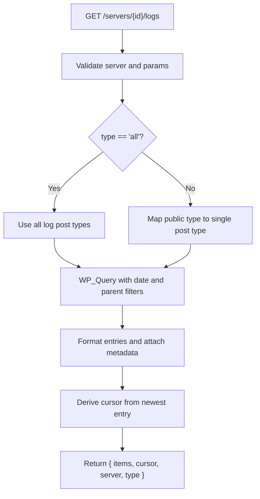
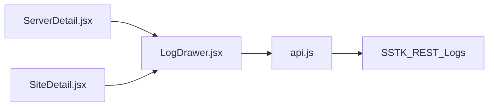

# LogDrawer Component

<cite>
**Referenced Files in This Document**
- [LogDrawer.jsx](file://src/admin/components/LogDrawer.jsx)
- [api.js](file://src/admin/lib/api.js)
- [class-sstk-rest-logs.php](file://includes/core/api/class-sstk-rest-logs.php)
- [ServerDetail.jsx](file://src/admin/routes/ServerDetail.jsx)
- [SiteDetail.jsx](file://src/admin/routes/SiteDetail.jsx)
</cite>

## Table of Contents
1. [Introduction](#introduction)
2. [Project Structure](#project-structure)
3. [Core Components](#core-components)
4. [Architecture Overview](#architecture-overview)
5. [Detailed Component Analysis](#detailed-component-analysis)
6. [Dependency Analysis](#dependency-analysis)
7. [Performance Considerations](#performance-considerations)
8. [Troubleshooting Guide](#troubleshooting-guide)
9. [Conclusion](#conclusion)

## Introduction
The LogDrawer component provides an inline, live log viewing interface for server and site operations. It replaces the legacy popup console by polling a REST endpoint with a time-based cursor, so operators can watch provisioning, command execution, SSH activity, and error output while continuing to use the surrounding page.

Key capabilities:
- Real-time updates through periodic polling.
- Server-scoped log retrieval with type filtering at the API layer.
- Visual categorization by log type.
- Manual refresh and text export.
- Inline presentation that keeps the main tab interactive.

This document explains how data is bound, how real-time updates work, how log levels are categorized, and how performance and accessibility considerations apply.

## Project Structure
The LogDrawer feature spans three layers:
- React UI: `src/admin/components/LogDrawer.jsx`
- Frontend API client: `src/admin/lib/api.js`
- Backend REST controller: `includes/core/api/class-sstk-rest-logs.php`
- Consumer routes: `src/admin/routes/ServerDetail.jsx` and `src/admin/routes/SiteDetail.jsx`

**Diagram sources**
- [ServerDetail.jsx:174-179](file://src/admin/routes/ServerDetail.jsx#L174-L179)
- [SiteDetail.jsx:158-163](file://src/admin/routes/SiteDetail.jsx#L158-L163)
- [LogDrawer.jsx:36-80](file://src/admin/components/LogDrawer.jsx#L36-L80)
- [api.js:253-267](file://src/admin/lib/api.js#L253-L267)
- [class-sstk-rest-logs.php:44-65](file://includes/core/api/class-sstk-rest-logs.php#L44-L65)

**Section sources**
- [LogDrawer.jsx:1-11](file://src/admin/components/LogDrawer.jsx#L1-L11)
- [ServerDetail.jsx:114-129](file://src/admin/routes/ServerDetail.jsx#L114-L129)
- [SiteDetail.jsx:112-128](file://src/admin/routes/SiteDetail.jsx#L112-L128)

## Core Components
- LogDrawer: Renders the live log panel, manages polling state, and exposes refresh and download actions.
- api.logs.forServer: Client method that calls the server logs endpoint.
- SSTK_REST_Logs: PHP controller that reads WordPress log post types and returns formatted entries with a cursor.
- ServerDetail and SiteDetail: Parent routes that open the drawer and pass the correct server context.

Responsibilities:
- Data binding: The drawer stores fetched entries, cursor, loading, and error state.
- Real-time updates: A timer polls the API every fixed interval when the drawer is open.
- Filtering: The backend supports filtering by log type; the drawer currently requests all types.
- Export: The drawer builds a plain-text file from current entries.

**Section sources**
- [LogDrawer.jsx:36-189](file://src/admin/components/LogDrawer.jsx#L36-L189)
- [api.js:253-267](file://src/admin/lib/api.js#L253-L267)
- [class-sstk-rest-logs.php:19-100](file://includes/core/api/class-sstk-rest-logs.php#L19-L100)
- [ServerDetail.jsx:174-179](file://src/admin/routes/ServerDetail.jsx#L174-L179)
- [SiteDetail.jsx:158-163](file://src/admin/routes/SiteDetail.jsx#L158-L163)

## Architecture Overview
The live log flow uses a polling pattern with a timestamp cursor to avoid re-fetching old entries.

**Diagram sources**
- [ServerDetail.jsx:121-124](file://src/admin/routes/ServerDetail.jsx#L121-L124)
- [SiteDetail.jsx:121-123](file://src/admin/routes/SiteDetail.jsx#L121-L123)
- [LogDrawer.jsx:83-101](file://src/admin/components/LogDrawer.jsx#L83-L101)
- [LogDrawer.jsx:46-80](file://src/admin/components/LogDrawer.jsx#L46-L80)
- [api.js:253-267](file://src/admin/lib/api.js#L253-L267)
- [class-sstk-rest-logs.php:76-100](file://includes/core/api/class-sstk-rest-logs.php#L76-L100)

## Detailed Component Analysis

### LogDrawer Component
The drawer maintains local state for entries, cursor, error, and loading. When opened, it performs an initial fetch and starts a polling interval. Each poll appends new entries in chronological order and scrolls the container to the top.

Key behaviors:
- Polling interval: Fixed delay between requests.
- Cursor tracking: Uses the newest entry’s timestamp to fetch only newer logs.
- Entry ordering: Reverses API results so the oldest visible entry appears first.
- Error handling: Displays error messages without breaking the polling loop.
- Download: Exports current entries as a plain-text file.

**Diagram sources**
- [LogDrawer.jsx:36-44](file://src/admin/components/LogDrawer.jsx#L36-L44)
- [LogDrawer.jsx:46-80](file://src/admin/components/LogDrawer.jsx#L46-L80)
- [LogDrawer.jsx:83-107](file://src/admin/components/LogDrawer.jsx#L83-L107)
- [LogDrawer.jsx:113-126](file://src/admin/components/LogDrawer.jsx#L113-L126)

#### Props and State
- Props:
  - serverId: Server identifier used for the logs endpoint.
  - title: Drawer heading.
  - open: Controls visibility.
  - onClose: Collapse handler.
  - kickoffMessage: Optional initial message before entries arrive.
- State:
  - entries: Array of log entries.
  - cursor: Timestamp string for incremental fetching.
  - error: Current error object.
  - loading: Boolean indicating active fetch.

**Section sources**
- [LogDrawer.jsx:27-44](file://src/admin/components/LogDrawer.jsx#L27-L44)

#### Data Binding and Rendering
- Entries are mapped into styled blocks showing type, timestamp, title, and body.
- Type-based tone classes provide visual distinction for command, SSH, and error logs.
- The container has a fixed maximum height and vertical scrolling.

**Section sources**
- [LogDrawer.jsx:128-189](file://src/admin/components/LogDrawer.jsx#L128-L189)

#### Real-Time Updates
- Initial fetch occurs when the drawer opens.
- An interval repeatedly calls the same fetch function using the latest cursor.
- On close, the interval is cleared to prevent background requests.

**Section sources**
- [LogDrawer.jsx:83-101](file://src/admin/components/LogDrawer.jsx#L83-L101)

#### Filtering Capabilities
- The drawer currently requests all log types.
- The backend supports filtering by type: all, command, ssh, error.
- No client-side search filter is implemented in the drawer.

**Section sources**
- [LogDrawer.jsx:54-59](file://src/admin/components/LogDrawer.jsx#L54-L59)
- [class-sstk-rest-logs.php:49-54](file://includes/core/api/class-sstk-rest-logs.php#L49-L54)

#### Log Level Categorization
- Supported public types: command, ssh, error.
- Visual tones differentiate these categories in the UI.
- Unknown types fall back to the default command styling.

**Section sources**
- [class-sstk-rest-logs.php:33-37](file://includes/core/api/class-sstk-rest-logs.php#L33-L37)
- [LogDrawer.jsx:21-25](file://src/admin/components/LogDrawer.jsx#L21-L25)

#### Search Functionality
- There is no built-in search input in the drawer.
- Operators can use browser search within the page to locate text.
- Future enhancements could add client-side filtering against entries.

[No sources needed since this section describes current behavior and conceptual enhancement]

#### Export Options
- The drawer exports a plain-text file containing each entry’s timestamp, type, title, and body.
- The filename includes the server ID.
- Export is disabled when there are no entries.

**Section sources**
- [LogDrawer.jsx:113-126](file://src/admin/components/LogDrawer.jsx#L113-L126)

#### Examples of Displayed Output
- Server logs: Provisioning and action output appear under the command category.
- Application logs: WordPress-related commands executed via tabs appear as command logs.
- Debugging output: Errors and SSH command outputs are shown with their respective categories.

These examples correspond to the backend mapping of log post types to public types and fields.

**Section sources**
- [class-sstk-rest-logs.php:187-222](file://includes/core/api/class-sstk-rest-logs.php#L187-L222)

### Backend Logs Controller
The REST controller defines the server logs route and formats log entries for consumption by the frontend.

Key responsibilities:
- Validate server existence.
- Accept query parameters: type, since, limit.
- Query WordPress private log posts.
- Format entries with id, type, title, date_gmt, and optional metadata.
- Return a cursor based on the newest entry.

**Diagram sources**
- [class-sstk-rest-logs.php:44-65](file://includes/core/api/class-sstk-rest-logs.php#L44-L65)
- [class-sstk-rest-logs.php:76-100](file://includes/core/api/class-sstk-rest-logs.php#L76-L100)
- [class-sstk-rest-logs.php:137-178](file://includes/core/api/class-sstk-rest-logs.php#L137-L178)
- [class-sstk-rest-logs.php:187-238](file://includes/core/api/class-sstk-rest-logs.php#L187-L238)

**Section sources**
- [class-sstk-rest-logs.php:19-100](file://includes/core/api/class-sstk-rest-logs.php#L19-L100)
- [class-sstk-rest-logs.php:137-238](file://includes/core/api/class-sstk-rest-logs.php#L137-L238)

### Integration with Routes
Both ServerDetail and SiteDetail render the LogDrawer with the appropriate server context:
- ServerDetail passes the server’s own ID.
- SiteDetail passes the site’s associated server ID.
- Both toggle the drawer open state and set a contextual title.

**Section sources**
- [ServerDetail.jsx:174-179](file://src/admin/routes/ServerDetail.jsx#L174-L179)
- [SiteDetail.jsx:158-163](file://src/admin/routes/SiteDetail.jsx#L158-L163)

## Dependency Analysis
The following diagram shows runtime dependencies among components and services.

**Diagram sources**
- [ServerDetail.jsx:14-15](file://src/admin/routes/ServerDetail.jsx#L14-L15)
- [SiteDetail.jsx:14-15](file://src/admin/routes/SiteDetail.jsx#L14-L15)
- [LogDrawer.jsx:15-17](file://src/admin/components/LogDrawer.jsx#L15-L17)
- [api.js:253-267](file://src/admin/lib/api.js#L253-L267)
- [class-sstk-rest-logs.php:44-65](file://includes/core/api/class-sstk-rest-logs.php#L44-L65)

**Section sources**
- [LogDrawer.jsx:13-17](file://src/admin/components/LogDrawer.jsx#L13-L17)
- [api.js:1-120](file://src/admin/lib/api.js#L1-L120)

## Performance Considerations
Current implementation characteristics:
- Fixed polling interval reduces unnecessary network traffic compared to continuous streaming.
- Cursor-based pagination avoids re-fetching older entries.
- Batch size is limited to a small number of entries per poll.
- The entire entry list is kept in memory and rendered on each update.

Optimization opportunities:
- Virtual scrolling: Render only visible entries to reduce DOM size for large histories.
- Entry deduplication: Use entry IDs to avoid duplicate inserts.
- Debounced scroll-to-top: Prevent excessive layout thrashing during rapid updates.
- Adaptive polling: Increase interval when the drawer is inactive or decrease it during active provisioning.
- Server-side pagination: Support offset or token-based cursors beyond timestamps for long-running sessions.
- Memory management: Prune old entries after reaching a configurable limit.

[No sources needed since this section provides general guidance]

## Troubleshooting Guide
Common issues and resolutions:
- Drawer does not start polling:
  - Ensure the drawer prop open is true and serverId is provided.
  - Verify the REST endpoint responds successfully.
- No entries appear:
  - Confirm that log posts exist for the server and are private.
  - Check that the since cursor is empty on the first request.
- Network or authentication errors:
  - Inspect the ApiError thrown by the client layer.
  - Ensure the nonce header is present for authenticated requests.
- Export button disabled:
  - The export is disabled when there are no entries. Add or wait for log entries.

Relevant code paths:
- Client error handling and unwrapping.
- Drawer error state display.
- Export logic and disabled condition.

**Section sources**
- [api.js:9-16](file://src/admin/lib/api.js#L9-L16)
- [api.js:67-120](file://src/admin/lib/api.js#L67-L120)
- [LogDrawer.jsx:74-78](file://src/admin/components/LogDrawer.jsx#L74-L78)
- [LogDrawer.jsx:145-147](file://src/admin/components/LogDrawer.jsx#L145-L147)

## Conclusion
The LogDrawer component delivers a practical, inline live log viewer integrated with the server and site detail pages. It relies on a cursor-based polling strategy to keep the interface responsive while displaying command, SSH, and error logs. While it currently lacks client-side search and virtual scrolling, its architecture cleanly separates concerns across React, the API client, and the PHP REST controller, making future enhancements straightforward.

[No sources needed since this section summarizes without analyzing specific files]