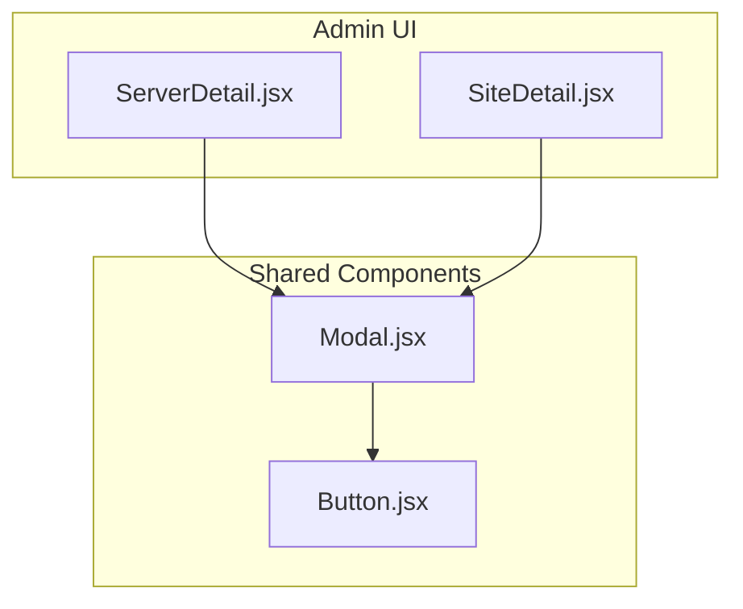
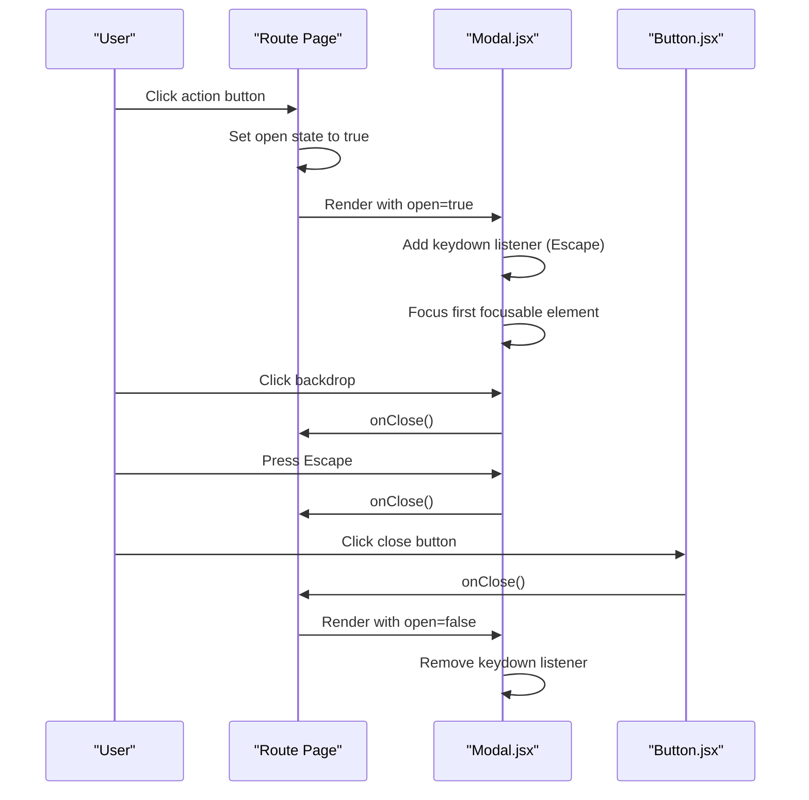
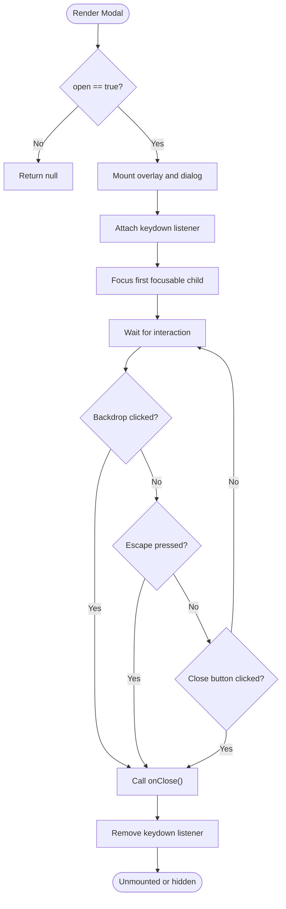
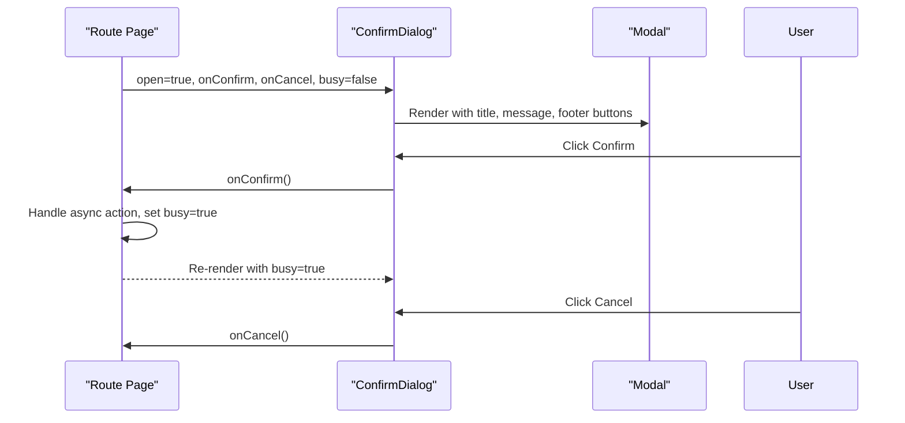
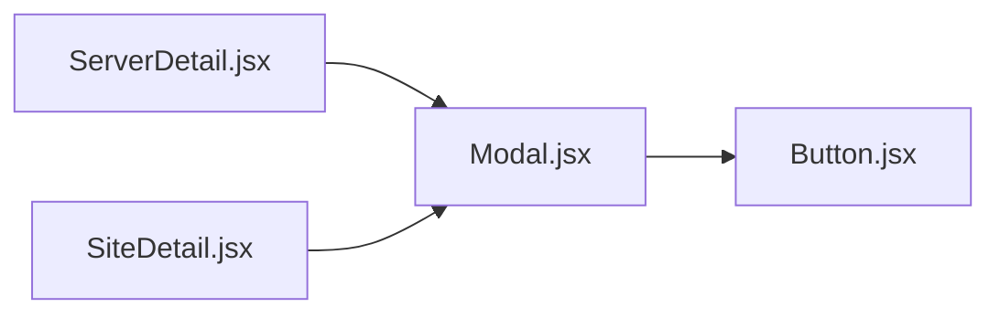

# Modal Component

<cite>
**Referenced Files in This Document**
- [Modal.jsx](file://src/admin/components/Modal.jsx)
- [Button.jsx](file://src/admin/components/Button.jsx)
- [ServerDetail.jsx](file://src/admin/routes/ServerDetail.jsx)
- [SiteDetail.jsx](file://src/admin/routes/SiteDetail.jsx)
</cite>

## Table of Contents
1. [Introduction](#introduction)
2. [Project Structure](#project-structure)
3. [Core Components](#core-components)
4. [Architecture Overview](#architecture-overview)
5. [Detailed Component Analysis](#detailed-component-analysis)
6. [Dependency Analysis](#dependency-analysis)
7. [Performance Considerations](#performance-considerations)
8. [Troubleshooting Guide](#troubleshooting-guide)
9. [Conclusion](#conclusion)

## Introduction
This document explains the Modal component used across the Simple Stack admin interface. It covers modal lifecycle management, opening and closing behaviors, backdrop interactions, focus behavior, props for sizing and positioning, animation characteristics, content rendering patterns, accessibility requirements, and performance considerations. It also provides usage examples for confirmation dialogs and guidance for building form modals and multi-step workflows using the provided primitives.

## Project Structure
The Modal component lives under the admin React components directory and is consumed by route-level pages that need to confirm destructive actions or present custom dialog content.

**Diagram sources**
- [Modal.jsx:1-131](file://src/admin/components/Modal.jsx#L1-L131)
- [ServerDetail.jsx:16-16](file://src/admin/routes/ServerDetail.jsx#L16-L16)
- [SiteDetail.jsx:16-16](file://src/admin/routes/SiteDetail.jsx#L16-L16)

**Section sources**
- [Modal.jsx:1-131](file://src/admin/components/Modal.jsx#L1-L131)
- [ServerDetail.jsx:1-209](file://src/admin/routes/ServerDetail.jsx#L1-L209)
- [SiteDetail.jsx:1-185](file://src/admin/routes/SiteDetail.jsx#L1-L185)

## Core Components
- Modal: A controlled dialog rendered into the app container with a backdrop, header, body, and optional footer. It handles Escape key handling and initial focus when opened.
- ConfirmDialog: A prebuilt confirmation dialog built on top of Modal, designed for destructive or irreversible actions.

Key responsibilities:
- Controlled visibility via an open prop.
- Backdrop click-to-close behavior.
- Escape key-to-close behavior.
- Initial focus management for accessible interaction.
- Semantic dialog markup with ARIA attributes.

**Section sources**
- [Modal.jsx:20-87](file://src/admin/components/Modal.jsx#L20-L87)
- [Modal.jsx:102-130](file://src/admin/components/Modal.jsx#L102-L130)

## Architecture Overview
The Modal component composes a generic dialog shell and a ready-to-use confirmation pattern. Route pages control the modal state and pass callbacks to handle user actions.

**Diagram sources**
- [Modal.jsx:23-47](file://src/admin/components/Modal.jsx#L23-L47)
- [Modal.jsx:53-86](file://src/admin/components/Modal.jsx#L53-L86)
- [ServerDetail.jsx:198-206](file://src/admin/routes/ServerDetail.jsx#L198-L206)
- [SiteDetail.jsx:175-183](file://src/admin/routes/SiteDetail.jsx#L175-L183)

## Detailed Component Analysis

### Modal Component
The default export is a controlled dialog component. It renders nothing when closed and mounts a full-screen overlay when open.

Props:
- open: boolean controlling visibility.
- title: string used as the dialog heading and aria-label.
- onClose: function invoked on backdrop click, Escape key, or close button.
- footer: JSX element(s) rendered in the footer area.
- children: main content area.

Behavior:
- Lifecycle:
  - When open becomes true, it attaches a global keydown listener to handle Escape.
  - It attempts to focus the first focusable child inside the panel after render.
  - On unmount or when open becomes false, it removes the keydown listener.
- Backdrop interaction:
  - Clicking the backdrop triggers onClose.
- Accessibility:
  - The dialog root uses role="dialog", aria-modal="true", and aria-label set from title.
  - The close button has an aria-label for screen readers.
- Styling and layout:
  - Uses fixed positioning, z-index layering, and Tailwind utility classes for spacing, borders, shadows, and responsive width.
  - Maximum width and margins provide centered placement at the top portion of the viewport.

Limitations and current behavior:
- No explicit focus trap; focus moves to the first focusable element but does not constrain tab navigation within the modal.
- No animation transitions are implemented; appearance/disappearance is immediate.
- Sizing is constrained by max-width and margin utilities; no dedicated size prop exists.
- Positioning is fixed at the top-center; no vertical offset or alignment prop exists.

**Diagram sources**
- [Modal.jsx:23-47](file://src/admin/components/Modal.jsx#L23-L47)
- [Modal.jsx:53-86](file://src/admin/components/Modal.jsx#L53-L86)

**Section sources**
- [Modal.jsx:20-87](file://src/admin/components/Modal.jsx#L20-L87)

### ConfirmDialog Component
ConfirmDialog is a convenience wrapper around Modal tailored for destructive or irreversible actions.

Props:
- open: boolean controlling visibility.
- title: dialog heading (default provided).
- message: body text describing the consequence.
- confirmLabel: label for the primary confirm button (default provided).
- onConfirm: function invoked when the user confirms.
- onCancel: function invoked when the user cancels or closes.
- busy: boolean to disable cancel and show loading state on confirm.

Behavior:
- Renders a two-button footer with Cancel and Confirm.
- Disables Cancel while busy and shows a busy indicator on Confirm.
- Delegates all modal behavior to Modal.

Usage example:
- Deleting a server or trashing a site.

**Diagram sources**
- [Modal.jsx:102-130](file://src/admin/components/Modal.jsx#L102-L130)
- [ServerDetail.jsx:198-206](file://src/admin/routes/ServerDetail.jsx#L198-L206)
- [SiteDetail.jsx:175-183](file://src/admin/routes/SiteDetail.jsx#L175-L183)

**Section sources**
- [Modal.jsx:102-130](file://src/admin/components/Modal.jsx#L102-L130)
- [ServerDetail.jsx:198-206](file://src/admin/routes/ServerDetail.jsx#L198-L206)
- [SiteDetail.jsx:175-183](file://src/admin/routes/SiteDetail.jsx#L175-L183)

### Usage Examples

#### Confirmation Dialogs
- Delete server:
  - Controlled by confirmDelete state and deleting flag.
  - Calls api.servers.remove and navigates away on success.
- Trash site:
  - Controlled by confirmDelete state and deleting flag.
  - Calls api.sites.remove and navigates away on success.

These examples demonstrate how to wire ConfirmDialog to asynchronous operations and manage loading states.

**Section sources**
- [ServerDetail.jsx:74-87](file://src/admin/routes/ServerDetail.jsx#L74-L87)
- [ServerDetail.jsx:198-206](file://src/admin/routes/ServerDetail.jsx#L198-L206)
- [SiteDetail.jsx:71-84](file://src/admin/routes/SiteDetail.jsx#L71-L84)
- [SiteDetail.jsx:175-183](file://src/admin/routes/SiteDetail.jsx#L175-L183)

#### Form Modals
To build a form modal:
- Use Modal with a custom footer containing form controls and submit/cancel buttons.
- Manage form state locally and call onClose after successful submission.
- Ensure the first interactive element is focusable so initial focus works.

Guidance:
- Keep forms short to avoid long scroll within the modal.
- Provide clear error messages and validation feedback inside the modal body.
- Disable submit while busy to prevent duplicate submissions.

[No sources needed since this section provides general guidance]

#### Complex Multi-Step Workflows
To implement multi-step workflows:
- Maintain a step index in the parent component.
- Render different steps inside Modal children based on the step index.
- Use footer buttons to navigate between steps and finalize the workflow.
- For destructive final steps, wrap them in ConfirmDialog.

Guidance:
- Reset or persist step state appropriately when closing the modal.
- Announce step changes to screen readers if necessary using aria-live regions outside the modal.

[No sources needed since this section provides general guidance]

## Dependency Analysis
Modal depends on:
- React hooks: useEffect, useRef.
- Button component for close and action buttons.

Consumers:
- ServerDetail uses ConfirmDialog for server deletion.
- SiteDetail uses ConfirmDialog for site trashing.

**Diagram sources**
- [Modal.jsx:8-10](file://src/admin/components/Modal.jsx#L8-L10)
- [ServerDetail.jsx:16-16](file://src/admin/routes/ServerDetail.jsx#L16-L16)
- [SiteDetail.jsx:16-16](file://src/admin/routes/SiteDetail.jsx#L16-L16)

**Section sources**
- [Modal.jsx:8-10](file://src/admin/components/Modal.jsx#L8-L10)
- [ServerDetail.jsx:16-16](file://src/admin/routes/ServerDetail.jsx#L16-L16)
- [SiteDetail.jsx:16-16](file://src/admin/routes/SiteDetail.jsx#L16-L16)

## Performance Considerations
- Rendering cost:
  - Modal returns null when closed, avoiding unnecessary DOM overhead.
- Event listeners:
  - A single keydown listener is attached only while open and removed on cleanup, minimizing global event overhead.
- Focus management:
  - Focusing the first focusable element occurs once per open cycle.
- Memory management:
  - Listeners are properly removed in the effect cleanup to prevent leaks.
- Styling:
  - Uses CSS classes without heavy animations; transitions are not applied, reducing reflow/repaint costs.

Recommendations:
- Avoid mounting large subtrees inside Modal unless necessary.
- Debounce or throttle expensive operations triggered by modal actions.
- Consider lazy-loading heavy content when opening the modal.

**Section sources**
- [Modal.jsx:23-47](file://src/admin/components/Modal.jsx#L23-L47)
- [Modal.jsx:49-51](file://src/admin/components/Modal.jsx#L49-L51)

## Troubleshooting Guide
Common issues and resolutions:
- Modal does not close on Escape:
  - Verify that onClose is passed and not overridden.
  - Ensure the modal is mounted and open is true before pressing Escape.
- Backdrop click does not close:
  - Confirm that the overlay element is present and not blocked by another element.
- Focus not moving into modal:
  - Ensure the modal content includes at least one focusable element.
  - If using custom components, ensure they expose focusable elements or tabIndex where appropriate.
- Screen reader announcements:
  - The dialog has aria-modal and aria-label; verify that title is meaningful.
  - For dynamic content updates inside the modal, consider adding aria-live regions outside the modal to announce changes.
- Multiple modals:
  - The current implementation does not stack multiple modals safely. Avoid nesting modals; use a single modal instance per flow.

Accessibility checklist:
- Keyboard:
  - Escape closes the modal.
  - Initial focus moves to the first focusable element.
  - Note: There is no focus trap; users can Tab out of the modal. Implement a focus trap if required by your UX policy.
- ARIA:
  - role="dialog" and aria-modal="true" are set.
  - aria-label reflects the dialog title.
  - Close button has an aria-label.
- Visual:
  - Backdrop provides visual separation.
  - Header contains a visible close button.

**Section sources**
- [Modal.jsx:23-47](file://src/admin/components/Modal.jsx#L23-L47)
- [Modal.jsx:53-86](file://src/admin/components/Modal.jsx#L53-L86)

## Conclusion
The Modal component provides a simple, accessible, and controlled dialog primitive for the Simple Stack admin interface. It supports Escape-to-close, backdrop-to-close, and initial focus management. ConfirmDialog offers a ready-made pattern for destructive actions. While it lacks advanced features like focus trapping, animations, and configurable sizing/positioning, it is sufficient for most confirmation flows and can be extended for form-based and multi-step workflows by composing additional logic in parent components.

[No sources needed since this section summarizes without analyzing specific files]