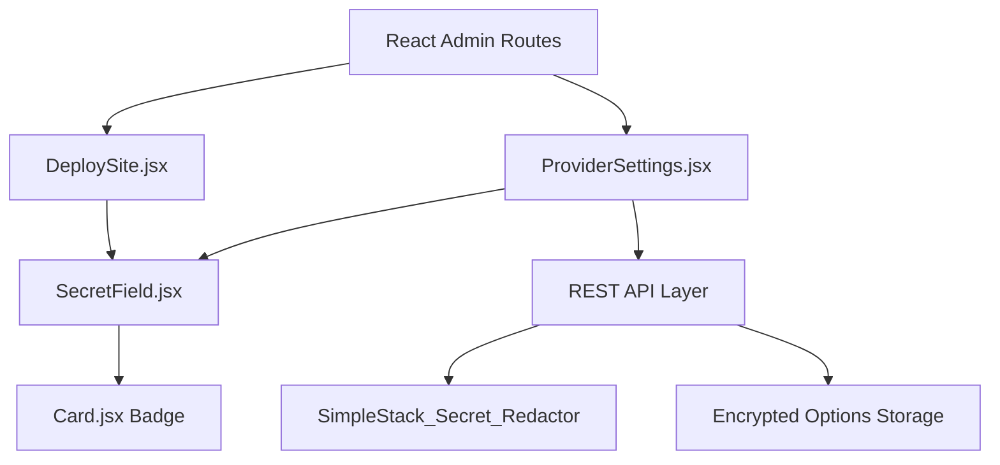
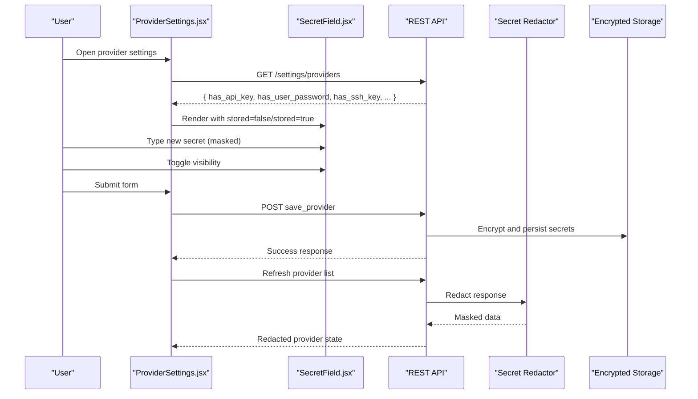
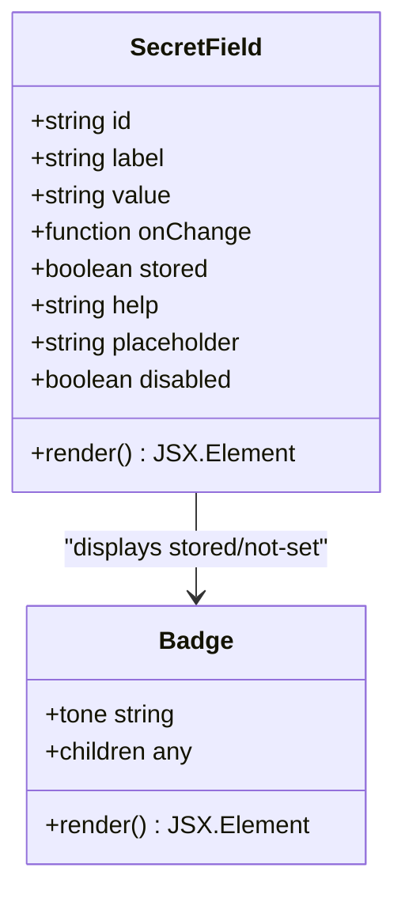
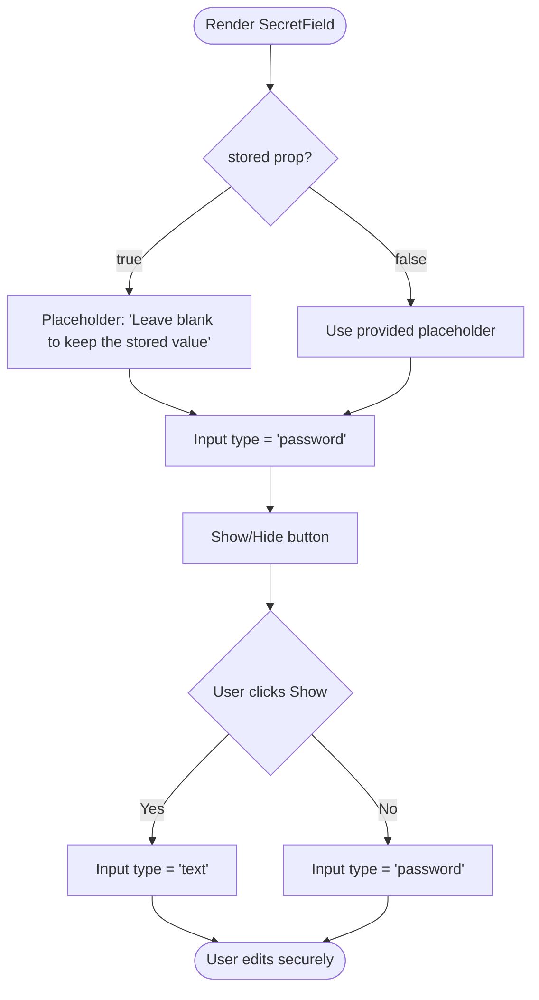
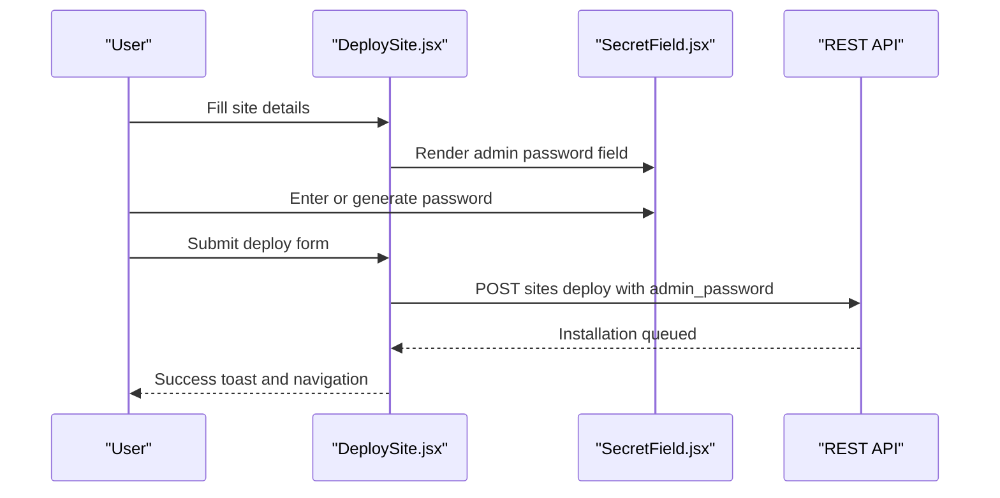
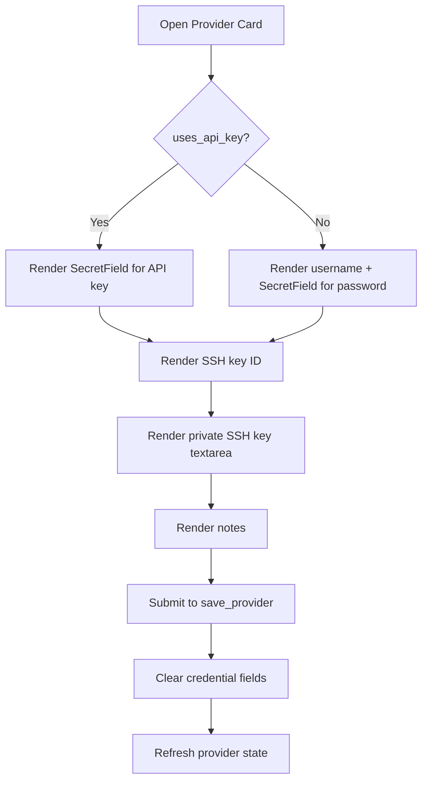
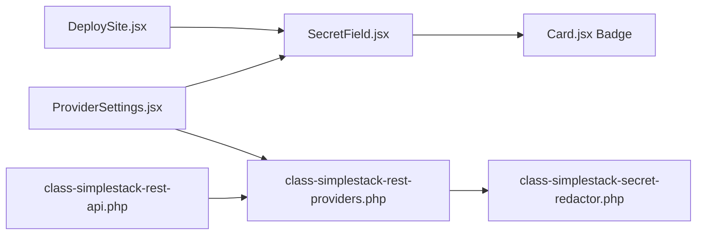

# SecretField Component

<cite>
**Referenced Files in This Document**
- [SecretField.jsx](file://src/admin/components/SecretField.jsx)
- [Card.jsx](file://src/admin/components/Card.jsx)
- [DeploySite.jsx](file://src/admin/routes/DeploySite.jsx)
- [ProviderSettings.jsx](file://src/admin/routes/ProviderSettings.jsx)
- [class-simplestack-secret-redactor.php](file://includes/core/api/class-simplestack-secret-redactor.php)
- [class-simplestack-rest-api.php](file://includes/core/api/class-simplestack-rest-api.php)
- [class-simplestack-rest-providers.php](file://includes/core/api/class-simplestack-rest-providers.php)
</cite>

## Table of Contents
1. [Introduction](#introduction)
2. [Project Structure](#project-structure)
3. [Core Components](#core-components)
4. [Architecture Overview](#architecture-overview)
5. [Detailed Component Analysis](#detailed-component-analysis)
6. [Dependency Analysis](#dependency-analysis)
7. [Performance Considerations](#performance-considerations)
8. [Troubleshooting Guide](#troubleshooting-guide)
9. [Conclusion](#conclusion)

## Introduction
The SecretField component is a secure credential input control used across the SimpleStack admin interface. It is designed for password masking, optional visibility toggling, and safe handling of sensitive values such as API keys, account passwords, and private SSH keys. The component intentionally starts empty so that secrets are never round-tripped through the browser; instead, it shows whether a value is already stored on the server using a status badge.

This document explains:
- Password masking and visibility toggle behavior
- Validation patterns and user guidance
- Security features including redaction, encryption, and credential management best practices
- Examples for API key inputs, password fields, and sensitive configuration forms
- Accessibility characteristics and keyboard navigation considerations

## Project Structure
SecretField lives in the React admin components directory and is consumed by routes that handle sensitive configuration:
- `src/admin/components/SecretField.jsx` defines the component
- `src/admin/routes/DeploySite.jsx` uses it for WordPress admin password entry
- `src/admin/routes/ProviderSettings.jsx` uses it for provider credentials such as API keys, account passwords, and SSH keys
- `includes/core/api/class-simplestack-secret-redactor.php` provides server-side secret redaction
- `includes/core/api/class-simplestack-rest-api.php` registers the REST namespace and controllers
- `includes/core/api/class-simplestack-rest-providers.php` handles provider credential storage and redacted listing

**Diagram sources**
- [SecretField.jsx:10-12](file://src/admin/components/SecretField.jsx#L10-L12)
- [DeploySite.jsx:13](file://src/admin/routes/DeploySite.jsx#L13)
- [ProviderSettings.jsx:18](file://src/admin/routes/ProviderSettings.jsx#L18)
- [class-simplestack-secret-redactor.php:12-23](file://includes/core/api/class-simplestack-secret-redactor.php#L12-L23)
- [class-simplestack-rest-api.php:21-37](file://includes/core/api/class-simplestack-rest-api.php#L21-L37)

**Section sources**
- [SecretField.jsx:1-73](file://src/admin/components/SecretField.jsx#L1-L73)
- [DeploySite.jsx:1-263](file://src/admin/routes/DeploySite.jsx#L1-L263)
- [ProviderSettings.jsx:1-372](file://src/admin/routes/ProviderSettings.jsx#L1-L372)
- [class-simplestack-secret-redactor.php:1-142](file://includes/core/api/class-simplestack-secret-redactor.php#L1-L142)
- [class-simplestack-rest-api.php:1-136](file://includes/core/api/class-simplestack-rest-api.php#L1-L136)

## Core Components
- SecretField: A controlled input that renders a masked password field with an optional Show/Hide button. It displays a “Stored” or “Not set” badge based on server state and supports help text, placeholders, disabled state, and standard change events.
- Card Badge: Used to display credential presence indicators without exposing values.
- ProviderSettings route: Uses SecretField for API keys, account passwords, and SSH-related inputs, while also managing non-secret fields like SSH key IDs and notes.
- DeploySite route: Uses SecretField for generating and submitting a strong WordPress admin password.

Key responsibilities:
- Prevent accidental exposure of secrets in the UI
- Communicate stored vs unset state clearly
- Provide safe editing workflows where blank means “do not overwrite existing secrets”

**Section sources**
- [SecretField.jsx:14-35](file://src/admin/components/SecretField.jsx#L14-L35)
- [SecretField.jsx:38-72](file://src/admin/components/SecretField.jsx#L38-L72)
- [ProviderSettings.jsx:149-358](file://src/admin/routes/ProviderSettings.jsx#L149-L358)
- [DeploySite.jsx:200-217](file://src/admin/routes/DeploySite.jsx#L200-L217)

## Architecture Overview
The SecretField component integrates into a broader security model:
- Frontend: Inputs are masked by default; users can reveal values temporarily. Values are sent only when explicitly provided.
- Backend: All responses pass through a secret redactor that masks known credential keys and scrubs embedded secrets from free text.
- Storage: Sensitive values are encrypted before being persisted.
- State signaling: The API returns boolean flags indicating whether credentials are present rather than returning the values themselves.

**Diagram sources**
- [ProviderSettings.jsx:53-83](file://src/admin/routes/ProviderSettings.jsx#L53-L83)
- [ProviderSettings.jsx:149-358](file://src/admin/routes/ProviderSettings.jsx#L149-L358)
- [class-simplestack-rest-providers.php:66-173](file://includes/core/api/class-simplestack-rest-providers.php#L66-L173)
- [class-simplestack-secret-redactor.php:51-95](file://includes/core/api/class-simplestack-secret-redactor.php#L51-L95)

## Detailed Component Analysis

### SecretField Component
SecretField is a small, focused component that:
- Renders a label associated with the input via htmlFor
- Shows a status badge indicating whether a value is already stored on the server
- Renders a masked input by default and allows toggling between masked and visible states
- Supports placeholder text, help text, disabled state, and onChange
- Uses autoComplete="new-password" and disables spellcheck to reduce accidental leakage

**Diagram sources**
- [SecretField.jsx:14-35](file://src/admin/components/SecretField.jsx#L14-L35)
- [SecretField.jsx:38-72](file://src/admin/components/SecretField.jsx#L38-L72)
- [Card.jsx:1-200](file://src/admin/components/Card.jsx#L1-L200)

#### Password Masking and Visibility Toggle
- Default type is password, ensuring visual masking
- A Show/Hide button toggles the input type between password and text
- When stored is true, placeholder indicates that leaving the field blank preserves the existing value

**Diagram sources**
- [SecretField.jsx:47-67](file://src/admin/components/SecretField.jsx#L47-L67)

#### Props and Behavior
- id: Associates the label with the input for accessibility
- label: Describes the secret field
- value: Controlled value; defaults to empty string if falsy
- onChange: Receives the new value for parent state updates
- stored: Indicates whether a value exists on the server
- help: Optional guidance text
- placeholder: Contextual hint; changes meaning when stored is true
- disabled: Disables both input and toggle button

**Section sources**
- [SecretField.jsx:14-35](file://src/admin/components/SecretField.jsx#L14-L35)
- [SecretField.jsx:38-72](file://src/admin/components/SecretField.jsx#L38-L72)

### Usage in Deploy Site Form
The DeploySite route uses SecretField for the WordPress admin password:
- The field is masked by default
- Help text clarifies that the generated password is local and never echoed back
- A helper function generates a strong password locally using cryptographic randomness when available

**Diagram sources**
- [DeploySite.jsx:200-217](file://src/admin/routes/DeploySite.jsx#L200-L217)
- [DeploySite.jsx:82-106](file://src/admin/routes/DeploySite.jsx#L82-L106)

**Section sources**
- [DeploySite.jsx:200-217](file://src/admin/routes/DeploySite.jsx#L200-L217)
- [DeploySite.jsx:22-40](file://src/admin/routes/DeploySite.jsx#L22-L40)

### Usage in Provider Settings Form
ProviderSettings uses SecretField for multiple credential types:
- API key (for providers that use API keys)
- Account password (for providers that authenticate with username/password)
- Private SSH key (via textarea, but still treated as a secret)
- Non-secret fields include SSH key ID and notes

The route clears all credential fields after saving and relies on boolean flags from the API to indicate stored state.

**Diagram sources**
- [ProviderSettings.jsx:149-358](file://src/admin/routes/ProviderSettings.jsx#L149-L358)

**Section sources**
- [ProviderSettings.jsx:149-358](file://src/admin/routes/ProviderSettings.jsx#L149-L358)

## Dependency Analysis
SecretField depends on:
- React useState for local visibility state
- Card Badge for displaying credential presence
- Parent routes for controlled value and change handling

The backend dependencies include:
- REST API registration and controller wiring
- Secret redactor for output sanitization
- Encrypted storage for sensitive options

**Diagram sources**
- [SecretField.jsx:10-12](file://src/admin/components/SecretField.jsx#L10-L12)
- [DeploySite.jsx:13](file://src/admin/routes/DeploySite.jsx#L13)
- [ProviderSettings.jsx:18](file://src/admin/routes/ProviderSettings.jsx#L18)
- [class-simplestack-rest-api.php:21-37](file://includes/core/api/class-simplestack-rest-api.php#L21-L37)
- [class-simplestack-rest-providers.php:66-173](file://includes/core/api/class-simplestack-rest-providers.php#L66-L173)
- [class-simplestack-secret-redactor.php:12-23](file://includes/core/api/class-simplestack-secret-redactor.php#L12-L23)

**Section sources**
- [SecretField.jsx:10-12](file://src/admin/components/SecretField.jsx#L10-L12)
- [class-simplestack-rest-api.php:21-37](file://includes/core/api/class-simplestack-rest-api.php#L21-L37)
- [class-simplestack-rest-providers.php:66-173](file://includes/core/api/class-simplestack-rest-providers.php#L66-L173)
- [class-simplestack-secret-redactor.php:12-23](file://includes/core/api/class-simplestack-secret-redactor.php#L12-L23)

## Performance Considerations
- SecretField is lightweight and uses minimal state (visibility toggle).
- Rendering cost is negligible; the main performance consideration is avoiding unnecessary re-renders in parent components by updating only changed fields.
- Server-side redaction operates recursively with a depth guard to prevent pathological structures, which is efficient for typical REST payloads.

[No sources needed since this section provides general guidance]

## Troubleshooting Guide
Common issues and resolutions:
- Secret appears in logs or responses: Ensure all responses pass through the secret redactor and avoid logging raw credentials.
- Credentials not saved: Verify that the field is not left blank when intending to update; blank means “keep existing.”
- Visibility toggle not working: Confirm that the button is not disabled and that the parent does not override the local state unexpectedly.
- Accessibility concerns: Ensure labels are properly associated with inputs and that focus management is preserved when toggling visibility.

Security best practices reinforced by the codebase:
- Never round-trip secrets; rely on boolean flags for presence.
- Encrypt sensitive values before persistence.
- Redact known credential keys and scrub embedded secrets from free text.

**Section sources**
- [class-simplestack-secret-redactor.php:12-23](file://includes/core/api/class-simplestack-secret-redactor.php#L12-L23)
- [class-simplestack-secret-redactor.php:51-95](file://includes/core/api/class-simplestack-secret-redactor.php#L51-L95)
- [class-simplestack-secret-redactor.php:115-126](file://includes/core/api/class-simplestack-secret-redactor.php#L115-L126)
- [ProviderSettings.jsx:159-163](file://src/admin/routes/ProviderSettings.jsx#L159-L163)

## Conclusion
SecretField provides a secure, accessible, and user-friendly way to handle sensitive inputs in the SimpleStack admin interface. By combining client-side masking with server-side redaction and encrypted storage, it ensures that secrets remain protected throughout the workflow. Its design encourages clear operator intent: blank inputs preserve existing secrets, while explicit entries trigger updates. The component integrates cleanly with provider settings and deployment flows, supporting robust credential management and compliance with security best practices.

[No sources needed since this section summarizes without analyzing specific files]