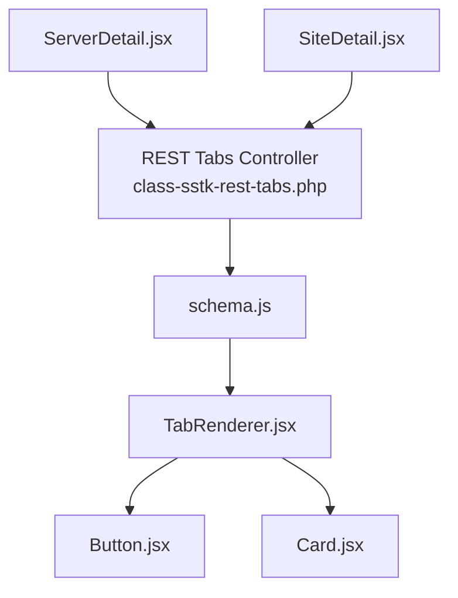
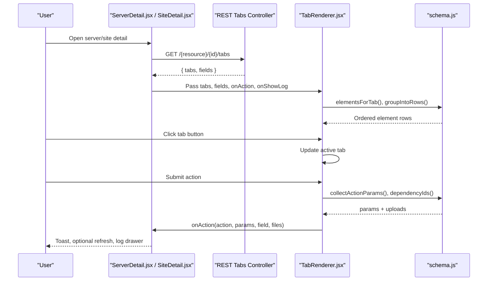
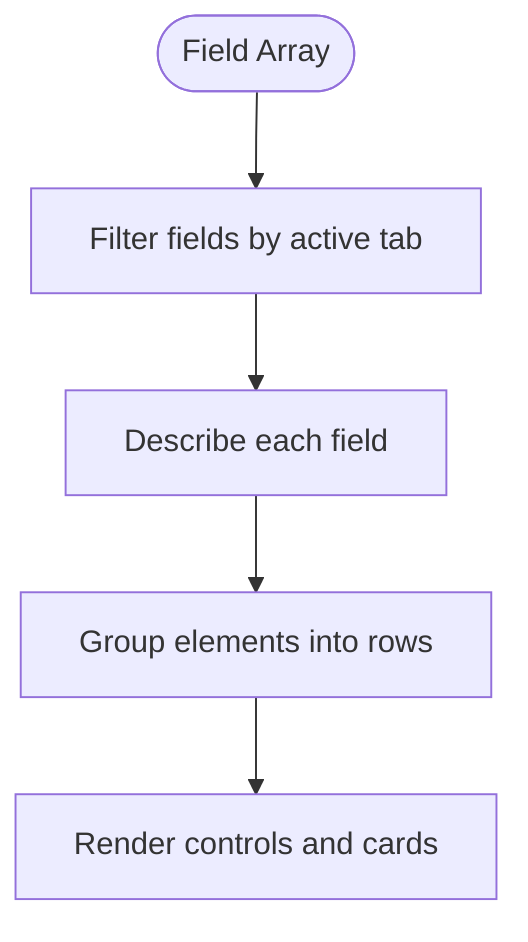
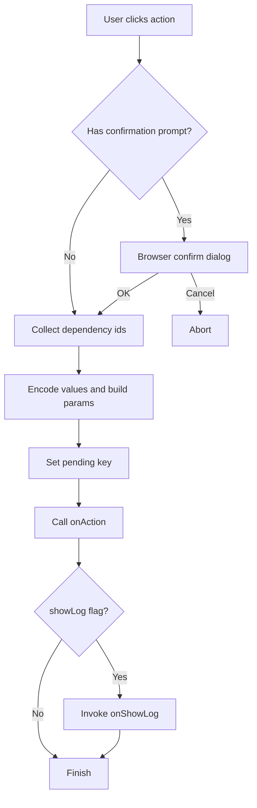
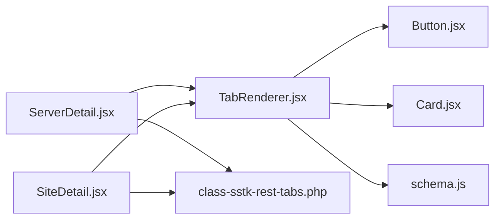

# TabRenderer Component

<cite>
**Referenced Files in This Document**   
- [TabRenderer.jsx](file://src/admin/components/TabRenderer.jsx)
- [schema.js](file://src/admin/lib/schema.js)
- [ServerDetail.jsx](file://src/admin/routes/ServerDetail.jsx)
- [SiteDetail.jsx](file://src/admin/routes/SiteDetail.jsx)
- [class-sstk-rest-tabs.php](file://includes/core/api/class-sstk-rest-tabs.php)
</cite>

## Table of Contents
1. [Introduction](#introduction)
2. [Project Structure](#project-structure)
3. [Core Components](#core-components)
4. [Architecture Overview](#architecture-overview)
5. [Detailed Component Analysis](#detailed-component-analysis)
6. [Dependency Analysis](#dependency-analysis)
7. [Performance Considerations](#performance-considerations)
8. [Troubleshooting Guide](#troubleshooting-guide)
9. [Conclusion](#conclusion)

## Introduction
The `TabRenderer` component is the generic React renderer for tabbed interfaces used by the Simple Stack admin UI. It consumes a server- or site-specific schema describing tabs and form-like fields, renders interactive controls, dispatches actions to backend handlers, and integrates with live log drawers. Rather than implementing per-tab screens, it translates Meta Box field arrays into renderable elements, allowing the same component to cover both server and site management tabs.

Key responsibilities:
- Render tab navigation and switch active content based on tab slugs.
- Convert raw field definitions into controlled inputs, labels, HTML blocks, file pickers, toggles, selects, textareas, and action buttons.
- Collect parameters from declared dependencies and send them through an action callback.
- Support loading placeholders, disabled states, confirmation prompts, and optional log drawer integration.
- Provide basic accessibility attributes such as `aria-current` for active tabs and standard form semantics.

## Project Structure
The tabbed interface is composed of three layers:
- Route-level consumers fetch tab schemas and pass them to `TabRenderer`.
- `TabRenderer` manages local state and renders controls using helpers from `schema.js`.
- The PHP REST layer exposes `/servers/{id}/tabs` and `/sites/{id}/tabs`, normalizing tab names and field arrays into JSON-safe structures.

**Diagram sources**
- [ServerDetail.jsx:39-52](file://src/admin/routes/ServerDetail.jsx#L39-L52)
- [SiteDetail.jsx:39-52](file://src/admin/routes/SiteDetail.jsx#L39-L52)
- [class-sstk-rest-tabs.php:41-54](file://includes/core/api/class-sstk-rest-tabs.php#L41-L54)
- [schema.js:1-19](file://src/admin/lib/schema.js#L1-L19)
- [TabRenderer.jsx:13-24](file://src/admin/components/TabRenderer.jsx#L13-L24)

**Section sources**
- [ServerDetail.jsx:1-20](file://src/admin/routes/ServerDetail.jsx#L1-L20)
- [SiteDetail.jsx:1-20](file://src/admin/routes/SiteDetail.jsx#L1-L20)
- [class-sstk-rest-tabs.php:12-26](file://includes/core/api/class-sstk-rest-tabs.php#L12-L26)
- [schema.js:1-19](file://src/admin/lib/schema.js#L1-L19)
- [TabRenderer.jsx:1-24](file://src/admin/components/TabRenderer.jsx#L1-L24)

## Core Components
- `TabRenderer`: Main component that owns tab list, active tab, control values, files, pending action state, and expanded card state. It renders tab buttons, disabled notices, and grouped field rows.
- `FieldControl`: Internal helper rendering individual controls based on normalized field descriptors.
- `schema.js`: Utilities translating Meta Box field arrays into renderable elements, parameter encoders, value initializers, and row grouping logic.
- Route consumers (`ServerDetail.jsx`, `SiteDetail.jsx`): Fetch data, handle actions, manage log drawer visibility, and pass props to `TabRenderer`.
- REST controller (`SSTK_REST_Tabs`): Exposes tab schemas and sanitizes field definitions for safe JSON transmission.

**Section sources**
- [TabRenderer.jsx:36-53](file://src/admin/components/TabRenderer.jsx#L36-L53)
- [schema.js:43-53](file://src/admin/lib/schema.js#L43-L53)
- [ServerDetail.jsx:181-193](file://src/admin/routes/ServerDetail.jsx#L181-L193)
- [SiteDetail.jsx:165-172](file://src/admin/routes/SiteDetail.jsx#L165-L172)
- [class-sstk-rest-tabs.php:134-154](file://includes/core/api/class-sstk-rest-tabs.php#L134-L154)

## Architecture Overview
The tabbed interface follows a schema-driven architecture:
1. Routes call REST endpoints to retrieve tab descriptors and field arrays.
2. The PHP controller filters app-specific tab lists and fields, then returns JSON-safe objects.
3. `schema.js` converts flat field arrays into ordered elements and groups them into rows.
4. `TabRenderer` renders tab navigation and controls, collects user input, and invokes the route’s action handler.
5. Actions may trigger refreshes, toast notifications, and log drawer opening.

**Diagram sources**
- [ServerDetail.jsx:39-72](file://src/admin/routes/ServerDetail.jsx#L39-L72)
- [SiteDetail.jsx:39-69](file://src/admin/routes/SiteDetail.jsx#L39-L69)
- [class-sstk-rest-tabs.php:65-125](file://includes/core/api/class-sstk-rest-tabs.php#L65-L125)
- [schema.js:154-182](file://src/admin/lib/schema.js#L154-L182)
- [TabRenderer.jsx:108-144](file://src/admin/components/TabRenderer.jsx#L108-L144)

## Detailed Component Analysis

### Tab Configuration
Tabs are described by the REST controller as an array of objects containing at least `slug` and `label`. The controller also prepares field arrays, which define every control visible under each tab. Field arrays include metadata such as type, id, label, description, options, and attributes like `data-sstk-action`, `data-sstk-fields`, and `data-show-log-console`.

Important behaviors:
- Tab list normalization ensures JSON-safe scalars and consistent structure.
- Password fields have their current values masked before being sent to the browser.
- Fields are scoped by `tab` so only relevant controls appear when a tab is active.

**Section sources**
- [class-sstk-rest-tabs.php:134-154](file://includes/core/api/class-sstk-rest-tabs.php#L134-L154)
- [class-sstk-rest-tabs.php:193-221](file://includes/core/api/class-sstk-rest-tabs.php#L193-L221)
- [schema.js:354-384](file://src/admin/lib/schema.js#L354-L384)

### Dynamic Tab Creation
Dynamic behavior is driven by the schema rather than hardcoded components:
- `elementsForTab` filters fields by tab slug and produces an ordered list of elements.
- `groupIntoRows` splits elements into rows based on card container markers.
- `describeField` maps Meta Box types to renderer kinds such as `text`, `select`, `toggle`, `file`, `action`, `html`, `readonly`, and `temporal`.

This design allows new tabs and controls to be added via field declarations without changing the React renderer.

**Diagram sources**
- [schema.js:354-424](file://src/admin/lib/schema.js#L354-L424)
- [schema.js:258-310](file://src/admin/lib/schema.js#L258-L310)

**Section sources**
- [schema.js:354-424](file://src/admin/lib/schema.js#L354-L424)
- [schema.js:258-310](file://src/admin/lib/schema.js#L258-L310)

### Content Switching Mechanisms
`TabRenderer` maintains an `active` state initialized to an empty string and updated when the tab list changes:
- If no tabs exist, the active state is cleared.
- If the current active slug is not present in the new list, it defaults to the first tab.
- Rendering switches based on the active slug, computing rows only for the active tab.

This provides efficient switching because field processing is memoized and scoped to the active tab.

**Section sources**
- [TabRenderer.jsx:57-81](file://src/admin/components/TabRenderer.jsx#L57-L81)

### Active Tab Management
Active tab management includes:
- Normalizing incoming `tabs` prop to an array.
- Resetting control values whenever the field list changes.
- Selecting a valid active tab automatically when the list updates.
- Rendering tab buttons with `aria-current="page"` for the active tab.

There is no URL-based persistence; the active tab is local to the component instance.

**Section sources**
- [TabRenderer.jsx:54-74](file://src/admin/components/TabRenderer.jsx#L54-L74)
- [TabRenderer.jsx:148-168](file://src/admin/components/TabRenderer.jsx#L148-L168)

### Lazy Loading Strategies
Lazy loading is implemented at two levels:
- Tab content is computed only when a tab is active, reducing unnecessary processing.
- The component shows a skeleton placeholder while the parent route reports loading.

There is no per-field lazy evaluation; all controls for the active tab are rendered together.

**Section sources**
- [TabRenderer.jsx:78-81](file://src/admin/components/TabRenderer.jsx#L78-L81)
- [TabRenderer.jsx:83-98](file://src/admin/components/TabRenderer.jsx#L83-L98)

### Tab Persistence
Persistence is not built into `TabRenderer`:
- The active tab is stored in local component state.
- Control values are seeded from field defaults but are not persisted across navigations.
- Consumers can extend this behavior by lifting state or integrating with routing if needed.

**Section sources**
- [TabRenderer.jsx:57-65](file://src/admin/components/TabRenderer.jsx#L57-L65)

### Action Execution and Parameter Collection
Actions are triggered by fields marked as actions:
- The action slug is resolved from attributes or field id conventions.
- Dependencies declare which field ids contribute to the request payload.
- Values are encoded to match legacy expectations, including `'on'`/`'off'` for switches.
- File uploads are collected from dependencies and passed alongside parameters.
- A global pending key prevents concurrent submissions for the same action.

**Diagram sources**
- [TabRenderer.jsx:108-144](file://src/admin/components/TabRenderer.jsx#L108-L144)
- [schema.js:124-182](file://src/admin/lib/schema.js#L124-L182)
- [schema.js:195-211](file://src/admin/lib/schema.js#L195-L211)

**Section sources**
- [TabRenderer.jsx:108-144](file://src/admin/components/TabRenderer.jsx#L108-L144)
- [schema.js:62-104](file://src/admin/lib/schema.js#L62-L104)
- [schema.js:124-211](file://src/admin/lib/schema.js#L124-L211)

### Field Types and Controls
Supported field kinds include:
- Hidden fields: ignored by the renderer.
- Label fields: display headings or descriptions.
- HTML fields: render server-produced markup safely within the component context.
- Readonly fields: show managed values without editing.
- Action fields: render buttons with optional descriptions and log expansion.
- Toggle fields: checkboxes with boolean handling.
- Select fields: dropdowns with normalized options.
- Textarea fields: multi-line inputs.
- Password fields: secure inputs with autocomplete hints.
- File fields: file pickers for uploads.
- Text, number, temporal, email, and url inputs: standard inputs with appropriate types.

Options normalization supports both object maps and arrays, ensuring consistent rendering.

**Section sources**
- [TabRenderer.jsx:219-402](file://src/admin/components/TabRenderer.jsx#L219-L402)
- [schema.js:318-340](file://src/admin/lib/schema.js#L318-L340)

### Complex Tabbed Interfaces
Complex layouts are supported through:
- Card containers that group related controls into bordered or borderless cards.
- Width variants such as full, half, third, and two-thirds for responsive grid layouts.
- Row grouping that preserves the original Meta Box layout intent.

Console-related tabs are documented by the server detail route, indicating that streaming outputs redirect to the live log drawer instead of inline consoles.

**Section sources**
- [schema.js:342-424](file://src/admin/lib/schema.js#L342-L424)
- [ServerDetail.jsx:224-249](file://src/admin/routes/ServerDetail.jsx#L224-L249)

### Nested Tabs
Nested tabs are not directly supported by `TabRenderer`. The component renders one level of tabs defined by the schema. If nested tab behavior is required, it should be implemented inside a field’s custom HTML or by composing additional components within a tab panel.

[No sources needed since this section explains conceptual limitations]

### Conditional Tab Rendering
Conditional rendering is primarily driven by the presence of tabs and fields:
- If no tabs are available, an empty state is shown.
- If a disabled reason is provided, controls are hidden and a warning notice appears.
- Consumers can conditionally mount `TabRenderer` based on resource availability.

True conditional visibility of specific tabs must be handled by the backend schema or by wrapping `TabRenderer` in consumer logic.

**Section sources**
- [TabRenderer.jsx:91-98](file://src/admin/components/TabRenderer.jsx#L91-L98)
- [TabRenderer.jsx:170-174](file://src/admin/components/TabRenderer.jsx#L170-L174)
- [ServerDetail.jsx:181-193](file://src/admin/routes/ServerDetail.jsx#L181-L193)

### Accessibility Features
Current accessibility implementation includes:
- `aria-current="page"` on the active tab button.
- Standard form semantics for labels, inputs, selects, textareas, and file pickers.
- Focus styles applied via CSS classes.
- No explicit keyboard navigation between tabs (no arrow-key handling).
- No `role="tablist"`, `role="tab"`, or `role="tabpanel"` attributes around the tab structure.
- No screen-reader-only announcements for active tab changes.

Recommendations for improvement:
- Wrap tab buttons in a `role="tablist"` container.
- Add `role="tab"` and `aria-selected` to each tab button.
- Associate panels with `role="tabpanel"` and `aria-labelledby`.
- Implement keyboard navigation for Left/Right arrows and Home/End keys.
- Announce active tab changes to assistive technologies.

**Section sources**
- [TabRenderer.jsx:148-168](file://src/admin/components/TabRenderer.jsx#L148-L168)
- [TabRenderer.jsx:288-402](file://src/admin/components/TabRenderer.jsx#L288-L402)

## Dependency Analysis
The following diagram shows how components and modules depend on each other during typical usage.

**Diagram sources**
- [ServerDetail.jsx:15-20](file://src/admin/routes/ServerDetail.jsx#L15-L20)
- [SiteDetail.jsx:15-20](file://src/admin/routes/SiteDetail.jsx#L15-L20)
- [TabRenderer.jsx:15-24](file://src/admin/components/TabRenderer.jsx#L15-L24)
- [class-sstk-rest-tabs.php:41-54](file://includes/core/api/class-sstk-rest-tabs.php#L41-L54)

**Section sources**
- [ServerDetail.jsx:15-20](file://src/admin/routes/ServerDetail.jsx#L15-L20)
- [SiteDetail.jsx:15-20](file://src/admin/routes/SiteDetail.jsx#L15-L20)
- [TabRenderer.jsx:15-24](file://src/admin/components/TabRenderer.jsx#L15-L24)

## Performance Considerations
- Memoization: `useMemo` is used for tab list, field list, index, and rows to avoid recomputation on unrelated updates.
- Scoped rendering: Rows are computed only for the active tab, reducing work when switching tabs.
- State granularity: Separate state slices for values, files, pending, and open cards minimize re-renders.
- Skeleton loading: Placeholder rendering avoids heavy DOM construction until data arrives.

Potential optimizations:
- Defer initialization of expensive controls until the tab becomes active.
- Debounce rapid tab switches if many tabs contain heavy controls.
- Cache computed rows per tab slug to avoid recomputation after returning to a previously viewed tab.

**Section sources**
- [TabRenderer.jsx:54-81](file://src/admin/components/TabRenderer.jsx#L54-L81)
- [TabRenderer.jsx:83-98](file://src/admin/components/TabRenderer.jsx#L83-L98)

## Troubleshooting Guide
Common issues and resolutions:
- No tabs displayed:
  - Verify the REST endpoint returns a non-empty `tabs` array.
  - Check that field arrays are scoped to the expected tab slug.
- Action does nothing:
  - Ensure the field has a valid action slug and dependency ids.
  - Confirm the parent route’s `onAction` handler is invoked and does not throw.
- Uploads not sent:
  - Verify the action declares dependencies on file fields.
  - Confirm the file picker sets a file value and the action collects it.
- Disabled controls:
  - Check the `disabledReason` prop passed by the consumer.
  - For servers, ensure the resource is reachable before enabling actions.
- Screen reader feedback missing:
  - Add proper ARIA roles and keyboard navigation if accessibility compliance is required.

**Section sources**
- [TabRenderer.jsx:91-98](file://src/admin/components/TabRenderer.jsx#L91-L98)
- [TabRenderer.jsx:108-144](file://src/admin/components/TabRenderer.jsx#L108-L144)
- [TabRenderer.jsx:170-174](file://src/admin/components/TabRenderer.jsx#L170-L174)
- [ServerDetail.jsx:187-191](file://src/admin/routes/ServerDetail.jsx#L187-L191)

## Conclusion
`TabRenderer` provides a robust, schema-driven foundation for tabbed interfaces in the Simple Stack admin. By delegating layout and behavior to Meta Box field arrays, it enables a single component to replace dozens of legacy screens while preserving existing backend contracts. Its strengths include dynamic tab creation, efficient content switching, clear action parameter collection, and straightforward integration with routes and log drawers. Future enhancements should focus on accessibility improvements, optional tab persistence, and performance refinements for complex tab sets.