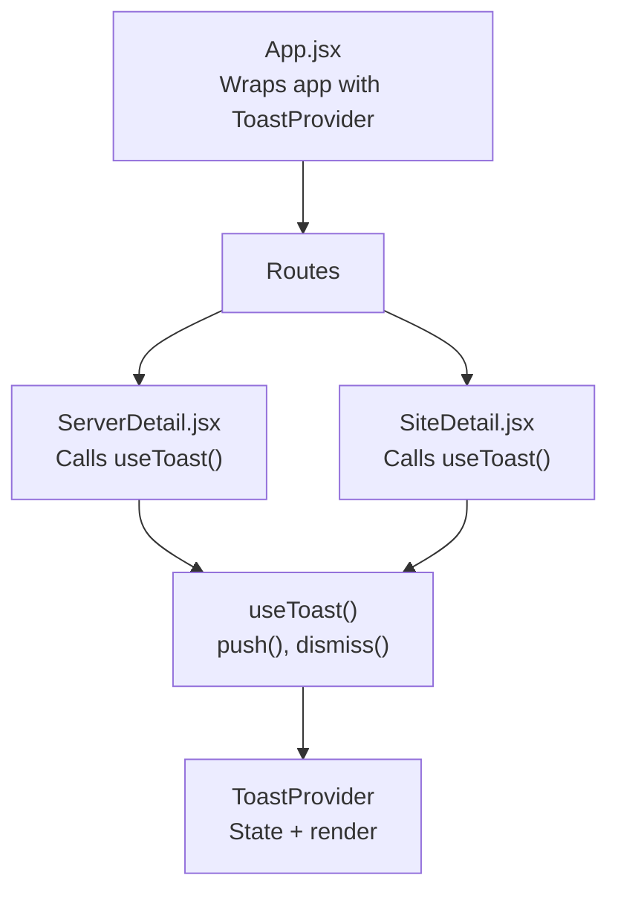
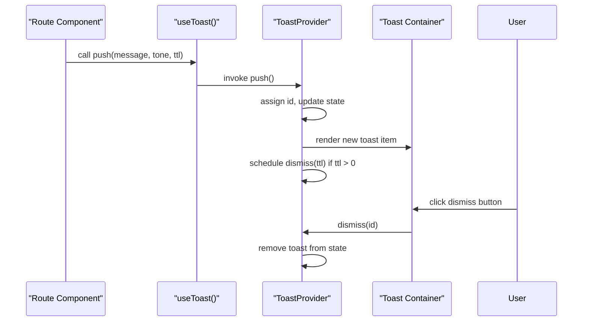
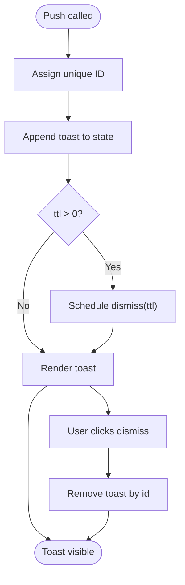
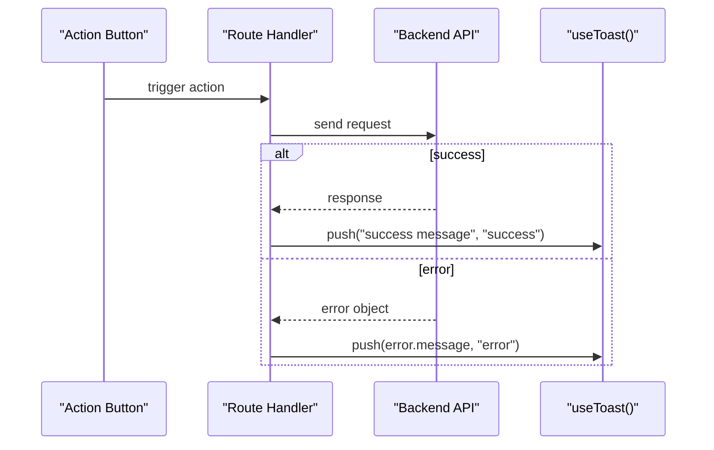
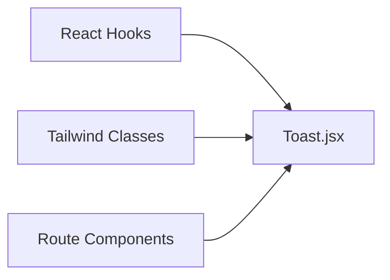

# Toast Component

<cite>
**Referenced Files in This Document**
- [Toast.jsx](file://src/admin/components/Toast.jsx)
- [App.jsx](file://src/admin/App.jsx)
- [ServerDetail.jsx](file://src/admin/routes/ServerDetail.jsx)
- [SiteDetail.jsx](file://src/admin/routes/SiteDetail.jsx)
</cite>

## Table of Contents
1. [Introduction](#introduction)
2. [Project Structure](#project-structure)
3. [Core Components](#core-components)
4. [Architecture Overview](#architecture-overview)
5. [Detailed Component Analysis](#detailed-component-analysis)
6. [Dependency Analysis](#dependency-analysis)
7. [Performance Considerations](#performance-considerations)
8. [Troubleshooting Guide](#troubleshooting-guide)
9. [Conclusion](#conclusion)

## Introduction
This document explains the Toast notification system used by the Simple Stack admin interface. It covers toast types, positioning, auto-dismiss behavior, programmatic creation, stacking management, user interaction handling, common usage patterns, accessibility, animation considerations, and mobile responsiveness.

The Toast component is a React context provider plus a hook that lets any route or component display brief feedback messages without managing global state manually.

## Project Structure
The Toast feature lives under the admin frontend:

- Provider and hook: `src/admin/components/Toast.jsx`
- Application root wraps routes with the provider: `src/admin/App.jsx`
- Example consumers: `src/admin/routes/ServerDetail.jsx`, `src/admin/routes/SiteDetail.jsx`

**Diagram sources**
- [App.jsx:61-68](file://src/admin/App.jsx#L61-L68)
- [ServerDetail.jsx:28-29](file://src/admin/routes/ServerDetail.jsx#L28-L29)
- [SiteDetail.jsx:28-29](file://src/admin/routes/SiteDetail.jsx#L28-L29)
- [Toast.jsx:25-74](file://src/admin/components/Toast.jsx#L25-L74)

**Section sources**
- [Toast.jsx:1-83](file://src/admin/components/Toast.jsx#L1-L83)
- [App.jsx:12-23](file://src/admin/App.jsx#L12-L23)
- [ServerDetail.jsx:10-21](file://src/admin/routes/ServerDetail.jsx#L10-L21)
- [SiteDetail.jsx:10-21](file://src/admin/routes/SiteDetail.jsx#L10-L21)

## Core Components
- ToastProvider: Provides the toast API via React Context and renders the visible toasts container.
- useToast: Hook returning `{ push(message, tone?, ttl?) }` and `{ dismiss(id) }`.

Key behaviors:
- Toast types (tones): success, error, info. A warning tone is not defined; unknown tones fall back to info styling.
- Positioning: Fixed container at the top-right area of the viewport.
- Stacking: Vertical stack with spacing between items.
- Auto-dismiss: Optional timer per toast; default duration applies when positive TTL is provided.
- Dismissal: Per-toast close button triggers dismissal.

**Section sources**
- [Toast.jsx:12-18](file://src/admin/components/Toast.jsx#L12-L18)
- [Toast.jsx:25-74](file://src/admin/components/Toast.jsx#L25-L74)

## Architecture Overview
The Toast system uses a simple provider/consumer pattern:

**Diagram sources**
- [Toast.jsx:32-44](file://src/admin/components/Toast.jsx#L32-L44)
- [Toast.jsx:52-72](file://src/admin/components/Toast.jsx#L52-L72)

## Detailed Component Analysis

### Toast Types and Styling
Supported tones:
- success: Positive color palette
- error: Negative color palette
- info: Brand color palette

Unknown tones fall back to info styling. There is no built-in warning tone.

Styling approach:
- Tone classes are applied conditionally based on the toast’s tone.
- Base styles include rounded corners, border, padding, text size, and shadow.

Accessibility:
- Each toast has role="status".
- The dismiss button includes an aria-label for screen readers.

Positioning:
- Fixed container aligned to the right side near the top of the page.
- Uses responsive width and vertical gap for stacking.

Auto-dismiss:
- If ttl is greater than zero, a timeout schedules dismissal after the specified milliseconds.
- Default ttl is applied when not explicitly provided.

User interaction:
- Clicking the close button removes the specific toast from the stack.

Programmatic API:
- push(message, tone?, ttl?): Adds a toast and returns its id.
- dismiss(id): Removes a toast by id.

Animation effects:
- No explicit enter/exit animations are implemented. Toasts appear immediately and disappear instantly upon dismissal.

Mobile responsiveness:
- The container uses fixed positioning and a constrained width.
- Content supports line breaks within messages.
- No media queries are present in the Toast component itself.

**Diagram sources**
- [Toast.jsx:32-44](file://src/admin/components/Toast.jsx#L32-L44)
- [Toast.jsx:52-72](file://src/admin/components/Toast.jsx#L52-L72)

**Section sources**
- [Toast.jsx:12-18](file://src/admin/components/Toast.jsx#L12-L18)
- [Toast.jsx:25-74](file://src/admin/components/Toast.jsx#L25-L74)

### Programmatic Usage Patterns

#### Success Feedback
Useful for confirming actions like dispatching server commands or submitting site operations.

Example references:
- Dispatched action success: [ServerDetail.jsx:61](file://src/admin/routes/ServerDetail.jsx#L61)
- Submitted action success: [SiteDetail.jsx:61](file://src/admin/routes/SiteDetail.jsx#L61)

#### Error Feedback
Display backend errors surfaced through the API layer.

Example references:
- Action error: [ServerDetail.jsx:69](file://src/admin/routes/ServerDetail.jsx#L69)
- Action error: [SiteDetail.jsx:66](file://src/admin/routes/SiteDetail.jsx#L66)

#### Deletion Confirmation Flow
Shows success after deletion request and navigates away.

Example references:
- Server deletion queued: [ServerDetail.jsx:79](file://src/admin/routes/ServerDetail.jsx#L79)
- Site trashed: [SiteDetail.jsx:76](file://src/admin/routes/SiteDetail.jsx#L76)

**Diagram sources**
- [ServerDetail.jsx:58-71](file://src/admin/routes/ServerDetail.jsx#L58-L71)
- [SiteDetail.jsx:58-69](file://src/admin/routes/SiteDetail.jsx#L58-L69)

**Section sources**
- [ServerDetail.jsx:58-87](file://src/admin/routes/ServerDetail.jsx#L58-L87)
- [SiteDetail.jsx:58-84](file://src/admin/routes/SiteDetail.jsx#L58-L84)

### Custom Toast Content
Current implementation renders plain text only. To support custom content:
- Extend the toast data model to accept JSX or HTML-safe markup.
- Sanitize any user-provided content before rendering.
- Update the toast renderer to output the custom content safely.

Note: This is a recommended extension path; it is not currently implemented.

### Integration With Application Workflows
- Wrap the application with ToastProvider at the root so all routes can access the toast API.
- Consume useToast in components that perform asynchronous operations.
- Show success toasts on successful mutations and error toasts on failures.
- Use navigation helpers to move users after important actions.

**Section sources**
- [App.jsx:61-68](file://src/admin/App.jsx#L61-L68)
- [ServerDetail.jsx:28-29](file://src/admin/routes/ServerDetail.jsx#L28-L29)
- [SiteDetail.jsx:28-29](file://src/admin/routes/SiteDetail.jsx#L28-L29)

## Dependency Analysis
The Toast system has minimal dependencies:

- React hooks: createContext, useCallback, useContext, useMemo, useState
- Tailwind utility classes for layout and styling
- Global window APIs for timers and location (used elsewhere in the app)

**Diagram sources**
- [Toast.jsx:8-10](file://src/admin/components/Toast.jsx#L8-L10)
- [Toast.jsx:52-72](file://src/admin/components/Toast.jsx#L52-L72)

**Section sources**
- [Toast.jsx:8-10](file://src/admin/components/Toast.jsx#L8-L10)

## Performance Considerations
- State updates are lightweight: array append and filter by id.
- Timers are created per toast; ensure reasonable ttl values to avoid excessive timers.
- No animations reduce runtime overhead but may impact perceived responsiveness.
- Consider debouncing rapid successive pushes if needed to prevent UI churn.

[No sources needed since this section provides general guidance]

## Troubleshooting Guide
Common issues and resolutions:

- Toast does not appear:
  - Ensure the app is wrapped with ToastProvider.
  - Verify the route is inside the provider tree.

- Toast disappears too quickly:
  - Increase ttl when calling push.
  - Avoid passing very small ttl values.

- Toast remains after navigation:
  - Current implementation persists until dismissed or ttl expires.
  - Consider clearing toasts on route changes if required.

- Warning tone not styled:
  - Only success, error, and info are supported.
  - Use one of these tones or extend TONES to add warning.

- Accessibility concerns:
  - Confirm screen readers announce role="status" toasts.
  - Ensure dismiss buttons have accessible labels.

**Section sources**
- [App.jsx:61-68](file://src/admin/App.jsx#L61-L68)
- [Toast.jsx:12-18](file://src/admin/components/Toast.jsx#L12-L18)
- [Toast.jsx:52-72](file://src/admin/components/Toast.jsx#L52-L72)

## Conclusion
The Toast component provides a simple, accessible, and easy-to-use notification system for the Simple Stack admin interface. It supports success, error, and info tones, fixed top-right positioning, automatic dismissal, and a straightforward programmatic API. While animations are not implemented, the design is lightweight and integrates cleanly with existing routes. For richer experiences, consider adding animations, expanded tone support, and optional custom content while maintaining accessibility best practices.