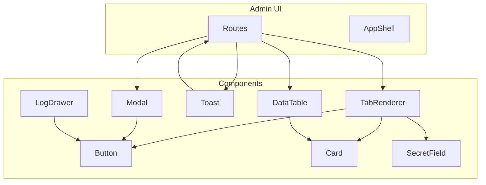
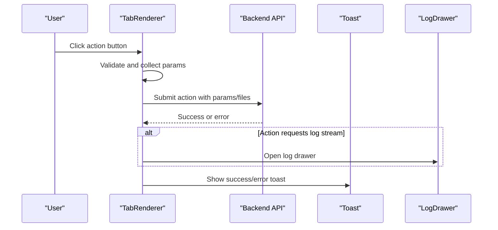
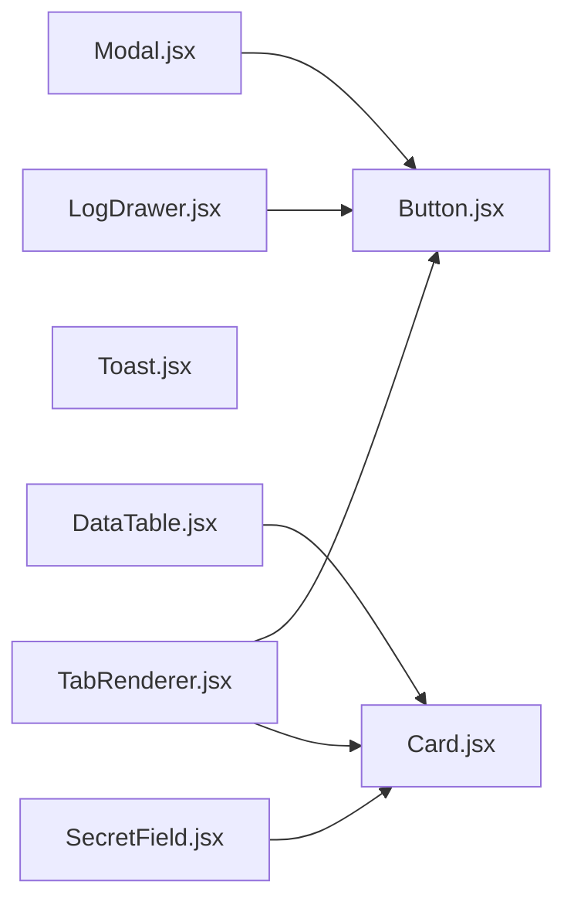

# UI Components Library

<cite>
**Referenced Files in This Document**
- [Button.jsx](file://src/admin/components/Button.jsx)
- [Card.jsx](file://src/admin/components/Card.jsx)
- [Modal.jsx](file://src/admin/components/Modal.jsx)
- [DataTable.jsx](file://src/admin/components/DataTable.jsx)
- [Toast.jsx](file://src/admin/components/Toast.jsx)
- [SecretField.jsx](file://src/admin/components/SecretField.jsx)
- [TabRenderer.jsx](file://src/admin/components/TabRenderer.jsx)
- [LogDrawer.jsx](file://src/admin/components/LogDrawer.jsx)
</cite>

## Table of Contents
1. [Introduction](#introduction)
2. [Project Structure](#project-structure)
3. [Core Components](#core-components)
4. [Architecture Overview](#architecture-overview)
5. [Detailed Component Analysis](#detailed-component-analysis)
6. [Dependency Analysis](#dependency-analysis)
7. [Performance Considerations](#performance-considerations)
8. [Troubleshooting Guide](#troubleshooting-guide)
9. [Conclusion](#conclusion)

## Introduction
This document describes Simple Stack’s reusable React UI component library used in the admin interface. It covers props, events, slots, customization options, accessibility, and responsive behavior for each component: Button, Card, Modal, DataTable, Toast, SecretField, TabRenderer, and LogDrawer. Practical usage examples are provided conceptually so you can adapt them to your routes and data models without copying implementation details.

## Project Structure
The components live under `src/admin/components` and share a consistent Tailwind-based design system scoped to the admin container. They compose together to build pages such as server and site detail views, tabs, tables, modals, notifications, and log drawers.

**Diagram sources**
- [Button.jsx:1-60](file://src/admin/components/Button.jsx#L1-L60)
- [Card.jsx:1-121](file://src/admin/components/Card.jsx#L1-L121)
- [Modal.jsx:1-131](file://src/admin/components/Modal.jsx#L1-L131)
- [DataTable.jsx:1-153](file://src/admin/components/DataTable.jsx#L1-L153)
- [Toast.jsx:1-83](file://src/admin/components/Toast.jsx#L1-L83)
- [SecretField.jsx:1-73](file://src/admin/components/SecretField.jsx#L1-L73)
- [TabRenderer.jsx:1-403](file://src/admin/components/TabRenderer.jsx#L1-L403)
- [LogDrawer.jsx:1-189](file://src/admin/components/LogDrawer.jsx#L1-L189)

**Section sources**
- [Button.jsx:1-60](file://src/admin/components/Button.jsx#L1-L60)
- [Card.jsx:1-121](file://src/admin/components/Card.jsx#L1-L121)
- [Modal.jsx:1-131](file://src/admin/components/Modal.jsx#L1-L131)
- [DataTable.jsx:1-153](file://src/admin/components/DataTable.jsx#L1-L153)
- [Toast.jsx:1-83](file://src/admin/components/Toast.jsx#L1-L83)
- [SecretField.jsx:1-73](file://src/admin/components/SecretField.jsx#L1-L73)
- [TabRenderer.jsx:1-403](file://src/admin/components/TabRenderer.jsx#L1-L403)
- [LogDrawer.jsx:1-189](file://src/admin/components/LogDrawer.jsx#L1-L189)

## Core Components
This section summarizes the public API surface of each component.

- Button
  - Props: variant, size, busy, disabled, className, type, children, plus any standard button attributes via rest.
  - Events: forwards click and other native button events.
  - Slots: children content; optional spinner when busy.
  - Customization: variants primary, secondary, ghost, danger; sizes sm, md; focus ring and disabled states.

- Card (and related primitives)
  - Card props: title, subtitle, action, borderless, className, children.
  - Badge props: tone (positive, warning, negative, neutral, brand), children.
  - Skeleton props: rows.
  - EmptyState props: title, message, action.
  - ErrorPanel props: error, onRetry.

- Modal
  - Props: open, title, onClose, footer, children.
  - Behavior: Escape key closes; focuses first focusable element; click-outside-to-close.
  - ConfirmDialog props: open, title, message, confirmLabel, onConfirm, onCancel, busy.

- DataTable
  - Props: columns, rows, rowKey, onRowClick, loading, emptyTitle, emptyMessage.
  - Column descriptor: key, header, render, sortValue, align, sortable.
  - Features: sorting, keyboard activation for rows, skeleton and empty state.

- Toast
  - Provider: ToastProvider wraps app tree.
  - Hook: useToast returns push(message, tone, ttl) and dismiss(id).
  - Tones: success, error, info.

- SecretField
  - Props: id, label, value, onChange, stored, help, placeholder, disabled.
  - Behavior: masked input with show/hide toggle; badge indicates stored vs not set.

- TabRenderer
  - Props: tabs, fields, onAction, onShowLog, loading, disabledReason.
  - Field kinds: hidden, label, html, readonly, action, toggle, select, textarea, password, file, number, temporal, email, url.
  - Integrates Card, Button, SecretField-like inputs, and supports file uploads and log drawer integration.

- LogDrawer
  - Props: serverId, title, open, onClose, kickoffMessage.
  - Behavior: polls logs endpoint, displays entries, supports refresh, download, and hide.

**Section sources**
- [Button.jsx:20-59](file://src/admin/components/Button.jsx#L20-L59)
- [Card.jsx:13-121](file://src/admin/components/Card.jsx#L13-L121)
- [Modal.jsx:12-131](file://src/admin/components/Modal.jsx#L12-L131)
- [DataTable.jsx:12-153](file://src/admin/components/DataTable.jsx#L12-L153)
- [Toast.jsx:20-83](file://src/admin/components/Toast.jsx#L20-L83)
- [SecretField.jsx:14-73](file://src/admin/components/SecretField.jsx#L14-L73)
- [TabRenderer.jsx:36-403](file://src/admin/components/TabRenderer.jsx#L36-L403)
- [LogDrawer.jsx:27-189](file://src/admin/components/LogDrawer.jsx#L27-L189)

## Architecture Overview
The components form a layered UI architecture:
- Presentation layer: Button, Card, Modal, DataTable, SecretField.
- Orchestration layer: TabRenderer composes multiple controls and actions.
- Feedback layer: Toast provides global notifications; LogDrawer streams operational logs.
- Data binding: DataTable binds column descriptors to rows; TabRenderer binds field schemas to values and files.

**Diagram sources**
- [TabRenderer.jsx:108-144](file://src/admin/components/TabRenderer.jsx#L108-L144)
- [Toast.jsx:32-44](file://src/admin/components/Toast.jsx#L32-L44)
- [LogDrawer.jsx:46-101](file://src/admin/components/LogDrawer.jsx#L46-L101)

## Detailed Component Analysis

### Button
Purpose: A versatile action button with variants, sizes, and a pending state.

Props
- variant: primary | secondary | ghost | danger
- size: sm | md
- busy: boolean; shows spinner and disables the button
- disabled: boolean
- className: string; additional classes
- type: string; defaults to button
- children: JSX content
- ...rest: forwarded to the underlying button element

Events
- All native button events are supported through rest.

Slots
- children: text, icons, or inline elements.

Customization
- Variants map to color schemes and hover states.
- Sizes adjust typography and padding.
- Focus-visible ring ensures keyboard accessibility.

Accessibility
- Disabled state is explicit.
- Spinner is visually decorative and marked aria-hidden.

Usage example
- Use primary for main actions, secondary for alternatives, ghost for subtle actions, and danger for destructive operations.
- Set busy while awaiting an asynchronous operation.

Styling notes
- Styles are scoped to the admin container to avoid leaking into WordPress admin styles.

**Section sources**
- [Button.jsx:8-18](file://src/admin/components/Button.jsx#L8-L18)
- [Button.jsx:20-59](file://src/admin/components/Button.jsx#L20-L59)

### Card
Purpose: A layout container with optional header, plus supporting primitives like Badge, Skeleton, EmptyState, and ErrorPanel.

Props
- Card: title, subtitle, action, borderless, className, children
- Badge: tone, children
- Skeleton: rows
- EmptyState: title, message, action
- ErrorPanel: error, onRetry

Layout and structure
- Card renders a header with title/subtitle and optional action slot, then children.
- Borderless mode removes border and padding for embedded layouts.

Customization
- Badge tones: positive, warning, negative, neutral, brand.
- Skeleton animates placeholder rows.
- EmptyState provides guidance and optional call to action.
- ErrorPanel displays error message, code, and retry button.

Usage example
- Wrap tabbed sections or settings panels in Card.
- Use Badge to indicate status.
- Show Skeleton during data loading and EmptyState when there is no data.

Accessibility
- ErrorPanel uses semantic buttons and readable messages.

**Section sources**
- [Card.jsx:5-11](file://src/admin/components/Card.jsx#L5-L11)
- [Card.jsx:13-40](file://src/admin/components/Card.jsx#L13-L40)
- [Card.jsx:42-121](file://src/admin/components/Card.jsx#L42-L121)

### Modal
Purpose: Accessible dialog with confirmation prompt support.

Props
- Modal: open, title, onClose, footer, children
- ConfirmDialog: open, title, message, confirmLabel, onConfirm, onCancel, busy

Behavior
- Renders only when open is true.
- Pressing Escape calls onClose.
- Focuses the first focusable element inside the panel.
- Clicking outside the panel closes it.
- Footer slot accepts custom buttons.

Accessibility
- role="dialog", aria-modal="true", aria-label from title.
- Close button has aria-label.

Usage example
- Wrap destructive actions in ConfirmDialog to require user confirmation.
- Use Modal for forms, previews, or detailed information.

Styling notes
- Backdrop and panel use consistent spacing, borders, and shadows.

**Section sources**
- [Modal.jsx:12-87](file://src/admin/components/Modal.jsx#L12-L87)
- [Modal.jsx:89-131](file://src/admin/components/Modal.jsx#L89-L131)

### DataTable
Purpose: Sortable, keyboard-reachable table bound to column descriptors and rows.

Props
- columns: array of { key, header, render?, sortValue?, align? }
- rows: array of objects
- rowKey: function(row) -> stable key
- onRowClick: function(row)
- loading: boolean
- emptyTitle: string
- emptyMessage: string

Data binding
- Columns define display and sorting behavior.
- render allows custom cell content.
- sortValue allows custom sort keys.
- align supports right alignment.

Pagination
- Pagination is not implemented in this component; provide paginated rows from your route and update rows/columns accordingly.

Keyboard and interaction
- Rows are clickable and keyboard-activatable when onRowClick is provided.
- Column headers are interactive when sortable.

Loading and empty states
- Shows Skeleton while loading.
- Shows EmptyState when rows are missing.

Usage example
- Define columns for server/site lists.
- Provide rowKey that returns a unique identifier.
- Handle onRowClick to navigate to detail pages.

**Section sources**
- [DataTable.jsx:12-31](file://src/admin/components/DataTable.jsx#L12-L31)
- [DataTable.jsx:34-79](file://src/admin/components/DataTable.jsx#L34-L79)
- [DataTable.jsx:81-153](file://src/admin/components/DataTable.jsx#L81-L153)

### Toast
Purpose: Global notification system using React context.

Provider and hook
- Wrap your app with ToastProvider.
- Call useToast() anywhere to get push(message, tone, ttl) and dismiss(id).

Tones
- success, error, info.

Behavior
- Each toast gets a unique id.
- Auto-dismiss after ttl milliseconds unless ttl is zero.
- Dismiss button available per toast.

Usage example
- After a successful mutation, call push("Saved successfully", "success").
- On failure, call push(error.message, "error").

Accessibility
- Toast containers have role="status".
- Dismiss button has aria-label.

**Section sources**
- [Toast.jsx:10-18](file://src/admin/components/Toast.jsx#L10-L18)
- [Toast.jsx:20-75](file://src/admin/components/Toast.jsx#L20-L75)
- [Toast.jsx:77-83](file://src/admin/components/Toast.jsx#L77-L83)

### SecretField
Purpose: Secure credential input with reveal toggle and stored-state indicator.

Props
- id: string
- label: string
- value: string
- onChange: function(value)
- stored: boolean; whether a value exists server-side
- help: string
- placeholder: string
- disabled: boolean

Behavior
- Input is masked by default; users can toggle visibility.
- Badge shows Stored or Not set based on stored prop.
- When stored is true, placeholder guides users to leave blank to keep existing value.

Security considerations
- The component itself does not transmit secrets; ensure your backend handles sensitive fields securely.

Usage example
- Use for passwords, API keys, or SSH keys where you need to indicate if a secret is already configured.

Accessibility
- Label is associated with the input via htmlFor/id.

**Section sources**
- [SecretField.jsx:14-35](file://src/admin/components/SecretField.jsx#L14-L35)
- [SecretField.jsx:36-73](file://src/admin/components/SecretField.jsx#L36-L73)

### TabRenderer
Purpose: Generic renderer for dynamic tab schemas returned by the backend. It maps field definitions to controls, collects parameters, triggers actions, and integrates with the log drawer and toasts.

Props
- tabs: array of { slug, label }
- fields: array of field descriptors
- onAction: async function(action, params, field, uploads)
- onShowLog: function(field)
- loading: boolean
- disabledReason: string

Field kinds and behaviors
- hidden: no UI.
- label: heading and description/raw HTML.
- html: server-produced documentation markup.
- readonly: displays managed value.
- action: triggers onAction with collected params and optional file upload.
- toggle: checkbox control.
- select: dropdown with options.
- textarea: multi-line input.
- password: masked input.
- file: file picker; uploaded as file parameter.
- number/temporal/email/url/text: typed inputs.

Data flow
- Maintains local state for values and files.
- Groups fields into rows and renders responsive grid layouts.
- Validates confirm prompts before executing actions.
- Sets pending state per action to disable controls during processing.
- Optionally opens LogDrawer when field.showLog is true.

Responsive design
- Uses grid widths full, half, third, two-thirds mapped to Tailwind breakpoints.

Usage example
- Fetch tabs and fields from the backend.
- Implement onAction to call your API and show toasts.
- Implement onShowLog to open LogDrawer for long-running tasks.

Accessibility
- Tabs use aria-current for active tab.
- Inputs have labels and descriptions.

**Section sources**
- [TabRenderer.jsx:1-11](file://src/admin/components/TabRenderer.jsx#L1-L11)
- [TabRenderer.jsx:36-81](file://src/admin/components/TabRenderer.jsx#L36-L81)
- [TabRenderer.jsx:100-144](file://src/admin/components/TabRenderer.jsx#L100-L144)
- [TabRenderer.jsx:146-211](file://src/admin/components/TabRenderer.jsx#L146-L211)
- [TabRenderer.jsx:219-403](file://src/admin/components/TabRenderer.jsx#L219-L403)

### LogDrawer
Purpose: Inline log viewer that polls server logs and displays entries with tone-based styling.

Props
- serverId: number
- title: string
- open: boolean
- onClose: function
- kickoffMessage: string

Behavior
- Polls logs endpoint at intervals while open.
- Displays newest entries first, scrolling to top on new data.
- Supports manual refresh, download as plain text, and hide.
- Shows loading indicator and cursor timestamp.

Error handling
- Displays error message when polling fails.

Usage example
- Open LogDrawer when starting a provisioning or maintenance action.
- Pass serverId to follow the correct log stream.

Accessibility
- Header includes descriptive title and status text.

**Section sources**
- [LogDrawer.jsx:1-11](file://src/admin/components/LogDrawer.jsx#L1-L11)
- [LogDrawer.jsx:27-45](file://src/admin/components/LogDrawer.jsx#L27-L45)
- [LogDrawer.jsx:46-107](file://src/admin/components/LogDrawer.jsx#L46-L107)
- [LogDrawer.jsx:113-189](file://src/admin/components/LogDrawer.jsx#L113-L189)

## Dependency Analysis
Component relationships and imports:

**Diagram sources**
- [Modal.jsx:10-10](file://src/admin/components/Modal.jsx#L10-L10)
- [DataTable.jsx:10-10](file://src/admin/components/DataTable.jsx#L10-L10)
- [SecretField.jsx:12-12](file://src/admin/components/SecretField.jsx#L12-L12)
- [TabRenderer.jsx:15-16](file://src/admin/components/TabRenderer.jsx#L15-L16)
- [LogDrawer.jsx:15-15](file://src/admin/components/LogDrawer.jsx#L15-L15)

**Section sources**
- [Modal.jsx:1-131](file://src/admin/components/Modal.jsx#L1-L131)
- [DataTable.jsx:1-153](file://src/admin/components/DataTable.jsx#L1-L153)
- [SecretField.jsx:1-73](file://src/admin/components/SecretField.jsx#L1-L73)
- [TabRenderer.jsx:1-403](file://src/admin/components/TabRenderer.jsx#L1-L403)
- [LogDrawer.jsx:1-189](file://src/admin/components/LogDrawer.jsx#L1-L189)

## Performance Considerations
- DataTable sorts in-memory; for very large datasets, consider server-side sorting and pagination.
- TabRenderer maintains local state for all fields; keep field counts reasonable and avoid heavy computations in onChange handlers.
- LogDrawer polls at a fixed interval; tune POLL_MS based on expected log volume and network conditions.
- Toast auto-dismiss reduces DOM growth; limit concurrent toasts by reusing or dismissing older ones.
- Modal renders conditionally; avoid heavy child trees until open.

[No sources needed since this section provides general guidance]

## Troubleshooting Guide
Common issues and resolutions:

- Modal does not close on Escape
  - Ensure onClose is passed and not overridden.
  - Verify the modal is rendered with open=true.

- Toast not appearing
  - Confirm ToastProvider wraps the application tree.
  - Check that useToast is called within a provider context.

- DataTable sorting not working
  - Ensure columns include sortValue when default comparison is insufficient.
  - Verify rowKey returns unique identifiers.

- SecretField shows “Not set” unexpectedly
  - Make sure stored prop reflects server state accurately.
  - If updating, pass empty string to keep existing value when stored is true.

- TabRenderer action does nothing
  - Check onAction implementation and that it returns a Promise.
  - Verify field.confirm prompts are handled correctly.

- LogDrawer not refreshing
  - Verify serverId is valid and open is true.
  - Inspect network requests to the logs endpoint.

**Section sources**
- [Modal.jsx:23-47](file://src/admin/components/Modal.jsx#L23-L47)
- [Toast.jsx:25-44](file://src/admin/components/Toast.jsx#L25-L44)
- [DataTable.jsx:34-59](file://src/admin/components/DataTable.jsx#L34-L59)
- [SecretField.jsx:36-73](file://src/admin/components/SecretField.jsx#L36-L73)
- [TabRenderer.jsx:108-144](file://src/admin/components/TabRenderer.jsx#L108-L144)
- [LogDrawer.jsx:83-101](file://src/admin/components/LogDrawer.jsx#L83-L101)

## Conclusion
Simple Stack’s UI component library provides a cohesive, accessible, and responsive set of building blocks for the admin interface. By composing Button, Card, Modal, DataTable, Toast, SecretField, TabRenderer, and LogDrawer, you can implement robust workflows for configuration, data presentation, user feedback, and operational logging. Follow the documented props, events, and slots to integrate these components consistently across your application.

[No sources needed since this section summarizes without analyzing specific files]