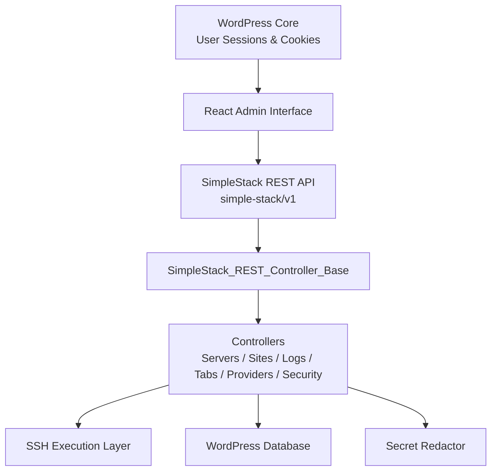
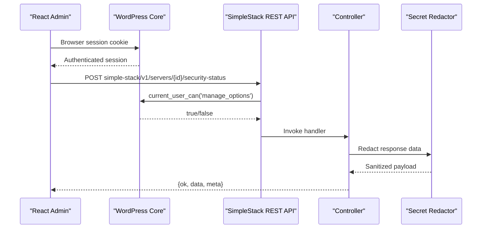
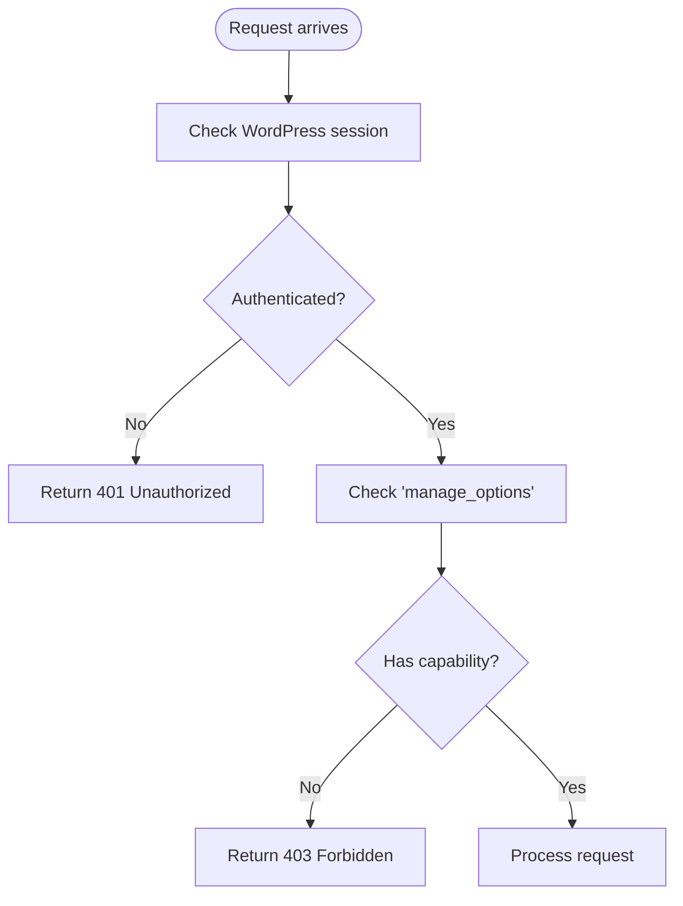
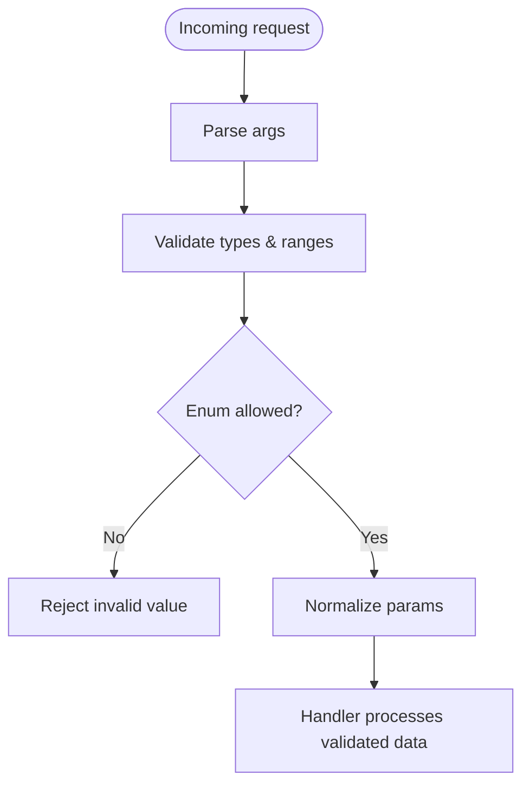
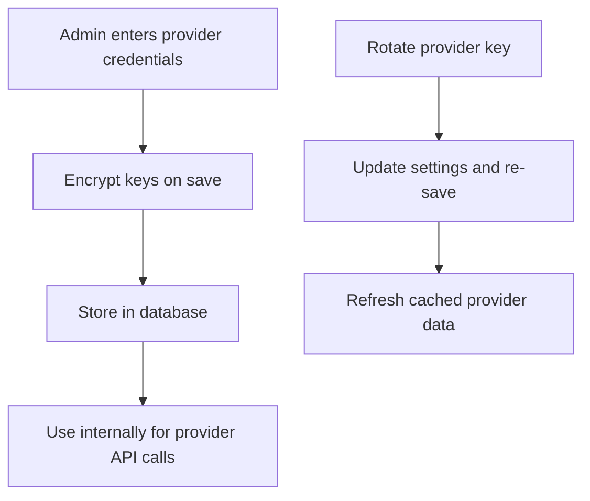
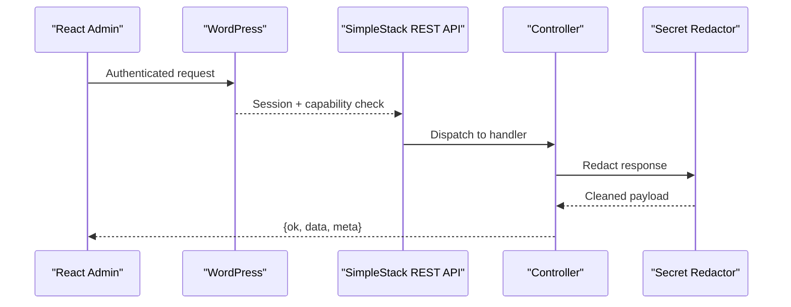
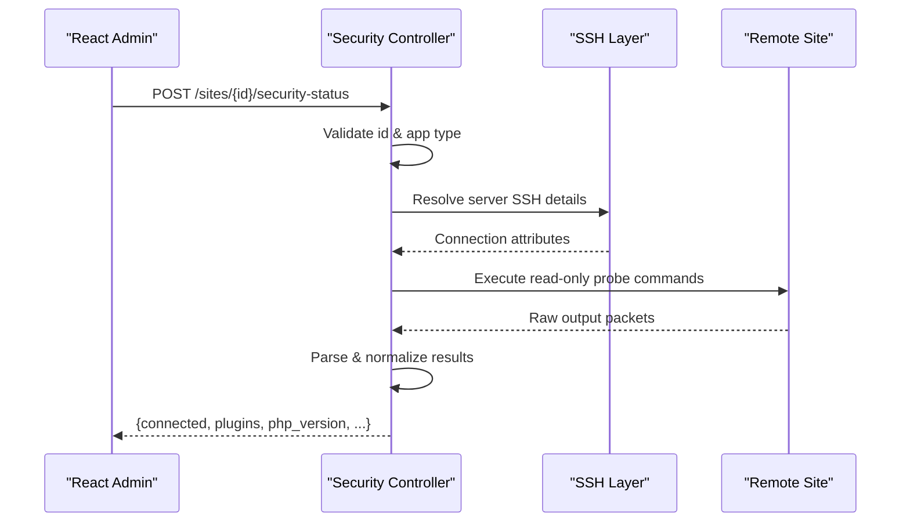
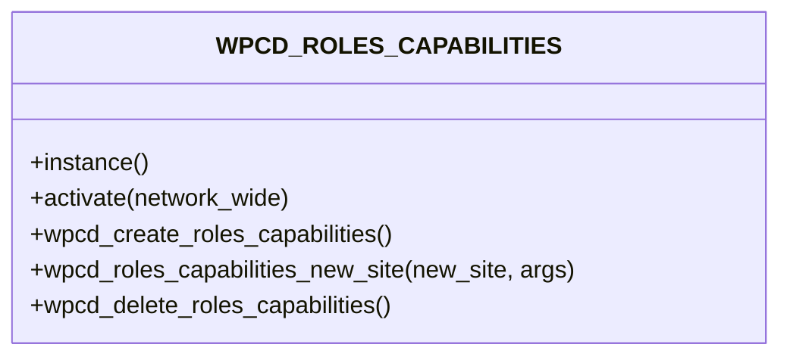
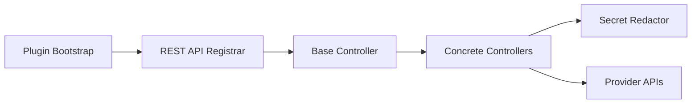

# Authentication Mechanisms

<cite>
**Referenced Files in This Document**
- [wpcd.php](file://wpcd.php)
- [class-simplestack-rest-api.php](file://includes/core/api/class-simplestack-rest-api.php)
- [class-simplestack-rest-controller-base.php](file://includes/core/api/class-simplestack-rest-controller-base.php)
- [class-simplestack-secret-redactor.php](file://includes/core/api/class-simplestack-secret-redactor.php)
- [class-simplestack-rest-security.php](file://includes/core/api/class-simplestack-rest-security.php)
- [class-wpcd-roles-capabilities.php](file://includes/core/class-wpcd-roles-capabilities.php)
- [class-wpcd-settings.php](file://includes/core/class-wpcd-settings.php)
- [class-wpcd-provider.php](file://includes/core/custom-table/class-wpcd-provider.php)
- [class-cloud-provider-api.php](file://includes/core/providers/class-cloud-provider-api.php)
- [ControllerBaseTest.php](file://tests/phpunit/rest-api/ControllerBaseTest.php)
- [class-wpcd-rest-api-controller-test.php](file://tests/data/class-wpcd-rest-api-controller-test.php)
</cite>

## Table of Contents
1. [Introduction](#introduction)
2. [Project Structure](#project-structure)
3. [Core Components](#core-components)
4. [Architecture Overview](#architecture-overview)
5. [Detailed Component Analysis](#detailed-component-analysis)
6. [Dependency Analysis](#dependency-analysis)
7. [Performance Considerations](#performance-considerations)
8. [Troubleshooting Guide](#troubleshooting-guide)
9. [Conclusion](#conclusion)

## Introduction
This document explains how SimpleStack secures its WordPress integration and React admin interface. It covers:
- How WordPress user authentication gates access to SimpleStack’s internal REST API.
- Session handling through WordPress sessions and cookies.
- Nonce verification for legacy AJAX endpoints.
- Request validation and parameter sanitization across the REST layer.
- Programmatic API key usage for cloud providers, including generation, storage, encryption, and rotation guidance.
- The end-to-end authentication flow from the React admin UI to SimpleStack REST endpoints.
- Secure implementation patterns and common vulnerabilities to avoid.

SimpleStack is an internal control plane. Its REST API is intentionally restricted to WordPress users with the `manage_options` capability, ensuring that only trusted administrators can manage servers and sites.

## Project Structure
The authentication surface spans several layers:
- Plugin bootstrap defines constants and loads the REST API registrar.
- The SimpleStack REST API registers controllers under a dedicated namespace.
- A base controller enforces permissions, validates parameters, and redacts secrets from responses.
- Role and capability definitions extend WordPress roles for administrative boundaries.
- Provider credential management stores encrypted API keys used by cloud integrations.

**Diagram sources**
- [wpcd.php:383-393](file://wpcd.php#L383-L393)
- [class-simplestack-rest-api.php:21-37](file://includes/core/api/class-simplestack-rest-api.php#L21-L37)
- [class-simplestack-rest-controller-base.php:22-60](file://includes/core/api/class-simplestack-rest-controller-base.php#L22-L60)
- [class-simplestack-secret-redactor.php:12-23](file://includes/core/api/class-simplestack-secret-redactor.php#L12-L23)

**Section sources**
- [wpcd.php:16-130](file://wpcd.php#L16-L130)
- [class-simplestack-rest-api.php:21-119](file://includes/core/api/class-simplestack-rest-api.php#L21-L119)

## Core Components
- SimpleStack REST API Registrar: Loads controllers and registers routes under `simple-stack/v1`.
- Base Controller: Enforces `manage_options`, provides argument helpers, response envelope, and secret redaction.
- Secret Redactor: Recursively masks credentials in responses and scrubs sensitive text.
- Roles and Capabilities: Defines custom roles and capabilities for administrative separation.
- Provider Credentials: Stores encrypted API keys for cloud provider access.

Key responsibilities:
- Authentication: Delegated to WordPress; SimpleStack requires `manage_options`.
- Authorization: Capability checks gate UI actions and REST endpoints.
- Validation: Strict parameter types, enums, ranges, and JSON normalization.
- Confidentiality: Secrets are never echoed back; PEM blocks and tokens are masked.

**Section sources**
- [class-simplestack-rest-api.php:21-119](file://includes/core/api/class-simplestack-rest-api.php#L21-L119)
- [class-simplestack-rest-controller-base.php:22-162](file://includes/core/api/class-simplestack-rest-controller-base.php#L22-L162)
- [class-simplestack-secret-redactor.php:12-141](file://includes/core/api/class-simplestack-secret-redactor.php#L12-L141)
- [class-wpcd-roles-capabilities.php:15-151](file://includes/core/class-wpcd-roles-capabilities.php#L15-L151)

## Architecture Overview
SimpleStack’s security model integrates tightly with WordPress:
- User identity comes from WordPress sessions and cookies.
- All SimpleStack REST endpoints require `manage_options`.
- Requests are validated using typed arguments and strict validators.
- Responses pass through a secret redactor before leaving the server.
- Provider API keys are stored encrypted and used internally; they are not exposed via the API.

**Diagram sources**
- [class-simplestack-rest-controller-base.php:58-60](file://includes/core/api/class-simplestack-rest-controller-base.php#L58-L60)
- [class-simplestack-rest-security.php:31-38](file://includes/core/api/class-simplestack-rest-security.php#L31-L38)
- [class-simplestack-secret-redactor.php:64-95](file://includes/core/api/class-simplestack-secret-redactor.php#L64-L95)

## Detailed Component Analysis

### WordPress User Authentication and Session Management
- Identity source: WordPress user sessions and cookies established during login.
- Access control: SimpleStack REST endpoints enforce `manage_options`.
- Session lifecycle: Managed by WordPress; SimpleStack relies on it without overriding session behavior.
- Best practice: Ensure HTTPS, secure cookies, and strong passwords or MFA at the WordPress level.

**Diagram sources**
- [class-simplestack-rest-controller-base.php:58-60](file://includes/core/api/class-simplestack-rest-controller-base.php#L58-L60)

**Section sources**
- [class-simplestack-rest-controller-base.php:58-60](file://includes/core/api/class-simplestack-rest-controller-base.php#L58-L60)

### Nonce Verification and Legacy AJAX Endpoints
- Nonces protect against CSRF for legacy AJAX handlers.
- Nonces are generated in PHP templates and verified when processing requests.
- Example patterns include nonce creation and verification in various modules.

Implementation notes:
- Generate nonces where forms or AJAX calls originate.
- Verify nonces before performing state-changing operations.
- Keep nonce scopes specific to actions and resources.

**Section sources**
- [wpcd.php:452-543](file://wpcd.php#L452-L543)

### Request Validation and Parameter Sanitization
- Every route uses typed arguments with sanitize and validate callbacks.
- Helpers provide integer, string (with enum), free-form text, object, and params normalization.
- Params support both JSON objects and multipart FormData payloads.

Key behaviors:
- Numeric IDs are strictly validated and cast to integers.
- Strings are sanitized and optionally constrained to allowed values.
- Free-form text preserves content while rejecting non-string inputs.
- Params are normalized from JSON strings or query-like strings into arrays.

**Diagram sources**
- [class-simplestack-rest-controller-base.php:169-341](file://includes/core/api/class-simplestack-rest-controller-base.php#L169-L341)

**Section sources**
- [class-simplestack-rest-controller-base.php:169-341](file://includes/core/api/class-simplestack-rest-controller-base.php#L169-L341)

### API Key Authentication for Programmatic Access
- Purpose: Cloud provider integrations use API keys to authenticate with external services.
- Generation: Keys are obtained from provider dashboards; SimpleStack does not generate provider API keys.
- Storage: Keys are stored encrypted in the database.
- Rotation: Update provider settings to rotate keys; re-save to refresh cached lists if needed.

Operational details:
- Provider classes expose methods to retrieve API keys and secrets.
- Credential fingerprinting ensures correct account identification.
- Settings UI indicates when keys are missing and guides additional configuration.

**Diagram sources**
- [class-wpcd-settings.php:1315-1464](file://includes/core/class-wpcd-settings.php#L1315-L1464)
- [class-wpcd-provider.php:191-204](file://includes/core/custom-table/class-wpcd-provider.php#L191-L204)
- [class-cloud-provider-api.php:173-207](file://includes/core/providers/class-cloud-provider-api.php#L173-L207)

**Section sources**
- [class-wpcd-settings.php:1315-1464](file://includes/core/class-wpcd-settings.php#L1315-L1464)
- [class-wpcd-provider.php:191-204](file://includes/core/custom-table/class-wpcd-provider.php#L191-L204)
- [class-cloud-provider-api.php:173-207](file://includes/core/providers/class-cloud-provider-api.php#L173-L207)

### Authentication Flow for React Admin Interface and REST Endpoints
- The React admin client communicates exclusively with the SimpleStack REST API under `simple-stack/v1`.
- Each endpoint requires `manage_options`; unauthorized or insufficiently privileged requests are rejected.
- Responses are wrapped in a standard envelope and redacted for secrets.

Example flow:
- React admin sends a request to a secured endpoint.
- WordPress verifies the session and capability.
- Controller validates parameters and executes logic.
- Response is redacted and returned.

**Diagram sources**
- [class-simplestack-rest-api.php:21-119](file://includes/core/api/class-simplestack-rest-api.php#L21-L119)
- [class-simplestack-rest-controller-base.php:136-162](file://includes/core/api/class-simplestack-rest-controller-base.php#L136-L162)

**Section sources**
- [class-simplestack-rest-api.php:21-119](file://includes/core/api/class-simplestack-rest-api.php#L21-L119)
- [class-simplestack-rest-controller-base.php:136-162](file://includes/core/api/class-simplestack-rest-controller-base.php#L136-L162)

### Security Posture Probe Endpoint
- The security status endpoint performs read-only probes against a site over SSH.
- It returns plugin information, file edit restrictions, and PHP version without mutating anything.
- No secret material is included in the response.

**Diagram sources**
- [class-simplestack-rest-security.php:31-100](file://includes/core/api/class-simplestack-rest-security.php#L31-L100)
- [class-simplestack-rest-security.php:117-191](file://includes/core/api/class-simplestack-rest-security.php#L117-L191)

**Section sources**
- [class-simplestack-rest-security.php:31-100](file://includes/core/api/class-simplestack-rest-security.php#L31-L100)
- [class-simplestack-rest-security.php:117-191](file://includes/core/api/class-simplestack-rest-security.php#L117-L191)

### Roles, Capabilities, and Administrative Boundaries
- Custom roles define granular permissions for provisioning, managing servers/apps, logs, settings, groups, teams, and all actions.
- These roles integrate with WordPress role/capability system and are created on activation or new site initialization.

**Diagram sources**
- [class-wpcd-roles-capabilities.php:15-151](file://includes/core/class-wpcd-roles-capabilities.php#L15-L151)

**Section sources**
- [class-wpcd-roles-capabilities.php:15-151](file://includes/core/class-wpcd-roles-capabilities.php#L15-L151)

## Dependency Analysis
The authentication and authorization dependencies form a clear chain:
- Plugin bootstrap loads the REST API registrar.
- The registrar instantiates controllers and registers routes.
- Controllers rely on the base controller for permission checks, argument helpers, and response envelopes.
- Responses are redacted to prevent secret leakage.
- Provider credentials are used internally and never exposed.

**Diagram sources**
- [wpcd.php:383-393](file://wpcd.php#L383-L393)
- [class-simplestack-rest-api.php:21-119](file://includes/core/api/class-simplestack-rest-api.php#L21-L119)
- [class-simplestack-rest-controller-base.php:22-162](file://includes/core/api/class-simplestack-rest-controller-base.php#L22-L162)
- [class-simplestack-secret-redactor.php:12-141](file://includes/core/api/class-simplestack-secret-redactor.php#L12-L141)

**Section sources**
- [wpcd.php:383-393](file://wpcd.php#L383-L393)
- [class-simplestack-rest-api.php:21-119](file://includes/core/api/class-simplestack-rest-api.php#L21-L119)
- [class-simplestack-rest-controller-base.php:22-162](file://includes/core/api/class-simplestack-rest-controller-base.php#L22-L162)
- [class-simplestack-secret-redactor.php:12-141](file://includes/core/api/class-simplestack-secret-redactor.php#L12-L141)

## Performance Considerations
- Authentication overhead is minimal because SimpleStack delegates to WordPress.
- Parameter validation is lightweight and centralized.
- Secret redaction traverses response structures but avoids expensive operations on large payloads.
- Avoid returning large unredacted payloads; keep responses focused on what the UI needs.

[No sources needed since this section provides general guidance]

## Troubleshooting Guide
Common issues and resolutions:
- 401 Unauthorized: Missing or invalid WordPress session. Ensure the user is logged in and has a valid session cookie.
- 403 Forbidden: Insufficient capability. Grant `manage_options` to the user or adjust roles accordingly.
- Invalid parameters: Check argument types, enums, and ranges. Use the provided helpers for consistent validation.
- Secret leakage: Verify that responses go through the redactor and avoid echoing sensitive fields.

Validation tests demonstrate expected behavior:
- Unauthenticated requests return 401.
- Authenticated but unauthorized requests return 403.
- Exceptions are converted to standardized error responses.

**Section sources**
- [ControllerBaseTest.php:83-113](file://tests/phpunit/rest-api/ControllerBaseTest.php#L83-L113)
- [class-wpcd-rest-api-controller-test.php:17-40](file://tests/data/class-wpcd-rest-api-controller-test.php#L17-L40)

## Conclusion
SimpleStack’s authentication model leverages WordPress sessions and capabilities to secure its internal control plane. The REST API enforces strict authorization, input validation, and secret redaction. Provider API keys are managed securely and used only for internal integrations. Following these patterns ensures robust protection against common vulnerabilities such as CSRF, privilege escalation, and credential exposure.

[No sources needed since this section summarizes without analyzing specific files]