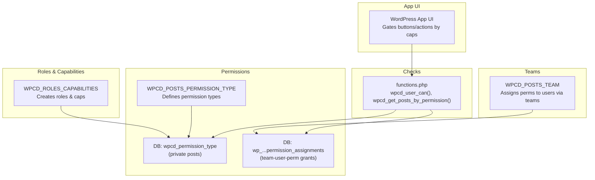
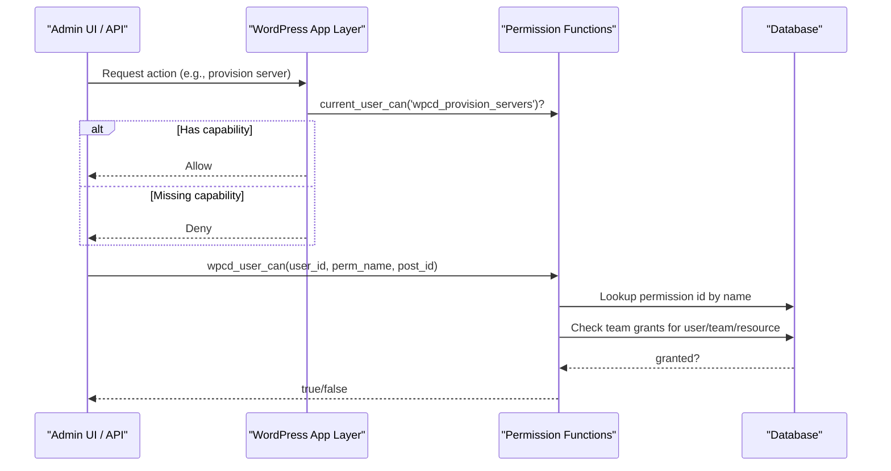
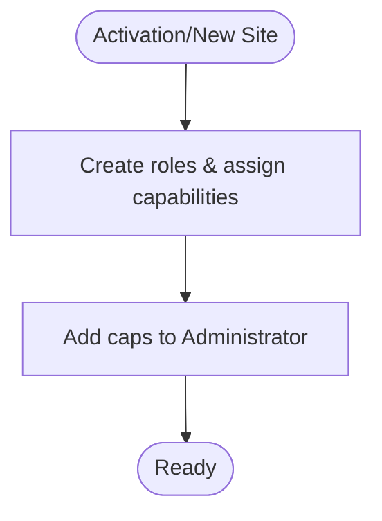
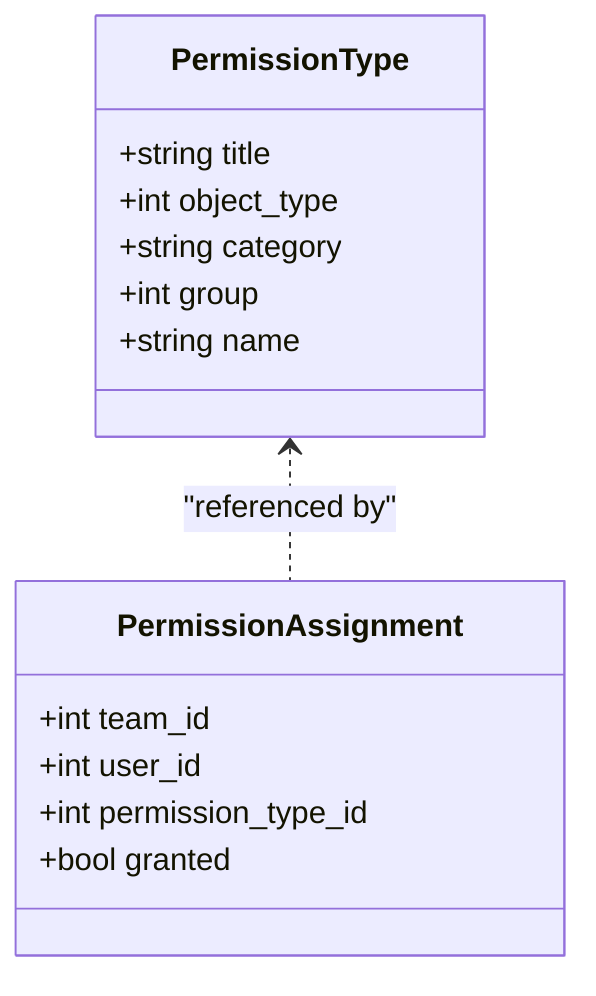
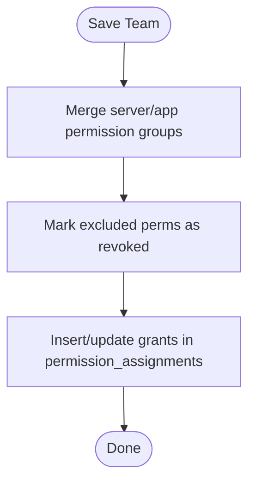
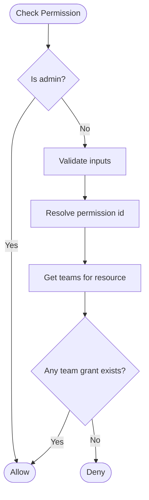
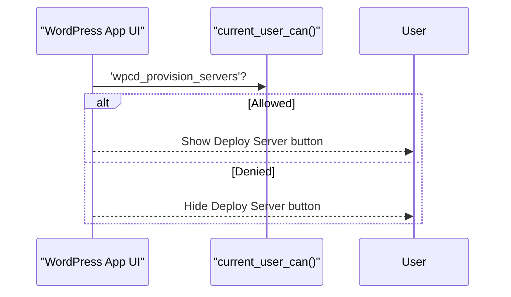
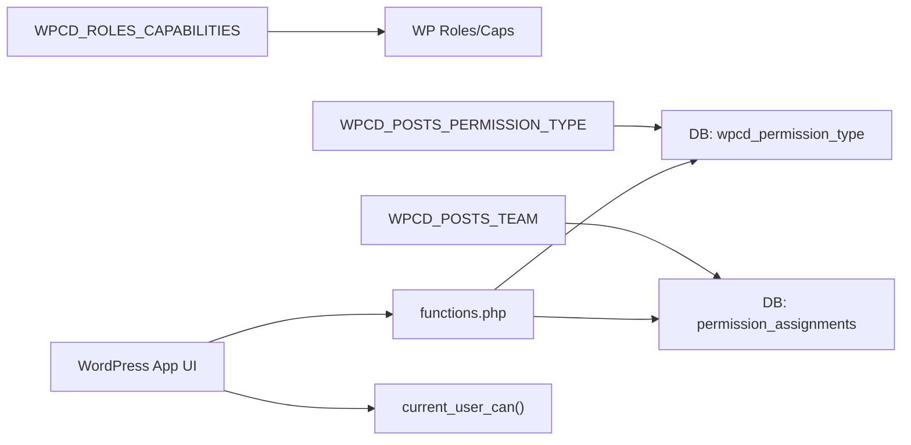

# Authorization Controls

<cite>
**Referenced Files in This Document**
- [class-wpcd-roles-capabilities.php](file://includes/core/class-wpcd-roles-capabilities.php)
- [class-wpcd-posts-permission-type.php](file://includes/core/class-wpcd-posts-permission-type.php)
- [class-wpcd-posts-team.php](file://includes/core/class-wpcd-posts-team.php)
- [functions.php](file://includes/core/functions.php)
- [class-wordpress-app.php](file://includes/core/apps/wordpress-app/class-wordpress-app.php)
</cite>

## Table of Contents
1. [Introduction](#introduction)
2. [Project Structure](#project-structure)
3. [Core Components](#core-components)
4. [Architecture Overview](#architecture-overview)
5. [Detailed Component Analysis](#detailed-component-analysis)
6. [Dependency Analysis](#dependency-analysis)
7. [Performance Considerations](#performance-considerations)
8. [Troubleshooting Guide](#troubleshooting-guide)
9. [Conclusion](#conclusion)

## Introduction
This document explains SimpleStack’s authorization and permission system with a focus on role-based access control (RBAC), team-based permissions, capability definitions, and server/site-level controls. It covers how roles and capabilities are created, how permissions are defined and assigned to teams, how resource isolation works, and where checks are enforced across the application. Practical guidance is included for implementing custom roles and capabilities and securing administrative interfaces.

## Project Structure
The authorization system spans several core components:
- Roles and capabilities registration and lifecycle management
- Permission type definitions stored as private posts
- Team-based permission assignments persisted in a custom table
- Utility functions that enforce checks against roles, capabilities, and team assignments
- Application-specific UI hooks that gate features based on capabilities

**Diagram sources**
- [class-wpcd-roles-capabilities.php:73-151](file://includes/core/class-wpcd-roles-capabilities.php#L73-L151)
- [class-wpcd-posts-permission-type.php:331-348](file://includes/core/class-wpcd-posts-permission-type.php#L331-L348)
- [class-wpcd-posts-permission-type.php:350-760](file://includes/core/class-wpcd-posts-permission-type.php#L350-L760)
- [class-wpcd-posts-team.php:312-348](file://includes/core/class-wpcd-posts-team.php#L312-L348)
- [functions.php:697-735](file://includes/core/functions.php#L697-L735)
- [functions.php:781-859](file://includes/core/functions.php#L781-L859)
- [class-wordpress-app.php:2569-2594](file://includes/core/apps/wordpress-app/class-wordpress-app.php#L2569-L2594)

**Section sources**
- [class-wpcd-roles-capabilities.php:73-151](file://includes/core/class-wpcd-roles-capabilities.php#L73-L151)
- [class-wpcd-posts-permission-type.php:331-348](file://includes/core/class-wpcd-posts-permission-type.php#L331-L348)
- [class-wpcd-posts-permission-type.php:350-760](file://includes/core/class-wpcd-posts-permission-type.php#L350-L760)
- [class-wpcd-posts-team.php:312-348](file://includes/core/class-wpcd-posts-team.php#L312-L348)
- [functions.php:697-735](file://includes/core/functions.php#L697-L735)
- [functions.php:781-859](file://includes/core/functions.php#L781-L859)
- [class-wordpress-app.php:2569-2594](file://includes/core/apps/wordpress-app/class-wordpress-app.php#L2569-L2594)

## Core Components
- Role and capability manager: Creates predefined roles and adds capabilities to built-in roles.
- Permission type registry: Defines granular permissions as private posts and provides admin UI for managing them.
- Team assignment engine: Persists per-user, per-team permission grants in a dedicated table.
- Permission checking utilities: Enforce checks at runtime using roles, capabilities, and team grants.
- Application UI gates: Hide or expose UI elements based on capabilities like provisioning servers.

Key responsibilities:
- Define who can do what at the role/capability level.
- Define fine-grained object-level permissions (server/app and their tabs).
- Assign permissions to users through teams.
- Enforce checks consistently across admin screens and REST endpoints.

**Section sources**
- [class-wpcd-roles-capabilities.php:73-151](file://includes/core/class-wpcd-roles-capabilities.php#L73-L151)
- [class-wpcd-posts-permission-type.php:350-760](file://includes/core/class-wpcd-posts-permission-type.php#L350-L760)
- [class-wpcd-posts-team.php:312-348](file://includes/core/class-wpcd-posts-team.php#L312-L348)
- [functions.php:697-735](file://includes/core/functions.php#L697-L735)
- [functions.php:781-859](file://includes/core/functions.php#L781-L859)

## Architecture Overview
The authorization model combines WordPress RBAC with a custom, team-scoped permission layer:
- Server- and app-level resources may be assigned to one or more teams.
- Users inherit permissions from teams they belong to.
- Admins bypass team checks; otherwise, checks require both a valid permission definition and an active grant for the user’s team.

**Diagram sources**
- [class-wordpress-app.php:2569-2594](file://includes/core/apps/wordpress-app/class-wordpress-app.php#L2569-L2594)
- [functions.php:697-735](file://includes/core/functions.php#L697-L735)
- [functions.php:744-769](file://includes/core/functions.php#L744-L769)

## Detailed Component Analysis

### Roles and Capabilities
- Predefined roles:
  - WPCDAdmin: full platform administration including provisioning, management, logs, settings, groups, teams, and a global “manage all” capability.
  - WPCDManager: similar to WPCDAdmin but without the “manage teams” and “manage all” capabilities.
  - WPCDSysAdmin: manage servers and apps.
  - WPCDAppManager: manage apps only.
- Built-in Administrator role receives all custom capabilities automatically.
- Lifecycle:
  - On plugin activation (single site or network-wide), roles and capabilities are created.
  - On new site creation in multisite, roles and capabilities are replicated.
  - On uninstallation, custom roles are removed and capabilities are stripped from Administrator.

**Diagram sources**
- [class-wpcd-roles-capabilities.php:73-151](file://includes/core/class-wpcd-roles-capabilities.php#L73-L151)
- [class-wpcd-roles-capabilities.php:162-173](file://includes/core/class-wpcd-roles-capabilities.php#L162-L173)
- [class-wpcd-roles-capabilities.php:181-210](file://includes/core/class-wpcd-roles-capabilities.php#L181-L210)

**Section sources**
- [class-wpcd-roles-capabilities.php:73-151](file://includes/core/class-wpcd-roles-capabilities.php#L73-L151)
- [class-wpcd-roles-capabilities.php:162-173](file://includes/core/class-wpcd-roles-capabilities.php#L162-L173)
- [class-wpcd-roles-capabilities.php:181-210](file://includes/core/class-wpcd-roles-capabilities.php#L181-L210)

### Permission Types (Granular Permissions)
- Permission types are stored as private posts of a custom post type.
- Each permission has metadata:
  - Object type: Server or App.
  - Category: e.g., core, wpapp.
  - Group: determines UI grouping when assigning permissions to teams.
- Default permissions include:
  - Server operations (view, delete, add WP App).
  - Many tab-level view permissions for server and app screens.
- The permission list screen is hidden by default and can be shown via a constant.

**Diagram sources**
- [class-wpcd-posts-permission-type.php:350-760](file://includes/core/class-wpcd-posts-permission-type.php#L350-L760)
- [class-wpcd-posts-permission-type.php:331-348](file://includes/core/class-wpcd-posts-permission-type.php#L331-L348)

**Section sources**
- [class-wpcd-posts-permission-type.php:331-348](file://includes/core/class-wpcd-posts-permission-type.php#L331-L348)
- [class-wpcd-posts-permission-type.php:350-760](file://includes/core/class-wpcd-posts-permission-type.php#L350-L760)

### Teams and Team-Based Permissions
- Teams are managed via a custom post type with meta boxes to select:
  - Team members and managers.
  - Server permissions and server tab permissions.
  - App permissions and app tab permissions.
- On save, the system:
  - Merges related permission groups.
  - Updates excluded permissions (revokes previously granted ones not selected).
  - Inserts or updates grants in the custom table for each selected permission.
- Team listing and editing are restricted:
  - Only users with the “manage teams” capability or those designated as team managers can edit teams.
  - Query filters ensure non-admins see only teams they manage.

**Diagram sources**
- [class-wpcd-posts-team.php:312-348](file://includes/core/class-wpcd-posts-team.php#L312-L348)
- [class-wpcd-posts-team.php:443-517](file://includes/core/class-wpcd-posts-team.php#L443-L517)
- [class-wpcd-posts-team.php:528-582](file://includes/core/class-wpcd-posts-team.php#L528-L582)

**Section sources**
- [class-wpcd-posts-team.php:312-348](file://includes/core/class-wpcd-posts-team.php#L312-L348)
- [class-wpcd-posts-team.php:443-517](file://includes/core/class-wpcd-posts-team.php#L443-L517)
- [class-wpcd-posts-team.php:528-582](file://includes/core/class-wpcd-posts-team.php#L528-L582)

### Permission Checking Functions and Hooks
- Admin bypass:
  - Administrators (super admins or those with manage_options) bypass team checks.
- Capability checks:
  - UI and logic gate actions using WordPress capabilities such as “provision servers,” “manage servers,” “manage apps,” etc.
- Team-scoped checks:
  - wpcd_user_can(user_id, permission_name, post_id):
    - Resolves permission id from its name.
    - Retrieves teams assigned to the resource.
    - Checks if the user has a granted permission for any of those teams.
- Listing filtering:
  - wpcd_get_posts_by_permission(permission_name, post_type, post_status, user_id):
    - Returns posts visible to the user based on authorship or team grants.

**Diagram sources**
- [functions.php:1241-1251](file://includes/core/functions.php#L1241-L1251)
- [functions.php:697-735](file://includes/core/functions.php#L697-L735)
- [functions.php:781-859](file://includes/core/functions.php#L781-L859)

**Section sources**
- [functions.php:1241-1251](file://includes/core/functions.php#L1241-L1251)
- [functions.php:697-735](file://includes/core/functions.php#L697-L735)
- [functions.php:781-859](file://includes/core/functions.php#L781-L859)

### Server and Site-Level Permissions
- Provisioning:
  - The WordPress app UI exposes the deploy/provision button only if the current user has the “provision servers” capability.
- Management:
  - Other capabilities control visibility and access to management features (servers, apps, logs, settings, groups, teams).
- These checks are applied both in PHP and via filters that allow extensions to adjust UI behavior.

**Diagram sources**
- [class-wordpress-app.php:2569-2594](file://includes/core/apps/wordpress-app/class-wordpress-app.php#L2569-L2594)

**Section sources**
- [class-wordpress-app.php:2569-2594](file://includes/core/apps/wordpress-app/class-wordpress-app.php#L2569-L2594)

### Practical Examples

#### Implementing Custom Roles and Capabilities
- To create a new role with specific capabilities:
  - Use WordPress role APIs to add a role and assign capabilities such as “wpcd_manage_servers,” “wpcd_manage_apps,” or a custom capability you define.
  - Ensure your capability names align with checks used throughout the codebase.
- To extend existing roles:
  - Add capabilities to built-in roles (e.g., Administrator) during activation or via configuration.
- Best practices:
  - Keep capability names descriptive and consistent with existing patterns (e.g., wpcd_*).
  - Avoid granting overly broad capabilities unless necessary.

[No sources needed since this section provides general guidance]

#### Defining Custom Permissions
- Create a new permission entry in the permission list:
  - Set object type (Server or App).
  - Choose a category (e.g., core, wpapp).
  - Select a group number to organize it in the team editor.
- After creating the permission, assign it to teams and users as needed.

[No sources needed since this section provides general guidance]

#### Securing Administrative Interfaces
- Gate admin pages and actions using:
  - WordPress capabilities (e.g., “wpcd_provision_servers,” “wpcd_manage_teams”).
  - Admin checks (e.g., administrators bypass team checks).
- For custom admin screens:
  - Check capabilities before rendering sensitive controls.
  - Validate permissions server-side even if client-side UI hides options.

[No sources needed since this section provides general guidance]

## Dependency Analysis
The following diagram shows key dependencies among authorization components:

**Diagram sources**
- [class-wpcd-roles-capabilities.php:73-151](file://includes/core/class-wpcd-roles-capabilities.php#L73-L151)
- [class-wpcd-posts-permission-type.php:331-348](file://includes/core/class-wpcd-posts-permission-type.php#L331-L348)
- [class-wpcd-posts-team.php:312-348](file://includes/core/class-wpcd-posts-team.php#L312-L348)
- [functions.php:697-735](file://includes/core/functions.php#L697-L735)
- [class-wordpress-app.php:2569-2594](file://includes/core/apps/wordpress-app/class-wordpress-app.php#L2569-L2594)

**Section sources**
- [class-wpcd-roles-capabilities.php:73-151](file://includes/core/class-wpcd-roles-capabilities.php#L73-L151)
- [class-wpcd-posts-permission-type.php:331-348](file://includes/core/class-wpcd-posts-permission-type.php#L331-L348)
- [class-wpcd-posts-team.php:312-348](file://includes/core/class-wpcd-posts-team.php#L312-L348)
- [functions.php:697-735](file://includes/core/functions.php#L697-L735)
- [class-wordpress-app.php:2569-2594](file://includes/core/apps/wordpress-app/class-wordpress-app.php#L2569-L2594)

## Performance Considerations
- Minimize unnecessary database queries:
  - Cache permission ids and team memberships where appropriate.
- Efficient SQL:
  - Use prepared statements and indexed columns for team_id, user_id, and permission_type_id in the permission_assignments table.
- Avoid redundant checks:
  - Perform capability checks once per request and reuse results.
- Limit large queries:
  - When listing resources, filter by permission early to reduce result sets.

[No sources needed since this section provides general guidance]

## Troubleshooting Guide
Common issues and resolutions:
- User cannot see a feature despite being in a team:
  - Verify the permission exists and is assigned to the correct team.
  - Confirm the resource is assigned to the same team.
  - Ensure the user is not blocked by missing capability checks at the UI layer.
- Admins still seeing unexpected restrictions:
  - Confirm the check path uses the admin bypass correctly.
- Permission not appearing in team editor:
  - Ensure the permission type was created with the correct object type and group.
- Provision button not visible:
  - Check whether the current user has the “provision servers” capability.

**Section sources**
- [functions.php:697-735](file://includes/core/functions.php#L697-L735)
- [class-wpcd-posts-permission-type.php:350-760](file://includes/core/class-wpcd-posts-permission-type.php#L350-L760)
- [class-wordpress-app.php:2569-2594](file://includes/core/apps/wordpress-app/class-wordpress-app.php#L2569-L2594)

## Conclusion
SimpleStack’s authorization system blends WordPress RBAC with a flexible, team-based permission model. Roles and capabilities provide coarse-grained control, while permission types and team assignments deliver fine-grained, object-scoped access. By consistently using the provided checking functions and capability checks, developers can secure both administrative interfaces and application features. Following the guidelines here will help you implement secure, maintainable access controls tailored to your environment.