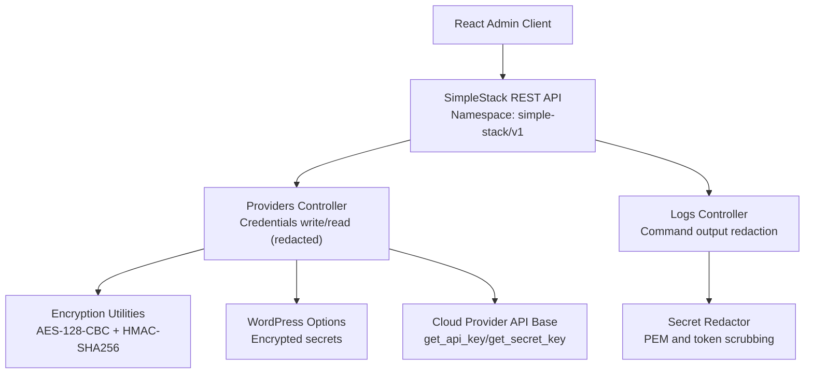
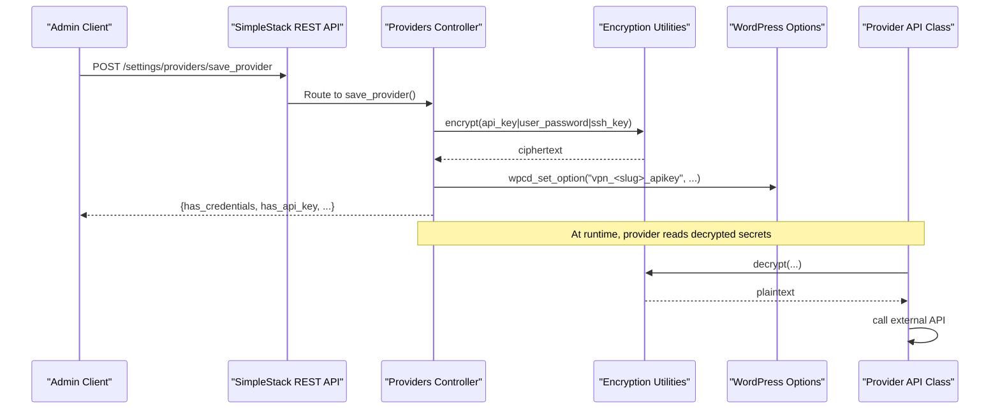
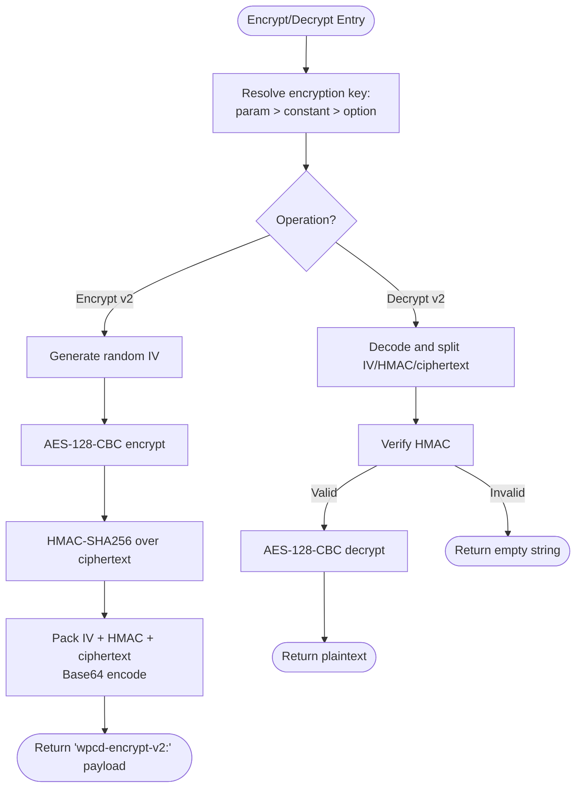
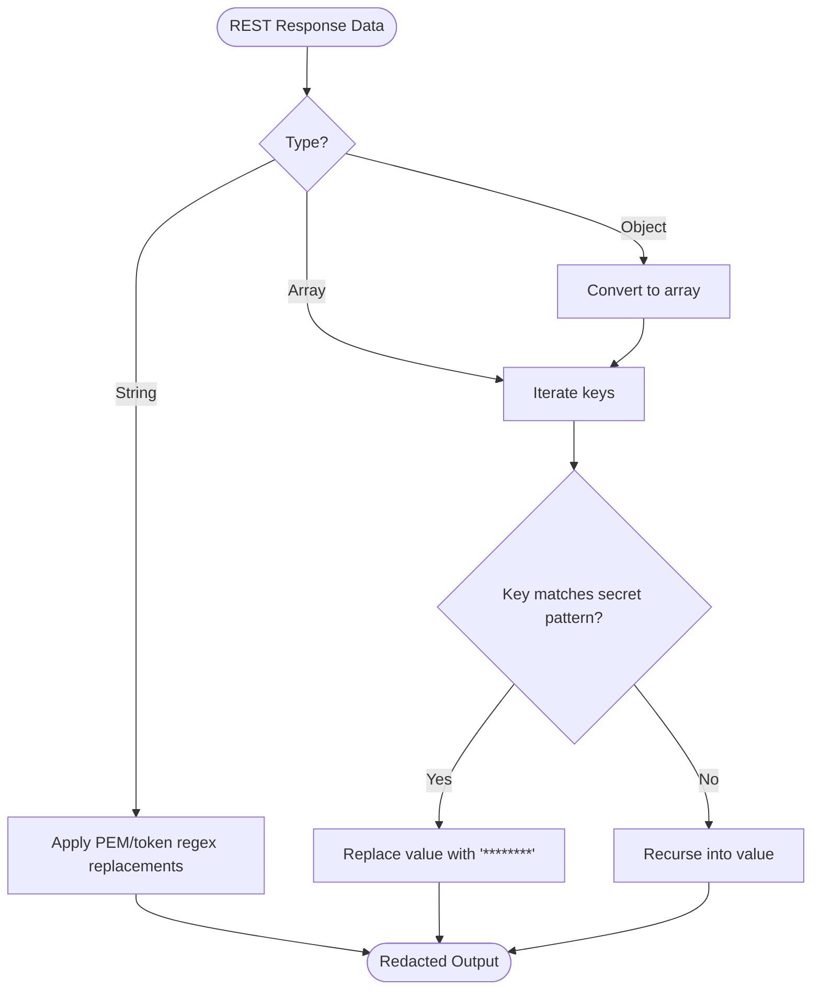
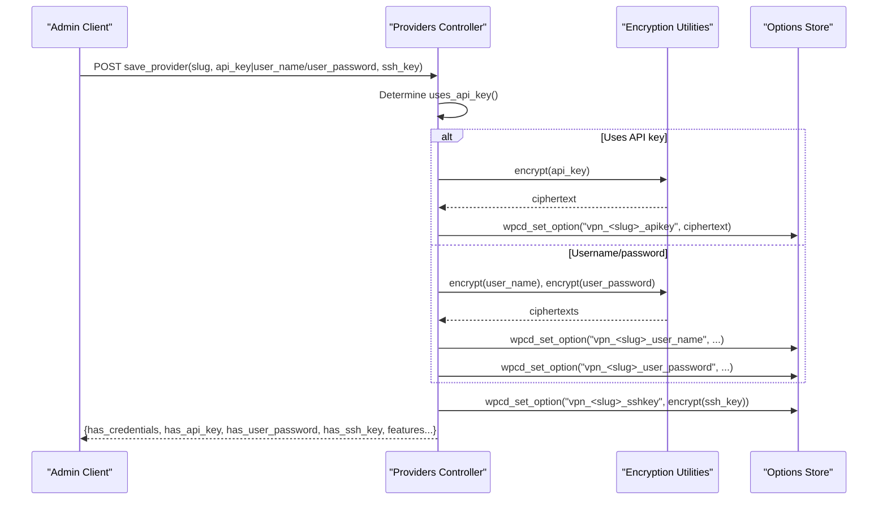
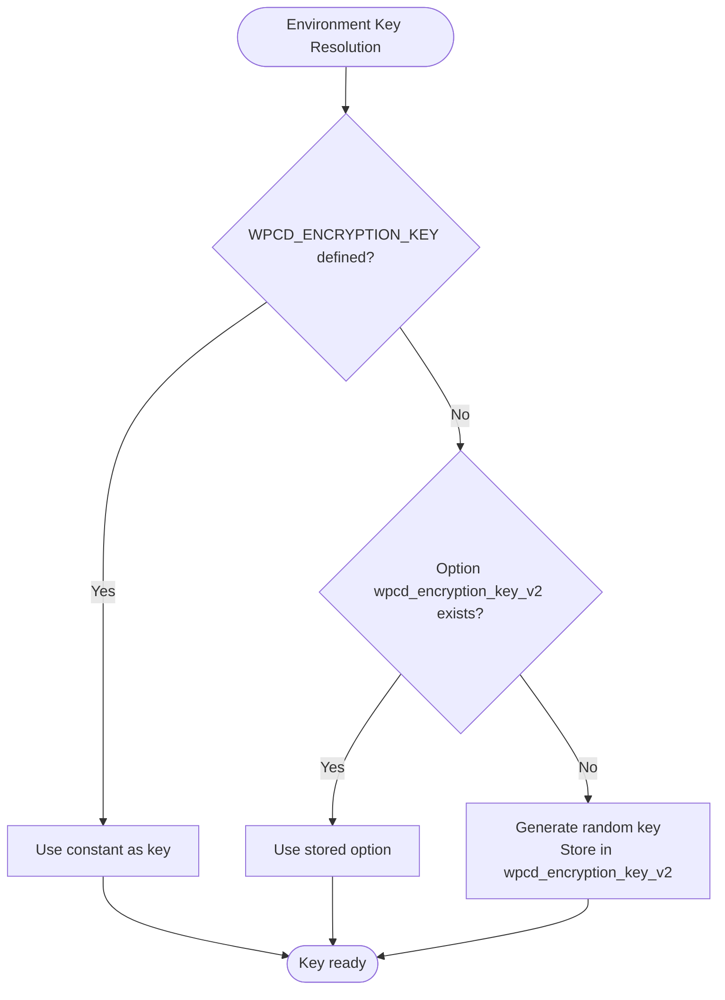
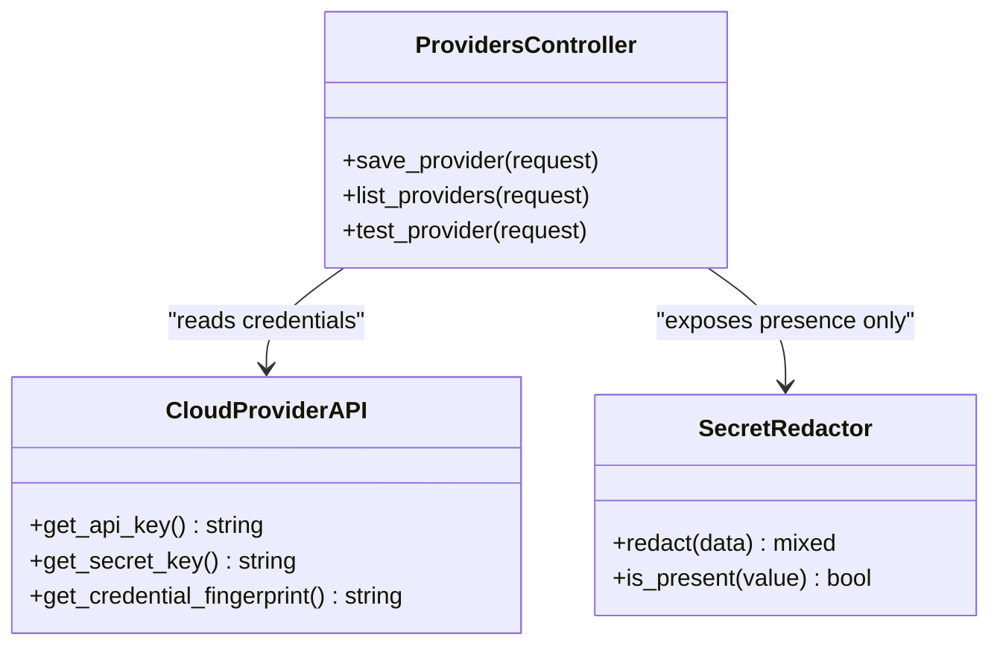
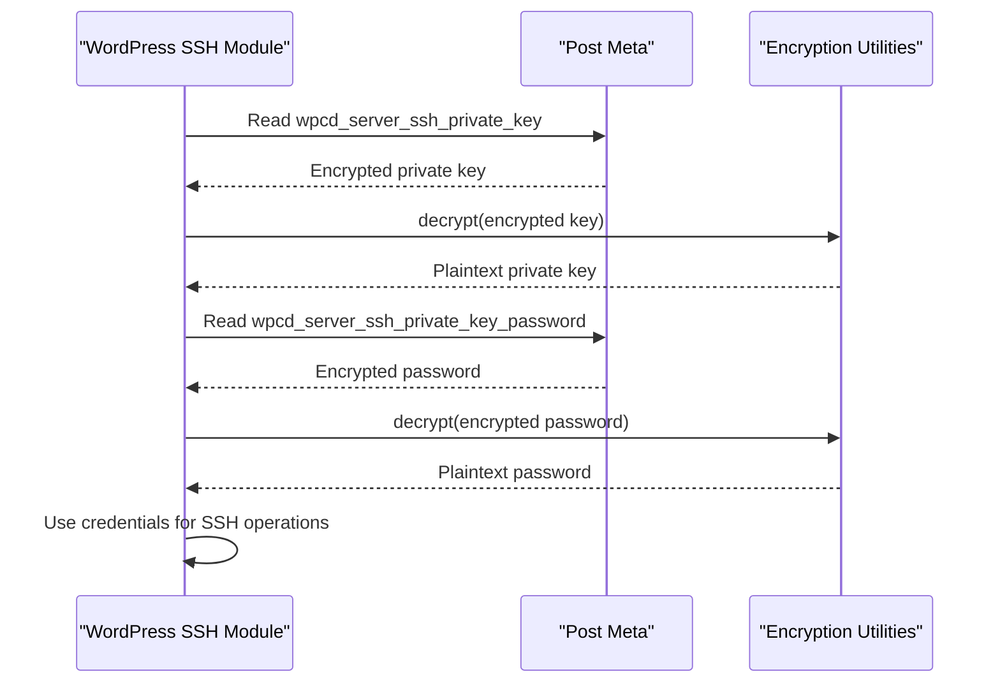
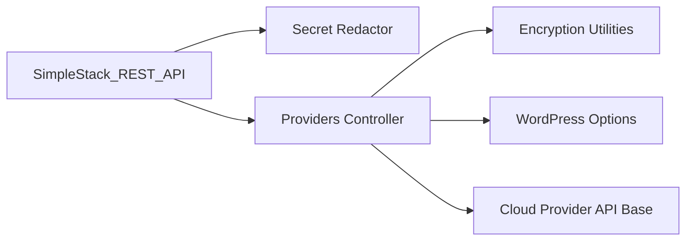

# Credential Management

<cite>
**Referenced Files in This Document**
- [wp-cloud-deploy.php](file://includes/core/wp-cloud-deploy.php)
- [class-simplestack-secret-redactor.php](file://includes/core/api/class-simplestack-secret-redactor.php)
- [class-simplestack-rest-api.php](file://includes/core/api/class-simplestack-rest-api.php)
- [class-simplestack-rest-providers.php](file://includes/core/api/class-simplestack-rest-providers.php)
- [class-wpcd-setup-wizard.php](file://includes/core/class-wpcd-setup-wizard.php)
- [wpcd.php](file://wpcd.php)
- [class-wpcd-provider.php](file://includes/core/custom-table/class-wpcd-provider.php)
- [class-wordpress-ssh.php](file://includes/core/apps/wordpress-app/class-wordpress-ssh.php)
- [class-cloud-provider-api.php](file://includes/core/providers/class-cloud-provider-api.php)
</cite>

## Table of Contents
1. [Introduction](#introduction)
2. [Project Structure](#project-structure)
3. [Core Components](#core-components)
4. [Architecture Overview](#architecture-overview)
5. [Detailed Component Analysis](#detailed-component-analysis)
6. [Dependency Analysis](#dependency-analysis)
7. [Performance Considerations](#performance-considerations)
8. [Troubleshooting Guide](#troubleshooting-guide)
9. [Conclusion](#conclusion)

## Introduction
This document explains how SimpleStack manages credentials and secrets across the application. It covers encryption algorithms for sensitive data such as API keys, database credentials, and SSH keys; the secret redaction system that prevents leaks in logs and REST responses; secure storage practices; key rotation procedures; environment variable handling; integration with cloud provider APIs; and developer guidelines for safe secret handling in custom code and extensions.

## Project Structure
Credential-related functionality is implemented across a small set of focused components:
- Encryption utilities provide symmetric encryption and decryption for stored secrets.
- A dedicated REST controller handles provider credential persistence and exposes only non-sensitive state to clients.
- A secret redactor ensures all outgoing REST payloads are scrubbed for sensitive material.
- The setup wizard enforces configuration of an encryption key early in installation.
- Provider classes define how credentials are read and used when calling external APIs.

**Diagram sources**
- [class-simplestack-rest-api.php:20-119](file://includes/core/api/class-simplestack-rest-api.php#L20-L119)
- [class-simplestack-rest-providers.php:20-174](file://includes/core/api/class-simplestack-rest-providers.php#L20-L174)
- [class-simplestack-secret-redactor.php:24-141](file://includes/core/api/class-simplestack-secret-redactor.php#L24-L141)
- [wp-cloud-deploy.php:980-1141](file://includes/core/wp-cloud-deploy.php#L980-L1141)
- [class-cloud-provider-api.php:169-207](file://includes/core/providers/class-cloud-provider-api.php#L169-L207)

**Section sources**
- [class-simplestack-rest-api.php:20-119](file://includes/core/api/class-simplestack-rest-api.php#L20-L119)
- [class-simplestack-rest-providers.php:20-174](file://includes/core/api/class-simplestack-rest-providers.php#L20-L174)
- [class-simplestack-secret-redactor.php:24-141](file://includes/core/api/class-simplestack-secret-redactor.php#L24-L141)
- [wp-cloud-deploy.php:980-1141](file://includes/core/wp-cloud-deploy.php#L980-L1141)
- [class-cloud-provider-api.php:169-207](file://includes/core/providers/class-cloud-provider-api.php#L169-L207)

## Core Components
- Encryption utilities: Provide v1 and v2 encryption/decryption, with v2 using a random initialization vector and HMAC integrity check.
- Secret redactor: Recursively masks array keys that look like credentials and scrubs embedded private keys and tokens from free text.
- Providers REST controller: Accepts credentials via the admin UI, encrypts them before storage, and returns only boolean presence flags and feature metadata.
- Setup wizard and admin notices: Enforce definition of WPCD_ENCRYPTION_KEY and warn about missing or default values.
- Provider base class: Defines how providers expose their API key or secret key and compute a fingerprint for account identification.

**Section sources**
- [wp-cloud-deploy.php:980-1141](file://includes/core/wp-cloud-deploy.php#L980-L1141)
- [class-simplestack-secret-redactor.php:24-141](file://includes/core/api/class-simplestack-secret-redactor.php#L24-L141)
- [class-simplestack-rest-providers.php:20-174](file://includes/core/api/class-simplestack-rest-providers.php#L20-L174)
- [class-wpcd-setup-wizard.php:320-366](file://includes/core/class-wpcd-setup-wizard.php#L320-L366)
- [wpcd.php:490-504](file://wpcd.php#L490-L504)
- [class-cloud-provider-api.php:169-207](file://includes/core/providers/class-cloud-provider-api.php#L169-L207)

## Architecture Overview
The credential lifecycle spans three phases:
- Ingestion: The React admin sends credentials through the SimpleStack REST API. The providers controller validates inputs and persists encrypted values to WordPress options.
- Storage: Secrets are stored using AES-128-CBC with a per-encrypt random IV and HMAC-SHA256 integrity tag. The encryption key is sourced from WPCD_ENCRYPTION_KEY or generated and stored in options if not defined.
- Consumption: Provider classes retrieve decrypted credentials at runtime to call external APIs. All REST responses pass through the secret redactor to prevent accidental exposure.

**Diagram sources**
- [class-simplestack-rest-api.php:63-99](file://includes/core/api/class-simplestack-rest-api.php#L63-L99)
- [class-simplestack-rest-providers.php:122-174](file://includes/core/api/class-simplestack-rest-providers.php#L122-L174)
- [wp-cloud-deploy.php:980-1141](file://includes/core/wp-cloud-deploy.php#L980-L1141)
- [class-cloud-provider-api.php:169-207](file://includes/core/providers/class-cloud-provider-api.php#L169-L207)

## Detailed Component Analysis

### Encryption Algorithms and Key Management
- Algorithm family: AES-128-CBC.
- Versioning:
  - v1: Fixed IV derived from a constant hash; legacy compatibility.
  - v2: Random IV per encryption plus HMAC-SHA256 integrity verification.
- Key source priority:
  1. Explicit parameter passed to decrypt().
  2. WPCD_ENCRYPTION_KEY constant (recommended).
  3. Option wpcd_encryption_key_v2 (auto-generated if missing).
- Integrity: v2 includes an HMAC tag; decryption fails if tampered.
- Migration: Decrypt dispatches based on prefix; old data remains readable.

**Diagram sources**
- [wp-cloud-deploy.php:980-1141](file://includes/core/wp-cloud-deploy.php#L980-L1141)

**Section sources**
- [wp-cloud-deploy.php:980-1141](file://includes/core/wp-cloud-deploy.php#L980-L1141)

### Secret Redaction System
- Scope: Every SimpleStack REST response is recursively processed by the secret redactor.
- Behavior:
  - Array keys matching patterns such as password, secret, token, private, authorization, _key, api_key are replaced with a mask.
  - Free-text fields are scrubbed for PEM private key blocks and common credential assignments (e.g., shell-style assignments, Authorization headers).
  - Objects are converted to arrays prior to processing.
  - Depth guard prevents runaway recursion.
- Helper: is_present(value) allows controllers to report whether a credential exists without exposing its value.

**Diagram sources**
- [class-simplestack-secret-redactor.php:24-141](file://includes/core/api/class-simplestack-secret-redactor.php#L24-L141)

**Section sources**
- [class-simplestack-secret-redactor.php:24-141](file://includes/core/api/class-simplestack-secret-redactor.php#L24-L141)

### Provider Credentials Persistence and Exposure
- Input validation: The providers controller accepts slug, api_key, user_name, user_password, ssh_key, ssh_key_id, and notes.
- Conditional storage:
  - If the provider uses an API key, store vpn_<slug>_apikey.
  - Otherwise, store vpn_<slug>_user_name and vpn_<slug>_user_password.
  - Always encrypt ssh_key when provided.
- Read path: describe_provider returns booleans indicating presence of credentials and feature flags; it never returns raw secret values.
- Test connection: Validates that credentials are available before invoking provider.test_connection.

**Diagram sources**
- [class-simplestack-rest-providers.php:122-174](file://includes/core/api/class-simplestack-rest-providers.php#L122-L174)
- [wp-cloud-deploy.php:980-1141](file://includes/core/wp-cloud-deploy.php#L980-L1141)

**Section sources**
- [class-simplestack-rest-providers.php:122-174](file://includes/core/api/class-simplestack-rest-providers.php#L122-L174)

### Environment Variable Handling and Key Rotation
- WPCD_ENCRYPTION_KEY:
  - Strongly recommended to be defined in wp-config.php.
  - The setup wizard blocks progression until it is defined.
  - Admin notices warn if missing or if the example placeholder is used.
- Fallback behavior:
  - If WPCD_ENCRYPTION_KEY is not defined, the system generates a random key and stores it in wpcd_encryption_key_v2.
- Rotation procedure:
  1. Define a new WPCD_ENCRYPTION_KEY in wp-config.php.
  2. Re-enter provider credentials via the providers settings screen so they are re-encrypted with the new key.
  3. Validate connectivity using the provider test endpoint.

**Diagram sources**
- [wp-cloud-deploy.php:980-1141](file://includes/core/wp-cloud-deploy.php#L980-L1141)
- [class-wpcd-setup-wizard.php:320-366](file://includes/core/class-wpcd-setup-wizard.php#L320-L366)
- [wpcd.php:490-504](file://wpcd.php#L490-L504)

**Section sources**
- [wp-cloud-deploy.php:980-1141](file://includes/core/wp-cloud-deploy.php#L980-L1141)
- [class-wpcd-setup-wizard.php:320-366](file://includes/core/class-wpcd-setup-wizard.php#L320-L366)
- [wpcd.php:490-504](file://wpcd.php#L490-L504)

### Cloud Provider Integration and Secure Credential Passing
- Provider base class defines get_api_key(), get_secret_key(), and get_credential_fingerprint() to abstract how each provider identifies its account.
- Controllers must never return raw credentials; they use is_present() to indicate existence.
- When testing connections, the providers controller checks credentials_available() before invoking provider.call('test_connection', []).

**Diagram sources**
- [class-cloud-provider-api.php:169-207](file://includes/core/providers/class-cloud-provider-api.php#L169-L207)
- [class-simplestack-rest-providers.php:185-217](file://includes/core/api/class-simplestack-rest-providers.php#L185-L217)
- [class-simplestack-secret-redactor.php:128-141](file://includes/core/api/class-simplestack-secret-redactor.php#L128-L141)

**Section sources**
- [class-cloud-provider-api.php:169-207](file://includes/core/providers/class-cloud-provider-api.php#L169-L207)
- [class-simplestack-rest-providers.php:185-217](file://includes/core/api/class-simplestack-rest-providers.php#L185-L217)
- [class-simplestack-secret-redactor.php:128-141](file://includes/core/api/class-simplestack-secret-redactor.php#L128-L141)

### SSH Keys and Private Key Handling
- SSH private keys are treated as secrets:
  - Stored encrypted via the providers controller.
  - Decrypted at runtime when needed for server access.
- WordPress app SSH module decrypts server-specific SSH private key and password when present, otherwise falls back to provider defaults.

**Diagram sources**
- [class-wordpress-ssh.php:92-106](file://includes/core/apps/wordpress-app/class-wordpress-ssh.php#L92-L106)
- [wp-cloud-deploy.php:1041-1141](file://includes/core/wp-cloud-deploy.php#L1041-L1141)

**Section sources**
- [class-wordpress-ssh.php:92-106](file://includes/core/apps/wordpress-app/class-wordpress-ssh.php#L92-L106)
- [wp-cloud-deploy.php:1041-1141](file://includes/core/wp-cloud-deploy.php#L1041-L1141)

### Custom Table Fields and Decryption Filters
- The custom table provider model registers filters to decrypt specific field types (e.g., API secret key, SSH private key, SSH private key password) when reading from the custom table.
- This ensures consistent decryption behavior across different storage backends.

**Section sources**
- [class-wpcd-provider.php:43-52](file://includes/core/custom-table/class-wpcd-provider.php#L43-L52)
- [class-wpcd-provider.php:202-241](file://includes/core/custom-table/class-wpcd-provider.php#L202-L241)

## Dependency Analysis
- SimpleStack_REST_API loads the secret redactor and all controllers, including the providers controller.
- Providers controller depends on:
  - Encryption utilities for persisting secrets.
  - WordPress options for storage.
  - Provider API base class for capability detection and fingerprinting.
- Secret redactor is independent but invoked by the REST layer to sanitize responses.

**Diagram sources**
- [class-simplestack-rest-api.php:63-99](file://includes/core/api/class-simplestack-rest-api.php#L63-L99)
- [class-simplestack-rest-providers.php:122-174](file://includes/core/api/class-simplestack-rest-providers.php#L122-L174)
- [wp-cloud-deploy.php:980-1141](file://includes/core/wp-cloud-deploy.php#L980-L1141)
- [class-cloud-provider-api.php:169-207](file://includes/core/providers/class-cloud-provider-api.php#L169-L207)

**Section sources**
- [class-simplestack-rest-api.php:63-99](file://includes/core/api/class-simplestack-rest-api.php#L63-L99)
- [class-simplestack-rest-providers.php:122-174](file://includes/core/api/class-simplestack-rest-providers.php#L122-L174)
- [wp-cloud-deploy.php:980-1141](file://includes/core/wp-cloud-deploy.php#L980-L1141)
- [class-cloud-provider-api.php:169-207](file://includes/core/providers/class-cloud-provider-api.php#L169-L207)

## Performance Considerations
- Encryption overhead: Each secret write triggers AES-128-CBC encryption and HMAC computation; this is negligible compared to network I/O and provider API calls.
- Redaction cost: Recursive redaction is bounded by depth and operates on response structures; it is lightweight relative to provider discovery calls.
- Caching: Region and size counts are cached briefly to avoid repeated provider queries during settings page load.

[No sources needed since this section provides general guidance]

## Troubleshooting Guide
- Missing or default WPCD_ENCRYPTION_KEY:
  - Symptom: Admin notice warns that the encryption key is undefined or still set to the example value.
  - Action: Define a strong WPCD_ENCRYPTION_KEY in wp-config.php and re-enter provider credentials to re-encrypt them.
- Provider connection failures:
  - Symptom: Test connection reports missing credentials.
  - Action: Ensure the correct credential shape is configured (api_key vs user_name/user_password) and that the SSH key is present.
- Logs containing sensitive data:
  - Symptom: Command output or exception messages include tokens or private keys.
  - Action: Confirm that the secret redactor is active; verify that logs are routed through the SimpleStack REST logging pipeline.

**Section sources**
- [wpcd.php:490-504](file://wpcd.php#L490-L504)
- [class-simplestack-rest-providers.php:185-217](file://includes/core/api/class-simplestack-rest-providers.php#L185-L217)
- [class-simplestack-secret-redactor.php:24-141](file://includes/core/api/class-simplestack-secret-redactor.php#L24-L141)

## Conclusion
SimpleStack implements a robust, layered approach to credential management:
- Strong encryption with integrity protection for secrets at rest.
- Strict redaction of sensitive data in all REST responses and logs.
- Clear separation between client-facing metadata and internal secret usage.
- Guided setup and warnings to ensure proper environment configuration.
- Provider abstraction that standardizes how credentials are accessed and tested.

Developers should always use the provided encryption utilities, rely on the secret redactor for any output, and follow the provider interface contracts to keep secrets out of logs and API responses.

[No sources needed since this section summarizes without analyzing specific files]