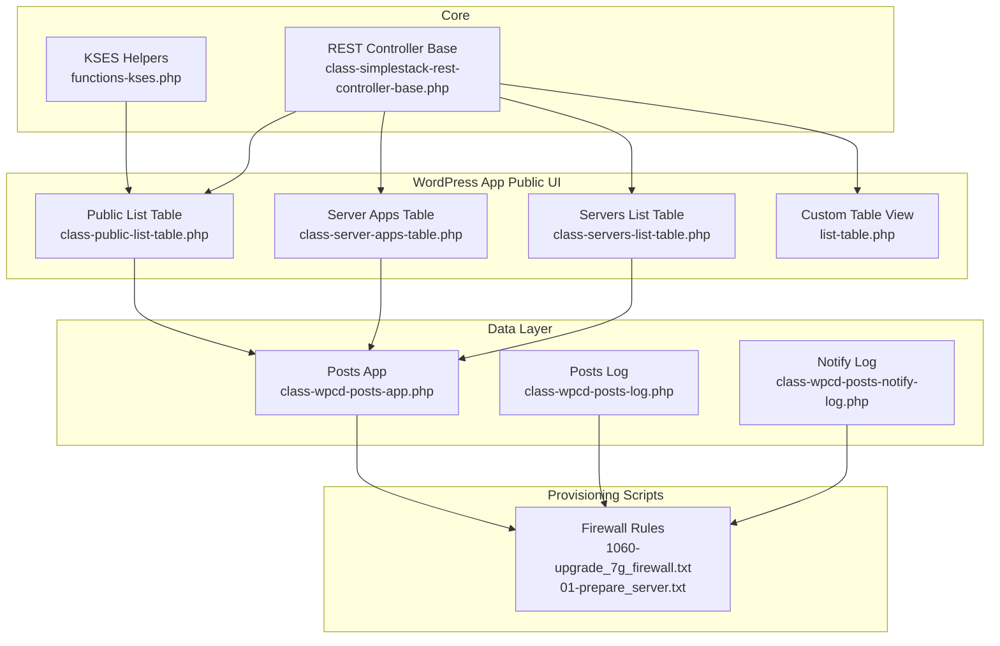
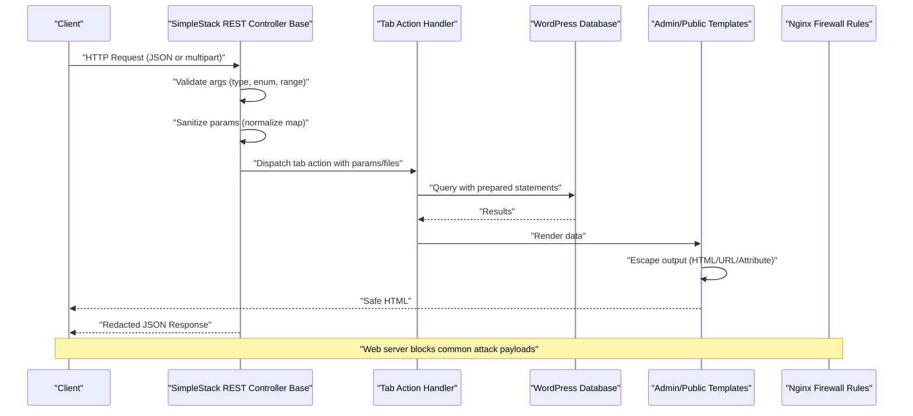
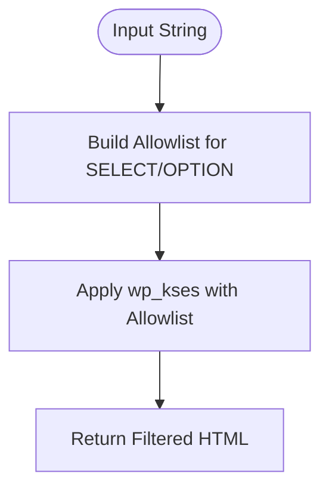
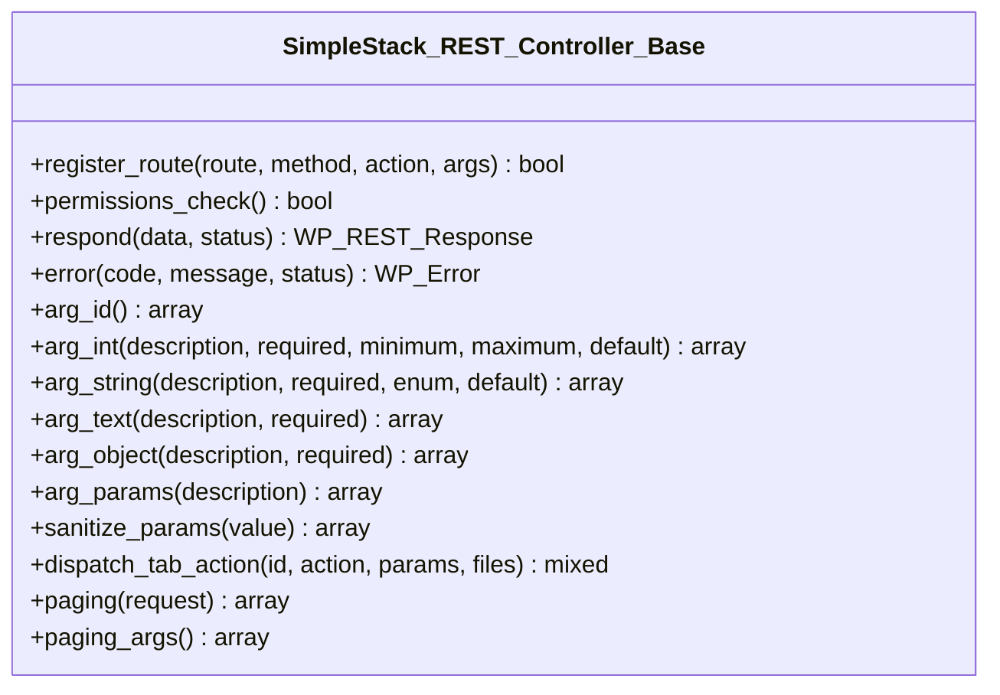
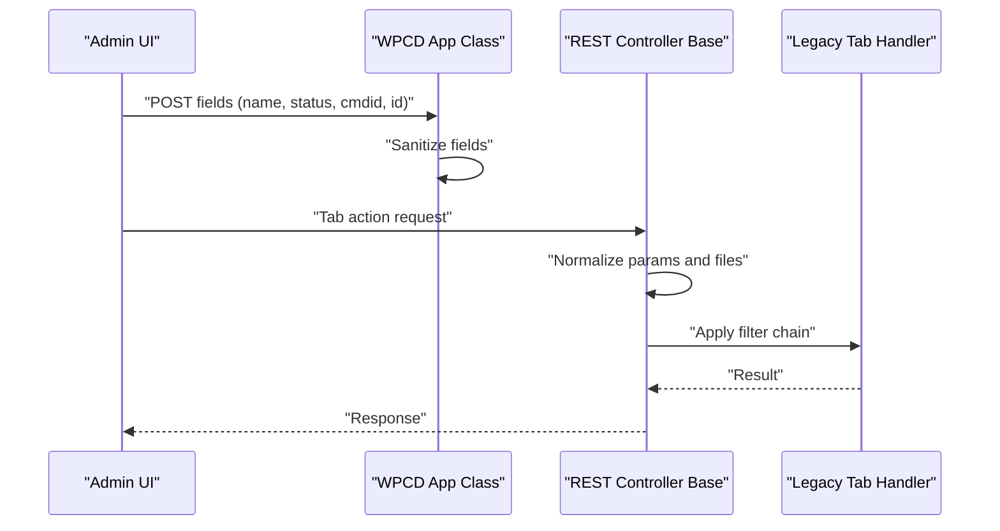
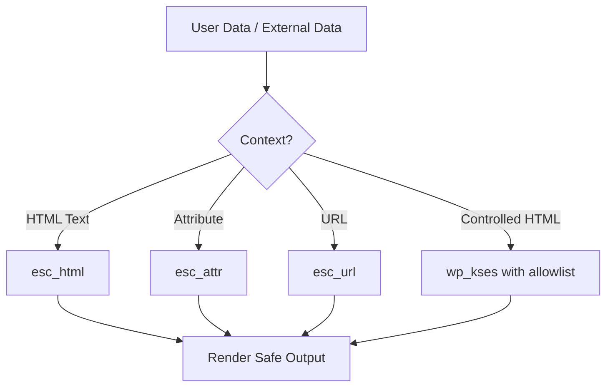
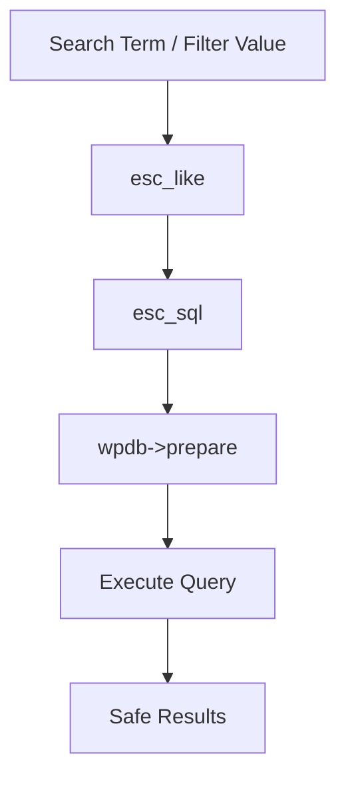
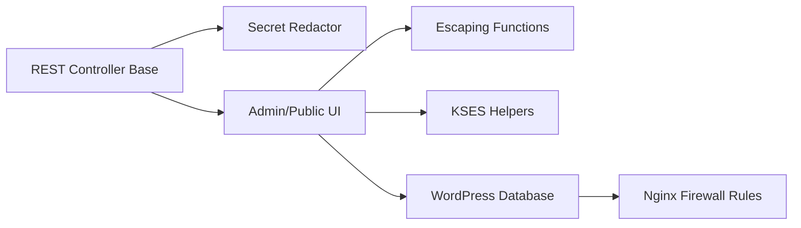

# Input & Output Security

<cite>
**Referenced Files in This Document**
- [functions-kses.php](file://includes/core/functions-kses.php)
- [class-simplestack-rest-controller-base.php](file://includes/core/api/class-simplestack-rest-controller-base.php)
- [class-wpcd-app.php](file://includes/core/apps/class-wpcd-app.php)
- [class-public-list-table.php](file://includes/core/apps/wordpress-app/public/class-public-list-table.php)
- [class-server-apps-table.php](file://includes/core/apps/wordpress-app/public/class-server-apps-table.php)
- [class-servers-list-table.php](file://includes/core/apps/wordpress-app/public/class-servers-list-table.php)
- [list-table.php](file://includes/core/apps/wordpress-app/public/custom-table/views/list-table.php)
- [class-wordpress-posts-quota-limits.php](file://includes/core/apps/wordpress-app/class-wordpress-posts-quota-limits.php)
- [class-wordpress-posts-quota-profile.php](file://includes/core/apps/wordpress-app/class-wordpress-posts-quota-profile.php)
- [class-wpcd-posts-app.php](file://includes/core/class-wpcd-posts-app.php)
- [class-wpcd-posts-log.php](file://includes/core/class-wpcd-posts-log.php)
- [class-wpcd-posts-notify-log.php](file://includes/core/class-wpcd-posts-notify-log.php)
- [1060-upgrade_7g_firewall.txt](file://includes/core/apps/wordpress-app/scripts/v1/raw/1060-upgrade_7g_firewall.txt)
- [01-prepare_server.txt](file://includes/core/apps/wordpress-app/scripts/v1/raw/01-prepare_server.txt)
</cite>

## Table of Contents
1. [Introduction](#introduction)
2. [Project Structure](#project-structure)
3. [Core Components](#core-components)
4. [Architecture Overview](#architecture-overview)
5. [Detailed Component Analysis](#detailed-component-analysis)
6. [Dependency Analysis](#dependency-analysis)
7. [Performance Considerations](#performance-considerations)
8. [Troubleshooting Guide](#troubleshooting-guide)
9. [Conclusion](#conclusion)

## Introduction
This document explains how SimpleStack handles input validation, sanitization, and output escaping to prevent common web vulnerabilities such as XSS, SQL injection, and unsafe file handling. It focuses on:

- The KSES-based HTML filtering helpers for safe content rendering.
- REST API argument definitions that enforce type, range, and allowed-value constraints.
- Form data handling patterns used by admin screens and legacy tab actions.
- Output escaping techniques applied across templates and tables.
- Database query safety using prepared statements and escaping utilities.
- Server-side security filters embedded in provisioning scripts.

The goal is to provide a clear, code-backed guide for developers and maintainers to understand where and how user-generated and external data are validated and rendered safely.

## Project Structure
SimpleStack organizes security-related logic across several layers:

- Core helper functions for KSES filtering live under the core includes directory.
- REST API controllers define typed, sanitized parameters and secure response envelopes.
- WordPress app public tables and custom table views apply context-aware escaping when rendering lists and links.
- Post and log classes use WordPress database APIs with prepared queries and escaping helpers.
- Provisioning scripts include firewall rules that block common attack payloads at the web server level.

**Diagram sources**
- [functions-kses.php:18-54](file://includes/core/functions-kses.php#L18-L54)
- [class-simplestack-rest-controller-base.php:22-341](file://includes/core/api/class-simplestack-rest-controller-base.php#L22-L341)
- [class-public-list-table.php:72-99](file://includes/core/apps/wordpress-app/public/class-public-list-table.php#L72-L99)
- [class-server-apps-table.php:92-122](file://includes/core/apps/wordpress-app/public/class-server-apps-table.php#L92-L122)
- [class-servers-list-table.php:92-120](file://includes/core/apps/wordpress-app/public/class-servers-list-table.php#L92-L120)
- [list-table.php:3-6](file://includes/core/apps/wordpress-app/public/custom-table/views/list-table.php#L3-L6)
- [class-wpcd-posts-app.php:962-1025](file://includes/core/class-wpcd-posts-app.php#L962-L1025)
- [class-wpcd-posts-log.php:548-568](file://includes/core/class-wpcd-posts-log.php#L548-L568)
- [class-wpcd-posts-notify-log.php:182-185](file://includes/core/class-wpcd-posts-notify-log.php#L182-L185)
- [1060-upgrade_7g_firewall.txt:61-79](file://includes/core/apps/wordpress-app/scripts/v1/raw/1060-upgrade_7g_firewall.txt#L61-L79)
- [01-prepare_server.txt:574-592](file://includes/core/apps/wordpress-app/scripts/v1/raw/01-prepare_server.txt#L574-L592)

**Section sources**
- [functions-kses.php:1-55](file://includes/core/functions-kses.php#L1-L55)
- [class-simplestack-rest-controller-base.php:1-447](file://includes/core/api/class-simplestack-rest-controller-base.php#L1-L447)
- [class-public-list-table.php:72-99](file://includes/core/apps/wordpress-app/public/class-public-list-table.php#L72-L99)
- [class-server-apps-table.php:92-122](file://includes/core/apps/wordpress-app/public/class-server-apps-table.php#L92-L122)
- [class-servers-list-table.php:92-120](file://includes/core/apps/wordpress-app/public/class-servers-list-table.php#L92-L120)
- [list-table.php:3-6](file://includes/core/apps/wordpress-app/public/custom-table/views/list-table.php#L3-L6)
- [class-wpcd-posts-app.php:962-1025](file://includes/core/class-wpcd-posts-app.php#L962-L1025)
- [class-wpcd-posts-log.php:548-568](file://includes/core/class-wpcd-posts-log.php#L548-L568)
- [class-wpcd-posts-notify-log.php:182-185](file://includes/core/class-wpcd-posts-notify-log.php#L182-L185)
- [1060-upgrade_7g_firewall.txt:61-79](file://includes/core/apps/wordpress-app/scripts/v1/raw/1060-upgrade_7g_firewall.txt#L61-L79)
- [01-prepare_server.txt:574-592](file://includes/core/apps/wordpress-app/scripts/v1/raw/01-prepare_server.txt#L574-L592)

## Core Components
This section summarizes the primary mechanisms SimpleStack uses to secure inputs and outputs.

- KSES HTML filtering helpers:
  - A helper returns an allowlist for SELECT and OPTION elements.
  - A filter function applies WordPress’s KSES engine against that allowlist.

- REST API parameter validation:
  - Centralized base controller defines reusable argument builders for integers, strings, free-form text, objects, and complex params maps.
  - Each argument definition pairs a sanitize callback with a validate callback.
  - Responses are wrapped in a standard envelope and passed through a secret redactor before being sent to clients.

- Legacy form and tab action handling:
  - Admin screens read POST fields and sanitize them before processing.
  - Tab actions receive normalized params and files, then dispatch through a filter chain while restoring superglobals afterward.

- Output escaping in templates and tables:
  - Tables escape attributes, URLs, and HTML text according to context.
  - Quota limit/profile pages render filtered HTML via KSES.

- Database query safety:
  - Queries use prepared statements and escaping helpers to avoid SQL injection.

- Web server firewall rules:
  - Provisioning scripts install Nginx rules that block common XSS, command injection, and SQL injection patterns.

**Section sources**
- [functions-kses.php:18-54](file://includes/core/functions-kses.php#L18-L54)
- [class-simplestack-rest-controller-base.php:169-341](file://includes/core/api/class-simplestack-rest-controller-base.php#L169-L341)
- [class-wpcd-app.php:1058-1061](file://includes/core/apps/class-wpcd-app.php#L1058-L1061)
- [class-wpcd-app.php:1539-1570](file://includes/core/apps/class-wpcd-app.php#L1539-L1570)
- [class-public-list-table.php:85-99](file://includes/core/apps/wordpress-app/public/class-public-list-table.php#L85-L99)
- [class-server-apps-table.php:92-122](file://includes/core/apps/wordpress-app/public/class-server-apps-table.php#L92-L122)
- [class-servers-list-table.php:92-120](file://includes/core/apps/wordpress-app/public/class-servers-list-table.php#L92-L120)
- [list-table.php:3-6](file://includes/core/apps/wordpress-app/public/custom-table/views/list-table.php#L3-L6)
- [class-wordpress-posts-quota-limits.php:296-296](file://includes/core/apps/wordpress-app/class-wordpress-posts-quota-limits.php#L296-L296)
- [class-wordpress-posts-quota-profile.php:269-269](file://includes/core/apps/wordpress-app/class-wordpress-posts-quota-profile.php#L269-L269)
- [class-wpcd-posts-app.php:962-1025](file://includes/core/class-wpcd-posts-app.php#L962-L1025)
- [class-wpcd-posts-log.php:548-568](file://includes/core/class-wpcd-posts-log.php#L548-L568)
- [class-wpcd-posts-notify-log.php:182-185](file://includes/core/class-wpcd-posts-notify-log.php#L182-L185)
- [1060-upgrade_7g_firewall.txt:61-79](file://includes/core/apps/wordpress-app/scripts/v1/raw/1060-upgrade_7g_firewall.txt#L61-L79)
- [01-prepare_server.txt:574-592](file://includes/core/apps/wordpress-app/scripts/v1/raw/01-prepare_server.txt#L574-L592)

## Architecture Overview
The following diagram shows how input flows from requests into validation and sanitization, then how output is escaped before rendering or sending responses.

**Diagram sources**
- [class-simplestack-rest-controller-base.php:72-149](file://includes/core/api/class-simplestack-rest-controller-base.php#L72-L149)
- [class-simplestack-rest-controller-base.php:169-341](file://includes/core/api/class-simplestack-rest-controller-base.php#L169-L341)
- [class-wpcd-app.php:1539-1570](file://includes/core/apps/class-wpcd-app.php#L1539-L1570)
- [class-wpcd-posts-app.php:962-1025](file://includes/core/class-wpcd-posts-app.php#L962-L1025)
- [class-public-list-table.php:85-99](file://includes/core/apps/wordpress-app/public/class-public-list-table.php#L85-L99)
- [1060-upgrade_7g_firewall.txt:61-79](file://includes/core/apps/wordpress-app/scripts/v1/raw/1060-upgrade_7g_firewall.txt#L61-L79)

## Detailed Component Analysis

### KSES HTML Filtering Helpers
SimpleStack provides focused KSES helpers for rendering safe SELECT elements. This approach limits allowed tags and attributes to only what is necessary for dropdown UI components.

Key behaviors:
- `wpcd_kses_allowed_select` returns an allowlist for SELECT and OPTION tags with minimal attributes.
- `wpcd_kses_select` applies WordPress’s KSES engine using that allowlist.

**Diagram sources**
- [functions-kses.php:18-39](file://includes/core/functions-kses.php#L18-L39)
- [functions-kses.php:50-54](file://includes/core/functions-kses.php#L50-L54)

**Section sources**
- [functions-kses.php:18-54](file://includes/core/functions-kses.php#L18-L54)

### REST API Argument Validation and Sanitization
The REST controller base centralizes input validation and sanitization. Every route uses shared argument builders that pair sanitization with validation.

Highlights:
- Integer arguments enforce numeric types and optional min/max bounds.
- String arguments sanitize text and optionally restrict values to an enum.
- Free-form text arguments preserve characters but reject non-string types.
- Object arguments normalize arrays and reject non-array inputs.
- Params normalization supports JSON objects, JSON strings, and query strings, returning a consistent array.
- Responses are wrapped in a standard envelope and redacted to remove secrets.

**Diagram sources**
- [class-simplestack-rest-controller-base.php:22-447](file://includes/core/api/class-simplestack-rest-controller-base.php#L22-L447)

**Section sources**
- [class-simplestack-rest-controller-base.php:169-341](file://includes/core/api/class-simplestack-rest-controller-base.php#L169-L341)
- [class-simplestack-rest-controller-base.php:362-406](file://includes/core/api/class-simplestack-rest-controller-base.php#L362-L406)

### Form Data Handling and Legacy Tab Actions
Legacy admin screens and tab actions handle POST data by reading raw fields and sanitizing them before processing. Tab actions receive normalized params and files, dispatch through a filter chain, and restore superglobals afterward to prevent request leakage.

Patterns observed:
- Raw POST fields are sanitized with text sanitizers.
- Tab action dispatch normalizes params and temporarily injects them into superglobals for legacy handlers.
- Uploaded files are mapped into `$_FILES` during dispatch and restored afterward.

**Diagram sources**
- [class-wpcd-app.php:1058-1061](file://includes/core/apps/class-wpcd-app.php#L1058-L1061)
- [class-wpcd-app.php:1539-1570](file://includes/core/apps/class-wpcd-app.php#L1539-L1570)
- [class-simplestack-rest-controller-base.php:362-406](file://includes/core/api/class-simplestack-rest-controller-base.php#L362-L406)

**Section sources**
- [class-wpcd-app.php:1058-1061](file://includes/core/apps/class-wpcd-app.php#L1058-L1061)
- [class-wpcd-app.php:1539-1570](file://includes/core/apps/class-wpcd-app.php#L1539-L1570)
- [class-simplestack-rest-controller-base.php:362-406](file://includes/core/api/class-simplestack-rest-controller-base.php#L362-L406)

### Output Escaping Techniques
Templates and list tables consistently escape output based on context:

- Attribute context: `esc_attr` ensures attribute values cannot break HTML structure.
- URL context: `esc_url` validates and escapes links.
- HTML text context: `esc_html` prevents unintended script execution in text nodes.
- KSES context: `wp_kses` renders controlled HTML fragments for specific UI elements.

Examples in the codebase:
- Public list table escapes attributes and URLs when building rows and links.
- Server apps and servers list tables escape view labels and action links.
- Custom table view escapes add-new link and success messages.
- Quota limit and profile pages render filtered HTML via KSES.

**Diagram sources**
- [class-public-list-table.php:257-267](file://includes/core/apps/wordpress-app/public/class-public-list-table.php#L257-L267)
- [class-server-apps-table.php:92-122](file://includes/core/apps/wordpress-app/public/class-server-apps-table.php#L92-L122)
- [class-servers-list-table.php:92-120](file://includes/core/apps/wordpress-app/public/class-servers-list-table.php#L92-L120)
- [list-table.php:3-6](file://includes/core/apps/wordpress-app/public/custom-table/views/list-table.php#L3-L6)
- [class-wordpress-posts-quota-limits.php:296-296](file://includes/core/apps/wordpress-app/class-wordpress-posts-quota-limits.php#L296-L296)
- [class-wordpress-posts-quota-profile.php:269-269](file://includes/core/apps/wordpress-app/class-wordpress-posts-quota-profile.php#L269-L269)

**Section sources**
- [class-public-list-table.php:257-267](file://includes/core/apps/wordpress-app/public/class-public-list-table.php#L257-L267)
- [class-server-apps-table.php:92-122](file://includes/core/apps/wordpress-app/public/class-server-apps-table.php#L92-L122)
- [class-servers-list-table.php:92-120](file://includes/core/apps/wordpress-app/public/class-servers-list-table.php#L92-L120)
- [list-table.php:3-6](file://includes/core/apps/wordpress-app/public/custom-table/views/list-table.php#L3-L6)
- [class-wordpress-posts-quota-limits.php:296-296](file://includes/core/apps/wordpress-app/class-wordpress-posts-quota-limits.php#L296-L296)
- [class-wordpress-posts-quota-profile.php:269-269](file://includes/core/apps/wordpress-app/class-wordpress-posts-quota-profile.php#L269-L269)

### Database Query Safety
SimpleStack avoids SQL injection by using WordPress’s database abstraction layer with prepared statements and escaping helpers:

- Prepared statements bind variables safely.
- LIKE clauses use `esc_like` combined with `esc_sql` to escape wildcards and quotes.
- Queries select and filter records without concatenating untrusted input directly into SQL strings.

Observed usage:
- Public list table queries use `wpdb->prepare`.
- Posts app and posts log classes use `esc_sql` and `esc_like` for search terms and meta lookups.
- Notify log queries prepare parameterized selects.

**Diagram sources**
- [class-public-list-table.php:96-99](file://includes/core/apps/wordpress-app/public/class-public-list-table.php#L96-L99)
- [class-wpcd-posts-app.php:970-1025](file://includes/core/class-wpcd-posts-app.php#L970-L1025)
- [class-wpcd-posts-log.php:559-568](file://includes/core/class-wpcd-posts-log.php#L559-L568)
- [class-wpcd-posts-notify-log.php:184-185](file://includes/core/class-wpcd-posts-notify-log.php#L184-L185)

**Section sources**
- [class-public-list-table.php:96-99](file://includes/core/apps/wordpress-app/public/class-public-list-table.php#L96-L99)
- [class-wpcd-posts-app.php:970-1025](file://includes/core/class-wpcd-posts-app.php#L970-L1025)
- [class-wpcd-posts-log.php:559-568](file://includes/core/class-wpcd-posts-log.php#L559-L568)
- [class-wpcd-posts-notify-log.php:184-185](file://includes/core/class-wpcd-posts-notify-log.php#L184-L185)

### Web Server Security Filters
Provisioning scripts install Nginx firewall rules that block common attack patterns including:

- XSS vectors via encoded angle brackets and event-like keywords.
- Command injection attempts using shell metacharacters and dangerous functions.
- SQL injection patterns such as UNION SELECT and string concatenation attacks.

These rules act as an additional defense layer at the web server boundary.

**Section sources**
- [1060-upgrade_7g_firewall.txt:61-79](file://includes/core/apps/wordpress-app/scripts/v1/raw/1060-upgrade_7g_firewall.txt#L61-L79)
- [01-prepare_server.txt:574-592](file://includes/core/apps/wordpress-app/scripts/v1/raw/01-prepare_server.txt#L574-L592)

## Dependency Analysis
Security-related dependencies flow from REST controllers to UI rendering and database access:

- REST controller base depends on WordPress REST API and secret redaction.
- UI tables depend on WordPress escaping functions and KSES helpers.
- Post/log classes depend on WordPress database APIs.
- Provisioning scripts depend on system-level firewall configuration.

**Diagram sources**
- [class-simplestack-rest-controller-base.php:136-149](file://includes/core/api/class-simplestack-rest-controller-base.php#L136-L149)
- [class-public-list-table.php:85-99](file://includes/core/apps/wordpress-app/public/class-public-list-table.php#L85-L99)
- [functions-kses.php:18-54](file://includes/core/functions-kses.php#L18-L54)
- [class-wpcd-posts-app.php:962-1025](file://includes/core/class-wpcd-posts-app.php#L962-L1025)
- [1060-upgrade_7g_firewall.txt:61-79](file://includes/core/apps/wordpress-app/scripts/v1/raw/1060-upgrade_7g_firewall.txt#L61-L79)

**Section sources**
- [class-simplestack-rest-controller-base.php:136-149](file://includes/core/api/class-simplestack-rest-controller-base.php#L136-L149)
- [class-public-list-table.php:85-99](file://includes/core/apps/wordpress-app/public/class-public-list-table.php#L85-L99)
- [functions-kses.php:18-54](file://includes/core/functions-kses.php#L18-L54)
- [class-wpcd-posts-app.php:962-1025](file://includes/core/class-wpcd-posts-app.php#L962-L1025)
- [1060-upgrade_7g_firewall.txt:61-79](file://includes/core/apps/wordpress-app/scripts/v1/raw/1060-upgrade_7g_firewall.txt#L61-L79)

## Performance Considerations
- KSES filtering is lightweight when restricted to small allowlists like SELECT/OPTION.
- REST argument validation occurs once per request; centralized builders reduce duplication and overhead.
- Prepared statements minimize parsing overhead and improve query safety.
- Nginx firewall rules can add latency if overly broad; keep patterns targeted to known attack signatures.

[No sources needed since this section provides general guidance]

## Troubleshooting Guide
Common issues and resolutions:

- Unexpected HTML stripped from SELECT elements:
  - Ensure you are using the dedicated KSES helper with the correct allowlist.
  - Verify that only expected attributes are present.

- REST API validation failures:
  - Check argument definitions for required flags, enums, and ranges.
  - Confirm that params normalization handles both JSON and multipart shapes.

- SQL errors or unexpected results:
  - Use `wpdb->prepare` for all variable bindings.
  - Apply `esc_like` and `esc_sql` for LIKE searches.

- XSS in admin UI:
  - Always escape output with the appropriate context function (`esc_html`, `esc_attr`, `esc_url`).
  - For controlled HTML, use `wp_kses` with a narrow allowlist.

- Firewall rule false positives:
  - Review Nginx rules for overly aggressive patterns.
  - Adjust rules to target specific attack vectors without blocking legitimate traffic.

**Section sources**
- [functions-kses.php:18-54](file://includes/core/functions-kses.php#L18-L54)
- [class-simplestack-rest-controller-base.php:169-341](file://includes/core/api/class-simplestack-rest-controller-base.php#L169-L341)
- [class-wpcd-posts-app.php:970-1025](file://includes/core/class-wpcd-posts-app.php#L970-L1025)
- [class-public-list-table.php:257-267](file://includes/core/apps/wordpress-app/public/class-public-list-table.php#L257-L267)
- [1060-upgrade_7g_firewall.txt:61-79](file://includes/core/apps/wordpress-app/scripts/v1/raw/1060-upgrade_7g_firewall.txt#L61-L79)

## Conclusion
SimpleStack implements a layered approach to input validation, sanitization, and output escaping:

- KSES helpers provide precise HTML filtering for UI components.
- REST controllers enforce strict argument types, ranges, and allowed values, with standardized responses and secret redaction.
- Legacy forms and tab actions sanitize inputs and safely dispatch to handlers.
- Templates and tables escape outputs according to context.
- Database queries rely on prepared statements and escaping helpers.
- Provisioning scripts add web server-level protections against common attacks.

By following these patterns, developers can prevent XSS, SQL injection, and other vulnerabilities while maintaining usability and performance.

[No sources needed since this section summarizes without analyzing specific files]