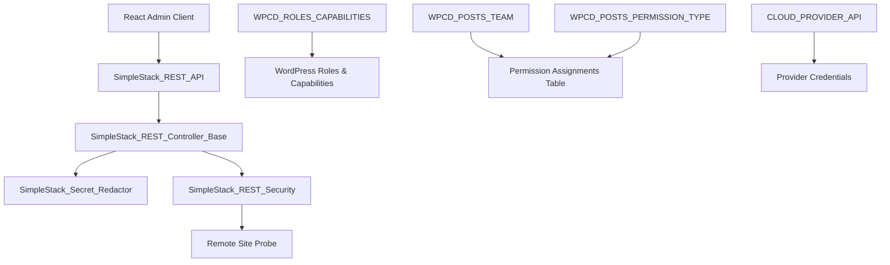
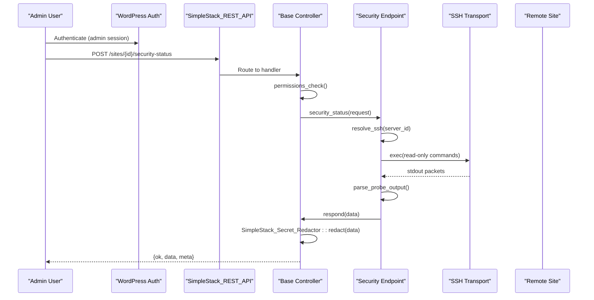
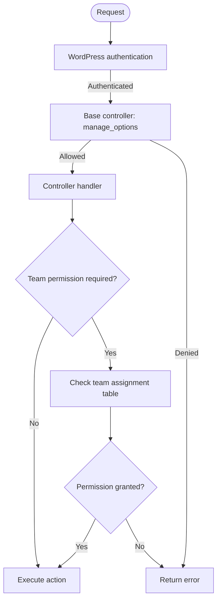
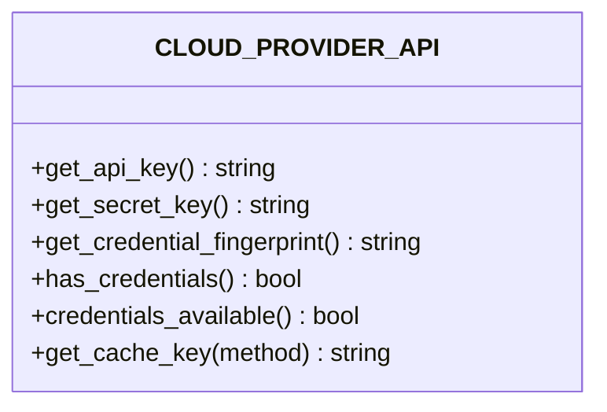
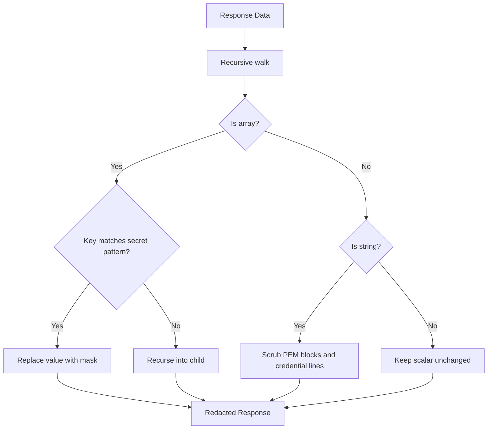
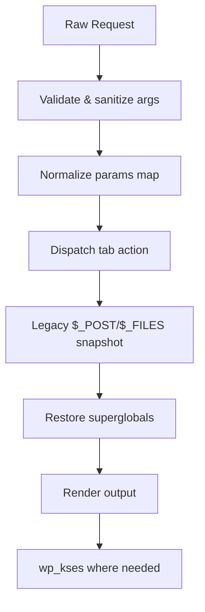
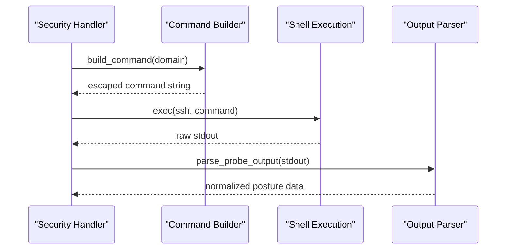
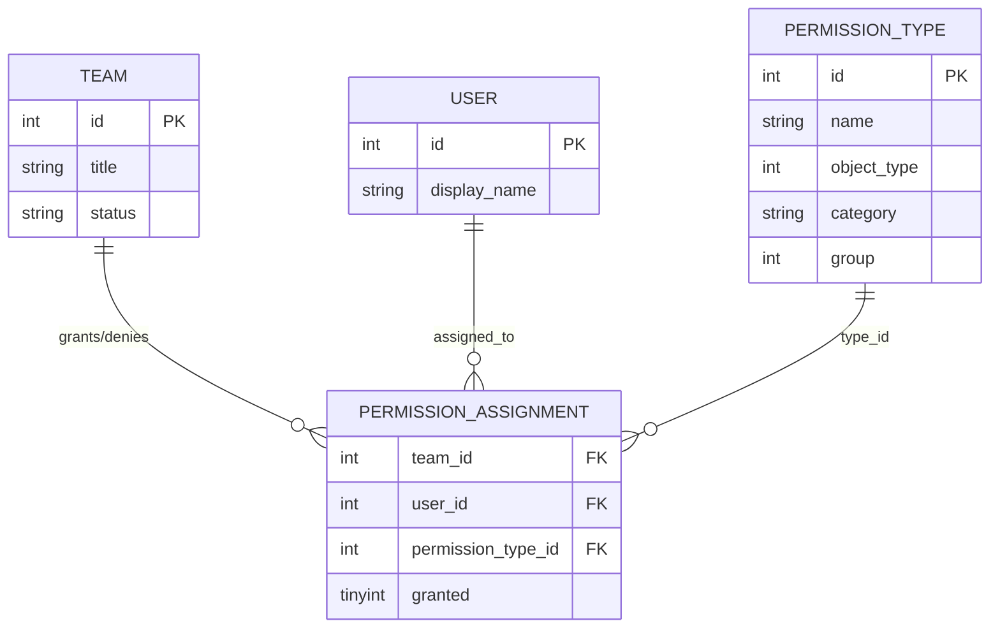
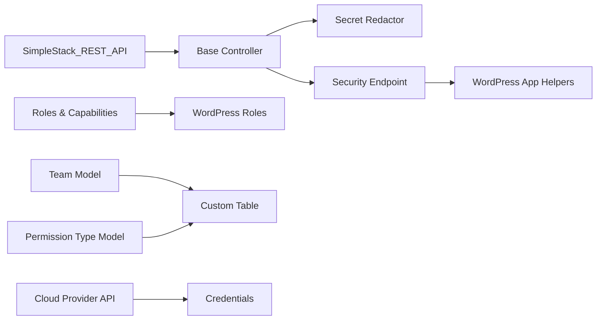

# Security & Authentication

<cite>
**Referenced Files in This Document**
- [class-simplestack-rest-api.php](file://includes/core/api/class-simplestack-rest-api.php)
- [class-simplestack-rest-controller-base.php](file://includes/core/api/class-simplestack-rest-controller-base.php)
- [class-simplestack-secret-redactor.php](file://includes/core/api/class-simplestack-secret-redactor.php)
- [class-simplestack-rest-security.php](file://includes/core/api/class-simplestack-rest-security.php)
- [class-wpcd-roles-capabilities.php](file://includes/core/class-wpcd-roles-capabilities.php)
- [class-wpcd-posts-team.php](file://includes/core/class-wpcd-posts-team.php)
- [class-wpcd-posts-permission-type.php](file://includes/core/class-wpcd-posts-permission-type.php)
- [functions-kses.php](file://includes/core/functions-kses.php)
- [class-cloud-provider-api.php](file://includes/core/providers/class-cloud-provider-api.php)
</cite>

## Table of Contents
1. [Introduction](#introduction)
2. [Project Structure](#project-structure)
3. [Core Components](#core-components)
4. [Architecture Overview](#architecture-overview)
5. [Detailed Component Analysis](#detailed-component-analysis)
6. [Dependency Analysis](#dependency-analysis)
7. [Performance Considerations](#performance-considerations)
8. [Troubleshooting Guide](#troubleshooting-guide)
9. [Conclusion](#conclusion)

## Introduction
This document explains the security model for SimpleStack, focusing on authentication, authorization, credential handling, secret redaction, input validation, output escaping, secure remote operations, and audit practices. It is intended for administrators, integrators, and developers who need to understand how access is controlled, how sensitive data is protected, and how to operate SimpleStack securely.

SimpleStack exposes a single internal REST API surface used by its React admin client. All routes require administrative privileges, enforce strict parameter validation, and pass every response through a secret redactor so that credentials never leak into logs or API responses. Team-based permissions provide fine-grained control over servers and applications, while role-based capabilities define platform-wide access boundaries.

## Project Structure
Security-related functionality is concentrated under the core API layer and WordPress permission subsystem:

- SimpleStack REST API entry point registers controllers and loads shared utilities.
- Base controller enforces admin-only access, validates parameters, and wraps all responses with secret redaction.
- Secret redactor masks known credential keys and scrubs embedded secrets from free text.
- Security posture endpoint performs read-only SSH probes against sites without mutating state.
- Role and capability definitions create custom roles and capabilities.
- Team and permission type models implement team membership, per-user server/app permissions, and permission catalog management.
- KSES helpers restrict allowed HTML attributes for safe UI rendering.
- Cloud provider base class centralizes credential fingerprinting and cache key generation.

**Diagram sources**
- [class-simplestack-rest-api.php:21-37](file://includes/core/api/class-simplestack-rest-api.php#L21-L37)
- [class-simplestack-rest-controller-base.php:22-60](file://includes/core/api/class-simplestack-rest-controller-base.php#L22-L60)
- [class-simplestack-secret-redactor.php:24-37](file://includes/core/api/class-simplestack-secret-redactor.php#L24-L37)
- [class-simplestack-rest-security.php:19-38](file://includes/core/api/class-simplestack-rest-security.php#L19-L38)
- [class-wpcd-roles-capabilities.php:15-34](file://includes/core/class-wpcd-roles-capabilities.php#L15-L34)
- [class-wpcd-posts-team.php:15-35](file://includes/core/class-wpcd-posts-team.php#L15-L35)
- [class-wpcd-posts-permission-type.php:15-35](file://includes/core/class-wpcd-posts-permission-type.php#L15-L35)
- [class-cloud-provider-api.php:15-77](file://includes/core/providers/class-cloud-provider-api.php#L15-L77)

**Section sources**
- [class-simplestack-rest-api.php:12-37](file://includes/core/api/class-simplestack-rest-api.php#L12-L37)
- [class-simplestack-rest-controller-base.php:12-60](file://includes/core/api/class-simplestack-rest-controller-base.php#L12-L60)
- [class-simplestack-secret-redactor.php:12-37](file://includes/core/api/class-simplestack-secret-redactor.php#L12-L37)
- [class-simplestack-rest-security.php:12-38](file://includes/core/api/class-simplestack-rest-security.php#L12-L38)
- [class-wpcd-roles-capabilities.php:12-34](file://includes/core/class-wpcd-roles-capabilities.php#L12-L34)
- [class-wpcd-posts-team.php:12-35](file://includes/core/class-wpcd-posts-team.php#L12-L35)
- [class-wpcd-posts-permission-type.php:12-35](file://includes/core/class-wpcd-posts-permission-type.php#L12-L35)
- [class-cloud-provider-api.php:12-77](file://includes/core/providers/class-cloud-provider-api.php#L12-L77)

## Core Components
- SimpleStack REST API: Registers the `simple-stack/v1` namespace and loads controllers including servers, sites, logs, tabs, providers, and security.
- Base Controller: Enforces `manage_options` for every route, defines typed argument helpers, normalizes params, dispatches legacy tab actions safely, and wraps responses with secret redaction.
- Secret Redactor: Recursively masks array values whose keys match credential patterns and scrubs PEM private keys and credential assignments from free text.
- Security Posture Endpoint: Performs read-only SSH commands to list plugins, check configuration flags, detect PHP version, and inspect vhost handlers.
- Roles & Capabilities: Creates custom roles and capabilities such as provisioning, managing servers/apps/logs/settings/groups/teams, and a catch-all manage-all capability.
- Team Permissions: Stores per-user, per-object permissions in a dedicated table and supports team manager controls and exclusion logic.
- Permission Types: Defines the permission catalog, groups, categories, and default entries for servers and apps.
- KSES Helpers: Provide allowed attribute sets for safe rendering of select elements and related UI components.
- Cloud Provider API: Centralizes credential fingerprinting, cache key construction, feature flags, and credential availability checks.

**Section sources**
- [class-simplestack-rest-api.php:12-37](file://includes/core/api/class-simplestack-rest-api.php#L12-L37)
- [class-simplestack-rest-controller-base.php:22-60](file://includes/core/api/class-simplestack-rest-controller-base.php#L22-L60)
- [class-simplestack-secret-redactor.php:24-37](file://includes/core/api/class-simplestack-secret-redactor.php#L24-L37)
- [class-simplestack-rest-security.php:19-38](file://includes/core/api/class-simplestack-rest-security.php#L19-L38)
- [class-wpcd-roles-capabilities.php:73-151](file://includes/core/class-wpcd-roles-capabilities.php#L73-L151)
- [class-wpcd-posts-team.php:312-347](file://includes/core/class-wpcd-posts-team.php#L312-L347)
- [class-wpcd-posts-permission-type.php:355-760](file://includes/core/class-wpcd-posts-permission-type.php#L355-L760)
- [functions-kses.php:18-52](file://includes/core/functions-kses.php#L18-L52)
- [class-cloud-provider-api.php:169-207](file://includes/core/providers/class-cloud-provider-api.php#L169-L207)

## Architecture Overview
The SimpleStack security architecture combines WordPress-native authentication with an internal admin-only REST API, strict input validation, centralized secret redaction, and team-scoped permissions.

**Diagram sources**
- [class-simplestack-rest-api.php:51-99](file://includes/core/api/class-simplestack-rest-api.php#L51-L99)
- [class-simplestack-rest-controller-base.php:53-60](file://includes/core/api/class-simplestack-rest-controller-base.php#L53-L60)
- [class-simplestack-rest-security.php:49-100](file://includes/core/api/class-simplestack-rest-security.php#L49-L100)
- [class-simplestack-secret-redactor.php:64-95](file://includes/core/api/class-simplestack-secret-redactor.php#L64-L95)

## Detailed Component Analysis

### Authentication and Authorization Model
- Authentication relies on WordPress sessions; only authenticated users can reach the admin area.
- Authorization for SimpleStack routes is enforced at the base controller level: every route requires `manage_options`.
- Custom roles and capabilities extend WordPress roles to grant granular permissions for provisioning, managing servers/apps/logs/settings/groups/teams, and a global manage-all capability.
- Team-based permissions allow assigning specific server and app permissions to individual users within teams, with support for team managers and explicit exclusion of permissions.

**Diagram sources**
- [class-simplestack-rest-controller-base.php:53-60](file://includes/core/api/class-simplestack-rest-controller-base.php#L53-L60)
- [class-wpcd-roles-capabilities.php:73-151](file://includes/core/class-wpcd-roles-capabilities.php#L73-L151)
- [class-wpcd-posts-team.php:443-517](file://includes/core/class-wpcd-posts-team.php#L443-L517)

**Section sources**
- [class-simplestack-rest-controller-base.php:53-60](file://includes/core/api/class-simplestack-rest-controller-base.php#L53-L60)
- [class-wpcd-roles-capabilities.php:73-151](file://includes/core/class-wpcd-roles-capabilities.php#L73-L151)
- [class-wpcd-posts-team.php:312-347](file://includes/core/class-wpcd-posts-team.php#L312-L347)
- [class-wpcd-posts-team.php:443-517](file://includes/core/class-wpcd-posts-team.php#L443-L517)

### Credential Management and Provider Integration
- Provider classes expose template methods for API keys and secret keys.
- A credential fingerprint method chooses whichever value is set, preventing identical empty strings from masking distinct accounts during connection tests.
- Cache keys incorporate hashed secret material to isolate cached data per account.
- Credential availability checks verify presence of SSH public/private keys and provider API keys before allowing operations.

**Diagram sources**
- [class-cloud-provider-api.php:169-207](file://includes/core/providers/class-cloud-provider-api.php#L169-L207)
- [class-cloud-provider-api.php:501-531](file://includes/core/providers/class-cloud-provider-api.php#L501-L531)
- [class-cloud-provider-api.php:669-704](file://includes/core/providers/class-cloud-provider-api.php#L669-L704)

**Section sources**
- [class-cloud-provider-api.php:169-207](file://includes/core/providers/class-cloud-provider-api.php#L169-L207)
- [class-cloud-provider-api.php:501-531](file://includes/core/providers/class-cloud-provider-api.php#L501-L531)
- [class-cloud-provider-api.php:669-704](file://includes/core/providers/class-cloud-provider-api.php#L669-L704)

### Secret Redaction System
- Every SimpleStack REST response passes through the secret redactor.
- Array keys matching patterns like password, secret, token, private, authorization, `_key`, and api key variants are masked entirely.
- Free-text scrubbing removes PEM private key blocks and collapses credential-looking shell assignments and authorization headers to safe placeholders.
- The redactor includes recursion depth protection to avoid pathological structures.

**Diagram sources**
- [class-simplestack-secret-redactor.php:64-95](file://includes/core/api/class-simplestack-secret-redactor.php#L64-L95)
- [class-simplestack-secret-redactor.php:115-126](file://includes/core/api/class-simplestack-secret-redactor.php#L115-L126)
- [class-simplestack-rest-controller-base.php:136-149](file://includes/core/api/class-simplestack-rest-controller-base.php#L136-L149)

**Section sources**
- [class-simplestack-secret-redactor.php:24-37](file://includes/core/api/class-simplestack-secret-redactor.php#L24-L37)
- [class-simplestack-secret-redactor.php:64-95](file://includes/core/api/class-simplestack-secret-redactor.php#L64-L95)
- [class-simplestack-secret-redactor.php:115-126](file://includes/core/api/class-simplestack-secret-redactor.php#L115-L126)
- [class-simplestack-rest-controller-base.php:136-149](file://includes/core/api/class-simplestack-rest-controller-base.php#L136-L149)

### Input Sanitization and Output Escaping
- Parameter validation uses typed helpers: integers, strings, enums, free-form text, objects, and normalized params maps.
- Strings use sanitization callbacks; free-form text preserves characters but still rejects non-string inputs.
- Legacy tab actions receive sanitized and isolated superglobals snapshots to prevent request leakage.
- KSES helpers constrain allowed HTML attributes for safe rendering of select elements and related UI components.

**Diagram sources**
- [class-simplestack-rest-controller-base.php:192-242](file://includes/core/api/class-simplestack-rest-controller-base.php#L192-L242)
- [class-simplestack-rest-controller-base.php:255-341](file://includes/core/api/class-simplestack-rest-controller-base.php#L255-L341)
- [class-simplestack-rest-controller-base.php:362-406](file://includes/core/api/class-simplestack-rest-controller-base.php#L362-L406)
- [functions-kses.php:18-52](file://includes/core/functions-kses.php#L18-L52)

**Section sources**
- [class-simplestack-rest-controller-base.php:192-242](file://includes/core/api/class-simplestack-rest-controller-base.php#L192-L242)
- [class-simplestack-rest-controller-base.php:255-341](file://includes/core/api/class-simplestack-rest-controller-base.php#L255-L341)
- [class-simplestack-rest-controller-base.php:362-406](file://includes/core/api/class-simplestack-rest-controller-base.php#L362-L406)
- [functions-kses.php:18-52](file://includes/core/functions-kses.php#L18-L52)

### Secure Remote Operations and Read-Only Probes
- The security posture endpoint constructs read-only commands using escaped arguments and executes them via SSH.
- Command output is split into packets and parsed into safe fields: plugin list, file edit flag, PHP version, and vhost handler detection.
- No write operations are performed; the endpoint reports installed plugins and configuration posture without mutating the site.

**Diagram sources**
- [class-simplestack-rest-security.php:162-191](file://includes/core/api/class-simplestack-rest-security.php#L162-L191)
- [class-simplestack-rest-security.php:117-150](file://includes/core/api/class-simplestack-rest-security.php#L117-L150)

**Section sources**
- [class-simplestack-rest-security.php:49-100](file://includes/core/api/class-simplestack-rest-security.php#L49-L100)
- [class-simplestack-rest-security.php:117-150](file://includes/core/api/class-simplestack-rest-security.php#L117-L150)
- [class-simplestack-rest-security.php:162-191](file://includes/core/api/class-simplestack-rest-security.php#L162-L191)

### Team-Based Permissions and User Isolation
- Team records are private posts and restricted by capability checks.
- Permission rules associate users with server and app permissions, supporting team managers and exclusion updates.
- The permission assignment table stores grants and denials per user, team, and permission type.
- Query filters limit team listings to authorized users based on team manager status and capabilities.

**Diagram sources**
- [class-wpcd-posts-team.php:138-186](file://includes/core/class-wpcd-posts-team.php#L138-L186)
- [class-wpcd-posts-team.php:312-347](file://includes/core/class-wpcd-posts-team.php#L312-L347)
- [class-wpcd-posts-team.php:443-517](file://includes/core/class-wpcd-posts-team.php#L443-L517)
- [class-wpcd-posts-permission-type.php:331-348](file://includes/core/class-wpcd-posts-permission-type.php#L331-L348)

**Section sources**
- [class-wpcd-posts-team.php:138-186](file://includes/core/class-wpcd-posts-team.php#L138-L186)
- [class-wpcd-posts-team.php:312-347](file://includes/core/class-wpcd-posts-team.php#L312-L347)
- [class-wpcd-posts-team.php:443-517](file://includes/core/class-wpcd-posts-team.php#L443-L517)
- [class-wpcd-posts-permission-type.php:331-348](file://includes/core/class-wpcd-posts-permission-type.php#L331-L348)

## Dependency Analysis
- SimpleStack REST API depends on the base controller and secret redactor.
- Security endpoint depends on SSH transport and WordPress app helpers to resolve domain and server metadata.
- Roles and capabilities hook into WordPress activation and multisite initialization.
- Team and permission type models depend on WordPress post types, metaboxes, and a custom database table.
- Cloud provider API provides credential abstractions consumed by provider-specific implementations.

**Diagram sources**
- [class-simplestack-rest-api.php:51-99](file://includes/core/api/class-simplestack-rest-api.php#L51-L99)
- [class-simplestack-rest-controller-base.php:136-149](file://includes/core/api/class-simplestack-rest-controller-base.php#L136-L149)
- [class-simplestack-rest-security.php:77-100](file://includes/core/api/class-simplestack-rest-security.php#L77-L100)
- [class-wpcd-roles-capabilities.php:54-66](file://includes/core/class-wpcd-roles-capabilities.php#L54-L66)
- [class-wpcd-posts-team.php:443-517](file://includes/core/class-wpcd-posts-team.php#L443-L517)
- [class-wpcd-posts-permission-type.php:331-348](file://includes/core/class-wpcd-posts-permission-type.php#L331-L348)
- [class-cloud-provider-api.php:169-207](file://includes/core/providers/class-cloud-provider-api.php#L169-L207)

**Section sources**
- [class-simplestack-rest-api.php:51-99](file://includes/core/api/class-simplestack-rest-api.php#L51-L99)
- [class-simplestack-rest-controller-base.php:136-149](file://includes/core/api/class-simplestack-rest-controller-base.php#L136-L149)
- [class-simplestack-rest-security.php:77-100](file://includes/core/api/class-simplestack-rest-security.php#L77-L100)
- [class-wpcd-roles-capabilities.php:54-66](file://includes/core/class-wpcd-roles-capabilities.php#L54-L66)
- [class-wpcd-posts-team.php:443-517](file://includes/core/class-wpcd-posts-team.php#L443-L517)
- [class-wpcd-posts-permission-type.php:331-348](file://includes/core/class-wpcd-posts-permission-type.php#L331-L348)
- [class-cloud-provider-api.php:169-207](file://includes/core/providers/class-cloud-provider-api.php#L169-L207)

## Performance Considerations
- Parameter validation avoids expensive parsing by using typed helpers and early rejection of invalid types.
- The security posture endpoint batches multiple read-only commands into one SSH round trip to reduce latency.
- Secret redaction walks nested arrays and strings; keep response payloads minimal to reduce processing time.
- Cloud provider caching isolates per-account transients and limits cache scope to whitelisted methods.

[No sources needed since this section provides general guidance]

## Troubleshooting Guide
- If SimpleStack routes return unauthorized errors, verify the user has the WordPress `manage_options` capability.
- If team listings show no items, confirm the current user is either a team manager or has the `wpcd_manage_teams` capability.
- If secret redaction hides expected values, check whether array keys match credential patterns or if free text contains PEM blocks or credential-like assignments.
- If security posture reports cannot connect, ensure the server’s provider instance is active and SSH key details are available.
- If provider operations fail due to missing credentials, verify API key or secret key configuration and SSH key pair presence.

**Section sources**
- [class-simplestack-rest-controller-base.php:53-60](file://includes/core/api/class-simplestack-rest-controller-base.php#L53-L60)
- [class-wpcd-posts-team.php:528-551](file://includes/core/class-wpcd-posts-team.php#L528-L551)
- [class-simplestack-secret-redactor.php:64-95](file://includes/core/api/class-simplestack-secret-redactor.php#L64-L95)
- [class-simplestack-rest-security.php:77-100](file://includes/core/api/class-simplestack-rest-security.php#L77-L100)
- [class-cloud-provider-api.php:669-704](file://includes/core/providers/class-cloud-provider-api.php#L669-L704)

## Conclusion
SimpleStack’s security model centers on strict admin-only access, robust input validation, centralized secret redaction, and team-scoped permissions. The architecture minimizes exposure by keeping the REST API internal, validating all parameters, and ensuring no credentials leave the process. Provider integration abstracts credential handling and caching, while read-only remote probes enable safe security posture checks. Administrators should configure roles and capabilities carefully, assign team permissions thoughtfully, and rely on the built-in redaction and validation mechanisms to protect sensitive data.