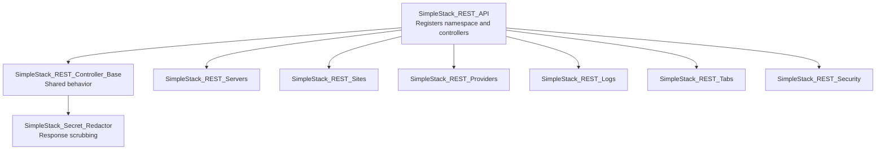
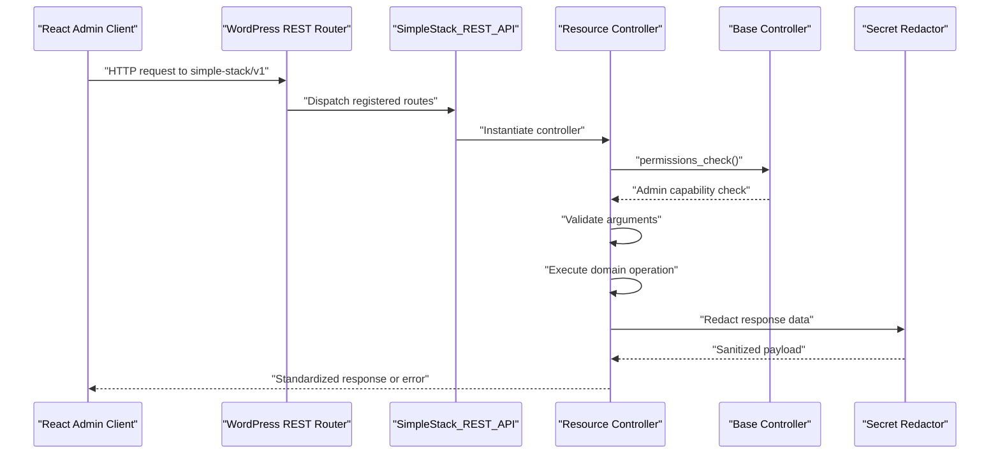
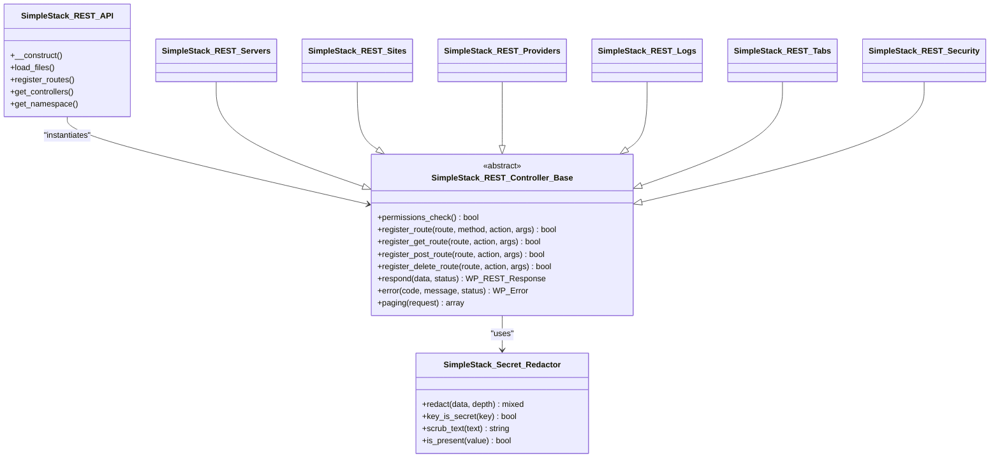
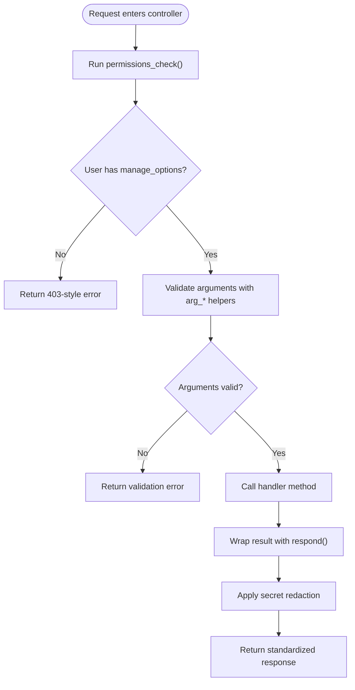
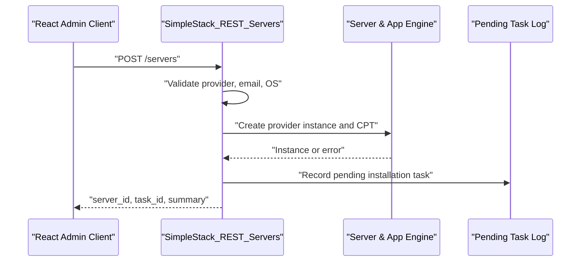
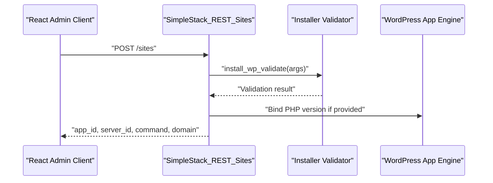
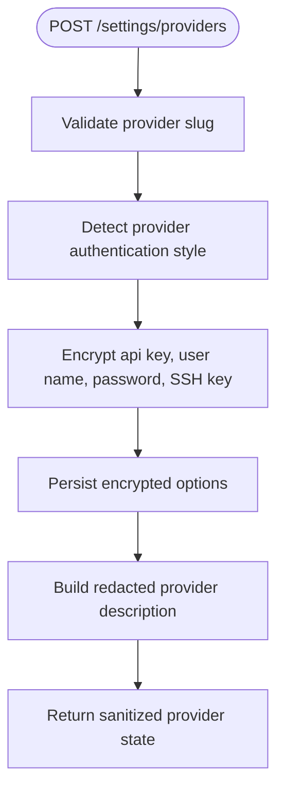
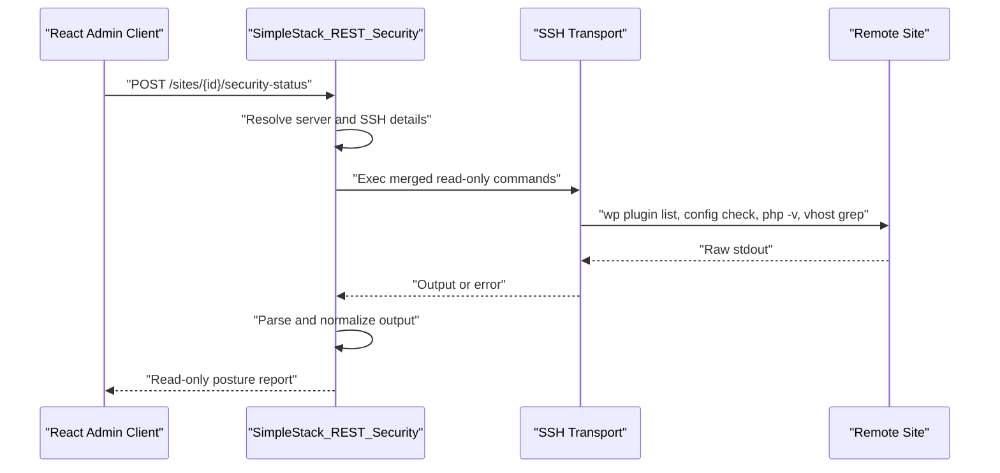
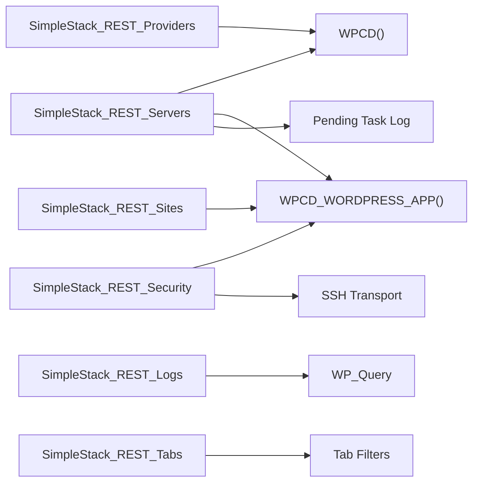

# API Layer Design

<cite>
**Referenced Files in This Document**
- [class-simplestack-rest-api.php](file://includes/core/api/class-simplestack-rest-api.php)
- [class-simplestack-rest-controller-base.php](file://includes/core/api/class-simplestack-rest-controller-base.php)
- [class-simplestack-secret-redactor.php](file://includes/core/api/class-simplestack-secret-redactor.php)
- [class-simplestack-rest-servers.php](file://includes/core/api/class-simplestack-rest-servers.php)
- [class-simplestack-rest-sites.php](file://includes/core/api/class-simplestack-rest-sites.php)
- [class-simplestack-rest-providers.php](file://includes/core/api/class-simplestack-rest-providers.php)
- [class-simplestack-rest-security.php](file://includes/core/api/class-simplestack-rest-security.php)
- [class-simplestack-rest-logs.php](file://includes/core/api/class-simplestack-rest-logs.php)
- [class-simplestack-rest-tabs.php](file://includes/core/api/class-simplestack-rest-tabs.php)
</cite>

## Update Summary
**Changes Made**
- Updated to reflect the complete new REST API architecture with `simple-stack/v1` namespace
- Enhanced documentation for the base controller class and its comprehensive functionality
- Added detailed coverage of all six specialized controllers (servers, sites, logs, providers, security, tabs)
- Updated architectural diagrams to show the complete controller hierarchy
- Enhanced security and authentication sections based on actual implementation
- Added comprehensive examples of endpoint patterns and response formats

## Table of Contents
1. [Introduction](#introduction)
2. [Project Structure](#project-structure)
3. [Core Components](#core-components)
4. [Architecture Overview](#architecture-overview)
5. [Detailed Component Analysis](#detailed-component-analysis)
6. [Dependency Analysis](#dependency-analysis)
7. [Performance Considerations](#performance-considerations)
8. [Troubleshooting Guide](#troubleshooting-guide)
9. [Conclusion](#conclusion)

## Introduction
This document describes the architectural design of SimpleStack's REST API layer. The API exposes a single internal control plane for the React admin client under the `simple-stack/v1` namespace. It follows a controller-based pattern: each resource—servers, sites, providers, logs, tabs, and security—has its own controller class extending a shared base controller.

The base controller centralizes route registration, permission checks, argument validation, paging helpers, response formatting, and error construction. Controllers translate HTTP requests into domain operations such as server provisioning, site deployment, provider credential management, log retrieval, tab schema exposure, and read-only security probing.

Key design goals include:
- A consistent request/response envelope with automatic secret redaction.
- Admin-only access enforced through WordPress capabilities.
- Strong input validation using typed argument helpers.
- Reuse of existing engine logic via action bridges and filter chains.
- Safe handling of credentials and sensitive output.

## Project Structure
The SimpleStack REST layer lives under `includes/core/api/`. The entry point registers the namespace and instantiates controllers. Each controller file defines one resource boundary.

**Diagram sources**
- [class-simplestack-rest-api.php:21-118](file://includes/core/api/class-simplestack-rest-api.php#L21-L118)
- [class-simplestack-rest-controller-base.php:22-51](file://includes/core/api/class-simplestack-rest-controller-base.php#L22-L51)
- [class-simplestack-secret-redactor.php:24-95](file://includes/core/api/class-simplestack-secret-redactor.php#L24-L95)

**Section sources**
- [class-simplestack-rest-api.php:12-75](file://includes/core/api/class-simplestack-rest-api.php#L12-L75)

## Core Components
The API is built around five core concepts:

| Concept | Responsibility | Primary Implementation |
|---|---|---|
| Namespace registrar | Loads controller files, registers routes under `simple-stack/v1`, and exposes the namespace | `SimpleStack_REST_API` |
| Base controller | Provides permissions, routing helpers, parameter validators, paging, response envelope, and error builder | `SimpleStack_REST_Controller_Base` |
| Secret redactor | Recursively masks credential-like keys and scrubs PEM blocks or embedded secrets from strings | `SimpleStack_Secret_Redactor` |
| Resource controllers | Implement endpoints for servers, sites, providers, logs, tabs, and security probes | `SimpleStack_REST_Servers`, `SimpleStack_REST_Sites`, `SimpleStack_REST_Providers`, `SimpleStack_REST_Logs`, `SimpleStack_REST_Tabs`, `SimpleStack_REST_Security` |
| Domain services | Provide cloud provider APIs, server objects, WordPress app logic, SSH transport, and post types | External plugin classes invoked by controllers |

### Request/Response Flow
Every request follows this path:

1. WordPress receives a request to `simple-stack/v1/<resource>...`.
2. `SimpleStack_REST_API::register_routes()` instantiates each controller that extends the base controller.
3. The base controller applies the shared permission callback.
4. WordPress validates parameters using the controller's argument definitions.
5. The controller method performs domain work.
6. Success responses are wrapped by `respond()`, which redacts secrets and adds metadata.
7. Errors are returned as `WP_Error` objects with machine-readable codes and status codes.

**Diagram sources**
- [class-simplestack-rest-api.php:84-99](file://includes/core/api/class-simplestack-rest-api.php#L84-L99)
- [class-simplestack-rest-controller-base.php:58-84](file://includes/core/api/class-simplestack-rest-controller-base.php#L58-L84)
- [class-simplestack-secret-redactor.php:64-95](file://includes/core/api/class-simplestack-secret-redactor.php#L64-L95)

**Section sources**
- [class-simplestack-rest-api.php:21-118](file://includes/core/api/class-simplestack-rest-api.php#L21-L118)
- [class-simplestack-rest-controller-base.php:22-162](file://includes/core/api/class-simplestack-rest-controller-base.php#L22-L162)
- [class-simplestack-secret-redactor.php:24-140](file://includes/core/api/class-simplestack-secret-redactor.php#L24-L140)

## Architecture Overview
The architecture separates concerns cleanly:

- **Routing and lifecycle:** `SimpleStack_REST_API` owns the namespace and controller lifecycle.
- **Cross-cutting behavior:** `SimpleStack_REST_Controller_Base` owns permissions, validation, paging, and response shape.
- **Domain boundaries:** Each controller owns one resource and delegates heavy lifting to existing domain classes.
- **Security boundary:** All responses pass through the secret redactor; credentials are never echoed back.
- **Extensibility boundary:** Tab schemas and action dispatch reuse existing filters and actions so legacy UI behavior remains intact.

**Diagram sources**
- [class-simplestack-rest-api.php:21-118](file://includes/core/api/class-simplestack-rest-api.php#L21-L118)
- [class-simplestack-rest-controller-base.php:22-162](file://includes/core/api/class-simplestack-rest-controller-base.php#L22-L162)
- [class-simplestack-secret-redactor.php:24-140](file://includes/core/api/class-simplestack-secret-redactor.php#L24-L140)

## Detailed Component Analysis

### Base Controller
The base controller is the foundation of the API layer. It defines:

- A shared namespace constant (`simple-stack/v1`).
- A reusable numeric ID path fragment.
- A maximum page size constant (200).
- A shared permission callback requiring `manage_options`.
- Route registration helpers for GET, POST, and DELETE.
- A standardized success response envelope.
- An error helper returning `WP_Error`.
- Typed argument builders for IDs, integers, strings, free-form text, objects, and tab params.
- A params normalizer supporting JSON objects, JSON strings, and query strings.
- A tab-action dispatcher that temporarily maps REST parameters onto legacy superglobals.
- Paging normalization and shared paging argument definitions.

**Diagram sources**
- [class-simplestack-rest-controller-base.php:58-162](file://includes/core/api/class-simplestack-rest-controller-base.php#L58-L162)
- [class-simplestack-secret-redactor.php:64-95](file://includes/core/api/class-simplestack-secret-redactor.php#L64-L95)

**Section sources**
- [class-simplestack-rest-controller-base.php:22-465](file://includes/core/api/class-simplestack-rest-controller-base.php#L22-L465)

### Server Controller
The server controller exposes:

- A paginated list endpoint with provider, region, status, and search filters.
- A create endpoint that builds attributes, creates the provider instance, attaches the WordPress app record, and records a pending task.
- A get endpoint returning a summarized server object plus meta and availability information.
- A delete endpoint that triggers the app's delete action chain and verifies the server is trashed.
- An action bridge endpoint that forwards tab actions or lifecycle verbs to the existing engine.

**Diagram sources**
- [class-simplestack-rest-servers.php:52-88](file://includes/core/api/class-simplestack-rest-servers.php#L52-L88)
- [class-simplestack-rest-servers.php:172-249](file://includes/core/api/class-simplestack-rest-servers.php#L172-L249)

**Section sources**
- [class-simplestack-rest-servers.php:22-458](file://includes/core/api/class-simplestack-rest-servers.php#L22-L458)

### Site Controller
The site controller exposes:

- A paginated list endpoint filtered by server and search term.
- A deploy endpoint that validates inputs through the same installer validator used by the legacy UI.
- A get endpoint returning a summarized site object plus meta and action status.
- A delete endpoint that respects the app post type's own permission gate before trashing.
- An action bridge endpoint that maps REST parameters onto the legacy tab action pipeline.

**Diagram sources**
- [class-simplestack-rest-sites.php:49-86](file://includes/core/api/class-simplestack-rest-sites.php#L49-L86)
- [class-simplestack-rest-sites.php:158-205](file://includes/core/api/class-simplestack-rest-sites.php#L158-L205)

**Section sources**
- [class-simplestack-rest-sites.php:21-392](file://includes/core/api/class-simplestack-rest-sites.php#L21-L392)

### Provider Controller
The provider controller manages cloud provider settings without exposing raw credentials. It provides:

- A list endpoint returning provider descriptions, feature flags, credential presence booleans, and cached region/size counts.
- A save endpoint that encrypts sensitive fields before storing them.
- A test endpoint that calls the provider's connection test when credentials are available.
- A short-lived transient cache for region and size discovery, with graceful failure handling.

**Diagram sources**
- [class-simplestack-rest-providers.php:66-85](file://includes/core/api/class-simplestack-rest-providers.php#L66-L85)
- [class-simplestack-rest-providers.php:122-174](file://includes/core/api/class-simplestack-rest-providers.php#L122-L174)
- [class-simplestack-rest-providers.php:290-336](file://includes/core/api/class-simplestack-rest-providers.php#L290-L336)

**Section sources**
- [class-simplestack-rest-providers.php:20-359](file://includes/core/api/class-simplestack-rest-providers.php#L20-L359)

### Security Controller
The security controller performs a strictly read-only probe against a site over SSH. It returns:

- Connection status.
- Normalized plugin information.
- Whether file editing is disallowed.
- Detected PHP version.
- Diagnostic messages instead of stack traces.

It avoids writing to the remote system and never places key material in responses.

**Diagram sources**
- [class-simplestack-rest-security.php:31-38](file://includes/core/api/class-simplestack-rest-security.php#L31-L38)
- [class-simplestack-rest-security.php:49-101](file://includes/core/api/class-simplestack-rest-security.php#L49-L101)
- [class-simplestack-rest-security.php:162-191](file://includes/core/api/class-simplestack-rest-security.php#L162-L191)

**Section sources**
- [class-simplestack-rest-security.php:19-253](file://includes/core/api/class-simplestack-rest-security.php#L19-L253)

### Logs Controller
The logs controller serves:

- A per-server log stream filtered by type and time cursor.
- A global activity feed optionally scoped to one server.
- Cursor-based pagination derived from the newest log entry timestamp.

All log bodies pass through the secret redactor because command output may contain accidental credentials.

**Section sources**
- [class-simplestack-rest-logs.php:19-240](file://includes/core/api/class-simplestack-rest-logs.php#L19-L240)

### Tabs Controller
The tabs controller exposes the dynamic tab schema for servers and sites. It:

- Queries tab names and field definitions through existing filters.
- Converts closures, objects, and encrypted defaults into JSON-safe structures.
- Blanks current values for password-type fields.
- Returns a generic schema the React client can render without hard-coded screens.

**Section sources**
- [class-simplestack-rest-tabs.php:27-223](file://includes/core/api/class-simplestack-rest-tabs.php#L27-L223)

## Dependency Analysis
The API layer depends on several external subsystems but keeps those dependencies behind controller methods:

| Dependency | Used By | Purpose |
|---|---|---|
| Cloud provider registry | Server and provider controllers | Enumerate providers and resolve provider APIs |
| Server abstraction | Server controller | Create, inspect, and operate on cloud instances |
| WordPress app engine | Server and site controllers | Install apps, bind PHP versions, run lifecycle actions |
| Pending task log | Server controller | Track asynchronous provisioning tasks |
| SSH transport | Security controller | Execute read-only commands on remote servers |
| Post types | Multiple controllers | Query servers, sites, and logs |

**Diagram sources**
- [class-simplestack-rest-servers.php:172-249](file://includes/core/api/class-simplestack-rest-servers.php#L172-L249)
- [class-simplestack-rest-sites.php:158-205](file://includes/core/api/class-simplestack-rest-sites.php#L158-L205)
- [class-simplestack-rest-providers.php:122-174](file://includes/core/api/class-simplestack-rest-providers.php#L122-L174)
- [class-simplestack-rest-security.php:77-101](file://includes/core/api/class-simplestack-rest-security.php#L77-L101)
- [class-simplestack-rest-logs.php:137-178](file://includes/core/api/class-simplestack-rest-logs.php#L137-L178)
- [class-simplestack-rest-tabs.php:74-86](file://includes/core/api/class-simplestack-rest-tabs.php#L74-L86)

**Section sources**
- [class-simplestack-rest-api.php:21-118](file://includes/core/api/class-simplestack-rest-api.php#L21-L118)
- [class-simplestack-rest-servers.php:22-458](file://includes/core/api/class-simplestack-rest-servers.php#L22-L458)
- [class-simplestack-rest-sites.php:21-392](file://includes/core/api/class-simplestack-rest-sites.php#L21-L392)
- [class-simplestack-rest-providers.php:20-359](file://includes/core/api/class-simplestack-rest-providers.php#L20-L359)
- [class-simplestack-rest-security.php:19-253](file://includes/core/api/class-simplestack-rest-security.php#L19-L253)
- [class-simplestack-rest-logs.php:19-240](file://includes/core/api/class-simplestack-rest-logs.php#L19-L240)
- [class-simplestack-rest-tabs.php:27-223](file://includes/core/api/class-simplestack-rest-tabs.php#L27-L223)

## Performance Considerations
The current implementation emphasizes correctness, safety, and reuse rather than aggressive optimization.

- **Paging:** List endpoints use `per_page` and `page`, capped at a maximum defined in the base controller (200). This prevents large payloads while keeping the React UI responsive.
- **Provider counts caching:** Region and size counts are stored in transients with a fixed TTL (300 seconds). A refresh flag allows bypassing the cache when needed.
- **Log queries:** Log endpoints disable row counting where possible and sort by date to support efficient polling.
- **Action bridge:** The server and site action bridges avoid reimplementing legacy tab logic by delegating to existing filter/action chains.

Recommendations for future extensibility:

- Add rate limiting at the API layer or reverse proxy for write-heavy endpoints such as server creation, site deployment, and provider tests.
- Introduce explicit API versioning by adding a versioned namespace prefix and deprecation headers when changing response shapes.
- Add response caching for read-only endpoints like provider lists and tab schemas, with invalidation hooks when configuration changes.
- Consider background job queues for long-running provisioning and deployment operations to decouple HTTP responses from execution time.
- Add structured audit logging for administrative mutations such as provider credential updates and destructive server/site operations.

[No sources needed since this section provides general guidance]

## Troubleshooting Guide

### Authentication and Authorization
- Every SimpleStack route uses the base controller's shared permission callback, which requires `manage_options`.
- If a request fails due to authorization, verify that the calling user has the required WordPress capability.
- The API does not implement nonce verification at the REST layer; it relies on WordPress capability gating.

**Section sources**
- [class-simplestack-rest-controller-base.php:58-60](file://includes/core/api/class-simplestack-rest-controller-base.php#L58-L60)

### Input Validation Failures
- Use the base controller's argument helpers to define required, typed, and bounded parameters.
- Integer parameters support minimum and maximum bounds.
- String parameters can be constrained to an enum.
- Free-form text parameters preserve characters but still reject non-string inputs.
- Tab params accept JSON objects, JSON strings, or query strings.

**Section sources**
- [class-simplestack-rest-controller-base.php:169-341](file://includes/core/api/class-simplestack-rest-controller-base.php#L169-L341)

### Error Handling Strategy
- Controllers return `WP_Error` objects for validation failures, missing resources, provider errors, and operational failures.
- Error responses include a machine-readable code, a human-readable message, and an HTTP status.
- Successful responses are wrapped in a standardized envelope containing `ok`, redacted `data`, and `meta`.

**Section sources**
- [class-simplestack-rest-controller-base.php:136-162](file://includes/core/api/class-simplestack-rest-controller-base.php#L136-L162)

### Secret Leakage Prevention
- All successful responses pass through the secret redactor.
- Keys matching credential patterns are masked.
- PEM private key blocks and embedded credential assignments are scrubbed from strings.
- Provider listing endpoints return boolean presence flags rather than raw credentials.
- Password-type tab fields have their current values blanked.

**Section sources**
- [class-simplestack-secret-redactor.php:24-142](file://includes/core/api/class-simplestack-secret-redactor.php#L24-L142)
- [class-simplestack-rest-providers.php:15-18](file://includes/core/api/class-simplestack-rest-providers.php#L15-L18)
- [class-simplestack-rest-tabs.php:29-35](file://includes/core/api/class-simplestack-rest-tabs.php#L29-L35)

### Adding a New API Endpoint
To add a new endpoint following established patterns:

1. Create or extend a controller class that extends `SimpleStack_REST_Controller_Base`.
2. Define the route segment in `$name`.
3. Register routes in `register_routes()` using `register_get_route`, `register_post_route`, or `register_delete_route`.
4. Define parameters using `arg_id`, `arg_int`, `arg_string`, `arg_text`, `arg_object`, or `arg_params`.
5. Perform domain work through existing services rather than duplicating logic.
6. Return success via `respond()` and errors via `error()`.
7. Ensure any sensitive data is either avoided or allowed to pass through the default redactor.

Example reference paths:
- Route registration pattern: [class-simplestack-rest-controller-base.php:72-84](file://includes/core/api/class-simplestack-rest-controller-base.php#L72-L84)
- Server list endpoint: [class-simplestack-rest-servers.php:36-50](file://includes/core/api/class-simplestack-rest-servers.php#L36-L50)
- Site deployment endpoint: [class-simplestack-rest-sites.php:49-63](file://includes/core/api/class-simplestack-rest-sites.php#L49-L63)
- Provider save endpoint: [class-simplestack-rest-providers.php:66-78](file://includes/core/api/class-simplestack-rest-providers.php#L66-L78)

**Section sources**
- [class-simplestack-rest-controller-base.php:72-84](file://includes/core/api/class-simplestack-rest-controller-base.php#L72-L84)
- [class-simplestack-rest-servers.php:36-88](file://includes/core/api/class-simplestack-rest-servers.php#L36-L88)
- [class-simplestack-rest-sites.php:35-86](file://includes/core/api/class-simplestack-rest-sites.php#L35-L86)
- [class-simplestack-rest-providers.php:58-85](file://includes/core/api/class-simplestack-rest-providers.php#L58-L85)

## Conclusion
SimpleStack's REST API layer provides a clean, secure, and extensible control plane for managing servers, sites, providers, logs, tabs, and security posture. Its controller-based architecture centralizes cross-cutting concerns while allowing each resource to focus on domain-specific operations. The base controller enforces consistent permissions, validation, and response formatting, and the secret redactor protects sensitive data across all responses.

For future growth, the layer is well positioned to adopt rate limiting, explicit API versioning, response caching, and structured auditing without breaking existing endpoints. New endpoints should follow the established controller pattern, reuse existing domain services, and treat every response as potentially sensitive.