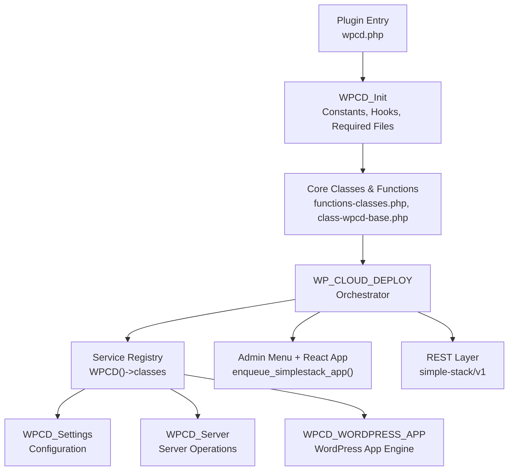
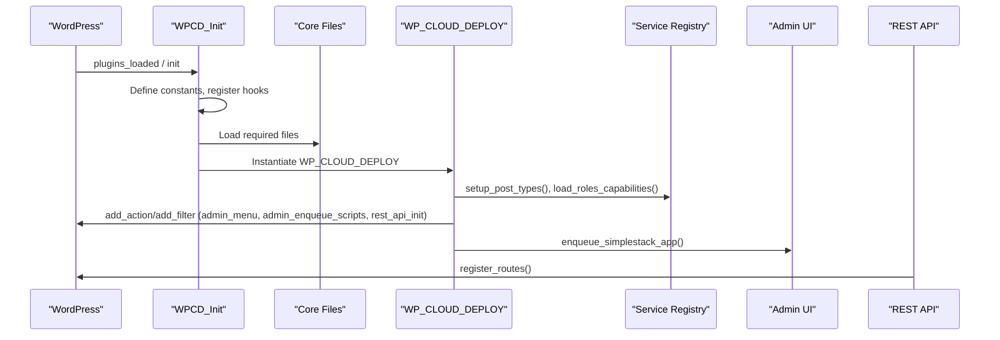
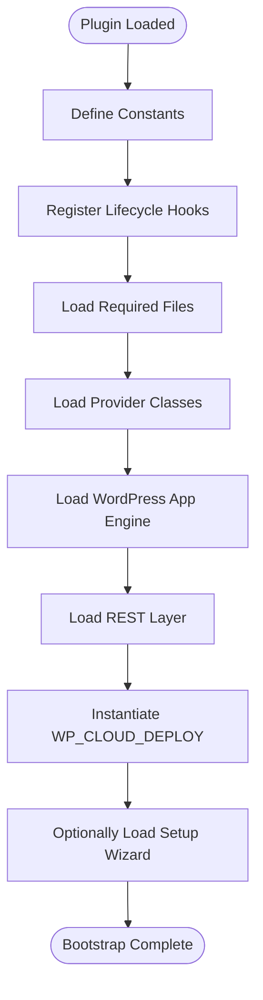
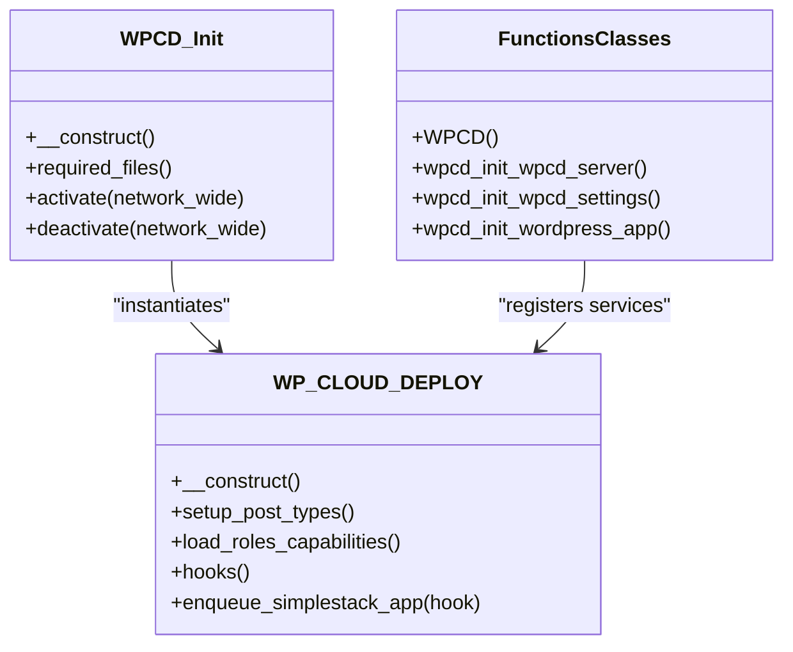
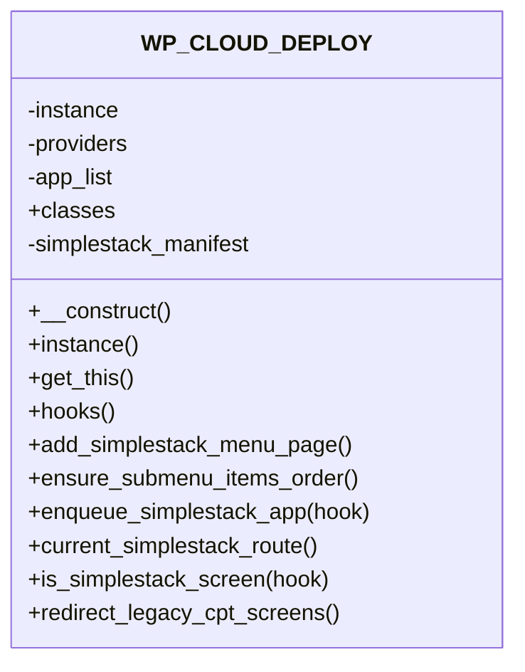
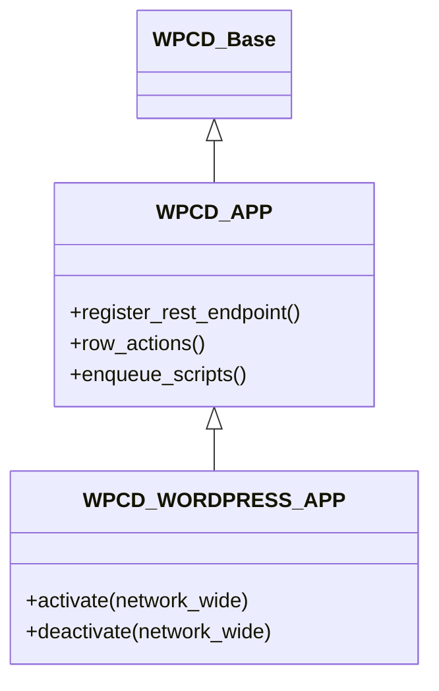
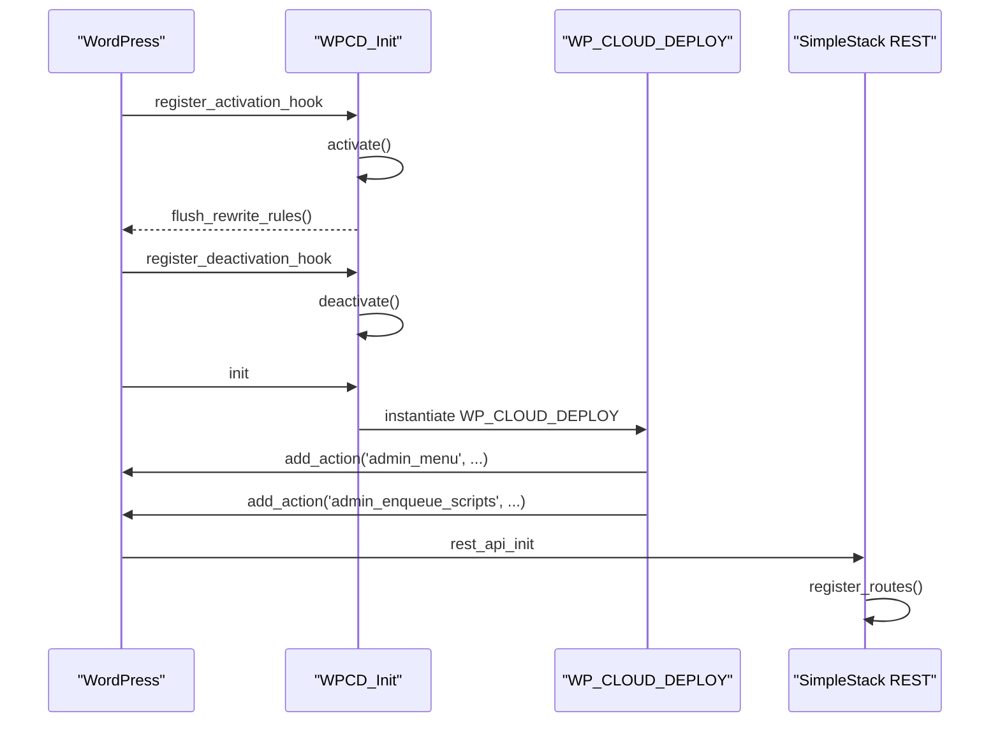
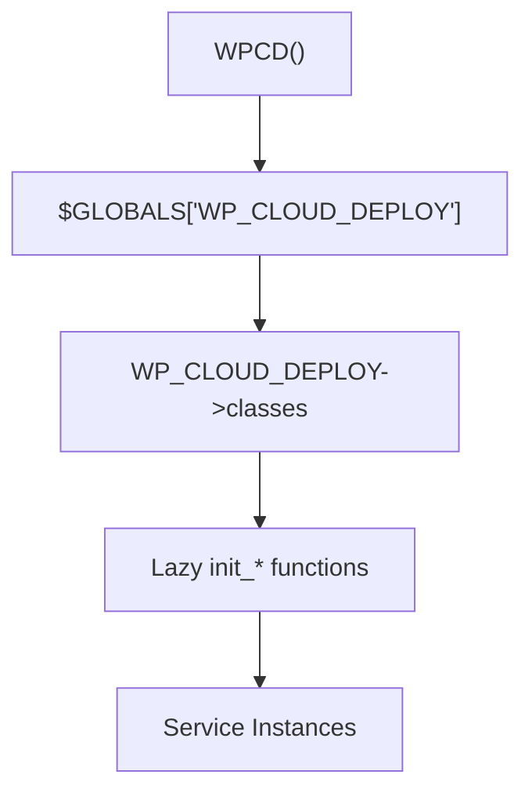
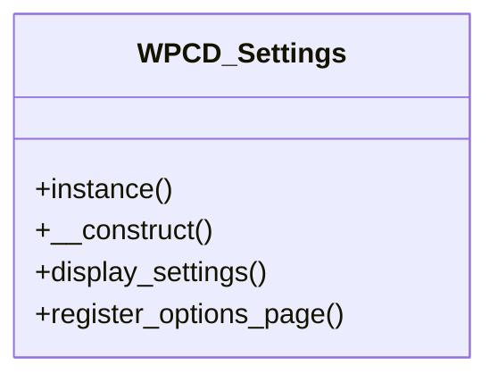
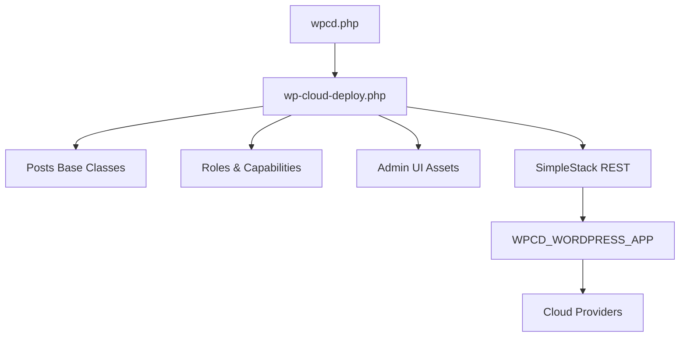

# Backend Architecture

<cite>
**Referenced Files in This Document**
- [wpcd.php](file://wpcd.php)
- [wp-cloud-deploy.php](file://includes/core/wp-cloud-deploy.php)
- [class-wpcd-base.php](file://includes/core/class-wpcd-base.php)
- [functions-classes.php](file://includes/core/functions-classes.php)
- [class-wpcd-settings.php](file://includes/core/class-wpcd-settings.php)
- [class-simplestack-rest-api.php](file://includes/core/api/class-simplestack-rest-api.php)
- [class-wpcd-app.php](file://includes/core/apps/class-wpcd-app.php)
- [class-wordpress-app.php](file://includes/core/apps/wordpress-app/class-wordpress-app.php)
- [commands-and-logs.php](file://includes/core/apps/wordpress-app/traits/commands-and-logs.php)
</cite>

## Table of Contents
1. [Introduction](#introduction)
2. [Project Structure](#project-structure)
3. [Core Components](#core-components)
4. [Architecture Overview](#architecture-overview)
5. [Detailed Component Analysis](#detailed-component-analysis)
6. [Dependency Analysis](#dependency-analysis)
7. [Performance Considerations](#performance-considerations)
8. [Troubleshooting Guide](#troubleshooting-guide)
9. [Conclusion](#conclusion)

## Introduction
This document explains SimpleStack’s backend architecture as a WordPress plugin. It focuses on the bootstrap process, class loading, initialization sequence, core base classes, object-oriented structure, integration with WordPress hooks and lifecycle events, dependency injection patterns, service registration, configuration management, and extension points for adding new components. It also covers performance considerations and best practices for extending the backend safely.

## Project Structure
SimpleStack is organized around a central bootstrap file that defines constants, registers activation/deactivation hooks, loads required dependencies, and instantiates the main orchestrator. Core logic lives under `includes/core`, with provider implementations, application-specific code (notably the WordPress app), REST controllers, custom tables, traits, and shared utilities. The admin interface is now primarily a React application mounted inside wp-admin, while the PHP layer provides data, orchestration, providers, and settings.

**Diagram sources**
- [wpcd.php:24-130](file://wpcd.php#L24-L130)
- [wpcd.php:267-416](file://wpcd.php#L267-L416)
- [wp-cloud-deploy.php:81-138](file://includes/core/wp-cloud-deploy.php#L81-L138)
- [functions-classes.php:17-50](file://includes/core/functions-classes.php#L17-L50)

**Section sources**
- [wpcd.php:1-130](file://wpcd.php#L1-L130)
- [wpcd.php:267-416](file://wpcd.php#L267-L416)

## Core Components
- WPCD_Init: Plugin bootstrap, constants, cron schedules, activation/deactivation, admin notices, language loading, and required file inclusion.
- WP_CLOUD_DEPLOY: Main orchestrator; sets up post types, roles/capabilities, hooks, admin menu, React app assets, and exposes a global accessor.
- WPCD_Base: Shared utility base class for deferred action history and formatted custom links.
- functions-classes.php: Global accessors and lazy service registration into the orchestrator’s registry.
- WPCD_Settings: Centralized configuration UI and options storage via Meta Box settings page.
- SimpleStack REST API: Namespaced REST endpoints for servers, sites, tasks, logs, and security.

**Section sources**
- [wpcd.php:24-130](file://wpcd.php#L24-L130)
- [wp-cloud-deploy.php:15-138](file://includes/core/wp-cloud-deploy.php#L15-L138)
- [class-wpcd-base.php:22-105](file://includes/core/class-wpcd-base.php#L22-L105)
- [functions-classes.php:17-50](file://includes/core/functions-classes.php#L17-L50)
- [class-wpcd-settings.php:32-66](file://includes/core/class-wpcd-settings.php#L32-L66)
- [class-simplestack-rest-api.php:52-52](file://includes/core/api/class-simplestack-rest-api.php#L52-L52)

## Architecture Overview
The plugin follows a layered, event-driven architecture:
- Bootstrap layer initializes constants, environment checks, and required files.
- Orchestrator layer wires core services, menus, hooks, and assets.
- Service registry layer lazily instantiates domain services (server, settings, DNS, app engine).
- Domain layer implements business logic (providers, apps, posts, logs).
- Integration layer connects to WordPress lifecycle (init, admin_menu, rest_api_init, cron).
- Presentation layer renders React-based admin screens and legacy meta boxes where needed.

**Diagram sources**
- [wpcd.php:106-130](file://wpcd.php#L106-L130)
- [wpcd.php:267-416](file://wpcd.php#L267-L416)
- [wp-cloud-deploy.php:81-138](file://includes/core/wp-cloud-deploy.php#L81-L138)
- [class-simplestack-rest-api.php:52-52](file://includes/core/api/class-simplestack-rest-api.php#L52-L52)

## Detailed Component Analysis

### Plugin Bootstrap Process and Initialization Sequence
- Constants are defined early, including paths, versioning, text domain, and brand colors.
- Cron schedules are registered for internal background tasks.
- Activation/deactivation hooks initialize or clean up subsystems such as post types, sync, roles, notifications, and logs.
- The `required_files()` method loads third-party dependencies (Meta Box ecosystem), core utilities, domain classes, providers, and the WordPress app engine.
- Finally, the orchestrator is instantiated, and the setup wizard may be loaded conditionally.

**Diagram sources**
- [wpcd.php:24-130](file://wpcd.php#L24-L130)
- [wpcd.php:267-416](file://wpcd.php#L267-L416)

**Section sources**
- [wpcd.php:24-130](file://wpcd.php#L24-L130)
- [wpcd.php:267-416](file://wpcd.php#L267-L416)

### Class Loading Mechanisms
- Lazy loading via `init` actions: domain services are attached to `init` with low priority and instantiated only if available.
- Conditional loading: optional features like email notifications, data sync, and custom table modules are guarded by feature flags and capability checks.
- Trait loading: core and WordPress app traits are explicitly included before dependent classes.

**Diagram sources**
- [wpcd.php:267-416](file://wpcd.php#L267-L416)
- [wp-cloud-deploy.php:81-138](file://includes/core/wp-cloud-deploy.php#L81-L138)
- [functions-classes.php:17-50](file://includes/core/functions-classes.php#L17-L50)

**Section sources**
- [wpcd.php:267-416](file://wpcd.php#L267-L416)
- [functions-classes.php:17-50](file://includes/core/functions-classes.php#L17-L50)

### WP_CLOUD_DEPLOY Orchestrator
Responsibilities:
- Exposes a global accessor via `$GLOBALS['WP_CLOUD_DEPLOY']`.
- Sets up post types and roles/capabilities.
- Registers WordPress hooks for admin UI, scripts, logging, and navigation.
- Manages the SimpleStack admin menu and React app asset pipeline.
- Provides route mapping between menu slugs and client-side hash routes.

Key behaviors:
- Menu ordering is enforced after all components have registered submenus.
- Legacy CPT screens redirect to React routes for continuity.
- Asset manifest parsing ensures correct script/style loading and cache busting.

**Diagram sources**
- [wp-cloud-deploy.php:15-138](file://includes/core/wp-cloud-deploy.php#L15-L138)
- [wp-cloud-deploy.php:207-336](file://includes/core/wp-cloud-deploy.php#L207-L336)
- [wp-cloud-deploy.php:376-526](file://includes/core/wp-cloud-deploy.php#L376-L526)
- [wp-cloud-deploy.php:600-633](file://includes/core/wp-cloud-deploy.php#L600-L633)

**Section sources**
- [wp-cloud-deploy.php:81-138](file://includes/core/wp-cloud-deploy.php#L81-L138)
- [wp-cloud-deploy.php:207-336](file://includes/core/wp-cloud-deploy.php#L207-L336)
- [wp-cloud-deploy.php:376-526](file://includes/core/wp-cloud-deploy.php#L376-L526)
- [wp-cloud-deploy.php:600-633](file://includes/core/wp-cloud-deploy.php#L600-L633)

### WPCD_Base Utility Functions
Shared utilities include:
- Deferred action history tracking per server/app record.
- Formatting of custom links stored in post metadata.

These methods are intended for reuse across domain classes that need consistent audit trails and link rendering.

**Section sources**
- [class-wpcd-base.php:22-105](file://includes/core/class-wpcd-base.php#L22-L105)

### Object-Oriented Structure
Base hierarchy:
- WPCD_Base: foundational utilities.
- WPCD_APP extends WPCD_Base: application abstraction.
- WPCD_WORDPRESS_APP extends WPCD_APP: WordPress-specific app engine.

Post type and log classes extend shared post/log bases, providing consistent CRUD and lifecycle behavior.

**Diagram sources**
- [class-wpcd-base.php:22-105](file://includes/core/class-wpcd-base.php#L22-L105)
- [class-wpcd-app.php:15-15](file://includes/core/apps/class-wpcd-app.php#L15-L15)
- [class-wordpress-app.php:15-15](file://includes/core/apps/wordpress-app/class-wordpress-app.php#L15-L15)

**Section sources**
- [class-wpcd-base.php:22-105](file://includes/core/class-wpcd-base.php#L22-L105)
- [class-wpcd-app.php:15-15](file://includes/core/apps/class-wpcd-app.php#L15-L15)
- [class-wordpress-app.php:15-15](file://includes/core/apps/wordpress-app/class-wordpress-app.php#L15-L15)

### WordPress Hooks, Filters, and Lifecycle Events
Integration points:
- Activation/deactivation: initialize/clean up subsystems and flush rewrite rules.
- Init: load required files, register services, set up menus and scripts.
- Admin hooks: parent/submenu highlighting, script/style enqueues, admin notices.
- REST: namespaced endpoints registered during `rest_api_init`.
- Cron: custom schedules and periodic tasks for deferred actions and maintenance.

**Diagram sources**
- [wpcd.php:112-130](file://wpcd.php#L112-L130)
- [wpcd.php:166-235](file://wpcd.php#L166-L235)
- [wpcd.php:242-262](file://wpcd.php#L242-L262)
- [wp-cloud-deploy.php:107-138](file://includes/core/wp-cloud-deploy.php#L107-L138)
- [class-simplestack-rest-api.php:52-52](file://includes/core/api/class-simplestack-rest-api.php#L52-L52)

**Section sources**
- [wpcd.php:112-130](file://wpcd.php#L112-L130)
- [wpcd.php:166-235](file://wpcd.php#L166-L235)
- [wpcd.php:242-262](file://wpcd.php#L242-L262)
- [wp-cloud-deploy.php:107-138](file://includes/core/wp-cloud-deploy.php#L107-L138)
- [class-simplestack-rest-api.php:52-52](file://includes/core/api/class-simplestack-rest-api.php#L52-L52)

### Dependency Injection Patterns and Service Registration
- Global accessor pattern: `WPCD()` returns the orchestrator instance from `$GLOBALS['WP_CLOUD_DEPLOY']`.
- Service registry: `WP_CLOUD_DEPLOY->classes` holds instantiated services keyed by identifier.
- Lazy instantiation: each service has an `init_*` function hooked to `init` that creates the instance once and stores it in the registry.
- Feature-gated services: some services are only created when enabled (e.g., email notifications, data sync, custom tables).

**Diagram sources**
- [functions-classes.php:17-50](file://includes/core/functions-classes.php#L17-L50)
- [functions-classes.php:109-178](file://includes/core/functions-classes.php#L109-L178)
- [functions-classes.php:335-454](file://includes/core/functions-classes.php#L335-L454)

**Section sources**
- [functions-classes.php:17-50](file://includes/core/functions-classes.php#L17-L50)
- [functions-classes.php:109-178](file://includes/core/functions-classes.php#L109-L178)
- [functions-classes.php:335-454](file://includes/core/functions-classes.php#L335-L454)

### Configuration Management System
- Centralized settings UI built with Meta Box settings page.
- Options stored under a single settings namespace.
- Extensible metabox definitions allow adding tabs, fields, and sections.
- Feature toggles and display controls are exposed through settings (e.g., hiding warnings, enabling legacy providers, adjusting timeouts).

**Diagram sources**
- [class-wpcd-settings.php:32-66](file://includes/core/class-wpcd-settings.php#L32-L66)
- [class-wpcd-settings.php:72-152](file://includes/core/class-wpcd-settings.php#L72-L152)

**Section sources**
- [class-wpcd-settings.php:32-66](file://includes/core/class-wpcd-settings.php#L32-L66)
- [class-wpcd-settings.php:72-152](file://includes/core/class-wpcd-settings.php#L72-L152)

### Example: Registering and Initializing a New Component
To integrate a new component:
1. Add a file under `includes/core` (or appropriate subdirectory).
2. Create a class implementing your functionality.
3. Hook an `init_*` function to `init` at a low priority to instantiate the class and store it in `WPCD()->classes['YOUR_KEY']`.
4. Provide a global accessor function returning the service instance.
5. If the component needs REST endpoints, register them in `rest_api_init` within its constructor or a dedicated loader.
6. If it needs admin UI, enqueue scripts/styles in `admin_enqueue_scripts` and add menu items via `admin_menu`.

Reference patterns:
- Service registration: see `wpcd_init_wpcd_server`, `wpcd_init_wpcd_settings`, `wpcd_init_wordpress_app`.
- REST registration: see `WPCD_APP::register_rest_endpoint`.

**Section sources**
- [functions-classes.php:29-50](file://includes/core/functions-classes.php#L29-L50)
- [functions-classes.php:159-178](file://includes/core/functions-classes.php#L159-L178)
- [class-wpcd-app.php:75-81](file://includes/core/apps/class-wpcd-app.php#L75-L81)

## Dependency Analysis
High-level dependencies:
- Bootstrap depends on WordPress core APIs and defines environment constants.
- Orchestrator depends on post type classes, roles/capabilities, and UI assets.
- Services depend on providers, SSH utilities, and settings.
- REST layer depends on the app engine and provider registry.

**Diagram sources**
- [wpcd.php:267-416](file://wpcd.php#L267-L416)
- [wp-cloud-deploy.php:81-138](file://includes/core/wp-cloud-deploy.php#L81-L138)
- [class-simplestack-rest-api.php:52-52](file://includes/core/api/class-simplestack-rest-api.php#L52-L52)

**Section sources**
- [wpcd.php:267-416](file://wpcd.php#L267-L416)
- [wp-cloud-deploy.php:81-138](file://includes/core/wp-cloud-deploy.php#L81-L138)
- [class-simplestack-rest-api.php:52-52](file://includes/core/api/class-simplestack-rest-api.php#L52-L52)

## Performance Considerations
- Lazy loading: services are instantiated only when needed, reducing memory footprint during early bootstrap.
- Conditional loading: optional features (email notifications, data sync, custom tables) are guarded to avoid unnecessary overhead.
- Asset optimization: React admin bundle is enqueued only on SimpleStack screens; manifest parsing avoids loading missing assets.
- Logging limits: settings provide auto-trim limits for various logs to prevent database bloat.
- Cron reliability: critical crons are monitored and administrators are notified if they are not running.

Best practices:
- Prefer lazy initialization for heavy services.
- Use feature flags to gate non-essential functionality.
- Keep admin scripts scoped to relevant screens.
- Configure log retention to balance diagnostics and performance.

[No sources needed since this section provides general guidance]

## Troubleshooting Guide
Common issues and resolutions:
- Missing build assets: if the React admin bundle is absent, the screen shows an operator-facing message instructing to rebuild assets.
- Cron failures: the system checks for critical crons and sends warning emails if they are not active; administrators can suppress these emails via settings.
- Permalink misconfiguration: default permalinks are incompatible; change to a non-plain structure.
- Encryption key: a strong encryption key must be defined in wp-config; otherwise, sensitive data is less secure.

Operational steps:
- Rebuild admin assets using the documented npm commands.
- Verify cron schedules and consider better cron mechanisms.
- Update permalink settings and ensure web server timeouts are adequate for long-running commands.
- Define a secure encryption key and rotate defaults.

**Section sources**
- [wp-cloud-deploy.php:324-336](file://includes/core/wp-cloud-deploy.php#L324-L336)
- [wpcd.php:452-543](file://wpcd.php#L452-L543)
- [wpcd.php:550-623](file://wpcd.php#L550-L623)

## Conclusion
SimpleStack’s backend architecture centers on a robust bootstrap and orchestrator pattern. The plugin uses lazy service registration, feature gating, and centralized configuration to maintain a clean separation of concerns. Integration with WordPress lifecycle hooks enables seamless operation within wp-admin, while the REST layer provides a stable API surface. For extensibility, developers should follow the established patterns for service registration, hook usage, and configuration exposure. Performance-conscious design choices—lazy loading, conditional inclusion, and controlled logging—help keep the system efficient and maintainable.

[No sources needed since this section summarizes without analyzing specific files]