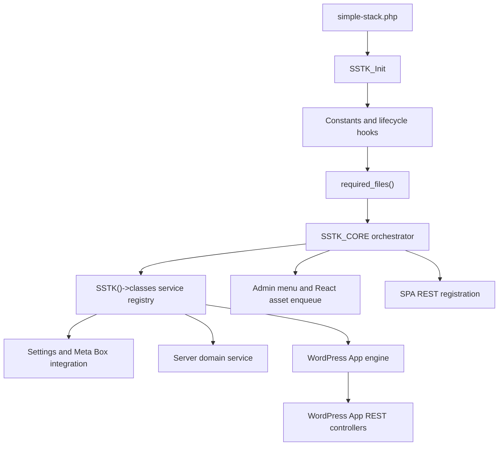

# Backend Architecture

<cite>
**Referenced Files in This Document**
- [Plugin entry point](file://simple-stack.php)
- [Core bootstrap and orchestrator](file://includes/core/simple-stack.php)
- [Service registration](file://includes/core/functions-classes.php)
- [Base class](file://includes/core/class-sstk-base.php)
- [Settings](file://includes/core/class-sstk-settings.php)
- [SPA REST registrar](file://includes/core/api/class-sstk-rest-api.php)
- [WordPress App engine](file://includes/core/apps/wordpress-app/class-wordpress-app.php)
</cite>

## Overview

Simple Stack is a WordPress plugin with a native `wp-admin` React client. PHP remains the control
plane: it owns provider APIs, SSH command execution, provisioning, custom post types, settings,
permissions and logs. The codebase uses the inherited `SSTK_` class convention and explicit file
loading; PHP namespaces and PSR-4 autoloading are deferred to a later refactor.

## Bootstrap layers

`SSTK_Init` defines constants, registers activation/deactivation behavior and loads required files.
`SSTK_CORE` wires hooks, post types, roles, admin screens and the React bundle. Global accessors in
`functions-classes.php` lazily attach domain services to the orchestrator.

## Core domain components

- `SSTK_Base`: shared utilities used by app and post classes.
- `SSTK_Settings`: Meta Box settings pages and option access.
- `SSTK_Server`: server records and provider lifecycle operations.
- `SSTK_APP`: base application abstraction and command callback contract.
- `SSTK_WORDPRESS_APP`: WordPress-specific tabs, script handlers, SSH operations and controllers.
- Post/log classes: custom post types for servers, sites, providers, teams and operational logs.

Meta Box is required for settings reads. `sstk_get_early_option()` reads the underlying WordPress
option directly and is used where Meta Box fields are not registered for the current REST or cron
request.

## REST architecture

The backend exposes two controller families under `simple-stack/v1`:

1. **SPA family** — `SSTK_REST_API` registers servers, sites, logs, tabs, providers and security.
   `SSTK_REST_Controller_Base` requires `manage_options`, wraps responses and redacts data.
2. **WordPress App family** — `SSTK_WORDPRESS_APP` registers server, site, domain-change, clone and
   task controllers. `SSTK_REST_API_Controller_Base` uses `sstk_is_admin()` and exception wrapping.

Tasks belong to the WordPress App family, not the SPA registrar. Two public callbacks share the
namespace: provisioning command completion uses a pending-command transient, and the GitHub
webhook uses HMAC-SHA1 with a non-empty per-site secret.

## Admin presentation

`enqueue_sstk_app()` loads the Vite manifest and enqueues the bundle only on Simple Stack screens.
The inline bootstrap provides the REST URL, nonce, namespace, version and initial hash route.
`TabRenderer` consumes PHP tab schemas, so the React client adapts the existing tab engine rather
than replacing its business logic.

## Provisioning architecture

The WordPress App engine builds SSH commands from `scripts/v2`. Raw `.txt` files are Bash; wrapper
`.txt` files are PHP templates with placeholders. `9999-common-functions.txt` supplies shared OLS,
database, PHP, firewall and site helpers. Checkpoints support resumable server preparation.

The runtime stack is OpenLiteSpeed-only on Ubuntu 24.04/26.04. There is no active v1 tree or script
version selection.

## Data portability

Cross-site data sync is retired. The service class, settings tab, AJAX handlers, cron wiring and
remote receiver are absent. There is no import endpoint or compatibility layer; each control-plane
site is configured explicitly.

## Extension model

Extensions use WordPress actions and filters, the `SSTK()->classes` registry and the existing app
interfaces. New REST code must choose the correct controller base and preserve its authorization
and response contract. New provisioning behavior belongs in the v2 script pipeline and must remain
OLS-only.
