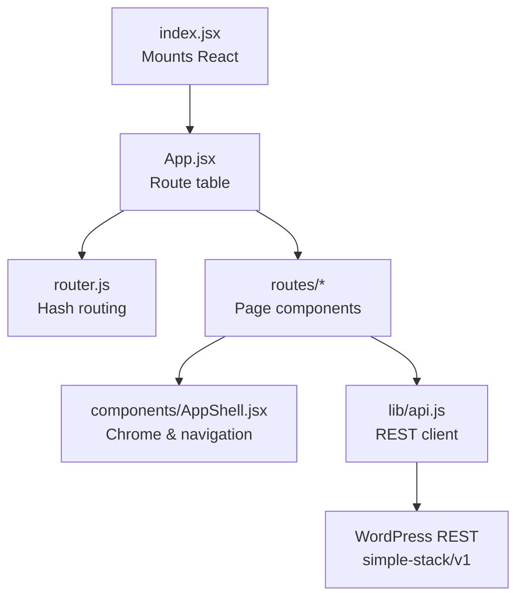
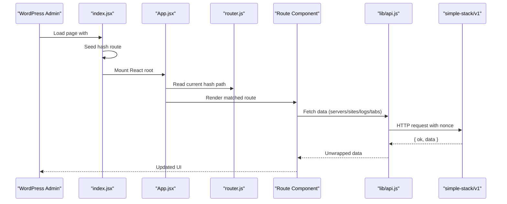
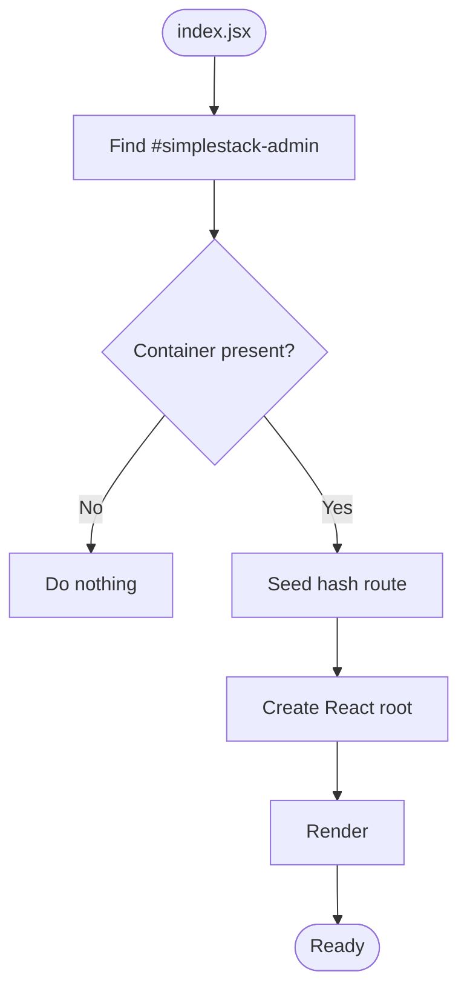
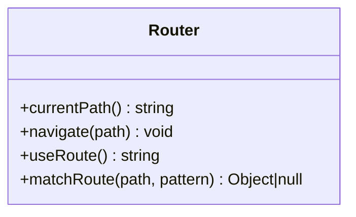
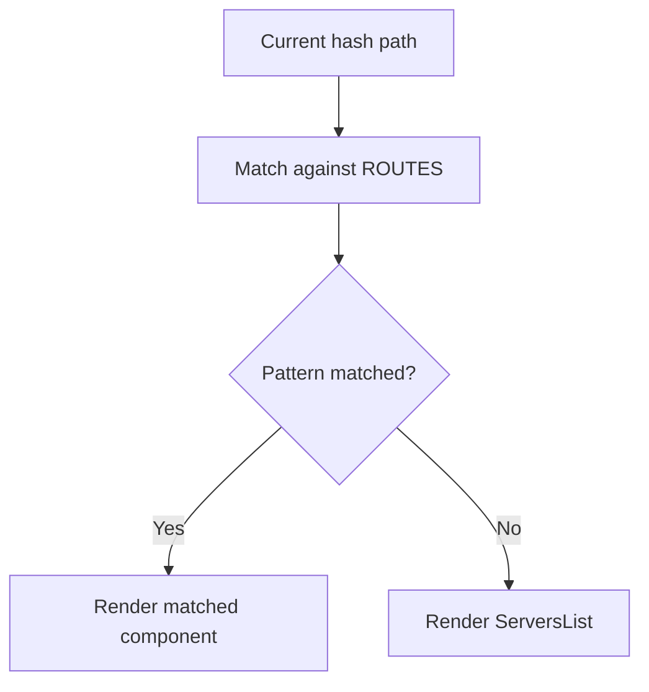
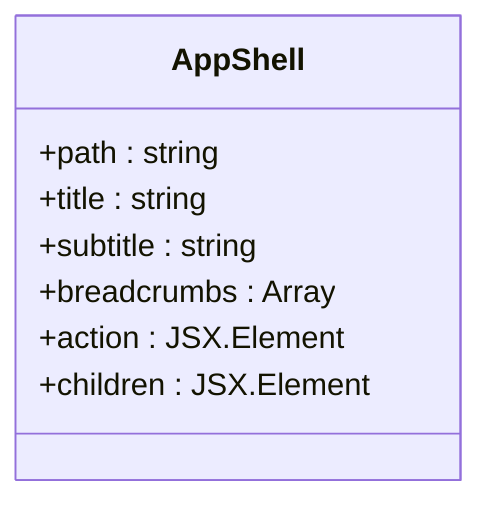
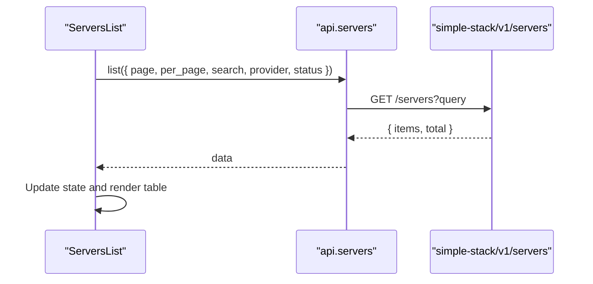
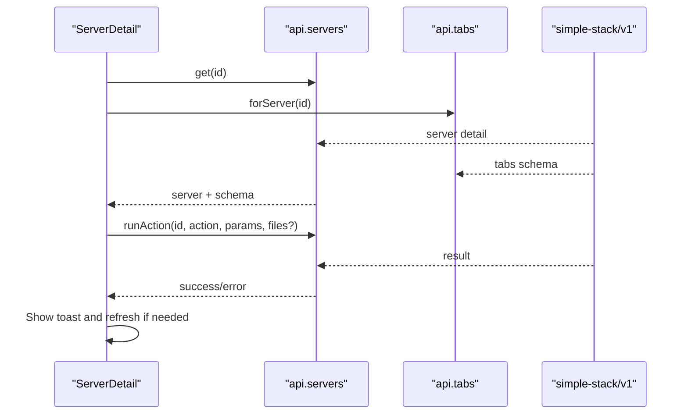
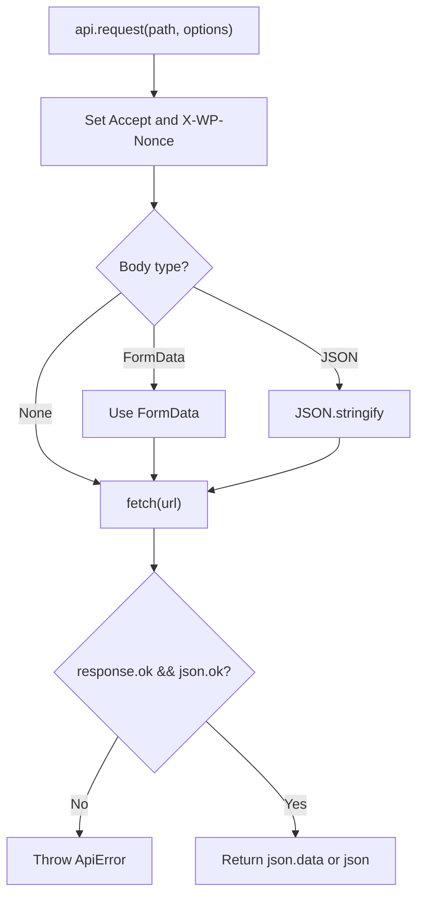
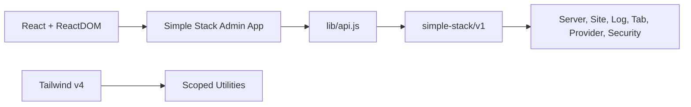

# Frontend Architecture

<cite>
**Referenced Files in This Document**
- [src/admin/index.jsx](file://src/admin/index.jsx)
- [src/admin/App.jsx](file://src/admin/App.jsx)
- [src/admin/lib/router.js](file://src/admin/lib/router.js)
- [src/admin/components/AppShell.jsx](file://src/admin/components/AppShell.jsx)
- [src/admin/routes/ServersList.jsx](file://src/admin/routes/ServersList.jsx)
- [src/admin/routes/ServerDetail.jsx](file://src/admin/routes/ServerDetail.jsx)
- [src/admin/lib/api.js](file://src/admin/lib/api.js)
- [vite.config.js](file://vite.config.js)
- [tailwind.config.js](file://tailwind.config.js)
- [package.json](file://package.json)
- [includes/core/api/class-sstk-rest-api.php](file://includes/core/api/class-sstk-rest-api.php)
</cite>

## Table of Contents
1. [Introduction](#introduction)
2. [Project Structure](#project-structure)
3. [Core Components](#core-components)
4. [Architecture Overview](#architecture-overview)
5. [Detailed Component Analysis](#detailed-component-analysis)
6. [Dependency Analysis](#dependency-analysis)
7. [Performance Considerations](#performance-considerations)
8. [Troubleshooting Guide](#troubleshooting-guide)
9. [Conclusion](#conclusion)

## Introduction
This document explains the Simple Stack React frontend architecture that runs inside the WordPress admin area. The application is a single-page interface mounted at `#simplestack-admin`, built with Vite, styled with Tailwind CSS v4, and communicating with the plugin through the `simple-stack/v1` REST namespace. It replaces legacy PHP-rendered screens for servers, sites, providers, and activity while preserving existing tab schemas and action flows.

Key characteristics:
- Root entry mounts React into a container only when present on the page.
- Routing uses hash-based paths so it coexists with WordPress admin navigation.
- UI components are modular under `src/admin/components` and route pages live under `src/admin/routes`.
- API calls go through a typed client that unwraps the PHP response envelope.
- Build output is committed to `assets/dist/`, removing the need for Node tooling on production installs.

## Project Structure
The frontend lives under `src/admin`:
- `index.jsx` boots React and seeds the initial hash route.
- `App.jsx` defines the route table and renders the matched page.
- `lib/router.js` provides hash routing primitives.
- `lib/api.js` wraps REST requests to `simple-stack/v1`.
- `components/` holds reusable UI building blocks.
- `routes/` contains page-level components.
- `styles/index.css` is the Tailwind entry point.

**Diagram sources**
- [src/admin/index.jsx:15-46](file://src/admin/index.jsx#L15-L46)
- [src/admin/App.jsx:25-69](file://src/admin/App.jsx#L25-L69)
- [src/admin/lib/router.js:16-83](file://src/admin/lib/router.js#L16-L83)
- [src/admin/lib/api.js:153-290](file://src/admin/lib/api.js#L153-L290)
- [includes/core/api/class-sstk-rest-api.php:21-37](file://includes/core/api/class-sstk-rest-api.php#L21-L37)

**Section sources**
- [src/admin/index.jsx:1-47](file://src/admin/index.jsx#L1-L47)
- [src/admin/App.jsx:1-70](file://src/admin/App.jsx#L1-L70)
- [src/admin/lib/router.js:1-84](file://src/admin/lib/router.js#L1-L84)
- [src/admin/lib/api.js:1-292](file://src/admin/lib/api.js#L1-L292)

## Core Components
- Application shell (`AppShell`) provides header, primary navigation, breadcrumbs, and main content area. It is intentionally thin because WordPress owns the admin chrome.
- Route pages such as `ServersList` and `ServerDetail` compose shell, data fetching, tables, modals, drawers, and toast notifications.
- Shared UI primitives include buttons, cards, data tables, modals, secret fields, log drawers, tabs, and toasts.

Component responsibilities:
- `AppShell`: layout, active navigation state, breadcrumb rendering, and accessibility attributes.
- `ServersList`: server listing, filtering, pagination, provider selection, and navigation to detail or provisioning.
- `ServerDetail`: server overview, schema-driven tabs, actions, live log drawer, delete confirmation, and error/loading states.

Styling approach:
- Tailwind utilities scoped to `#simplestack-admin` via the Tailwind configuration.
- Preflight is disabled to avoid restyling the entire WordPress admin.
- Brand colors, ink tones, surface tokens, and typography are extended in the Tailwind config.

Build pipeline:
- Vite bundles React and the app entry into `assets/dist/`.
- Tailwind v4 is applied through the Vite plugin.
- CSS is emitted as a single stylesheet for the app.
- Output filenames include hashes for cache busting.

State management approach:
- Local component state drives UI state (loading, errors, form inputs).
- Data fetching is performed directly in components using the `api` client.
- A global toast context provides user feedback across routes.

API communication patterns:
- All requests go through `lib/api.js`, which sets headers, builds URLs, handles JSON and multipart bodies, and throws typed errors.
- Responses are unwrapped from the PHP `{ ok, data }` envelope before reaching components.
- Tab actions support both JSON and file uploads by switching to `FormData`.

Integration with WordPress:
- The React app mounts only when `#simplestack-admin` exists.
- Initial route is seeded from `data-route` or the bootstrap object.
- Nonce is read from `window.simplestackAdmin` and attached to REST requests.
- The backend registers the `simple-stack/v1` namespace and controllers.

**Section sources**
- [src/admin/components/AppShell.jsx:1-88](file://src/admin/components/AppShell.jsx#L1-L88)
- [src/admin/routes/ServersList.jsx:1-218](file://src/admin/routes/ServersList.jsx#L1-L218)
- [src/admin/routes/ServerDetail.jsx:1-250](file://src/admin/routes/ServerDetail.jsx#L1-L250)
- [tailwind.config.js:1-85](file://tailwind.config.js#L1-L85)
- [vite.config.js:1-45](file://vite.config.js#L1-L45)
- [src/admin/lib/api.js:1-292](file://src/admin/lib/api.js#L1-L292)
- [includes/core/api/class-sstk-rest-api.php:1-136](file://includes/core/api/class-sstk-rest-api.php#L1-L136)

## Architecture Overview
The frontend follows a layered structure:
- Bootstrap layer: `index.jsx` mounts React and initializes the hash route.
- Routing layer: `App.jsx` matches hash paths against a static route table.
- Page layer: route components render domain-specific views.
- UI layer: shared components provide consistent interactions and visuals.
- Data layer: `lib/api.js` communicates with the WordPress REST API.

**Diagram sources**
- [src/admin/index.jsx:15-46](file://src/admin/index.jsx#L15-L46)
- [src/admin/App.jsx:25-69](file://src/admin/App.jsx#L25-L69)
- [src/admin/lib/router.js:16-83](file://src/admin/lib/router.js#L16-L83)
- [src/admin/lib/api.js:67-120](file://src/admin/lib/api.js#L67-L120)
- [includes/core/api/class-sstk-rest-api.php:51-99](file://includes/core/api/class-sstk-rest-api.php#L51-L99)

## Detailed Component Analysis

### App Entry and Bootstrapping
Responsibilities:
- Locate the mount container.
- Seed the hash route if none exists.
- Create the React root and render `App` with bootstrap config.

Behavior highlights:
- Safe mounting prevents React from touching wp-admin when the container is absent.
- Existing hash takes precedence over the PHP-provided route.

**Diagram sources**
- [src/admin/index.jsx:15-46](file://src/admin/index.jsx#L15-L46)

**Section sources**
- [src/admin/index.jsx:1-47](file://src/admin/index.jsx#L1-L47)

### Routing Layer
Responsibilities:
- Provide `useRoute`, `navigate`, and `matchRoute`.
- Keep deep links working without interfering with WordPress history.

Implementation notes:
- `useRoute` subscribes to `hashchange` and returns the normalized path.
- `navigate` updates `window.location.hash`.
- `matchRoute` supports parameterized segments like `:id`.

**Diagram sources**
- [src/admin/lib/router.js:16-83](file://src/admin/lib/router.js#L16-L83)

**Section sources**
- [src/admin/lib/router.js:1-84](file://src/admin/lib/router.js#L1-L84)

### Root Application and Route Table
Responsibilities:
- Define the route table mapping patterns to components.
- Wrap the app in a toast provider.
- Fallback to the servers list for unknown routes.

Routing examples:
- `/servers`, `/sites`, `/settings/providers`, `/activity`.
- Parameterized routes like `/servers/:id` and `/sites/:id/security`.

**Diagram sources**
- [src/admin/App.jsx:25-54](file://src/admin/App.jsx#L25-L54)

**Section sources**
- [src/admin/App.jsx:1-70](file://src/admin/App.jsx#L1-L70)

### Application Shell
Responsibilities:
- Render header, title, subtitle, and optional action button.
- Provide primary navigation between sections.
- Render breadcrumbs with clickable items.
- Wrap page content in `<main>`.

Design decisions:
- Navigation uses the router’s `navigate` function.
- Active state is computed from the current path.
- Styling uses Tailwind utilities scoped to the app container.

**Diagram sources**
- [src/admin/components/AppShell.jsx:10-87](file://src/admin/components/AppShell.jsx#L10-L87)

**Section sources**
- [src/admin/components/AppShell.jsx:1-88](file://src/admin/components/AppShell.jsx#L1-L88)

### Servers List Page
Responsibilities:
- Fetch server listings with search, provider, and status filters.
- Display results in a data table with sortable columns.
- Provide pagination controls.
- Navigate to provision or detail pages.

Data flow:
- Calls `api.servers.list` with query parameters.
- Loads available providers once for filtering.
- Uses local state for loading, error, and pagination.

**Diagram sources**
- [src/admin/routes/ServersList.jsx:32-74](file://src/admin/routes/ServersList.jsx#L32-L74)
- [src/admin/lib/api.js:153-160](file://src/admin/lib/api.js#L153-L160)

**Section sources**
- [src/admin/routes/ServersList.jsx:1-218](file://src/admin/routes/ServersList.jsx#L1-L218)

### Server Detail Page
Responsibilities:
- Load server details and tab schema concurrently.
- Render overview metadata, site count card, and schema-driven tabs.
- Open live log drawer and confirm destructive actions.
- Dispatch tab actions and refresh when required.

Action handling:
- Wraps action dispatch with toast feedback.
- Supports file uploads for specific tabs through multipart requests.
- Navigates back to the list after deletion.

**Diagram sources**
- [src/admin/routes/ServerDetail.jsx:39-72](file://src/admin/routes/ServerDetail.jsx#L39-L72)
- [src/admin/lib/api.js:186-190](file://src/admin/lib/api.js#L186-L190)

**Section sources**
- [src/admin/routes/ServerDetail.jsx:1-250](file://src/admin/routes/ServerDetail.jsx#L1-L250)

### API Client
Responsibilities:
- Centralize REST URL construction and request options.
- Attach nonces and set appropriate content types.
- Handle JSON and multipart bodies.
- Throw typed errors with codes and statuses.
- Expose resource methods for servers, sites, tabs, logs, and providers.

Error model:
- `ApiError` carries message, code, and HTTP status.
- Network failures and HTTP failures are distinguished.

**Diagram sources**
- [src/admin/lib/api.js:67-120](file://src/admin/lib/api.js#L67-L120)

**Section sources**
- [src/admin/lib/api.js:1-292](file://src/admin/lib/api.js#L1-L292)

### Build System and Styling
Vite configuration:
- Uses `@vitejs/plugin-react` and `@tailwindcss/vite`.
- Outputs to `assets/dist/` with hashed filenames.
- Disables CSS code splitting to publish one stylesheet for the app.
- Targets ES2020 and disables sourcemaps for production.

Tailwind configuration:
- Scans `src/admin/**/*.{js,jsx}` for utility usage.
- Applies `important: '#simplestack-admin'` to scope styles.
- Disables preflight to avoid affecting WordPress admin chrome.
- Extends brand colors, ink tones, surface tokens, fonts, and border radius.

Package scripts:
- `dev` starts Vite development server.
- `build` produces production assets.
- `verify:css` runs CSS isolation verification.
- `verify` runs build and verification together.

**Section sources**
- [vite.config.js:1-45](file://vite.config.js#L1-L45)
- [tailwind.config.js:1-85](file://tailwind.config.js#L1-L85)
- [package.json:1-25](file://package.json#L1-L25)

## Dependency Analysis
Frontend dependencies:
- React and ReactDOM for UI runtime.
- TanStack Query is listed but not used by the analyzed routes; current data fetching relies on local state and direct API calls.

Backend integration:
- The PHP REST API registers controllers for servers, sites, logs, tabs, providers, and security.
- The React client targets the `simple-stack/v1` namespace.

**Diagram sources**
- [package.json:13-22](file://package.json#L13-L22)
- [includes/core/api/class-sstk-rest-api.php:30-37](file://includes/core/api/class-sstk-rest-api.php#L30-L37)

**Section sources**
- [package.json:1-25](file://package.json#L1-L25)
- [includes/core/api/class-sstk-rest-api.php:1-136](file://includes/core/api/class-sstk-rest-api.php#L1-L136)

## Performance Considerations
- Single bundle strategy: CSS is not split per chunk, reducing stylesheet overhead and simplifying asset references.
- Hashed filenames enable long-term caching while allowing cache busting on rebuilds.
- Targeting ES2020 avoids polyfills and keeps the bundle lean.
- No external React copy: bundling React ensures reproducible builds and avoids version drift with WordPress-provided libraries.
- Lazy loading: currently not implemented; adding route-level lazy loading can reduce initial payload for rarely visited pages.
- Data fetching: consider caching strategies (e.g., TanStack Query) to deduplicate repeated requests and manage background refreshes.
- Asset management: images and other static assets should be imported through Vite to benefit from hashing and optimization.

[No sources needed since this section provides general guidance]

## Troubleshooting Guide
Common issues and resolutions:
- App does not mount: ensure the page includes the `#simplestack-admin` container and that the built script is enqueued.
- Wrong initial route: verify `data-route` or the bootstrap object’s `route` value; an existing hash overrides the seeded route.
- REST requests fail with authentication errors: confirm the nonce is present in `window.simplestackAdmin` and that the request includes `X-WP-Nonce`.
- Styles leak into WordPress admin: check that Tailwind’s `important` selector remains `#simplestack-admin` and preflight is disabled.
- CSS not applied: run `npm run verify` to rebuild and validate CSS isolation.
- Unknown route shows blank screen: the router falls back to the servers list; update the route table if new pages are added.

Operational checks:
- Use the browser network panel to inspect requests to `/wp-json/simple-stack/v1/...`.
- Inspect the response envelope to confirm `{ ok, data }` wrapping.
- Validate that uploaded files use multipart requests when required by tab handlers.

**Section sources**
- [src/admin/index.jsx:15-46](file://src/admin/index.jsx#L15-L46)
- [src/admin/lib/api.js:67-120](file://src/admin/lib/api.js#L67-L120)
- [tailwind.config.js:11-20](file://tailwind.config.js#L11-L20)
- [package.json:7-12](file://package.json#L7-L12)

## Conclusion
Simple Stack’s frontend is a focused React application designed to integrate cleanly with WordPress admin. It uses hash routing to coexist with WordPress navigation, a typed REST client for reliable API communication, and Tailwind v4 for scoped styling. The build system prioritizes reproducibility and simplicity by bundling React and emitting a single stylesheet. Future enhancements can introduce lazy-loaded routes, centralized caching, and richer error boundaries while preserving the current composition patterns and integration points.

[No sources needed since this section summarizes without analyzing specific files]