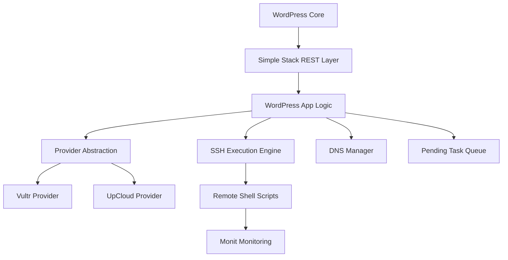
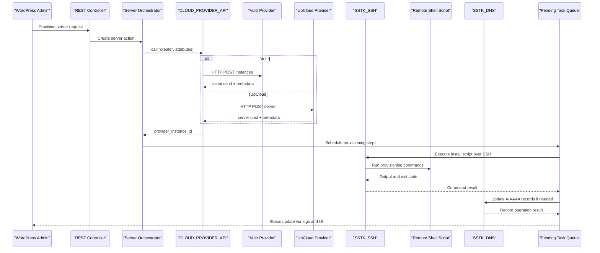
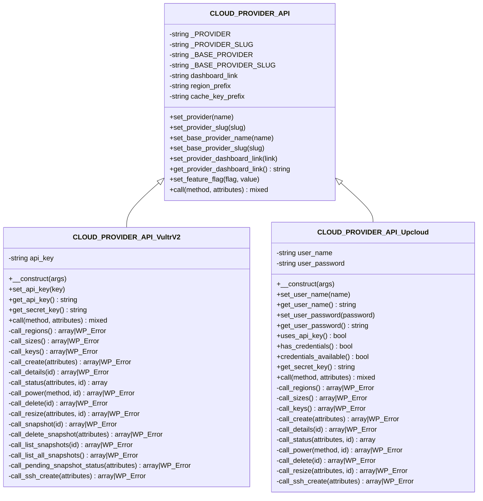
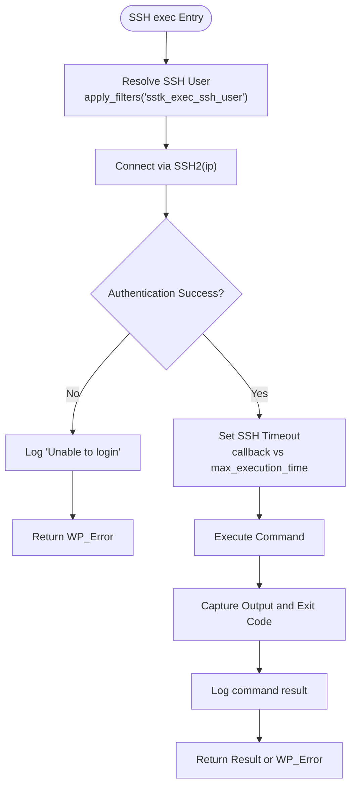
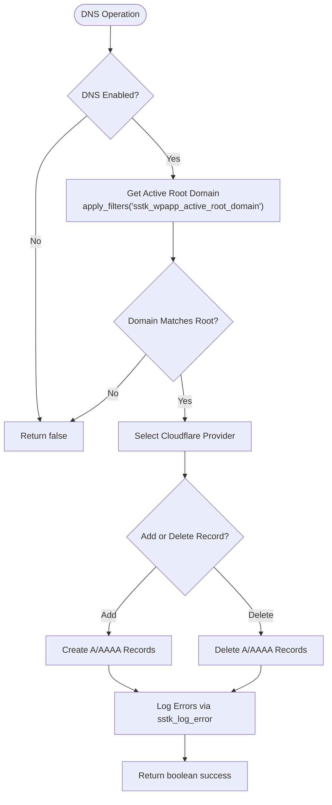
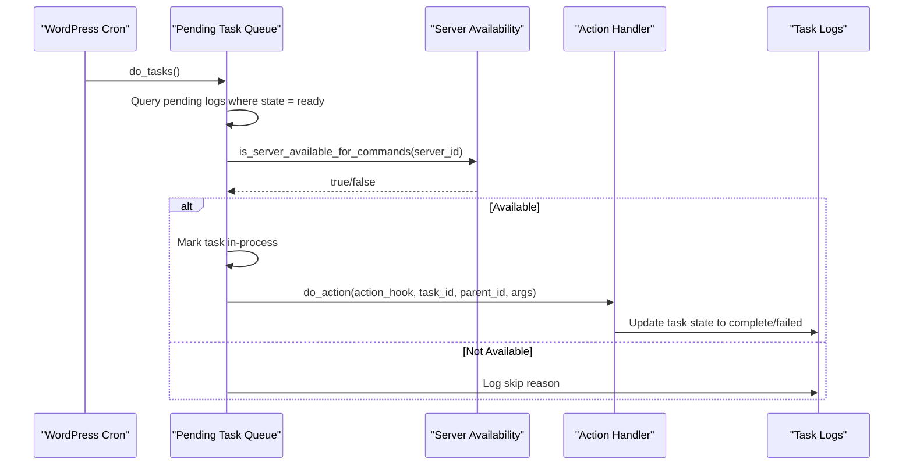
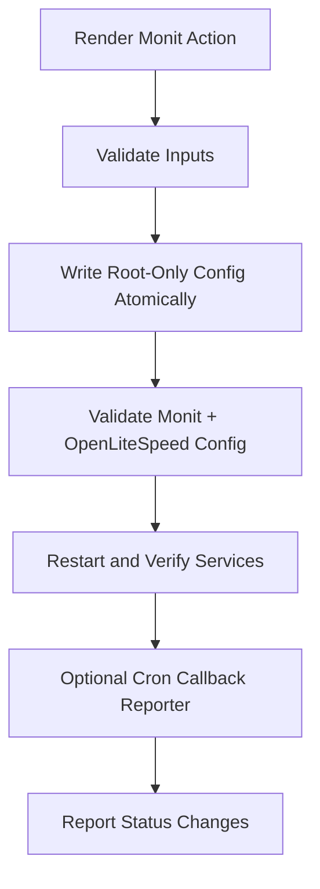
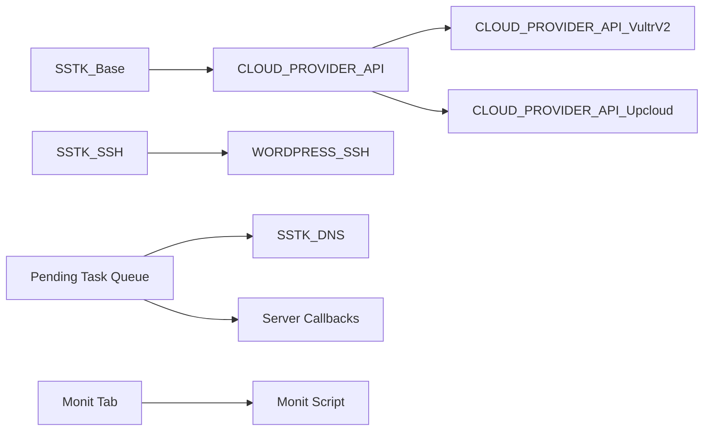

# Integration Patterns

<cite>
**Referenced Files in This Document**   
- [README.md](file://README.md)
- [class-sstk-base.php](file://includes/core/class-sstk-base.php)
- [class-cloud-provider-api.php](file://includes/core/providers/class-cloud-provider-api.php)
- [class-vultr-v2.php](file://includes/core/providers/class-vultr-v2.php)
- [class-upcloud.php](file://includes/core/providers/class-upcloud.php)
- [class-sstk-ssh.php](file://includes/core/apps/class-sstk-ssh.php)
- [class-wordpress-ssh.php](file://includes/core/apps/wordpress-app/class-wordpress-ssh.php)
- [class-sstk-dns.php](file://includes/core/class-sstk-dns.php)
- [class-sstk-dns-provider.php](file://includes/core/custom-table/class-sstk-dns-provider.php)
- [class-sstk-dns-zone.php](file://includes/core/custom-table/class-sstk-dns-zone.php)
- [class-sstk-posts-pending-tasks-log.php](file://includes/core/class-sstk-posts-pending-tasks-log.php)
- [callbacks.php](file://includes/core/apps/wordpress-app/tabs-server/callbacks.php)
- [monit.php](file://includes/core/apps/wordpress-app/tabs-server/monit.php)
- [20-monit.txt](file://includes/core/apps/wordpress-app/scripts/v2/raw/20-monit.txt)
</cite>

## Table of Contents
1. [Introduction](#introduction)
2. [Project Structure](#project-structure)
3. [Core Components](#core-components)
4. [Architecture Overview](#architecture-overview)
5. [Detailed Component Analysis](#detailed-component-analysis)
6. [Dependency Analysis](#dependency-analysis)
7. [Performance Considerations](#performance-considerations)
8. [Troubleshooting Guide](#troubleshooting-guide)
9. [Conclusion](#conclusion)

## Introduction
Simple Stack is a WordPress plugin that provisions cloud servers, installs a WordPress stack over SSH, and manages those servers and sites from the WordPress admin dashboard. It integrates with Vultr API v2 and UpCloud API 1.3, executes shell scripts on remote servers, manages DNS records for Cloudflare, and uses WordPress hooks to coordinate asynchronous tasks.

The integration patterns documented here focus on:
- Provider abstraction for multiple cloud services.
- An SSH execution engine for remote operations and script automation.
- DNS management coordination across providers.
- Event-driven task processing using WordPress hooks.
- Error handling, retry/backstop behavior, and monitoring integration points.
- The boundary between local WordPress operations and remote server management.

## Project Structure
At a high level, Simple Stack organizes its code around:
- A base class and shared utilities.
- A provider abstraction layer under `includes/core/providers`.
- Application-specific logic under `includes/core/apps`, including SSH helpers and WordPress app tabs.
- DNS management under `includes/core` and custom table models under `includes/core/custom-table`.
- Background task orchestration through pending log posts.
- Remote shell scripts under `includes/core/apps/wordpress-app/scripts`.

**Diagram sources**
- [class-sstk-base.php:1-200](file://includes/core/class-sstk-base.php#L1-L200)
- [class-cloud-provider-api.php:15-120](file://includes/core/providers/class-cloud-provider-api.php#L15-L120)
- [class-vultr-v2.php:30-127](file://includes/core/providers/class-vultr-v2.php#L30-L127)
- [class-upcloud.php:33-128](file://includes/core/providers/class-upcloud.php#L33-L128)
- [class-sstk-ssh.php:23-93](file://includes/core/apps/class-sstk-ssh.php#L23-L93)
- [class-sstk-dns.php:16-34](file://includes/core/class-sstk-dns.php#L16-L34)
- [class-sstk-posts-pending-tasks-log.php:809-866](file://includes/core/class-sstk-posts-pending-tasks-log.php#L809-L866)
- [20-monit.txt](file://includes/core/apps/wordpress-app/scripts/v2/raw/20-monit.txt)

**Section sources**
- [README.md:1-38](file://README.md#L1-L38)

## Core Components
This section summarizes the main integration components and their responsibilities:

- **Base class**: Provides shared functionality used by other core classes.
- **Provider abstraction**: Defines a uniform interface for cloud providers; concrete implementations handle Vultr and UpCloud specifics.
- **SSH execution engine**: Executes commands and file transfers over SSH, logs operations, and supports callbacks for long-running tasks.
- **DNS manager**: Coordinates domain record creation, lookup, and deletion, currently focused on Cloudflare but extensible via filters.
- **Pending task queue**: Stores background jobs as private posts, checks server availability, and dispatches actions via WordPress hooks.
- **Monitoring integration**: Installs and configures Monit on remote servers, periodically compares logs, and reports status changes back to a callback URL.

**Section sources**
- [class-sstk-base.php:1-200](file://includes/core/class-sstk-base.php#L1-L200)
- [class-cloud-provider-api.php:15-120](file://includes/core/providers/class-cloud-provider-api.php#L15-L120)
- [class-sstk-ssh.php:23-93](file://includes/core/apps/class-sstk-ssh.php#L23-L93)
- [class-sstk-dns.php:16-109](file://includes/core/class-sstk-dns.php#L16-L109)
- [class-sstk-posts-pending-tasks-log.php:809-866](file://includes/core/class-sstk-posts-pending-tasks-log.php#L809-L866)
- [20-monit.txt](file://includes/core/apps/wordpress-app/scripts/v2/raw/20-monit.txt)

## Architecture Overview
Simple Stack’s architecture separates concerns into layers:

- **Local WordPress layer**: Admin UI, REST endpoints, settings, and task orchestration live inside WordPress.
- **Provider layer**: Abstracts cloud APIs so higher layers do not care whether a server is on Vultr or UpCloud.
- **SSH layer**: Encapsulates remote command execution, key handling, and SFTP operations.
- **Script layer**: Bash scripts provision and configure OpenLiteSpeed, PHP, databases, caching, security, and monitoring.
- **DNS layer**: Manages domain records against configured DNS providers.
- **Task layer**: Uses WordPress cron and post-based queues to run long-running operations asynchronously.

**Diagram sources**
- [class-vultr-v2.php:183-249](file://includes/core/providers/class-vultr-v2.php#L183-L249)
- [class-upcloud.php:310-372](file://includes/core/providers/class-upcloud.php#L310-L372)
- [class-sstk-ssh.php:45-93](file://includes/core/apps/class-sstk-ssh.php#L45-L93)
- [class-sstk-dns.php:88-109](file://includes/core/class-sstk-dns.php#L88-L109)
- [class-sstk-posts-pending-tasks-log.php:809-866](file://includes/core/class-sstk-posts-pending-tasks-log.php#L809-L866)

## Detailed Component Analysis

### Provider Abstraction Pattern
The provider abstraction defines a common contract for cloud providers. Concrete classes implement this contract while hiding provider-specific authentication, payload construction, error mapping, and state interpretation.

Key aspects:
- Base class stores provider name, slug, dashboard link, region prefix, cache keys, and feature flags.
- Concrete providers set credentials, features, and map provider responses to a normalized shape.
- Both Vultr and UpCloud implement `call()` with method routing, validation, caching for safe reads, and consistent return structures.
- Power operations are asynchronous; completion is inferred from provider state plus an elapsed-time backstop transient.

**Diagram sources**
- [class-cloud-provider-api.php:15-120](file://includes/core/providers/class-cloud-provider-api.php#L15-L120)
- [class-vultr-v2.php:30-127](file://includes/core/providers/class-vultr-v2.php#L30-L127)
- [class-upcloud.php:33-128](file://includes/core/providers/class-upcloud.php#L33-L128)

How new integrations can be added:
- Extend `CLOUD_PROVIDER_API`.
- Implement `call()` with method routing and validation.
- Provide credential handling and feature flags.
- Normalize provider responses to include fields like `provider_instance_id`, `name`, `created`, and `actions`.
- Handle asynchronous power operations with state inference and transient backstops.

**Section sources**
- [class-cloud-provider-api.php:15-120](file://includes/core/providers/class-cloud-provider-api.php#L15-L120)
- [class-vultr-v2.php:183-249](file://includes/core/providers/class-vultr-v2.php#L183-L249)
- [class-upcloud.php:310-372](file://includes/core/providers/class-upcloud.php#L310-L372)

### SSH Execution Engine
The SSH execution engine provides a reusable way to execute commands and transfer files on remote servers. It uses phpseclib3, supports key/password login, configurable timeouts, and logging hooks.

Key behaviors:
- `exec()` connects via SSH, optionally adjusts timeout based on PHP execution limits or callback usage, runs a command, captures output, and logs errors.
- `download()` and `upload()` wrap SFTP operations with similar logging and error handling.
- User override filter allows different default users per provider (for example, AWS-style non-root defaults).
- WordPress app SSH helper resolves provider-specific root user, encrypted key material, and IP address before invoking base SSH methods.

**Diagram sources**
- [class-sstk-ssh.php:45-93](file://includes/core/apps/class-sstk-ssh.php#L45-L93)
- [class-sstk-ssh.php:166-241](file://includes/core/apps/class-sstk-ssh.php#L166-L241)
- [class-wordpress-ssh.php:78-135](file://includes/core/apps/wordpress-app/class-wordpress-ssh.php#L78-L135)

Integration notes:
- Commands are logged via `do_action('sstk_log_error', ...)` at debug, trace, and error levels.
- Long-running commands should use callbacks to keep connection alive and provide progress updates.
- File operations return numeric codes or strings and should be wrapped by application logic to convert them into user-friendly messages.

**Section sources**
- [class-sstk-ssh.php:45-93](file://includes/core/apps/class-sstk-ssh.php#L45-L93)
- [class-sstk-ssh.php:166-241](file://includes/core/apps/class-sstk-ssh.php#L166-L241)
- [class-wordpress-ssh.php:78-135](file://includes/core/apps/wordpress-app/class-wordpress-ssh.php#L78-L135)

### DNS Management Integration
DNS management coordinates domain operations against a configured DNS provider. Currently, it focuses on Cloudflare but exposes filters for extensibility.

Responsibilities:
- Generate temporary subdomains.
- Determine active root domain via filter.
- Add, delete, and query A and AAAA records.
- Log errors when Cloudflare requests fail.

**Diagram sources**
- [class-sstk-dns.php:45-109](file://includes/core/class-sstk-dns.php#L45-L109)
- [class-sstk-dns.php:158-261](file://includes/core/class-sstk-dns.php#L158-L261)
- [class-sstk-dns.php:359-459](file://includes/core/class-sstk-dns.php#L359-L459)

Extensibility:
- Use `sstk_wpapp_active_root_domain` to change the root domain source.
- Replace Cloudflare implementation with another provider by adding conditional logic and filters.
- Store DNS provider configuration in custom tables for multi-tenant environments.

**Section sources**
- [class-sstk-dns.php:45-109](file://includes/core/class-sstk-dns.php#L45-L109)
- [class-sstk-dns.php:158-261](file://includes/core/class-sstk-dns.php#L158-L261)
- [class-sstk-dns.php:359-459](file://includes/core/class-sstk-dns.php#L359-L459)

### Event-Driven Architecture Using WordPress Hooks
Asynchronous task processing is implemented through WordPress hooks and a pending task queue backed by private posts.

Core flow:
- Background processes scan for pending tasks with state `ready`.
- For each task, the orchestrator checks server availability.
- If available, it marks the task `in-process`, adds context, and fires the registered action hook.
- The hook handler performs the actual work and updates the task state to complete or failed.

**Diagram sources**
- [class-sstk-posts-pending-tasks-log.php:809-866](file://includes/core/class-sstk-posts-pending-tasks-log.php#L809-L866)
- [callbacks.php:936-953](file://includes/core/apps/wordpress-app/tabs-server/callbacks.php#L936-L953)
- [callbacks.php:1118-1125](file://includes/core/apps/wordpress-app/tabs-server/callbacks.php#L1118-L1125)

Examples of hook-driven operations:
- Removing server status callbacks.
- Running status cron background tasks.
- Updating themes and plugins.

**Section sources**
- [class-sstk-posts-pending-tasks-log.php:809-866](file://includes/core/class-sstk-posts-pending-tasks-log.php#L809-L866)
- [callbacks.php:936-953](file://includes/core/apps/wordpress-app/tabs-server/callbacks.php#L936-L953)
- [callbacks.php:1118-1125](file://includes/core/apps/wordpress-app/tabs-server/callbacks.php#L1118-L1125)

### Monitoring Integration Points
Monitoring is integrated both locally and remotely:
- The server Monit tab validates operator input, renders the fixed-v2 `monit.txt` wrapper, executes it over SSH, and evaluates action-specific success output.
- The raw script validates inputs, writes configuration atomically with root-only credential files, binds the Monit HTTP daemon to loopback, validates Monit and OpenLiteSpeed configuration, restarts and verifies both services, and can install a cron callback reporter with state under `/etc/simple-stack/`.

**Diagram sources**
- [monit.php](file://includes/core/apps/wordpress-app/tabs-server/monit.php)
- [20-monit.txt](file://includes/core/apps/wordpress-app/scripts/v2/raw/20-monit.txt)

**Section sources**
- [monit.php](file://includes/core/apps/wordpress-app/tabs-server/monit.php)
- [20-monit.txt](file://includes/core/apps/wordpress-app/scripts/v2/raw/20-monit.txt)

## Dependency Analysis
The following diagram shows how major components depend on each other:

**Diagram sources**
- [class-sstk-base.php:1-200](file://includes/core/class-sstk-base.php#L1-L200)
- [class-cloud-provider-api.php:15-120](file://includes/core/providers/class-cloud-provider-api.php#L15-L120)
- [class-vultr-v2.php:30-127](file://includes/core/providers/class-vultr-v2.php#L30-L127)
- [class-upcloud.php:33-128](file://includes/core/providers/class-upcloud.php#L33-L128)
- [class-sstk-ssh.php:23-93](file://includes/core/apps/class-sstk-ssh.php#L23-L93)
- [class-wordpress-ssh.php:22-135](file://includes/core/apps/wordpress-app/class-wordpress-ssh.php#L22-L135)
- [class-sstk-dns.php:16-109](file://includes/core/class-sstk-dns.php#L16-L109)
- [class-sstk-posts-pending-tasks-log.php:809-866](file://includes/core/class-sstk-posts-pending-tasks-log.php#L809-L866)
- [callbacks.php:936-953](file://includes/core/apps/wordpress-app/tabs-server/callbacks.php#L936-L953)
- [monit.php](file://includes/core/apps/wordpress-app/tabs-server/monit.php)
- [20-monit.txt](file://includes/core/apps/wordpress-app/scripts/v2/raw/20-monit.txt)

Coupling and cohesion observations:
- Provider classes are cohesive around their respective APIs and decoupled from higher layers through the base contract.
- SSH logic is centralized, reducing duplication across apps.
- DNS logic is isolated and extensible via filters.
- Task orchestration is loosely coupled to handlers through action hooks.

Potential circular dependencies:
- None observed among the analyzed components; providers do not depend on SSH or DNS directly.
- Task handlers may invoke DNS or SSH indirectly through application logic, but not through direct class coupling.

External dependencies:
- phpseclib3 for SSH/SFTP.
- Cloud provider REST APIs.
- Cloudflare DNS API.
- WordPress cron and post storage.

**Section sources**
- [class-sstk-base.php:1-200](file://includes/core/class-sstk-base.php#L1-L200)
- [class-cloud-provider-api.php:15-120](file://includes/core/providers/class-cloud-provider-api.php#L15-L120)
- [class-vultr-v2.php:30-127](file://includes/core/providers/class-vultr-v2.php#L30-L127)
- [class-upcloud.php:33-128](file://includes/core/providers/class-upcloud.php#L33-L128)
- [class-sstk-ssh.php:23-93](file://includes/core/apps/class-sstk-ssh.php#L23-L93)
- [class-wordpress-ssh.php:22-135](file://includes/core/apps/wordpress-app/class-wordpress-ssh.php#L22-L135)
- [class-sstk-dns.php:16-109](file://includes/core/class-sstk-dns.php#L16-L109)
- [class-sstk-posts-pending-tasks-log.php:809-866](file://includes/core/class-sstk-posts-pending-tasks-log.php#L809-L866)
- [callbacks.php:936-953](file://includes/core/apps/wordpress-app/tabs-server/callbacks.php#L936-L953)
- [monit.php](file://includes/core/apps/wordpress-app/tabs-server/monit.php)
- [20-monit.txt](file://includes/core/apps/wordpress-app/scripts/v2/raw/20-monit.txt)

## Performance Considerations
- Provider read endpoints are cached to avoid repeated API calls. Cache keys incorporate secret material to isolate accounts.
- SSH timeouts adapt to PHP execution limits or callback mode to balance responsiveness and reliability.
- Pending task processing runs one action per cycle to prevent overlapping work on the same server.
- Monit reporting uses a crontab job to compare logs and reduce overhead during normal operation.

Recommendations:
- Keep provider caches short-lived for dynamic data like regions and sizes.
- Avoid logging sensitive credentials in SSH or provider request helpers.
- Use background tasks for long-running operations to prevent web request timeouts.
- Monitor transient backstops for power operations to avoid wedged states.

[No sources needed since this section provides general guidance]

## Troubleshooting Guide
Common issues and diagnostics:

- **Provider connection failures**:
  - Verify credentials are stored and decrypted correctly.
  - Check provider feature flags and required inputs such as region, size, and SSH keys.
  - Inspect logs emitted by provider `call()` methods.

- **SSH connectivity problems**:
  - Confirm root user, private key, and password are resolved from provider or server metadata.
  - Review `sstk_log_error` entries for login failures and command execution errors.
  - Ensure timeouts are appropriate for long-running scripts.

- **DNS record errors**:
  - Validate Cloudflare zone ID and token.
  - Check whether the domain matches the active root domain.
  - Review error logs for A/AAAA record operations.

- **Stuck background tasks**:
  - Inspect pending task state and history.
  - Use bulk actions to reset state if necessary.
  - Ensure server availability checks pass before task execution.

- **Monitoring anomalies**:
  - Verify Monit installation and crontab entry.
  - Check callback URL accessibility and response codes.
  - Compare Monit logs to identify trigger differences.

**Section sources**
- [class-sstk-ssh.php:45-93](file://includes/core/apps/class-sstk-ssh.php#L45-L93)
- [class-sstk-ssh.php:166-241](file://includes/core/apps/class-sstk-ssh.php#L166-L241)
- [class-sstk-dns.php:158-261](file://includes/core/class-sstk-dns.php#L158-L261)
- [class-sstk-dns.php:359-459](file://includes/core/class-sstk-dns.php#L359-L459)
- [class-sstk-posts-pending-tasks-log.php:809-866](file://includes/core/class-sstk-posts-pending-tasks-log.php#L809-L866)
- [20-monit.txt](file://includes/core/apps/wordpress-app/scripts/v2/raw/20-monit.txt)

## Conclusion
Simple Stack’s integration patterns emphasize clear boundaries and extensibility:
- Provider abstraction enables uniform management of Vultr and UpCloud.
- SSH execution centralizes remote operations and script automation.
- DNS management isolates domain operations and supports future provider expansion.
- WordPress hooks drive asynchronous task processing with robust state tracking.
- Monitoring integrates system health checks and callbacks.

These patterns make it straightforward to add new providers, extend DNS support, integrate additional monitoring tools, and maintain reliable distributed operations across local WordPress and remote server boundaries.

[No sources needed since this section summarizes without analyzing specific files]