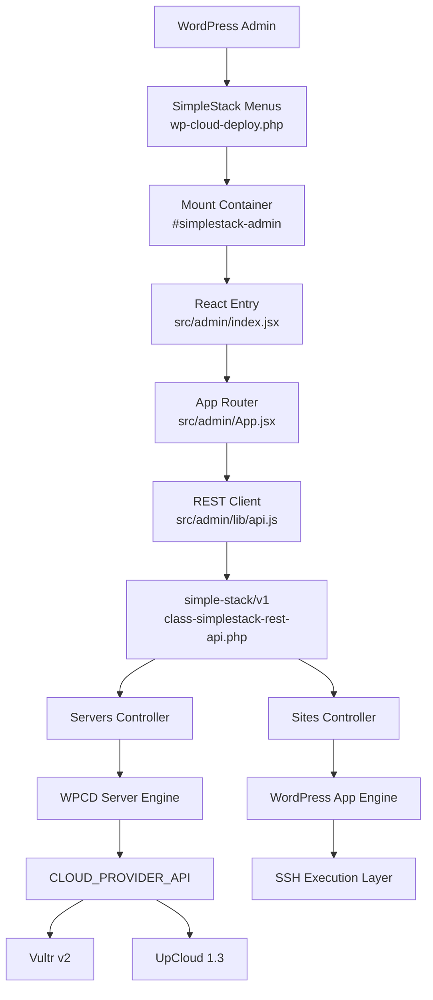
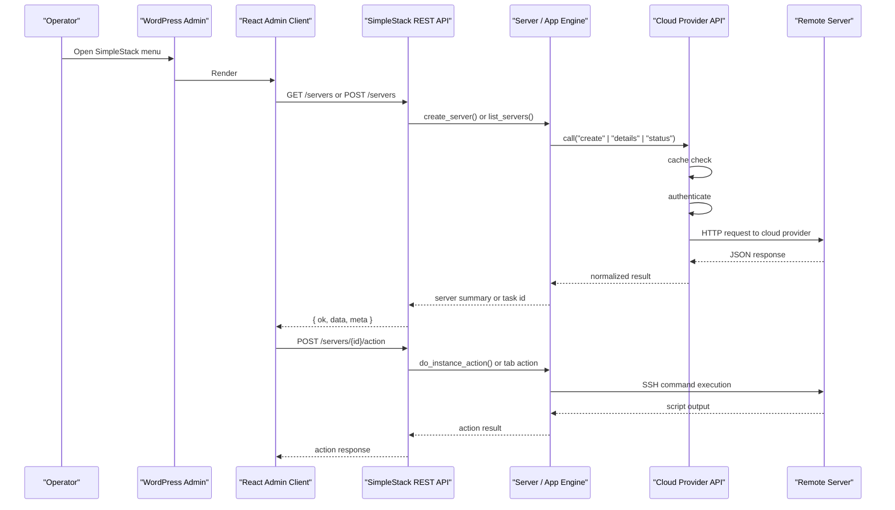
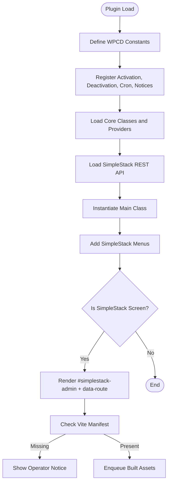
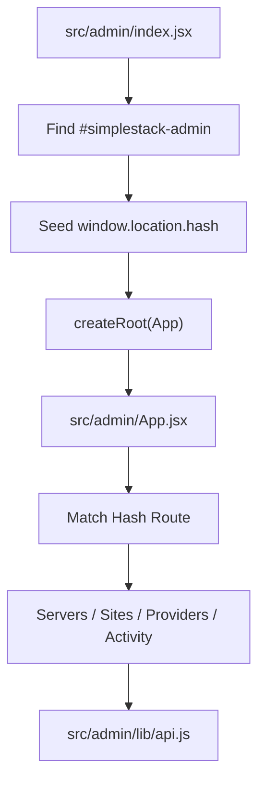
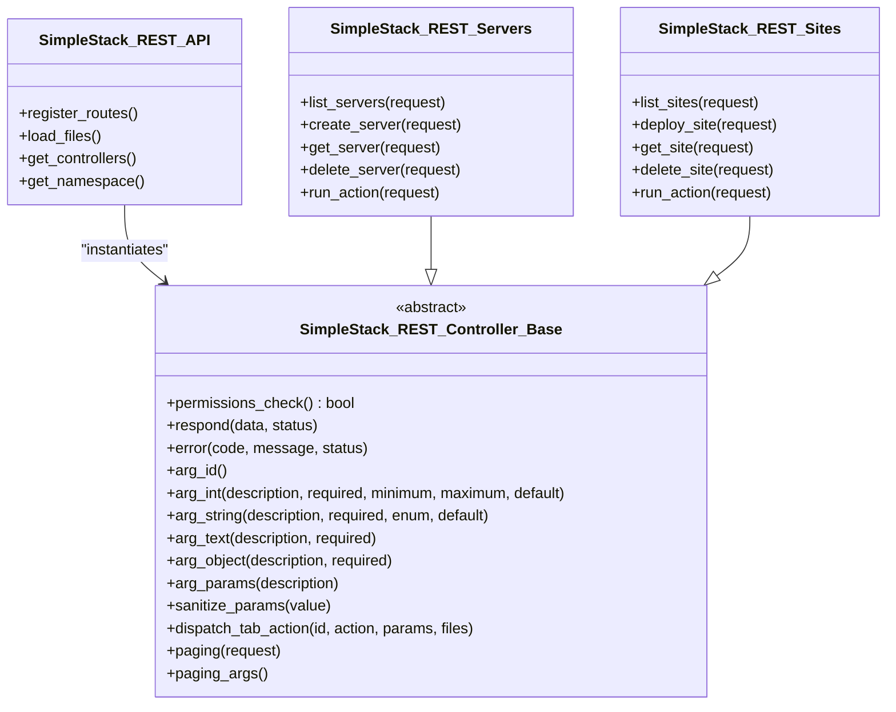
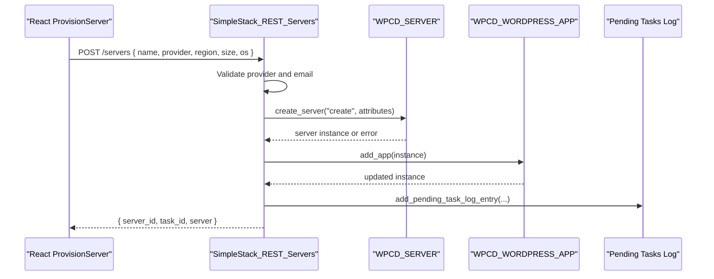
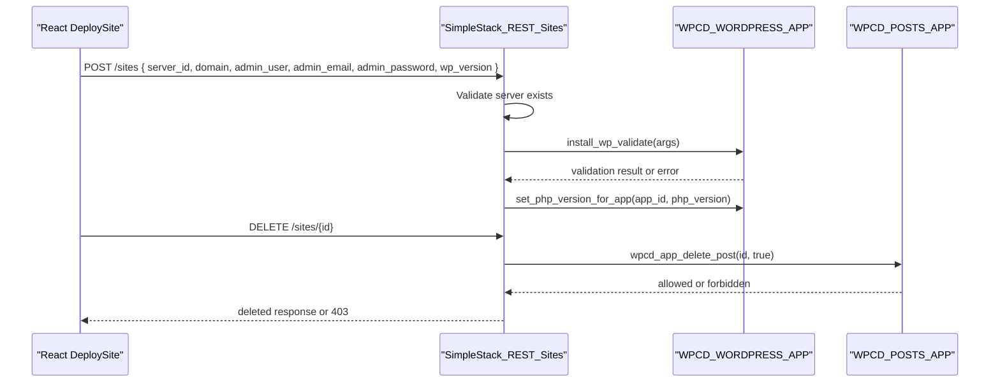
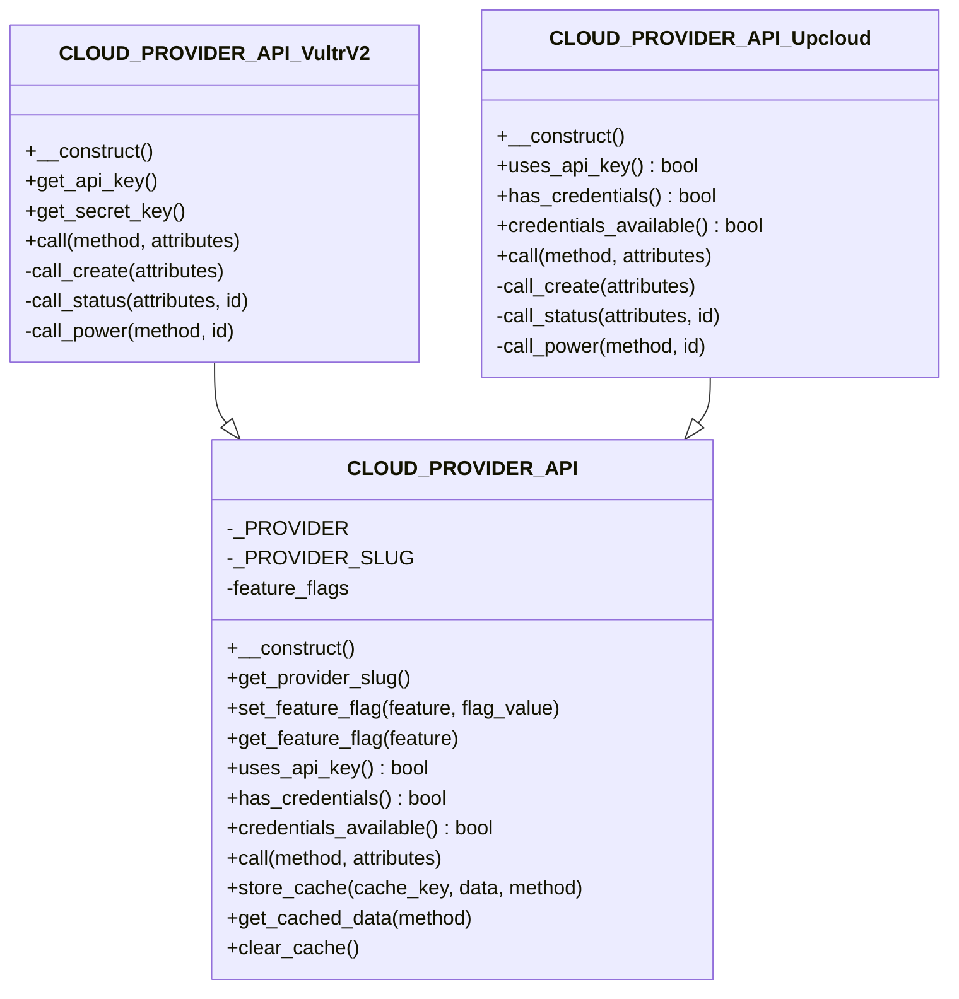
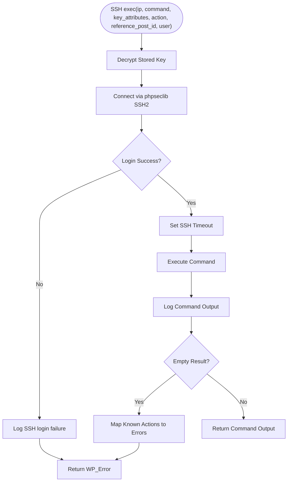
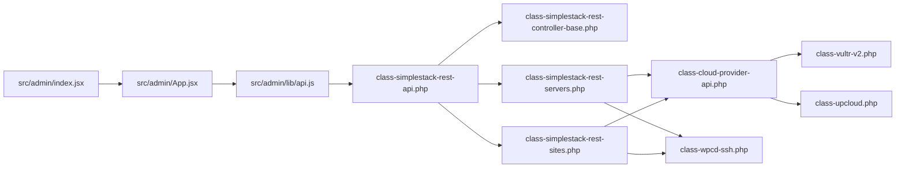

# System Architecture

<cite>
**Referenced Files in This Document**   
- [README.md](file://README.md)
- [wpcd.php](file://wpcd.php)
- [package.json](file://package.json)
- [vite.config.js](file://vite.config.js)
- [src/admin/index.jsx](file://src/admin/index.jsx)
- [src/admin/App.jsx](file://src/admin/App.jsx)
- [src/admin/lib/api.js](file://src/admin/lib/api.js)
- [includes/core/wp-cloud-deploy.php](file://includes/core/wp-cloud-deploy.php)
- [includes/core/api/class-simplestack-rest-api.php](file://includes/core/api/class-simplestack-rest-api.php)
- [includes/core/api/class-simplestack-rest-controller-base.php](file://includes/core/api/class-simplestack-rest-controller-base.php)
- [includes/core/api/class-simplestack-rest-servers.php](file://includes/core/api/class-simplestack-rest-servers.php)
- [includes/core/api/class-simplestack-rest-sites.php](file://includes/core/api/class-simplestack-rest-sites.php)
- [includes/core/providers/class-cloud-provider-api.php](file://includes/core/providers/class-cloud-provider-api.php)
- [includes/core/apps/class-wpcd-ssh.php](file://includes/core/apps/class-wpcd-ssh.php)
</cite>

## Update Summary
**Changes Made**
- Updated architecture to reflect complete transformation from WPCloudDeploy to SimpleStack
- Added documentation for modern React 19 frontend with Tailwind CSS v4
- Documented new REST API layer (`simple-stack/v1`) with enhanced security
- Expanded cloud provider support documentation (Vultr v2, UpCloud 1.3, Custom Server)
- Updated component interactions to show hybrid WordPress + React architecture
- Enhanced security boundaries and authentication mechanisms documentation

## Table of Contents
1. [Introduction](#introduction)
2. [Project Structure](#project-structure)
3. [Core Components](#core-components)
4. [Architecture Overview](#architecture-overview)
5. [Detailed Component Analysis](#detailed-component-analysis)
6. [Dependency Analysis](#dependency-analysis)
7. [Performance Considerations](#performance-considerations)
8. [Security Architecture](#security-architecture)
9. [Troubleshooting Guide](#troubleshooting-guide)
10. [Conclusion](#conclusion)

## Introduction
SimpleStack is a hybrid WordPress plugin that combines a React 19 admin frontend with a PHP 8.1+ backend to provision and manage remote servers and WordPress sites. The WordPress admin interface acts as the control plane, while a dedicated `simple-stack/v1` REST API exposes server and site operations. Provisioning is performed through cloud provider APIs (Vultr v2, UpCloud 1.3, or custom servers), and remote server configuration is driven by shell scripts executed over SSH.

The system intentionally keeps all operator interactions inside `wp-admin`, avoids external SaaS in the control path, and separates local WordPress operations from remote server management. This represents a complete architectural transformation from the original WPCloudDeploy, featuring a modern React frontend, enhanced REST API layer, and expanded cloud provider support.

**Section sources**
- [README.md:1-25](file://README.md#L1-L25)
- [README.md:27-46](file://README.md#L27-L46)

## Project Structure
At a high level, SimpleStack consists of:

- **WordPress plugin bootstrap**: defines constants, loads core classes, registers menus, and initializes the REST layer.
- **React admin client**: built with Vite and Tailwind CSS v4, mounted into a container rendered by the PHP layer.
- **REST controllers**: typed routes for servers, sites, logs, tabs, providers, and security.
- **Provider abstractions**: shared base class plus Vultr and UpCloud implementations.
- **SSH execution layer**: phpseclib-based SSH/SFTP client used by provisioning and management scripts.

**Diagram sources**
- [includes/core/wp-cloud-deploy.php:225-336](file://includes/core/wp-cloud-deploy.php#L225-L336)
- [src/admin/index.jsx:1-47](file://src/admin/index.jsx#L1-L47)
- [src/admin/App.jsx:1-70](file://src/admin/App.jsx#L1-L70)
- [src/admin/lib/api.js:1-55](file://src/admin/lib/api.js#L1-L55)
- [includes/core/api/class-simplestack-rest-api.php:12-53](file://includes/core/api/class-simplestack-rest-api.php#L12-L53)
- [includes/core/providers/class-cloud-provider-api.php:12-167](file://includes/core/providers/class-cloud-provider-api.php#L12-L167)

**Section sources**
- [wpcd.php:16-130](file://wpcd.php#L16-L130)
- [wpcd.php:267-416](file://wpcd.php#L267-L416)
- [package.json:1-25](file://package.json#L1-L25)
- [vite.config.js:1-45](file://vite.config.js#L1-L45)

## Core Components
This section summarizes the major architectural components and their responsibilities.

| Component | Responsibility | Key Implementation |
|---|---|---|
| Plugin Bootstrap | Defines constants, required files, activation hooks, cron schedules, and REST initialization | `wpcd.php` |
| Admin UI Bootstrap | Renders the mount container, seeds the initial route, and mounts the React app | `includes/core/wp-cloud-deploy.php`, `src/admin/index.jsx` |
| React Application | Routes between servers, sites, providers, and activity screens; calls the REST client | `src/admin/App.jsx`, `src/admin/lib/api.js` |
| REST Namespace Registrar | Loads controller files and registers the `simple-stack/v1` namespace | `includes/core/api/class-simplestack-rest-api.php` |
| REST Base Controller | Enforces `manage_options`, normalizes responses, sanitizes arguments, and dispatches tab actions | `includes/core/api/class-simplestack-rest-controller-base.php` |
| Servers Controller | Lists, creates, reads, deletes, and runs actions against servers | `includes/core/api/class-simplestack-rest-servers.php` |
| Sites Controller | Lists, deploys, reads, deletes, and runs actions against WordPress sites | `includes/core/api/class-simplestack-rest-sites.php` |
| Cloud Provider Base | Shared provider state, feature flags, credential helpers, caching, and common methods | `includes/core/providers/class-cloud-provider-api.php` |
| Vultr Provider | Implements Vultr v2 REST API behavior, including power status inference | `includes/core/providers/class-vultr-v2.php` |
| UpCloud Provider | Implements UpCloud 1.3 REST API behavior, including username/password authentication | `includes/core/providers/class-upcloud.php` |
| SSH Execution Layer | Executes commands and transfers files over SSH/SFTP using phpseclib | `includes/core/apps/class-wpcd-ssh.php` |

**Section sources**
- [wpcd.php:16-130](file://wpcd.php#L16-L130)
- [wpcd.php:267-416](file://wpcd.php#L267-L416)
- [includes/core/wp-cloud-deploy.php:225-336](file://includes/core/wp-cloud-deploy.php#L225-L336)
- [src/admin/index.jsx:1-47](file://src/admin/index.jsx#L1-L47)
- [src/admin/App.jsx:1-70](file://src/admin/App.jsx#L1-L70)
- [src/admin/lib/api.js:1-55](file://src/admin/lib/api.js#L1-L55)
- [includes/core/api/class-simplestack-rest-api.php:12-118](file://includes/core/api/class-simplestack-rest-api.php#L12-L118)
- [includes/core/api/class-simplestack-rest-controller-base.php:12-60](file://includes/core/api/class-simplestack-rest-controller-base.php#L12-L60)
- [includes/core/providers/class-cloud-provider-api.php:12-167](file://includes/core/providers/class-cloud-provider-api.php#L12-L167)
- [includes/core/apps/class-wpcd-ssh.php:20-50](file://includes/core/apps/class-wpcd-ssh.php#L20-L50)

## Architecture Overview
SimpleStack follows a layered architecture:

1. **Control Plane**: WordPress admin pages render the React application.
2. **Frontend Layer**: React components use a small REST client to call `simple-stack/v1`.
3. **API Layer**: Controllers validate input, enforce permissions, and delegate to engine classes.
4. **Application Engine Layer**: Server and WordPress app engines coordinate provisioning, installation, and lifecycle actions.
5. **Provider Abstraction Layer**: Concrete provider classes translate engine requests into cloud provider API calls.
6. **Remote Execution Layer**: Shell scripts are pushed and executed on remote servers via SSH.

**Diagram sources**
- [includes/core/wp-cloud-deploy.php:287-336](file://includes/core/wp-cloud-deploy.php#L287-L336)
- [src/admin/index.jsx:15-47](file://src/admin/index.jsx#L15-L47)
- [src/admin/lib/api.js:67-120](file://src/admin/lib/api.js#L67-L120)
- [includes/core/api/class-simplestack-rest-api.php:51-99](file://includes/core/api/class-simplestack-rest-api.php#L51-L99)
- [includes/core/api/class-simplestack-rest-servers.php:172-249](file://includes/core/api/class-simplestack-rest-servers.php#L172-L249)
- [includes/core/providers/class-vultr-v2.php:183-249](file://includes/core/providers/class-vultr-v2.php#L183-L249)
- [includes/core/providers/class-upcloud.php:310-371](file://includes/core/providers/class-upcloud.php#L310-L371)
- [includes/core/apps/class-wpcd-ssh.php:45-101](file://includes/core/apps/class-wpcd-ssh.php#L45-L101)

## Detailed Component Analysis

### WordPress Admin Control Plane
The PHP bootstrap defines plugin metadata, constants, activation/deactivation hooks, cron schedules, and the main initialization flow. It also enqueues the React bundle when the Vite manifest is present and renders the `#simplestack-admin` container with an initial route.

Key behaviors:
- Constants such as `WPCD_VERSION`, `WPCD_REST_VERSION`, and brand colors are defined early.
- Required classes are loaded during `init`.
- The SimpleStack REST API is registered after app classes are available.
- The SimpleStack menu and submenu pages are added under a top-level `SimpleStack` entry.
- Each screen maps to an initial hash route so the React router starts on the correct page.

**Diagram sources**
- [wpcd.php:16-130](file://wpcd.php#L16-L130)
- [wpcd.php:267-416](file://wpcd.php#L267-L416)
- [includes/core/wp-cloud-deploy.php:225-336](file://includes/core/wp-cloud-deploy.php#L225-L336)

**Section sources**
- [wpcd.php:16-130](file://wpcd.php#L16-L130)
- [wpcd.php:267-416](file://wpcd.php#L267-L416)
- [includes/core/wp-cloud-deploy.php:225-336](file://includes/core/wp-cloud-deploy.php#L225-L336)

### React Admin Frontend
The React frontend is a single-page application mounted into the WordPress admin. It uses a lightweight internal router based on the URL hash rather than full navigation, because WordPress owns the real URL.

Responsibilities:
- Seed the initial hash route from the PHP-rendered `data-route` attribute.
- Resolve routes such as `/servers`, `/sites`, `/settings/providers`, and `/activity`.
- Wrap the app in a toast provider for user feedback.
- Delegate all network calls to the REST client module.

**Diagram sources**
- [src/admin/index.jsx:1-47](file://src/admin/index.jsx#L1-L47)
- [src/admin/App.jsx:1-70](file://src/admin/App.jsx#L1-L70)
- [src/admin/lib/api.js:1-55](file://src/admin/lib/api.js#L1-L55)

**Section sources**
- [src/admin/index.jsx:1-47](file://src/admin/index.jsx#L1-L47)
- [src/admin/App.jsx:1-70](file://src/admin/App.jsx#L1-L70)

### REST API Layer
The REST layer is the only public surface the React client talks to. It uses the `simple-stack/v1` namespace and gates every route behind `manage_options`.

Design characteristics:
- A central registrar loads controller files and instantiates each controller.
- Every controller extends a base controller that provides permission checks, response envelopes, argument helpers, paging helpers, and tab-action dispatch.
- Responses are wrapped in `{ ok, data, meta }`, and sensitive values are redacted before leaving the process.
- Tab actions reuse existing legacy handlers by mapping REST parameters back onto `$_POST` temporarily.

**Diagram sources**
- [includes/core/api/class-simplestack-rest-api.php:12-118](file://includes/core/api/class-simplestack-rest-api.php#L12-L118)
- [includes/core/api/class-simplestack-rest-controller-base.php:12-446](file://includes/core/api/class-simplestack-rest-controller-base.php#L12-L446)
- [includes/core/api/class-simplestack-rest-servers.php:12-88](file://includes/core/api/class-simplestack-rest-servers.php#L12-L88)
- [includes/core/api/class-simplestack-rest-sites.php:12-86](file://includes/core/api/class-simplestack-rest-sites.php#L12-L86)

**Section sources**
- [includes/core/api/class-simplestack-rest-api.php:12-118](file://includes/core/api/class-simplestack-rest-api.php#L12-L118)
- [includes/core/api/class-simplestack-rest-controller-base.php:12-60](file://includes/core/api/class-simplestack-rest-controller-base.php#L12-L60)
- [includes/core/api/class-simplestack-rest-controller-base.php:125-162](file://includes/core/api/class-simplestack-rest-controller-base.php#L125-L162)
- [includes/core/api/class-simplestack-rest-controller-base.php:343-406](file://includes/core/api/class-simplestack-rest-controller-base.php#L343-L406)

### Server Management Flow
The servers controller exposes listing, creation, retrieval, deletion, and action execution endpoints. Creation delegates to the server engine, which creates both the provider instance and the local post record, then queues a pending task.

**Diagram sources**
- [includes/core/api/class-simplestack-rest-servers.php:172-249](file://includes/core/api/class-simplestack-rest-servers.php#L172-L249)

**Section sources**
- [includes/core/api/class-simplestack-rest-servers.php:36-88](file://includes/core/api/class-simplestack-rest-servers.php#L36-L88)
- [includes/core/api/class-simplestack-rest-servers.php:172-249](file://includes/core/api/class-simplestack-rest-servers.php#L172-L249)

### Site Deployment Flow
The sites controller handles listing, deployment, retrieval, deletion, and tab-driven actions. Deployment validates inputs using the same validation logic as the legacy installer and binds the requested PHP version before the installer runs.

**Diagram sources**
- [includes/core/api/class-simplestack-rest-sites.php:158-205](file://includes/core/api/class-simplestack-rest-sites.php#L158-L205)
- [includes/core/api/class-simplestack-rest-sites.php:242-267](file://includes/core/api/class-simplestack-rest-sites.php#L242-L267)

**Section sources**
- [includes/core/api/class-simplestack-rest-sites.php:35-86](file://includes/core/api/class-simplestack-rest-sites.php#L35-L86)
- [includes/core/api/class-simplestack-rest-sites.php:158-205](file://includes/core/api/class-simplestack-rest-sites.php#L158-L205)
- [includes/core/api/class-simplestack-rest-sites.php:242-267](file://includes/core/api/class-simplestack-rest-sites.php#L242-L267)

### Cloud Provider Abstractions
All supported providers extend a shared base class. The base class manages provider identity, feature flags, credential fingerprints, caching, state translation, and helper methods. Concrete providers implement provider-specific authentication, endpoint mapping, and operational quirks.

**Diagram sources**
- [includes/core/providers/class-cloud-provider-api.php:12-167](file://includes/core/providers/class-cloud-provider-api.php#L12-L167)
- [includes/core/providers/class-cloud-provider-api.php:644-704](file://includes/core/providers/class-cloud-provider-api.php#L644-L704)
- [includes/core/providers/class-vultr-v2.php:12-127](file://includes/core/providers/class-vultr-v2.php#L12-L127)
- [includes/core/providers/class-vultr-v2.php:183-249](file://includes/core/providers/class-vultr-v2.php#L183-L249)
- [includes/core/providers/class-upcloud.php:12-128](file://includes/core/providers/class-upcloud.php#L12-L128)
- [includes/core/providers/class-upcloud.php:310-371](file://includes/core/providers/class-upcloud.php#L310-L371)

**Section sources**
- [includes/core/providers/class-cloud-provider-api.php:12-167](file://includes/core/providers/class-cloud-provider-api.php#L12-L167)
- [includes/core/providers/class-cloud-provider-api.php:480-585](file://includes/core/providers/class-cloud-provider-api.php#L480-L585)
- [includes/core/providers/class-cloud-provider-api.php:644-704](file://includes/core/providers/class-cloud-provider-api.php#L644-L704)
- [includes/core/providers/class-vultr-v2.php:12-127](file://includes/core/providers/class-vultr-v2.php#L12-L127)
- [includes/core/providers/class-vultr-v2.php:183-249](file://includes/core/providers/class-vultr-v2.php#L183-L249)
- [includes/core/providers/class-upcloud.php:12-128](file://includes/core/providers/class-upcloud.php#L12-L128)
- [includes/core/providers/class-upcloud.php:310-371](file://includes/core/providers/class-upcloud.php#L310-L371)

### SSH Execution Layer
The SSH layer is responsible for executing commands and transferring files on remote servers. It uses phpseclib to establish SSH/SFTP connections, decrypts stored keys, sets timeouts, logs results, and returns structured errors.

Key behaviors:
- Commands run as a configurable user, defaulting to root.
- Timeouts adapt to whether a callback is used and respect PHP execution limits.
- Login failures and missing files are converted into `WP_Error` objects.
- Command output is logged and returned to callers.

**Diagram sources**
- [includes/core/apps/class-wpcd-ssh.php:45-151](file://includes/core/apps/class-wpcd-ssh.php#L45-L151)

**Section sources**
- [includes/core/apps/class-wpcd-ssh.php:20-50](file://includes/core/apps/class-wpcd-ssh.php#L20-L50)
- [includes/core/apps/class-wpcd-ssh.php:45-151](file://includes/core/apps/class-wpcd-ssh.php#L45-L151)
- [includes/core/apps/class-wpcd-ssh.php:153-244](file://includes/core/apps/class-wpcd-ssh.php#L153-L244)

## Dependency Analysis
The following diagram shows how the React frontend depends on the REST API, which in turn depends on server/app engines, provider abstractions, and the SSH execution layer.

**Diagram sources**
- [src/admin/index.jsx:1-47](file://src/admin/index.jsx#L1-L47)
- [src/admin/App.jsx:1-70](file://src/admin/App.jsx#L1-L70)
- [src/admin/lib/api.js:1-55](file://src/admin/lib/api.js#L1-L55)
- [includes/core/api/class-simplestack-rest-api.php:12-118](file://includes/core/api/class-simplestack-rest-api.php#L12-L118)
- [includes/core/api/class-simplestack-rest-controller-base.php:12-60](file://includes/core/api/class-simplestack-rest-controller-base.php#L12-L60)
- [includes/core/api/class-simplestack-rest-servers.php:12-88](file://includes/core/api/class-simplestack-rest-servers.php#L12-L88)
- [includes/core/api/class-simplestack-rest-sites.php:12-86](file://includes/core/api/class-simplestack-rest-sites.php#L12-L86)
- [includes/core/providers/class-cloud-provider-api.php:12-167](file://includes/core/providers/class-cloud-provider-api.php#L12-L167)
- [includes/core/providers/class-vultr-v2.php:12-127](file://includes/core/providers/class-vultr-v2.php#L12-L127)
- [includes/core/providers/class-upcloud.php:12-128](file://includes/core/providers/class-upcloud.php#L12-L128)
- [includes/core/apps/class-wpcd-ssh.php:20-50](file://includes/core/apps/class-wpcd-ssh.php#L20-L50)

**Section sources**
- [src/admin/lib/api.js:153-291](file://src/admin/lib/api.js#L153-L291)
- [includes/core/api/class-simplestack-rest-api.php:30-37](file://includes/core/api/class-simplestack-rest-api.php#L30-L37)
- [includes/core/providers/class-cloud-provider-api.php:480-585](file://includes/core/providers/class-cloud-provider-api.php#L480-L585)

## Performance Considerations
- **Provider API caching**: Read-only provider methods such as regions, sizes, and keys are cached through transients keyed by provider slug and credentials. This reduces repeated API calls during list and form rendering.
- **Power operation backstops**: Both Vultr and UpCloud providers stamp transient timestamps for asynchronous power operations. If completion signals are missing, elapsed time prevents servers from remaining stuck in "performing" states.
- **PHP execution limits**: The SSH layer adapts its timeout to PHP's execution limit and proxy constraints, logging guidance for web server timeouts.
- **Build output immutability**: The React build output is committed, so production installs do not require Node toolchains. Missing manifests produce an operator-facing notice instead of a blank screen.

[No sources needed since this section provides general guidance]

## Security Architecture
SimpleStack implements multiple layers of security to protect sensitive operations and credentials:

### Authentication and Authorization
- All REST endpoints require `manage_options` capability through the base controller's `permissions_check()` method.
- WordPress session nonce verification is enforced for all API requests.
- User authentication is handled by WordPress core, ensuring consistent access control.

### Credential Protection
- API keys and SSH keys are encrypted before storage using WordPress encryption functions.
- The `SimpleStack_Secret_Redactor` automatically redacts sensitive fields from all API responses.
- Credentials are never exposed in browser payloads or logs.
- Provider connection tests report success/failure without exposing actual credentials.

### Data Validation and Sanitization
- All REST parameters go through strict type validation using the base controller's argument helpers.
- Input is sanitized using appropriate WordPress sanitization functions.
- File uploads are validated and processed securely.
- SQL queries use prepared statements through WordPress database APIs.

### Network Security
- All communication with cloud providers uses HTTPS.
- SSH connections use encrypted key pairs with optional passphrase protection.
- Remote server commands are executed with minimal privileges where possible.
- Firewall rules restrict access to sensitive services like OpenLiteSpeed WebAdmin.

**Section sources**
- [includes/core/api/class-simplestack-rest-controller-base.php:53-60](file://includes/core/api/class-simplestack-rest-controller-base.php#L53-L60)
- [includes/core/api/class-simplestack-rest-controller-base.php:125-162](file://includes/core/api/class-simplestack-rest-controller-base.php#L125-L162)
- [src/admin/lib/api.js:67-120](file://src/admin/lib/api.js#L67-L120)

## Troubleshooting Guide
Common operational issues and where they appear in the codebase:

| Symptom | Likely Cause | Relevant Code Path |
|---|---|---|
| React admin page is blank | Vite manifest missing or build output absent | `includes/core/wp-cloud-deploy.php` |
| REST requests fail with 403/401 | User lacks `manage_options` or WordPress session nonce mismatch | `class-simplestack-rest-controller-base.php` |
| Server creation fails immediately | Invalid provider slug, invalid email, or provider API rejects request | `class-simplestack-rest-servers.php` |
| Site deployment fails validation | Duplicate domain, unsafe password, invalid email, or invalid username | `class-simplestack-rest-sites.php` |
| Provider connection test fails | Missing or invalid API key, username/password, or SSH key material | `class-cloud-provider-api.php`, provider classes |
| Remote command returns no output | SSH connection failed, script produced empty output, or action expects specific feedback | `class-wpcd-ssh.php` |
| Power operation never completes | Provider did not return expected state signal; transient timeout should expire it | `class-vultr-v2.php`, `class-upcloud.php` |
| Build fails during development | Missing Node dependencies or incorrect Vite configuration | `package.json`, `vite.config.js` |
| CSS isolation violations | Tailwind styles escaping `#simplestack-admin` scope | `tools/verify-css-isolation.mjs` |

**Section sources**
- [includes/core/wp-cloud-deploy.php:324-336](file://includes/core/wp-cloud-deploy.php#L324-L336)
- [includes/core/api/class-simplestack-rest-controller-base.php:53-60](file://includes/core/api/class-simplestack-rest-controller-base.php#L53-L60)
- [includes/core/api/class-simplestack-rest-servers.php:172-249](file://includes/core/api/class-simplestack-rest-servers.php#L172-L249)
- [includes/core/api/class-simplestack-rest-sites.php:158-205](file://includes/core/api/class-simplestack-rest-sites.php#L158-L205)
- [includes/core/providers/class-cloud-provider-api.php:644-704](file://includes/core/providers/class-cloud-provider-api.php#L644-L704)
- [includes/core/apps/class-wpcd-ssh.php:45-151](file://includes/core/apps/class-wpcd-ssh.php#L45-L151)
- [includes/core/providers/class-vultr-v2.php:500-553](file://includes/core/providers/class-vultr-v2.php#L500-L553)
- [includes/core/providers/class-upcloud.php:642-687](file://includes/core/providers/class-upcloud.php#L642-L687)

## Conclusion
SimpleStack's hybrid architecture cleanly separates concerns:

- The **WordPress admin** remains the operator's control plane.
- The **React frontend** provides a modern, routed interface without replacing WordPress's routing model.
- The **REST API** is the single controlled surface for server and site operations, with strict permissions and consistent response envelopes.
- The **provider abstraction layer** isolates cloud provider differences behind a stable contract.
- The **SSH execution layer** safely executes remote commands and file operations.

This design supports multiple cloud providers, preserves legacy tab behavior through action bridges, and keeps sensitive credentials out of browser payloads and logs. The transformation from WPCloudDeploy to SimpleStack brings modern development practices, enhanced security, and improved maintainability while preserving the core functionality that makes it effective for hosting management. Future extensions should follow the established patterns: new providers extend the base provider class, new REST endpoints go through the base controller, and remote operations continue to be expressed as scripts executed over SSH.